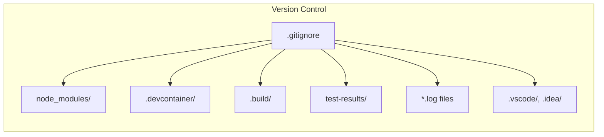
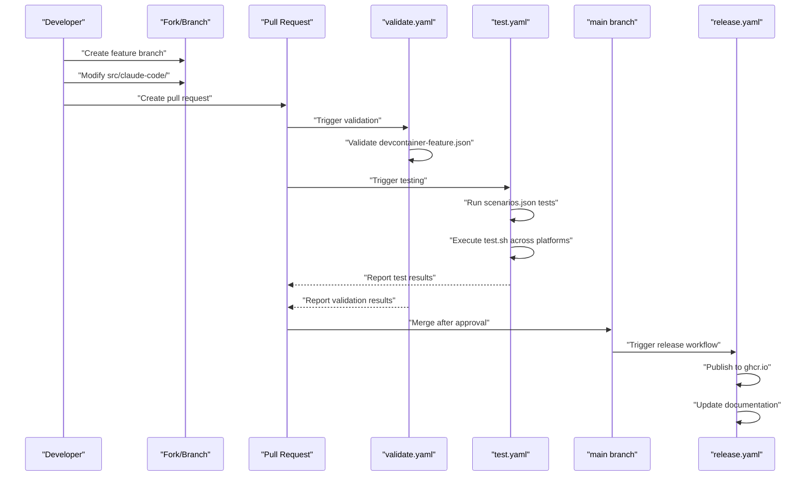
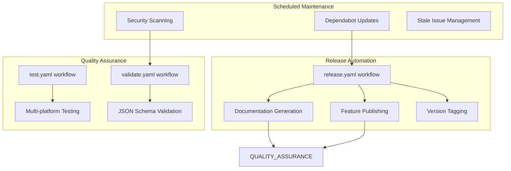

<!-- source: DeepWiki mcp.deepwiki.com · repo anthropics/devcontainer-features · page 5 Repository Structure and Maintenance · fetched 2026-10-26 -->

# Repository Structure and Maintenance

Relevant source files

The following files were used as context for generating this wiki page:

- [.gitignore](.gitignore)
- [LICENSE](LICENSE)

This document covers the overall organization of the devcontainer-features repository and the development workflows used to maintain it. It focuses on the directory structure, key configuration files, and processes for contributing changes to the codebase.

For detailed information about the claude-code feature implementation, see [Claude Code Dev Container Feature](#2). For release automation, see [Release and Publication System](#3). For testing infrastructure, see [Testing and Validation](#4).

## Repository Organization

The repository follows the standard Dev Container Features layout with additional automation and testing infrastructure to support a robust development workflow.

### Directory Structure

```mermaid
graph TD
    subgraph "Repository Root"
        ROOT["/"]
        GITIGNORE[".gitignore"]
        LICENSE["LICENSE"]
        README["README.md"]
    end
    
    subgraph "Source Code"
        SRC["src/"]
        CLAUDE_DIR["src/claude-code/"]
        FEATURE_JSON["src/claude-code/devcontainer-feature.json"]
        INSTALL_SH["src/claude-code/install.sh"]
        FEATURE_README["src/claude-code/README.md"]
        NOTES["src/claude-code/NOTES.md"]
    end
    
    subgraph "Testing Infrastructure"
        TEST["test/"]
        TEST_CLAUDE["test/claude-code/"]
        SCENARIOS["test/claude-code/scenarios.json"]
        TEST_SH["test/claude-code/test.sh"]
        BASIC_SH["test/claude-code/basic.sh"]
    end
    
    subgraph "CI/CD Workflows"
        GITHUB[".github/"]
        WORKFLOWS[".github/workflows/"]
        RELEASE_YAML[".github/workflows/release.yaml"]
        TEST_YAML[".github/workflows/test.yaml"]
        VALIDATE_YAML[".github/workflows/validate.yaml"]
    end
    
    ROOT --> GITIGNORE
    ROOT --> LICENSE
    ROOT --> README
    ROOT --> SRC
    ROOT --> TEST
    ROOT --> GITHUB
    
    SRC --> CLAUDE_DIR
    CLAUDE_DIR --> FEATURE_JSON
    CLAUDE_DIR --> INSTALL_SH
    CLAUDE_DIR --> FEATURE_README
    CLAUDE_DIR --> NOTES
    
    TEST --> TEST_CLAUDE
    TEST_CLAUDE --> SCENARIOS
    TEST_CLAUDE --> TEST_SH
    TEST_CLAUDE --> BASIC_SH
    
    GITHUB --> WORKFLOWS
    WORKFLOWS --> RELEASE_YAML
    WORKFLOWS --> TEST_YAML
    WORKFLOWS --> VALIDATE_YAML
```

**Sources:** [.gitignore:1-30](), [LICENSE:1-21]()

### Core File Types and Purposes

| File Type | Location | Purpose |
|-----------|----------|---------|
| `devcontainer-feature.json` | `src/claude-code/` | Feature definition and configuration schema |
| `install.sh` | `src/claude-code/` | Feature installation script |
| `README.md` | `src/claude-code/` | Feature documentation (auto-generated) |
| `NOTES.md` | `src/claude-code/` | Developer notes and implementation details |
| `scenarios.json` | `test/claude-code/` | Test scenario definitions |
| `test.sh` | `test/claude-code/` | Test execution script |
| `*.yaml` | `.github/workflows/` | GitHub Actions workflow definitions |

**Sources:** [.gitignore:1-30]()

## Configuration Management

The repository uses several key configuration files to manage different aspects of the development and deployment process.

### Git Configuration

The `.gitignore` file excludes:
- Node.js dependencies and artifacts ([.gitignore:1-3]())
- Development container configurations ([.gitignore:5-6]())
- Build and test artifacts ([.gitignore:8-10](), [.gitignore:29-30]())
- System and editor-specific files ([.gitignore:11-27]())

**Sources:** [.gitignore:1-30]()

### License and Legal

The repository is licensed under the MIT License with copyright held by Anthropic PBC ([LICENSE:1-21]()). This provides broad permissions for use, modification, and distribution while maintaining copyright attribution requirements.

**Sources:** [LICENSE:1-21]()

## Development Workflow

The repository implements a structured development workflow that integrates testing, validation, and automated releases.

### Contribution Process

**Sources:** [.gitignore:1-30]()

### File Modification Patterns

Different types of changes follow specific patterns:

| Change Type | Files Modified | Validation Required |
|-------------|---------------|-------------------|
| Feature Logic | `src/claude-code/install.sh` | Testing across platforms |
| Feature Config | `src/claude-code/devcontainer-feature.json` | JSON schema validation |
| Test Cases | `test/claude-code/scenarios.json` | Test execution |
| Documentation | `src/claude-code/NOTES.md` | None (README.md is auto-generated) |
| Workflows | `.github/workflows/*.yaml` | Workflow syntax validation |

**Sources:** [.gitignore:1-30]()

## Maintenance Processes

The repository employs several automated processes to maintain code quality and keep dependencies current.

### Automated Maintenance

**Sources:** [.gitignore:1-30]()

### Repository Health Monitoring

The maintenance process monitors several key indicators:

- **Test Coverage**: All scenarios in `test/claude-code/scenarios.json` must pass
- **Platform Compatibility**: Installation success across Debian, Ubuntu, and Alpine base images
- **Documentation Sync**: Automated updates to `src/claude-code/README.md` via release workflow
- **Dependency Security**: Regular scanning of Node.js packages installed by `install.sh`

**Sources:** [.gitignore:1-30]()

### Release Cadence

The repository follows a continuous deployment model where:
- All changes to `main` branch trigger the release workflow
- Features are immediately published to `ghcr.io/anthropics/devcontainer-features`
- Documentation is automatically updated and committed back to the repository
- Version tags are created based on semantic versioning principles

**Sources:** [LICENSE:1-21]()