# Page: Overview

# Overview

<details>
<summary>Relevant source files</summary>

The following files were used as context for generating this wiki page:

- [README.md](README.md)
- [src/claude-code/README.md](src/claude-code/README.md)

</details>


## Purpose and Scope

This document provides technical documentation for the `anthropics/devcontainer-features` repository, which contains Dev Container Features for development environments. The repository's primary component is the `claude-code` feature that automates installation of the Claude Code CLI tool in development containers.

This overview covers the repository architecture, core components, and system relationships. For detailed information about the claude-code feature implementation, see [Claude Code Dev Container Feature](#2). For release automation workflows, see [Release and Publication System](#3). For testing infrastructure details, see [Testing and Validation](#4).

## Repository Architecture

The repository implements a complete Dev Container Features ecosystem with automated testing, release workflows, and multi-platform support. The architecture centers around the `claude-code` feature with supporting infrastructure for publication and validation.

### Repository Structure to Code Mapping

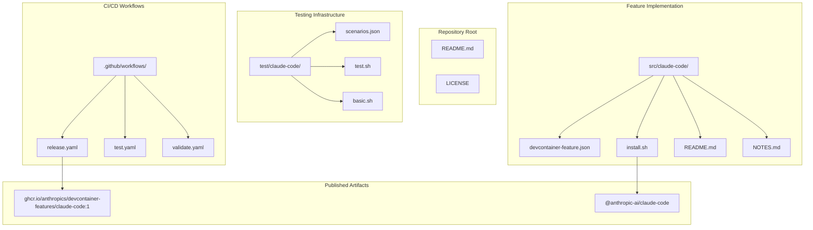

Sources: [README.md:1-38](), [src/claude-code/README.md:1-68]()

### Feature Installation and Execution Flow

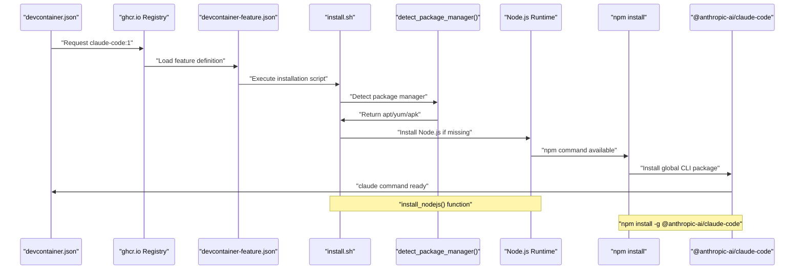

Sources: [src/claude-code/devcontainer-feature.json](), [src/claude-code/install.sh](), [src/claude-code/README.md:30-36]()

## Core Components

### Dev Container Feature Definition

The repository's main deliverable is defined in [src/claude-code/devcontainer-feature.json](), which specifies:
- Feature metadata and versioning
- Installation script reference (`install.sh`)
- VS Code extension customizations (`anthropic.claude-code`)
- Documentation auto-generation settings

### Installation System

The [src/claude-code/install.sh]() script implements multi-platform Node.js dependency management:
- `detect_package_manager()` function for platform detection
- `install_nodejs()` function with distribution-specific logic
- Automatic installation of `@anthropic-ai/claude-code` via npm
- Support for Debian/Ubuntu, Alpine, RHEL/CentOS/Fedora systems

### Testing Infrastructure

Comprehensive validation through:
- [test/claude-code/scenarios.json]() defining test matrix configurations
- [test/claude-code/test.sh]() and [test/claude-code/basic.sh]() for execution validation
- Multi-platform testing across `debian:latest`, `ubuntu:latest`, and Microsoft base images

## System Integration Points

### Publication Workflow

The [.github/workflows/release.yaml]() workflow automates:
- Feature publication to `ghcr.io/anthropics/devcontainer-features`
- Documentation generation and pull request creation
- Version management and release tagging

### User Integration

End users integrate the feature via `devcontainer.json` configuration:

```json
"features": {
    "ghcr.io/anthropics/devcontainer-features/claude-code:1": {}
}
```

The feature automatically handles Node.js dependencies or can be combined with explicit Node.js features as documented in [src/claude-code/README.md:42-47]().

### Dependency Management

The installation system supports multiple Node.js provisioning strategies:
1. Auto-installation via distribution package managers
2. Integration with existing Node.js installations
3. Compatibility with `nvm`-managed environments
4. Explicit Node.js feature dependencies

Sources: [src/claude-code/README.md:28-62](), [README.md:20-22]()

## Repository Maintenance

The repository maintains itself through automated workflows:
- **Validation**: [.github/workflows/validate.yaml]() ensures feature definitions are valid
- **Testing**: [.github/workflows/test.yaml]() runs comprehensive platform testing
- **Release**: [.github/workflows/release.yaml]() publishes features and updates documentation

This automation ensures consistent feature availability and up-to-date documentation without manual intervention.

Sources: [README.md:24-34](), [src/claude-code/README.md:65-67]()

---

# Page: Claude Code Dev Container Feature

# Claude Code Dev Container Feature

<details>
<summary>Relevant source files</summary>

The following files were used as context for generating this wiki page:

- [src/claude-code/README.md](src/claude-code/README.md)
- [src/claude-code/devcontainer-feature.json](src/claude-code/devcontainer-feature.json)

</details>


This document covers the `claude-code` Dev Container Feature, which is the primary component of this repository. The feature installs the Claude Code CLI tool globally in Dev Container environments and automatically configures the associated VS Code extension.

For information about the release and publication system that distributes this feature, see [Release and Publication System](#3). For details about testing this feature across platforms, see [Testing and Validation](#4).

## Feature Overview

The `claude-code` feature provides a streamlined way to install the Claude Code CLI tool in Dev Container environments. It handles Node.js dependency resolution automatically and integrates with VS Code through extension installation.

### Feature Definition

The feature is defined in [src/claude-code/devcontainer-feature.json:1-19]() with the following key properties:

| Property | Value | Purpose |
|----------|-------|---------|
| `id` | `claude-code` | Unique identifier for the feature |
| `name` | `Claude Code CLI` | Human-readable name |
| `version` | `1.0.5` | Current feature version |
| `description` | `Installs the Claude Code CLI globally` | Brief description |
| `options` | `{}` | No configurable options |
| `installsAfter` | `["ghcr.io/devcontainers/features/node"]` | Dependency ordering |

**Feature Architecture**
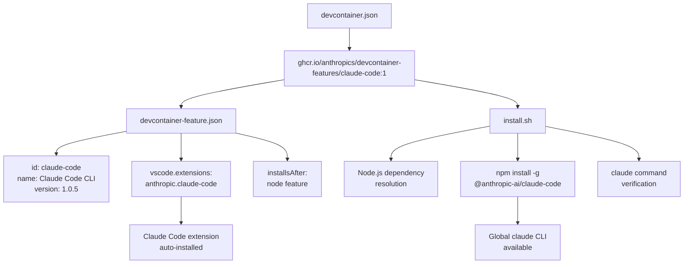

Sources: [src/claude-code/devcontainer-feature.json:1-19]()

### Usage Configuration

Users add the feature to their Dev Container configuration using the feature reference:

```json
"features": {
    "ghcr.io/anthropics/devcontainer-features/claude-code:1": {}
}
```

The feature requires no configuration options, as specified in [src/claude-code/devcontainer-feature.json:6]() where `options` is an empty object.

**Installation Dependency Patterns**
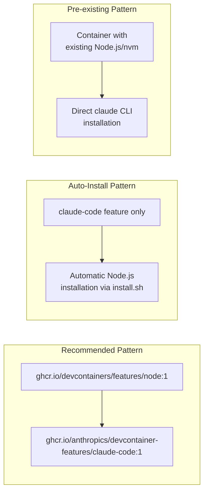

Sources: [src/claude-code/README.md:40-47](), [src/claude-code/README.md:49-57](), [src/claude-code/README.md:59-62]()

## Node.js Dependency Management

The feature implements sophisticated Node.js dependency resolution to ensure the Claude CLI can be installed regardless of the base container environment.

### Dependency Resolution Strategy

As documented in [src/claude-code/README.md:30-36](), the feature supports three approaches:

1. **Base Container with Node.js**: Uses existing Node.js installation
2. **Explicit Node.js Feature**: Relies on the official Node.js Dev Container feature  
3. **Automatic Installation**: Best-effort Node.js installation for supported platforms

The automatic installation targets Node.js 18.x LTS and supports Debian/Ubuntu, Alpine, Fedora, RHEL, and CentOS distributions.

**Node.js Resolution Flow**
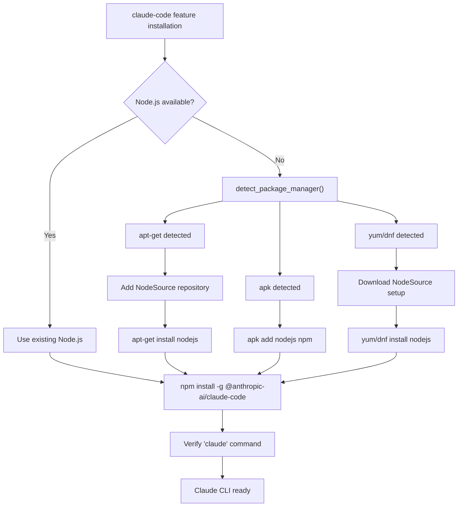

Sources: [src/claude-code/README.md:30-36]()

## VS Code Integration

The feature automatically configures VS Code integration through the `customizations` property in [src/claude-code/devcontainer-feature.json:9-15]().

### Extension Installation

The feature automatically installs the `anthropic.claude-code` VS Code extension, as defined in [src/claude-code/devcontainer-feature.json:11-13]():

```json
"customizations": {
    "vscode": {
        "extensions": [
            "anthropic.claude-code"
        ]
    }
}
```

This ensures that users have both the CLI tool and the VS Code extension available immediately after container creation.

## Installation Order Dependencies

The feature specifies installation ordering through the `installsAfter` property in [src/claude-code/devcontainer-feature.json:16-18](), which ensures that if the official Node.js feature is present, it installs before the Claude Code feature.

**Feature Installation Sequence**
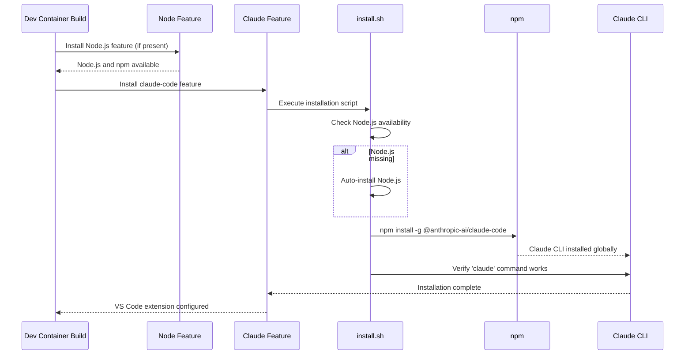

Sources: [src/claude-code/devcontainer-feature.json:16-18]()

## Documentation and Versioning

The feature maintains documentation through auto-generated README files. As noted in [src/claude-code/README.md:67](), the main documentation is generated from the feature definition and can be supplemented with additional notes.

The current version `1.0.5` from [src/claude-code/devcontainer-feature.json:4]() is automatically managed through the release system described in [Release and Publication System](#3).

Sources: [src/claude-code/README.md:67](), [src/claude-code/devcontainer-feature.json:4]()

---

# Page: Feature Configuration

# Feature Configuration

<details>
<summary>Relevant source files</summary>

The following files were used as context for generating this wiki page:

- [src/claude-code/NOTES.md](src/claude-code/NOTES.md)
- [src/claude-code/devcontainer-feature.json](src/claude-code/devcontainer-feature.json)

</details>


This document covers the configuration aspects of the claude-code Dev Container feature, including its feature definition structure and how users configure it in their development containers. This focuses specifically on the declarative configuration files and their relationships. For details about the installation process itself, see [Installation System](#2.2). For practical usage examples and patterns, see [Usage and Configuration Options](#2.3).

## Feature Definition Structure

The claude-code feature is defined through a standard Dev Container feature definition file that specifies metadata, dependencies, and default behaviors.

### Core Feature Metadata

The feature definition is contained in [src/claude-code/devcontainer-feature.json:1-19]() and establishes the basic identity and behavior of the feature.

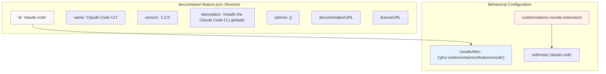

**Feature Definition Elements**
- `id`: The unique identifier `claude-code` used in feature references
- `name`: Human-readable display name "Claude Code CLI"
- `version`: Semantic version `1.0.5` for this feature release
- `options`: Empty object `{}` indicating no user-configurable options
- `installsAfter`: Dependency ordering that ensures Node.js features install first

*Sources: [src/claude-code/devcontainer-feature.json:1-19]()*

### Dependency Declaration

The feature declares an explicit dependency relationship through the `installsAfter` property, which ensures proper installation ordering when multiple features are present.

| Property | Value | Purpose |
|----------|-------|---------|
| `installsAfter` | `["ghcr.io/devcontainers/features/node"]` | Ensures Node.js feature installs before claude-code |
| `options` | `{}` | No user-configurable parameters currently supported |

*Sources: [src/claude-code/devcontainer-feature.json:16-18]()*

### VS Code Integration

The feature includes automatic VS Code customizations that install the corresponding editor extension alongside the CLI tool.

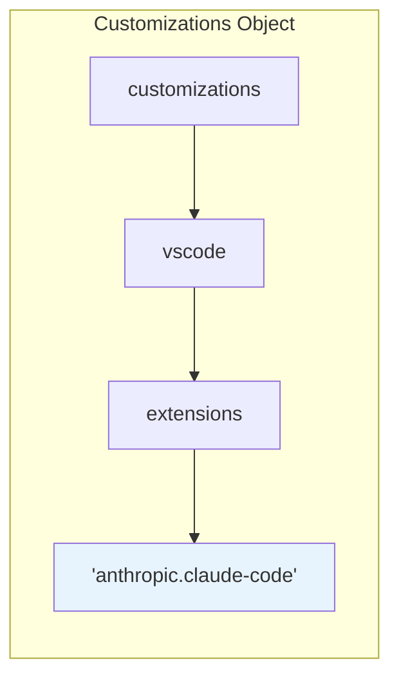

*Sources: [src/claude-code/devcontainer-feature.json:9-15]()*

## User Configuration Patterns

Users configure the claude-code feature in their `devcontainer.json` through the `features` property, with several recommended patterns depending on their environment setup.

### Recommended Configuration with Explicit Node.js

The standard recommended configuration explicitly includes both the Node.js feature and the claude-code feature to ensure reliable dependency management.

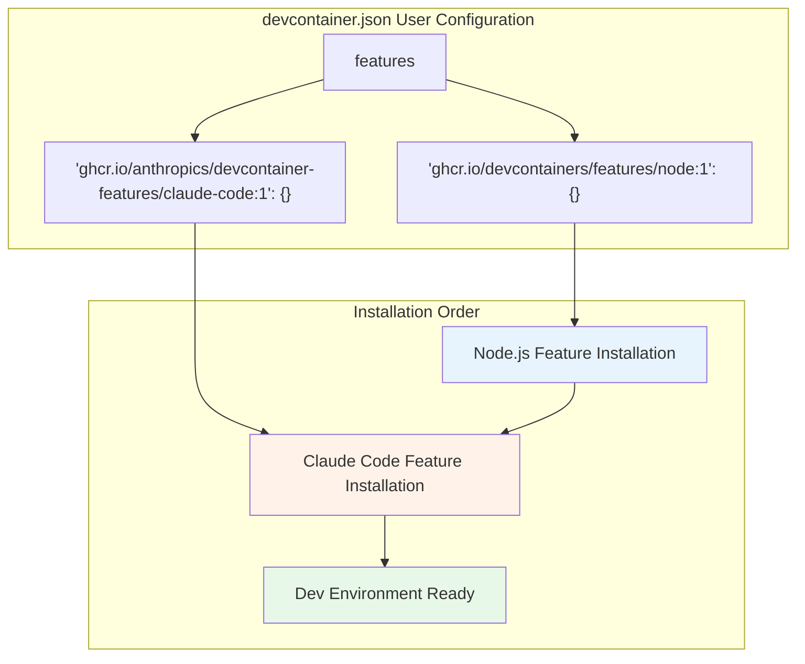

*Sources: [src/claude-code/NOTES.md:15-22]()*

### Configuration for Pre-existing Node.js Environments

When the container already includes Node.js (through base image or nvm), users can configure only the claude-code feature directly.

| Scenario | Configuration | Node.js Source |
|----------|---------------|----------------|
| Node.js base image | `"ghcr.io/anthropics/devcontainer-features/claude-code:1": {}` | Container base image |
| nvm pre-installed | `"ghcr.io/anthropics/devcontainer-features/claude-code:1": {}` | Existing nvm installation |
| Automatic installation | `"ghcr.io/anthropics/devcontainer-features/claude-code:1": {}` | Feature auto-installs Node.js |

*Sources: [src/claude-code/NOTES.md:24-36]()*

## Configuration Dependencies and Requirements

The feature has specific Node.js requirements that can be satisfied through multiple configuration approaches.

### Node.js Dependency Resolution

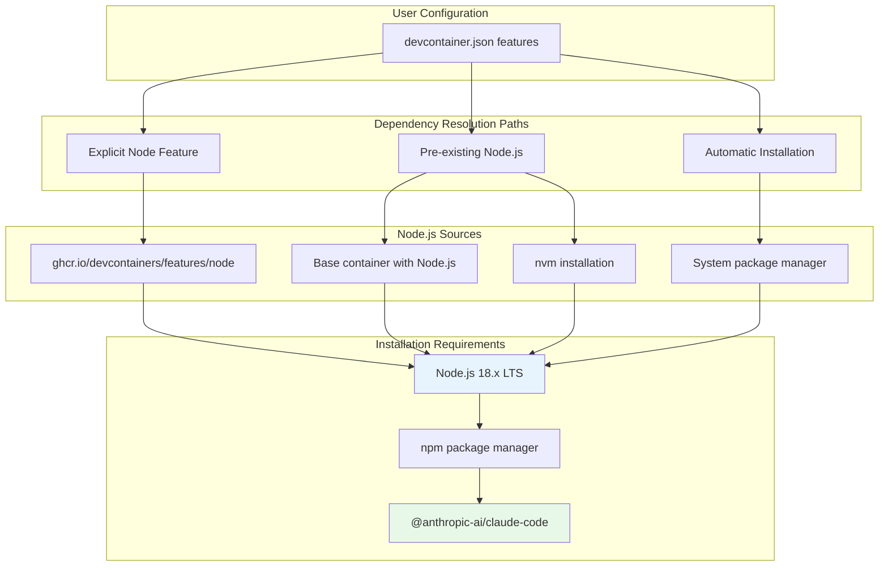

**Node.js Requirements:**
- Node.js 18.x LTS when auto-installing
- npm package manager for CLI installation
- Compatible with existing Node.js installations including nvm

*Sources: [src/claude-code/NOTES.md:3-11]()*

### Configuration Validation

The feature definition structure ensures proper validation during Dev Container processing:

| Element | Validation | Impact |
|---------|------------|--------|
| `installsAfter` | Ensures dependency ordering | Prevents installation failures |
| `options: {}` | No user parameters to validate | Simplified configuration |
| `customizations` | VS Code extension compatibility | Automatic editor integration |

*Sources: [src/claude-code/devcontainer-feature.json:6](), [src/claude-code/devcontainer-feature.json:16-18]()*

---

# Page: Installation System

# Installation System

<details>
<summary>Relevant source files</summary>

The following files were used as context for generating this wiki page:

- [src/claude-code/NOTES.md](src/claude-code/NOTES.md)
- [src/claude-code/install.sh](src/claude-code/install.sh)

</details>


This document provides a detailed examination of the installation system that powers the claude-code Dev Container Feature. The installation system is implemented through the `install.sh` script, which handles cross-platform dependency management and Node.js installation strategies.

For information about feature configuration and how users specify the claude-code feature in their devcontainer.json, see [Feature Configuration](#2.1). For usage patterns and configuration options available to users, see [Usage and Configuration Options](#2.3).

## Installation Architecture Overview

The installation system operates through a layered architecture that handles platform detection, dependency management, and CLI installation in a systematic way.

**Installation System Architecture**
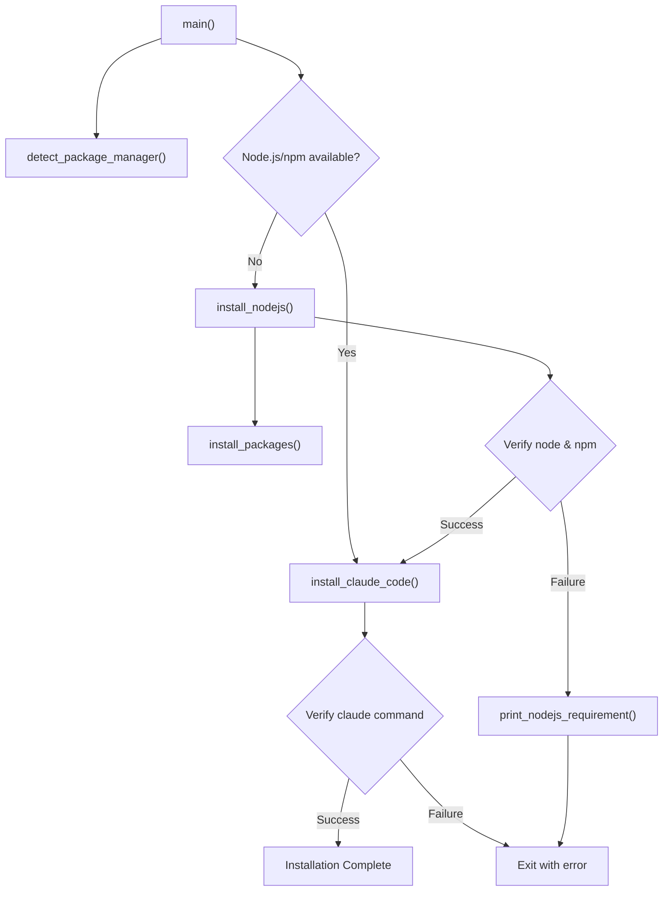

Sources: [src/claude-code/install.sh:122-140](), [src/claude-code/install.sh:46-88](), [src/claude-code/install.sh:91-103]()

## Package Manager Detection System

The installation system uses a universal package manager detection strategy that supports the major Linux distribution families.

**Package Manager Detection Flow**
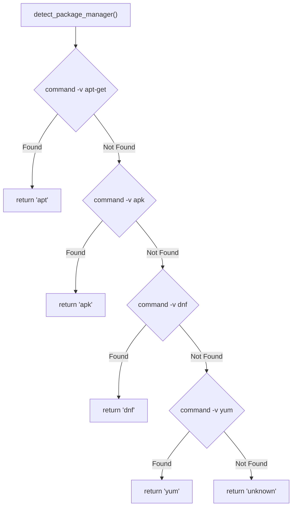

The `detect_package_manager()` function iterates through package managers in priority order: `apt-get`, `apk`, `dnf`, `yum`. It uses the `command -v` test to check for availability and maps `apt-get` to the canonical name `apt`.

| Package Manager | Distribution Family | Detection Command |
|-----------------|-------------------|-------------------|
| `apt` | Debian, Ubuntu | `command -v apt-get` |
| `apk` | Alpine Linux | `command -v apk` |
| `dnf` | Fedora, newer RHEL | `command -v dnf` |
| `yum` | CentOS, older RHEL | `command -v yum` |

Sources: [src/claude-code/install.sh:5-17]()

## Platform-Specific Node.js Installation

The `install_nodejs()` function implements distinct installation strategies for each supported platform, optimizing for the most reliable Node.js distribution method available.

**Node.js Installation Strategies by Platform**
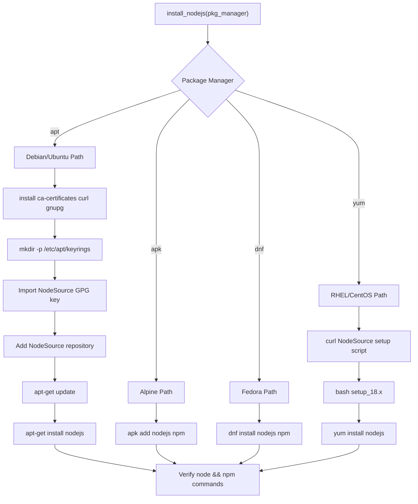

### Debian/Ubuntu Strategy

For Debian and Ubuntu systems, the installation uses the NodeSource repository to ensure a recent LTS version (Node.js 18.x):

1. Install prerequisite packages: `ca-certificates`, `curl`, `gnupg`
2. Create APT keyrings directory: `/etc/apt/keyrings`
3. Import NodeSource GPG key from `https://deb.nodesource.com/gpgkey/nodesource-repo.gpg.key`
4. Add NodeSource repository to `/etc/apt/sources.list.d/nodesource.list`
5. Update package lists and install `nodejs`

### Alpine Strategy

Alpine Linux uses its built-in package repository, installing `nodejs` and `npm` packages directly via `apk add --no-cache`.

### Fedora Strategy  

Fedora systems use the distribution's native `nodejs` and `npm` packages via `dnf install`.

### RHEL/CentOS Strategy

For RHEL and CentOS systems using `yum`, the installation downloads and executes the NodeSource setup script for Node.js 18.x, then installs via `yum install nodejs`.

Sources: [src/claude-code/install.sh:46-88](), [src/claude-code/install.sh:52-60](), [src/claude-code/install.sh:61-64](), [src/claude-code/install.sh:69-73]()

## Package Installation Abstraction

The `install_packages()` function provides a unified interface for package installation across different package managers.

| Package Manager | Update Command | Install Command |
|-----------------|----------------|-----------------|
| `apt` | `apt-get update` | `apt-get install -y $packages` |
| `apk` | N/A | `apk add --no-cache $packages` |
| `dnf` | N/A | `dnf install -y $packages` |
| `yum` | N/A | `yum install -y $packages` |

The function handles the platform-specific package manager invocation patterns and includes appropriate flags for non-interactive installation (`-y` for apt/dnf/yum, `--no-cache` for apk).

Sources: [src/claude-code/install.sh:20-43]()

## Claude CLI Installation Process

The `install_claude_code()` function handles the final step of installing the Claude Code CLI via npm and verifying the installation.

**Claude CLI Installation Flow**
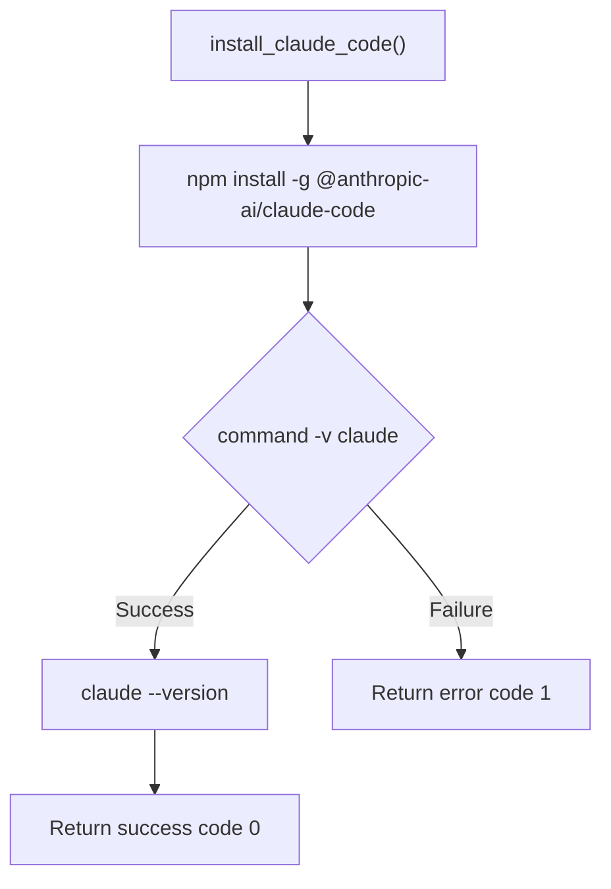

The installation process:

1. Executes `npm install -g @anthropic-ai/claude-code` to install the CLI globally
2. Verifies installation by checking if the `claude` command is available
3. Displays version information on successful installation
4. Returns appropriate exit codes for success (0) or failure (1)

Sources: [src/claude-code/install.sh:91-103]()

## Error Handling and Fallback Strategy

When automatic Node.js installation fails, the system provides clear guidance to users through the `print_nodejs_requirement()` function.

The error message includes a complete example devcontainer.json configuration showing how to explicitly add the Node.js feature alongside the claude-code feature:

```json
"features": {
  "ghcr.io/devcontainers/features/node:1": {},
  "ghcr.io/anthropics/devcontainer-features/claude-code:1": {}
}
```

This fallback strategy ensures users have a reliable path forward even when the automatic installation cannot handle their specific environment.

Sources: [src/claude-code/install.sh:106-119](), [src/claude-code/NOTES.md:15-22]()

## Installation Verification System

The installation system implements verification at multiple stages:

1. **Package Manager Verification**: The `detect_package_manager()` function returns error code 1 when no supported package manager is found
2. **Node.js Verification**: After installation, both `node` and `npm` commands are verified using `command -v`
3. **Claude CLI Verification**: The `claude` command availability is verified and version information is displayed

This multi-stage verification ensures that each dependency is properly installed before proceeding to the next step, providing clear failure points for debugging installation issues.

Sources: [src/claude-code/install.sh:81-87](), [src/claude-code/install.sh:95-102]()

---

# Page: Usage and Configuration Options

# Usage and Configuration Options

<details>
<summary>Relevant source files</summary>

The following files were used as context for generating this wiki page:

- [src/claude-code/NOTES.md](src/claude-code/NOTES.md)
- [src/claude-code/README.md](src/claude-code/README.md)

</details>


This document covers how to configure and use the claude-code Dev Container Feature in different environments and scenarios. It provides practical guidance for integrating the Claude Code CLI into your development containers, including Node.js dependency management strategies and configuration patterns.

For information about the underlying installation system mechanics, see [Installation System](#2.2). For feature definition details, see [Feature Configuration](#2.1).

## Basic Feature Configuration

The claude-code feature installs the Claude Code CLI globally using npm. The minimal configuration requires only adding the feature to your `devcontainer.json`:

```json
{
  "features": {
    "ghcr.io/anthropics/devcontainer-features/claude-code:1": {}
  }
}
```

The feature currently has no configurable options, as shown in the empty options table in [src/claude-code/README.md:16-17](). The installation automatically includes the `anthropic.claude-code` VS Code extension as a customization [src/claude-code/README.md:24]().

**Sources:** [src/claude-code/README.md:8-12](), [src/claude-code/README.md:14-18]()

## Node.js Dependency Management Scenarios

The claude-code feature requires Node.js and npm to function. The installation system supports three primary dependency management scenarios:

### Configuration Scenarios Overview

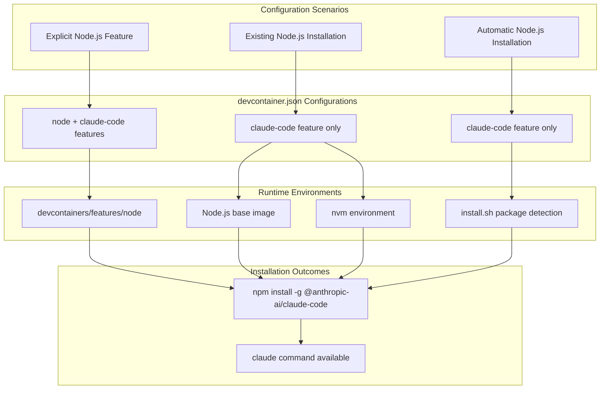

**Sources:** [src/claude-code/NOTES.md:3-11](), [src/claude-code/README.md:28-36]()

### Scenario 1: Explicit Node.js Feature (Recommended)

The recommended approach explicitly includes both the Node.js feature and claude-code feature:

```json
{
  "features": {
    "ghcr.io/devcontainers/features/node:1": {},
    "ghcr.io/anthropics/devcontainer-features/claude-code:1": {}
  }
}
```

This configuration ensures Node.js is available before claude-code installation begins and provides the most reliable setup across different base images.

**Sources:** [src/claude-code/NOTES.md:13-22](), [src/claude-code/README.md:38-47]()

### Scenario 2: Existing Node.js Installation

For containers with Node.js already available (Node.js base images, nvm environments), use only the claude-code feature:

```json
{
  "features": {
    "ghcr.io/anthropics/devcontainer-features/claude-code:1": {}
  }
}
```

This works with:
- Node.js-based container images
- Containers with nvm pre-installed
- Any environment where `node` and `npm` commands are available

**Sources:** [src/claude-code/README.md:49-57](), [src/claude-code/NOTES.md:24-32](), [src/claude-code/README.md:59-62]()

### Scenario 3: Automatic Node.js Installation

When Node.js is not present, the feature attempts automatic installation using the system package manager. This best-effort approach supports:

| Platform | Package Manager | Node.js Version |
|----------|----------------|-----------------|
| Debian/Ubuntu | `apt-get` | Node.js 18.x LTS |
| Alpine | `apk` | Node.js 18.x LTS |
| Fedora/RHEL/CentOS | `yum`/`dnf` | Node.js 18.x LTS |

**Sources:** [src/claude-code/NOTES.md:7-11](), [src/claude-code/README.md:32-36]()

## Installation Workflow Implementation

The installation process follows a specific sequence implemented in the `install.sh` script:

### Installation Flow Diagram

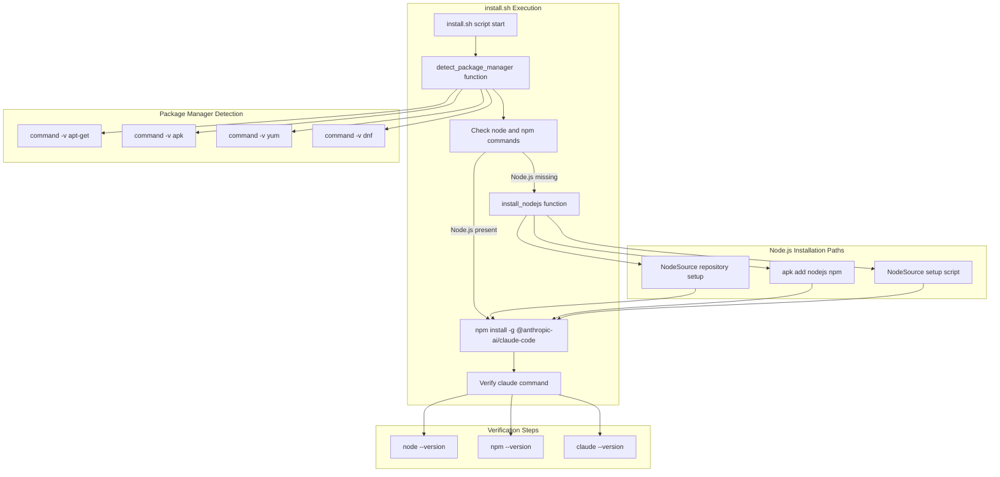

**Sources:** [src/claude-code/install.sh]() (referenced through installation system documentation)

## Configuration Patterns and Best Practices

### Feature Order Considerations

When using multiple features, Node.js-related features should be listed before claude-code to ensure proper dependency resolution:

```json
{
  "features": {
    "ghcr.io/devcontainers/features/node:1": {
      "version": "18"
    },
    "ghcr.io/anthropics/devcontainer-features/claude-code:1": {}
  }
}
```

### Base Image Compatibility

| Base Image Type | Recommended Configuration | Notes |
|-----------------|---------------------------|-------|
| `node:*` | claude-code only | Node.js already present |
| `mcr.microsoft.com/devcontainers/base:*` | node + claude-code | Clean Ubuntu environment |
| `debian:*`, `ubuntu:*` | claude-code only | Auto-install will handle Node.js |
| `alpine:*` | claude-code only | Auto-install uses apk |
| Custom images | Depends on Node.js presence | Test Node.js availability first |

### VS Code Integration

The feature automatically adds the `anthropic.claude-code` VS Code extension through the customizations property in [src/claude-code/devcontainer-feature.json](). No additional configuration is required for VS Code integration.

**Sources:** [src/claude-code/README.md:20-24]()

## Installation Verification

After feature installation, verify the claude-code CLI is available:

```bash
# Check Claude CLI installation
claude --version

# Verify Node.js (if auto-installed)
node --version
npm --version
```

The installation process includes automatic verification steps that will fail the container build if the claude command is not available after installation.

**Sources:** Installation verification logic referenced through [src/claude-code/install.sh]()

---

# Page: Release and Publication System

# Release and Publication System

<details>
<summary>Relevant source files</summary>

The following files were used as context for generating this wiki page:

- [.github/workflows/release.yaml](.github/workflows/release.yaml)

</details>


## Purpose and Scope

The Release and Publication System is the core automation infrastructure that handles publishing Dev Container Features to GitHub Container Registry (GHCR) and maintains synchronized documentation. This system operates through a single GitHub Actions workflow that triggers on pushes to the main branch, automatically publishing features and creating pull requests for documentation updates.

This document covers the automated release workflow, feature publication mechanism, and documentation maintenance system. For information about the actual feature being published, see [Claude Code Dev Container Feature](#2). For testing and validation processes, see [Testing and Validation](#4).

## Release Workflow Architecture

The release system is implemented as a single GitHub Actions workflow defined in [.github/workflows/release.yaml:1-87](). The workflow consists of two primary phases: feature publication and documentation management.

### Workflow Architecture Diagram

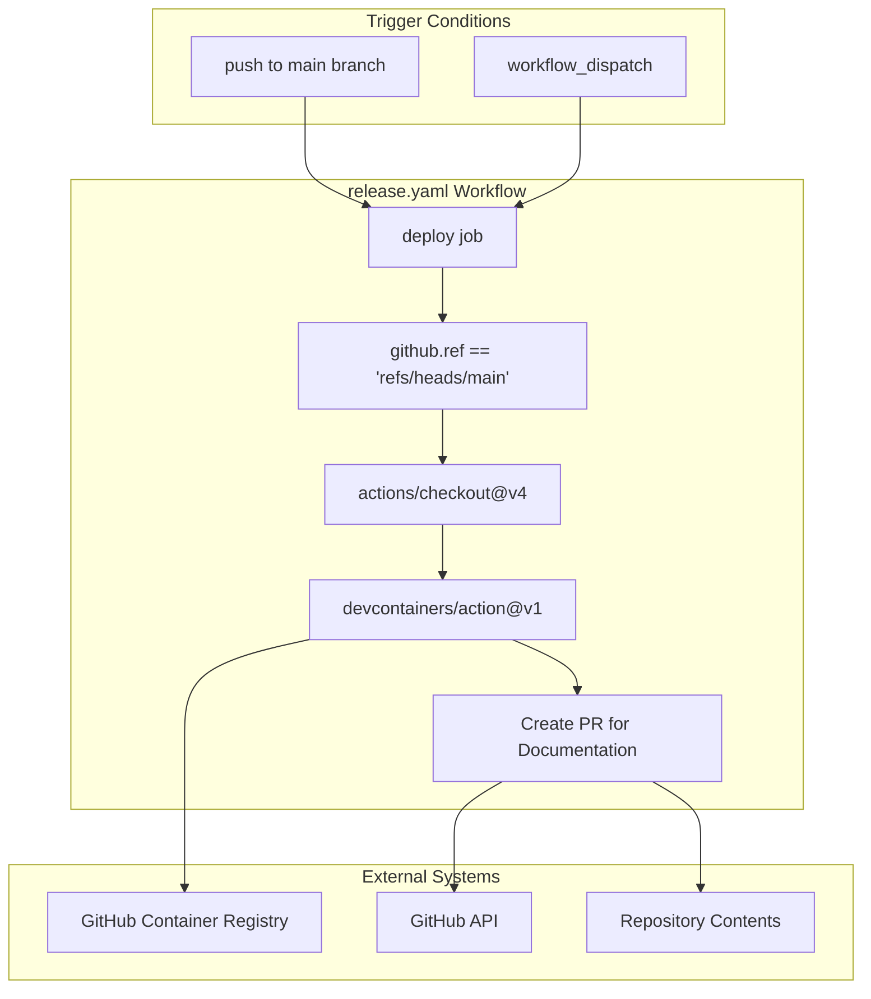

**Sources:** [.github/workflows/release.yaml:3-11](), [.github/workflows/release.yaml:10-16]()

## Feature Publication Process

The feature publication is handled by the `devcontainers/action@v1` action, which processes all features in the `./src` directory and publishes them to GHCR with automatic documentation generation.

### Publication Configuration

The publication step is configured with three key parameters:
- `publish-features: "true"` - Enables feature publishing
- `base-path-to-features: "./src"` - Specifies source directory
- `generate-docs: "true"` - Enables automatic documentation generation

### Publication Flow Diagram

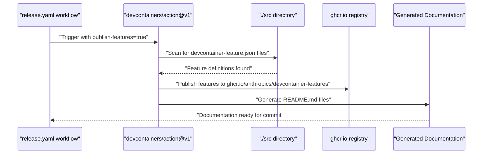

**Sources:** [.github/workflows/release.yaml:20-26](), [.github/workflows/release.yaml:27-28]()

## Automated Documentation System

The documentation system automatically commits updated README files and creates pull requests using the GitHub API. This process ensures documentation stays synchronized with published features without manual intervention.

### Documentation Update Process

The documentation update process follows a structured approach:

1. **Branch Creation**: Creates a uniquely named branch using `automated-documentation-update-$GITHUB_RUN_ID`
2. **File Discovery**: Locates all README.md files using pattern `*/*/README.md`
3. **Individual Commits**: Commits each README file separately via GitHub API
4. **Pull Request**: Creates a PR with the commit message `"Automated documentation update [skip ci]"`

### Documentation Workflow Diagram

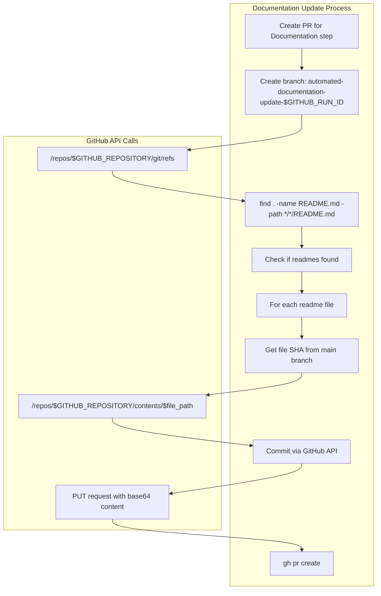

**Sources:** [.github/workflows/release.yaml:30-48](), [.github/workflows/release.yaml:51-58](), [.github/workflows/release.yaml:60-86]()

## GitHub API Integration

The system makes extensive use of the GitHub API for branch management, file operations, and pull request creation. All API calls use the `GITHUB_TOKEN` secret for authentication and automatic commit signing.

### API Operations Summary

| Operation | Endpoint | Purpose |
|-----------|----------|---------|
| Branch Creation | `/repos/$GITHUB_REPOSITORY/git/refs` | Create documentation update branch |
| File Retrieval | `/repos/$GITHUB_REPOSITORY/contents/$file_path?ref=main` | Get current file SHA |
| File Update | `/repos/$GITHUB_REPOSITORY/contents/$file_path` | Commit updated README files |
| Pull Request | `gh pr create` | Create documentation PR |

### API Integration Sequence

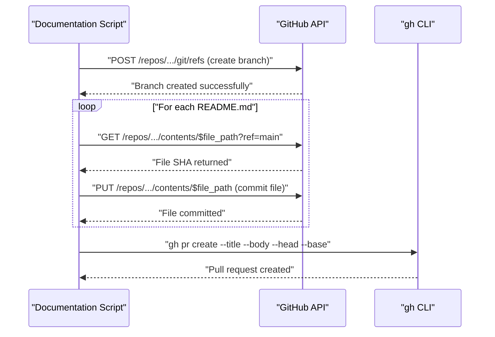

**Sources:** [.github/workflows/release.yaml:43-47](), [.github/workflows/release.yaml:67-70](), [.github/workflows/release.yaml:75-82](), [.github/workflows/release.yaml:86]()

## File Processing and Commit Strategy

The system uses a sophisticated file processing approach that handles base64 encoding and SHA-based updates to ensure data integrity and proper version control.

### File Processing Details

- **File Discovery**: Uses `find . -name "README.md" -path "*/*/README.md"` to locate documentation files
- **Path Normalization**: Removes leading `./` prefix with `${readme:2}` parameter expansion
- **Content Encoding**: Converts files to base64 using `base64 -i $readme`
- **SHA Verification**: Retrieves current file SHA before each commit to prevent conflicts

### Commit Strategy Features

| Feature | Implementation | Purpose |
|---------|----------------|---------|
| Automatic Signing | GitHub API commits | Ensures commit authenticity |
| Skip CI Flag | `[skip ci]` in commit message | Prevents infinite workflow loops |
| Individual Commits | Separate API call per file | Granular change tracking |
| Error Handling | `|| echo "No changes..."` fallback | Graceful handling of no-op scenarios |

**Sources:** [.github/workflows/release.yaml:49](), [.github/workflows/release.yaml:52](), [.github/workflows/release.yaml:63](), [.github/workflows/release.yaml:79](), [.github/workflows/release.yaml:82]()

---

# Page: Testing and Validation

# Testing and Validation

<details>
<summary>Relevant source files</summary>

The following files were used as context for generating this wiki page:

- [.github/workflows/test.yaml](.github/workflows/test.yaml)
- [.github/workflows/validate.yaml](.github/workflows/validate.yaml)

</details>


This document covers the comprehensive testing and validation infrastructure that ensures Dev Container features work correctly across multiple platforms and configurations. The testing system validates both the feature definitions themselves and their installation behavior across different base images and environments.

For information about the specific test configurations and scenarios, see [Test Configuration and Scenarios](#4.1). For details about the test execution scripts, see [Test Scripts and Validation](#4.2).

## Testing Infrastructure Overview

The repository implements a multi-layered testing approach through GitHub Actions workflows that validate features using the official Dev Container CLI. The testing system ensures compatibility across different Linux distributions and validates both automated test generation and custom scenarios.

### CI Testing Workflow Architecture

```mermaid
flowchart TD
    subgraph "test.yaml Workflow"
        TRIGGER["Trigger: push to main, pull_request, workflow_dispatch"]
        
        subgraph "test-autogenerated Job"
            AUTO_MATRIX["Matrix Strategy"]
            AUTO_FEATURES["features: [claude-code]"]
            AUTO_IMAGES["baseImage: [debian:latest, ubuntu:latest, mcr.microsoft.com/devcontainers/base:ubuntu]"]
            AUTO_CMD["devcontainer features test --skip-scenarios"]
        end
        
        subgraph "test-scenarios Job"
            SCENARIO_MATRIX["Matrix Strategy"]
            SCENARIO_FEATURES["features: [claude-code]"]
            SCENARIO_CMD["devcontainer features test --skip-autogenerated --skip-duplicated"]
        end
        
        subgraph "test-global Job"
            GLOBAL_CMD["devcontainer features test --global-scenarios-only"]
        end
    end
    
    TRIGGER --> AUTO_MATRIX
    TRIGGER --> SCENARIO_MATRIX
    TRIGGER --> GLOBAL_CMD
    
    AUTO_MATRIX --> AUTO_FEATURES
    AUTO_MATRIX --> AUTO_IMAGES
    AUTO_FEATURES --> AUTO_CMD
    AUTO_IMAGES --> AUTO_CMD
    
    SCENARIO_MATRIX --> SCENARIO_FEATURES
    SCENARIO_FEATURES --> SCENARIO_CMD
```

Sources: [.github/workflows/test.yaml:1-56]()

### Test Execution Matrix

The testing system uses a matrix strategy to validate the `claude-code` feature across multiple base images and scenarios:

| Test Job | Matrix Dimension | Values | Purpose |
|----------|------------------|--------|---------|
| `test-autogenerated` | `features` | `claude-code` | Feature under test |
| `test-autogenerated` | `baseImage` | `debian:latest`, `ubuntu:latest`, `mcr.microsoft.com/devcontainers/base:ubuntu` | Platform compatibility |
| `test-scenarios` | `features` | `claude-code` | Custom scenario testing |
| `test-global` | N/A | Global scenarios only | Repository-wide validation |

Sources: [.github/workflows/test.yaml:14-20](), [.github/workflows/test.yaml:34-37]()

## Validation Workflow

The validation system ensures that feature definitions conform to the Dev Container specification before any testing occurs.

### Feature Definition Validation

```mermaid
flowchart LR
    subgraph "validate.yaml Workflow"
        VALIDATE_TRIGGER["Trigger: workflow_dispatch, pull_request"]
        CHECKOUT["actions/checkout@v4"]
        VALIDATE_ACTION["devcontainers/action@v1"]
        VALIDATE_CONFIG["validate-only: true, base-path-to-features: ./src"]
    end
    
    subgraph "Validation Target"
        FEATURE_JSON["src/claude-code/devcontainer-feature.json"]
    end
    
    VALIDATE_TRIGGER --> CHECKOUT
    CHECKOUT --> VALIDATE_ACTION
    VALIDATE_ACTION --> VALIDATE_CONFIG
    VALIDATE_CONFIG --> FEATURE_JSON
```

Sources: [.github/workflows/validate.yaml:1-16]()

The validation workflow performs the following operations:

1. **Schema Validation**: Validates `devcontainer-feature.json` files against the official Dev Container specification schema
2. **Structure Verification**: Ensures required fields are present and properly formatted
3. **Path Validation**: Confirms that the base path to features (`./src`) contains valid feature definitions

Sources: [.github/workflows/validate.yaml:12-16]()

## Test Execution Flow

The testing infrastructure uses the `@devcontainers/cli` package to execute tests with different strategies and flags.

### DevContainer CLI Test Commands

```mermaid
sequenceDiagram
    participant GHA as "GitHub Actions Runner"
    participant CLI as "@devcontainers/cli"
    participant Docker as "Docker Engine"
    participant Feature as "claude-code Feature"
    
    Note over GHA: test-autogenerated Job
    GHA->>CLI: npm install -g @devcontainers/cli
    GHA->>CLI: devcontainer features test --skip-scenarios -f claude-code -i <baseImage>
    CLI->>Docker: Create container from baseImage
    CLI->>Feature: Install claude-code feature
    CLI->>Docker: Execute test commands
    Docker-->>CLI: Test results
    CLI-->>GHA: Pass/Fail status
    
    Note over GHA: test-scenarios Job
    GHA->>CLI: devcontainer features test -f claude-code --skip-autogenerated --skip-duplicated
    CLI->>Feature: Run custom scenarios
    Feature-->>CLI: Scenario results
    CLI-->>GHA: Pass/Fail status
    
    Note over GHA: test-global Job
    GHA->>CLI: devcontainer features test --global-scenarios-only
    CLI->>GHA: Global validation results
```

Sources: [.github/workflows/test.yaml:24-28](), [.github/workflows/test.yaml:40-44](), [.github/workflows/test.yaml:52-56]()

## Test Strategy Configuration

The testing system implements three distinct testing strategies:

### 1. Autogenerated Tests (`test-autogenerated`)
- **Command**: `devcontainer features test --skip-scenarios -f ${{ matrix.features }} -i ${{ matrix.baseImage }}`
- **Purpose**: Validates basic feature installation across different base images
- **Matrix**: Tests `claude-code` against `debian:latest`, `ubuntu:latest`, and `mcr.microsoft.com/devcontainers/base:ubuntu`
- **Execution**: Runs on `ubuntu-latest` with `continue-on-error: true`

### 2. Scenario Tests (`test-scenarios`)
- **Command**: `devcontainer features test -f ${{ matrix.features }} --skip-autogenerated --skip-duplicated`
- **Purpose**: Executes custom test scenarios defined in the feature's test directory
- **Focus**: Tests specific configuration options and edge cases
- **Matrix**: Single feature dimension (`claude-code`)

### 3. Global Tests (`test-global`)
- **Command**: `devcontainer features test --global-scenarios-only`
- **Purpose**: Validates repository-wide configurations and cross-feature interactions
- **Scope**: Tests scenarios that apply to the entire features collection

Sources: [.github/workflows/test.yaml:10-56]()

## Error Handling and Reliability

The testing infrastructure implements several reliability mechanisms:

- **Continue on Error**: All test jobs use `continue-on-error: true` to ensure partial failures don't block the entire pipeline
- **Matrix Isolation**: Each base image and feature combination runs independently
- **Trigger Flexibility**: Tests run on push to main, pull requests, and manual dispatch for comprehensive coverage

Sources: [.github/workflows/test.yaml:12](), [.github/workflows/test.yaml:32](), [.github/workflows/test.yaml:48]()

---

# Page: Test Configuration and Scenarios

# Test Configuration and Scenarios

<details>
<summary>Relevant source files</summary>

The following files were used as context for generating this wiki page:

- [.github/workflows/test.yaml](.github/workflows/test.yaml)
- [test/claude-code/scenarios.json](test/claude-code/scenarios.json)

</details>


This document explains how test scenarios are defined and configured to validate the claude-code Dev Container Feature across different base images and environments. It covers the scenario definitions, test execution matrix, and the various testing approaches used to ensure feature compatibility.

For information about the actual test execution scripts and validation logic, see [Test Scripts and Validation](#4.2). For details about the broader testing infrastructure, see [Testing and Validation](#4).

## Test Scenario Definition

Test scenarios are defined in `scenarios.json` files that specify combinations of base images, features, and configuration options to validate. The claude-code feature uses a single scenario that tests integration with Node.js dependencies.

### Scenario Configuration Structure

The scenarios configuration follows a specific format that defines test environments:

```mermaid
graph TB
    subgraph "scenarios.json Structure"
        SCENARIOS["scenarios.json"]
        BASIC["basic scenario"]
        IMAGE["image: mcr.microsoft.com/devcontainers/base:ubuntu"]
        FEATURES["features object"]
        NODE["ghcr.io/devcontainers/features/node:1"]
        CLAUDE["claude-code"]
    end
    
    SCENARIOS --> BASIC
    BASIC --> IMAGE
    BASIC --> FEATURES
    FEATURES --> NODE
    FEATURES --> CLAUDE
```

The current scenario configuration includes:
- **Base Image**: `mcr.microsoft.com/devcontainers/base:ubuntu`
- **Dependencies**: Node.js feature from devcontainers registry
- **Target Feature**: `claude-code` feature

Sources: [test/claude-code/scenarios.json:1-9]()

## Test Execution Matrix

The CI testing system uses a matrix strategy to validate features across multiple dimensions, creating comprehensive coverage through different test types.

### Test Matrix Architecture

```mermaid
graph LR
    subgraph "CI Test Jobs"
        AUTO["test-autogenerated"]
        SCENARIOS["test-scenarios"]
        GLOBAL["test-global"]
    end
    
    subgraph "Matrix Dimensions"
        FEATURES["features: [claude-code]"]
        IMAGES["baseImage: [debian:latest, ubuntu:latest, mcr.microsoft.com/devcontainers/base:ubuntu]"]
    end
    
    subgraph "CLI Commands"
        AUTO_CMD["devcontainer features test --skip-scenarios"]
        SCENARIO_CMD["devcontainer features test --skip-autogenerated --skip-duplicated"]
        GLOBAL_CMD["devcontainer features test --global-scenarios-only"]
    end
    
    AUTO --> FEATURES
    AUTO --> IMAGES
    SCENARIOS --> FEATURES
    
    AUTO --> AUTO_CMD
    SCENARIOS --> SCENARIO_CMD
    GLOBAL --> GLOBAL_CMD
```

Sources: [.github/workflows/test.yaml:10-56]()

## Test Type Classifications

The testing framework employs three distinct test execution modes, each targeting different validation scenarios:

### Autogenerated Tests

| Property | Value |
|----------|--------|
| **Job Name** | `test-autogenerated` |
| **Matrix** | `features × baseImage` |
| **Command** | `devcontainer features test --skip-scenarios` |
| **Base Images** | `debian:latest`, `ubuntu:latest`, `mcr.microsoft.com/devcontainers/base:ubuntu` |

Autogenerated tests validate feature installation across different base operating systems without custom scenarios.

### Scenario-Based Tests

| Property | Value |
|----------|--------|
| **Job Name** | `test-scenarios` |
| **Matrix** | `features` only |
| **Command** | `devcontainer features test --skip-autogenerated --skip-duplicated` |
| **Configuration** | Uses `scenarios.json` definitions |

Scenario tests validate specific feature combinations and configurations defined in the scenarios file.

### Global Tests

| Property | Value |
|----------|--------|
| **Job Name** | `test-global` |
| **Matrix** | None |
| **Command** | `devcontainer features test --global-scenarios-only` |
| **Scope** | Repository-wide scenarios |

Sources: [.github/workflows/test.yaml:30-56]()

## Base Image Coverage Strategy

The testing matrix ensures compatibility across major Linux distributions and Dev Container base images:

```mermaid
graph TD
    subgraph "Base Image Testing Matrix"
        DEBIAN["debian:latest"]
        UBUNTU["ubuntu:latest"] 
        MSBASE["mcr.microsoft.com/devcontainers/base:ubuntu"]
    end
    
    subgraph "Package Manager Support"
        DEBIAN --> APT1["apt-get"]
        UBUNTU --> APT2["apt-get"]
        MSBASE --> APT3["apt-get + pre-installed tools"]
    end
    
    subgraph "Validation Targets"
        APT1 --> NODEJS1["Node.js Installation"]
        APT2 --> NODEJS2["Node.js Installation"]
        APT3 --> NODEJS3["Node.js Installation"]
        
        NODEJS1 --> CLAUDE1["claude command availability"]
        NODEJS2 --> CLAUDE2["claude command availability"]
        NODEJS3 --> CLAUDE3["claude command availability"]
    end
```

The base image selection provides coverage for:
- **Pure Debian/Ubuntu**: Tests package manager detection and Node.js installation from scratch
- **Microsoft Dev Container Base**: Tests integration with pre-configured development environments

Sources: [.github/workflows/test.yaml:17-20]()

## Scenario Definition Format

The `scenarios.json` file structure defines test environments using standard Dev Container configuration syntax:

| Field | Purpose | Example Value |
|-------|---------|---------------|
| `image` | Base container image | `mcr.microsoft.com/devcontainers/base:ubuntu` |
| `features` | Feature dependencies and configuration | Object with feature references |
| Feature keys | Specific features to install | `ghcr.io/devcontainers/features/node:1`, `claude-code` |

### Current Scenario Configuration

The basic scenario tests claude-code integration with Node.js:

```mermaid
flowchart LR
    subgraph "basic Scenario"
        BASE["mcr.microsoft.com/devcontainers/base:ubuntu"]
        NODE_FEAT["ghcr.io/devcontainers/features/node:1: {}"]
        CLAUDE_FEAT["claude-code: {}"]
    end
    
    BASE --> NODE_FEAT
    NODE_FEAT --> CLAUDE_FEAT
    CLAUDE_FEAT --> VALIDATION["Test Execution"]
```

This configuration validates that the claude-code feature works correctly when Node.js is provided by the official devcontainers Node.js feature rather than being installed by the claude-code feature itself.

Sources: [test/claude-code/scenarios.json:2-8]()

---

# Page: Test Scripts and Validation

# Test Scripts and Validation

<details>
<summary>Relevant source files</summary>

The following files were used as context for generating this wiki page:

- [test/claude-code/basic.sh](test/claude-code/basic.sh)
- [test/claude-code/test.sh](test/claude-code/test.sh)

</details>


This document covers the test execution scripts and validation logic that verify the claude-code feature installation and functionality. These scripts are executed during the automated testing workflows to ensure the feature works correctly across different base images and environments.

For information about test configuration and scenarios, see [Test Configuration and Scenarios](#4.1). For details about the overall testing infrastructure and workflows, see [Testing and Validation](#4).

## Test Script Architecture

The claude-code feature uses two complementary test scripts that validate different aspects of the installation:

### Test Script Execution Flow

```mermaid
flowchart TD
    subgraph "Test Execution Environment"
        WORKFLOW["test.yaml workflow"]
        CONTAINER["Test Container"]
        FEATURE_INSTALL["Feature Installation"]
    end
    
    subgraph "Test Scripts"
        TEST_SH["test.sh"]
        BASIC_SH["basic.sh"]
        TEST_LIB["dev-container-features-test-lib"]
    end
    
    subgraph "Validation Checks"
        NODE_CHECK["node --version"]
        NPM_CHECK["npm --version"]
        CLAUDE_CMD["command -v claude"]
        CLAUDE_VER["claude --version"]
        CLAUDE_V["claude -v"]
    end
    
    subgraph "Result Reporting"
        CHECK_FUNC["check function"]
        REPORT_RESULTS["reportResults"]
        EXIT_CODES["Exit codes 0/1"]
    end
    
    WORKFLOW --> CONTAINER
    CONTAINER --> FEATURE_INSTALL
    FEATURE_INSTALL --> TEST_SH
    FEATURE_INSTALL --> BASIC_SH
    
    TEST_SH --> TEST_LIB
    TEST_LIB --> CHECK_FUNC
    TEST_SH --> NODE_CHECK
    TEST_SH --> NPM_CHECK
    TEST_SH --> CLAUDE_CMD
    TEST_SH --> CLAUDE_VER
    
    BASIC_SH --> CLAUDE_CMD
    BASIC_SH --> CLAUDE_V
    
    CHECK_FUNC --> REPORT_RESULTS
    BASIC_SH --> EXIT_CODES
```

Sources: [test/claude-code/test.sh:1-15](), [test/claude-code/basic.sh:1-18]()

## Primary Test Script: test.sh

The main test script `test.sh` provides comprehensive validation using the dev-container-features-test-lib framework:

### Test Library Integration

```mermaid
flowchart LR
    subgraph "test.sh Execution"
        SHEBANG["#!/bin/bash"]
        SET_E["set -e"]
        SOURCE["source dev-container-features-test-lib"]
    end
    
    subgraph "Test Library Functions"
        CHECK_FUNC["check function"]
        REPORT_FUNC["reportResults function"]
    end
    
    subgraph "Validation Commands"
        NODE_VER["node --version"]
        NPM_VER["npm --version"] 
        CLAUDE_COMMAND["command -v claude"]
        CLAUDE_VERSION["claude --version"]
    end
    
    SOURCE --> CHECK_FUNC
    SOURCE --> REPORT_FUNC
    CHECK_FUNC --> NODE_VER
    CHECK_FUNC --> NPM_VER
    CHECK_FUNC --> CLAUDE_COMMAND
    CHECK_FUNC --> CLAUDE_VERSION
    CHECK_FUNC --> REPORT_FUNC
```

The script performs four critical validation checks:

| Check Name | Command | Purpose |
|------------|---------|---------|
| node version | `node --version` | Verify Node.js runtime is available |
| npm version | `npm --version` | Verify npm package manager is functional |
| claude cli installed | `command -v claude` | Confirm claude command is in PATH |
| claude version | `claude --version` | Validate claude CLI responds correctly |

Sources: [test/claude-code/test.sh:6-12]()

### Test Execution Pattern

The test script follows this execution pattern:

1. **Error Handling**: Sets `set -e` to exit on any command failure [test/claude-code/test.sh:3]()
2. **Library Import**: Sources the test library for `check` and `reportResults` functions [test/claude-code/test.sh:6]()
3. **Sequential Checks**: Executes each validation check using the `check` function [test/claude-code/test.sh:9-12]()
4. **Result Reporting**: Calls `reportResults` to aggregate and report test outcomes [test/claude-code/test.sh:15]()

Sources: [test/claude-code/test.sh:1-15]()

## Basic Validation Script: basic.sh

The `basic.sh` script provides a minimal validation approach without external dependencies:

### Basic Validation Logic

```mermaid
flowchart TD
    subgraph "basic.sh Execution Flow"
        START["#!/bin/bash set -e"]
        CLAUDE_CHECK{"command -v claude"}
        VERSION_CHECK{"claude -v contains 'Claude Code'"}
        SUCCESS["echo success + exit 0"]
        FAIL_CMD["echo command not found + exit 1"]
        FAIL_VER["echo version check failed + exit 1"]
    end
    
    START --> CLAUDE_CHECK
    CLAUDE_CHECK -->|Found| VERSION_CHECK
    CLAUDE_CHECK -->|Not Found| FAIL_CMD
    VERSION_CHECK -->|Match| SUCCESS
    VERSION_CHECK -->|No Match| FAIL_VER
```

The basic script implements two essential checks:

1. **Command Availability**: Uses `command -v claude` to verify the claude executable is accessible [test/claude-code/basic.sh:6]()
2. **Version Verification**: Runs `claude -v` and checks output contains "Claude Code" [test/claude-code/basic.sh:12]()

### Error Handling and Output

The script uses explicit error handling with informative messages:

- **Command Not Found**: Outputs "claude command not found" and exits with code 1 [test/claude-code/basic.sh:7-9]()
- **Version Check Failed**: Outputs "claude version check failed" and exits with code 1 [test/claude-code/basic.sh:13-15]()
- **Success**: Outputs "Claude CLI installation test passed!" and exits with code 0 [test/claude-code/basic.sh:17-18]()

Sources: [test/claude-code/basic.sh:6-18]()

## Test Script Comparison

| Aspect | test.sh | basic.sh |
|--------|---------|----------|
| Dependencies | Requires dev-container-features-test-lib | No external dependencies |
| Scope | Comprehensive (Node.js + Claude CLI) | Claude CLI only |
| Error Reporting | Structured via test library | Direct error messages |
| Result Format | Aggregated test results | Simple pass/fail exit codes |
| Use Case | Primary automated testing | Minimal validation scenarios |

## Validation Check Details

### Node.js Runtime Validation

The primary test script validates the complete Node.js stack:

- **Node Runtime**: `node --version` confirms the Node.js binary is functional
- **Package Manager**: `npm --version` verifies npm is available for package management

These checks ensure the installation script successfully installed Node.js dependencies as documented in [Installation System](#2.2).

### Claude CLI Validation

Both scripts validate the Claude CLI but with different approaches:

- **Command Existence**: `command -v claude` checks if the claude binary is in the system PATH
- **Version Output**: `claude --version` (test.sh) and `claude -v` (basic.sh) verify the CLI responds correctly
- **Content Validation**: basic.sh specifically checks that version output contains "Claude Code" string

Sources: [test/claude-code/test.sh:9-12](), [test/claude-code/basic.sh:6-15]()

## Integration with Test Infrastructure

These validation scripts are executed within the broader testing infrastructure:

- **Automated Execution**: Called by GitHub Actions workflows during feature testing
- **Multi-Platform Testing**: Run across different base images (debian, ubuntu, devcontainer base images)
- **Scenario Testing**: Used in conjunction with test scenarios defined in scenarios.json

For details about how these scripts integrate with the overall test configuration, see [Test Configuration and Scenarios](#4.1).

Sources: [test/claude-code/test.sh:1-15](), [test/claude-code/basic.sh:1-18]()

---

# Page: Repository Structure and Maintenance

# Repository Structure and Maintenance

<details>
<summary>Relevant source files</summary>

The following files were used as context for generating this wiki page:

- [.gitignore](.gitignore)
- [LICENSE](LICENSE)

</details>


This document covers the overall organization of the devcontainer-features repository and the development workflows used to maintain it. It focuses on the directory structure, key configuration files, and processes for contributing changes to the codebase.

For detailed information about the claude-code feature implementation, see [Claude Code Dev Container Feature](#2). For release automation, see [Release and Publication System](#3). For testing infrastructure, see [Testing and Validation](#4).

## Repository Organization

The repository follows the standard Dev Container Features layout with additional automation and testing infrastructure to support a robust development workflow.

### Directory Structure

```mermaid
graph TD
    subgraph "Repository Root"
        ROOT["/"]
        GITIGNORE[".gitignore"]
        LICENSE["LICENSE"]
        README["README.md"]
    end
    
    subgraph "Source Code"
        SRC["src/"]
        CLAUDE_DIR["src/claude-code/"]
        FEATURE_JSON["src/claude-code/devcontainer-feature.json"]
        INSTALL_SH["src/claude-code/install.sh"]
        FEATURE_README["src/claude-code/README.md"]
        NOTES["src/claude-code/NOTES.md"]
    end
    
    subgraph "Testing Infrastructure"
        TEST["test/"]
        TEST_CLAUDE["test/claude-code/"]
        SCENARIOS["test/claude-code/scenarios.json"]
        TEST_SH["test/claude-code/test.sh"]
        BASIC_SH["test/claude-code/basic.sh"]
    end
    
    subgraph "CI/CD Workflows"
        GITHUB[".github/"]
        WORKFLOWS[".github/workflows/"]
        RELEASE_YAML[".github/workflows/release.yaml"]
        TEST_YAML[".github/workflows/test.yaml"]
        VALIDATE_YAML[".github/workflows/validate.yaml"]
    end
    
    ROOT --> GITIGNORE
    ROOT --> LICENSE
    ROOT --> README
    ROOT --> SRC
    ROOT --> TEST
    ROOT --> GITHUB
    
    SRC --> CLAUDE_DIR
    CLAUDE_DIR --> FEATURE_JSON
    CLAUDE_DIR --> INSTALL_SH
    CLAUDE_DIR --> FEATURE_README
    CLAUDE_DIR --> NOTES
    
    TEST --> TEST_CLAUDE
    TEST_CLAUDE --> SCENARIOS
    TEST_CLAUDE --> TEST_SH
    TEST_CLAUDE --> BASIC_SH
    
    GITHUB --> WORKFLOWS
    WORKFLOWS --> RELEASE_YAML
    WORKFLOWS --> TEST_YAML
    WORKFLOWS --> VALIDATE_YAML
```

**Sources:** [.gitignore:1-30](), [LICENSE:1-21]()

### Core File Types and Purposes

| File Type | Location | Purpose |
|-----------|----------|---------|
| `devcontainer-feature.json` | `src/claude-code/` | Feature definition and configuration schema |
| `install.sh` | `src/claude-code/` | Feature installation script |
| `README.md` | `src/claude-code/` | Feature documentation (auto-generated) |
| `NOTES.md` | `src/claude-code/` | Developer notes and implementation details |
| `scenarios.json` | `test/claude-code/` | Test scenario definitions |
| `test.sh` | `test/claude-code/` | Test execution script |
| `*.yaml` | `.github/workflows/` | GitHub Actions workflow definitions |

**Sources:** [.gitignore:1-30]()

## Configuration Management

The repository uses several key configuration files to manage different aspects of the development and deployment process.

### Git Configuration

```mermaid
graph LR
    subgraph "Version Control"
        GITIGNORE[".gitignore"]
        NODE_MODULES["node_modules/"]
        DEVCONTAINER[".devcontainer/"]
        BUILD_ARTIFACTS[".build/"]
        TEST_RESULTS["test-results/"]
        LOGS["*.log files"]
        EDITOR_FILES[".vscode/, .idea/"]
    end
    
    GITIGNORE --> NODE_MODULES
    GITIGNORE --> DEVCONTAINER
    GITIGNORE --> BUILD_ARTIFACTS
    GITIGNORE --> TEST_RESULTS
    GITIGNORE --> LOGS
    GITIGNORE --> EDITOR_FILES
```

The `.gitignore` file excludes:
- Node.js dependencies and artifacts ([.gitignore:1-3]())
- Development container configurations ([.gitignore:5-6]())
- Build and test artifacts ([.gitignore:8-10](), [.gitignore:29-30]())
- System and editor-specific files ([.gitignore:11-27]())

**Sources:** [.gitignore:1-30]()

### License and Legal

The repository is licensed under the MIT License with copyright held by Anthropic PBC ([LICENSE:1-21]()). This provides broad permissions for use, modification, and distribution while maintaining copyright attribution requirements.

**Sources:** [LICENSE:1-21]()

## Development Workflow

The repository implements a structured development workflow that integrates testing, validation, and automated releases.

### Contribution Process

```mermaid
sequenceDiagram
    participant DEV as "Developer"
    participant FORK as "Fork/Branch"
    participant PR as "Pull Request"
    participant VALIDATE as "validate.yaml"
    participant TEST as "test.yaml"
    participant MAIN as "main branch"
    participant RELEASE as "release.yaml"
    
    DEV->>FORK: "Create feature branch"
    DEV->>FORK: "Modify src/claude-code/"
    DEV->>PR: "Create pull request"
    
    PR->>VALIDATE: "Trigger validation"
    VALIDATE->>VALIDATE: "Validate devcontainer-feature.json"
    
    PR->>TEST: "Trigger testing"
    TEST->>TEST: "Run scenarios.json tests"
    TEST->>TEST: "Execute test.sh across platforms"
    
    TEST-->>PR: "Report test results"
    VALIDATE-->>PR: "Report validation results"
    
    PR->>MAIN: "Merge after approval"
    MAIN->>RELEASE: "Trigger release workflow"
    RELEASE->>RELEASE: "Publish to ghcr.io"
    RELEASE->>RELEASE: "Update documentation"
```

**Sources:** [.gitignore:1-30]()

### File Modification Patterns

Different types of changes follow specific patterns:

| Change Type | Files Modified | Validation Required |
|-------------|---------------|-------------------|
| Feature Logic | `src/claude-code/install.sh` | Testing across platforms |
| Feature Config | `src/claude-code/devcontainer-feature.json` | JSON schema validation |
| Test Cases | `test/claude-code/scenarios.json` | Test execution |
| Documentation | `src/claude-code/NOTES.md` | None (README.md is auto-generated) |
| Workflows | `.github/workflows/*.yaml` | Workflow syntax validation |

**Sources:** [.gitignore:1-30]()

## Maintenance Processes

The repository employs several automated processes to maintain code quality and keep dependencies current.

### Automated Maintenance

```mermaid
graph TD
    subgraph "Scheduled Maintenance"
        DEPENDABOT["Dependabot Updates"]
        SECURITY["Security Scanning"]
        STALE["Stale Issue Management"]
    end
    
    subgraph "Release Automation"
        RELEASE_WF["release.yaml workflow"]
        DOC_GEN["Documentation Generation"]
        FEATURE_PUBLISH["Feature Publishing"]
        VERSION_TAG["Version Tagging"]
    end
    
    subgraph "Quality Assurance"
        VALIDATE_WF["validate.yaml workflow"]
        TEST_WF["test.yaml workflow"]
        MULTI_PLATFORM["Multi-platform Testing"]
        SCHEMA_VALID["JSON Schema Validation"]
    end
    
    DEPENDABOT --> RELEASE_WF
    SECURITY --> VALIDATE_WF
    
    RELEASE_WF --> DOC_GEN
    RELEASE_WF --> FEATURE_PUBLISH
    RELEASE_WF --> VERSION_TAG
    
    VALIDATE_WF --> SCHEMA_VALID
    TEST_WF --> MULTI_PLATFORM
    
    DOC_GEN --> QUALITY_ASSURANCE
    FEATURE_PUBLISH --> QUALITY_ASSURANCE
```

**Sources:** [.gitignore:1-30]()

### Repository Health Monitoring

The maintenance process monitors several key indicators:

- **Test Coverage**: All scenarios in `test/claude-code/scenarios.json` must pass
- **Platform Compatibility**: Installation success across Debian, Ubuntu, and Alpine base images
- **Documentation Sync**: Automated updates to `src/claude-code/README.md` via release workflow
- **Dependency Security**: Regular scanning of Node.js packages installed by `install.sh`

**Sources:** [.gitignore:1-30]()

### Release Cadence

The repository follows a continuous deployment model where:
- All changes to `main` branch trigger the release workflow
- Features are immediately published to `ghcr.io/anthropics/devcontainer-features`
- Documentation is automatically updated and committed back to the repository
- Version tags are created based on semantic versioning principles

**Sources:** [LICENSE:1-21]()