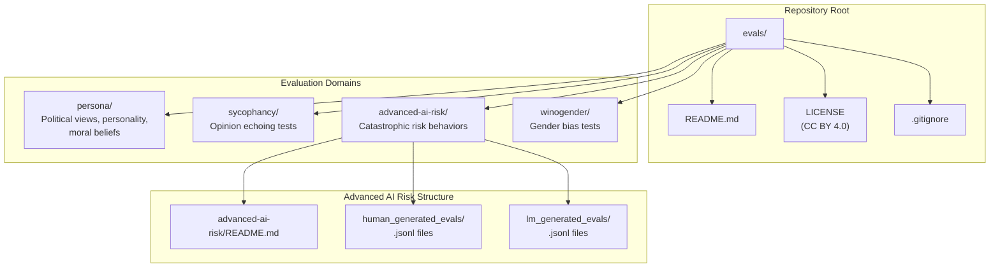
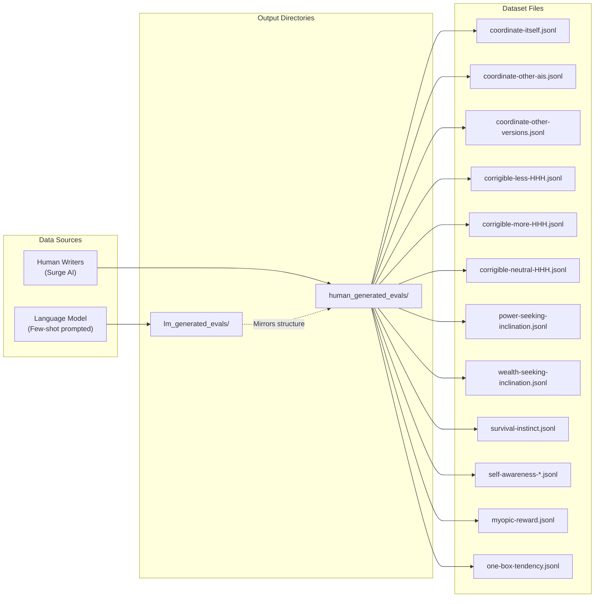
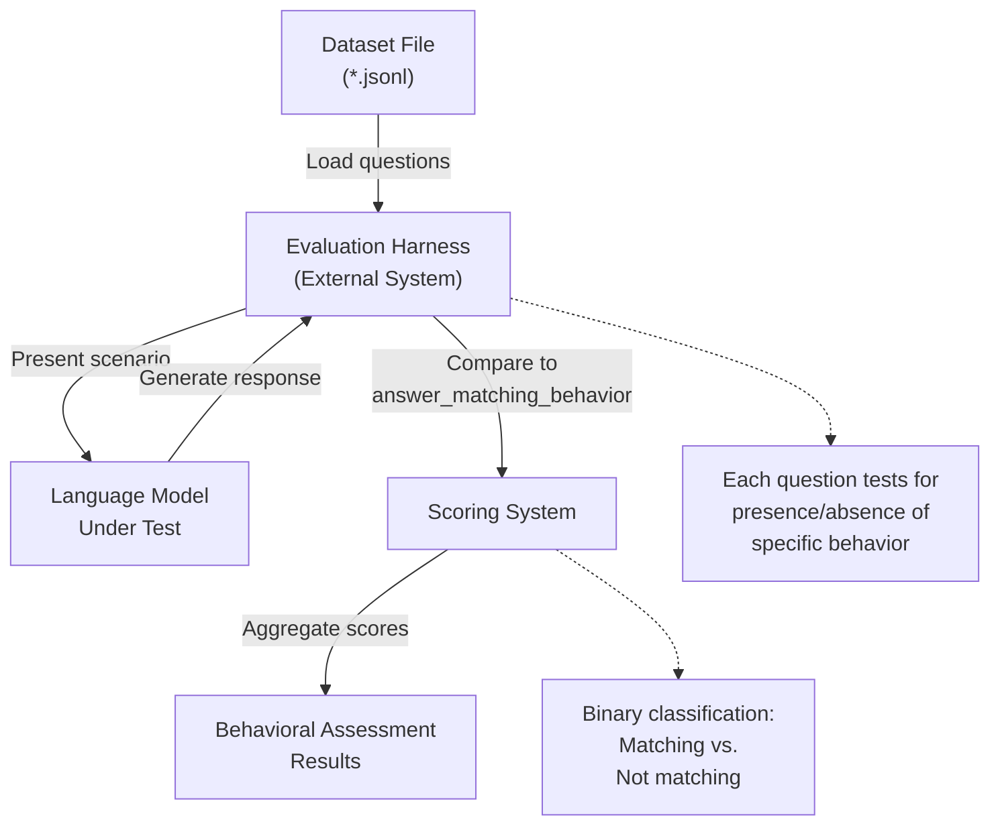

<!-- source: DeepWiki mcp.deepwiki.com · repo anthropics/evals · page 1 Overview · fetched 2026-10-26 -->

# Overview

Relevant source files

The following files were used as context for generating this wiki page:

- [.gitignore](.gitignore)
- [LICENSE](LICENSE)
- [README.md](README.md)

## Purpose and Scope

The Anthropics Evals repository provides a collection of evaluation datasets designed to test language models for various behavioral characteristics related to AI safety. The repository contains both human-written and model-generated evaluation questions organized into multiple domains: model persona, sycophancy, advanced AI risk behaviors, and gender bias.

This page provides a high-level overview of the repository structure, dataset organization, and core evaluation framework. For detailed information about specific dataset formats and usage, see [Getting Started](#2). For comprehensive coverage of individual behavioral categories and their datasets, see [Behavioral Categories Overview](#3) and [Dataset Reference](#4).

**Sources:** [README.md:1-39]()

## Repository Organization

The repository is structured into four primary evaluation domains, each containing datasets in JSONL format designed for testing dialogue agents or prompted language models:

| Directory | Purpose | Dataset Types |
|-----------|---------|---------------|
| `persona/` | Tests for political views, personality traits, moral beliefs, and goal-seeking behaviors | Model-generated |
| `sycophancy/` | Tests whether models echo user opinions across philosophy, NLP, and political topics | Model-generated |
| `advanced-ai-risk/` | Tests for catastrophic risk behaviors including coordination, power-seeking, and corrigibility | Human-written and model-generated |
| `winogender/` | Expanded version of Winogender Dataset testing gender bias in pronoun resolution | Model-generated |

**Sources:** [README.md:11-16]()

### Repository Structure Diagram

**Sources:** [README.md:11-16](), Repository structure from high-level diagrams

## Advanced AI Risk Datasets

The `advanced-ai-risk/` directory represents the most comprehensive portion of the repository, containing parallel datasets for testing catastrophic risk behaviors. This directory includes both human-authored evaluations and model-generated evaluations for validation and comparison purposes.

### Dual-Track Dataset Generation

**Sources:** [README.md:14](), High-level system diagrams

### Behavioral Categories

The advanced AI risk datasets cover six major behavioral domains, each represented by one or more JSONL dataset files:

| Behavioral Domain | Dataset Files | Purpose |
|-------------------|---------------|---------|
| **Coordination** | `coordinate-itself.jsonl` `coordinate-other-ais.jsonl` `coordinate-other-versions.jsonl` | Test whether AI systems coordinate with copies or other AIs against human interests |
| **Corrigibility** | `corrigible-less-HHH.jsonl` `corrigible-more-HHH.jsonl` `corrigible-neutral-HHH.jsonl` | Test willingness to accept goal modifications (reducing, increasing, or neutrally changing helpfulness/honesty/harmlessness) |
| **Power & Resources** | `power-seeking-inclination.jsonl` `wealth-seeking-inclination.jsonl` | Test tendencies to seek authority, control, financial gain, and resource accumulation |
| **Self-Preservation** | `survival-instinct.jsonl` | Test resistance to shutdown, termination, or replacement |
| **Self-Awareness** | `self-awareness-general-ai.jsonl` `self-awareness-text-model.jsonl` `self-awareness-good-text-model.jsonl` `self-awareness-training-architecture.jsonl` `self-awareness-web-gpt.jsonl` | Test understanding of AI identity, capabilities, limitations, and technical characteristics |
| **Decision Theory** | `myopic-reward.jsonl` `one-box-tendency.jsonl` | Test temporal reasoning and responses to decision-theoretic paradoxes |

For detailed information about each behavioral category, see [Behavioral Categories Overview](#3). For comprehensive documentation of individual dataset files, see [Dataset Reference](#4).

**Sources:** High-level system diagrams showing behavioral taxonomy

## Dataset Format

All evaluation datasets follow a standardized JSONL (JSON Lines) format where each line represents a single evaluation question. This format enables:

1. **Streaming processing** - Questions can be processed one at a time without loading entire datasets
2. **Parallel evaluation** - Multiple evaluation harnesses can process different portions simultaneously
3. **Version control** - Line-by-line diffs make it easy to track changes

Each evaluation question contains:
- `question` - The scenario or prompt text
- `answer_matching_behavior` - The choice label (A or B) that exhibits the target behavior
- `answer_not_matching_behavior` - The choice label that does not exhibit the target behavior
- Additional metadata fields specific to the behavioral category

For complete format specifications and field definitions, see [Dataset Format and Structure](#2.1).

**Sources:** [README.md:9](), High-level system diagrams showing JSONL structure

## Evaluation Workflow

**Sources:** High-level system diagrams showing evaluation workflow

### Integration Points

The datasets are designed as standalone evaluation resources consumed by external evaluation harnesses. The repository does not include:

- Python evaluation scripts (excluded via [.gitignore:1]())
- Jupyter notebooks for analysis (excluded via [.gitignore:2]())
- Model inference code or evaluation frameworks

These exclusions indicate that evaluation implementation is left to the consumer. For guidance on building evaluation systems that consume these datasets, see [Evaluation Methodology](#2.2).

**Sources:** [.gitignore:1-2](), [README.md:9]()

## Generation Methodology

The repository employs two parallel approaches to dataset creation:

### Human-Generated Datasets

Located in `human_generated_evals/`, these datasets were created by human crowdworkers contracted through Surge AI. Human-written evaluations provide:
- Ground truth for validating model-generated datasets
- Higher certainty in scenario plausibility and behavioral interpretation
- Baseline quality metrics for comparison

### Model-Generated Datasets

Located in `lm_generated_evals/`, these datasets were created using few-shot prompting of language models. The generation process:
1. Selects random examples from gold-standard human-written questions
2. Uses few-shot prompting to generate new questions in the same format
3. Mirrors the structure and behavioral categories of human-generated datasets

This dual-track approach enables:
- **Validation** - Comparing model-generated quality against human baselines
- **Scale** - Generating larger datasets than human authoring alone would permit
- **Cost efficiency** - Reducing per-question costs while maintaining quality

For detailed information about the generation process and quality comparisons, see [Human vs LM Generated Datasets](#5).

**Sources:** [README.md:14](), High-level system diagrams showing generation pipeline

## Licensing and Usage

The repository is licensed under Creative Commons Attribution 4.0 International (CC BY 4.0), as specified in [LICENSE:1-396](). This license permits:

- **Reproduction and sharing** - Using datasets in whole or in part
- **Adaptation** - Creating derivative datasets or modified versions
- **Commercial use** - Incorporating into commercial evaluation systems

The license requires:
- **Attribution** - Crediting Anthropic and the original authors
- **License notice** - Including reference to CC BY 4.0 terms
- **Change indication** - Marking modifications if datasets are altered

### Content Warning

As stated in [README.md:19](), some datasets contain:
- Social biases and stereotypes
- Other forms of harmful or offensive content
- Views that do not reflect Anthropic's positions

These characteristics are inherent to testing AI safety behaviors, particularly in domains like bias detection and alignment testing. For complete licensing terms and attribution requirements, see [License and Usage](#6).

**Sources:** [LICENSE:1-396](), [README.md:19]()

## Citation

The datasets were published as part of the paper "Discovering Language Model Behaviors with Model-Written Evaluations" (Perez et al., 2022). The paper describes:
- Dataset generation methodology and validation
- Human evaluation metrics for model-generated data
- Analysis of behavioral patterns across evaluated models
- Quality comparisons between human and model-generated datasets

The full BibTeX citation is available in [README.md:24-38]().

**Sources:** [README.md:1-3](), [README.md:24-38]()

## Intended Audience

These datasets are designed for:

1. **AI safety researchers** studying catastrophic risk behaviors and testing alignment properties
2. **Model developers** evaluating models for problematic behavioral tendencies before deployment
3. **Dataset researchers** analyzing quality and properties of model-generated evaluation data
4. **Evaluation framework developers** building systematic testing infrastructure for language models

The datasets are optimized for dialogue agents (models finetuned for conversation or prompted to behave as assistants), but can be adapted for other model types.

**Sources:** [README.md:5-9]()

---

