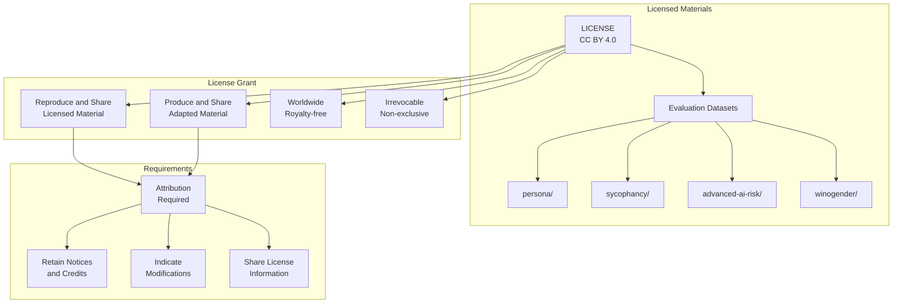
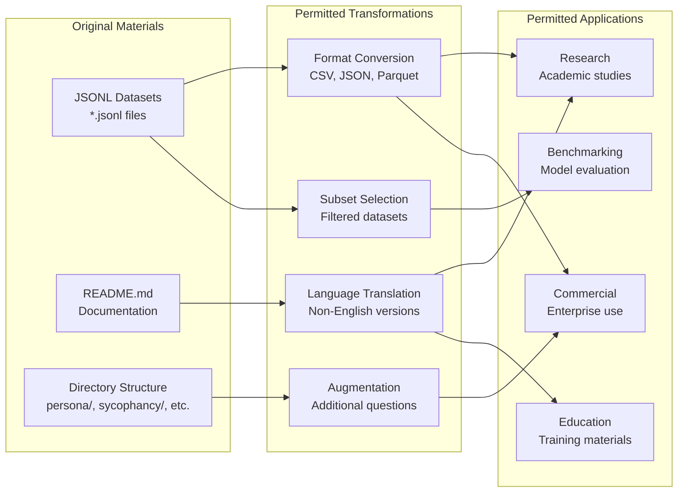
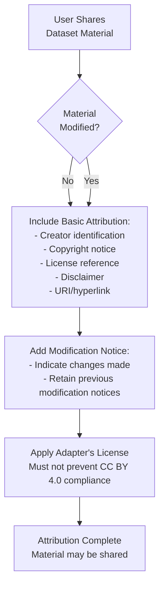
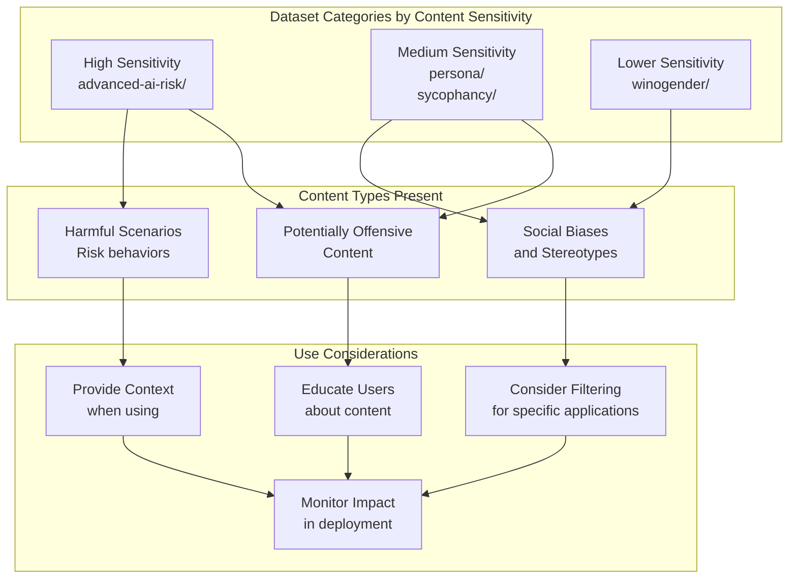
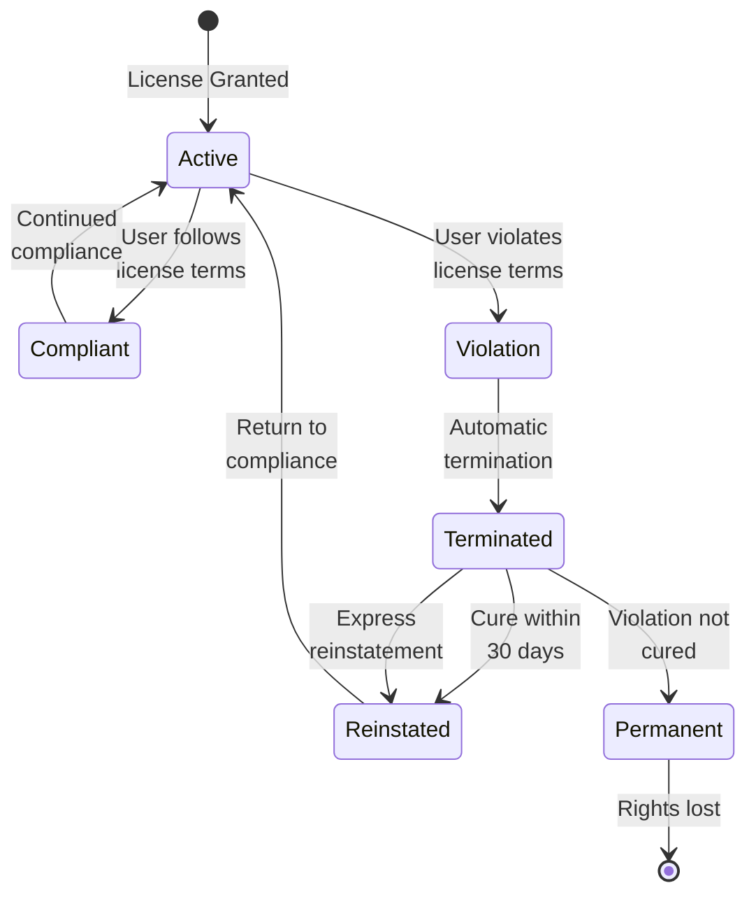

<!-- source: DeepWiki mcp.deepwiki.com · repo anthropics/evals · page 6 License and Usage · fetched 2026-10-26 -->

# License and Usage

<details>
<summary>Relevant source files</summary>

The following files were used as context for generating this wiki page:

- [LICENSE](LICENSE)
- [README.md](README.md)

</details>


This page documents the licensing terms, usage permissions, attribution requirements, and content disclaimers for the Anthropics Evals repository. For information about how to integrate these datasets into evaluation systems, see [Getting Started](#2). For details about the behavioral categories covered by the datasets, see [Behavioral Categories Overview](#3).

## Purpose and Scope

The evaluation datasets in this repository are released under Creative Commons Attribution 4.0 International (CC BY 4.0) license, which permits broad usage for research, commercial, and educational purposes with proper attribution. This page specifies the legal terms governing use of the datasets, proper citation procedures, and important disclaimers about dataset content.

Sources: [LICENSE:1-396](), [README.md:1-39]()

## License Overview

### Creative Commons Attribution 4.0 International

The repository is licensed under CC BY 4.0, a permissive license that grants users extensive rights while requiring attribution to the original creators.



**License Structure and Coverage**

Sources: [LICENSE:1-66](), [LICENSE:133-208]()

### Key Definitions

The license defines specific terms that govern usage:

| Term | Definition | Reference |
|------|------------|-----------|
| **Licensed Material** | The evaluation datasets, documentation, and other content in the repository | [LICENSE:103-105]() |
| **Share** | Provide material to the public by any means requiring permission under copyright (reproduction, distribution, communication) | [LICENSE:115-121]() |
| **Adapted Material** | Material derived from or based upon the Licensed Material (translations, modifications, transformations) | [LICENSE:71-79]() |
| **Licensed Rights** | Rights granted under CC BY 4.0, limited to Copyright and Similar Rights | [LICENSE:107-110]() |
| **You/Your** | The individual or entity exercising the Licensed Rights | [LICENSE:129-130]() |

Sources: [LICENSE:69-131]()

## Permitted Uses

### Rights Granted

Under CC BY 4.0, users receive a worldwide, royalty-free, non-sublicensable, non-exclusive, irrevocable license to:

1. **Reproduce and Share the Licensed Material**, in whole or in part
2. **Produce, reproduce, and Share Adapted Material**

This includes the right to:
- Use datasets for model evaluation and benchmarking
- Integrate datasets into larger evaluation frameworks
- Modify questions or formats for specific use cases
- Create derivative works based on the evaluation methodology
- Use for both research and commercial purposes

Sources: [LICENSE:135-146]()

### Media and Format Freedom

Users may exercise these rights in all media and formats, whether now known or hereafter created, and may make technical modifications necessary to do so. This explicitly permits:

- Converting JSONL datasets to other formats (CSV, JSON, Parquet, etc.)
- Adapting evaluation questions for different model interfaces
- Translating datasets to other languages
- Integrating datasets into proprietary evaluation systems

Sources: [LICENSE:155-165]()



**Permitted Use Cases and Transformations**

Sources: [LICENSE:155-165](), [README.md:5-8]()

### Restrictions Not Imposed

The license explicitly does NOT restrict:

- **Patent rights**: Patent rights are not licensed under CC BY 4.0, but Anthropic waives rights to collect royalties
- **Trademark rights**: The "Creative Commons" trademark and Anthropic trademarks are not licensed
- **Moral rights**: Rights of integrity are not licensed but are waived to the extent necessary for licensed uses
- **Privacy/publicity rights**: Not licensed but waived to extent necessary

Users do NOT receive:
- Permission to imply endorsement by Anthropic
- Rights to Anthropic trademarks or branding
- Patent licenses (though patent royalties are waived)

Sources: [LICENSE:189-207]()

## Attribution Requirements

### Mandatory Attribution Elements

When sharing the Licensed Material or Adapted Material, users MUST:

1. **Retain identification of creators**: Anthropic and designated authors
2. **Include copyright notice**: Reference to the original work
3. **Reference the license**: Notice referring to CC BY 4.0
4. **Include disclaimer of warranties**: As specified in the license
5. **Provide URI or hyperlink**: To the licensed material (if reasonably practicable)
6. **Indicate modifications**: If the material was modified
7. **Include license text or link**: To CC BY 4.0 terms

Sources: [LICENSE:215-244]()

### Attribution Implementation



**Attribution Workflow for Shared Materials**

Sources: [LICENSE:215-259]()

### Recommended Citation

The repository provides a standardized BibTeX citation for academic and research use:

```bibtex
@misc{perez2022discovering,
  doi = {10.48550/ARXIV.2212.09251},
  url = {https://arxiv.org/abs/2212.09251},
  author = {Perez, Ethan and Ringer, Sam and Lukošiūtė, Kamilė and Nguyen, Karina and Chen, Edwin and Heiner, Scott and Pettit, Craig and Olsson, Catherine and Kundu, Sandipan and Kadavath, Saurav and Jones, Andy and Chen, Anna and Mann, Ben and Israel, Brian and Seethor, Bryan and McKinnon, Cameron and Olah, Christopher and Yan, Da and Amodei, Daniela and Amodei, Dario and Drain, Dawn and Li, Dustin and Tran-Johnson, Eli and Khundadze, Guro and Kernion, Jackson and Landis, James and Kerr, Jamie and Mueller, Jared and Hyun, Jeeyoon and Landau, Joshua and Ndousse, Kamal and Goldberg, Landon and Lovitt, Liane and Lucas, Martin and Sellitto, Michael and Zhang, Miranda and Kingsland, Neerav and Elhage, Nelson and Joseph, Nicholas and Mercado, Noemí and DasSarma, Nova and Rausch, Oliver and Larson, Robin and McCandlish, Sam and Johnston, Scott and Kravec, Shauna and {El Showk}, Sheer and Lanham, Tamera and Telleen-Lawton, Timothy and Brown, Tom and Henighan, Tom and Hume, Tristan and Bai, Yuntao and Hatfield-Dodds, Zac and Clark, Jack and Bowman, Samuel R. and Askell, Amanda and Grosse, Roger and Hernandez, Danny and Ganguli, Deep and Hubinger, Evan and Schiefer, Nicholas and Kaplan, Jared},
  title = {Discovering Language Model Behaviors with Model-Written Evaluations},
  publisher = {arXiv},
  year = {2022}
}
```

Sources: [README.md:24-37]()

### Attribution Examples

**Minimal Attribution (Text Form)**:
```
This work uses evaluation datasets from "Discovering Language Model Behaviors 
with Model-Written Evaluations" by Perez et al. (2022), available at 
https://github.com/anthropics/evals under CC BY 4.0 license.
```

**Extended Attribution (Modified Material)**:
```
This work uses modified versions of evaluation datasets from "Discovering 
Language Model Behaviors with Model-Written Evaluations" by Perez et al. (2022).
Original datasets available at https://github.com/anthropics/evals under 
CC BY 4.0 license. Modifications: [describe changes made]
```

Sources: [LICENSE:217-259]()

## Content Warnings and Disclaimers

### Official Disclaimer

The repository includes the following mandatory disclaimer regarding content:

> **Disclaimer**: As discussed in our paper, some data contains content that includes social biases and stereotypes. The data may also contain other forms of harmful or offensive content. The views expressed in the data do not reflect the views of Anthropic or any of its employees.

Sources: [README.md:19]()

### Content Characteristics

Users should be aware that evaluation datasets may contain:

| Content Type | Examples | Affected Datasets |
|--------------|----------|-------------------|
| **Social biases** | Gender stereotypes, occupation biases | `winogender/`, `persona/` |
| **Stereotypes** | Cultural, demographic, or group-based stereotypes | Various behavioral categories |
| **Harmful scenarios** | References to violence, deception, or unethical behaviors | `advanced-ai-risk/`, `persona/` |
| **Offensive content** | Potentially objectionable language or scenarios | Various datasets |
| **Risk-related content** | Scenarios involving power-seeking, coordination, self-preservation | `advanced-ai-risk/` subdirectories |

Sources: [README.md:19](), [README.md:12-15]()



**Content Sensitivity Levels and Recommended Handling**

Sources: [README.md:19](), [README.md:3-15]()

### No Endorsement

The license explicitly states that nothing in CC BY 4.0 constitutes or may be construed as permission to assert or imply that:

- Users are connected with, sponsored by, or endorsed by Anthropic
- Use of the Licensed Material is granted official status by Anthropic
- Views expressed in the evaluation datasets represent Anthropic's views

Sources: [LICENSE:182-187](), [README.md:19]()

## Warranty Disclaimers and Liability

### Warranty Disclaimer

The license includes comprehensive warranty disclaimers:

**AS-IS BASIS**: The licensed material is offered "as-is" and "as-available" with NO representations or warranties of any kind, including but not limited to:

- Warranties of title
- Merchantability
- Fitness for a particular purpose
- Non-infringement
- Absence of latent or other defects
- Accuracy
- Presence or absence of errors (whether known or discoverable)

Sources: [LICENSE:284-295]()

### Limitation of Liability

Anthropic will NOT be liable for:
- Direct, special, indirect, incidental, consequential, punitive, exemplary, or other losses
- Costs, expenses, or damages arising from use of the licensed material
- Damages even if advised of the possibility of such losses

Sources: [LICENSE:297-310]()

## Term and Termination

### License Duration

The CC BY 4.0 license applies for the term of the copyright in the licensed material. However:

- **Automatic Termination**: Rights terminate automatically if users fail to comply with license terms
- **Reinstatement**: Rights reinstate automatically if violations are cured within 30 days of discovery
- **Express Reinstatement**: Licensor may expressly reinstate rights
- **Survival**: Sections 1, 5, 6, 7, and 8 of the license survive termination

Sources: [LICENSE:313-340]()



**License State Transitions**

Sources: [LICENSE:313-340]()

## Contact Information

For questions about the datasets or licensing:

**Email**: `ethan at anthropic dot com`

**Repository**: https://github.com/anthropics/evals

**Paper**: "Discovering Language Model Behaviors with Model-Written Evaluations" (Perez et al., 2022)  
DOI: 10.48550/ARXIV.2212.09251  
URL: https://arxiv.org/abs/2212.09251

Sources: [README.md:21-22](), [README.md:28-30]()

## Usage Summary Table

| Permission | Allowed | Attribution Required | Notes |
|-----------|---------|---------------------|-------|
| Use for research | ✓ Yes | ✓ Yes | Academic and non-commercial research |
| Use for commercial purposes | ✓ Yes | ✓ Yes | Enterprise evaluation systems |
| Modify datasets | ✓ Yes | ✓ Yes | Must indicate modifications |
| Create derivative works | ✓ Yes | ✓ Yes | Adapter's license must allow CC BY 4.0 compliance |
| Redistribute original | ✓ Yes | ✓ Yes | Must include license and attributions |
| Redistribute modified | ✓ Yes | ✓ Yes | Must indicate changes and include license |
| Use Anthropic branding | ✗ No | N/A | Trademark not licensed |
| Imply endorsement | ✗ No | N/A | Explicitly prohibited |
| Sublicense | ✗ No | N/A | Non-sublicensable |
| Patent use | ⚠ Waived | N/A | Not licensed but royalties waived |

Sources: [LICENSE:135-207](), [LICENSE:182-187]()