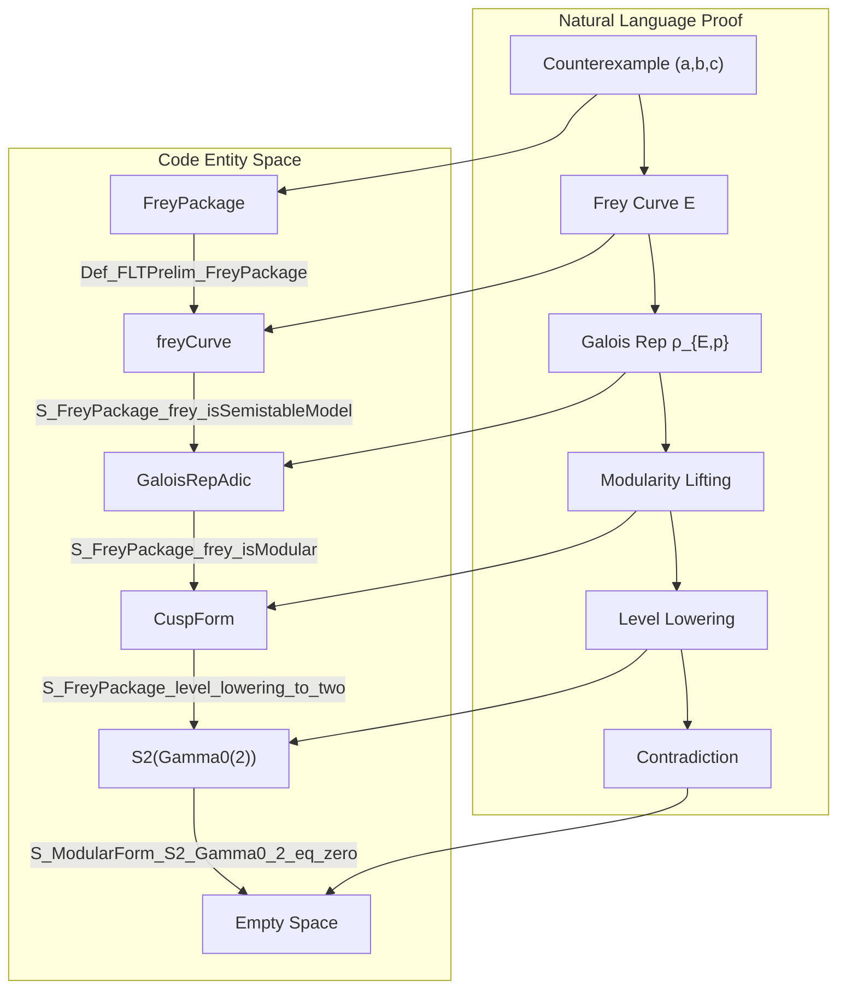
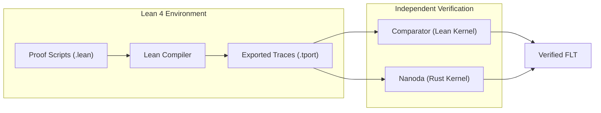

<!-- source: DeepWiki mcp.deepwiki.com · repo anthropics/fermats-last-theorem · page 1 Overview: Fermat's Last Theorem in Lean 4 · fetched 2026-10-26 -->

# Overview: Fermat's Last Theorem in Lean 4

Relevant source files

The following files were used as context for generating this wiki page:

- [P2M/Sol/S_CerednikDrinfeld_classSet_eq_empty_or_eq_univ_of_forall_mem_iff_of_squarefree.lean](P2M/Sol/S_CerednikDrinfeld_classSet_eq_empty_or_eq_univ_of_forall_mem_iff_of_squarefree.lean)
- [P2M/Sol/S_CuspForm_HeckeGaloisRepDatum_ordinaryCondition_or_flatCondition_of_apOfModel.lean](P2M/Sol/S_CuspForm_HeckeGaloisRepDatum_ordinaryCondition_or_flatCondition_of_apOfModel.lean)
- [P2M/Sol/S_CuspForm_heckeLocal_exists_algHom_length_cotangent_le_of_isResiduallyModular_of_level_of_inertia_moves_torsion_of_eq_three_of_not_cube_dvd_of_level_not_cube_dvd.lean](P2M/Sol/S_CuspForm_heckeLocal_exists_algHom_length_cotangent_le_of_isResiduallyModular_of_level_of_inertia_moves_torsion_of_eq_three_of_not_cube_dvd_of_level_not_cube_dvd.lean)
- [P2M/Sol/S_CuspForm_heckeLocal_exists_isCornerRealization_and_linearEquiv_baseML_of_squarefree.lean](P2M/Sol/S_CuspForm_heckeLocal_exists_isCornerRealization_and_linearEquiv_baseML_of_squarefree.lean)
- [P2M/Sol/S_CuspForm_isFlatAt_of_point_of_not_dvd.lean](P2M/Sol/S_CuspForm_isFlatAt_of_point_of_not_dvd.lean)
- [P2M/Sol/S_FLT_fermatLastTheorem.lean](P2M/Sol/S_FLT_fermatLastTheorem.lean)
- [P2M/Sol/S_FreyPackage_Mazur_Frey.lean](P2M/Sol/S_FreyPackage_Mazur_Frey.lean)
- [P2M/Sol/S_FreyPackage_atPNewLowering.lean](P2M/Sol/S_FreyPackage_atPNewLowering.lean)
- [P2M/Sol/S_FreyPackage_atPNewLoweringAtUniform.lean](P2M/Sol/S_FreyPackage_atPNewLoweringAtUniform.lean)
- [P2M/Sol/S_FreyPackage_dvd_freyCurveInt_discr_iff.lean](P2M/Sol/S_FreyPackage_dvd_freyCurveInt_discr_iff.lean)
- [P2M/Sol/S_FreyPackage_fermatLastTheoremFor_of_five_le.lean](P2M/Sol/S_FreyPackage_fermatLastTheoremFor_of_five_le.lean)
- [P2M/Sol/S_FreyPackage_freyCurveInt_discr_ne_zero.lean](P2M/Sol/S_FreyPackage_freyCurveInt_discr_ne_zero.lean)
- [P2M/Sol/S_FreyPackage_freyCurveInt_map.lean](P2M/Sol/S_FreyPackage_freyCurveInt_map.lean)
- [P2M/Sol/S_FreyPackage_freyGaloisRep_isUnramifiedAt.lean](P2M/Sol/S_FreyPackage_freyGaloisRep_isUnramifiedAt.lean)
- [P2M/Sol/S_FreyPackage_frey_isModular.lean](P2M/Sol/S_FreyPackage_frey_isModular.lean)
- [P2M/Sol/S_FreyPackage_frey_isSemistableModel.lean](P2M/Sol/S_FreyPackage_frey_isSemistableModel.lean)
- [P2M/Sol/S_FreyPackage_level_lowering_odd_prime_of_conductorLevel.lean](P2M/Sol/S_FreyPackage_level_lowering_odd_prime_of_conductorLevel.lean)
- [P2M/Sol/S_FreyPackage_level_lowering_to_two.lean](P2M/Sol/S_FreyPackage_level_lowering_to_two.lean)
- [P2M/Sol/S_FreyPackage_mazurPrincipleAtPStep.lean](P2M/Sol/S_FreyPackage_mazurPrincipleAtPStep.lean)
- [P2M/Sol/S_FreyPackage_modularRepOfConductorLevel.lean](P2M/Sol/S_FreyPackage_modularRepOfConductorLevel.lean)
- [P2M/Sol/S_FreyPackage_no_frey_package.lean](P2M/Sol/S_FreyPackage_no_frey_package.lean)
- [P2M/Sol/S_FreyPackage_not_dvd_freyCurveInt_c4.lean](P2M/Sol/S_FreyPackage_not_dvd_freyCurveInt_c4.lean)
- [P2M/Sol/S_FreyPackage_padicValInt_freyCurveInt_discr.lean](P2M/Sol/S_FreyPackage_padicValInt_freyCurveInt_discr.lean)
- [P2M/Sol/S_FreyPackage_padicValInt_two_freyCurveInt_discr.lean](P2M/Sol/S_FreyPackage_padicValInt_two_freyCurveInt_discr.lean)

This repository contains a formal verification of Fermat's Last Theorem (FLT) in the Lean 4 programming language. The proof follows the modern modularity-based approach established by Wiles, Taylor, Ribet, Serre, and others. The codebase formalizes the transition from a hypothetical counterexample to the Fermat equation $a^n + b^n = c^n$ to the construction of a semistable elliptic curve (the Frey curve) and the subsequent contradiction derived from modularity lifting and level lowering.

### Proof Strategy: The Six Steps

The formalization is organized around the "Frey-Serre-Ribet-Wiles" strategy. The high-level proof, found in `P2M/Sol/S_FLT_fermatLastTheorem.lean` and `P2M/Sol/S_FreyPackage_fermatLastTheoremFor_of_five_le.lean`, reduces the problem to six fundamental milestones:

1.  **Reduction to Prime $p \geq 5$**: The proof focuses on the case where $n$ is a prime $p \geq 5$.
2.  **Frey Package Construction**: Given a counterexample $(a, b, c)$, a `FreyPackage` is constructed, defining a semistable elliptic curve $E_{a,b,c}$ over $\mathbb{Q}$ [Definitions/Def_FLTPrelim_FreyPackage.lean]().
3.  **Irreducibility (Mazur)**: The residual Galois representation $\bar{\rho}_{E,p}$ is shown to be absolutely irreducible [Theorems/Thm_FreyPackage_Mazur_Frey.lean]().
4.  **Modularity (Wiles/Taylor-Wiles)**: The Frey curve is proved to be modular, meaning its $L$-function corresponds to a modular form [Theorems/Thm_FreyPackage_frey_isModular.lean]().
5.  **Level Lowering (Ribet)**: The level of the associated modular form is lowered until it reaches $N=2$ [Theorems/Thm_FreyPackage_level_lowering_to_two.lean]().
6.  **Vanishing of $S_2(\Gamma_0(2))$**: A contradiction is reached by proving that the space of cusp forms of weight 2 and level 2 is zero [Theorems/Thm_ModularForm_S2_Gamma0_2_eq_zero.lean]().

For a detailed walkthrough of these steps, see [Proof Route: Six Steps from FLT to S₂(Γ₀(2))=0](#1.2).

### Codebase Organization

The repository is structured to separate definitions, individual theorem statements, and the integrated proof solutions.

| Directory | Purpose |
| :--- | :--- |
| `Definitions/` | Core typeclasses and structures (e.g., `FreyPackage`, `CuspForm`). |
| `Theorems/` | Individual lemmas and major named theorems (e.g., `Thm_W54_...`). |
| `P2M/Sol/` | "Solution" files that integrate theorems to close specific proof gaps. |
| `verification/` | Infrastructure for external kernel checking (Lean kernel and Nanoda). |
| `html/` | Generated documentation site containing the citation graph. |

For details on file naming and navigation, see [Repository Structure and Navigation](#1.1).

### Mapping Proof Logic to Code Entities

The following diagram illustrates how the mathematical proof steps are represented by specific Lean structures and files within the `P2M/Sol` and `Theorems` namespaces.

**Proof Step to Code Mapping**

**Sources:** [P2M/Sol/S_FreyPackage_fermatLastTheoremFor_of_five_le.lean:1-7](), [P2M/Sol/S_FreyPackage_no_frey_package.lean:1-5](), [Definitions/Def_FLTPrelim_FreyPackage.lean]()

### Verification and Trust

To ensure the integrity of the formalization, the proof is subjected to two independent kernel checks. This process ensures that no "sorry" or unproven axioms remain in the dependency graph of the final theorem.

**Verification Pipeline**

For details on the verification tools and patching strategy, see [Verification Infrastructure](#1.3).

**Sources:** [P2M/Sol/S_FreyPackage_dvd_freyCurveInt_discr_iff.lean:149-171](), [P2M/Sol/S_CuspForm_isFlatAt_of_point_of_not_dvd.lean:1-20]()

---

