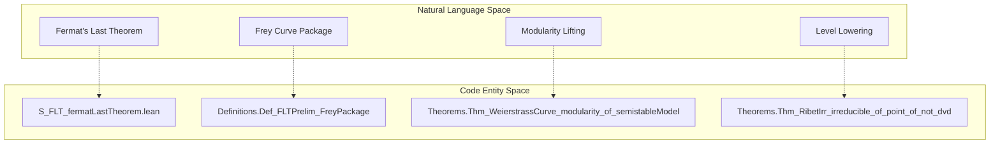
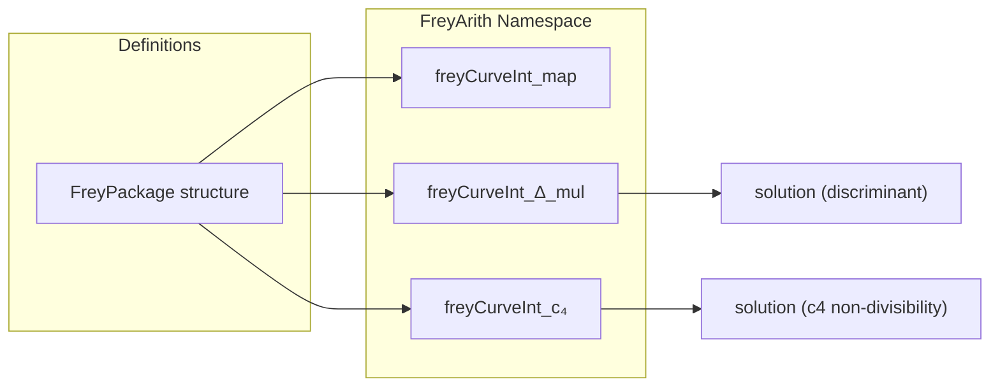

<!-- source: DeepWiki mcp.deepwiki.com · repo anthropics/fermats-last-theorem · page 1.1 Repository Structure and Navigation · fetched 2026-10-26 -->

# Repository Structure and Navigation

Relevant source files

The following files were used as context for generating this wiki page:

- [P2M/Sol/S_CerednikDrinfeld_classSet_eq_empty_or_eq_univ_of_forall_mem_iff_of_squarefree.lean](P2M/Sol/S_CerednikDrinfeld_classSet_eq_empty_or_eq_univ_of_forall_mem_iff_of_squarefree.lean)
- [P2M/Sol/S_CuspForm_HeckeGaloisRepDatum_ordinaryCondition_or_flatCondition_of_apOfModel.lean](P2M/Sol/S_CuspForm_HeckeGaloisRepDatum_ordinaryCondition_or_flatCondition_of_apOfModel.lean)
- [P2M/Sol/S_CuspForm_heckeLocal_exists_algHom_length_cotangent_le_of_isResiduallyModular_of_level_of_inertia_moves_torsion_of_eq_three_of_not_cube_dvd_of_level_not_cube_dvd.lean](P2M/Sol/S_CuspForm_heckeLocal_exists_algHom_length_cotangent_le_of_isResiduallyModular_of_level_of_inertia_moves_torsion_of_eq_three_of_not_cube_dvd_of_level_not_cube_dvd.lean)
- [P2M/Sol/S_CuspForm_heckeLocal_exists_isCornerRealization_and_linearEquiv_baseML_of_squarefree.lean](P2M/Sol/S_CuspForm_heckeLocal_exists_isCornerRealization_and_linearEquiv_baseML_of_squarefree.lean)
- [P2M/Sol/S_CuspForm_isFlatAt_of_point_of_not_dvd.lean](P2M/Sol/S_CuspForm_isFlatAt_of_point_of_not_dvd.lean)
- [P2M/Sol/S_FLT_fermatLastTheorem.lean](P2M/Sol/S_FLT_fermatLastTheorem.lean)
- [P2M/Sol/S_FreyPackage_Mazur_Frey.lean](P2M/Sol/S_FreyPackage_Mazur_Frey.lean)
- [P2M/Sol/S_FreyPackage_atPNewLowering.lean](P2M/Sol/S_FreyPackage_atPNewLowering.lean)
- [P2M/Sol/S_FreyPackage_atPNewLoweringAtUniform.lean](P2M/Sol/S_FreyPackage_atPNewLoweringAtUniform.lean)
- [P2M/Sol/S_FreyPackage_dvd_freyCurveInt_discr_iff.lean](P2M/Sol/S_FreyPackage_dvd_freyCurveInt_discr_iff.lean)
- [P2M/Sol/S_FreyPackage_fermatLastTheoremFor_of_five_le.lean](P2M/Sol/S_FreyPackage_fermatLastTheoremFor_of_five_le.lean)
- [P2M/Sol/S_FreyPackage_freyCurveInt_discr_ne_zero.lean](P2M/Sol/S_FreyPackage_freyCurveInt_discr_ne_zero.lean)
- [P2M/Sol/S_FreyPackage_freyCurveInt_map.lean](P2M/Sol/S_FreyPackage_freyCurveInt_map.lean)
- [P2M/Sol/S_FreyPackage_freyGaloisRep_isUnramifiedAt.lean](P2M/Sol/S_FreyPackage_freyGaloisRep_isUnramifiedAt.lean)
- [P2M/Sol/S_FreyPackage_frey_isModular.lean](P2M/Sol/S_FreyPackage_frey_isModular.lean)
- [P2M/Sol/S_FreyPackage_frey_isSemistableModel.lean](P2M/Sol/S_FreyPackage_frey_isSemistableModel.lean)
- [P2M/Sol/S_FreyPackage_level_lowering_odd_prime_of_conductorLevel.lean](P2M/Sol/S_FreyPackage_level_lowering_odd_prime_of_conductorLevel.lean)
- [P2M/Sol/S_FreyPackage_level_lowering_to_two.lean](P2M/Sol/S_FreyPackage_level_lowering_to_two.lean)
- [P2M/Sol/S_FreyPackage_mazurPrincipleAtPStep.lean](P2M/Sol/S_FreyPackage_mazurPrincipleAtPStep.lean)
- [P2M/Sol/S_FreyPackage_modularRepOfConductorLevel.lean](P2M/Sol/S_FreyPackage_modularRepOfConductorLevel.lean)
- [P2M/Sol/S_FreyPackage_no_frey_package.lean](P2M/Sol/S_FreyPackage_no_frey_package.lean)
- [P2M/Sol/S_FreyPackage_not_dvd_freyCurveInt_c4.lean](P2M/Sol/S_FreyPackage_not_dvd_freyCurveInt_c4.lean)
- [P2M/Sol/S_FreyPackage_padicValInt_freyCurveInt_discr.lean](P2M/Sol/S_FreyPackage_padicValInt_freyCurveInt_discr.lean)
- [P2M/Sol/S_FreyPackage_padicValInt_two_freyCurveInt_discr.lean](P2M/Sol/S_FreyPackage_padicValInt_two_freyCurveInt_discr.lean)

This page describes the organizational layout of the Fermat's Last Theorem (FLT) Lean 4 repository. It details the directory structure, file naming conventions, and the dependency graph between definitions and theorems, as well as the use of the generated HTML documentation.

## Directory Layout

The repository is organized into several functional directories, each serving a specific role in the formalization and verification process.

| Directory | Description |
| :--- | :--- |
| `Theorems/` | Contains the formal statements and proofs of major named theorems. |
| `Definitions/` | Contains the core mathematical definitions and structures used across the proof. |
| `P2M/Sol/` | "Path to Mathlib" solutions. Contains finalized proofs of specific lemmas required for the main FLT result, often bridging repository-specific definitions to Mathlib. |
| `html/` | The generated documentation site, including the citation graph and theorem indices. |
| `tools/` | Python-based infrastructure for generating the documentation site and performing QA. |
| `verification/` | Scripts and tools for independent kernel verification (e.g., `nanoda`, `lean4export`). |

### Sources:
- [P2M/Sol/S_CuspForm_isFlatAt_of_point_of_not_dvd.lean:1-40]()
- [P2M/Sol/S_FreyPackage_modularRepOfConductorLevel.lean:1-14]()

## Naming Conventions

The repository follows a strict naming convention to distinguish between different types of Lean files and to facilitate automated discovery.

*   **`Def_X_y.lean`**: Located in `Definitions/`. Defines a mathematical object or property (e.g., `Def_GaloisRep_Adic`).
*   **`Thm_X_y.lean`**: Located in `Theorems/`. Contains the statement and proof of a significant theorem (e.g., `Thm_RibetIrr_irreducible_of_point_of_not_dvd`).
*   **`S_X_y.lean`**: Located in `P2M/Sol/`. These are "Solution" files that prove specific goals identified in the proof path. For example, `S_FreyPackage_frey_isModular.lean` proves the modularity of the Frey curve by invoking modularity lifting theorems.

### Sources:
- [P2M/Sol/S_CuspForm_isFlatAt_of_point_of_not_dvd.lean:1-24]()
- [P2M/Sol/S_FreyPackage_modularRepOfConductorLevel.lean:1-12]()

## Theorem Citation and Data Flow

The codebase is structured as a Directed Acyclic Graph (DAG). High-level results in `P2M/Sol/` import theorems from `Theorems/`, which in turn depend on `Definitions/` and `Mathlib`.

### Natural Language to Code Entity Space: Proof Components

The following diagram maps the high-level proof concepts to the specific Lean entities and files that implement them.

**Diagram: Proof Component Mapping**

### Sources:
- [P2M/Sol/S_FreyPackage_frey_isModular.lean:1-1]()
- [P2M/Sol/S_FreyPackage_fermatLastTheoremFor_of_five_le.lean:1-2]()
- [P2M/Sol/S_CuspForm_isFlatAt_of_point_of_not_dvd.lean:1-5]()

## Internal Data Flow: The Frey Package Example

The `FreyPackage` structure acts as a central data carrier for the proof, transporting the arithmetic properties of a hypothetical counterexample through various stages of the proof.

**Diagram: Frey Package Data Flow**

### Sources:
- [P2M/Sol/S_FreyPackage_dvd_freyCurveInt_discr_iff.lean:17-49]()
- [P2M/Sol/S_FreyPackage_dvd_freyCurveInt_discr_iff.lean:105-150]()
- [P2M/Sol/S_FreyPackage_not_dvd_freyCurveInt_c4.lean:58-100]()
- [P2M/Sol/S_FreyPackage_not_dvd_freyCurveInt_c4.lean:149-152]()

## HTML Documentation and Navigation

The `html/` directory contains a static site generated by the tools in `tools/docs-site/`. This site is the primary interface for exploring the proof's complexity.

1.  **Theorem Pages**: Every theorem has a dedicated page (e.g., `html/thm/Thm_X_y.html`) showing its statement, formal proof, and dependencies.
2.  **Citation Graph**: The `edges.js` and `shard/` files contain the data for the interactive DAG, allowing users to trace how a specific lemma in `P2M/Sol/` contributes to the final proof of FLT.
3.  **Route Chapters**: The `route/` directory organizes theorems according to the six main steps of the proof path defined in `PROOF-PATH.md`.
4.  **Namespace Index**: Provides a searchable index of all Lean namespaces used in the project, such as `P2MW.S_FreyPackage_dvd_freyCurveInt_discr_iff`.

### Sources:
- [P2M/Sol/S_FreyPackage_dvd_freyCurveInt_discr_iff.lean:7-11]()
- [P2M/Sol/S_CuspForm_isFlatAt_of_point_of_not_dvd.lean:40-40]()

---

