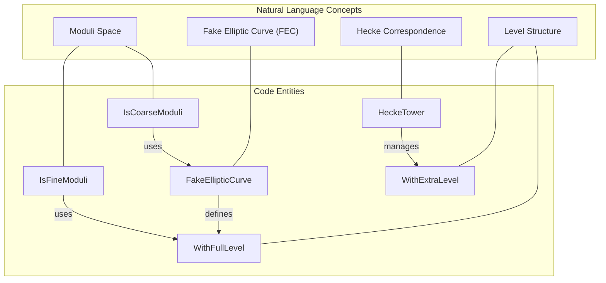
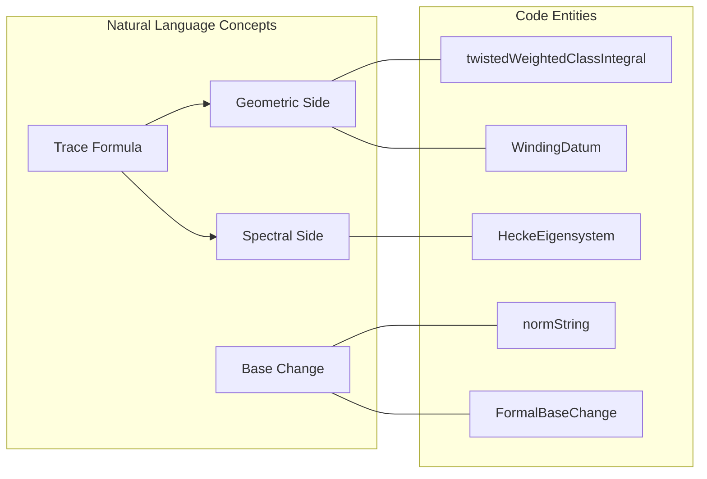

<!-- source: DeepWiki mcp.deepwiki.com · repo anthropics/fermats-last-theorem · page 10 Glossary · fetched 2026-10-26 -->

# Glossary

Relevant source files

The following files were used as context for generating this wiki page:

- [Definitions/Def_FrobeniusDensity_BadPrimes.lean](Definitions/Def_FrobeniusDensity_BadPrimes.lean)
- [Definitions/Def_LanglandsTunnell_ArtinCoreCTM.lean](Definitions/Def_LanglandsTunnell_ArtinCoreCTM.lean)
- [Definitions/Def_LanglandsTunnell_NormClass.lean](Definitions/Def_LanglandsTunnell_NormClass.lean)
- [P2M/Sol/S_AlgebraicCurve_Differential_correspondence_mem_regularDifferentials.lean](P2M/Sol/S_AlgebraicCurve_Differential_correspondence_mem_regularDifferentials.lean)
- [P2M/Sol/S_AlgebraicCurve_Divisor_pushforwardNormFormula.lean](P2M/Sol/S_AlgebraicCurve_Divisor_pushforwardNormFormula.lean)
- [P2M/Sol/S_AlgebraicCurve_Divisor_pushforwardNormFormula_of_finiteDimensional.lean](P2M/Sol/S_AlgebraicCurve_Divisor_pushforwardNormFormula_of_finiteDimensional.lean)
- [P2M/Sol/S_AlgebraicCurve_Divisor_pushforwardNormFormula_of_isSeparable.lean](P2M/Sol/S_AlgebraicCurve_Divisor_pushforwardNormFormula_of_isSeparable.lean)
- [P2M/Sol/S_AlgebraicCurve_Place_exists_toValuationSubring_eq_comap.lean](P2M/Sol/S_AlgebraicCurve_Place_exists_toValuationSubring_eq_comap.lean)
- [P2M/Sol/S_AlgebraicCurve_Place_inertiaDeg_eq_inertiaDeg_fiberCenter.lean](P2M/Sol/S_AlgebraicCurve_Place_inertiaDeg_eq_inertiaDeg_fiberCenter.lean)
- [P2M/Sol/S_AlgebraicCurve_Place_inertiaDeg_pos.lean](P2M/Sol/S_AlgebraicCurve_Place_inertiaDeg_pos.lean)
- [P2M/Sol/S_AlgebraicCurve_Place_neg_le_ord_trace_of_forall_le_ord_sub_pred.lean](P2M/Sol/S_AlgebraicCurve_Place_neg_le_ord_trace_of_forall_le_ord_sub_pred.lean)
- [P2M/Sol/S_AlgebraicCurve_Place_ord_norm_eq_sum_fiberOver.lean](P2M/Sol/S_AlgebraicCurve_Place_ord_norm_eq_sum_fiberOver.lean)
- [P2M/Sol/S_AlgebraicCurve_Place_ord_norm_eq_sum_fiberOver_of_isSeparable.lean](P2M/Sol/S_AlgebraicCurve_Place_ord_norm_eq_sum_fiberOver_of_isSeparable.lean)
- [P2M/Sol/S_AlgebraicCurve_Place_ramificationIndex_eq_ramificationIdx_fiberCenter.lean](P2M/Sol/S_AlgebraicCurve_Place_ramificationIndex_eq_ramificationIdx_fiberCenter.lean)
- [P2M/Sol/S_AlgebraicCurve_Place_sum_ramificationIndex_mul_inertiaDeg.lean](P2M/Sol/S_AlgebraicCurve_Place_sum_ramificationIndex_mul_inertiaDeg.lean)
- [P2M/Sol/S_AlgebraicCurve_Place_sum_ramificationIndex_mul_inertiaDeg_fiberOver.lean](P2M/Sol/S_AlgebraicCurve_Place_sum_ramificationIndex_mul_inertiaDeg_fiberOver.lean)
- [P2M/Sol/S_AlgebraicCurve_Place_sum_ramificationIndex_mul_inertiaDeg_le_finrank.lean](P2M/Sol/S_AlgebraicCurve_Place_sum_ramificationIndex_mul_inertiaDeg_le_finrank.lean)
- [P2M/Sol/S_AlgebraicCurve_RationalFunctionField_trace_localResidue_finitePlace_add_trace_localResidue_placeInfty_eq_zero.lean](P2M/Sol/S_AlgebraicCurve_RationalFunctionField_trace_localResidue_finitePlace_add_trace_localResidue_placeInfty_eq_zero.lean)
- [P2M/Sol/S_AlgebraicCurve_RationalFunctionField_trace_localResidue_finitePlace_div_pow_eq_zero.lean](P2M/Sol/S_AlgebraicCurve_RationalFunctionField_trace_localResidue_finitePlace_div_pow_eq_zero.lean)
- [P2M/Sol/S_AlgebraicCurve_RationalFunctionField_trace_localResidue_placeInfty_X_pow_eq_zero.lean](P2M/Sol/S_AlgebraicCurve_RationalFunctionField_trace_localResidue_placeInfty_X_pow_eq_zero.lean)
- [P2M/Sol/S_AlgebraicCurve_completionTraceSum_of_isSeparable.lean](P2M/Sol/S_AlgebraicCurve_completionTraceSum_of_isSeparable.lean)
- [P2M/Sol/S_AlgebraicCurve_fibreResidueIdentityAlong_of_separableAlong_of_dCoordGenerates.lean](P2M/Sol/S_AlgebraicCurve_fibreResidueIdentityAlong_of_separableAlong_of_dCoordGenerates.lean)
- [P2M/Sol/S_AlgebraicCurve_genus_ratFunc_eq_zero_of_perfectField.lean](P2M/Sol/S_AlgebraicCurve_genus_ratFunc_eq_zero_of_perfectField.lean)
- [P2M/Sol/S_AlgebraicCurve_hasPrincipalDivisors_of_finiteDimensional_ratFunc.lean](P2M/Sol/S_AlgebraicCurve_hasPrincipalDivisors_of_finiteDimensional_ratFunc.lean)
- [P2M/Sol/S_AlgebraicCurve_hasPrincipalDivisors_of_finiteDimensional_ratFunc_of_isSeparable.lean](P2M/Sol/S_AlgebraicCurve_hasPrincipalDivisors_of_finiteDimensional_ratFunc_of_isSeparable.lean)
- [P2M/Sol/S_AlgebraicCurve_hasPrincipalDivisors_of_transcendental.lean](P2M/Sol/S_AlgebraicCurve_hasPrincipalDivisors_of_transcendental.lean)
- [P2M/Sol/S_AlgebraicCurve_instHasCanonicalDivisorRatFuncPerfectField.lean](P2M/Sol/S_AlgebraicCurve_instHasCanonicalDivisorRatFuncPerfectField.lean)
- [P2M/Sol/S_AlgebraicCurve_isCurveOver_ratFunc.lean](P2M/Sol/S_AlgebraicCurve_isCurveOver_ratFunc.lean)
- [P2M/Sol/S_AlgebraicCurve_residueTheoremK_of_isAlgClosed.lean](P2M/Sol/S_AlgebraicCurve_residueTheoremK_of_isAlgClosed.lean)
- [P2M/Sol/S_AlgebraicCurve_residueTheoremK_ratFunc_of_isAlgClosed.lean](P2M/Sol/S_AlgebraicCurve_residueTheoremK_ratFunc_of_isAlgClosed.lean)
- [P2M/Sol/S_AlgebraicCurve_residueTheorem_of_residueTheorem_ratFunc_of_residueTraceCompletionCommute.lean](P2M/Sol/S_AlgebraicCurve_residueTheorem_of_residueTheorem_ratFunc_of_residueTraceCompletionCommute.lean)
- [P2M/Sol/S_AlgebraicCurve_residueTheorem_ratFunc_of_perfectField.lean](P2M/Sol/S_AlgebraicCurve_residueTheorem_ratFunc_of_perfectField.lean)
- [P2M/Sol/S_AlgebraicCurve_tateCommFinite.lean](P2M/Sol/S_AlgebraicCurve_tateCommFinite.lean)
- [P2M/Sol/S_AlgebraicCurve_tateTraceCompat_of_isSeparable.lean](P2M/Sol/S_AlgebraicCurve_tateTraceCompat_of_isSeparable.lean)
- [P2M/Sol/S_AlgebraicGeometry_Polarisation_KernelIsTwoTorsion_of_forall_away_of_isInvertible.lean](P2M/Sol/S_AlgebraicGeometry_Polarisation_KernelIsTwoTorsion_of_forall_away_of_isInvertible.lean)
- [P2M/Sol/S_AlgebraicGeometry_Polarisation_KernelIsTwoTorsion_of_pullback_of_faithfullyFlat.lean](P2M/Sol/S_AlgebraicGeometry_Polarisation_KernelIsTwoTorsion_of_pullback_of_faithfullyFlat.lean)
- [P2M/Sol/S_AlgebraicGeometry_Polarisation_KernelIsTwoTorsion_pullback_of_isPullback_of_isInvertible.lean](P2M/Sol/S_AlgebraicGeometry_Polarisation_KernelIsTwoTorsion_pullback_of_isPullback_of_isInvertible.lean)
- [P2M/Sol/S_AlgebraicGeometry_Polarisation_KernelTrivial_of_forall_away_of_isInvertible.lean](P2M/Sol/S_AlgebraicGeometry_Polarisation_KernelTrivial_of_forall_away_of_isInvertible.lean)
- [P2M/Sol/S_AlgebraicGeometry_Polarisation_RosatiCompatible_of_forall_away_of_isInvertible.lean](P2M/Sol/S_AlgebraicGeometry_Polarisation_RosatiCompatible_of_forall_away_of_isInvertible.lean)
- [P2M/Sol/S_AlgebraicGeometry_Polarisation_RosatiCompatible_of_pullback_of_faithfullyFlat.lean](P2M/Sol/S_AlgebraicGeometry_Polarisation_RosatiCompatible_of_pullback_of_faithfullyFlat.lean)
- [P2M/Sol/S_AlgebraicGeometry_Polarisation_RosatiCompatible_pullback_of_isPullback.lean](P2M/Sol/S_AlgebraicGeometry_Polarisation_RosatiCompatible_pullback_of_isPullback.lean)
- [P2M/Sol/S_AlgebraicGeometry_Polarisation_exists_faithfullyFlat_principalSqrt_of_kernelTrivial_of_locIsoOnBase.lean](P2M/Sol/S_AlgebraicGeometry_Polarisation_exists_faithfullyFlat_principalSqrt_of_kernelTrivial_of_locIsoOnBase.lean)
- [P2M/Sol/S_AlgebraicGeometry_Polarisation_exists_isLocalRing_faithfullyFlat_kernelTrivial_locIsoOnBase_pair_of_isLocalRing.lean](P2M/Sol/S_AlgebraicGeometry_Polarisation_exists_isLocalRing_faithfullyFlat_kernelTrivial_locIsoOnBase_pair_of_isLocalRing.lean)
- [P2M/Sol/S_AlgebraicGeometry_Polarisation_kernelIsTwoTorsion_of_isPullback_of_kernelTrivial_of_locIsoOnBase_of_isAlgClosed.lean](P2M/Sol/S_AlgebraicGeometry_Polarisation_kernelIsTwoTorsion_of_isPullback_of_kernelTrivial_of_locIsoOnBase_of_isAlgClosed.lean)
- [P2M/Sol/S_AlgebraicGeometry_Polarisation_memKernel_iff_memKernel_comp_of_isPullback.lean](P2M/Sol/S_AlgebraicGeometry_Polarisation_memKernel_iff_memKernel_comp_of_isPullback.lean)
- [P2M/Sol/S_AlgebraicGeometry_Polarisation_principalSqrt_baseChange_of_principalSqrt_chart.lean](P2M/Sol/S_AlgebraicGeometry_Polarisation_principalSqrt_baseChange_of_principalSqrt_chart.lean)
- [P2M/Sol/S_AlgebraicGeometry_PolarisedAbelianScheme_hasPrincipalRoot_of_isPullback.lean](P2M/Sol/S_AlgebraicGeometry_PolarisedAbelianScheme_hasPrincipalRoot_of_isPullback.lean)
- [P2M/Sol/S_AlgebraicGeometry_PolarisedAbelianScheme_isOfType_of_isPullback.lean](P2M/Sol/S_AlgebraicGeometry_PolarisedAbelianScheme_isOfType_of_isPullback.lean)
- [P2M/Sol/S_AlgebraicGeometry_PolarisedAbelianScheme_isSymmetric_of_isPullback.lean](P2M/Sol/S_AlgebraicGeometry_PolarisedAbelianScheme_isSymmetric_of_isPullback.lean)
- [P2M/Sol/S_AlgebraicGeometry_RelEffCartierDiv_eq_of_isAlgEquivZero_of_nonempty_tensor_lineBundle_iso_lineBundle.lean](P2M/Sol/S_AlgebraicGeometry_RelEffCartierDiv_eq_of_isAlgEquivZero_of_nonempty_tensor_lineBundle_iso_lineBundle.lean)
- [P2M/Sol/S_AlgebraicGeometry_RelEffCartierDiv_eq_of_isAlgEquivZero_pullback_mapOnProdOver_of_nonempty_tensor_lineBundle_iso_lineBundle.lean](P2M/Sol/S_AlgebraicGeometry_RelEffCartierDiv_eq_of_isAlgEquivZero_pullback_mapOnProdOver_of_nonempty_tensor_lineBundle_iso_lineBundle.lean)
- [P2M/Sol/S_AlgebraicGeometry_RelEffCartierDiv_exists_nonempty_tensor_lineBundle_iso_lineBundle.lean](P2M/Sol/S_AlgebraicGeometry_RelEffCartierDiv_exists_nonempty_tensor_lineBundle_iso_lineBundle.lean)
- [P2M/Sol/S_AlgebraicGeometry_RelPicard_IsAlgEquivZero_nonempty_pullback_iso_pullback_unit_and_eulerChar_eq_one_of_curveModel_ratFunc.lean](P2M/Sol/S_AlgebraicGeometry_RelPicard_IsAlgEquivZero_nonempty_pullback_iso_pullback_unit_and_eulerChar_eq_one_of_curveModel_ratFunc.lean)
- [P2M/Sol/S_AlgebraicGeometry_RelPicard_exists_chart_subsingleton_H1_and_support_subset_fibre_of_twoSidedBlocks_of_injective.lean](P2M/Sol/S_AlgebraicGeometry_RelPicard_exists_chart_subsingleton_H1_and_support_subset_fibre_of_twoSidedBlocks_of_injective.lean)
- [P2M/Sol/S_AlgebraicGeometry_RelPicard_exists_chart_subsingleton_H1_fibre_of_blocks_of_injective.lean](P2M/Sol/S_AlgebraicGeometry_RelPicard_exists_chart_subsingleton_H1_fibre_of_blocks_of_injective.lean)
- [P2M/Sol/S_AlgebraicGeometry_RelPicard_exists_chart_subsingleton_H1_fibre_of_blocks_of_not_smooth.lean](P2M/Sol/S_AlgebraicGeometry_RelPicard_exists_chart_subsingleton_H1_fibre_of_blocks_of_not_smooth.lean)
- [P2M/Sol/S_AlgebraicGeometry_RelPicard_exists_injective_forall_finrank_H0_eq_zero_and_subsingleton_H1_restrict_fst_of_nearBlocks_of_twoGluedSmoothCurveDegeneration.lean](P2M/Sol/S_AlgebraicGeometry_RelPicard_exists_injective_forall_finrank_H0_eq_zero_and_subsingleton_H1_restrict_fst_of_nearBlocks_of_twoGluedSmoothCurveDegeneration.lean)
- [P2M/Sol/S_AlgebraicGeometry_RelPicard_exists_injective_forall_subsingleton_H1_and_finrank_H0_restrict_snd_of_farBlocks_of_twoGluedSmoothCurveDegeneration.lean](P2M/Sol/S_AlgebraicGeometry_RelPicard_exists_injective_forall_subsingleton_H1_and_finrank_H0_restrict_snd_of_farBlocks_of_twoGluedSmoothCurveDegeneration.lean)
- [P2M/Sol/S_AlgebraicGeometry_RelPicard_exists_injective_forall_subsingleton_H1_of_blocks_of_pool_of_bijective_sections.lean](P2M/Sol/S_AlgebraicGeometry_RelPicard_exists_injective_forall_subsingleton_H1_of_blocks_of_pool_of_bijective_sections.lean)
- [P2M/Sol/S_AlgebraicGeometry_RelPicard_exists_injective_forall_subsingleton_H1_of_blocks_of_twoLineDegeneration_of_sectionInSmoothLocus.lean](P2M/Sol/S_AlgebraicGeometry_RelPicard_exists_injective_forall_subsingleton_H1_of_blocks_of_twoLineDegeneration_of_sectionInSmoothLocus.lean)
- [P2M/Sol/S_AlgebraicGeometry_RelPicard_exists_opens_range_subset_iff_isAlgEquivZero_rigidify_lineBundle_baseChange_of_twoGluedSmoothCurveDegenerations.lean](P2M/Sol/S_AlgebraicGeometry_RelPicard_exists_opens_range_subset_iff_isAlgEquivZero_rigidify_lineBundle_baseChange_of_twoGluedSmoothCurveDegenerations.lean)
- [P2M/Sol/S_AlgebraicGeometry_RelPicard_exists_opens_range_subset_iff_isAlgEquivZero_twistModule_baseChange_of_twoLineDegenerations.lean](P2M/Sol/S_AlgebraicGeometry_RelPicard_exists_opens_range_subset_iff_isAlgEquivZero_twistModule_baseChange_of_twoLineDegenerations.lean)
- [P2M/Sol/S_AlgebraicGeometry_RelPicard_exists_relEffCartierDiv_I_eq_zeroSchemeIdeal_chartModule_fibre_of_not_smooth_of_isReduced.lean](P2M/Sol/S_AlgebraicGeometry_RelPicard_exists_relEffCartierDiv_I_eq_zeroSchemeIdeal_chartModule_fibre_of_not_smooth_of_isReduced.lean)
- [P2M/Sol/S_AlgebraicGeometry_RelPicard_exists_relEffCartierDiv_I_eq_zeroSchemeIdeal_chartModule_fibre_of_smooth.lean](P2M/Sol/S_AlgebraicGeometry_RelPicard_exists_relEffCartierDiv_I_eq_zeroSchemeIdeal_chartModule_fibre_of_smooth.lean)
- [P2M/Sol/S_AlgebraicGeometry_RelPicard_exists_relEffCartierDiv_I_eq_zeroSchemeIdeal_polarisedChartModule_fibre_of_support_subset_of_twoGluedSmoothCurveDegenerations_of_not_smooth.lean](P2M/Sol/S_AlgebraicGeometry_RelPicard_exists_relEffCartierDiv_I_eq_zeroSchemeIdeal_polarisedChartModule_fibre_of_support_subset_of_twoGluedSmoothCurveDegenerations_of_not_smooth.lean)
- [P2M/Sol/S_AlgebraicGeometry_RelPicard_exists_relEffCartierDiv_I_eq_zeroSchemeIdeal_polarisedChartModule_fibre_of_support_subset_of_twoGluedSmoothCurveDegenerations_of_smooth.lean](P2M/Sol/S_AlgebraicGeometry_RelPicard_exists_relEffCartierDiv_I_eq_zeroSchemeIdeal_polarisedChartModule_fibre_of_support_subset_of_twoGluedSmoothCurveDegenerations_of_smooth.lean)
- [P2M/Sol/S_AlgebraicGeometry_RelPicard_exists_relEffCartierDiv_lineBundle_iso_of_forall_fibre.lean](P2M/Sol/S_AlgebraicGeometry_RelPicard_exists_relEffCartierDiv_lineBundle_iso_of_forall_fibre.lean)
- [P2M/Sol/S_AlgebraicGeometry_RelPicard_exists_relEffCartierDiv_lineBundle_iso_of_forall_fibre_of_supportedIn.lean](P2M/Sol/S_AlgebraicGeometry_RelPicard_exists_relEffCartierDiv_lineBundle_iso_of_forall_fibre_of_supportedIn.lean)
- [P2M/Sol/S_AlgebraicGeometry_RelPicard_exists_relEffCartierDiv_supportedIn_rigidify_iso_of_subsingleton_H1_of_support_subset.lean](P2M/Sol/S_AlgebraicGeometry_RelPicard_exists_relEffCartierDiv_supportedIn_rigidify_iso_of_subsingleton_H1_of_support_subset.lean)
- [P2M/Sol/S_AlgebraicGeometry_RelPicard_exists_split_injective_forall_subsingleton_H1_and_support_subset_of_twoSidedBlocks_of_bijective_sections.lean](P2M/Sol/S_AlgebraicGeometry_RelPicard_exists_split_injective_forall_subsingleton_H1_and_support_subset_of_twoSidedBlocks_of_bijective_sections.lean)
- [P2M/Sol/S_AlgebraicGeometry_RelPicard_exists_split_injective_forall_subsingleton_H1_and_support_subset_of_twoSidedBlocks_of_twoGluedSmoothCurveDegeneration.lean](P2M/Sol/S_AlgebraicGeometry_RelPicard_exists_split_injective_forall_subsingleton_H1_and_support_subset_of_twoSidedBlocks_of_twoGluedSmoothCurveDegeneration.lean)
- [P2M/Sol/S_AlgebraicGeometry_RelPicard_exists_split_injective_forall_subsingleton_H1_lineBundle_and_support_subset_of_twoSidedBlocks_of_bijective_sections.lean](P2M/Sol/S_AlgebraicGeometry_RelPicard_exists_split_injective_forall_subsingleton_H1_lineBundle_and_support_subset_of_twoSidedBlocks_of_bijective_sections.lean)
- [P2M/Sol/S_AlgebraicGeometry_RelPicard_finrank_H1_le_finrank_H1_unit_add_one_of_isAlgEquivZero_of_twoGluedSmoothCurves.lean](P2M/Sol/S_AlgebraicGeometry_RelPicard_finrank_H1_le_finrank_H1_unit_add_one_of_isAlgEquivZero_of_twoGluedSmoothCurves.lean)
- [P2M/Sol/S_AlgebraicGeometry_RelPicard_forall_prime_exists_representsRelSubPic_algEquivZeroCut_baseChange_away_of_smoothLocus_of_twoGluedSmoothCurveDegenerations.lean](P2M/Sol/S_AlgebraicGeometry_RelPicard_forall_prime_exists_representsRelSubPic_algEquivZeroCut_baseChange_away_of_smoothLocus_of_twoGluedSmoothCurveDegenerations.lean)
- [P2M/Sol/S_AlgebraicGeometry_RelPicard_forall_prime_exists_representsRelSubPic_algEquivZeroCut_baseChange_away_of_smoothLocus_of_twoLineDegenerations.lean](P2M/Sol/S_AlgebraicGeometry_RelPicard_forall_prime_exists_representsRelSubPic_algEquivZeroCut_baseChange_away_of_smoothLocus_of_twoLineDegenerations.lean)
- [P2M/Sol/S_AlgebraicGeometry_RelPicard_isAlgEquivZero_of_eulerChar_sectionsOf_pullback_eq_of_twoGluedSmoothCurves.lean](P2M/Sol/S_AlgebraicGeometry_RelPicard_isAlgEquivZero_of_eulerChar_sectionsOf_pullback_eq_of_twoGluedSmoothCurves.lean)
- [P2M/Sol/S_AlgebraicGeometry_RelPicard_isAlgEquivZero_of_finrank_H1_tensorPow_add_two_le_of_twoGluedSmoothCurves.lean](P2M/Sol/S_AlgebraicGeometry_RelPicard_isAlgEquivZero_of_finrank_H1_tensorPow_add_two_le_of_twoGluedSmoothCurves.lean)
- [P2M/Sol/S_AlgebraicGeometry_RelPicard_isAlgEquivZero_of_pullback_curveChange_iso_unit_of_twoGluedSmoothCurves.lean](P2M/Sol/S_AlgebraicGeometry_RelPicard_isAlgEquivZero_of_pullback_curveChange_iso_unit_of_twoGluedSmoothCurves.lean)
- [P2M/Sol/S_AlgebraicGeometry_RelPicard_isLFPSurj_relSubPicPresheaf_algEquivZeroCut_baseChange_of_twoGluedSmoothCurveDegenerations.lean](P2M/Sol/S_AlgebraicGeometry_RelPicard_isLFPSurj_relSubPicPresheaf_algEquivZeroCut_baseChange_of_twoGluedSmoothCurveDegenerations.lean)
- [P2M/Sol/S_AlgebraicGeometry_RelPicard_isLFPSurj_relSubPicPresheaf_algEquivZeroCut_baseChange_of_twoLineDegenerations.lean](P2M/Sol/S_AlgebraicGeometry_RelPicard_isLFPSurj_relSubPicPresheaf_algEquivZeroCut_baseChange_of_twoLineDegenerations.lean)
- [P2M/Sol/S_AlgebraicGeometry_RelPicard_support_zeroSchemeIdeal_fibre_subset_of_support_zeroSchemeIdeal_fibre_subset_extension.lean](P2M/Sol/S_AlgebraicGeometry_RelPicard_support_zeroSchemeIdeal_fibre_subset_of_support_zeroSchemeIdeal_fibre_subset_extension.lean)
- [P2M/Sol/S_AlgebraicGeometry_TwoGluedCurves_isAlgEquivZero_fibre_of_isAlgEquivZero_fibre_of_preconnectedSpace.lean](P2M/Sol/S_AlgebraicGeometry_TwoGluedCurves_isAlgEquivZero_fibre_of_isAlgEquivZero_fibre_of_preconnectedSpace.lean)
- [P2M/Sol/S_AlgebraicGeometry_TwoGluedProjectiveLines_nonempty_iso_unit_of_isAlgEquivZero_of_ne_zero.lean](P2M/Sol/S_AlgebraicGeometry_TwoGluedProjectiveLines_nonempty_iso_unit_of_isAlgEquivZero_of_ne_zero.lean)
- [P2M/Sol/S_AutomorphicForm_exists_atoms_forall_exists_noAtomicMass_heckeWordSum_twistedCutTrace_sub_finrank_mul_const_mul_heckeWordSum_cutTrace_eq.lean](P2M/Sol/S_AutomorphicForm_exists_atoms_forall_exists_noAtomicMass_heckeWordSum_twistedCutTrace_sub_finrank_mul_const_mul_heckeWordSum_cutTrace_eq.lean)
- [P2M/Sol/S_AutomorphicForm_exists_const_forall_exists_windingDatum_hyperbolicIntercept_sub_finrank_mul_const_mul_sum_eq_sum_satakeLaurent_mul_coeff_of_eq_affine_of_areMatchingArch_of_areMatchingLocal.lean](P2M/Sol/S_AutomorphicForm_exists_const_forall_exists_windingDatum_hyperbolicIntercept_sub_finrank_mul_const_mul_sum_eq_sum_satakeLaurent_mul_coeff_of_eq_affine_of_areMatchingArch_of_areMatchingLocal.lean)
- [P2M/Sol/S_AutomorphicForm_exists_const_forall_exists_windingDatum_integrableOn_and_hyperbolicTerm_sub_finrank_mul_const_mul_sum_eq_mul_sum_coeff_add_sum_coeff_of_areMatchingAt.lean](P2M/Sol/S_AutomorphicForm_exists_const_forall_exists_windingDatum_integrableOn_and_hyperbolicTerm_sub_finrank_mul_const_mul_sum_eq_mul_sum_coeff_add_sum_coeff_of_areMatchingAt.lean)
- [P2M/Sol/S_AutomorphicForm_exists_continuous_noAtomicMass_intercept_parabolic_sub_finrank_mul_const_mul_sum_intercept_parabolic_eq_uniform.lean](P2M/Sol/S_AutomorphicForm_exists_continuous_noAtomicMass_intercept_parabolic_sub_finrank_mul_const_mul_sum_intercept_parabolic_eq_uniform.lean)
- [P2M/Sol/S_AutomorphicForm_exists_eq_archHaarK_torusFamily_isOrbitalIntegral_centralScalar_mul_diagUnits2_of_isArchTestFactor_of_isLocalTestFn.lean](P2M/Sol/S_AutomorphicForm_exists_eq_archHaarK_torusFamily_isOrbitalIntegral_centralScalar_mul_diagUnits2_of_isArchTestFactor_of_isLocalTestFn.lean)
- [P2M/Sol/S_AutomorphicForm_exists_finset_forall_slope_eq_sum_classIntegral_and_intercept_eq_sum_weightedClassIntegral_of_hyperbolicTerm_eq_affine.lean](P2M/Sol/S_AutomorphicForm_exists_finset_forall_slope_eq_sum_classIntegral_and_intercept_eq_sum_weightedClassIntegral_of_hyperbolicTerm_eq_affine.lean)
- [P2M/Sol/S_AutomorphicForm_exists_finset_forall_slope_eq_sum_twistedClassIntegral_and_intercept_eq_sum_weightedTwistedClassIntegral_haarQuotient_of_eq_affine.lean](P2M/Sol/S_AutomorphicForm_exists_finset_forall_slope_eq_sum_twistedClassIntegral_and_intercept_eq_sum_weightedTwistedClassIntegral_haarQuotient_of_eq_affine.lean)
- [P2M/Sol/S_AutomorphicForm_exists_finset_forall_window_product_eq_zero_of_not_mem.lean](P2M/Sol/S_AutomorphicForm_exists_finset_forall_window_product_eq_zero_of_not_mem.lean)
- [P2M/Sol/S_AutomorphicForm_exists_forall_finsum_mul_prod_zpow_neg_mul_ideleNorm_mul_integral_orbital_eq_sum_tsum_ite_of_smul_eq_map_partAt_of_ne_one.lean](P2M/Sol/S_AutomorphicForm_exists_forall_finsum_mul_prod_zpow_neg_mul_ideleNorm_mul_integral_orbital_eq_sum_tsum_ite_of_smul_eq_map_partAt_of_ne_one.lean)
- [P2M/Sol/S_AutomorphicForm_exists_forall_hyperbolicSlope_eq_mul_sum_slotFamilyCoeff_mul_hyperbolicSlope_of_eq_affine.lean](P2M/Sol/S_AutomorphicForm_exists_forall_hyperbolicSlope_eq_mul_sum_slotFamilyCoeff_mul_hyperbolicSlope_of_eq_affine.lean)
- [P2M/Sol/S_AutomorphicForm_exists_forall_integrable_prod_sum_rightConv_mul_axis_continuation_mul_conj_lambdaT_sigmaAdelicAct_symm_of_subset_iUnion_image_centreCutSiegelSet.lean](P2M/Sol/S_AutomorphicForm_exists_forall_integrable_prod_sum_rightConv_mul_axis_continuation_mul_conj_lambdaT_sigmaAdelicAct_symm_of_subset_iUnion_image_centreCutSiegelSet.lean)
- [P2M/Sol/S_AutomorphicForm_exists_forall_setIntegral_finsum_unipotentCell_sub_indicator_constantTerm_eq_sum_mul_setIntegral_rankOne_unram.lean](P2M/Sol/S_AutomorphicForm_exists_forall_setIntegral_finsum_unipotentCell_sub_indicator_constantTerm_eq_sum_mul_setIntegral_rankOne_unram.lean)
- [P2M/Sol/S_AutomorphicForm_exists_forall_window_classSum_eq_tsum_mul_tsum_ite_kinkWindow_of_areMatchingArch_of_areMatchingLocal_of_ne_one_unweighted.lean](P2M/Sol/S_AutomorphicForm_exists_forall_window_classSum_eq_tsum_mul_tsum_ite_kinkWindow_of_areMatchingArch_of_areMatchingLocal_of_ne_one_unweighted.lean)
- [P2M/Sol/S_AutomorphicForm_exists_inv_mul_mul_map_eq_scalar_of_sigmaNormPow_eq_map_scalar_of_odd.lean](P2M/Sol/S_AutomorphicForm_exists_inv_mul_mul_map_eq_scalar_of_sigmaNormPow_eq_map_scalar_of_odd.lean)
- [P2M/Sol/S_AutomorphicForm_exists_isOrbitalIntegralOn_centralScalar_mul_eq_mul_prod_and_isWeightedOrbitalIntegralOn_eq_mul_sum_prod_of_isUnitFactorization.lean](P2M/Sol/S_AutomorphicForm_exists_isOrbitalIntegralOn_centralScalar_mul_eq_mul_prod_and_isWeightedOrbitalIntegralOn_eq_mul_sum_prod_of_isUnitFactorization.lean)
- [P2M/Sol/S_AutomorphicForm_exists_twistedTorusFamily_lift_centralScalar_mul_diagUnits2_coupled_massOne_restrictedProduct.lean](P2M/Sol/S_AutomorphicForm_exists_twistedTorusFamily_lift_centralScalar_mul_diagUnits2_coupled_massOne_restrictedProduct.lean)
- [P2M/Sol/S_AutomorphicForm_exists_windingDatum_forall_coeff_eq_mul_finsum_mul_prod_zpow_neg_mul_ideleNorm_mul_integral_orbital_of_smul_eq_map_partAt_of_ne_one_unweighted.lean](P2M/Sol/S_AutomorphicForm_exists_windingDatum_forall_coeff_eq_mul_finsum_mul_prod_zpow_neg_mul_ideleNorm_mul_integral_orbital_of_smul_eq_map_partAt_of_ne_one_unweighted.lean)
- [P2M/Sol/S_AutomorphicForm_exists_windingDatum_forall_coeff_eq_window_classSum_of_areMatchingArch_of_areMatchingLocal_of_ne_one_unweighted.lean](P2M/Sol/S_AutomorphicForm_exists_windingDatum_forall_coeff_eq_window_classSum_of_areMatchingArch_of_areMatchingLocal_of_ne_one_unweighted.lean)
- [P2M/Sol/S_AutomorphicForm_exists_windingDatum_forall_heckeWord_mul_sum_slotFamilyCoeff_mul_sum_classIntegral_eq_sum_satakeLaurent_mul_coeff.lean](P2M/Sol/S_AutomorphicForm_exists_windingDatum_forall_heckeWord_mul_sum_slotFamilyCoeff_mul_sum_classIntegral_eq_sum_satakeLaurent_mul_coeff.lean)
- [P2M/Sol/S_AutomorphicForm_exists_windingDatum_forall_heckeWord_mul_sum_slotFamilyCoeff_mul_sum_windowClassIntegral_eq_sum_satakeLaurent_mul_coeff.lean](P2M/Sol/S_AutomorphicForm_exists_windingDatum_forall_heckeWord_mul_sum_slotFamilyCoeff_mul_sum_windowClassIntegral_eq_sum_satakeLaurent_mul_coeff.lean)
- [P2M/Sol/S_AutomorphicForm_fibreSum_twistedCutTrace_eq_const_mul_fibreSum_cutTrace_of_areMatchingAt_symm_of_prime.lean](P2M/Sol/S_AutomorphicForm_fibreSum_twistedCutTrace_eq_const_mul_fibreSum_cutTrace_of_areMatchingAt_symm_of_prime.lean)
- [P2M/Sol/S_AutomorphicForm_fibreSum_twistedCutTrace_eq_const_mul_fibreSum_cutTrace_of_centralElliptic_of_prime.lean](P2M/Sol/S_AutomorphicForm_fibreSum_twistedCutTrace_eq_const_mul_fibreSum_cutTrace_of_centralElliptic_of_prime.lean)
- [P2M/Sol/S_AutomorphicForm_finsum_sigmaCentralizerDomain_centralNorm_eq_mul_sum_finsum_centralizerDomain_central_of_central_transfer.lean](P2M/Sol/S_AutomorphicForm_finsum_sigmaCentralizerDomain_centralNorm_eq_mul_sum_finsum_centralizerDomain_central_of_central_transfer.lean)
- [P2M/Sol/S_AutomorphicForm_finsum_sigmaCentralizerDomain_ellipticNorm_eq_mul_sum_finsum_centralizerDomain_elliptic_of_forall_perClass.lean](P2M/Sol/S_AutomorphicForm_finsum_sigmaCentralizerDomain_ellipticNorm_eq_mul_sum_finsum_centralizerDomain_elliptic_of_forall_perClass.lean)
- [P2M/Sol/S_AutomorphicForm_ground_window_values_inv_mul_unitsMap_eq_of_ne_one.lean](P2M/Sol/S_AutomorphicForm_ground_window_values_inv_mul_unitsMap_eq_of_ne_one.lean)
- [P2M/Sol/S_AutomorphicForm_integral_mul_orbital_centralScalar_eq_mul_ideleNorm_mul_prod_tsum_mul_integral_of_isUnitFactorization_of_integrable.lean](P2M/Sol/S_AutomorphicForm_integral_mul_orbital_centralScalar_eq_mul_ideleNorm_mul_prod_tsum_mul_integral_of_isUnitFactorization_of_integrable.lean)
- [P2M/Sol/S_AutomorphicForm_isLocallyConstant_finprod_unitValue_and_integrable_window_product_of_ne_one_of_isLocalTestFn.lean](P2M/Sol/S_AutomorphicForm_isLocallyConstant_finprod_unitValue_and_integrable_window_product_of_ne_one_of_isLocalTestFn.lean)
- [P2M/Sol/S_AutomorphicForm_mul_prod_orbital_eq_zero_of_forall_apply_conj_centralScalar_mul_diagUnits2_eq_zero.lean](P2M/Sol/S_AutomorphicForm_mul_prod_orbital_eq_zero_of_forall_apply_conj_centralScalar_mul_diagUnits2_eq_zero.lean)
- [P2M/Sol/S_AutomorphicForm_semilocal_central_transfer_of_forall_oneplace_of_referenceMeasures.lean](P2M/Sol/S_AutomorphicForm_semilocal_central_transfer_of_forall_oneplace_of_referenceMeasures.lean)
- [P2M/Sol/S_AutomorphicForm_sum_slotFamilyCoeff_mul_sum_mul_integral_orbital_eq_sum_prod_mul_windingDatum_coeff_of_forall_coeff_eq_of_smul_eq_map_partAt_of_ne_one_unweighted.lean](P2M/Sol/S_AutomorphicForm_sum_slotFamilyCoeff_mul_sum_mul_integral_orbital_eq_sum_prod_mul_windingDatum_coeff_of_forall_coeff_eq_of_smul_eq_map_partAt_of_ne_one_unweighted.lean)
- [P2M/Sol/S_AutomorphicForm_sum_slotFamilyCoeff_mul_sum_mul_integral_window_eq_sum_prod_mul_windingDatum_coeff_of_forall_coeff_eq_of_ne_one_unweighted.lean](P2M/Sol/S_AutomorphicForm_sum_slotFamilyCoeff_mul_sum_mul_integral_window_eq_sum_prod_mul_windingDatum_coeff_of_forall_coeff_eq_of_ne_one_unweighted.lean)
- [P2M/Sol/S_AutomorphicForm_twistedWeightedClassIntegral_eq_finrank_mul_ratio_mul_weightedClassIntegral_add_mul_window_of_coupled_of_isSemiLocalFactorization.lean](P2M/Sol/S_AutomorphicForm_twistedWeightedClassIntegral_eq_finrank_mul_ratio_mul_weightedClassIntegral_add_mul_window_of_coupled_of_isSemiLocalFactorization.lean)
- [P2M/Sol/S_AutomorphicForm_twisted_window_values_inv_mul_unitsMap_eq_of_ne_one_of_prime.lean](P2M/Sol/S_AutomorphicForm_twisted_window_values_inv_mul_unitsMap_eq_of_ne_one_of_prime.lean)
- [P2M/Sol/S_AutomorphicForm_window_bracket_eq_window_bracket_partAt_of_isWeightedOrbitalIntegralOn_of_isTwistedWeightedOrbitalIntegralOn_of_ne_one.lean](P2M/Sol/S_AutomorphicForm_window_bracket_eq_window_bracket_partAt_of_isWeightedOrbitalIntegralOn_of_isTwistedWeightedOrbitalIntegralOn_of_ne_one.lean)
- [P2M/Sol/S_AutomorphicForm_window_values_inv_mul_unitsMap_eq_of_ne_one_of_prime.lean](P2M/Sol/S_AutomorphicForm_window_values_inv_mul_unitsMap_eq_of_ne_one_of_prime.lean)
- [P2M/Sol/S_CerednikDrinfeld_QM_FakeEllipticCurve_ExtraLevel_exists_isClosed_range_subset_iff_forall_factorsThrough_iff.lean](P2M/Sol/S_CerednikDrinfeld_QM_FakeEllipticCurve_ExtraLevel_exists_isClosed_range_subset_iff_forall_factorsThrough_iff.lean)
- [P2M/Sol/S_CerednikDrinfeld_QM_FakeEllipticCurve_ExtraLevel_exists_submodule_relIndex_eq_forall_factorsThrough_iff.lean](P2M/Sol/S_CerednikDrinfeld_QM_FakeEllipticCurve_ExtraLevel_exists_submodule_relIndex_eq_forall_factorsThrough_iff.lean)
- [P2M/Sol/S_CerednikDrinfeld_QM_FakeEllipticCurve_FullLevel_eq_of_isNormLevelTransport_of_isNormLevelTransport.lean](P2M/Sol/S_CerednikDrinfeld_QM_FakeEllipticCurve_FullLevel_eq_of_isNormLevelTransport_of_isNormLevelTransport.lean)
- [P2M/Sol/S_CerednikDrinfeld_QM_FakeEllipticCurve_FullLevel_exists_extraLevel_forall_factorsThrough_iff.lean](P2M/Sol/S_CerednikDrinfeld_QM_FakeEllipticCurve_FullLevel_exists_extraLevel_forall_factorsThrough_iff.lean)
- [P2M/Sol/S_CerednikDrinfeld_QM_FakeEllipticCurve_FullLevel_exists_forall_factorsThrough_iff_of_mul_mem.lean](P2M/Sol/S_CerednikDrinfeld_QM_FakeEllipticCurve_FullLevel_exists_forall_factorsThrough_iff_of_mul_mem.lean)
- [P2M/Sol/S_CerednikDrinfeld_QM_FakeEllipticCurve_FullLevel_exists_isClosed_range_subset_iff_forall_factorsThrough_lev_imp_eq_one.lean](P2M/Sol/S_CerednikDrinfeld_QM_FakeEllipticCurve_FullLevel_exists_isClosed_range_subset_iff_forall_factorsThrough_lev_imp_eq_one.lean)
- [P2M/Sol/S_CerednikDrinfeld_QM_FakeEllipticCurve_FullLevel_forall_factorsThrough_iff_of_mul_mem_of_sectionAt_eq.lean](P2M/Sol/S_CerednikDrinfeld_QM_FakeEllipticCurve_FullLevel_forall_factorsThrough_iff_of_mul_mem_of_sectionAt_eq.lean)
- [P2M/Sol/S_CerednikDrinfeld_QM_FakeEllipticCurve_Rigidification_comp_phi_comp_eq_phi_of_comp_act_pow_eq.lean](P2M/Sol/S_CerednikDrinfeld_QM_FakeEllipticCurve_Rigidification_comp_phi_comp_eq_phi_of_comp_act_pow_eq.lean)
- [P2M/Sol/S_CerednikDrinfeld_QM_FakeEllipticCurve_Rigidification_exists_le_equiv_of_inEdgeChart_of_isArtinianRing.lean](P2M/Sol/S_CerednikDrinfeld_QM_FakeEllipticCurve_Rigidification_exists_le_equiv_of_inEdgeChart_of_isArtinianRing.lean)
- [P2M/Sol/S_CerednikDrinfeld_QM_FakeEllipticCurve_Rigidification_exists_le_equiv_of_inEdgeChart_of_isLocalRing.lean](P2M/Sol/S_CerednikDrinfeld_QM_FakeEllipticCurve_Rigidification_exists_le_equiv_of_inEdgeChart_of_isLocalRing.lean)
- [P2M/Sol/S_CerednikDrinfeld_QM_FakeEllipticCurve_Rigidification_exists_le_equiv_of_isAdmissible_of_n_le_of_isArtinianRing.lean](P2M/Sol/S_CerednikDrinfeld_QM_FakeEllipticCurve_Rigidification_exists_le_equiv_of_isAdmissible_of_n_le_of_isArtinianRing.lean)
- [P2M/Sol/S_CerednikDrinfeld_QM_FakeEllipticCurve_Rigidification_exists_le_equiv_of_isAdmissible_of_n_le_of_isLocalRing.lean](P2M/Sol/S_CerednikDrinfeld_QM_FakeEllipticCurve_Rigidification_exists_le_equiv_of_isAdmissible_of_n_le_of_isLocalRing.lean)
- [P2M/Sol/S_CerednikDrinfeld_QM_FakeEllipticCurve_Rigidification_exists_mem_isPullback_of_isoVia_levelHom_of_translate_of_isAlgClosed_heightNormalised_eq_of_oneLeg_levelHomLaw.lean](P2M/Sol/S_CerednikDrinfeld_QM_FakeEllipticCurve_Rigidification_exists_mem_isPullback_of_isoVia_levelHom_of_translate_of_isAlgClosed_heightNormalised_eq_of_oneLeg_levelHomLaw.lean)
- [P2M/Sol/S_CerednikDrinfeld_QM_FakeEllipticCurve_Rigidification_exists_series_isODHom_represents_of_isoVia_of_corr_of_isRigTransport.lean](P2M/Sol/S_CerednikDrinfeld_QM_FakeEllipticCurve_Rigidification_exists_series_isODHom_represents_of_isoVia_of_corr_of_isRigTransport.lean)
- [P2M/Sol/S_CerednikDrinfeld_QM_FakeEllipticCurve_Rigidification_exists_translate_level_eq_of_levelHom_of_character_of_isTwistedAct_heightNormalised_eq.lean](P2M/Sol/S_CerednikDrinfeld_QM_FakeEllipticCurve_Rigidification_exists_translate_level_eq_of_levelHom_of_character_of_isTwistedAct_heightNormalised_eq.lean)
- [P2M/Sol/S_CerednikDrinfeld_QM_FakeEllipticCurve_Rigidification_forall_factorsThrough_iff_and_stable_of_isTranslateBy_corr_of_isAlgClosed_heightNormalised_eq_oneLeg_det_descent.lean](P2M/Sol/S_CerednikDrinfeld_QM_FakeEllipticCurve_Rigidification_forall_factorsThrough_iff_and_stable_of_isTranslateBy_corr_of_isAlgClosed_heightNormalised_eq_oneLeg_det_descent.lean)
- [P2M/Sol/S_CerednikDrinfeld_QM_FakeEllipticCurve_Rigidification_forall_factorsThrough_iff_and_stable_of_isTranslateBy_corr_of_isAlgClosed_heightNormalised_eq_oneLeg_det_kbar.lean](P2M/Sol/S_CerednikDrinfeld_QM_FakeEllipticCurve_Rigidification_forall_factorsThrough_iff_and_stable_of_isTranslateBy_corr_of_isAlgClosed_heightNormalised_eq_oneLeg_det_kbar.lean)
- [P2M/Sol/S_CerednikDrinfeld_QM_FakeEllipticCurve_Rigidification_forall_factorsThrough_iff_and_stable_of_isTranslateBy_corr_of_isAlgClosed_heightNormalised_eq_oneLeg_ell.lean](P2M/Sol/S_CerednikDrinfeld_QM_FakeEllipticCurve_Rigidification_forall_factorsThrough_iff_and_stable_of_isTranslateBy_corr_of_isAlgClosed_heightNormalised_eq_oneLeg_ell.lean)
- [P2M/Sol/S_CerednikDrinfeld_QM_FakeEllipticCurve_Rigidification_isRigTransport_map_of_isPullbackVia.lean](P2M/Sol/S_CerednikDrinfeld_QM_FakeEllipticCurve_Rigidification_isRigTransport_map_of_isPullbackVia.lean)
- [P2M/Sol/S_CerednikDrinfeld_QM_FakeEllipticCurve_Rigidification_locally_isNormLevelTransport_of_isoVia_of_corr_conn.lean](P2M/Sol/S_CerednikDrinfeld_QM_FakeEllipticCurve_Rigidification_locally_isNormLevelTransport_of_isoVia_of_corr_conn.lean)
- [P2M/Sol/S_CerednikDrinfeld_QM_FakeEllipticCurve_Rigidification_mapPt_pushPt_eq_of_translate_corr_of_isNormLevelTransport_of_isAlgClosed_heightNormalised_eq_oneLeg_levelHomLaw.lean](P2M/Sol/S_CerednikDrinfeld_QM_FakeEllipticCurve_Rigidification_mapPt_pushPt_eq_of_translate_corr_of_isNormLevelTransport_of_isAlgClosed_heightNormalised_eq_oneLeg_levelHomLaw.lean)
- [P2M/Sol/S_CerednikDrinfeld_QM_FakeEllipticCurve_Rigidification_n_eq_n_add_sub_slackExponent_of_isRigTransport_of_isRigTransport_translate_of_isActBy.lean](P2M/Sol/S_CerednikDrinfeld_QM_FakeEllipticCurve_Rigidification_n_eq_n_add_sub_slackExponent_of_isRigTransport_of_isRigTransport_translate_of_isActBy.lean)
- [P2M/Sol/S_CerednikDrinfeld_QM_FakeEllipticCurve_Rigidification_pushPt_slack_nsmulPt_translate_section_eq_nsmulPt_pushPt_character_section_of_isTranslateBy.lean](P2M/Sol/S_CerednikDrinfeld_QM_FakeEllipticCurve_Rigidification_pushPt_slack_nsmulPt_translate_section_eq_nsmulPt_pushPt_character_section_of_isTranslateBy.lean)
- [P2M/Sol/S_CerednikDrinfeld_QM_FakeEllipticCurve_WithExtraLevel_exists_fin_forall_isLevelIsogeny_iso.lean](P2M/Sol/S_CerednikDrinfeld_QM_FakeEllipticCurve_WithExtraLevel_exists_fin_forall_isLevelIsogeny_iso.lean)
- [P2M/Sol/S_CerednikDrinfeld_QM_FakeEllipticCurve_WithExtraLevel_iso_of_forall_mapPt_eq_one_iff_of_forall_factorsThrough_mapPt_iff.lean](P2M/Sol/S_CerednikDrinfeld_QM_FakeEllipticCurve_WithExtraLevel_iso_of_forall_mapPt_eq_one_iff_of_forall_factorsThrough_mapPt_iff.lean)
- [P2M/Sol/S_CerednikDrinfeld_QM_FakeEllipticCurve_WithExtraLevel_iso_of_iso_of_forall_factorsThrough_iff_mul.lean](P2M/Sol/S_CerednikDrinfeld_QM_FakeEllipticCurve_WithExtraLevel_iso_of_iso_of_forall_factorsThrough_iff_mul.lean)
- [P2M/Sol/S_CerednikDrinfeld_QM_FakeEllipticCurve_annihilator_ne_of_not_isIso_of_nsmulPt_eq_one.lean](P2M/Sol/S_CerednikDrinfeld_QM_FakeEllipticCurve_annihilator_ne_of_not_isIso_of_nsmulPt_eq_one.lean)
- [P2M/Sol/S_CerednikDrinfeld_QM_FakeEllipticCurve_evenRigidifiedPair_exists_unique_pullback_lift_of_rigidifiedToG_conn_h2.lean](P2M/Sol/S_CerednikDrinfeld_QM_FakeEllipticCurve_evenRigidifiedPair_exists_unique_pullback_lift_of_rigidifiedToG_conn_h2.lean)
- [P2M/Sol/S_CerednikDrinfeld_QM_FakeEllipticCurve_evenRigidifiedPair_unique_of_rigidifiedToG_of_forall_isIdempotentElem_of_isUnit_two.lean](P2M/Sol/S_CerednikDrinfeld_QM_FakeEllipticCurve_evenRigidifiedPair_unique_of_rigidifiedToG_of_forall_isIdempotentElem_of_isUnit_two.lean)
- [P2M/Sol/S_CerednikDrinfeld_QM_FakeEllipticCurve_existsUnique_sectionAt_eq_of_nsmulPt_eq_one.lean](P2M/Sol/S_CerednikDrinfeld_QM_FakeEllipticCurve_existsUnique_sectionAt_eq_of_nsmulPt_eq_one.lean)
- [P2M/Sol/S_CerednikDrinfeld_QM_FakeEllipticCurve_exists_extraLevel_forall_factorsThrough_mapPt_iff.lean](P2M/Sol/S_CerednikDrinfeld_QM_FakeEllipticCurve_exists_extraLevel_forall_factorsThrough_mapPt_iff.lean)
- [P2M/Sol/S_CerednikDrinfeld_QM_FakeEllipticCurve_exists_fg_subalgebra_extension_kernelIsTwoTorsion_pullback.lean](P2M/Sol/S_CerednikDrinfeld_QM_FakeEllipticCurve_exists_fg_subalgebra_extension_kernelIsTwoTorsion_pullback.lean)
- [P2M/Sol/S_CerednikDrinfeld_QM_FakeEllipticCurve_exists_fg_subalgebra_extension_kernelTrivial_pullback.lean](P2M/Sol/S_CerednikDrinfeld_QM_FakeEllipticCurve_exists_fg_subalgebra_extension_kernelTrivial_pullback.lean)
- [P2M/Sol/S_CerednikDrinfeld_QM_FakeEllipticCurve_exists_fin_forall_factorsThrough_iff_of_iso_of_isLevelIsogeny.lean](P2M/Sol/S_CerednikDrinfeld_QM_FakeEllipticCurve_exists_fin_forall_factorsThrough_iff_of_iso_of_isLevelIsogeny.lean)
- [P2M/Sol/S_CerednikDrinfeld_QM_FakeEllipticCurve_exists_fin_forall_not_iso_not_exists_mapPt_mapPt_mul_zpow_eq_zpow_of_level_one.lean](P2M/Sol/S_CerednikDrinfeld_QM_FakeEllipticCurve_exists_fin_forall_not_iso_not_exists_mapPt_mapPt_mul_zpow_eq_zpow_of_level_one.lean)
- [P2M/Sol/S_CerednikDrinfeld_QM_FakeEllipticCurve_exists_forall_isActBy_rigidifiedToG_star_of_isTranslateBy_of_isLevelIsogeny_of_isAtkinLehnerQuotient_of_endIsoFull.lean](P2M/Sol/S_CerednikDrinfeld_QM_FakeEllipticCurve_exists_forall_isActBy_rigidifiedToG_star_of_isTranslateBy_of_isLevelIsogeny_of_isAtkinLehnerQuotient_of_endIsoFull.lean)
- [P2M/Sol/S_CerednikDrinfeld_QM_FakeEllipticCurve_exists_fullLevel_transport_and_eq_of_rigidification.lean](P2M/Sol/S_CerednikDrinfeld_QM_FakeEllipticCurve_exists_fullLevel_transport_and_eq_of_rigidification.lean)
- [P2M/Sol/S_CerednikDrinfeld_QM_FakeEllipticCurve_exists_isClopen_genLocus_schemeKer.lean](P2M/Sol/S_CerednikDrinfeld_QM_FakeEllipticCurve_exists_isClopen_genLocus_schemeKer.lean)
- [P2M/Sol/S_CerednikDrinfeld_QM_FakeEllipticCurve_exists_label_natural_iff_exists_ptR_eq_of_rigidifiedToG_connInj_pr.lean](P2M/Sol/S_CerednikDrinfeld_QM_FakeEllipticCurve_exists_label_natural_iff_exists_ptR_eq_of_rigidifiedToG_connInj_pr.lean)
- [P2M/Sol/S_CerednikDrinfeld_QM_FakeEllipticCurve_exists_rigidification_frobTwist_zpow_isActBy_scalar_extraLevel_normLevel_of_rigidifiedToG.lean](P2M/Sol/S_CerednikDrinfeld_QM_FakeEllipticCurve_exists_rigidification_frobTwist_zpow_isActBy_scalar_extraLevel_normLevel_of_rigidifiedToG.lean)
- [P2M/Sol/S_CerednikDrinfeld_QM_FakeEllipticCurve_exists_rigidification_frobTwist_zpow_isActBy_scalar_extraLevel_of_rigidifiedToG.lean](P2M/Sol/S_CerednikDrinfeld_QM_FakeEllipticCurve_exists_rigidification_frobTwist_zpow_isActBy_scalar_extraLevel_of_rigidifiedToG.lean)
- [P2M/Sol/S_CerednikDrinfeld_QM_FakeEllipticCurve_exists_rigidifiedCurve_lift_pullback_isoVia_of_label_of_isArtinianRing_of_rigidifiedToG_connInj_pr.lean](P2M/Sol/S_CerednikDrinfeld_QM_FakeEllipticCurve_exists_rigidifiedCurve_lift_pullback_isoVia_of_label_of_isArtinianRing_of_rigidifiedToG_connInj_pr.lean)
- [P2M/Sol/S_CerednikDrinfeld_QM_FakeEllipticCurve_exists_zmod_prod_equiv_factorsThrough_kernel_dual_of_not_dvd.lean](P2M/Sol/S_CerednikDrinfeld_QM_FakeEllipticCurve_exists_zmod_prod_equiv_factorsThrough_kernel_dual_of_not_dvd.lean)
- [P2M/Sol/S_CerednikDrinfeld_QM_FakeEllipticCurve_heckeNeighbour_iff_exists_isLevelIsogeny.lean](P2M/Sol/S_CerednikDrinfeld_QM_FakeEllipticCurve_heckeNeighbour_iff_exists_isLevelIsogeny.lean)
- [P2M/Sol/S_CerednikDrinfeld_QM_FakeEllipticCurve_isCanonicalPolData_localizationAtPrime_of_locIsoOnBase_of_isCanonicalPolData_of_faithfullyFlat.lean](P2M/Sol/S_CerednikDrinfeld_QM_FakeEllipticCurve_isCanonicalPolData_localizationAtPrime_of_locIsoOnBase_of_isCanonicalPolData_of_faithfullyFlat.lean)
- [P2M/Sol/S_CerednikDrinfeld_QM_FakeEllipticCurve_isCanonicalPol_of_isCanonicalPol_pullback_of_injective_of_isLocalHom.lean](P2M/Sol/S_CerednikDrinfeld_QM_FakeEllipticCurve_isCanonicalPol_of_isCanonicalPol_pullback_of_injective_of_isLocalHom.lean)
- [P2M/Sol/S_CerednikDrinfeld_QM_FakeEllipticCurve_isOpen_setOf_forall_factorsThrough_lev_imp_eq_one_smul_fullLevel.lean](P2M/Sol/S_CerednikDrinfeld_QM_FakeEllipticCurve_isOpen_setOf_forall_factorsThrough_lev_imp_eq_one_smul_fullLevel.lean)
- [P2M/Sol/S_CerednikDrinfeld_QM_FakeEllipticCurve_omega_family_bijective_label_of_isAlgClosed_of_rigidifiedToG_connInj_pr.lean](P2M/Sol/S_CerednikDrinfeld_QM_FakeEllipticCurve_omega_family_bijective_label_of_isAlgClosed_of_rigidifiedToG_connInj_pr.lean)
- [P2M/Sol/S_CerednikDrinfeld_QM_FakeEllipticCurve_omega_family_existsUnique_lift_label_of_isArtinianRing_of_rigidifiedToG_connInj_pr.lean](P2M/Sol/S_CerednikDrinfeld_QM_FakeEllipticCurve_omega_family_existsUnique_lift_label_of_isArtinianRing_of_rigidifiedToG_connInj_pr.lean)
- [P2M/Sol/S_CerednikDrinfeld_QM_FakeEllipticCurve_presentationLabel_map_of_presentationLabel_pr.lean](P2M/Sol/S_CerednikDrinfeld_QM_FakeEllipticCurve_presentationLabel_map_of_presentationLabel_pr.lean)
- [P2M/Sol/S_CerednikDrinfeld_QM_FakeEllipticCurve_presentationLabel_twist_pr.lean](P2M/Sol/S_CerednikDrinfeld_QM_FakeEllipticCurve_presentationLabel_twist_pr.lean)
- [P2M/Sol/S_CerednikDrinfeld_QM_FakeEllipticCurve_presentationLabel_unique_and_leg_eq_of_ptR_eq_pr.lean](P2M/Sol/S_CerednikDrinfeld_QM_FakeEllipticCurve_presentationLabel_unique_and_leg_eq_of_ptR_eq_pr.lean)
- [P2M/Sol/S_CerednikDrinfeld_QM_FakeEllipticCurve_rigidifiedToG_surjective_injective_of_isArtinianRing_of_isAlgClosed_residueField.lean](P2M/Sol/S_CerednikDrinfeld_QM_FakeEllipticCurve_rigidifiedToG_surjective_injective_of_isArtinianRing_of_isAlgClosed_residueField.lean)
- [P2M/Sol/S_CerednikDrinfeld_QM_IsCanonicalPolData_pullback_of_isPullback.lean](P2M/Sol/S_CerednikDrinfeld_QM_IsCanonicalPolData_pullback_of_isPullback.lean)
- [P2M/Sol/S_CerednikDrinfeld_QM_IsCoarseModuliT_towerFamily_eq_iff_exists_isTwistedAct_of_isAlgClosed_heightNormalised_oneLegC5.lean](P2M/Sol/S_CerednikDrinfeld_QM_IsCoarseModuliT_towerFamily_eq_iff_exists_isTwistedAct_of_isAlgClosed_heightNormalised_oneLegC5.lean)
- [P2M/Sol/S_CerednikDrinfeld_QM_IsCoarseModuliT_towerFamily_eq_of_isTwistedAct_of_mem_of_isNoetherianRing_heightNormalised_oneLegC5.lean](P2M/Sol/S_CerednikDrinfeld_QM_IsCoarseModuliT_towerFamily_eq_of_isTwistedAct_of_mem_of_isNoetherianRing_heightNormalised_oneLegC5.lean)
- [P2M/Sol/S_CerednikDrinfeld_QM_IsFineModuliT_exists_fineFamilyT_connected_value_of_fineFamily_of_towerFamily_of_isNoetherianRing_oneLegC5.lean](P2M/Sol/S_CerednikDrinfeld_QM_IsFineModuliT_exists_fineFamilyT_connected_value_of_fineFamily_of_towerFamily_of_isNoetherianRing_oneLegC5.lean)
- [P2M/Sol/S_CerednikDrinfeld_QM_IsFineModuliT_exists_fineFamilyT_value_compat_of_fineFamily_of_towerFamily_of_isNoetherianRing_oneLegC5.lean](P2M/Sol/S_CerednikDrinfeld_QM_IsFineModuliT_exists_fineFamilyT_value_compat_of_fineFamily_of_towerFamily_of_isNoetherianRing_oneLegC5.lean)
- [P2M/Sol/S_CerednikDrinfeld_QM_IsFineModuliT_exists_fineFamilyT_value_of_fineFamilyT_connected_of_isNoetherianRing_oneLegC5.lean](P2M/Sol/S_CerednikDrinfeld_QM_IsFineModuliT_exists_fineFamilyT_value_of_fineFamilyT_connected_of_isNoetherianRing_oneLegC5.lean)
- [P2M/Sol/S_CerednikDrinfeld_QM_IsFineModuliT_fineFamilyT_fibre_of_oneLeg_of_legBlind_of_translate_of_value_of_isAlgClosed_eq.lean](P2M/Sol/S_CerednikDrinfeld_QM_IsFineModuliT_fineFamilyT_fibre_of_oneLeg_of_legBlind_of_translate_of_value_of_isAlgClosed_eq.lean)
- [P2M/Sol/S_CerednikDrinfeld_QM_IsFineModuli_cerednikDrinfeld_fineFamily_atkinLehner_of_rigidifiedToG_heightNormalised_oneLegC5.lean](P2M/Sol/S_CerednikDrinfeld_QM_IsFineModuli_cerednikDrinfeld_fineFamily_atkinLehner_of_rigidifiedToG_heightNormalised_oneLegC5.lean)
- [P2M/Sol/S_CerednikDrinfeld_QM_IsFineModuli_cerednikDrinfeld_fineFamily_atkinLehner_of_rigidifiedToG_of_isNoetherianRing_heightNormalised_oneLegC5.lean](P2M/Sol/S_CerednikDrinfeld_QM_IsFineModuli_cerednikDrinfeld_fineFamily_atkinLehner_of_rigidifiedToG_of_isNoetherianRing_heightNormalised_oneLegC5.lean)
- [P2M/Sol/S_CerednikDrinfeld_QM_IsFineModuli_existsUnique_lift_of_sheaf_of_represents_rigidifiedCurve.lean](P2M/Sol/S_CerednikDrinfeld_QM_IsFineModuli_existsUnique_lift_of_sheaf_of_represents_rigidifiedCurve.lean)
- [P2M/Sol/S_CerednikDrinfeld_QM_IsFineModuli_exists_cerednikDrinfeld_fineFamily_value_of_value_of_connected_equivariant_heightNormalised_conn.lean](P2M/Sol/S_CerednikDrinfeld_QM_IsFineModuli_exists_cerednikDrinfeld_fineFamily_value_of_value_of_connected_equivariant_heightNormalised_conn.lean)
- [P2M/Sol/S_CerednikDrinfeld_QM_IsFineModuli_exists_cerednikDrinfeld_towerFamily_liftT_of_rigidifiedToG_of_isNoetherianRing_heightNormalised_eq_oneLegC5.lean](P2M/Sol/S_CerednikDrinfeld_QM_IsFineModuli_exists_cerednikDrinfeld_towerFamily_liftT_of_rigidifiedToG_of_isNoetherianRing_heightNormalised_eq_oneLegC5.lean)
- [P2M/Sol/S_CerednikDrinfeld_QM_IsFineModuli_exists_cerednikDrinfeld_uniformization_fine_level_atkinLehner_minusT_liftT_of_squarefree_of_isUnit_two_of_pow_smul_mem.lean](P2M/Sol/S_CerednikDrinfeld_QM_IsFineModuli_exists_cerednikDrinfeld_uniformization_fine_level_atkinLehner_minusT_liftT_of_squarefree_of_isUnit_two_of_pow_smul_mem.lean)
- [P2M/Sol/S_CerednikDrinfeld_QM_IsFineModuli_exists_cerednikDrinfeld_uniformization_fine_level_atkinLehner_of_geometricallyConnected_of_squarefree_of_isUnit_two_of_geometricallyConnected_tower_of_isUnit_three.lean](P2M/Sol/S_CerednikDrinfeld_QM_IsFineModuli_exists_cerednikDrinfeld_uniformization_fine_level_atkinLehner_of_geometricallyConnected_of_squarefree_of_isUnit_two_of_geometricallyConnected_tower_of_isUnit_three.lean)
- [P2M/Sol/S_CerednikDrinfeld_QM_IsFineModuli_exists_fineFamilyT_lift_of_towerFamily_of_isNoetherianRing_heightNormalised_eq_oneLegC5.lean](P2M/Sol/S_CerednikDrinfeld_QM_IsFineModuli_exists_fineFamilyT_lift_of_towerFamily_of_isNoetherianRing_heightNormalised_eq_oneLegC5.lean)
- [P2M/Sol/S_CerednikDrinfeld_QM_IsFineModuli_exists_fineFamily_of_evenRigidifiedPair_of_isNoetherianRing_heightNormalised_conn.lean](P2M/Sol/S_CerednikDrinfeld_QM_IsFineModuli_exists_fineFamily_of_evenRigidifiedPair_of_isNoetherianRing_heightNormalised_conn.lean)
- [P2M/Sol/S_CerednikDrinfeld_QM_IsFineModuli_exists_levelHom_translate_fibre_of_fineFamily_of_isNoetherianRing_heightNormalised_conn_eq_oneLegC5.lean](P2M/Sol/S_CerednikDrinfeld_QM_IsFineModuli_exists_levelHom_translate_fibre_of_fineFamily_of_isNoetherianRing_heightNormalised_conn_eq_oneLegC5.lean)
- [P2M/Sol/S_CerednikDrinfeld_QM_IsFineModuli_fineFamily_eq_iff_exists_mem_levelHom_of_oneLeg_of_legBlind_of_twistedAct_heightNormalised_eq.lean](P2M/Sol/S_CerednikDrinfeld_QM_IsFineModuli_fineFamily_eq_iff_exists_mem_levelHom_of_oneLeg_of_legBlind_of_twistedAct_heightNormalised_eq.lean)
- [P2M/Sol/S_CerednikDrinfeld_QM_IsFineModuli_fineFamily_exists_lift_of_value_of_squareZero_heightNormalised_conn.lean](P2M/Sol/S_CerednikDrinfeld_QM_IsFineModuli_fineFamily_exists_lift_of_value_of_squareZero_heightNormalised_conn.lean)
- [P2M/Sol/S_CerednikDrinfeld_QM_IsFineModuli_fineFamily_lift_unique_of_value_of_squareZero_heightNormalised_conn.lean](P2M/Sol/S_CerednikDrinfeld_QM_IsFineModuli_fineFamily_lift_unique_of_value_of_squareZero_heightNormalised_conn.lean)
- [P2M/Sol/S_CerednikDrinfeld_QM_IsFineModuli_fineFamily_twistedAct_levelHom_mul_eq_of_translate_heightNormalised_eq.lean](P2M/Sol/S_CerednikDrinfeld_QM_IsFineModuli_fineFamily_twistedAct_levelHom_mul_eq_of_translate_heightNormalised_eq.lean)
- [P2M/Sol/S_CerednikDrinfeld_QM_IsFineModuli_fineFamily_twistedAct_levelHom_mul_eq_of_translate_of_isFormalModuleVia_of_forall_isIdempotentElem_heightNormalised_eq.lean](P2M/Sol/S_CerednikDrinfeld_QM_IsFineModuli_fineFamily_twistedAct_levelHom_mul_eq_of_translate_of_isFormalModuleVia_of_forall_isIdempotentElem_heightNormalised_eq.lean)
- [P2M/Sol/S_CerednikDrinfeld_QM_IsFineModuli_mem_of_ptF_comp_eq_of_rigid.lean](P2M/Sol/S_CerednikDrinfeld_QM_IsFineModuli_mem_of_ptF_comp_eq_of_rigid.lean)
- [P2M/Sol/S_CerednikDrinfeld_QM_IsFineModuli_towerFamily_heckeTranslate_of_evenRigidifiedPair_of_isNoetherianRing_heightNormalised_oneLegC5.lean](P2M/Sol/S_CerednikDrinfeld_QM_IsFineModuli_towerFamily_heckeTranslate_of_evenRigidifiedPair_of_isNoetherianRing_heightNormalised_oneLegC5.lean)
- [P2M/Sol/S_CerednikDrinfeld_classSet_eq_empty_or_eq_univ_of_forall_mem_iff_of_squarefree.lean](P2M/Sol/S_CerednikDrinfeld_classSet_eq_empty_or_eq_univ_of_forall_mem_iff_of_squarefree.lean)
- [P2M/Sol/S_CuspForm_HeckeGaloisRepDatum_ordinaryCondition_or_flatCondition_of_apOfModel.lean](P2M/Sol/S_CuspForm_HeckeGaloisRepDatum_ordinaryCondition_or_flatCondition_of_apOfModel.lean)
- [P2M/Sol/S_CuspForm_heckeLocal_exists_algHom_length_cotangent_le_of_isResiduallyModular_of_level_of_inertia_moves_torsion_of_eq_three_of_not_cube_dvd_of_level_not_cube_dvd.lean](P2M/Sol/S_CuspForm_heckeLocal_exists_algHom_length_cotangent_le_of_isResiduallyModular_of_level_of_inertia_moves_torsion_of_eq_three_of_not_cube_dvd_of_level_not_cube_dvd.lean)
- [P2M/Sol/S_CuspForm_heckeLocal_exists_isCornerRealization_and_linearEquiv_baseML_of_squarefree.lean](P2M/Sol/S_CuspForm_heckeLocal_exists_isCornerRealization_and_linearEquiv_baseML_of_squarefree.lean)
- [P2M/Sol/S_CuspForm_isFlatAt_of_point_of_not_dvd.lean](P2M/Sol/S_CuspForm_isFlatAt_of_point_of_not_dvd.lean)
- [P2M/Sol/S_FLT_fermatLastTheorem.lean](P2M/Sol/S_FLT_fermatLastTheorem.lean)
- [P2M/Sol/S_FreyPackage_Mazur_Frey.lean](P2M/Sol/S_FreyPackage_Mazur_Frey.lean)
- [P2M/Sol/S_FreyPackage_atPNewLowering.lean](P2M/Sol/S_FreyPackage_atPNewLowering.lean)
- [P2M/Sol/S_FreyPackage_atPNewLoweringAtUniform.lean](P2M/Sol/S_FreyPackage_atPNewLoweringAtUniform.lean)
- [P2M/Sol/S_FreyPackage_dvd_freyCurveInt_discr_iff.lean](P2M/Sol/S_FreyPackage_dvd_freyCurveInt_discr_iff.lean)
- [P2M/Sol/S_FreyPackage_fermatLastTheoremFor_of_five_le.lean](P2M/Sol/S_FreyPackage_fermatLastTheoremFor_of_five_le.lean)
- [P2M/Sol/S_FreyPackage_freyCurveInt_discr_ne_zero.lean](P2M/Sol/S_FreyPackage_freyCurveInt_discr_ne_zero.lean)
- [P2M/Sol/S_FreyPackage_freyCurveInt_map.lean](P2M/Sol/S_FreyPackage_freyCurveInt_map.lean)
- [P2M/Sol/S_FreyPackage_freyGaloisRep_isUnramifiedAt.lean](P2M/Sol/S_FreyPackage_freyGaloisRep_isUnramifiedAt.lean)
- [P2M/Sol/S_FreyPackage_frey_isModular.lean](P2M/Sol/S_FreyPackage_frey_isModular.lean)
- [P2M/Sol/S_FreyPackage_frey_isSemistableModel.lean](P2M/Sol/S_FreyPackage_frey_isSemistableModel.lean)
- [P2M/Sol/S_FreyPackage_level_lowering_odd_prime_of_conductorLevel.lean](P2M/Sol/S_FreyPackage_level_lowering_odd_prime_of_conductorLevel.lean)
- [P2M/Sol/S_FreyPackage_level_lowering_to_two.lean](P2M/Sol/S_FreyPackage_level_lowering_to_two.lean)
- [P2M/Sol/S_FreyPackage_mazurPrincipleAtPStep.lean](P2M/Sol/S_FreyPackage_mazurPrincipleAtPStep.lean)
- [P2M/Sol/S_FreyPackage_modularRepOfConductorLevel.lean](P2M/Sol/S_FreyPackage_modularRepOfConductorLevel.lean)
- [P2M/Sol/S_FreyPackage_no_frey_package.lean](P2M/Sol/S_FreyPackage_no_frey_package.lean)
- [P2M/Sol/S_FreyPackage_not_dvd_freyCurveInt_c4.lean](P2M/Sol/S_FreyPackage_not_dvd_freyCurveInt_c4.lean)
- [P2M/Sol/S_FreyPackage_padicValInt_freyCurveInt_discr.lean](P2M/Sol/S_FreyPackage_padicValInt_freyCurveInt_discr.lean)
- [P2M/Sol/S_FreyPackage_padicValInt_two_freyCurveInt_discr.lean](P2M/Sol/S_FreyPackage_padicValInt_two_freyCurveInt_discr.lean)
- [P2M/Sol/S_GoodReductionJacobian_AbelianSchemePropertyBundle_nonempty_iso_of_pullback_iso_of_sliceAt_one_of_isPullback_of_ker_mul_self_of_isNoetherianRing.lean](P2M/Sol/S_GoodReductionJacobian_AbelianSchemePropertyBundle_nonempty_iso_of_pullback_iso_of_sliceAt_one_of_isPullback_of_ker_mul_self_of_isNoetherianRing.lean)
- [P2M/Sol/S_GoodReductionJacobian_AbelianSchemePropertyBundle_nonempty_iso_unit_of_pullback_iso_unit_of_isSymmetric_of_ker_mul_maximalIdeal_of_isUnit_two_of_isNoetherianRing.lean](P2M/Sol/S_GoodReductionJacobian_AbelianSchemePropertyBundle_nonempty_iso_unit_of_pullback_iso_unit_of_isSymmetric_of_ker_mul_maximalIdeal_of_isUnit_two_of_isNoetherianRing.lean)
- [P2M/Sol/S_GoodReductionJacobian_PartialAction_exists_compatible_stable_defined_one_of_not_isProper.lean](P2M/Sol/S_GoodReductionJacobian_PartialAction_exists_compatible_stable_defined_one_of_not_isProper.lean)
- [P2M/Sol/S_GoodReductionJacobian_PartialAction_exists_isClosedImmersion_range_ne_univ_of_act_ne.lean](P2M/Sol/S_GoodReductionJacobian_PartialAction_exists_isClosedImmersion_range_ne_univ_of_act_ne.lean)
- [P2M/Sol/S_GoodReductionJacobian_PartialAction_exists_stable_defined_one_of_closure_image_eq_closure_singleton.lean](P2M/Sol/S_GoodReductionJacobian_PartialAction_exists_stable_defined_one_of_closure_image_eq_closure_singleton.lean)
- [P2M/Sol/S_GoodReductionJacobian_PartialAction_isAffine_of_forall_act_eq.lean](P2M/Sol/S_GoodReductionJacobian_PartialAction_isAffine_of_forall_act_eq.lean)
- [P2M/Sol/S_GoodReductionJacobian_PartialAction_unitActs_and_assoc_of_compatible_of_maximal.lean](P2M/Sol/S_GoodReductionJacobian_PartialAction_unitActs_and_assoc_of_compatible_of_maximal.lean)
- [P2M/Sol/S_GoodReductionJacobian_RelativeGroupLaw_existsUnique_schemeKer_comp_fst_eq_fst_comp_of_hom.lean](P2M/Sol/S_GoodReductionJacobian_RelativeGroupLaw_existsUnique_schemeKer_comp_fst_eq_fst_comp_of_hom.lean)
- [P2M/Sol/S_GoodReductionJacobian_RelativeGroupLaw_exists_abelianSchemePropertyBundle_isPullback_inf_toSubring_of_directed_iUnion_of_isIso.lean](P2M/Sol/S_GoodReductionJacobian_RelativeGroupLaw_exists_abelianSchemePropertyBundle_isPullback_inf_toSubring_of_directed_iUnion_of_isIso.lean)
- [P2M/Sol/S_GoodReductionJacobian_RelativeGroupLaw_exists_fg_subalgebra_abelianSchemePropertyBundle_isPullback_of_isNoetherianRing.lean](P2M/Sol/S_GoodReductionJacobian_RelativeGroupLaw_exists_fg_subalgebra_abelianSchemePropertyBundle_isPullback_of_isNoetherianRing.lean)
- [P2M/Sol/S_GoodReductionJacobian_RelativeGroupLaw_exists_grpObj_schemeKer_eq.lean](P2M/Sol/S_GoodReductionJacobian_RelativeGroupLaw_exists_grpObj_schemeKer_eq.lean)
- [P2M/Sol/S_GoodReductionJacobian_RelativeGroupLaw_exists_isGreatest_opens_difference_extension.lean](P2M/Sol/S_GoodReductionJacobian_RelativeGroupLaw_exists_isGreatest_opens_difference_extension.lean)
- [P2M/Sol/S_GoodReductionJacobian_RelativeGroupLaw_exists_isGreatest_opens_difference_extension_of_dense.lean](P2M/Sol/S_GoodReductionJacobian_RelativeGroupLaw_exists_isGreatest_opens_difference_extension_of_dense.lean)
- [P2M/Sol/S_GoodReductionJacobian_RelativeGroupLaw_exists_isTorsionPoint_pow_and_reduction_eq_of_mem_closure_endomorphisms_of_forall_isTorsionPoint.lean](P2M/Sol/S_GoodReductionJacobian_RelativeGroupLaw_exists_isTorsionPoint_pow_and_reduction_eq_of_mem_closure_endomorphisms_of_forall_isTorsionPoint.lean)
- [P2M/Sol/S_GoodReductionJacobian_RelativeGroupLaw_exists_opens_etale_preimage_snd_action_of_etale_nhds.lean](P2M/Sol/S_GoodReductionJacobian_RelativeGroupLaw_exists_opens_etale_preimage_snd_action_of_etale_nhds.lean)
- [P2M/Sol/S_GoodReductionJacobian_RelativeGroupLaw_exists_partialAction_compatible_maximal_of_isProper.lean](P2M/Sol/S_GoodReductionJacobian_RelativeGroupLaw_exists_partialAction_compatible_maximal_of_isProper.lean)
- [P2M/Sol/S_GoodReductionJacobian_RelativeGroupLaw_exists_relativeGroupLaw_quotient_of_isColimit.lean](P2M/Sol/S_GoodReductionJacobian_RelativeGroupLaw_exists_relativeGroupLaw_quotient_of_isColimit.lean)
- [P2M/Sol/S_GoodReductionJacobian_RelativeGroupLaw_exists_relativeGroupLaw_quotient_of_isPullback_action_of_surjective.lean](P2M/Sol/S_GoodReductionJacobian_RelativeGroupLaw_exists_relativeGroupLaw_quotient_of_isPullback_action_of_surjective.lean)
- [P2M/Sol/S_GoodReductionJacobian_RelativeGroupLaw_exists_relativeGroupLaw_schemeKer_forall_mem_torsionSubset_iff.lean](P2M/Sol/S_GoodReductionJacobian_RelativeGroupLaw_exists_relativeGroupLaw_schemeKer_forall_mem_torsionSubset_iff.lean)
- [P2M/Sol/S_GoodReductionJacobian_RelativeGroupLaw_finiteLocallyFree_equivalenceRelation_action.lean](P2M/Sol/S_GoodReductionJacobian_RelativeGroupLaw_finiteLocallyFree_equivalenceRelation_action.lean)
- [P2M/Sol/S_GoodReductionJacobian_RelativeGroupLaw_finiteLocallyFree_mono_equivalence_actionGroupoid.lean](P2M/Sol/S_GoodReductionJacobian_RelativeGroupLaw_finiteLocallyFree_mono_equivalence_actionGroupoid.lean)
- [P2M/Sol/S_GoodReductionJacobian_RelativeGroupLaw_isAffine_of_smooth_of_forall_generalLinearGroup_eq_one_imp_eq_one.lean](P2M/Sol/S_GoodReductionJacobian_RelativeGroupLaw_isAffine_of_smooth_of_forall_generalLinearGroup_eq_one_imp_eq_one.lean)
- [P2M/Sol/S_GoodReductionJacobian_RelativeGroupLaw_isClosedImmersion_of_mono_of_forall_schemeHomOverComp_mul_eq_of_isAlgClosed.lean](P2M/Sol/S_GoodReductionJacobian_RelativeGroupLaw_isClosedImmersion_of_mono_of_forall_schemeHomOverComp_mul_eq_of_isAlgClosed.lean)
- [P2M/Sol/S_GoodReductionJacobian_RelativeGroupLaw_isClosed_range_of_forall_schemeHomOverComp_mul_eq_of_isAlgClosed.lean](P2M/Sol/S_GoodReductionJacobian_RelativeGroupLaw_isClosed_range_of_forall_schemeHomOverComp_mul_eq_of_isAlgClosed.lean)
- [P2M/Sol/S_GoodReductionJacobian_RelativeGroupLaw_isProper_of_forall_isAffine_isClosedImmersion_eq_zero.lean](P2M/Sol/S_GoodReductionJacobian_RelativeGroupLaw_isProper_of_forall_isAffine_isClosedImmersion_eq_zero.lean)
- [P2M/Sol/S_GoodReductionJacobian_RelativeGroupLaw_isProper_or_natCard_isTorsionPoint_le_pow_sub_one.lean](P2M/Sol/S_GoodReductionJacobian_RelativeGroupLaw_isProper_or_natCard_isTorsionPoint_le_pow_sub_one.lean)
- [P2M/Sol/S_GoodReductionJacobian_RelativeGroupLaw_rosatiCompatible_of_rosatiCompatible_generic_of_isDiscreteValuationRing.lean](P2M/Sol/S_GoodReductionJacobian_RelativeGroupLaw_rosatiCompatible_of_rosatiCompatible_generic_of_isDiscreteValuationRing.lean)
- [P2M/Sol/S_GoodReductionJacobian_exists_away_relativeGroupLaw_baseChange_one_eq_of_isNoetherianRing_of_isClopen.lean](P2M/Sol/S_GoodReductionJacobian_exists_away_relativeGroupLaw_baseChange_one_eq_of_isNoetherianRing_of_isClopen.lean)
- [P2M/Sol/S_GoodReductionJacobian_exists_forall_relativeGroupLaw_adicThickening_one_eq_of_isNoetherianRing_of_isClopen.lean](P2M/Sol/S_GoodReductionJacobian_exists_forall_relativeGroupLaw_adicThickening_one_eq_of_isNoetherianRing_of_isClopen.lean)
- [P2M/Sol/S_GoodReductionJacobian_exists_not_mem_forall_nonempty_relativeGroupLaw_geometricFibre_of_not_mem.lean](P2M/Sol/S_GoodReductionJacobian_exists_not_mem_forall_nonempty_relativeGroupLaw_geometricFibre_of_not_mem.lean)
- [P2M/Sol/S_GoodReductionJacobian_nonempty_relativeGroupLaw_geometricFibre_of_nonempty_of_ker_eq.lean](P2M/Sol/S_GoodReductionJacobian_nonempty_relativeGroupLaw_geometricFibre_of_nonempty_of_ker_eq.lean)
- [P2M/Sol/S_IsLocalRing_hensel_lift_unique.lean](P2M/Sol/S_IsLocalRing_hensel_lift_unique.lean)
- [P2M/Sol/S_LT_HeckeChar_exists_heckeCharOfRayClassChar.lean](P2M/Sol/S_LT_HeckeChar_exists_heckeCharOfRayClassChar.lean)
- [P2M/Sol/S_LT_TwistedNorm_finsum_inv_card_mul_eq_finsum_inv_card_mul_of_normClassMap_eq_of_mem_ellipticCell.lean](P2M/Sol/S_LT_TwistedNorm_finsum_inv_card_mul_eq_finsum_inv_card_mul_of_normClassMap_eq_of_mem_ellipticCell.lean)
- [P2M/Sol/S_LanglandsTunnell_Artin_Ni_mem_normRaySubgroup_of_symbol_eq_one.lean](P2M/Sol/S_LanglandsTunnell_Artin_Ni_mem_normRaySubgroup_of_symbol_eq_one.lean)
- [P2M/Sol/S_LanglandsTunnell_Artin_artinSymbol_surjective_and_ker_eq_normRaySubgroup_of_dvd_twentyFour.lean](P2M/Sol/S_LanglandsTunnell_Artin_artinSymbol_surjective_and_ker_eq_normRaySubgroup_of_dvd_twentyFour.lean)
- [P2M/Sol/S_LanglandsTunnell_Artin_artinSymbol_surjective_and_ker_eq_normRaySubgroup_of_isAdmissibleModulusOfDegree.lean](P2M/Sol/S_LanglandsTunnell_Artin_artinSymbol_surjective_and_ker_eq_normRaySubgroup_of_isAdmissibleModulusOfDegree.lean)
- [P2M/Sol/S_LanglandsTunnell_Artin_artinSymbol_surjective_and_ker_eq_normRaySubgroup_of_pow_eq_one_of_isAdmissibleModulusOfDegree.lean](P2M/Sol/S_LanglandsTunnell_Artin_artinSymbol_surjective_and_ker_eq_normRaySubgroup_of_pow_eq_one_of_isAdmissibleModulusOfDegree.lean)
- [P2M/Sol/S_LanglandsTunnell_Artin_exists_Ni_eq_Ni_and_symbol_eq_of_artinPairCore.lean](P2M/Sol/S_LanglandsTunnell_Artin_exists_Ni_eq_Ni_and_symbol_eq_of_artinPairCore.lean)
- [P2M/Sol/S_LanglandsTunnell_Artin_exists_artinFieldCore_exists_artinPairCore_of_isAdmissibleModulusOfDegree.lean](P2M/Sol/S_LanglandsTunnell_Artin_exists_artinFieldCore_exists_artinPairCore_of_isAdmissibleModulusOfDegree.lean)
- [P2M/Sol/S_LanglandsTunnell_Artin_exists_artinFieldCore_nonempty_artinPairCore.lean](P2M/Sol/S_LanglandsTunnell_Artin_exists_artinFieldCore_nonempty_artinPairCore.lean)
- [P2M/Sol/S_LanglandsTunnell_Artin_exists_transferData_of_finrank_eq_three.lean](P2M/Sol/S_LanglandsTunnell_Artin_exists_transferData_of_finrank_eq_three.lean)
- [P2M/Sol/S_LanglandsTunnell_Artin_exists_transferData_of_finrank_eq_two.lean](P2M/Sol/S_LanglandsTunnell_Artin_exists_transferData_of_finrank_eq_two.lean)
- [P2M/Sol/S_LanglandsTunnell_P2_Artin_normRaySubgroup_index_eq_of_anchors.lean](P2M/Sol/S_LanglandsTunnell_P2_Artin_normRaySubgroup_index_eq_of_anchors.lean)
- [P2M/Sol/S_LanglandsTunnell_P2_raySymbol_artinValue_span_eq_one.lean](P2M/Sol/S_LanglandsTunnell_P2_raySymbol_artinValue_span_eq_one.lean)
- [P2M/Sol/S_LanglandsTunnell_P2_raySymbol_artinValue_span_eq_one_of_artinFieldCore.lean](P2M/Sol/S_LanglandsTunnell_P2_raySymbol_artinValue_span_eq_one_of_artinFieldCore.lean)
- [P2M/Sol/S_LanglandsTunnell_P2_raySymbol_artinValue_span_eq_one_of_artinPairCore.lean](P2M/Sol/S_LanglandsTunnell_P2_raySymbol_artinValue_span_eq_one_of_artinPairCore.lean)
- [P2M/Sol/S_LanglandsTunnell_agreesAwayFromFinite_or_twist_bcWeight_of_formalBaseChange_agree_sylowH.lean](P2M/Sol/S_LanglandsTunnell_agreesAwayFromFinite_or_twist_bcWeight_of_formalBaseChange_agree_sylowH.lean)
- [P2M/Sol/S_LanglandsTunnell_artinValue4_eq_artinValue_under_pow.lean](P2M/Sol/S_LanglandsTunnell_artinValue4_eq_artinValue_under_pow.lean)
- [P2M/Sol/S_LanglandsTunnell_exists_agreesLiftTraceSeed_isCusp_pair_of_detDictionaryRow_of_coversModCentre.lean](P2M/Sol/S_LanglandsTunnell_exists_agreesLiftTraceSeed_isCusp_pair_of_detDictionaryRow_of_coversModCentre.lean)
- [P2M/Sol/S_LanglandsTunnell_exists_finset_forall_inertia_eq_bot.lean](P2M/Sol/S_LanglandsTunnell_exists_finset_forall_inertia_eq_bot.lean)
- [P2M/Sol/S_LanglandsTunnell_exists_isArithBoundedGenuineCuspRealizable_pair_agrees_liftTraceSeed_quatH.lean](P2M/Sol/S_LanglandsTunnell_exists_isArithBoundedGenuineCuspRealizable_pair_agrees_liftTraceSeed_quatH.lean)
- [P2M/Sol/S_LanglandsTunnell_exists_isConstantOnFibers_b_formalBaseChange_arithBoundedGenuineCuspRealizable_detKer_of_quatH.lean](P2M/Sol/S_LanglandsTunnell_exists_isConstantOnFibers_b_formalBaseChange_arithBoundedGenuineCuspRealizable_detKer_of_quatH.lean)
- [P2M/Sol/S_LanglandsTunnell_face_liftValuedUpToPartner_of_b_agreesAt_liftTraceSeed_detKer_sylowH.lean](P2M/Sol/S_LanglandsTunnell_face_liftValuedUpToPartner_of_b_agreesAt_liftTraceSeed_detKer_sylowH.lean)
- [P2M/Sol/S_LanglandsTunnell_liftTraceSeed_quatH_table_eq_artinValue4.lean](P2M/Sol/S_LanglandsTunnell_liftTraceSeed_quatH_table_eq_artinValue4.lean)
- [P2M/Sol/S_LanglandsTunnell_liftTraceSeed_sylowH_table_eq_artinValue.lean](P2M/Sol/S_LanglandsTunnell_liftTraceSeed_sylowH_table_eq_artinValue.lean)
- [P2M/Sol/S_LanglandsTunnell_not_agreesAwayFromFinite_formalBaseChange_sylowH_eisensteinTableOf_of_quatH.lean](P2M/Sol/S_LanglandsTunnell_not_agreesAwayFromFinite_formalBaseChange_sylowH_eisensteinTableOf_of_quatH.lean)
- [P2M/Sol/S_M4aHerbrand_bijective_groupCohomology_map_toSIdeleClass.lean](P2M/Sol/S_M4aHerbrand_bijective_groupCohomology_map_toSIdeleClass.lean)
- [P2M/Sol/S_M4aHerbrand_card_nsmul_eq_zero_and_map_eq_zero_and_exists_eq_one_div_of_forall_localSum_eq_finsum.lean](P2M/Sol/S_M4aHerbrand_card_nsmul_eq_zero_and_map_eq_zero_and_exists_eq_one_div_of_forall_localSum_eq_finsum.lean)
- [P2M/Sol/S_M4aHerbrand_div_natCard_decomp_eq_div_natCard_decomp_under_of_map_map_eq_zsmul_of_isScalarTower.lean](P2M/Sol/S_M4aHerbrand_div_natCard_decomp_eq_div_natCard_decomp_under_of_map_map_eq_zsmul_of_isScalarTower.lean)
- [P2M/Sol/S_M4aHerbrand_eq_zero_of_forall_localCoordinates_above_eq_zero_groupCohomology_ideles.lean](P2M/Sol/S_M4aHerbrand_eq_zero_of_forall_localCoordinates_above_eq_zero_groupCohomology_ideles.lean)
- [P2M/Sol/S_M4aHerbrand_exists_adeleBaseChange_invariant_groupCohomology_ideleClassGroup_map_eq_of_invariant.lean](P2M/Sol/S_M4aHerbrand_exists_adeleBaseChange_invariant_groupCohomology_ideleClassGroup_map_eq_of_invariant.lean)
- [P2M/Sol/S_M4aHerbrand_exists_fundamentalClass_ideleClassGroup.lean](P2M/Sol/S_M4aHerbrand_exists_fundamentalClass_ideleClassGroup.lean)
- [P2M/Sol/S_M4aHerbrand_exists_fundamentalClass_ideleClassGroup_map_eq_finrank_smul_of_ne_two.lean](P2M/Sol/S_M4aHerbrand_exists_fundamentalClass_ideleClassGroup_map_eq_finrank_smul_of_ne_two.lean)
- [P2M/Sol/S_M4aHerbrand_exists_fundamentalClass_ideleClassGroup_of_isPGroup.lean](P2M/Sol/S_M4aHerbrand_exists_fundamentalClass_ideleClassGroup_of_isPGroup.lean)
- [P2M/Sol/S_M4aHerbrand_exists_fundamentalClass_ideleClassGroup_res_eq_localFundamentalClass_of_isPGroup_of_ne_two.lean](P2M/Sol/S_M4aHerbrand_exists_fundamentalClass_ideleClassGroup_res_eq_localFundamentalClass_of_isPGroup_of_ne_two.lean)
- [P2M/Sol/S_M4aHerbrand_exists_fundamentalClass_ideleClassGroup_smul_res_eq_smul_localFundamentalClass_of_ne_two.lean](P2M/Sol/S_M4aHerbrand_exists_fundamentalClass_ideleClassGroup_smul_res_eq_smul_localFundamentalClass_of_ne_two.lean)
- [P2M/Sol/S_M4aHerbrand_exists_fundamentalClass_sIdeleClassGroup.lean](P2M/Sol/S_M4aHerbrand_exists_fundamentalClass_sIdeleClassGroup.lean)
- [P2M/Sol/S_M4aHerbrand_exists_hom_adicCompletion_res_decomp_ideles_apply.lean](P2M/Sol/S_M4aHerbrand_exists_hom_adicCompletion_res_decomp_ideles_apply.lean)
- [P2M/Sol/S_M4aHerbrand_exists_hom_coind_ideles_finPart_eq_and_eq_one.lean](P2M/Sol/S_M4aHerbrand_exists_hom_coind_ideles_finPart_eq_and_eq_one.lean)
- [P2M/Sol/S_M4aHerbrand_exists_hom_res_decomp_ideles_adicCompletion_apply.lean](P2M/Sol/S_M4aHerbrand_exists_hom_res_decomp_ideles_adicCompletion_apply.lean)
- [P2M/Sol/S_M4aHerbrand_exists_hom_res_inf_decomp_ideles_adicCompletion_apply.lean](P2M/Sol/S_M4aHerbrand_exists_hom_res_inf_decomp_ideles_adicCompletion_apply.lean)
- [P2M/Sol/S_M4aHerbrand_exists_invariant_forall_inv_map_eq_finsum_of_forall_localFundamentalClass_of_isPGroup.lean](P2M/Sol/S_M4aHerbrand_exists_invariant_forall_inv_map_eq_finsum_of_forall_localFundamentalClass_of_isPGroup.lean)
- [P2M/Sol/S_M4aHerbrand_exists_invariant_forall_inv_map_eq_finsum_of_forall_localFundamentalClass_of_isPGroup_of_children.lean](P2M/Sol/S_M4aHerbrand_exists_invariant_forall_inv_map_eq_finsum_of_forall_localFundamentalClass_of_isPGroup_of_children.lean)
- [P2M/Sol/S_M4aHerbrand_exists_invariant_forall_inv_map_localFundamentalClass_eq_one_div_natCard_decomp_of_isPGroup.lean](P2M/Sol/S_M4aHerbrand_exists_invariant_forall_inv_map_localFundamentalClass_eq_one_div_natCard_decomp_of_isPGroup.lean)
- [P2M/Sol/S_M4aHerbrand_exists_invariant_groupCohomology_ideleClassGroup_forall_comp_eq_index_smul_of_ne_two.lean](P2M/Sol/S_M4aHerbrand_exists_invariant_groupCohomology_ideleClassGroup_forall_comp_eq_index_smul_of_ne_two.lean)
- [P2M/Sol/S_M4aHerbrand_exists_invariant_groupCohomology_ideleClassGroup_of_isPGroup_of_ne_two.lean](P2M/Sol/S_M4aHerbrand_exists_invariant_groupCohomology_ideleClassGroup_of_isPGroup_of_ne_two.lean)
- [P2M/Sol/S_M4aHerbrand_exists_map_eq_groupCohomology_ideleClassGroup_of_isCyclic.lean](P2M/Sol/S_M4aHerbrand_exists_map_eq_groupCohomology_ideleClassGroup_of_isCyclic.lean)
- [P2M/Sol/S_M4aHerbrand_exists_map_eq_map_res_ideles.lean](P2M/Sol/S_M4aHerbrand_exists_map_eq_map_res_ideles.lean)
- [P2M/Sol/S_M4aHerbrand_exists_map_eq_of_map_eq_zero_groupCohomology_ideles_of_isCyclic.lean](P2M/Sol/S_M4aHerbrand_exists_map_eq_of_map_eq_zero_groupCohomology_ideles_of_isCyclic.lean)
- [P2M/Sol/S_M4aHerbrand_exists_map_map_eq_map_map_of_dvd_natCard_decomp.lean](P2M/Sol/S_M4aHerbrand_exists_map_map_eq_map_map_of_dvd_natCard_decomp.lean)
- [P2M/Sol/S_M4aHerbrand_exists_map_prG_eq_zsmul_of_map_prG_eq_zsmul_of_under_eq.lean](P2M/Sol/S_M4aHerbrand_exists_map_prG_eq_zsmul_of_map_prG_eq_zsmul_of_under_eq.lean)
- [P2M/Sol/S_M4aHerbrand_exists_natCard_H2_eq_card_and_span_eq_top_ideleClassGroup.lean](P2M/Sol/S_M4aHerbrand_exists_natCard_H2_eq_card_and_span_eq_top_ideleClassGroup.lean)
- [P2M/Sol/S_M4aHerbrand_exists_natCard_H2_eq_card_and_span_eq_top_ideleClassGroup_of_isPGroup.lean](P2M/Sol/S_M4aHerbrand_exists_natCard_H2_eq_card_and_span_eq_top_ideleClassGroup_of_isPGroup.lean)
- [P2M/Sol/S_M4aHerbrand_exists_surjective_and_invariant_map_eq_finsum_of_isCyclic.lean](P2M/Sol/S_M4aHerbrand_exists_surjective_and_invariant_map_eq_finsum_of_isCyclic.lean)
- [P2M/Sol/S_M4aHerbrand_exists_two_cocycle_ideles_mem_unitIdelesOutside_and_map_prG_eq_zsmul_and_eq_zero.lean](P2M/Sol/S_M4aHerbrand_exists_two_cocycle_ideles_mem_unitIdelesOutside_and_map_prG_eq_zsmul_and_eq_zero.lean)
- [P2M/Sol/S_M4aHerbrand_exists_unit_forall_exists_localFundamentalClass_eq_smul_res_and_pow_dvd_of_forall_map_inclusion_eq.lean](P2M/Sol/S_M4aHerbrand_exists_unit_forall_exists_localFundamentalClass_eq_smul_res_and_pow_dvd_of_forall_map_inclusion_eq.lean)
- [P2M/Sol/S_M4aHerbrand_exists_unit_forall_exists_localFundamentalClass_eq_smul_res_and_pow_dvd_of_ne_two.lean](P2M/Sol/S_M4aHerbrand_exists_unit_forall_exists_localFundamentalClass_eq_smul_res_and_pow_dvd_of_ne_two.lean)
- [P2M/Sol/S_M4aHerbrand_finsum_div_natCard_decomp_cores_eq_finsum_div_natCard_inf_decomp.lean](P2M/Sol/S_M4aHerbrand_finsum_div_natCard_decomp_cores_eq_finsum_div_natCard_inf_decomp.lean)
- [P2M/Sol/S_M4aHerbrand_finsum_div_natCard_decomp_eq_zero_of_isCyclic.lean](P2M/Sol/S_M4aHerbrand_finsum_div_natCard_decomp_eq_zero_of_isCyclic.lean)
- [P2M/Sol/S_M4aHerbrand_finsum_div_natCard_decomp_eq_zero_of_isPGroup.lean](P2M/Sol/S_M4aHerbrand_finsum_div_natCard_decomp_eq_zero_of_isPGroup.lean)
- [P2M/Sol/S_M4aHerbrand_finsum_div_natCard_decomp_map_eq_finsum_div_natCard_decomp_of_isScalarTower.lean](P2M/Sol/S_M4aHerbrand_finsum_div_natCard_decomp_map_eq_finsum_div_natCard_decomp_of_isScalarTower.lean)
- [P2M/Sol/S_M4aHerbrand_injective_and_finite_and_surjective_localCoordinates_groupCohomology_ideles.lean](P2M/Sol/S_M4aHerbrand_injective_and_finite_and_surjective_localCoordinates_groupCohomology_ideles.lean)
- [P2M/Sol/S_M4aHerbrand_injective_and_finite_and_surjective_localCoordinates_groupCohomology_res_ideles.lean](P2M/Sol/S_M4aHerbrand_injective_and_finite_and_surjective_localCoordinates_groupCohomology_res_ideles.lean)
- [P2M/Sol/S_M4aHerbrand_isZero_groupCohomology_unitIdelesTrivialOn_of_ramificationIdx_eq_one.lean](P2M/Sol/S_M4aHerbrand_isZero_groupCohomology_unitIdelesTrivialOn_of_ramificationIdx_eq_one.lean)
- [P2M/Sol/S_M4aHerbrand_map_decomp_map_ideles_eq_map_map_decomp_under_of_isScalarTower.lean](P2M/Sol/S_M4aHerbrand_map_decomp_map_ideles_eq_map_map_decomp_under_of_isScalarTower.lean)
- [P2M/Sol/S_M4aHerbrand_map_inclusion_map_subtype_eq_map_inclusion_map_decomp.lean](P2M/Sol/S_M4aHerbrand_map_inclusion_map_subtype_eq_map_inclusion_map_decomp.lean)
- [P2M/Sol/S_M4aHerbrand_map_inclusion_map_subtype_map_ideles_eq_zero_infinitePlace_of_forall_eq_one.lean](P2M/Sol/S_M4aHerbrand_map_inclusion_map_subtype_map_ideles_eq_zero_infinitePlace_of_forall_eq_one.lean)
- [P2M/Sol/S_M4aHerbrand_map_inclusion_map_subtype_map_ideles_eq_zero_of_dvd_natCard_decomp.lean](P2M/Sol/S_M4aHerbrand_map_inclusion_map_subtype_map_ideles_eq_zero_of_dvd_natCard_decomp.lean)
- [P2M/Sol/S_M4aHerbrand_map_pi_eq_zero_iff_finsum_eq_zero_of_pow_smul_eq_zero.lean](P2M/Sol/S_M4aHerbrand_map_pi_eq_zero_iff_finsum_eq_zero_of_pow_smul_eq_zero.lean)
- [P2M/Sol/S_M4aHerbrand_map_pi_eq_zero_iff_map_pi_eq_zero_sylow_of_pow_smul_eq_zero.lean](P2M/Sol/S_M4aHerbrand_map_pi_eq_zero_iff_map_pi_eq_zero_sylow_of_pow_smul_eq_zero.lean)
- [P2M/Sol/S_M4aHerbrand_map_prG_eq_map_map_prG_of_smul_eq.lean](P2M/Sol/S_M4aHerbrand_map_prG_eq_map_map_prG_of_smul_eq.lean)
- [P2M/Sol/S_M4aHerbrand_map_prG_eq_smul_fixedField_of_map_prG_eq_smul.lean](P2M/Sol/S_M4aHerbrand_map_prG_eq_smul_fixedField_of_map_prG_eq_smul.lean)
- [P2M/Sol/S_M4aHerbrand_map_prG_eq_smul_sylow_of_map_prG_eq_smul.lean](P2M/Sol/S_M4aHerbrand_map_prG_eq_smul_sylow_of_map_prG_eq_smul.lean)
- [P2M/Sol/S_M4aHerbrand_map_prG_map_eq_map_map_prH_of_smul_eq.lean](P2M/Sol/S_M4aHerbrand_map_prG_map_eq_map_map_prH_of_smul_eq.lean)
- [P2M/Sol/S_M4aHerbrand_map_prH_eq_map_map_prH_of_smul_eq.lean](P2M/Sol/S_M4aHerbrand_map_prH_eq_map_map_prH_of_smul_eq.lean)
- [P2M/Sol/S_M4aHerbrand_map_prInf_eq_zero_of_pow_smul_eq_zero.lean](P2M/Sol/S_M4aHerbrand_map_prInf_eq_zero_of_pow_smul_eq_zero.lean)
- [P2M/Sol/S_M4aHerbrand_map_two_res_units_ideles_injective_of_isPGroup.lean](P2M/Sol/S_M4aHerbrand_map_two_res_units_ideles_injective_of_isPGroup.lean)
- [P2M/Sol/S_M4aHerbrand_nonempty_unitIdelesTrivialOn_iso_pi_coind_localIntegerUnits.lean](P2M/Sol/S_M4aHerbrand_nonempty_unitIdelesTrivialOn_iso_pi_coind_localIntegerUnits.lean)
- [P2M/Sol/S_M4aHerbrand_subsingleton_tateCohomology_unitIdelesTrivialOn_of_ramificationIdx_eq_one.lean](P2M/Sol/S_M4aHerbrand_subsingleton_tateCohomology_unitIdelesTrivialOn_of_ramificationIdx_eq_one.lean)
- [P2M/Sol/S_M4aHerbrand_unitIdelesTrivialOn_nonempty_res_iso_fixedField_and_groupCohomology_iso.lean](P2M/Sol/S_M4aHerbrand_unitIdelesTrivialOn_nonempty_res_iso_fixedField_and_groupCohomology_iso.lean)
- [P2M/Sol/S_M4aHerbrand_zsmul_map_eq_zsmul_index_smul_of_zsmul_res_eq_zsmul_map_of_comap_decomp.lean](P2M/Sol/S_M4aHerbrand_zsmul_map_eq_zsmul_index_smul_of_zsmul_res_eq_zsmul_map_of_comap_decomp.lean)
- [P2M/Sol/S_M4aKummer_normClassIndex_dvd_two.lean](P2M/Sol/S_M4aKummer_normClassIndex_dvd_two.lean)

This page provides definitions for codebase-specific terms, abbreviations, and domain concepts essential for understanding the Lean 4 formalization of Fermat's Last Theorem (FLT). The repository uses a structured naming convention where `Def_X` files contain formal definitions and `Thm_X` or `S_X` files contain theorems and their proofs.

## Core Proof Concepts

### The Frey Package
The `FreyPackage` is the central object linking a hypothetical solution to Fermat's equation $a^n + b^n = c^n$ to an elliptic curve. The codebase defines the construction and properties of these curves, particularly their discriminants and conductor levels.
*   **Key Symbol**: `FreyPackage` [P2M/Sol/S_FreyPackage_modularRepOfConductorLevel.lean:28-28]().
*   **Properties**: The discriminant of the Frey curve is analyzed in relation to the Fermat equation variables [P2M/Sol/S_FreyPackage_dvd_freyCurveInt_discr_iff.lean:1-5]().

### Modular Curves and QM Moduli
The proof relies heavily on Shimura curves and modular curves $X_0(N)$. In the codebase, these are often represented via their moduli problems, specifically **Fake Elliptic Curves (FEC)** which are abelian surfaces with **Quaternion Multiplication (QM)**.
*   **FakeEllipticCurve**: An abelian surface equipped with an action by a maximal order $\Lambda$ in a quaternion algebra [P2M/Sol/S_CerednikDrinfeld_QM_FakeEllipticCurve_FullLevel_exists_extraLevel_forall_factorsThrough_iff.lean:75-75]().
*   **QM Moduli Spaces**: Defined as `IsCoarseModuli` and `IsFineModuli` for various level structures [P2M/Sol/S_CerednikDrinfeld_QM_FakeEllipticCurve_Rigidification_n_eq_n_add_sub_slackExponent_of_isRigTransport_of_isRigTransport_translate_of_isActBy.lean:75-81]().
*   **Level Structures**: `FullLevel` and `ExtraLevel` represent the additional data attached to an FEC to define points on modular curves of higher level [P2M/Sol/S_CerednikDrinfeld_QM_FakeEllipticCurve_FullLevel_exists_extraLevel_forall_factorsThrough_iff.lean:2-3]().

## Algebraic Curve Theory

### Places and Divisors
The theory of function fields and algebraic curves is built on the concept of a `Place`.
*   **Place**: Represents a discrete valuation on a function field, corresponding to a point on the smooth proper curve [P2M/Sol/S_AlgebraicCurve_residueTheoremK_of_isAlgClosed.lean:35-35]().
*   **Place.deg**: The degree of a place [P2M/Sol/S_AlgebraicCurve_residueTheoremK_of_isAlgClosed.lean:35-35]().
*   **Divisor**: A formal sum of places [P2M/Sol/S_AlgebraicCurve_residueTheoremK_of_isAlgClosed.lean:35-35]().
*   **Pic0**: The group of divisors of degree zero modulo principal divisors [P2M/Sol/S_AlgebraicCurve_residueTheoremK_of_isAlgClosed.lean:35-35]().

### Residues and Differentials
The proof utilizes the global residue theorem and the properties of Kähler differentials.
*   **kaehlerResidueTerm**: The local residue of a differential form at a place [P2M/Sol/S_AlgebraicCurve_residueTheoremK_of_isAlgClosed.lean:35-35]().
*   **ResidueTheorem**: The statement that the sum of residues of a rational differential over all places is zero [P2M/Sol/S_AlgebraicCurve_residueTheorem_of_residueTheorem_ratFunc_of_residueTraceCompletionCommute.lean:34-34]().
*   **residueTraceCompletionCommute**: A technical lemma showing that taking the residue commutes with the trace map in field extensions [P2M/Sol/S_AlgebraicCurve_residueTheoremK_of_isAlgClosed.lean:17-17]().

## Automorphic Forms and Trace Formula

### Adelic Machinery
The proof uses the adelic language for GL₂ to apply the Arthur-Selberg Trace Formula.
*   **AdeleRing**: The ring of adeles of a number field $K$ [P2M/Sol/S_AutomorphicForm_twistedWeightedClassIntegral_eq_finrank_mul_ratio_mul_weightedClassIntegral_add_mul_window_of_coupled_of_isSemiLocalFactorization.lean:62-62]().
*   **AutomorphicFnAt**: Functions on the adelic group satisfying specific transformation and growth conditions [P2M/Sol/S_LanglandsTunnell_exists_agreesLiftTraceSeed_isCusp_pair_of_detDictionaryRow_of_coversModCentre.lean:33-33]().
*   **HeckeEigensystem**: The collection of eigenvalues for Hecke operators acting on an automorphic form [P2M/Sol/S_LanglandsTunnell_exists_agreesLiftTraceSeed_isCusp_pair_of_detDictionaryRow_of_coversModCentre.lean:38-38]().

### Trace Formula Terms
*   **twistedWeightedClassIntegral**: A term on the geometric side of the trace formula involving twisted orbital integrals [P2M/Sol/S_AutomorphicForm_twistedWeightedClassIntegral_eq_finrank_mul_ratio_mul_weightedClassIntegral_add_mul_window_of_coupled_of_isSemiLocalFactorization.lean:1-1]().
*   **normString**: A specific product of elements under Galois conjugates used to define the "norm" of an element in the context of base change for GL₂ [P2M/Sol/S_AutomorphicForm_twistedWeightedClassIntegral_eq_finrank_mul_ratio_mul_weightedClassIntegral_add_mul_window_of_coupled_of_isSemiLocalFactorization.lean:45-59]().
*   **WindingDatum**: Data used to manage the truncation and regularization of integrals in the trace formula [P2M/Sol/S_AutomorphicForm_twistedWeightedClassIntegral_eq_finrank_mul_ratio_mul_weightedClassIntegral_add_mul_window_of_coupled_of_isSemiLocalFactorization.lean:10-10]().

## Langlands-Tunnell and Galois Representations

### Artin Representations
The `LanglandsTunnell` namespace contains the machinery for the Langlands-Tunnell theorem, which provides the modularity of certain tetrahedral and octahedral Galois representations.
*   **LiftTraceSeed**: A structure containing the trace data of a Galois representation to be matched with an automorphic form [P2M/Sol/S_LanglandsTunnell_exists_agreesLiftTraceSeed_isCusp_pair_of_detDictionaryRow_of_coversModCentre.lean:21-21]().
*   **ArtinPairCore / ArtinFieldCore**: Core data structures representing the Galois extensions and group actions involved in the Langlands-Tunnell lift [P2M/Sol/S_LanglandsTunnell_exists_agreesLiftTraceSeed_isCusp_pair_of_detDictionaryRow_of_coversModCentre.lean:36-36]().
*   **detDictionaryRow**: A lookup mechanism for matching determinants of Galois representations to Hecke characters [P2M/Sol/S_LanglandsTunnell_exists_agreesLiftTraceSeed_isCusp_pair_of_detDictionaryRow_of_coversModCentre.lean:3-3]().

## Mapping Natural Language to Code Entities

### Moduli Space Construction
This diagram bridges the conceptual "Moduli Space of Fake Elliptic Curves" to the specific Lean structures used to define them.

*Sources: [P2M/Sol/S_CerednikDrinfeld_QM_FakeEllipticCurve_Rigidification_n_eq_n_add_sub_slackExponent_of_isRigTransport_of_isRigTransport_translate_of_isActBy.lean:71-97](), [P2M/Sol/S_CerednikDrinfeld_QM_FakeEllipticCurve_FullLevel_exists_extraLevel_forall_factorsThrough_iff.lean:75-75]()*

### Trace Formula Components
This diagram maps the components of the "Arthur-Selberg Trace Formula" to the internal names used for the geometric and spectral terms.

*Sources: [P2M/Sol/S_AutomorphicForm_twistedWeightedClassIntegral_eq_finrank_mul_ratio_mul_weightedClassIntegral_add_mul_window_of_coupled_of_isSemiLocalFactorization.lean:1-12](), [P2M/Sol/S_LanglandsTunnell_exists_isConstantOnFibers_b_formalBaseChange_arithBoundedGenuineCuspRealizable_detKer_of_quatH.lean:3-7]()*

## Technical Abbreviations Table

| Abbreviation | Full Term | Context |
| :--- | :--- | :--- |
| **QM** | Quaternion Multiplication | Abelian surfaces with an action by a quaternion order. |
| **FEC** | Fake Elliptic Curve | The primary object of study in Čerednik-Drinfeld theory. |
| **DVR** | Discrete Valuation Ring | Local rings at places of an algebraic curve. |
| **H1 / H2** | Group Cohomology | Specifically used in the context of the Idele Class Group. |
| **res / cores** | Restriction / Corestriction | Standard maps in group cohomology. |
| **adic** | $p$-adic / $\mathfrak{p}$-adic | Completion of a field at a place. |

*Sources: [P2M/Sol/S_M4aHerbrand_exists_invariant_forall_inv_map_eq_finsum_of_forall_localFundamentalClass_of_isPGroup_of_children.lean:3-12](), [P2M/Sol/S_AlgebraicCurve_residueTheoremK_of_isAlgClosed.lean:12-14](), [P2M/Sol/S_CerednikDrinfeld_QM_FakeEllipticCurve_FullLevel_exists_extraLevel_forall_factorsThrough_iff.lean:2-3]()*