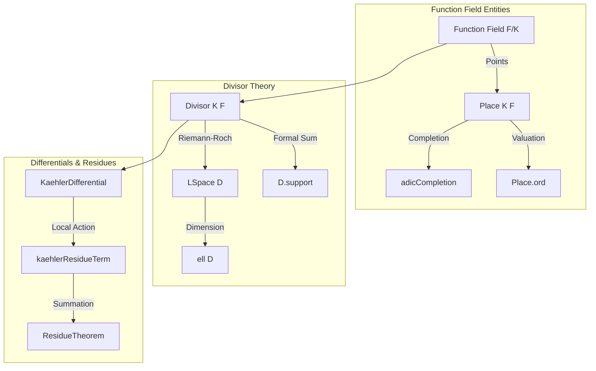
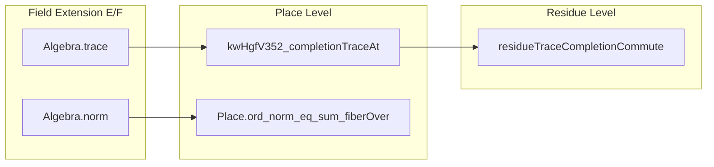

<!-- source: DeepWiki mcp.deepwiki.com · repo anthropics/fermats-last-theorem · page 2 Algebraic Curves and Function Fields · fetched 2026-10-26 -->

# Algebraic Curves and Function Fields

Relevant source files

The following files were used as context for generating this wiki page:

- [P2M/Sol/S_AlgebraicCurve_Differential_correspondence_mem_regularDifferentials.lean](P2M/Sol/S_AlgebraicCurve_Differential_correspondence_mem_regularDifferentials.lean)
- [P2M/Sol/S_AlgebraicCurve_Divisor_pushforwardNormFormula.lean](P2M/Sol/S_AlgebraicCurve_Divisor_pushforwardNormFormula.lean)
- [P2M/Sol/S_AlgebraicCurve_Divisor_pushforwardNormFormula_of_finiteDimensional.lean](P2M/Sol/S_AlgebraicCurve_Divisor_pushforwardNormFormula_of_finiteDimensional.lean)
- [P2M/Sol/S_AlgebraicCurve_Divisor_pushforwardNormFormula_of_isSeparable.lean](P2M/Sol/S_AlgebraicCurve_Divisor_pushforwardNormFormula_of_isSeparable.lean)
- [P2M/Sol/S_AlgebraicCurve_Place_exists_toValuationSubring_eq_comap.lean](P2M/Sol/S_AlgebraicCurve_Place_exists_toValuationSubring_eq_comap.lean)
- [P2M/Sol/S_AlgebraicCurve_Place_inertiaDeg_eq_inertiaDeg_fiberCenter.lean](P2M/Sol/S_AlgebraicCurve_Place_inertiaDeg_eq_inertiaDeg_fiberCenter.lean)
- [P2M/Sol/S_AlgebraicCurve_Place_inertiaDeg_pos.lean](P2M/Sol/S_AlgebraicCurve_Place_inertiaDeg_pos.lean)
- [P2M/Sol/S_AlgebraicCurve_Place_mk_mem_maximalIdeal_iff.lean](P2M/Sol/S_AlgebraicCurve_Place_mk_mem_maximalIdeal_iff.lean)
- [P2M/Sol/S_AlgebraicCurve_Place_neg_le_ord_trace_of_forall_le_ord_sub_pred.lean](P2M/Sol/S_AlgebraicCurve_Place_neg_le_ord_trace_of_forall_le_ord_sub_pred.lean)
- [P2M/Sol/S_AlgebraicCurve_Place_ord_norm_eq_sum_fiberOver.lean](P2M/Sol/S_AlgebraicCurve_Place_ord_norm_eq_sum_fiberOver.lean)
- [P2M/Sol/S_AlgebraicCurve_Place_ord_norm_eq_sum_fiberOver_of_isSeparable.lean](P2M/Sol/S_AlgebraicCurve_Place_ord_norm_eq_sum_fiberOver_of_isSeparable.lean)
- [P2M/Sol/S_AlgebraicCurve_Place_ramificationIndex_eq_ramificationIdx_fiberCenter.lean](P2M/Sol/S_AlgebraicCurve_Place_ramificationIndex_eq_ramificationIdx_fiberCenter.lean)
- [P2M/Sol/S_AlgebraicCurve_Place_sum_ramificationIndex_mul_inertiaDeg.lean](P2M/Sol/S_AlgebraicCurve_Place_sum_ramificationIndex_mul_inertiaDeg.lean)
- [P2M/Sol/S_AlgebraicCurve_Place_sum_ramificationIndex_mul_inertiaDeg_fiberOver.lean](P2M/Sol/S_AlgebraicCurve_Place_sum_ramificationIndex_mul_inertiaDeg_fiberOver.lean)
- [P2M/Sol/S_AlgebraicCurve_Place_sum_ramificationIndex_mul_inertiaDeg_le_finrank.lean](P2M/Sol/S_AlgebraicCurve_Place_sum_ramificationIndex_mul_inertiaDeg_le_finrank.lean)
- [P2M/Sol/S_AlgebraicCurve_RationalFunctionField_trace_localResidue_finitePlace_add_trace_localResidue_placeInfty_eq_zero.lean](P2M/Sol/S_AlgebraicCurve_RationalFunctionField_trace_localResidue_finitePlace_add_trace_localResidue_placeInfty_eq_zero.lean)
- [P2M/Sol/S_AlgebraicCurve_RationalFunctionField_trace_localResidue_finitePlace_div_pow_eq_zero.lean](P2M/Sol/S_AlgebraicCurve_RationalFunctionField_trace_localResidue_finitePlace_div_pow_eq_zero.lean)
- [P2M/Sol/S_AlgebraicCurve_RationalFunctionField_trace_localResidue_placeInfty_X_pow_eq_zero.lean](P2M/Sol/S_AlgebraicCurve_RationalFunctionField_trace_localResidue_placeInfty_X_pow_eq_zero.lean)
- [P2M/Sol/S_AlgebraicCurve_RiemannGenusReachedAt_eq_of_ge.lean](P2M/Sol/S_AlgebraicCurve_RiemannGenusReachedAt_eq_of_ge.lean)
- [P2M/Sol/S_AlgebraicCurve_adeleSpace_eq_of_genusReached.lean](P2M/Sol/S_AlgebraicCurve_adeleSpace_eq_of_genusReached.lean)
- [P2M/Sol/S_AlgebraicCurve_completionTraceSum_of_isSeparable.lean](P2M/Sol/S_AlgebraicCurve_completionTraceSum_of_isSeparable.lean)
- [P2M/Sol/S_AlgebraicCurve_ell_le_degree_add_ellZero.lean](P2M/Sol/S_AlgebraicCurve_ell_le_degree_add_ellZero.lean)
- [P2M/Sol/S_AlgebraicCurve_ell_le_ell_sub_single_add_deg.lean](P2M/Sol/S_AlgebraicCurve_ell_le_ell_sub_single_add_deg.lean)
- [P2M/Sol/S_AlgebraicCurve_ell_sub_ell_le_degree_sub_degree.lean](P2M/Sol/S_AlgebraicCurve_ell_sub_ell_le_degree_sub_degree.lean)
- [P2M/Sol/S_AlgebraicCurve_exists_genus_riemannIndex_of_stichtenothGenusExists.lean](P2M/Sol/S_AlgebraicCurve_exists_genus_riemannIndex_of_stichtenothGenusExists.lean)
- [P2M/Sol/S_AlgebraicCurve_exists_riemannGenusReachedAt_of_bounded.lean](P2M/Sol/S_AlgebraicCurve_exists_riemannGenusReachedAt_of_bounded.lean)
- [P2M/Sol/S_AlgebraicCurve_fibreResidueIdentityAlong_of_separableAlong_of_dCoordGenerates.lean](P2M/Sol/S_AlgebraicCurve_fibreResidueIdentityAlong_of_separableAlong_of_dCoordGenerates.lean)
- [P2M/Sol/S_AlgebraicCurve_finiteDimensional_lSpace.lean](P2M/Sol/S_AlgebraicCurve_finiteDimensional_lSpace.lean)
- [P2M/Sol/S_AlgebraicCurve_genus_ratFunc_eq_zero_of_perfectField.lean](P2M/Sol/S_AlgebraicCurve_genus_ratFunc_eq_zero_of_perfectField.lean)
- [P2M/Sol/S_AlgebraicCurve_hasPrincipalDivisors_of_finiteDimensional_ratFunc.lean](P2M/Sol/S_AlgebraicCurve_hasPrincipalDivisors_of_finiteDimensional_ratFunc.lean)
- [P2M/Sol/S_AlgebraicCurve_hasPrincipalDivisors_of_finiteDimensional_ratFunc_of_isSeparable.lean](P2M/Sol/S_AlgebraicCurve_hasPrincipalDivisors_of_finiteDimensional_ratFunc_of_isSeparable.lean)
- [P2M/Sol/S_AlgebraicCurve_hasPrincipalDivisors_of_transcendental.lean](P2M/Sol/S_AlgebraicCurve_hasPrincipalDivisors_of_transcendental.lean)
- [P2M/Sol/S_AlgebraicCurve_indexOfSpecialty_eq_ell_sub_of_rankOne_max.lean](P2M/Sol/S_AlgebraicCurve_indexOfSpecialty_eq_ell_sub_of_rankOne_max.lean)
- [P2M/Sol/S_AlgebraicCurve_indexOfSpecialty_eq_of_genusReached.lean](P2M/Sol/S_AlgebraicCurve_indexOfSpecialty_eq_of_genusReached.lean)
- [P2M/Sol/S_AlgebraicCurve_indexOfSpecialty_eq_zero_of_genusReached.lean](P2M/Sol/S_AlgebraicCurve_indexOfSpecialty_eq_zero_of_genusReached.lean)
- [P2M/Sol/S_AlgebraicCurve_instHasCanonicalDivisorRatFuncPerfectField.lean](P2M/Sol/S_AlgebraicCurve_instHasCanonicalDivisorRatFuncPerfectField.lean)
- [P2M/Sol/S_AlgebraicCurve_isCurveOver_ratFunc.lean](P2M/Sol/S_AlgebraicCurve_isCurveOver_ratFunc.lean)
- [P2M/Sol/S_AlgebraicCurve_omegaSpace_finite_of_genusReached.lean](P2M/Sol/S_AlgebraicCurve_omegaSpace_finite_of_genusReached.lean)
- [P2M/Sol/S_AlgebraicCurve_one_le_deg.lean](P2M/Sol/S_AlgebraicCurve_one_le_deg.lean)
- [P2M/Sol/S_AlgebraicCurve_residueTheoremK_of_isAlgClosed.lean](P2M/Sol/S_AlgebraicCurve_residueTheoremK_of_isAlgClosed.lean)
- [P2M/Sol/S_AlgebraicCurve_residueTheoremK_ratFunc_of_isAlgClosed.lean](P2M/Sol/S_AlgebraicCurve_residueTheoremK_ratFunc_of_isAlgClosed.lean)
- [P2M/Sol/S_AlgebraicCurve_residueTheorem_of_residueTheorem_ratFunc_of_residueTraceCompletionCommute.lean](P2M/Sol/S_AlgebraicCurve_residueTheorem_of_residueTheorem_ratFunc_of_residueTraceCompletionCommute.lean)
- [P2M/Sol/S_AlgebraicCurve_residueTheorem_ratFunc_of_perfectField.lean](P2M/Sol/S_AlgebraicCurve_residueTheorem_ratFunc_of_perfectField.lean)
- [P2M/Sol/S_AlgebraicCurve_tateCommFinite.lean](P2M/Sol/S_AlgebraicCurve_tateCommFinite.lean)
- [P2M/Sol/S_AlgebraicCurve_tateTraceCompat_of_isSeparable.lean](P2M/Sol/S_AlgebraicCurve_tateTraceCompat_of_isSeparable.lean)
- [P2M/Sol/S_AlgebraicCurve_weilDifferentialRankOne_of_stichtenothGenusExists.lean](P2M/Sol/S_AlgebraicCurve_weilDifferentialRankOne_of_stichtenothGenusExists.lean)
- [P2M/Sol/S_IsLocalRing_hensel_lift_unique.lean](P2M/Sol/S_IsLocalRing_hensel_lift_unique.lean)

This section provides an overview of the algebraic curve theory and function field arithmetic used in the proof of Fermat's Last Theorem. The codebase formalizes the theory of smooth proper curves over a field $K$ by focusing on their function fields $F/K$. Key components include the theory of valuations (places), formal sums of places (divisors), the Riemann-Roch theorem, and the residue theorem for Kähler differentials.

### Core Concepts and Hierarchy

The theory is built on the correspondence between algebraic curves and their function fields. A curve is represented by the `IsCurveOver K F` predicate [P2M/Sol/S_AlgebraicCurve_residueTheoremK_of_isAlgClosed.lean:35]().

*   **Places and Valuations**: The fundamental units of the curve, representing points or discrete valuation rings within the function field.
*   **Divisors**: Formal sums of places used to track zeros and poles of functions and differentials.
*   **Differentials**: Kähler differentials $\Omega_{F/K}$, which are used to define residues and the canonical divisor.
*   **Jacobians**: The group of degree-zero divisors modulo principal divisors, forming the `Pic0` group.

### System Architecture: Curve Theory to Code

The following diagram maps the mathematical components of algebraic curve theory to their corresponding definitions and theorems in the Lean 4 codebase.

**Curve Theory to Code Mapping**

Sources: [P2M/Sol/S_AlgebraicCurve_residueTheoremK_of_isAlgClosed.lean:34-45](), [P2M/Sol/S_AlgebraicCurve_indexOfSpecialty_eq_of_genusReached.lean:12-14]()

---

### 2.1 Places, Valuations, and Completions
A `Place` in the function field $F/K$ corresponds to a discrete valuation ring (DVR). The codebase defines `Place.ord` as the valuation associated with a place [P2M/Sol/S_AlgebraicCurve_residueTheoremK_of_isAlgClosed.lean:35](). For extensions of function fields $E/F$, the theory handles the `ramificationIndex` and `inertiaDeg` [P2M/Sol/S_AlgebraicCurve_Place_sum_ramificationIndex_mul_inertiaDeg_fiberOver.lean:21](), proving the fundamental identity $\sum e_i f_i = [E:F]$ in `Place.sum_ramificationIndex_mul_inertiaDeg` [P2M/Sol/S_AlgebraicCurve_Place_sum_ramificationIndex_mul_inertiaDeg.lean]().

For details, see [Places, Valuations, and Completions](#2.1).

### 2.2 Divisors, Riemann-Roch, and Genus
`Divisor K F` is implemented as a formal sum of places with integer coefficients [P2M/Sol/S_AlgebraicCurve_residueTheoremK_of_isAlgClosed.lean:35](). The Riemann-Roch space `LSpace D` consists of functions whose valuations are bounded by $D$ [P2M/Sol/S_AlgebraicCurve_indexOfSpecialty_eq_of_genusReached.lean:13](). The `RiemannGenusReached` predicate and `StichtenothGenusExists` construction establish the existence of the genus $g$ such that $\ell(D) = \deg(D) + 1 - g$ for sufficiently large $\deg(D)$ [P2M/Sol/S_AlgebraicCurve_indexOfSpecialty_eq_of_genusReached.lean:13]().

For details, see [Divisors, Riemann-Roch, and Genus](#2.2).

### 2.3 Kähler Differentials and the Residue Theorem
The theory of differentials is centered around `KaehlerDifferential` and the `kaehlerResidueTerm` [P2M/Sol/S_AlgebraicCurve_residueTheoremK_of_isAlgClosed.lean:35](). A central result is the `ResidueTheorem`, which states that the sum of residues of a differential across all places is zero [P2M/Sol/S_AlgebraicCurve_residueTheorem_of_residueTheorem_ratFunc_of_residueTraceCompletionCommute.lean:34](). This is proved by reducing to the rational function field case `residueTheoremK_ratFunc_of_isAlgClosed` [P2M/Sol/S_AlgebraicCurve_residueTheoremK_of_isAlgClosed.lean:35]() and using trace-compatibility results like `residueTraceCompletionCommute` [P2M/Sol/S_AlgebraicCurve_residueTheoremK_of_isAlgClosed.lean:35]().

For details, see [Kähler Differentials and the Residue Theorem](#2.3).

### 2.4 Jacobians, Pic⁰, and the Abel-Jacobi Map
The Jacobian of a curve is represented by `Pic0`, the group of divisors of degree zero modulo principal divisors [P2M/Sol/S_AlgebraicCurve_residueTheoremK_of_isAlgClosed.lean:35](). The codebase includes structures for the `AbelJacobiMap` and uniformization of Jacobians, particularly in the context of modular curves and their semistable models.

For details, see [Jacobians, Pic⁰, and the Abel-Jacobi Map](#2.4).

### 2.5 Curve Models and Integral Structures
To study curves over non-algebraically closed fields or rings (like $\mathbb{Z}_p$), the codebase utilizes `CurveModel` and `TwoChartIntegralModel` [Definitions.Def_AlgebraicCurve_IsCurveOver](). This includes the study of `node rings` and `ordinary double points` occurring in the reduction of modular curves.

For details, see [Curve Models and Integral Structures](#2.5).

---

### Function Field Arithmetic Relationships

The following table summarizes the key numerical invariants and their relationships as defined in the codebase.

| Entity | Code Symbol | Definition / Property |
| :--- | :--- | :--- |
| **Valuation** | `Place.ord` | Integer valuation at a place [P2M/Sol/S_AlgebraicCurve_residueTheoremK_of_isAlgClosed.lean:35]() |
| **Dimension** | `ell D` | $\dim_K L(D)$ [P2M/Sol/S_AlgebraicCurve_indexOfSpecialty_eq_of_genusReached.lean:13]() |
| **Genus** | `RiemannGenusReached` | The $g$ in Riemann-Roch [P2M/Sol/S_AlgebraicCurve_indexOfSpecialty_eq_of_genusReached.lean:13]() |
| **Specialty** | `indexOfSpecialty` | $i(D) = \ell(K-D)$ [P2M/Sol/S_AlgebraicCurve_indexOfSpecialty_eq_of_genusReached.lean:13]() |
| **Residue** | `kaehlerResidueTerm` | Local residue of a differential [P2M/Sol/S_AlgebraicCurve_residueTheoremK_of_isAlgClosed.lean:35]() |

**Trace and Norm Interaction**

Sources: [P2M/Sol/S_AlgebraicCurve_residueTheoremK_of_isAlgClosed.lean:35](), [P2M/Sol/S_AlgebraicCurve_tateTraceCompat_of_isSeparable.lean:35](), [P2M/Sol/S_AlgebraicCurve_Place_ord_norm_eq_sum_fiberOver.lean]()

---

