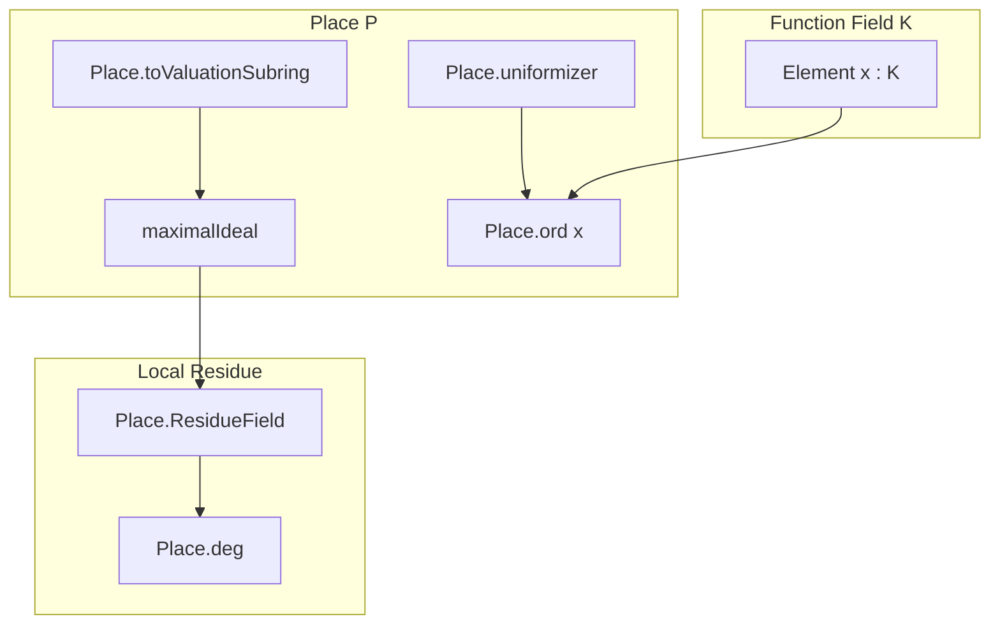
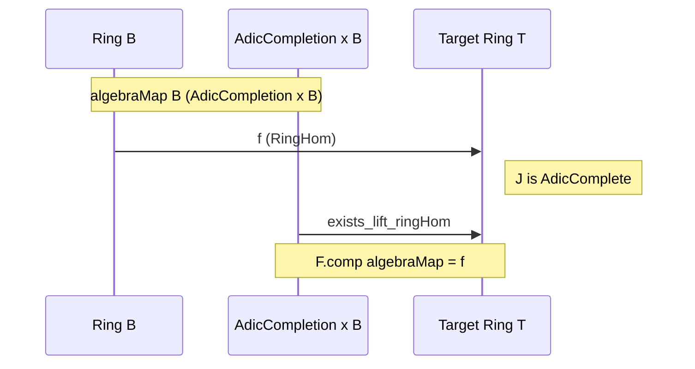

<!-- source: DeepWiki mcp.deepwiki.com · repo anthropics/fermats-last-theorem · page 2.1 Places, Valuations, and Completions · fetched 2026-10-26 -->

# Places, Valuations, and Completions

Relevant source files

The following files were used as context for generating this wiki page:

- [Definitions/Def_AdicCompletionLocalRing.lean](Definitions/Def_AdicCompletionLocalRing.lean)
- [Definitions/Def_AlgebraicCurve_DivisorPushPull.lean](Definitions/Def_AlgebraicCurve_DivisorPushPull.lean)
- [Definitions/Def_ModularCurve_CharLFrobeniusGeomLevel.lean](Definitions/Def_ModularCurve_CharLFrobeniusGeomLevel.lean)
- [Definitions/Def_ModularCurve_KwNo6HspecCartierDlogCampaignFrame.lean](Definitions/Def_ModularCurve_KwNo6HspecCartierDlogCampaignFrame.lean)
- [Definitions/Def_PolynomialCompletion.lean](Definitions/Def_PolynomialCompletion.lean)
- [P2M/Sol/S_AdicCompletion_exists_moduleFinite_etale_adicCompletion_tensorProduct_of_flat_of_map_maximalIdeal_eq.lean](P2M/Sol/S_AdicCompletion_exists_moduleFinite_etale_adicCompletion_tensorProduct_of_flat_of_map_maximalIdeal_eq.lean)
- [P2M/Sol/S_AdicCompletion_exists_ringEquiv_mvPowerSeries_quotient_map_of_tensorProduct_of_flat.lean](P2M/Sol/S_AdicCompletion_exists_ringEquiv_mvPowerSeries_quotient_map_of_tensorProduct_of_flat.lean)
- [P2M/Sol/S_AdicCompletion_exists_ringEquiv_of_forall_quotient_mk_comp_surjective_of_forall_ker_eq_pow.lean](P2M/Sol/S_AdicCompletion_exists_ringEquiv_of_forall_quotient_mk_comp_surjective_of_forall_ker_eq_pow.lean)
- [P2M/Sol/S_AdicCompletion_isDomain_and_isIntegrallyClosed_of_isInvariant_of_isLocalization_atPrime_of_tame.lean](P2M/Sol/S_AdicCompletion_isDomain_and_isIntegrallyClosed_of_isInvariant_of_isLocalization_atPrime_of_tame.lean)
- [P2M/Sol/S_AdicCompletion_isField_localization_atPrime_of_not_isMaximal_of_isSeparable.lean](P2M/Sol/S_AdicCompletion_isField_localization_atPrime_of_not_isMaximal_of_isSeparable.lean)
- [P2M/Sol/S_AdicCompletion_isReduced_and_isSeparable_genericFibre_of_isInvariant.lean](P2M/Sol/S_AdicCompletion_isReduced_and_isSeparable_genericFibre_of_isInvariant.lean)
- [P2M/Sol/S_AdicCompletion_isRegularLocalRing_localization_atPrime_of_mem_of_not_isMaximal_of_tame.lean](P2M/Sol/S_AdicCompletion_isRegularLocalRing_localization_atPrime_of_mem_of_not_isMaximal_of_tame.lean)
- [P2M/Sol/S_AdicCompletion_nonempty_ringEquiv_adicCompletion_tensorProduct_of_flat_of_map_maximalIdeal_eq_of_card_eq.lean](P2M/Sol/S_AdicCompletion_nonempty_ringEquiv_adicCompletion_tensorProduct_of_flat_of_map_maximalIdeal_eq_of_card_eq.lean)
- [P2M/Sol/S_AdjoinRoot_exists_isLocalRing_etale_residueField_algEquiv_of_isAdicComplete.lean](P2M/Sol/S_AdjoinRoot_exists_isLocalRing_etale_residueField_algEquiv_of_isAdicComplete.lean)
- [P2M/Sol/S_AdjoinRoot_exists_isLocalRing_faithfullyFlat_residueField_algEquiv_of_irreducible_map.lean](P2M/Sol/S_AdjoinRoot_exists_isLocalRing_faithfullyFlat_residueField_algEquiv_of_irreducible_map.lean)
- [P2M/Sol/S_Algebra_Etale_nonempty_algEquiv_of_isLocalRing_of_finite_residueField_of_card_eq.lean](P2M/Sol/S_Algebra_Etale_nonempty_algEquiv_of_isLocalRing_of_finite_residueField_of_card_eq.lean)
- [P2M/Sol/S_Algebra_Etale_of_formallyUnramified_residueField_baseChange.lean](P2M/Sol/S_Algebra_Etale_of_formallyUnramified_residueField_baseChange.lean)
- [P2M/Sol/S_Algebra_FormallyUnramified_of_residueField_baseChange_of_finite.lean](P2M/Sol/S_Algebra_FormallyUnramified_of_residueField_baseChange_of_finite.lean)
- [P2M/Sol/S_Algebra_etale_of_moduleFinite_of_flat_of_forall_isUnramifiedAt.lean](P2M/Sol/S_Algebra_etale_of_moduleFinite_of_flat_of_forall_isUnramifiedAt.lean)
- [P2M/Sol/S_Algebra_finitePresentation_of_finite_of_flat_of_isLocalRing.lean](P2M/Sol/S_Algebra_finitePresentation_of_finite_of_flat_of_isLocalRing.lean)
- [P2M/Sol/S_AlgebraicCurve_Annulus_sum_eq_ord_add_ord_and_prod_valuation_evalAt_zpow_eq_of_regularProlongation.lean](P2M/Sol/S_AlgebraicCurve_Annulus_sum_eq_ord_add_ord_and_prod_valuation_evalAt_zpow_eq_of_regularProlongation.lean)
- [P2M/Sol/S_AlgebraicCurve_ComponentChart_forall_tubeBounded_mem_integers_and_exists_mul_eq_of_not_mem_dom.lean](P2M/Sol/S_AlgebraicCurve_ComponentChart_forall_tubeBounded_mem_integers_and_exists_mul_eq_of_not_mem_dom.lean)
- [P2M/Sol/S_AlgebraicCurve_Differential_correspondence_mem_regularDifferentials.lean](P2M/Sol/S_AlgebraicCurve_Differential_correspondence_mem_regularDifferentials.lean)
- [P2M/Sol/S_AlgebraicCurve_Differential_sum_ord_smul_pullbackAlong_eq_zero.lean](P2M/Sol/S_AlgebraicCurve_Differential_sum_ord_smul_pullbackAlong_eq_zero.lean)
- [P2M/Sol/S_AlgebraicCurve_Divisor_isPrincipal_of_constantFieldExtension.lean](P2M/Sol/S_AlgebraicCurve_Divisor_isPrincipal_of_constantFieldExtension.lean)
- [P2M/Sol/S_AlgebraicCurve_Divisor_pushforwardNormFormula.lean](P2M/Sol/S_AlgebraicCurve_Divisor_pushforwardNormFormula.lean)
- [P2M/Sol/S_AlgebraicCurve_Divisor_pushforwardNormFormula_of_finiteDimensional.lean](P2M/Sol/S_AlgebraicCurve_Divisor_pushforwardNormFormula_of_finiteDimensional.lean)
- [P2M/Sol/S_AlgebraicCurve_Divisor_pushforwardNormFormula_of_isSeparable.lean](P2M/Sol/S_AlgebraicCurve_Divisor_pushforwardNormFormula_of_isSeparable.lean)
- [P2M/Sol/S_AlgebraicCurve_Place_eq_of_comap_toValuationSubring_eq_of_isRational.lean](P2M/Sol/S_AlgebraicCurve_Place_eq_of_comap_toValuationSubring_eq_of_isRational.lean)
- [P2M/Sol/S_AlgebraicCurve_Place_exists_comap_algebraMap_eq_of_constantFieldExtension.lean](P2M/Sol/S_AlgebraicCurve_Place_exists_comap_algebraMap_eq_of_constantFieldExtension.lean)
- [P2M/Sol/S_AlgebraicCurve_Place_exists_comap_algebraMap_eq_of_constantFieldExtension_of_deg_eq_one_of_isAlgebraic.lean](P2M/Sol/S_AlgebraicCurve_Place_exists_comap_algebraMap_eq_of_constantFieldExtension_of_deg_eq_one_of_isAlgebraic.lean)
- [P2M/Sol/S_AlgebraicCurve_Place_exists_comap_algebraMap_eq_of_constantFieldExtension_of_isAlgClosed.lean](P2M/Sol/S_AlgebraicCurve_Place_exists_comap_algebraMap_eq_of_constantFieldExtension_of_isAlgClosed.lean)
- [P2M/Sol/S_AlgebraicCurve_Place_exists_eq_smul_dCoord_and_uniformizer_pow_mul_mem_of_cartierLaws.lean](P2M/Sol/S_AlgebraicCurve_Place_exists_eq_smul_dCoord_and_uniformizer_pow_mul_mem_of_cartierLaws.lean)
- [P2M/Sol/S_AlgebraicCurve_Place_exists_natCast_dvd_ord_sub_single_sub_single.lean](P2M/Sol/S_AlgebraicCurve_Place_exists_natCast_dvd_ord_sub_single_sub_single.lean)
- [P2M/Sol/S_AlgebraicCurve_Place_exists_ord_algebraMap_eq_mul_ord.lean](P2M/Sol/S_AlgebraicCurve_Place_exists_ord_algebraMap_eq_mul_ord.lean)
- [P2M/Sol/S_AlgebraicCurve_Place_exists_toValuationSubring_eq_comap.lean](P2M/Sol/S_AlgebraicCurve_Place_exists_toValuationSubring_eq_comap.lean)
- [P2M/Sol/S_AlgebraicCurve_Place_finite_setOf_not_mem_toValuationSubring_or_evalAt_mem.lean](P2M/Sol/S_AlgebraicCurve_Place_finite_setOf_not_mem_toValuationSubring_or_evalAt_mem.lean)
- [P2M/Sol/S_AlgebraicCurve_Place_hasValue_iff_mem_and_eq_or_ord_sub_pos.lean](P2M/Sol/S_AlgebraicCurve_Place_hasValue_iff_mem_and_eq_or_ord_sub_pos.lean)
- [P2M/Sol/S_AlgebraicCurve_Place_inertiaDeg_eq_inertiaDeg_fiberCenter.lean](P2M/Sol/S_AlgebraicCurve_Place_inertiaDeg_eq_inertiaDeg_fiberCenter.lean)
- [P2M/Sol/S_AlgebraicCurve_Place_inertiaDeg_pos.lean](P2M/Sol/S_AlgebraicCurve_Place_inertiaDeg_pos.lean)
- [P2M/Sol/S_AlgebraicCurve_Place_isDedekindDomain_iInf_toSubring_and_isMaximal_iff_of_finset_nonempty.lean](P2M/Sol/S_AlgebraicCurve_Place_isDedekindDomain_iInf_toSubring_and_isMaximal_iff_of_finset_nonempty.lean)
- [P2M/Sol/S_AlgebraicCurve_Place_isRegularAt_and_hasSimplePoleAt_and_hasSimpleResidue_mul_pullbackAlong_restrictAlong.lean](P2M/Sol/S_AlgebraicCurve_Place_isRegularAt_and_hasSimplePoleAt_and_hasSimpleResidue_mul_pullbackAlong_restrictAlong.lean)
- [P2M/Sol/S_AlgebraicCurve_Place_isRegularAt_and_hasSimplePoleAt_and_hasSimpleResidue_of_cartierLaws_of_finiteDimensional.lean](P2M/Sol/S_AlgebraicCurve_Place_isRegularAt_and_hasSimplePoleAt_and_hasSimpleResidue_of_cartierLaws_of_finiteDimensional.lean)
- [P2M/Sol/S_AlgebraicCurve_Place_isRegularAt_and_hasSimplePoleAt_and_hasSimpleResidue_smul_pullbackAlong_of_algEquiv.lean](P2M/Sol/S_AlgebraicCurve_Place_isRegularAt_and_hasSimplePoleAt_and_hasSimpleResidue_smul_pullbackAlong_of_algEquiv.lean)
- [P2M/Sol/S_AlgebraicCurve_Place_neg_le_ord_trace_of_forall_le_ord_sub_pred.lean](P2M/Sol/S_AlgebraicCurve_Place_neg_le_ord_trace_of_forall_le_ord_sub_pred.lean)
- [P2M/Sol/S_AlgebraicCurve_Place_ordDifferential_D_eq_zero_of_constantFieldExtension_of_forall_mem.lean](P2M/Sol/S_AlgebraicCurve_Place_ordDifferential_D_eq_zero_of_constantFieldExtension_of_forall_mem.lean)
- [P2M/Sol/S_AlgebraicCurve_Place_ord_norm_eq_sum_fiberOver.lean](P2M/Sol/S_AlgebraicCurve_Place_ord_norm_eq_sum_fiberOver.lean)
- [P2M/Sol/S_AlgebraicCurve_Place_ord_norm_eq_sum_fiberOver_of_isSeparable.lean](P2M/Sol/S_AlgebraicCurve_Place_ord_norm_eq_sum_fiberOver_of_isSeparable.lean)
- [P2M/Sol/S_AlgebraicCurve_Place_ramificationIndexAlong_eq_one_of_ord_eval_derivative_eq_zero.lean](P2M/Sol/S_AlgebraicCurve_Place_ramificationIndexAlong_eq_one_of_ord_eval_derivative_eq_zero.lean)
- [P2M/Sol/S_AlgebraicCurve_Place_ramificationIndex_eq_div_gcd_natAbs_ord_of_isSplittingField_X_pow_sub_C.lean](P2M/Sol/S_AlgebraicCurve_Place_ramificationIndex_eq_div_gcd_natAbs_ord_of_isSplittingField_X_pow_sub_C.lean)
- [P2M/Sol/S_AlgebraicCurve_Place_ramificationIndex_eq_one_of_forall_dvd_ord.lean](P2M/Sol/S_AlgebraicCurve_Place_ramificationIndex_eq_one_of_forall_dvd_ord.lean)
- [P2M/Sol/S_AlgebraicCurve_Place_ramificationIndex_eq_one_of_forall_dvd_ord_of_isSeparable.lean](P2M/Sol/S_AlgebraicCurve_Place_ramificationIndex_eq_one_of_forall_dvd_ord_of_isSeparable.lean)
- [P2M/Sol/S_AlgebraicCurve_Place_ramificationIndex_eq_ramificationIdx_fiberCenter.lean](P2M/Sol/S_AlgebraicCurve_Place_ramificationIndex_eq_ramificationIdx_fiberCenter.lean)
- [P2M/Sol/S_AlgebraicCurve_Place_sum_ramificationIndex_mul_inertiaDeg.lean](P2M/Sol/S_AlgebraicCurve_Place_sum_ramificationIndex_mul_inertiaDeg.lean)
- [P2M/Sol/S_AlgebraicCurve_Place_sum_ramificationIndex_mul_inertiaDeg_fiberOver.lean](P2M/Sol/S_AlgebraicCurve_Place_sum_ramificationIndex_mul_inertiaDeg_fiberOver.lean)
- [P2M/Sol/S_AlgebraicCurve_Place_sum_ramificationIndex_mul_inertiaDeg_le_finrank.lean](P2M/Sol/S_AlgebraicCurve_Place_sum_ramificationIndex_mul_inertiaDeg_le_finrank.lean)
- [P2M/Sol/S_AlgebraicCurve_Place_transcendental_of_ord_ne_zero.lean](P2M/Sol/S_AlgebraicCurve_Place_transcendental_of_ord_ne_zero.lean)
- [P2M/Sol/S_AlgebraicCurve_RationalFunctionField_algebraMap_polynomial_mem_of_ne_placeInfty.lean](P2M/Sol/S_AlgebraicCurve_RationalFunctionField_algebraMap_polynomial_mem_of_ne_placeInfty.lean)
- [P2M/Sol/S_AlgebraicCurve_RationalFunctionField_finiteDimensional_lSpace_zero_of_constantsAreBase.lean](P2M/Sol/S_AlgebraicCurve_RationalFunctionField_finiteDimensional_lSpace_zero_of_constantsAreBase.lean)
- [P2M/Sol/S_AlgebraicCurve_RationalFunctionField_indexOfSpecialtyFinite_of_ratFunc_tower.lean](P2M/Sol/S_AlgebraicCurve_RationalFunctionField_indexOfSpecialtyFinite_of_ratFunc_tower.lean)
- [P2M/Sol/S_AlgebraicCurve_RationalFunctionField_ord_X_nonneg_of_ne_placeInfty.lean](P2M/Sol/S_AlgebraicCurve_RationalFunctionField_ord_X_nonneg_of_ne_placeInfty.lean)
- [P2M/Sol/S_AlgebraicCurve_RationalFunctionField_ord_placeInfty_X.lean](P2M/Sol/S_AlgebraicCurve_RationalFunctionField_ord_placeInfty_X.lean)
- [P2M/Sol/S_AlgebraicCurve_RationalFunctionField_stichtenothGenusExists.lean](P2M/Sol/S_AlgebraicCurve_RationalFunctionField_stichtenothGenusExists.lean)
- [P2M/Sol/S_AlgebraicCurve_RationalFunctionField_stichtenothGenusExists_of_ratFunc_tower.lean](P2M/Sol/S_AlgebraicCurve_RationalFunctionField_stichtenothGenusExists_of_ratFunc_tower.lean)
- [P2M/Sol/S_AlgebraicCurve_RationalFunctionField_trace_localResidue_finitePlace_add_trace_localResidue_placeInfty_eq_zero.lean](P2M/Sol/S_AlgebraicCurve_RationalFunctionField_trace_localResidue_finitePlace_add_trace_localResidue_placeInfty_eq_zero.lean)
- [P2M/Sol/S_AlgebraicCurve_RationalFunctionField_trace_localResidue_finitePlace_div_pow_eq_zero.lean](P2M/Sol/S_AlgebraicCurve_RationalFunctionField_trace_localResidue_finitePlace_div_pow_eq_zero.lean)
- [P2M/Sol/S_AlgebraicCurve_RationalFunctionField_trace_localResidue_placeInfty_X_pow_eq_zero.lean](P2M/Sol/S_AlgebraicCurve_RationalFunctionField_trace_localResidue_placeInfty_X_pow_eq_zero.lean)
- [P2M/Sol/S_AlgebraicCurve_completionTraceSum_of_isSeparable.lean](P2M/Sol/S_AlgebraicCurve_completionTraceSum_of_isSeparable.lean)
- [P2M/Sol/S_AlgebraicCurve_constantsAreBase_of_apply_algebraMap_eq_pow_card.lean](P2M/Sol/S_AlgebraicCurve_constantsAreBase_of_apply_algebraMap_eq_pow_card.lean)
- [P2M/Sol/S_AlgebraicCurve_constantsAreBase_of_exists_isRational.lean](P2M/Sol/S_AlgebraicCurve_constantsAreBase_of_exists_isRational.lean)
- [P2M/Sol/S_AlgebraicCurve_eval_one_eq_natCard_pic0_of_natCard_fixedPoints_restrictAlong_eq.lean](P2M/Sol/S_AlgebraicCurve_eval_one_eq_natCard_pic0_of_natCard_fixedPoints_restrictAlong_eq.lean)
- [P2M/Sol/S_AlgebraicCurve_exists_derivation_constantFieldExtension_map_mem.lean](P2M/Sol/S_AlgebraicCurve_exists_derivation_constantFieldExtension_map_mem.lean)
- [P2M/Sol/S_AlgebraicCurve_exists_monic_natCard_fixedPoints_restrictAlong_eq_of_constantFieldExtension.lean](P2M/Sol/S_AlgebraicCurve_exists_monic_natCard_fixedPoints_restrictAlong_eq_of_constantFieldExtension.lean)
- [P2M/Sol/S_AlgebraicCurve_exists_trace_mul_eq_aeval_of_forall_exists_smul_D_eq_smul_dCoord.lean](P2M/Sol/S_AlgebraicCurve_exists_trace_mul_eq_aeval_of_forall_exists_smul_D_eq_smul_dCoord.lean)
- [P2M/Sol/S_AlgebraicCurve_fibreResidueIdentityAlong_of_separableAlong_of_dCoordGenerates.lean](P2M/Sol/S_AlgebraicCurve_fibreResidueIdentityAlong_of_separableAlong_of_dCoordGenerates.lean)
- [P2M/Sol/S_AlgebraicCurve_finite_fixedPoints_restrictAlong_iterate_and_natCard_eq_sum_divisors.lean](P2M/Sol/S_AlgebraicCurve_finite_fixedPoints_restrictAlong_iterate_and_natCard_eq_sum_divisors.lean)
- [P2M/Sol/S_AlgebraicCurve_genusFF_eq_of_constantFieldExtension_of_finite_of_isAlgClosed.lean](P2M/Sol/S_AlgebraicCurve_genusFF_eq_of_constantFieldExtension_of_finite_of_isAlgClosed.lean)
- [P2M/Sol/S_AlgebraicCurve_genus_eq_of_constantFieldExtension_of_isAlgClosed.lean](P2M/Sol/S_AlgebraicCurve_genus_eq_of_constantFieldExtension_of_isAlgClosed.lean)
- [P2M/Sol/S_AlgebraicCurve_genus_ratFunc_eq_zero_of_perfectField.lean](P2M/Sol/S_AlgebraicCurve_genus_ratFunc_eq_zero_of_perfectField.lean)
- [P2M/Sol/S_AlgebraicCurve_hasPrincipalDivisors_of_finiteDimensional_ratFunc.lean](P2M/Sol/S_AlgebraicCurve_hasPrincipalDivisors_of_finiteDimensional_ratFunc.lean)
- [P2M/Sol/S_AlgebraicCurve_hasPrincipalDivisors_of_finiteDimensional_ratFunc_of_isSeparable.lean](P2M/Sol/S_AlgebraicCurve_hasPrincipalDivisors_of_finiteDimensional_ratFunc_of_isSeparable.lean)
- [P2M/Sol/S_AlgebraicCurve_hasPrincipalDivisors_of_transcendental.lean](P2M/Sol/S_AlgebraicCurve_hasPrincipalDivisors_of_transcendental.lean)
- [P2M/Sol/S_AlgebraicCurve_instHasCanonicalDivisorRatFuncPerfectField.lean](P2M/Sol/S_AlgebraicCurve_instHasCanonicalDivisorRatFuncPerfectField.lean)
- [P2M/Sol/S_AlgebraicCurve_isCurveOver_ratFunc.lean](P2M/Sol/S_AlgebraicCurve_isCurveOver_ratFunc.lean)
- [P2M/Sol/S_AlgebraicCurve_linearIndependent_pow_of_transcendental.lean](P2M/Sol/S_AlgebraicCurve_linearIndependent_pow_of_transcendental.lean)
- [P2M/Sol/S_AlgebraicCurve_mem_span_range_algebraMap_of_constantFieldExtension.lean](P2M/Sol/S_AlgebraicCurve_mem_span_range_algebraMap_of_constantFieldExtension.lean)
- [P2M/Sol/S_AlgebraicCurve_residueTheoremK_of_isAlgClosed.lean](P2M/Sol/S_AlgebraicCurve_residueTheoremK_of_isAlgClosed.lean)
- [P2M/Sol/S_AlgebraicCurve_residueTheoremK_ratFunc_of_isAlgClosed.lean](P2M/Sol/S_AlgebraicCurve_residueTheoremK_ratFunc_of_isAlgClosed.lean)
- [P2M/Sol/S_AlgebraicCurve_residueTheorem_of_residueTheorem_ratFunc_of_residueTraceCompletionCommute.lean](P2M/Sol/S_AlgebraicCurve_residueTheorem_of_residueTheorem_ratFunc_of_residueTraceCompletionCommute.lean)
- [P2M/Sol/S_AlgebraicCurve_residueTheorem_ratFunc_of_perfectField.lean](P2M/Sol/S_AlgebraicCurve_residueTheorem_ratFunc_of_perfectField.lean)
- [P2M/Sol/S_AlgebraicCurve_tateCommFinite.lean](P2M/Sol/S_AlgebraicCurve_tateCommFinite.lean)
- [P2M/Sol/S_AlgebraicCurve_tateTraceCompat_of_isSeparable.lean](P2M/Sol/S_AlgebraicCurve_tateTraceCompat_of_isSeparable.lean)
- [P2M/Sol/S_FiniteField_nonempty_algEquiv_of_card_eq.lean](P2M/Sol/S_FiniteField_nonempty_algEquiv_of_card_eq.lean)
- [P2M/Sol/S_Ideal_IsMaximal_exists_adicCompletion_localization_ringEquiv.lean](P2M/Sol/S_Ideal_IsMaximal_exists_adicCompletion_localization_ringEquiv.lean)
- [P2M/Sol/S_Ideal_exists_ringEquiv_adicCompletion_quotient_of_mem_minimalPrimes_of_isDomain_adicCompletion.lean](P2M/Sol/S_Ideal_exists_ringEquiv_adicCompletion_quotient_of_mem_minimalPrimes_of_isDomain_adicCompletion.lean)
- [P2M/Sol/S_IsLocalRing_etale_adicCompletion_tensorProduct_of_finite_of_finrank_eq_finrank_residueField.lean](P2M/Sol/S_IsLocalRing_etale_adicCompletion_tensorProduct_of_finite_of_finrank_eq_finrank_residueField.lean)
- [P2M/Sol/S_IsLocalRing_etale_of_finite_of_finrank_eq_finrank_residueField.lean](P2M/Sol/S_IsLocalRing_etale_of_finite_of_finrank_eq_finrank_residueField.lean)
- [P2M/Sol/S_IsLocalRing_etale_of_finite_of_finrank_eq_finrank_residueField_of_isAdicComplete.lean](P2M/Sol/S_IsLocalRing_etale_of_finite_of_finrank_eq_finrank_residueField_of_isAdicComplete.lean)
- [P2M/Sol/S_IsLocalRing_exists_adicCompletion_ringHom_finite_of_moduleFinite.lean](P2M/Sol/S_IsLocalRing_exists_adicCompletion_ringHom_finite_of_moduleFinite.lean)
- [P2M/Sol/S_IsLocalRing_exists_isLocalRing_adicCompletion_isAdicComplete_map_maximalIdeal_eq.lean](P2M/Sol/S_IsLocalRing_exists_isLocalRing_adicCompletion_isAdicComplete_map_maximalIdeal_eq.lean)
- [P2M/Sol/S_IsLocalRing_exists_isLocalRing_adicCompletion_tensorProduct_residueField_equiv.lean](P2M/Sol/S_IsLocalRing_exists_isLocalRing_adicCompletion_tensorProduct_residueField_equiv.lean)
- [P2M/Sol/S_IsLocalRing_exists_isLocalRing_etale_free_residueField_algEquiv.lean](P2M/Sol/S_IsLocalRing_exists_isLocalRing_etale_free_residueField_algEquiv.lean)
- [P2M/Sol/S_IsLocalRing_exists_ringEquiv_adicCompletion_maximalIdeal_comp_algebraMap_of_ringEquiv.lean](P2M/Sol/S_IsLocalRing_exists_ringEquiv_adicCompletion_maximalIdeal_comp_algebraMap_of_ringEquiv.lean)
- [P2M/Sol/S_IsLocalRing_exists_ringHom_ringEquiv_adicCompletion_uvCrossingModel_of_ringEquiv.lean](P2M/Sol/S_IsLocalRing_exists_ringHom_ringEquiv_adicCompletion_uvCrossingModel_of_ringEquiv.lean)
- [P2M/Sol/S_IsLocalRing_hensel_lift_unique.lean](P2M/Sol/S_IsLocalRing_hensel_lift_unique.lean)
- [P2M/Sol/S_IsLocalization_AtPrime_exists_ringEquiv_adicCompletion_maximalIdeal.lean](P2M/Sol/S_IsLocalization_AtPrime_exists_ringEquiv_adicCompletion_maximalIdeal.lean)
- [P2M/Sol/S_IsRegularLocalRing_exists_algEquiv_tensorProduct_isGalois_isCyclic_of_etale_of_isUnramifiedAt_of_forall_sub_mem.lean](P2M/Sol/S_IsRegularLocalRing_exists_algEquiv_tensorProduct_isGalois_isCyclic_of_etale_of_isUnramifiedAt_of_forall_sub_mem.lean)
- [P2M/Sol/S_IsRegularLocalRing_exists_ringEquiv_adicCompletion_of_isInvariant_of_card_inertia_eq_of_isUnramifiedAt_off.lean](P2M/Sol/S_IsRegularLocalRing_exists_ringEquiv_adicCompletion_of_isInvariant_of_card_inertia_eq_of_isUnramifiedAt_off.lean)
- [P2M/Sol/S_IsRegularLocalRing_exists_ringEquiv_adicCompletion_of_isInvariant_of_isLocalization_atPrime_of_isUnramifiedAt_off.lean](P2M/Sol/S_IsRegularLocalRing_exists_ringEquiv_adicCompletion_of_isInvariant_of_isLocalization_atPrime_of_isUnramifiedAt_off.lean)
- [P2M/Sol/S_IsRegularLocalRing_of_isUnramifiedAt_of_flat_of_maximalIdeal_eq_span_pair.lean](P2M/Sol/S_IsRegularLocalRing_of_isUnramifiedAt_of_flat_of_maximalIdeal_eq_span_pair.lean)
- [P2M/Sol/S_KummerTheory_algEquiv_eq_one_of_forall_apply_eq_of_isSplittingField.lean](P2M/Sol/S_KummerTheory_algEquiv_eq_one_of_forall_apply_eq_of_isSplittingField.lean)
- [P2M/Sol/S_KummerTheory_isGalois_and_commute_and_pow_eq_one_of_isSplittingField_prod_X_pow_sub_C.lean](P2M/Sol/S_KummerTheory_isGalois_and_commute_and_pow_eq_one_of_isSplittingField_prod_X_pow_sub_C.lean)

This section covers the theory of places in algebraic function fields, their associated valuations, and the construction of adic completions. It establishes the local-to-global foundation required for the residue theorem and the study of modular curve models.

## The Place Typeclass

In this codebase, a `Place` of a function field $K$ is represented as a discrete valuation ring (DVR) contained within $K$. The `Place` typeclass provides the interface for evaluating the order of vanishing of functions and defining local parameters (uniformizers).

### Key Definitions and Structures

| Entity | Description | Citation |
| :--- | :--- | :--- |
| `Place` | The type of places of an algebraic curve/function field. | [P2M/Sol/S_AlgebraicCurve_residueTheoremK_of_isAlgClosed.lean:35-35]() |
| `Place.ord` | The discrete valuation $v_P: K \to \mathbb{Z} \cup \{\infty\}$. | [P2M/Sol/S_AlgebraicCurve_residueTheoremK_of_isAlgClosed.lean:35-35]() |
| `Place.uniformizer` | A local parameter $\pi$ such that $v_P(\pi) = 1$. | [P2M/Sol/S_AlgebraicCurve_tateTraceCompat_of_isSeparable.lean:35-35]() |
| `Place.FiniteResidue` | The residue field $\kappa(P) = \mathcal{O}_P / \mathfrak{m}_P$. | [P2M/Sol/S_AlgebraicCurve_residueTheoremK_of_isAlgClosed.lean:35-35]() |
| `Place.deg` | The degree of the place, defined as $[\kappa(P) : k]$. | [P2M/Sol/S_AlgebraicCurve_residueTheoremK_of_isAlgClosed.lean:35-35]() |

### Code Entity Relationship: Local Properties
The following diagram illustrates how the `Place` structure links algebraic field elements to local valuations and residue fields.

Sources: [P2M/Sol/S_AlgebraicCurve_residueTheoremK_of_isAlgClosed.lean:35-35](), [P2M/Sol/S_AlgebraicCurve_tateTraceCompat_of_isSeparable.lean:35-35](), [P2M/Sol/S_AlgebraicCurve_residueTheoremK_of_isAlgClosed.lean:27-27]()

## Adic Completions

For a place $P$, the completion $\hat{K}_P$ is constructed via the adic topology defined by the maximal ideal of the DVR. This is crucial for defining local residues and the Tate trace compatibility.

### Implementation Details
*   **Completion Construction**: The completion is handled by the `AdicCompletion` type, which takes an ideal $I$ (typically the maximal ideal of a place) and a ring $R$. [P2M/Sol/S_AdicCompletion_exists_ringEquiv_mvPowerSeries_quotient_map_of_tensorProduct_of_flat.lean:24-25]()
*   **Valuation Extension**: The valuation $v_P$ extends to the completion $\hat{K}_P$, and the completion of the valuation ring $\hat{\mathcal{O}}_P$ is a DVR. [P2M/Sol/S_AlgebraicCurve_tateTraceCompat_of_isSeparable.lean:35-35]()
*   **Trace Compatibility**: For a finite separable extension $L/K$, the trace $\text{Tr}_{L/K}$ is compatible with the sum of local traces across all places $Q$ lying over $P$. [P2M/Sol/S_AlgebraicCurve_tateTraceCompat_of_isSeparable.lean:85-85]()

### Code Flow: Completion and Lift
The following diagram depicts the process of lifting ring homomorphisms to adic completions, which is a frequent operation in the deformation theory sections.

Sources: [P2M/Sol/S_AdicCompletion_exists_moduleFinite_etale_adicCompletion_tensorProduct_of_flat_of_map_maximalIdeal_eq.lean:55-57](), [P2M/Sol/S_AdicCompletion_exists_ringEquiv_mvPowerSeries_quotient_map_of_tensorProduct_of_flat.lean:70-72]()

## Ramification and the Fundamental Identity

The relationship between places in a field extension $L/K$ is governed by the ramification index $e(Q|P)$ and the inertia degree $f(Q|P)$.

### The Identity $\sum e_i f_i = n$
For a finite extension of function fields of degree $n$, the sum of the products of ramification indices and inertia degrees over all places $Q$ above $P$ equals $n$.

*   **Ramification Index**: `Place.ramificationIndex` is defined as the valuation of the uniformizer of the base field in the extension. [P2M/Sol/S_AlgebraicCurve_tateTraceCompat_of_isSeparable.lean:35-35]()
*   **Inertia Degree**: Defined via the dimension of the residue field extension. [P2M/Sol/S_AlgebraicCurve_RationalFunctionField_stichtenothGenusExists.lean:27-27]()
*   **Fundamental Identity**: Proved in `Place.sum_ramificationIndex_mul_inertiaDeg`. [P2M/Sol/S_AlgebraicCurve_RationalFunctionField_stichtenothGenusExists.lean:27-27]()

## Rational Function Field Places

The classification of places in the rational function field $k(X)$ is a base case for many theorems.

1.  **Finite Places**: Correspond to irreducible polynomials $p(X) \in k[X]$. These are constructed via `Place.ofHeightOneSpectrum`. [P2M/Sol/S_AlgebraicCurve_residueTheoremK_of_isAlgClosed.lean:35-35]()
2.  **Place at Infinity**: The place $P_\infty$ where $v_\infty(f/g) = \deg(g) - \deg(f)$.
    *   **Definition**: `RationalFunctionField.placeInfty`. [P2M/Sol/S_AlgebraicCurve_RationalFunctionField_trace_localResidue_placeInfty_X_pow_eq_zero.lean:58-58]()
    *   **Valuation of X**: $v_\infty(X) = -1$. [P2M/Sol/S_AlgebraicCurve_RationalFunctionField_ord_placeInfty_X.lean:27-27]()

### Summary of Rational Function Field Theorems
| Theorem | Description | Citation |
| :--- | :--- | :--- |
| `eq_ofHeightOneSpectrum_or_eq_placeInfty` | Classification of all places in $k(X)$. | [P2M/Sol/S_AlgebraicCurve_RationalFunctionField_stichtenothGenusExists.lean:14-14]() |
| `deg_placeInfty` | The degree of the place at infinity is 1. | [P2M/Sol/S_AlgebraicCurve_RationalFunctionField_stichtenothGenusExists.lean:12-12]() |
| `ord_placeInfty` | Calculates $v_\infty$ for any rational function. | [P2M/Sol/S_AlgebraicCurve_RationalFunctionField_stichtenothGenusExists.lean:11-11]() |

Sources: [P2M/Sol/S_AlgebraicCurve_RationalFunctionField_stichtenothGenusExists.lean:11-14](), [P2M/Sol/S_AlgebraicCurve_RationalFunctionField_ord_placeInfty_X.lean:27-27]()

---

