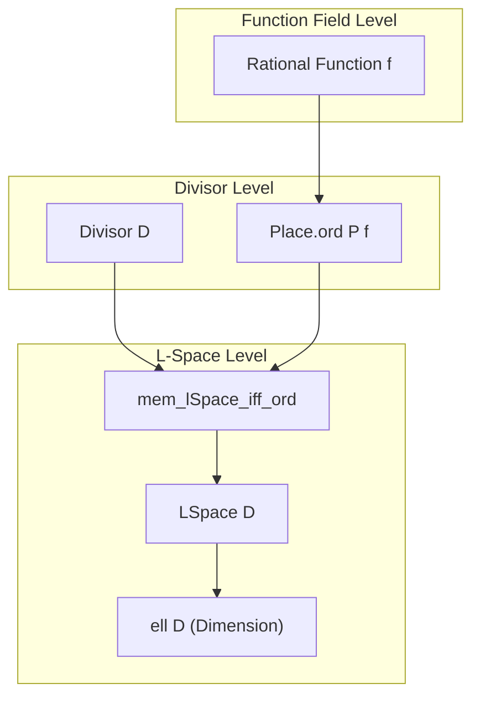
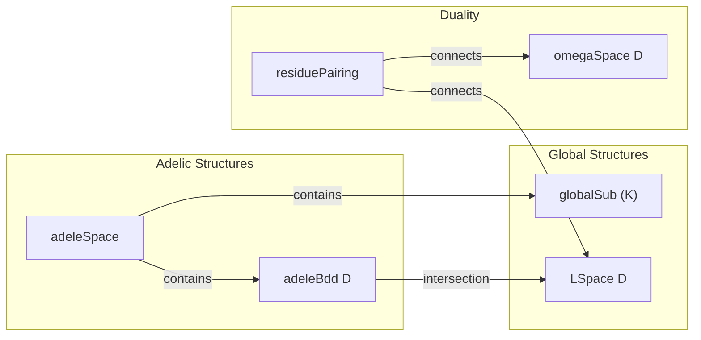

<!-- source: DeepWiki mcp.deepwiki.com · repo anthropics/fermats-last-theorem · page 2.2 Divisors, Riemann-Roch, and Genus · fetched 2026-10-26 -->

# Divisors, Riemann-Roch, and Genus

Relevant source files

The following files were used as context for generating this wiki page:

- [P2M/Sol/S_AlgebraicCurve_Differential_correspondence_mem_regularDifferentials.lean](P2M/Sol/S_AlgebraicCurve_Differential_correspondence_mem_regularDifferentials.lean)
- [P2M/Sol/S_AlgebraicCurve_Divisor_pushforwardNormFormula.lean](P2M/Sol/S_AlgebraicCurve_Divisor_pushforwardNormFormula.lean)
- [P2M/Sol/S_AlgebraicCurve_Divisor_pushforwardNormFormula_of_finiteDimensional.lean](P2M/Sol/S_AlgebraicCurve_Divisor_pushforwardNormFormula_of_finiteDimensional.lean)
- [P2M/Sol/S_AlgebraicCurve_Divisor_pushforwardNormFormula_of_isSeparable.lean](P2M/Sol/S_AlgebraicCurve_Divisor_pushforwardNormFormula_of_isSeparable.lean)
- [P2M/Sol/S_AlgebraicCurve_Place_exists_toValuationSubring_eq_comap.lean](P2M/Sol/S_AlgebraicCurve_Place_exists_toValuationSubring_eq_comap.lean)
- [P2M/Sol/S_AlgebraicCurve_Place_inertiaDeg_eq_inertiaDeg_fiberCenter.lean](P2M/Sol/S_AlgebraicCurve_Place_inertiaDeg_eq_inertiaDeg_fiberCenter.lean)
- [P2M/Sol/S_AlgebraicCurve_Place_inertiaDeg_pos.lean](P2M/Sol/S_AlgebraicCurve_Place_inertiaDeg_pos.lean)
- [P2M/Sol/S_AlgebraicCurve_Place_mk_mem_maximalIdeal_iff.lean](P2M/Sol/S_AlgebraicCurve_Place_mk_mem_maximalIdeal_iff.lean)
- [P2M/Sol/S_AlgebraicCurve_Place_neg_le_ord_trace_of_forall_le_ord_sub_pred.lean](P2M/Sol/S_AlgebraicCurve_Place_neg_le_ord_trace_of_forall_le_ord_sub_pred.lean)
- [P2M/Sol/S_AlgebraicCurve_Place_ord_norm_eq_sum_fiberOver.lean](P2M/Sol/S_AlgebraicCurve_Place_ord_norm_eq_sum_fiberOver.lean)
- [P2M/Sol/S_AlgebraicCurve_Place_ord_norm_eq_sum_fiberOver_of_isSeparable.lean](P2M/Sol/S_AlgebraicCurve_Place_ord_norm_eq_sum_fiberOver_of_isSeparable.lean)
- [P2M/Sol/S_AlgebraicCurve_Place_ramificationIndex_eq_ramificationIdx_fiberCenter.lean](P2M/Sol/S_AlgebraicCurve_Place_ramificationIndex_eq_ramificationIdx_fiberCenter.lean)
- [P2M/Sol/S_AlgebraicCurve_Place_sum_ramificationIndex_mul_inertiaDeg.lean](P2M/Sol/S_AlgebraicCurve_Place_sum_ramificationIndex_mul_inertiaDeg.lean)
- [P2M/Sol/S_AlgebraicCurve_Place_sum_ramificationIndex_mul_inertiaDeg_fiberOver.lean](P2M/Sol/S_AlgebraicCurve_Place_sum_ramificationIndex_mul_inertiaDeg_fiberOver.lean)
- [P2M/Sol/S_AlgebraicCurve_Place_sum_ramificationIndex_mul_inertiaDeg_le_finrank.lean](P2M/Sol/S_AlgebraicCurve_Place_sum_ramificationIndex_mul_inertiaDeg_le_finrank.lean)
- [P2M/Sol/S_AlgebraicCurve_RationalFunctionField_algebraMap_polynomial_mem_of_ne_placeInfty.lean](P2M/Sol/S_AlgebraicCurve_RationalFunctionField_algebraMap_polynomial_mem_of_ne_placeInfty.lean)
- [P2M/Sol/S_AlgebraicCurve_RationalFunctionField_finiteDimensional_lSpace_zero_of_constantsAreBase.lean](P2M/Sol/S_AlgebraicCurve_RationalFunctionField_finiteDimensional_lSpace_zero_of_constantsAreBase.lean)
- [P2M/Sol/S_AlgebraicCurve_RationalFunctionField_indexOfSpecialtyFinite_of_ratFunc_tower.lean](P2M/Sol/S_AlgebraicCurve_RationalFunctionField_indexOfSpecialtyFinite_of_ratFunc_tower.lean)
- [P2M/Sol/S_AlgebraicCurve_RationalFunctionField_ord_X_nonneg_of_ne_placeInfty.lean](P2M/Sol/S_AlgebraicCurve_RationalFunctionField_ord_X_nonneg_of_ne_placeInfty.lean)
- [P2M/Sol/S_AlgebraicCurve_RationalFunctionField_ord_placeInfty_X.lean](P2M/Sol/S_AlgebraicCurve_RationalFunctionField_ord_placeInfty_X.lean)
- [P2M/Sol/S_AlgebraicCurve_RationalFunctionField_stichtenothGenusExists.lean](P2M/Sol/S_AlgebraicCurve_RationalFunctionField_stichtenothGenusExists.lean)
- [P2M/Sol/S_AlgebraicCurve_RationalFunctionField_stichtenothGenusExists_of_ratFunc_tower.lean](P2M/Sol/S_AlgebraicCurve_RationalFunctionField_stichtenothGenusExists_of_ratFunc_tower.lean)
- [P2M/Sol/S_AlgebraicCurve_RationalFunctionField_trace_localResidue_finitePlace_add_trace_localResidue_placeInfty_eq_zero.lean](P2M/Sol/S_AlgebraicCurve_RationalFunctionField_trace_localResidue_finitePlace_add_trace_localResidue_placeInfty_eq_zero.lean)
- [P2M/Sol/S_AlgebraicCurve_RationalFunctionField_trace_localResidue_finitePlace_div_pow_eq_zero.lean](P2M/Sol/S_AlgebraicCurve_RationalFunctionField_trace_localResidue_finitePlace_div_pow_eq_zero.lean)
- [P2M/Sol/S_AlgebraicCurve_RationalFunctionField_trace_localResidue_placeInfty_X_pow_eq_zero.lean](P2M/Sol/S_AlgebraicCurve_RationalFunctionField_trace_localResidue_placeInfty_X_pow_eq_zero.lean)
- [P2M/Sol/S_AlgebraicCurve_RiemannGenusReachedAt_eq_of_ge.lean](P2M/Sol/S_AlgebraicCurve_RiemannGenusReachedAt_eq_of_ge.lean)
- [P2M/Sol/S_AlgebraicCurve_adeleSpace_eq_of_genusReached.lean](P2M/Sol/S_AlgebraicCurve_adeleSpace_eq_of_genusReached.lean)
- [P2M/Sol/S_AlgebraicCurve_completionTraceSum_of_isSeparable.lean](P2M/Sol/S_AlgebraicCurve_completionTraceSum_of_isSeparable.lean)
- [P2M/Sol/S_AlgebraicCurve_ell_le_degree_add_ellZero.lean](P2M/Sol/S_AlgebraicCurve_ell_le_degree_add_ellZero.lean)
- [P2M/Sol/S_AlgebraicCurve_ell_le_ell_sub_single_add_deg.lean](P2M/Sol/S_AlgebraicCurve_ell_le_ell_sub_single_add_deg.lean)
- [P2M/Sol/S_AlgebraicCurve_ell_sub_ell_le_degree_sub_degree.lean](P2M/Sol/S_AlgebraicCurve_ell_sub_ell_le_degree_sub_degree.lean)
- [P2M/Sol/S_AlgebraicCurve_exists_genus_riemannIndex_of_stichtenothGenusExists.lean](P2M/Sol/S_AlgebraicCurve_exists_genus_riemannIndex_of_stichtenothGenusExists.lean)
- [P2M/Sol/S_AlgebraicCurve_exists_riemannGenusReachedAt_of_bounded.lean](P2M/Sol/S_AlgebraicCurve_exists_riemannGenusReachedAt_of_bounded.lean)
- [P2M/Sol/S_AlgebraicCurve_fibreResidueIdentityAlong_of_separableAlong_of_dCoordGenerates.lean](P2M/Sol/S_AlgebraicCurve_fibreResidueIdentityAlong_of_separableAlong_of_dCoordGenerates.lean)
- [P2M/Sol/S_AlgebraicCurve_finiteDimensional_lSpace.lean](P2M/Sol/S_AlgebraicCurve_finiteDimensional_lSpace.lean)
- [P2M/Sol/S_AlgebraicCurve_genus_ratFunc_eq_zero_of_perfectField.lean](P2M/Sol/S_AlgebraicCurve_genus_ratFunc_eq_zero_of_perfectField.lean)
- [P2M/Sol/S_AlgebraicCurve_hasPrincipalDivisors_of_finiteDimensional_ratFunc.lean](P2M/Sol/S_AlgebraicCurve_hasPrincipalDivisors_of_finiteDimensional_ratFunc.lean)
- [P2M/Sol/S_AlgebraicCurve_hasPrincipalDivisors_of_finiteDimensional_ratFunc_of_isSeparable.lean](P2M/Sol/S_AlgebraicCurve_hasPrincipalDivisors_of_finiteDimensional_ratFunc_of_isSeparable.lean)
- [P2M/Sol/S_AlgebraicCurve_hasPrincipalDivisors_of_transcendental.lean](P2M/Sol/S_AlgebraicCurve_hasPrincipalDivisors_of_transcendental.lean)
- [P2M/Sol/S_AlgebraicCurve_indexOfSpecialty_eq_ell_sub_of_rankOne_max.lean](P2M/Sol/S_AlgebraicCurve_indexOfSpecialty_eq_ell_sub_of_rankOne_max.lean)
- [P2M/Sol/S_AlgebraicCurve_indexOfSpecialty_eq_of_genusReached.lean](P2M/Sol/S_AlgebraicCurve_indexOfSpecialty_eq_of_genusReached.lean)
- [P2M/Sol/S_AlgebraicCurve_indexOfSpecialty_eq_zero_of_genusReached.lean](P2M/Sol/S_AlgebraicCurve_indexOfSpecialty_eq_zero_of_genusReached.lean)
- [P2M/Sol/S_AlgebraicCurve_instHasCanonicalDivisorRatFuncPerfectField.lean](P2M/Sol/S_AlgebraicCurve_instHasCanonicalDivisorRatFuncPerfectField.lean)
- [P2M/Sol/S_AlgebraicCurve_isCurveOver_ratFunc.lean](P2M/Sol/S_AlgebraicCurve_isCurveOver_ratFunc.lean)
- [P2M/Sol/S_AlgebraicCurve_linearIndependent_pow_of_transcendental.lean](P2M/Sol/S_AlgebraicCurve_linearIndependent_pow_of_transcendental.lean)
- [P2M/Sol/S_AlgebraicCurve_omegaSpace_finite_of_genusReached.lean](P2M/Sol/S_AlgebraicCurve_omegaSpace_finite_of_genusReached.lean)
- [P2M/Sol/S_AlgebraicCurve_one_le_deg.lean](P2M/Sol/S_AlgebraicCurve_one_le_deg.lean)
- [P2M/Sol/S_AlgebraicCurve_residueTheoremK_of_isAlgClosed.lean](P2M/Sol/S_AlgebraicCurve_residueTheoremK_of_isAlgClosed.lean)
- [P2M/Sol/S_AlgebraicCurve_residueTheoremK_ratFunc_of_isAlgClosed.lean](P2M/Sol/S_AlgebraicCurve_residueTheoremK_ratFunc_of_isAlgClosed.lean)
- [P2M/Sol/S_AlgebraicCurve_residueTheorem_of_residueTheorem_ratFunc_of_residueTraceCompletionCommute.lean](P2M/Sol/S_AlgebraicCurve_residueTheorem_of_residueTheorem_ratFunc_of_residueTraceCompletionCommute.lean)
- [P2M/Sol/S_AlgebraicCurve_residueTheorem_ratFunc_of_perfectField.lean](P2M/Sol/S_AlgebraicCurve_residueTheorem_ratFunc_of_perfectField.lean)
- [P2M/Sol/S_AlgebraicCurve_tateCommFinite.lean](P2M/Sol/S_AlgebraicCurve_tateCommFinite.lean)
- [P2M/Sol/S_AlgebraicCurve_tateTraceCompat_of_isSeparable.lean](P2M/Sol/S_AlgebraicCurve_tateTraceCompat_of_isSeparable.lean)
- [P2M/Sol/S_AlgebraicCurve_weilDifferentialRankOne_of_stichtenothGenusExists.lean](P2M/Sol/S_AlgebraicCurve_weilDifferentialRankOne_of_stichtenothGenusExists.lean)
- [P2M/Sol/S_IsLocalRing_hensel_lift_unique.lean](P2M/Sol/S_IsLocalRing_hensel_lift_unique.lean)

This section covers the theory of formal divisors on algebraic curves, the construction of Riemann-Roch spaces ($L$-spaces), and the derivation of the genus through the Riemann-Roch theorem. The implementation follows the Stichtenoth approach to function fields, defining the genus via the stability of the index of specialty for large divisors.

## Divisors and Principal Divisors

A `Divisor` is implemented as a formal sum of `Place` objects with integer coefficients [P2M/Sol/S_AlgebraicCurve_residueTheoremK_of_isAlgClosed.lean:35-35](). The degree of a divisor is the sum of these coefficients weighted by the degree of the place [P2M/Sol/S_AlgebraicCurve_residueTheoremK_of_isAlgClosed.lean:35-35]().

The codebase defines `HasPrincipalDivisors` to denote curves where every principal divisor (the divisor $(f)$ associated to a rational function $f$) is defined [P2M/Sol/S_AlgebraicCurve_residueTheoremK_of_isAlgClosed.lean:35-35](). The map from the function field to the divisor group is handled via `Place.ord` [P2M/Sol/S_AlgebraicCurve_residueTheoremK_of_isAlgClosed.lean:35-35]().

### Mapping Natural Language to Code: Divisors

| Concept | Code Entity | File Reference |
| :--- | :--- | :--- |
| **Divisor** | `Divisor` | [P2M/Sol/S_AlgebraicCurve_residueTheoremK_of_isAlgClosed.lean:35-35]() |
| **Degree** | `Divisor.degree` | [P2M/Sol/S_AlgebraicCurve_residueTheoremK_of_isAlgClosed.lean:35-35]() |
| **Principal Divisor** | `HasPrincipalDivisors` | [P2M/Sol/S_AlgebraicCurve_residueTheoremK_of_isAlgClosed.lean:35-35]() |
| **Valuation at Place** | `Place.ord` | [P2M/Sol/S_AlgebraicCurve_residueTheoremK_of_isAlgClosed.lean:35-35]() |

**Sources:** [P2M/Sol/S_AlgebraicCurve_residueTheoremK_of_isAlgClosed.lean:35-45](), [P2M/Sol/S_AlgebraicCurve_RationalFunctionField_stichtenothGenusExists.lean:27-27]()

## Riemann-Roch Spaces (L-Spaces)

The $L$-space associated with a divisor $D$, denoted `LSpace D`, consists of all elements $x$ in the function field such that $ord_P(x) \geq -ord_P(D)$ for all places $P$ [P2M/Sol/S_AlgebraicCurve_RationalFunctionField_stichtenothGenusExists.lean:27-27](). The dimension of this space is denoted by `ell D` [P2M/Sol/S_AlgebraicCurve_RationalFunctionField_stichtenothGenusExists.lean:27-27]().

Key properties implemented include:
*   **Monotonicity**: `lSpace_mono` shows that $D_1 \leq D_2 \implies L(D_1) \subseteq L(D_2)$ [P2M/Sol/S_AlgebraicCurve_RationalFunctionField_stichtenothGenusExists.lean:27-27]().
*   **Base Field Constants**: If the curve satisfies `ConstantsAreBase`, then `ell 0 = 1` [P2M/Sol/S_AlgebraicCurve_RationalFunctionField_stichtenothGenusExists.lean:27-27]().
*   **Finite Dimensionality**: Proven in `finiteDimensional_lSpace` [P2M/Sol/S_AlgebraicCurve_RationalFunctionField_stichtenothGenusExists.lean:27-27]().

### Data Flow: Riemann-Roch Space Construction

**Sources:** [P2M/Sol/S_AlgebraicCurve_RationalFunctionField_stichtenothGenusExists.lean:27-29]()

## Genus and Index of Specialty

The genus $g$ is defined via the `StichtenothGenusExists` construction, which identifies a constant such that for all divisors $D$ of sufficiently large degree, the **index of specialty** becomes stable [P2M/Sol/S_AlgebraicCurve_RationalFunctionField_stichtenothGenusExists.lean:27-27]().

The `indexOfSpecialty` of a divisor $D$ is defined as $deg(D) - ell(D) + 1$ [P2M/Sol/S_AlgebraicCurve_RationalFunctionField_stichtenothGenusExists.lean:27-27](). The Riemann-Roch theorem then relates this to the dimension of the space of differentials `omegaSpace` [P2M/Sol/S_AlgebraicCurve_RationalFunctionField_stichtenothGenusExists.lean:27-27]().

### Key Genus Theorems
*   **RiemannGenusReached**: Predicate indicating that the genus bound has been attained for a specific divisor [P2M/Sol/S_AlgebraicCurve_RationalFunctionField_stichtenothGenusExists.lean:27-27]().
*   **RiemannGenusBounded**: Proves that the set of indices of specialty is bounded above [P2M/Sol/S_AlgebraicCurve_RationalFunctionField_stichtenothGenusExists.lean:27-27]().
*   **StichtenothGenusExists**: The main existential proof for the genus of a function field [P2M/Sol/S_AlgebraicCurve_RationalFunctionField_stichtenothGenusExists.lean:27-27]().

### Mapping Natural Language to Code: Genus

| Concept | Code Entity | File Reference |
| :--- | :--- | :--- |
| **Index of Specialty** | `indexOfSpecialty` | [P2M/Sol/S_AlgebraicCurve_RationalFunctionField_stichtenothGenusExists.lean:27-27]() |
| **Genus Existence** | `StichtenothGenusExists` | [P2M/Sol/S_AlgebraicCurve_RationalFunctionField_stichtenothGenusExists.lean:27-27]() |
| **Space of Differentials** | `omegaSpace` | [P2M/Sol/S_AlgebraicCurve_RationalFunctionField_stichtenothGenusExists.lean:27-27]() |
| **Dimension of Omega** | `finrank_omegaSpace_eq_indexOfSpecialty` | [P2M/Sol/S_AlgebraicCurve_RationalFunctionField_stichtenothGenusExists.lean:27-27]() |

**Sources:** [P2M/Sol/S_AlgebraicCurve_RationalFunctionField_stichtenothGenusExists.lean:27-29](), [P2M/Sol/S_AlgebraicCurve_RationalFunctionField_stichtenothGenusExists_of_ratFunc_tower.lean:27-27]()

## Adeles and Duality

The proof of the Riemann-Roch theorem utilizes the `adeleSpace` (repartitions) [P2M/Sol/S_AlgebraicCurve_RationalFunctionField_stichtenothGenusExists.lean:27-27](). The `adeleBdd` space represents adeles whose components are bounded by a divisor $D$ [P2M/Sol/S_AlgebraicCurve_RationalFunctionField_stichtenothGenusExists.lean:27-27]().

The duality between $L$-spaces and the space of Weil differentials is established through the `residuePairing` [P2M/Sol/S_AlgebraicCurve_RationalFunctionField_stichtenothGenusExists.lean:27-27]().

**Sources:** [P2M/Sol/S_AlgebraicCurve_RationalFunctionField_stichtenothGenusExists.lean:27-29](), [P2M/Sol/S_AlgebraicCurve_residueTheoremK_of_isAlgClosed.lean:35-35]()

## Rational Function Field Specialization

For the rational function field $K(X)$, specific constructions are provided:
*   **Place at Infinity**: `RationalFunctionField.placeInfty` [P2M/Sol/S_AlgebraicCurve_RationalFunctionField_stichtenothGenusExists.lean:27-27]().
*   **Valuation at Infinity**: `RationalFunctionField.ord_placeInfty` [P2M/Sol/S_AlgebraicCurve_RationalFunctionField_stichtenothGenusExists.lean:27-27]().
*   **Genus Zero**: The genus of the rational function field is proven to be zero in `S_AlgebraicCurve_genus_ratFunc_eq_zero_of_perfectField`.

**Sources:** [P2M/Sol/S_AlgebraicCurve_RationalFunctionField_stichtenothGenusExists.lean:27-29](), [P2M/Sol/S_AlgebraicCurve_RationalFunctionField_ord_placeInfty_X.lean:27-27]()

---

