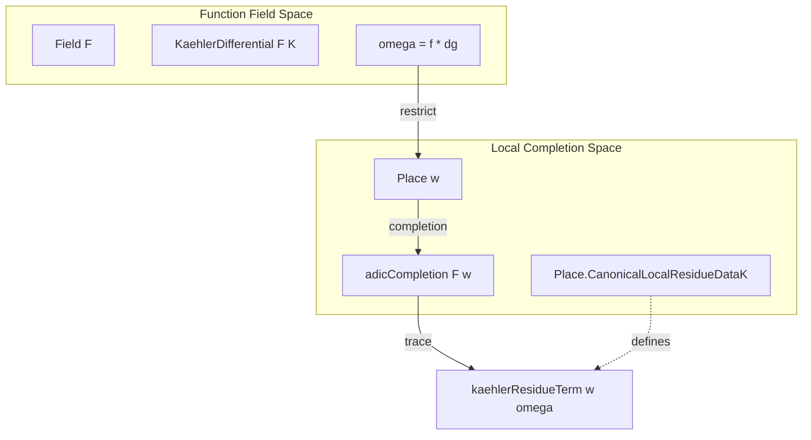
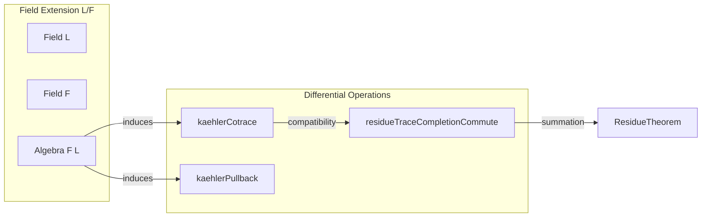

<!-- source: DeepWiki mcp.deepwiki.com · repo anthropics/fermats-last-theorem · page 2.3 Kähler Differentials and the Residue Theorem · fetched 2026-10-26 -->

# Kähler Differentials and the Residue Theorem

Relevant source files

The following files were used as context for generating this wiki page:

- [Definitions/Def_AlgebraicCurve_Pic0BaseChange.lean](Definitions/Def_AlgebraicCurve_Pic0BaseChange.lean)
- [Definitions/Def_AlgebraicCurve_SerrePairing.lean](Definitions/Def_AlgebraicCurve_SerrePairing.lean)
- [P2M/Sol/S_AlgebraicCurve_AlgEquiv_eq_one_of_forall_smul_place_eq.lean](P2M/Sol/S_AlgebraicCurve_AlgEquiv_eq_one_of_forall_smul_place_eq.lean)
- [P2M/Sol/S_AlgebraicCurve_Differential_correspondence_mem_regularDifferentials.lean](P2M/Sol/S_AlgebraicCurve_Differential_correspondence_mem_regularDifferentials.lean)
- [P2M/Sol/S_AlgebraicCurve_Differential_map_correspondence_regularDifferentials_of_constantFieldExtension.lean](P2M/Sol/S_AlgebraicCurve_Differential_map_correspondence_regularDifferentials_of_constantFieldExtension.lean)
- [P2M/Sol/S_AlgebraicCurve_Divisor_isPrincipal_of_genus_eq_zero.lean](P2M/Sol/S_AlgebraicCurve_Divisor_isPrincipal_of_genus_eq_zero.lean)
- [P2M/Sol/S_AlgebraicCurve_Divisor_mapDomain_pullbackAlong_eq_and_restrictAlong_eq_of_degZero.lean](P2M/Sol/S_AlgebraicCurve_Divisor_mapDomain_pullbackAlong_eq_and_restrictAlong_eq_of_degZero.lean)
- [P2M/Sol/S_AlgebraicCurve_Divisor_pullbackAlong_pushforwardAlong_eq_add_of_adjoin_eq_top.lean](P2M/Sol/S_AlgebraicCurve_Divisor_pullbackAlong_pushforwardAlong_eq_add_of_adjoin_eq_top.lean)
- [P2M/Sol/S_AlgebraicCurve_Divisor_pullbackAlong_pushforwardAlong_eq_pushforwardAlong_pullbackAlong.lean](P2M/Sol/S_AlgebraicCurve_Divisor_pullbackAlong_pushforwardAlong_eq_pushforwardAlong_pullbackAlong.lean)
- [P2M/Sol/S_AlgebraicCurve_Divisor_pullbackAlong_pushforwardAlong_eq_sum_of_decomposition.lean](P2M/Sol/S_AlgebraicCurve_Divisor_pullbackAlong_pushforwardAlong_eq_sum_of_decomposition.lean)
- [P2M/Sol/S_AlgebraicCurve_Divisor_pushforwardNormFormula.lean](P2M/Sol/S_AlgebraicCurve_Divisor_pushforwardNormFormula.lean)
- [P2M/Sol/S_AlgebraicCurve_Divisor_pushforwardNormFormula_of_finiteDimensional.lean](P2M/Sol/S_AlgebraicCurve_Divisor_pushforwardNormFormula_of_finiteDimensional.lean)
- [P2M/Sol/S_AlgebraicCurve_Divisor_pushforwardNormFormula_of_isSeparable.lean](P2M/Sol/S_AlgebraicCurve_Divisor_pushforwardNormFormula_of_isSeparable.lean)
- [P2M/Sol/S_AlgebraicCurve_Pic0_exists_injective_linearMap_rationalTateModule_fixedField_range_eq_iInf_ker_and_comp_eq.lean](P2M/Sol/S_AlgebraicCurve_Pic0_exists_injective_linearMap_rationalTateModule_fixedField_range_eq_iInf_ker_and_comp_eq.lean)
- [P2M/Sol/S_AlgebraicCurve_Place_exists_toValuationSubring_eq_comap.lean](P2M/Sol/S_AlgebraicCurve_Place_exists_toValuationSubring_eq_comap.lean)
- [P2M/Sol/S_AlgebraicCurve_Place_inertiaDeg_eq_inertiaDeg_fiberCenter.lean](P2M/Sol/S_AlgebraicCurve_Place_inertiaDeg_eq_inertiaDeg_fiberCenter.lean)
- [P2M/Sol/S_AlgebraicCurve_Place_inertiaDeg_pos.lean](P2M/Sol/S_AlgebraicCurve_Place_inertiaDeg_pos.lean)
- [P2M/Sol/S_AlgebraicCurve_Place_neg_le_ord_trace_of_forall_le_ord_sub_pred.lean](P2M/Sol/S_AlgebraicCurve_Place_neg_le_ord_trace_of_forall_le_ord_sub_pred.lean)
- [P2M/Sol/S_AlgebraicCurve_Place_ord_norm_eq_sum_fiberOver.lean](P2M/Sol/S_AlgebraicCurve_Place_ord_norm_eq_sum_fiberOver.lean)
- [P2M/Sol/S_AlgebraicCurve_Place_ord_norm_eq_sum_fiberOver_of_isSeparable.lean](P2M/Sol/S_AlgebraicCurve_Place_ord_norm_eq_sum_fiberOver_of_isSeparable.lean)
- [P2M/Sol/S_AlgebraicCurve_Place_ramificationIndex_eq_ramificationIdx_fiberCenter.lean](P2M/Sol/S_AlgebraicCurve_Place_ramificationIndex_eq_ramificationIdx_fiberCenter.lean)
- [P2M/Sol/S_AlgebraicCurve_Place_sum_ramificationIndex_mul_inertiaDeg.lean](P2M/Sol/S_AlgebraicCurve_Place_sum_ramificationIndex_mul_inertiaDeg.lean)
- [P2M/Sol/S_AlgebraicCurve_Place_sum_ramificationIndex_mul_inertiaDeg_bifiber.lean](P2M/Sol/S_AlgebraicCurve_Place_sum_ramificationIndex_mul_inertiaDeg_bifiber.lean)
- [P2M/Sol/S_AlgebraicCurve_Place_sum_ramificationIndex_mul_inertiaDeg_bifiber_defect.lean](P2M/Sol/S_AlgebraicCurve_Place_sum_ramificationIndex_mul_inertiaDeg_bifiber_defect.lean)
- [P2M/Sol/S_AlgebraicCurve_Place_sum_ramificationIndex_mul_inertiaDeg_exchange.lean](P2M/Sol/S_AlgebraicCurve_Place_sum_ramificationIndex_mul_inertiaDeg_exchange.lean)
- [P2M/Sol/S_AlgebraicCurve_Place_sum_ramificationIndex_mul_inertiaDeg_exchange_add.lean](P2M/Sol/S_AlgebraicCurve_Place_sum_ramificationIndex_mul_inertiaDeg_exchange_add.lean)
- [P2M/Sol/S_AlgebraicCurve_Place_sum_ramificationIndex_mul_inertiaDeg_fiberOver.lean](P2M/Sol/S_AlgebraicCurve_Place_sum_ramificationIndex_mul_inertiaDeg_fiberOver.lean)
- [P2M/Sol/S_AlgebraicCurve_Place_sum_ramificationIndex_mul_inertiaDeg_le_finrank.lean](P2M/Sol/S_AlgebraicCurve_Place_sum_ramificationIndex_mul_inertiaDeg_le_finrank.lean)
- [P2M/Sol/S_AlgebraicCurve_RationalFunctionField_trace_localResidue_finitePlace_add_trace_localResidue_placeInfty_eq_zero.lean](P2M/Sol/S_AlgebraicCurve_RationalFunctionField_trace_localResidue_finitePlace_add_trace_localResidue_placeInfty_eq_zero.lean)
- [P2M/Sol/S_AlgebraicCurve_RationalFunctionField_trace_localResidue_finitePlace_div_pow_eq_zero.lean](P2M/Sol/S_AlgebraicCurve_RationalFunctionField_trace_localResidue_finitePlace_div_pow_eq_zero.lean)
- [P2M/Sol/S_AlgebraicCurve_RationalFunctionField_trace_localResidue_placeInfty_X_pow_eq_zero.lean](P2M/Sol/S_AlgebraicCurve_RationalFunctionField_trace_localResidue_placeInfty_X_pow_eq_zero.lean)
- [P2M/Sol/S_AlgebraicCurve_completionTraceSum_of_isSeparable.lean](P2M/Sol/S_AlgebraicCurve_completionTraceSum_of_isSeparable.lean)
- [P2M/Sol/S_AlgebraicCurve_ell_mapDomain_eq_of_constantFieldExtension_of_isAlgClosed.lean](P2M/Sol/S_AlgebraicCurve_ell_mapDomain_eq_of_constantFieldExtension_of_isAlgClosed.lean)
- [P2M/Sol/S_AlgebraicCurve_exists_int_matrix_forall_toMatrix_tateModule_rep_correspondence_eq_map.lean](P2M/Sol/S_AlgebraicCurve_exists_int_matrix_forall_toMatrix_tateModule_rep_correspondence_eq_map.lean)
- [P2M/Sol/S_AlgebraicCurve_exists_ordDifferential_ge_neg_one_and_evalAt_eq_of_degree_eq_zero.lean](P2M/Sol/S_AlgebraicCurve_exists_ordDifferential_ge_neg_one_and_evalAt_eq_of_degree_eq_zero.lean)
- [P2M/Sol/S_AlgebraicCurve_exists_transcendental_reduced_poleDivisor.lean](P2M/Sol/S_AlgebraicCurve_exists_transcendental_reduced_poleDivisor.lean)
- [P2M/Sol/S_AlgebraicCurve_fibreResidueIdentityAlong_of_separableAlong_of_dCoordGenerates.lean](P2M/Sol/S_AlgebraicCurve_fibreResidueIdentityAlong_of_separableAlong_of_dCoordGenerates.lean)
- [P2M/Sol/S_AlgebraicCurve_finite_and_finrank_polarDifferentials_eq.lean](P2M/Sol/S_AlgebraicCurve_finite_and_finrank_polarDifferentials_eq.lean)
- [P2M/Sol/S_AlgebraicCurve_finite_and_finrank_regularDifferentials_eq_genus.lean](P2M/Sol/S_AlgebraicCurve_finite_and_finrank_regularDifferentials_eq_genus.lean)
- [P2M/Sol/S_AlgebraicCurve_finite_and_finrank_regularDiffs_eq_genusFF_of_isAlgClosed.lean](P2M/Sol/S_AlgebraicCurve_finite_and_finrank_regularDiffs_eq_genusFF_of_isAlgClosed.lean)
- [P2M/Sol/S_AlgebraicCurve_genus_ratFunc_eq_zero_of_perfectField.lean](P2M/Sol/S_AlgebraicCurve_genus_ratFunc_eq_zero_of_perfectField.lean)
- [P2M/Sol/S_AlgebraicCurve_hasPrincipalDivisors_of_finiteDimensional_ratFunc.lean](P2M/Sol/S_AlgebraicCurve_hasPrincipalDivisors_of_finiteDimensional_ratFunc.lean)
- [P2M/Sol/S_AlgebraicCurve_hasPrincipalDivisors_of_finiteDimensional_ratFunc_of_isSeparable.lean](P2M/Sol/S_AlgebraicCurve_hasPrincipalDivisors_of_finiteDimensional_ratFunc_of_isSeparable.lean)
- [P2M/Sol/S_AlgebraicCurve_hasPrincipalDivisors_of_transcendental.lean](P2M/Sol/S_AlgebraicCurve_hasPrincipalDivisors_of_transcendental.lean)
- [P2M/Sol/S_AlgebraicCurve_instHasCanonicalDivisorRatFuncPerfectField.lean](P2M/Sol/S_AlgebraicCurve_instHasCanonicalDivisorRatFuncPerfectField.lean)
- [P2M/Sol/S_AlgebraicCurve_isCurveOver_ratFunc.lean](P2M/Sol/S_AlgebraicCurve_isCurveOver_ratFunc.lean)
- [P2M/Sol/S_AlgebraicCurve_mem_span_image_polarDifferentials_of_constantFieldExtension_of_isAlgClosed.lean](P2M/Sol/S_AlgebraicCurve_mem_span_image_polarDifferentials_of_constantFieldExtension_of_isAlgClosed.lean)
- [P2M/Sol/S_AlgebraicCurve_pullbackAlong_mem_regularDifferentials_of_isIntegral.lean](P2M/Sol/S_AlgebraicCurve_pullbackAlong_mem_regularDifferentials_of_isIntegral.lean)
- [P2M/Sol/S_AlgebraicCurve_pullbackAlong_mem_regularDifferentials_of_mem_of_algEquiv.lean](P2M/Sol/S_AlgebraicCurve_pullbackAlong_mem_regularDifferentials_of_mem_of_algEquiv.lean)
- [P2M/Sol/S_AlgebraicCurve_pullbackAlong_mem_regularDifferentials_of_mem_of_isCurveOver.lean](P2M/Sol/S_AlgebraicCurve_pullbackAlong_mem_regularDifferentials_of_mem_of_isCurveOver.lean)
- [P2M/Sol/S_AlgebraicCurve_regularDiffs_eq_regularDifferentials.lean](P2M/Sol/S_AlgebraicCurve_regularDiffs_eq_regularDifferentials.lean)
- [P2M/Sol/S_AlgebraicCurve_regularDiffs_eq_regularDifferentials_of_perfectField.lean](P2M/Sol/S_AlgebraicCurve_regularDiffs_eq_regularDifferentials_of_perfectField.lean)
- [P2M/Sol/S_AlgebraicCurve_residueTheoremK_of_isAlgClosed.lean](P2M/Sol/S_AlgebraicCurve_residueTheoremK_of_isAlgClosed.lean)
- [P2M/Sol/S_AlgebraicCurve_residueTheoremK_ratFunc_of_isAlgClosed.lean](P2M/Sol/S_AlgebraicCurve_residueTheoremK_ratFunc_of_isAlgClosed.lean)
- [P2M/Sol/S_AlgebraicCurve_residueTheorem_of_residueTheorem_ratFunc_of_residueTraceCompletionCommute.lean](P2M/Sol/S_AlgebraicCurve_residueTheorem_of_residueTheorem_ratFunc_of_residueTraceCompletionCommute.lean)
- [P2M/Sol/S_AlgebraicCurve_residueTheorem_ratFunc_of_perfectField.lean](P2M/Sol/S_AlgebraicCurve_residueTheorem_ratFunc_of_perfectField.lean)
- [P2M/Sol/S_AlgebraicCurve_tateCommFinite.lean](P2M/Sol/S_AlgebraicCurve_tateCommFinite.lean)
- [P2M/Sol/S_AlgebraicCurve_tateTraceCompat_of_isSeparable.lean](P2M/Sol/S_AlgebraicCurve_tateTraceCompat_of_isSeparable.lean)
- [P2M/Sol/S_IsLocalRing_hensel_lift_unique.lean](P2M/Sol/S_IsLocalRing_hensel_lift_unique.lean)

This section details the theory of differentials on algebraic curves and the proof of the Global Residue Theorem. The repository implements Kähler differentials as the module of relative differentials $\Omega_{F/K}$, defines local residues at places of the function field, and establishes that the sum of residues of any differential across all places is zero.

## Kähler Differentials and Regularity

In the function field $F$ of a curve over a field $K$, Kähler differentials are constructed via the `KaehlerDifferential` module [P2M/Sol/S_AlgebraicCurve_RationalFunctionField_trace_localResidue_finitePlace_add_trace_localResidue_placeInfty_eq_zero.lean:102-102](). For a differential $\omega \in \Omega_{F/K}$, the valuation at a place $w$ is defined via `Place.ordDifferential` [P2M/Sol/S_AlgebraicCurve_residueTheoremK_of_isAlgClosed.lean:35-35]().

A differential is **regular** if its valuation is non-negative at all places. The space of regular differentials is proven to have dimension equal to the genus of the function field when $K$ is algebraically closed [P2M/Sol/S_AlgebraicCurve_exists_int_matrix_forall_toMatrix_tateModule_rep_correspondence_eq_map.lean:18-18]().

### Key Entities: Differentials
| Code Entity | Description |
|:---|:---|
| `KaehlerDifferential.D` | The derivation $d: F \to \Omega_{F/K}$ [P2M/Sol/S_AlgebraicCurve_tateTraceCompat_of_isSeparable.lean:60-60](). |
| `Place.ordDifferential` | The order of a differential at a specific place $w$ [P2M/Sol/S_AlgebraicCurve_residueTheoremK_of_isAlgClosed.lean:35-35](). |
| `HasCanonicalDivisor` | Typeclass indicating the existence of a divisor $K_X$ such that $\mathcal{L}(K_X) \cong \Omega_{F/K}$ [P2M/Sol/S_AlgebraicCurve_residueTheoremK_of_isAlgClosed.lean:35-35](). |
| `regularDifferentials` | The submodule of differentials with no poles [P2M/Sol/S_AlgebraicCurve_exists_int_matrix_forall_toMatrix_tateModule_rep_correspondence_eq_map.lean:7-7](). |

**Sources:** [P2M/Sol/S_AlgebraicCurve_residueTheoremK_of_isAlgClosed.lean:34-36](), [P2M/Sol/S_AlgebraicCurve_exists_int_matrix_forall_toMatrix_tateModule_rep_correspondence_eq_map.lean:7-18](), [P2M/Sol/S_AlgebraicCurve_tateTraceCompat_of_isSeparable.lean:59-62]().

## Local Residues

The local residue of a differential at a place $w$, denoted `kaehlerResidueTerm`, is defined using the Tate residue trace or through the completion of the function field at $w$ [P2M/Sol/S_AlgebraicCurve_residueTheoremK_of_isAlgClosed.lean:35-35]().

For a differential $\omega = f \, dg$, the residue at $w$ is calculated by:
1. Mapping $f$ and $g$ to the adic completion $\hat{F}_w$ [P2M/Sol/S_AlgebraicCurve_tateTraceCompat_of_isSeparable.lean:35-35]().
2. Using the `kaehlerResidueTermKFam` which provides the residue values across a family of places [P2M/Sol/S_AlgebraicCurve_residueTheoremK_of_isAlgClosed.lean:35-35]().

### Data Flow: Local Residue Calculation
The following diagram illustrates how a global differential is processed into a local residue at a place $w$.

**Sources:** [P2M/Sol/S_AlgebraicCurve_residueTheoremK_of_isAlgClosed.lean:35-45](), [P2M/Sol/S_AlgebraicCurve_tateTraceCompat_of_isSeparable.lean:35-37](), [P2M/Sol/S_AlgebraicCurve_RationalFunctionField_trace_localResidue_finitePlace_add_trace_localResidue_placeInfty_eq_zero.lean:57-57]().

## The Global Residue Theorem

The central result of this section is `ResidueTheorem`, which states that for any differential $\omega \in \Omega_{F/K}$, the sum of residues over all places $w$ of $F$ is zero:
$$\sum_{w \in \text{Pl}(F)} \text{res}_w(\omega) = 0$$

The proof strategy involves three main steps:
1.  **Rational Function Field Case**: Proving the theorem for $K(X)$ by checking residues at finite places and the place at infinity [P2M/Sol/S_AlgebraicCurve_residueTheoremK_ratFunc_of_isAlgClosed.lean:51-51]().
2.  **Trace Compatibility**: Showing that for a finite separable extension $L/F$, the residue of the cotrace of a differential $\omega$ in $F$ is related to the residue in $L$ via the trace [P2M/Sol/S_AlgebraicCurve_tateTraceCompat_of_isSeparable.lean:68-68]().
3.  **Reduction**: Reducing the general curve case to the rational function field using a transcendental element and the `kaehlerCotrace` / `kaehlerPullback` machinery [P2M/Sol/S_AlgebraicCurve_residueTheoremK_of_isAlgClosed.lean:35-35]().

### Trace and Cotrace Mapping
This diagram maps the algebraic operations used in the reduction step to their Lean implementations.

**Sources:** [P2M/Sol/S_AlgebraicCurve_residueTheoremK_of_isAlgClosed.lean:17-18](), [P2M/Sol/S_AlgebraicCurve_residueTheorem_of_residueTheorem_ratFunc_of_residueTraceCompletionCommute.lean:34-34](), [P2M/Sol/S_AlgebraicCurve_tateTraceCompat_of_isSeparable.lean:24-24]().

## Implementation Details

### Rational Function Field Base Case
The base case for $K(X)$ is handled by `residueTheoremK_ratFunc_of_isAlgClosed` [P2M/Sol/S_AlgebraicCurve_residueTheoremK_of_isAlgClosed.lean:35-35](). It verifies:
*   Residues at finite places (corresponding to irreducible polynomials) [P2M/Sol/S_AlgebraicCurve_RationalFunctionField_trace_localResidue_finitePlace_add_trace_localResidue_placeInfty_eq_zero.lean:57-57]().
*   The residue at the infinite place `placeInfty` [P2M/Sol/S_AlgebraicCurve_RationalFunctionField_trace_localResidue_placeInfty_X_pow_eq_zero.lean:58-58]().
*   Specific vanishing results for $X^n \, dX$ [P2M/Sol/S_AlgebraicCurve_RationalFunctionField_trace_localResidue_placeInfty_X_pow_eq_zero.lean:58-58]().

### Trace Compatibility
The theorem `residueTraceCompletionCommute` [P2M/Sol/S_AlgebraicCurve_residueTheoremK_of_isAlgClosed.lean:35-35]() is critical for the reduction. It ensures that the sum of residues over the fiber of a place $w$ in an extension equals the residue of the trace:
`KwHgfV352_completionTraceSum` [P2M/Sol/S_AlgebraicCurve_residueTheoremK_of_isAlgClosed.lean:35-35]().

### Summary of Key Functions
| Function | File Reference |
|:---|:---|
| `kaehlerResidueTerm` | [P2M/Sol/S_AlgebraicCurve_residueTheoremK_of_isAlgClosed.lean:35-35]() |
| `residueTheoremK` | [P2M/Sol/S_AlgebraicCurve_residueTheoremK_of_isAlgClosed.lean:35-35]() |
| `kaehlerCotrace` | [P2M/Sol/S_AlgebraicCurve_residueTheoremK_of_isAlgClosed.lean:35-35]() |
| `residueTraceCompletionCommute` | [P2M/Sol/S_AlgebraicCurve_residueTheoremK_of_isAlgClosed.lean:17-17]() |
| `sum_ramificationIndex_mul_inertiaDeg` | [P2M/Sol/S_AlgebraicCurve_Place_sum_ramificationIndex_mul_inertiaDeg_le_finrank.lean:21-21]() |

**Sources:** [P2M/Sol/S_AlgebraicCurve_residueTheoremK_of_isAlgClosed.lean:1-45](), [P2M/Sol/S_AlgebraicCurve_tateTraceCompat_of_isSeparable.lean:1-40](), [P2M/Sol/S_AlgebraicCurve_RationalFunctionField_trace_localResidue_placeInfty_X_pow_eq_zero.lean:1-60]().

---

