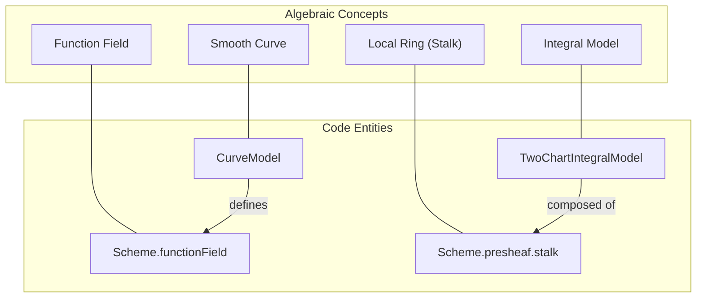
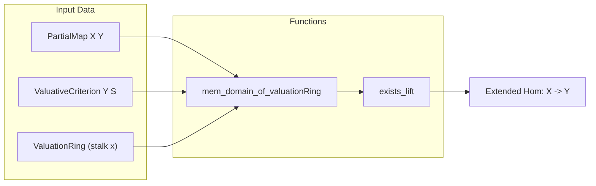

<!-- source: DeepWiki mcp.deepwiki.com · repo anthropics/fermats-last-theorem · page 2.5 Curve Models and Integral Structures · fetched 2026-10-26 -->

# Curve Models and Integral Structures

Relevant source files

The following files were used as context for generating this wiki page:

- [Definitions/Def_AlgebraicCurve_PlaceEvaluationAlgebra.lean](Definitions/Def_AlgebraicCurve_PlaceEvaluationAlgebra.lean)
- [P2M/Sol/S_Algebra_ringKrullDim_eq_toENat_trdeg_of_finiteType.lean](P2M/Sol/S_Algebra_ringKrullDim_eq_toENat_trdeg_of_finiteType.lean)
- [P2M/Sol/S_AlgebraicCurve_Annulus_exists_twoEnd_of_modulus_ne_zero.lean](P2M/Sol/S_AlgebraicCurve_Annulus_exists_twoEnd_of_modulus_ne_zero.lean)
- [P2M/Sol/S_AlgebraicCurve_Annulus_ord_residue_eq_neg_and_evalAt_residue_mul_zpow_eq_of_forall_ord_eq_zero_of_rankOne.lean](P2M/Sol/S_AlgebraicCurve_Annulus_ord_residue_eq_neg_and_evalAt_residue_mul_zpow_eq_of_forall_ord_eq_zero_of_rankOne.lean)
- [P2M/Sol/S_AlgebraicCurve_Annulus_residue_evalAt_eq_evalAt_residue_of_ord_residue_eq_zero_of_regularProlongation.lean](P2M/Sol/S_AlgebraicCurve_Annulus_residue_evalAt_eq_evalAt_residue_of_ord_residue_eq_zero_of_regularProlongation.lean)
- [P2M/Sol/S_AlgebraicCurve_Annulus_residue_evalAt_eq_evalAt_residue_of_ord_residue_eq_zero_of_regularProlongation_modulus_div_param.lean](P2M/Sol/S_AlgebraicCurve_Annulus_residue_evalAt_eq_evalAt_residue_of_ord_residue_eq_zero_of_regularProlongation_modulus_div_param.lean)
- [P2M/Sol/S_AlgebraicCurve_ComponentChart_exists_mem_dom_forall_isUnit_evalAt_of_forall_isUnit.lean](P2M/Sol/S_AlgebraicCurve_ComponentChart_exists_mem_dom_forall_isUnit_evalAt_of_forall_isUnit.lean)
- [P2M/Sol/S_AlgebraicCurve_ComponentChart_fibreParam_laws_of_ord_residue_sub_eq_one.lean](P2M/Sol/S_AlgebraicCurve_ComponentChart_fibreParam_laws_of_ord_residue_sub_eq_one.lean)
- [P2M/Sol/S_AlgebraicCurve_CurveModel_exists_finite_flat_hom_of_algHom.lean](P2M/Sol/S_AlgebraicCurve_CurveModel_exists_finite_flat_hom_of_algHom.lean)
- [P2M/Sol/S_AlgebraicCurve_CurveModel_exists_hom_of_algHom.lean](P2M/Sol/S_AlgebraicCurve_CurveModel_exists_hom_of_algHom.lean)
- [P2M/Sol/S_AlgebraicCurve_CurveModel_pointEquivPlace_eq_of_forall_sub_algebraMap_mem_nonunits_of_twoChartIntegralModel.lean](P2M/Sol/S_AlgebraicCurve_CurveModel_pointEquivPlace_eq_of_forall_sub_algebraMap_mem_nonunits_of_twoChartIntegralModel.lean)
- [P2M/Sol/S_AlgebraicCurve_NodeRingLayers_mem_of_isIntegral_and_exists_valuationSubring_localization_of_uvCrossingModel.lean](P2M/Sol/S_AlgebraicCurve_NodeRingLayers_mem_of_isIntegral_and_exists_valuationSubring_localization_of_uvCrossingModel.lean)
- [P2M/Sol/S_AlgebraicCurve_Place_analyticCoord_of_agree.lean](P2M/Sol/S_AlgebraicCurve_Place_analyticCoord_of_agree.lean)
- [P2M/Sol/S_AlgebraicCurve_Place_card_fiber_eq_finrank_adjoin_of_ord_eq_one.lean](P2M/Sol/S_AlgebraicCurve_Place_card_fiber_eq_finrank_adjoin_of_ord_eq_one.lean)
- [P2M/Sol/S_AlgebraicCurve_Place_connectedSpace_of_chartedSpace_of_meromorphicOrderAt_eq_ord_complex.lean](P2M/Sol/S_AlgebraicCurve_Place_connectedSpace_of_chartedSpace_of_meromorphicOrderAt_eq_ord_complex.lean)
- [P2M/Sol/S_AlgebraicCurve_Place_eq_of_comap_eq_of_forall_mem_nonunits_iff.lean](P2M/Sol/S_AlgebraicCurve_Place_eq_of_comap_eq_of_forall_mem_nonunits_iff.lean)
- [P2M/Sol/S_AlgebraicCurve_Place_evalAt_ne_zero.lean](P2M/Sol/S_AlgebraicCurve_Place_evalAt_ne_zero.lean)
- [P2M/Sol/S_AlgebraicCurve_Place_exists_chartedSpace_meromorphicOrderAt_evalAt_eq_ord_complex.lean](P2M/Sol/S_AlgebraicCurve_Place_exists_chartedSpace_meromorphicOrderAt_evalAt_eq_ord_complex.lean)
- [P2M/Sol/S_AlgebraicCurve_Place_exists_finset_forall_exists_localParam_eq_complex.lean](P2M/Sol/S_AlgebraicCurve_Place_exists_finset_forall_exists_localParam_eq_complex.lean)
- [P2M/Sol/S_AlgebraicCurve_Place_exists_forall_mem_hasValue.lean](P2M/Sol/S_AlgebraicCurve_Place_exists_forall_mem_hasValue.lean)
- [P2M/Sol/S_AlgebraicCurve_Place_exists_forall_mem_iff_adjoin_sup_of_linearDisjoint.lean](P2M/Sol/S_AlgebraicCurve_Place_exists_forall_mem_iff_adjoin_sup_of_linearDisjoint.lean)
- [P2M/Sol/S_AlgebraicCurve_Place_exists_forgetConstants_restrict_eq_of_isConstantFieldExtension.lean](P2M/Sol/S_AlgebraicCurve_Place_exists_forgetConstants_restrict_eq_of_isConstantFieldExtension.lean)
- [P2M/Sol/S_AlgebraicCurve_Place_exists_localParam_meromorphicOrderAt_evalAt_eq_ord_complex.lean](P2M/Sol/S_AlgebraicCurve_Place_exists_localParam_meromorphicOrderAt_evalAt_eq_ord_complex.lean)
- [P2M/Sol/S_AlgebraicCurve_Place_exists_of_valuationSubring_of_finiteDimensional.lean](P2M/Sol/S_AlgebraicCurve_Place_exists_of_valuationSubring_of_finiteDimensional.lean)
- [P2M/Sol/S_AlgebraicCurve_Place_localParam_eventually_eq_comp_evalAt_complex.lean](P2M/Sol/S_AlgebraicCurve_Place_localParam_eventually_eq_comp_evalAt_complex.lean)
- [P2M/Sol/S_AlgebraicCurve_Place_ramificationIndex_forgetConstants_eq_one_of_adjoin_range_eq_top.lean](P2M/Sol/S_AlgebraicCurve_Place_ramificationIndex_forgetConstants_eq_one_of_adjoin_range_eq_top.lean)
- [P2M/Sol/S_AlgebraicCurve_Place_ramificationIndex_forgetConstants_eq_one_of_isConstantFieldExtension.lean](P2M/Sol/S_AlgebraicCurve_Place_ramificationIndex_forgetConstants_eq_one_of_isConstantFieldExtension.lean)
- [P2M/Sol/S_AlgebraicCurve_Place_readDifferential_eventuallyEq_div_add_of_ordDifferential.lean](P2M/Sol/S_AlgebraicCurve_Place_readDifferential_eventuallyEq_div_add_of_ordDifferential.lean)
- [P2M/Sol/S_AlgebraicCurve_Place_sum_fiber_ord_eq_finrank.lean](P2M/Sol/S_AlgebraicCurve_Place_sum_fiber_ord_eq_finrank.lean)
- [P2M/Sol/S_AlgebraicCurve_Place_sum_ramification_evalAt_eq.lean](P2M/Sol/S_AlgebraicCurve_Place_sum_ramification_evalAt_eq.lean)
- [P2M/Sol/S_AlgebraicCurve_RegularProlongation_exists_placeMap_mapDomain_eq_ord_of_residue_integralClosure_surjective.lean](P2M/Sol/S_AlgebraicCurve_RegularProlongation_exists_placeMap_mapDomain_eq_ord_of_residue_integralClosure_surjective.lean)
- [P2M/Sol/S_AlgebraicCurve_RegularProlongation_integers_le_of_annulus_attached_of_forall_mem_of_param_mem_units.lean](P2M/Sol/S_AlgebraicCurve_RegularProlongation_integers_le_of_annulus_attached_of_forall_mem_of_param_mem_units.lean)
- [P2M/Sol/S_AlgebraicCurve_RegularProlongation_sum_ord_eq_ord_residue_of_residue_integralClosure_surjective.lean](P2M/Sol/S_AlgebraicCurve_RegularProlongation_sum_ord_eq_ord_residue_of_residue_integralClosure_surjective.lean)
- [P2M/Sol/S_AlgebraicCurve_RegularProlongation_sum_ord_eq_sum_ord_residue_of_isIntegral_adjoin.lean](P2M/Sol/S_AlgebraicCurve_RegularProlongation_sum_ord_eq_sum_ord_residue_of_isIntegral_adjoin.lean)
- [P2M/Sol/S_AlgebraicCurve_TwoChartIntegralModel_exists_hom_isFinite_surjective_chartMap_finite_of_algHom.lean](P2M/Sol/S_AlgebraicCurve_TwoChartIntegralModel_exists_hom_isFinite_surjective_chartMap_finite_of_algHom.lean)
- [P2M/Sol/S_AlgebraicCurve_TwoChartIntegralModel_exists_hom_isFinite_surjective_of_algHom.lean](P2M/Sol/S_AlgebraicCurve_TwoChartIntegralModel_exists_hom_isFinite_surjective_of_algHom.lean)
- [P2M/Sol/S_AlgebraicCurve_eq_of_specializes_of_specializes_of_ne_of_regularProlongation_of_isCurveOver.lean](P2M/Sol/S_AlgebraicCurve_eq_of_specializes_of_specializes_of_ne_of_regularProlongation_of_isCurveOver.lean)
- [P2M/Sol/S_AlgebraicCurve_existsUnique_point_localRing_eq_and_specializes_closedPoint_and_forall_eq_of_isProper_of_isIntegrallyClosed.lean](P2M/Sol/S_AlgebraicCurve_existsUnique_point_localRing_eq_and_specializes_closedPoint_and_forall_eq_of_isProper_of_isIntegrallyClosed.lean)
- [P2M/Sol/S_AlgebraicCurve_exists_finitePresentation_isLocalizationAtPrime_localRing_of_mem_smoothLocus.lean](P2M/Sol/S_AlgebraicCurve_exists_finitePresentation_isLocalizationAtPrime_localRing_of_mem_smoothLocus.lean)
- [P2M/Sol/S_AlgebraicCurve_exists_formallySmooth_isLocalizationAtPrime_localRing_of_mem_smoothLocus.lean](P2M/Sol/S_AlgebraicCurve_exists_formallySmooth_isLocalizationAtPrime_localRing_of_mem_smoothLocus.lean)
- [P2M/Sol/S_AlgebraicCurve_exists_maximalIdeal_localRing_eq_map_sup_span_of_ord_eq_one_of_mem_smoothLocus.lean](P2M/Sol/S_AlgebraicCurve_exists_maximalIdeal_localRing_eq_map_sup_span_of_ord_eq_one_of_mem_smoothLocus.lean)
- [P2M/Sol/S_AlgebraicCurve_exists_place_evalAt_eq_and_forall_evalAt_eq_zero_of_ord_eq_one_of_mem_smoothLocus.lean](P2M/Sol/S_AlgebraicCurve_exists_place_evalAt_eq_and_forall_evalAt_eq_zero_of_ord_eq_one_of_mem_smoothLocus.lean)
- [P2M/Sol/S_AlgebraicCurve_ker_productMap_eq_of_placeEquiv_restrictAlong.lean](P2M/Sol/S_AlgebraicCurve_ker_productMap_eq_of_placeEquiv_restrictAlong.lean)
- [P2M/Sol/S_AlgebraicCurve_mem_localRing_of_specializes_of_mem_integers_of_forall_mem_toValuationSubring_of_isIntegrallyClosed.lean](P2M/Sol/S_AlgebraicCurve_mem_localRing_of_specializes_of_mem_integers_of_forall_mem_toValuationSubring_of_isIntegrallyClosed.lean)
- [P2M/Sol/S_AlgebraicCurve_mem_span_range_algebraMap_of_constantFieldExtension_of_isAlgClosed.lean](P2M/Sol/S_AlgebraicCurve_mem_span_range_algebraMap_of_constantFieldExtension_of_isAlgClosed.lean)
- [P2M/Sol/S_AlgebraicGeometry_Flat_of_comp_of_flat_of_surjective.lean](P2M/Sol/S_AlgebraicGeometry_Flat_of_comp_of_flat_of_surjective.lean)
- [P2M/Sol/S_AlgebraicGeometry_Scheme_RationalMap_exists_specializes_ringKrullDim_le_one_of_not_mem_domain.lean](P2M/Sol/S_AlgebraicGeometry_Scheme_RationalMap_exists_specializes_ringKrullDim_le_one_of_not_mem_domain.lean)
- [P2M/Sol/S_AlgebraicGeometry_exists_isIrreducible_topologicalKrullDim_le_add_of_apply_eq_of_isClosed_singleton.lean](P2M/Sol/S_AlgebraicGeometry_exists_isIrreducible_topologicalKrullDim_le_add_of_apply_eq_of_isClosed_singleton.lean)
- [P2M/Sol/S_AlgebraicGeometry_exists_localRing_eq_localization_of_affineModel_of_map_maximalIdeal_le_of_isIntegrallyClosed_ofPrime.lean](P2M/Sol/S_AlgebraicGeometry_exists_localRing_eq_localization_of_affineModel_of_map_maximalIdeal_le_of_isIntegrallyClosed_ofPrime.lean)
- [P2M/Sol/S_AlgebraicGeometry_exists_localRing_eq_localization_of_normal_affineModel_of_map_maximalIdeal_le.lean](P2M/Sol/S_AlgebraicGeometry_exists_localRing_eq_localization_of_normal_affineModel_of_map_maximalIdeal_le.lean)
- [P2M/Sol/S_AlgebraicGeometry_exists_smoothProperCurve_hom_comp_eq_of_ringKrullDim_eq_one.lean](P2M/Sol/S_AlgebraicGeometry_exists_smoothProperCurve_hom_comp_eq_of_ringKrullDim_eq_one.lean)
- [P2M/Sol/S_AlgebraicGeometry_exists_smoothProperCurve_opens_hom_comp_eq_of_ringKrullDim_eq_one.lean](P2M/Sol/S_AlgebraicGeometry_exists_smoothProperCurve_opens_hom_comp_eq_of_ringKrullDim_eq_one.lean)
- [P2M/Sol/S_AlgebraicGeometry_exists_valuationSubring_eq_range_stalk_of_iso_pullback_of_mem_smoothLocus_of_isDiscreteValuationRing_of_specializes.lean](P2M/Sol/S_AlgebraicGeometry_exists_valuationSubring_eq_range_stalk_of_iso_pullback_of_mem_smoothLocus_of_isDiscreteValuationRing_of_specializes.lean)
- [P2M/Sol/S_AlgebraicGeometry_forall_mem_iff_not_exists_or_of_isPrime_of_ne_nodeIdeal_of_nodeChart.lean](P2M/Sol/S_AlgebraicGeometry_forall_mem_iff_not_exists_or_of_isPrime_of_ne_nodeIdeal_of_nodeChart.lean)
- [P2M/Sol/S_AlgebraicGeometry_isDiscreteValuationRing_stalk_of_mem_smoothLocus_of_forall_specializes_eq.lean](P2M/Sol/S_AlgebraicGeometry_isDiscreteValuationRing_stalk_of_mem_smoothLocus_of_forall_specializes_eq.lean)
- [P2M/Sol/S_AlgebraicGeometry_isFinite_and_flat_and_surjective_of_locallyQuasiFinite_of_smoothOfRelativeDimension.lean](P2M/Sol/S_AlgebraicGeometry_isFinite_and_flat_and_surjective_of_locallyQuasiFinite_of_smoothOfRelativeDimension.lean)
- [P2M/Sol/S_AlgebraicGeometry_isIntegrallyClosed_stalk_pullback_of_ordinaryDoublePoints_of_isDiscreteValuationRing_of_relDimOne.lean](P2M/Sol/S_AlgebraicGeometry_isIntegrallyClosed_stalk_pullback_of_ordinaryDoublePoints_of_isDiscreteValuationRing_of_relDimOne.lean)
- [P2M/Sol/S_AlgebraicGeometry_isIntegrallyClosed_stalk_pullback_of_ringEquiv_adicCompletion_stalk_of_isDiscreteValuationRing.lean](P2M/Sol/S_AlgebraicGeometry_isIntegrallyClosed_stalk_pullback_of_ringEquiv_adicCompletion_stalk_of_isDiscreteValuationRing.lean)
- [P2M/Sol/S_AlgebraicGeometry_mem_localRing_node_iff_exists_mul_eq_of_nodeChart_of_forall_not_dominates.lean](P2M/Sol/S_AlgebraicGeometry_mem_localRing_node_iff_exists_mul_eq_of_nodeChart_of_forall_not_dominates.lean)
- [P2M/Sol/S_AlgebraicGeometry_ringKrullDim_stalk_add_topologicalKrullDim_closure_of_isIntegral.lean](P2M/Sol/S_AlgebraicGeometry_ringKrullDim_stalk_add_topologicalKrullDim_closure_of_isIntegral.lean)
- [P2M/Sol/S_AlgebraicGeometry_ringKrullDim_stalk_eq_of_isFinite_endomorphism.lean](P2M/Sol/S_AlgebraicGeometry_ringKrullDim_stalk_eq_of_isFinite_endomorphism.lean)
- [P2M/Sol/S_AlgebraicGeometry_ringKrullDim_stalk_eq_of_locallyQuasiFinite_endomorphism.lean](P2M/Sol/S_AlgebraicGeometry_ringKrullDim_stalk_eq_of_locallyQuasiFinite_endomorphism.lean)
- [P2M/Sol/S_AlgebraicGeometry_toENat_trdeg_residueField_eq_topologicalKrullDim_closure.lean](P2M/Sol/S_AlgebraicGeometry_toENat_trdeg_residueField_eq_topologicalKrullDim_closure.lean)
- [P2M/Sol/S_AlgebraicGeometry_topologicalKrullDim_eq_ringKrullDim_of_isAffineOpen_of_isIntegral.lean](P2M/Sol/S_AlgebraicGeometry_topologicalKrullDim_eq_ringKrullDim_of_isAffineOpen_of_isIntegral.lean)
- [P2M/Sol/S_AlgebraicGeometry_topologicalKrullDim_preimage_eq_of_isFinite_of_surjective.lean](P2M/Sol/S_AlgebraicGeometry_topologicalKrullDim_preimage_eq_of_isFinite_of_surjective.lean)
- [P2M/Sol/S_GoodReductionJacobian_AbelianSchemePropertyBundle_flat_of_isFinite.lean](P2M/Sol/S_GoodReductionJacobian_AbelianSchemePropertyBundle_flat_of_isFinite.lean)
- [P2M/Sol/S_GoodReductionJacobian_RelativeGroupLaw_isFinite_and_flat_of_surjective_of_isFinite_pullback_snd.lean](P2M/Sol/S_GoodReductionJacobian_RelativeGroupLaw_isFinite_and_flat_of_surjective_of_isFinite_pullback_snd.lean)
- [P2M/Sol/S_Ideal_exists_isPrime_le_and_le_and_ringKrullDim_quotient_eq_one.lean](P2M/Sol/S_Ideal_exists_isPrime_le_and_le_and_ringKrullDim_quotient_eq_one.lean)
- [P2M/Sol/S_Ideal_height_add_ringKrullDim_quotient_eq_ringKrullDim_of_finiteType.lean](P2M/Sol/S_Ideal_height_add_ringKrullDim_quotient_eq_ringKrullDim_of_finiteType.lean)
- [P2M/Sol/S_Ideal_natCast_le_ringKrullDim_quotient_of_mem_minimalPrimes_map_of_algebraicIndependent.lean](P2M/Sol/S_Ideal_natCast_le_ringKrullDim_quotient_of_mem_minimalPrimes_map_of_algebraicIndependent.lean)

This page describes the implementation of integral models for algebraic curves, focusing on smooth proper curves over a base, the construction of two-chart models, and the characterization of local rings at smooth and singular (node) points.

## Overview of Curve Models

In this repository, a curve model is treated as a scheme morphism $X \to S$ satisfying specific properties like smoothness and properness. The codebase provides infrastructure for moving between the abstract category-theoretic definition of schemes and the concrete ring-theoretic data of their stalks and function fields.

### Key Definitions and Structures

*   **`CurveModel`**: Represents a smooth proper curve over a base scheme $S$ [Definitions/Def_AlgebraicCurve_CurveModel:7-9]().
*   **`TwoChartIntegralModel`**: A specific construction of an integral model using two affine charts, typically used for modular curves where one chart covers the finite part and another covers the neighborhood of infinity [Definitions/Def_AlgebraicCurve_TwoChartIntegralModel:2-3]().
*   **`SemistableModel`**: Extends the notion of models to include singular fibers, specifically those with ordinary double points (nodes) [Definitions/Def_AlgebraicCurve_SemistableModel:2-3]().

### Code Entity Space to Technical Concept Mapping

The following diagram bridges the abstract algebraic geometry concepts to the specific Lean 4 classes and functions used in the repository.

"Entity Mapping: Models and Stalks"

Sources: [Definitions/Def_AlgebraicCurve_CurveModel:7-9](), [Definitions/Def_AlgebraicCurve_TwoChartIntegralModel:2-3](), [P2M/Sol/S_AlgebraicCurve_CurveModel_exists_hom_of_algHom.lean:49-51]()

## Integral Structures and Valuations

The codebase extensively uses the relationship between the local rings of a curve and its function field. For an integral scheme $X$, the stalk at a point $x$, denoted `X.presheaf.stalk x`, is a subring of the function field `X.functionField` [P2M/Sol/S_AlgebraicCurve_CurveModel_exists_hom_of_algHom.lean:49-53]().

### Valuation Rings and Smoothness

A key result in the library is that for a curve $C$ smooth over a field $K$, the stalks at every point are valuation rings [P2M/Sol/S_AlgebraicCurve_CurveModel_exists_hom_of_algHom.lean:132-134](). This is proven by showing that standard smooth morphisms of relative dimension 1 locally look like polynomial rings, whose localizations at prime ideals are valuation rings [P2M/Sol/S_AlgebraicCurve_CurveModel_exists_hom_of_algHom.lean:110-126]().

### Lifting Rational Maps

The `ValuativeCriterion.Existence` property is used to extend rational maps to morphisms. If $Y \to S$ satisfies the valuative criterion and we have a rational map from $X$ to $Y$, the map extends to any point $x \in X$ where the stalk is a valuation ring [P2M/Sol/S_AlgebraicCurve_CurveModel_exists_hom_of_algHom.lean:55-86]().

"Data Flow: Rational Map Extension"

Sources: [P2M/Sol/S_AlgebraicCurve_CurveModel_exists_hom_of_algHom.lean:55-86]()

## Two-Chart Integral Models

The `TwoChartIntegralModel` is a concrete implementation of a curve over a base ring $R$. It is defined by two sub-algebras of the function field $F$:
1.  `chartAlg R F {j}`: The "finite" chart, often related to the $j$-invariant [P2M/Sol/S_AlgebraicCurve_TwoChartIntegralModel_exists_hom_isFinite_surjective_of_algHom.lean:51]().
2.  `chartAlg R F {j⁻¹}`: The "infinite" chart [P2M/Sol/S_AlgebraicCurve_TwoChartIntegralModel_exists_hom_isFinite_surjective_of_algHom.lean:52]().

These charts are glued along the overlap `chartAlg R F {j, j⁻¹}` [P2M/Sol/S_AlgebraicCurve_TwoChartIntegralModel_exists_hom_isFinite_surjective_of_algHom.lean:53]().

### Integral Closure and Normality

The model construction relies on the `chartAlg` being integrally closed in the function field. The function `isIntegrallyClosed_chartAlg` proves that if $S$ is a set of elements in $F$, then `chartAlg R F S` is integrally closed in $F$ [P2M/Sol/S_AlgebraicCurve_TwoChartIntegralModel_exists_hom_isFinite_surjective_of_algHom.lean:98-100]().

| Function/Theorem | Purpose | File Reference |
| :--- | :--- | :--- |
| `chartMap` | Defines a morphism between charts induced by a field map $\phi: F \to F'$ | [S_AlgebraicCurve_TwoChartIntegralModel_exists_hom_isFinite_surjective_of_algHom.lean:33-34]() |
| `inclFin` / `inclInf` | The inclusion maps from finite/infinite charts to the overlap | [S_AlgebraicCurve_TwoChartIntegralModel_exists_hom_isFinite_surjective_of_algHom.lean:70-74]() |
| `isIntegralElem_coe` | Relates integrality in the chart to integrality over the base | [S_AlgebraicCurve_TwoChartIntegralModel_exists_hom_isFinite_surjective_of_algHom.lean:104-106]() |

## Node Rings and Ordinary Double Points

Semistable models involve "nodes" or ordinary double points. The local structure of these points is captured by `node rings`.

### Local Ring Characterization

For a semistable model $X$, the local ring at a node $z$ is characterized by the existence of elements $u, v$ in the completion such that $uv = \pi$, where $\pi$ is a uniformizer of the base ring. The file `S_AlgebraicGeometry_mem_localRing_node_iff_exists_mul_eq_of_nodeChart_of_forall_not_dominates.lean` provides the machinery to identify elements of the local ring based on their behavior under valuations and specialized node charts [P2M/Sol/S_AlgebraicGeometry_mem_localRing_node_iff_exists_mul_eq_of_nodeChart_of_forall_not_dominates.lean:30-47]().

### Smooth Locus

The smooth locus of a model is the open subscheme where the morphism to the base is smooth. At points in the smooth locus, the stalks are regular local rings. For curves (relative dimension 1), these are Discrete Valuation Rings (DVRs) [P2M/Sol/S_AlgebraicGeometry_isIntegrallyClosed_stalk_pullback_of_ordinaryDoublePoints_of_isDiscreteValuationRing_of_relDimOne.lean:3-9]().

## Algebraic and Analytic Structures

Over $\mathbb{C}$, the algebraic structure of the curve corresponds to a Riemann surface. The library handles this via:
*   **`Place.evalAt`**: Evaluates a meromorphic function (element of the function field) at a place (point) of the curve [P2M/Sol/S_AlgebraicCurve_Place_exists_finset_forall_exists_localParam_eq_complex.lean:16-18]().
*   **`Place.ord`**: The valuation (order of vanishing/pole) of a function at a place [P2M/Sol/S_AlgebraicCurve_Place_exists_finset_forall_exists_localParam_eq_complex.lean:33-34]().
*   **Local Parameters**: For any place $v$, there exists a local parameter $t$ (a function with `ord v t = 1`) such that the evaluation of other functions can be expressed via power series in $t$ [P2M/Sol/S_AlgebraicCurve_Place_exists_finset_forall_exists_localParam_eq_complex.lean:133-142]().

### Sources
*   `Definitions/Def_AlgebraicCurve_CurveModel` [7-9]()
*   `Definitions/Def_AlgebraicCurve_TwoChartIntegralModel` [2-3]()
*   `P2M/Sol/S_AlgebraicCurve_CurveModel_exists_hom_of_algHom.lean` [49-86, 110-134]()
*   `P2M/Sol/S_AlgebraicCurve_TwoChartIntegralModel_exists_hom_isFinite_surjective_of_algHom.lean` [33-106]()
*   `P2M/Sol/S_AlgebraicCurve_Place_exists_finset_forall_exists_localParam_eq_complex.lean` [16-142]()
*   `P2M/Sol/S_AlgebraicGeometry_mem_localRing_node_iff_exists_mul_eq_of_nodeChart_of_forall_not_dominates.lean` [30-47]()

---

