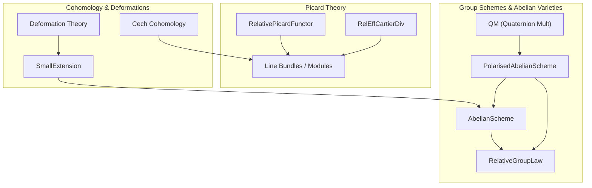

<!-- source: DeepWiki mcp.deepwiki.com · repo anthropics/fermats-last-theorem · page 3 Algebraic Geometry Foundations · fetched 2026-10-26 -->

# Algebraic Geometry Foundations

Relevant source files

The following files were used as context for generating this wiki page:

- [P2M/Sol/S_AlgebraicGeometry_Polarisation_KernelIsTwoTorsion_of_forall_away_of_isInvertible.lean](P2M/Sol/S_AlgebraicGeometry_Polarisation_KernelIsTwoTorsion_of_forall_away_of_isInvertible.lean)
- [P2M/Sol/S_AlgebraicGeometry_Polarisation_KernelIsTwoTorsion_of_pullback_of_faithfullyFlat.lean](P2M/Sol/S_AlgebraicGeometry_Polarisation_KernelIsTwoTorsion_of_pullback_of_faithfullyFlat.lean)
- [P2M/Sol/S_AlgebraicGeometry_Polarisation_KernelIsTwoTorsion_pullback_of_isPullback_of_isInvertible.lean](P2M/Sol/S_AlgebraicGeometry_Polarisation_KernelIsTwoTorsion_pullback_of_isPullback_of_isInvertible.lean)
- [P2M/Sol/S_AlgebraicGeometry_Polarisation_KernelTrivial_of_forall_away_of_isInvertible.lean](P2M/Sol/S_AlgebraicGeometry_Polarisation_KernelTrivial_of_forall_away_of_isInvertible.lean)
- [P2M/Sol/S_AlgebraicGeometry_Polarisation_RosatiCompatible_of_forall_away_of_isInvertible.lean](P2M/Sol/S_AlgebraicGeometry_Polarisation_RosatiCompatible_of_forall_away_of_isInvertible.lean)
- [P2M/Sol/S_AlgebraicGeometry_Polarisation_RosatiCompatible_of_pullback_of_faithfullyFlat.lean](P2M/Sol/S_AlgebraicGeometry_Polarisation_RosatiCompatible_of_pullback_of_faithfullyFlat.lean)
- [P2M/Sol/S_AlgebraicGeometry_Polarisation_RosatiCompatible_pullback_of_isPullback.lean](P2M/Sol/S_AlgebraicGeometry_Polarisation_RosatiCompatible_pullback_of_isPullback.lean)
- [P2M/Sol/S_AlgebraicGeometry_Polarisation_exists_faithfullyFlat_principalSqrt_of_kernelTrivial_of_locIsoOnBase.lean](P2M/Sol/S_AlgebraicGeometry_Polarisation_exists_faithfullyFlat_principalSqrt_of_kernelTrivial_of_locIsoOnBase.lean)
- [P2M/Sol/S_AlgebraicGeometry_Polarisation_exists_isLocalRing_faithfullyFlat_kernelTrivial_locIsoOnBase_pair_of_isLocalRing.lean](P2M/Sol/S_AlgebraicGeometry_Polarisation_exists_isLocalRing_faithfullyFlat_kernelTrivial_locIsoOnBase_pair_of_isLocalRing.lean)
- [P2M/Sol/S_AlgebraicGeometry_Polarisation_kernelIsTwoTorsion_of_isPullback_of_kernelTrivial_of_locIsoOnBase_of_isAlgClosed.lean](P2M/Sol/S_AlgebraicGeometry_Polarisation_kernelIsTwoTorsion_of_isPullback_of_kernelTrivial_of_locIsoOnBase_of_isAlgClosed.lean)
- [P2M/Sol/S_AlgebraicGeometry_Polarisation_memKernel_iff_memKernel_comp_of_isPullback.lean](P2M/Sol/S_AlgebraicGeometry_Polarisation_memKernel_iff_memKernel_comp_of_isPullback.lean)
- [P2M/Sol/S_AlgebraicGeometry_Polarisation_principalSqrt_baseChange_of_principalSqrt_chart.lean](P2M/Sol/S_AlgebraicGeometry_Polarisation_principalSqrt_baseChange_of_principalSqrt_chart.lean)
- [P2M/Sol/S_AlgebraicGeometry_PolarisedAbelianScheme_hasPrincipalRoot_of_isPullback.lean](P2M/Sol/S_AlgebraicGeometry_PolarisedAbelianScheme_hasPrincipalRoot_of_isPullback.lean)
- [P2M/Sol/S_AlgebraicGeometry_PolarisedAbelianScheme_isOfType_of_isPullback.lean](P2M/Sol/S_AlgebraicGeometry_PolarisedAbelianScheme_isOfType_of_isPullback.lean)
- [P2M/Sol/S_AlgebraicGeometry_PolarisedAbelianScheme_isSymmetric_of_isPullback.lean](P2M/Sol/S_AlgebraicGeometry_PolarisedAbelianScheme_isSymmetric_of_isPullback.lean)
- [P2M/Sol/S_AlgebraicGeometry_RelEffCartierDiv_eq_of_isAlgEquivZero_of_nonempty_tensor_lineBundle_iso_lineBundle.lean](P2M/Sol/S_AlgebraicGeometry_RelEffCartierDiv_eq_of_isAlgEquivZero_of_nonempty_tensor_lineBundle_iso_lineBundle.lean)
- [P2M/Sol/S_AlgebraicGeometry_RelEffCartierDiv_eq_of_isAlgEquivZero_pullback_mapOnProdOver_of_nonempty_tensor_lineBundle_iso_lineBundle.lean](P2M/Sol/S_AlgebraicGeometry_RelEffCartierDiv_eq_of_isAlgEquivZero_pullback_mapOnProdOver_of_nonempty_tensor_lineBundle_iso_lineBundle.lean)
- [P2M/Sol/S_AlgebraicGeometry_RelEffCartierDiv_exists_nonempty_tensor_lineBundle_iso_lineBundle.lean](P2M/Sol/S_AlgebraicGeometry_RelEffCartierDiv_exists_nonempty_tensor_lineBundle_iso_lineBundle.lean)
- [P2M/Sol/S_AlgebraicGeometry_RelPicard_IsAlgEquivZero_nonempty_pullback_iso_pullback_unit_and_eulerChar_eq_one_of_curveModel_ratFunc.lean](P2M/Sol/S_AlgebraicGeometry_RelPicard_IsAlgEquivZero_nonempty_pullback_iso_pullback_unit_and_eulerChar_eq_one_of_curveModel_ratFunc.lean)
- [P2M/Sol/S_AlgebraicGeometry_RelPicard_exists_chart_subsingleton_H1_and_support_subset_fibre_of_twoSidedBlocks_of_injective.lean](P2M/Sol/S_AlgebraicGeometry_RelPicard_exists_chart_subsingleton_H1_and_support_subset_fibre_of_twoSidedBlocks_of_injective.lean)
- [P2M/Sol/S_AlgebraicGeometry_RelPicard_exists_chart_subsingleton_H1_fibre_of_blocks_of_injective.lean](P2M/Sol/S_AlgebraicGeometry_RelPicard_exists_chart_subsingleton_H1_fibre_of_blocks_of_injective.lean)
- [P2M/Sol/S_AlgebraicGeometry_RelPicard_exists_chart_subsingleton_H1_fibre_of_blocks_of_not_smooth.lean](P2M/Sol/S_AlgebraicGeometry_RelPicard_exists_chart_subsingleton_H1_fibre_of_blocks_of_not_smooth.lean)
- [P2M/Sol/S_AlgebraicGeometry_RelPicard_exists_injective_forall_finrank_H0_eq_zero_and_subsingleton_H1_restrict_fst_of_nearBlocks_of_twoGluedSmoothCurveDegeneration.lean](P2M/Sol/S_AlgebraicGeometry_RelPicard_exists_injective_forall_finrank_H0_eq_zero_and_subsingleton_H1_restrict_fst_of_nearBlocks_of_twoGluedSmoothCurveDegeneration.lean)
- [P2M/Sol/S_AlgebraicGeometry_RelPicard_exists_injective_forall_subsingleton_H1_and_finrank_H0_restrict_snd_of_farBlocks_of_twoGluedSmoothCurveDegeneration.lean](P2M/Sol/S_AlgebraicGeometry_RelPicard_exists_injective_forall_subsingleton_H1_and_finrank_H0_restrict_snd_of_farBlocks_of_twoGluedSmoothCurveDegeneration.lean)
- [P2M/Sol/S_AlgebraicGeometry_RelPicard_exists_injective_forall_subsingleton_H1_of_blocks_of_pool_of_bijective_sections.lean](P2M/Sol/S_AlgebraicGeometry_RelPicard_exists_injective_forall_subsingleton_H1_of_blocks_of_pool_of_bijective_sections.lean)
- [P2M/Sol/S_AlgebraicGeometry_RelPicard_exists_injective_forall_subsingleton_H1_of_blocks_of_twoLineDegeneration_of_sectionInSmoothLocus.lean](P2M/Sol/S_AlgebraicGeometry_RelPicard_exists_injective_forall_subsingleton_H1_of_blocks_of_twoLineDegeneration_of_sectionInSmoothLocus.lean)
- [P2M/Sol/S_AlgebraicGeometry_RelPicard_exists_opens_range_subset_iff_isAlgEquivZero_rigidify_lineBundle_baseChange_of_twoGluedSmoothCurveDegenerations.lean](P2M/Sol/S_AlgebraicGeometry_RelPicard_exists_opens_range_subset_iff_isAlgEquivZero_rigidify_lineBundle_baseChange_of_twoGluedSmoothCurveDegenerations.lean)
- [P2M/Sol/S_AlgebraicGeometry_RelPicard_exists_opens_range_subset_iff_isAlgEquivZero_twistModule_baseChange_of_twoLineDegenerations.lean](P2M/Sol/S_AlgebraicGeometry_RelPicard_exists_opens_range_subset_iff_isAlgEquivZero_twistModule_baseChange_of_twoLineDegenerations.lean)
- [P2M/Sol/S_AlgebraicGeometry_RelPicard_exists_relEffCartierDiv_I_eq_zeroSchemeIdeal_chartModule_fibre_of_not_smooth_of_isReduced.lean](P2M/Sol/S_AlgebraicGeometry_RelPicard_exists_relEffCartierDiv_I_eq_zeroSchemeIdeal_chartModule_fibre_of_not_smooth_of_isReduced.lean)
- [P2M/Sol/S_AlgebraicGeometry_RelPicard_exists_relEffCartierDiv_I_eq_zeroSchemeIdeal_chartModule_fibre_of_smooth.lean](P2M/Sol/S_AlgebraicGeometry_RelPicard_exists_relEffCartierDiv_I_eq_zeroSchemeIdeal_chartModule_fibre_of_smooth.lean)
- [P2M/Sol/S_AlgebraicGeometry_RelPicard_exists_relEffCartierDiv_I_eq_zeroSchemeIdeal_polarisedChartModule_fibre_of_support_subset_of_twoGluedSmoothCurveDegenerations_of_not_smooth.lean](P2M/Sol/S_AlgebraicGeometry_RelPicard_exists_relEffCartierDiv_I_eq_zeroSchemeIdeal_polarisedChartModule_fibre_of_support_subset_of_twoGluedSmoothCurveDegenerations_of_not_smooth.lean)
- [P2M/Sol/S_AlgebraicGeometry_RelPicard_exists_relEffCartierDiv_I_eq_zeroSchemeIdeal_polarisedChartModule_fibre_of_support_subset_of_twoGluedSmoothCurveDegenerations_of_smooth.lean](P2M/Sol/S_AlgebraicGeometry_RelPicard_exists_relEffCartierDiv_I_eq_zeroSchemeIdeal_polarisedChartModule_fibre_of_support_subset_of_twoGluedSmoothCurveDegenerations_of_smooth.lean)
- [P2M/Sol/S_AlgebraicGeometry_RelPicard_exists_relEffCartierDiv_lineBundle_iso_of_forall_fibre.lean](P2M/Sol/S_AlgebraicGeometry_RelPicard_exists_relEffCartierDiv_lineBundle_iso_of_forall_fibre.lean)
- [P2M/Sol/S_AlgebraicGeometry_RelPicard_exists_relEffCartierDiv_lineBundle_iso_of_forall_fibre_of_supportedIn.lean](P2M/Sol/S_AlgebraicGeometry_RelPicard_exists_relEffCartierDiv_lineBundle_iso_of_forall_fibre_of_supportedIn.lean)
- [P2M/Sol/S_AlgebraicGeometry_RelPicard_exists_relEffCartierDiv_supportedIn_rigidify_iso_of_subsingleton_H1_of_support_subset.lean](P2M/Sol/S_AlgebraicGeometry_RelPicard_exists_relEffCartierDiv_supportedIn_rigidify_iso_of_subsingleton_H1_of_support_subset.lean)
- [P2M/Sol/S_AlgebraicGeometry_RelPicard_exists_split_injective_forall_subsingleton_H1_and_support_subset_of_twoSidedBlocks_of_bijective_sections.lean](P2M/Sol/S_AlgebraicGeometry_RelPicard_exists_split_injective_forall_subsingleton_H1_and_support_subset_of_twoSidedBlocks_of_bijective_sections.lean)
- [P2M/Sol/S_AlgebraicGeometry_RelPicard_exists_split_injective_forall_subsingleton_H1_and_support_subset_of_twoSidedBlocks_of_twoGluedSmoothCurveDegeneration.lean](P2M/Sol/S_AlgebraicGeometry_RelPicard_exists_split_injective_forall_subsingleton_H1_and_support_subset_of_twoSidedBlocks_of_twoGluedSmoothCurveDegeneration.lean)
- [P2M/Sol/S_AlgebraicGeometry_RelPicard_exists_split_injective_forall_subsingleton_H1_lineBundle_and_support_subset_of_twoSidedBlocks_of_bijective_sections.lean](P2M/Sol/S_AlgebraicGeometry_RelPicard_exists_split_injective_forall_subsingleton_H1_lineBundle_and_support_subset_of_twoSidedBlocks_of_bijective_sections.lean)
- [P2M/Sol/S_AlgebraicGeometry_RelPicard_finrank_H1_le_finrank_H1_unit_add_one_of_isAlgEquivZero_of_twoGluedSmoothCurves.lean](P2M/Sol/S_AlgebraicGeometry_RelPicard_finrank_H1_le_finrank_H1_unit_add_one_of_isAlgEquivZero_of_twoGluedSmoothCurves.lean)
- [P2M/Sol/S_AlgebraicGeometry_RelPicard_forall_prime_exists_representsRelSubPic_algEquivZeroCut_baseChange_away_of_smoothLocus_of_twoGluedSmoothCurveDegenerations.lean](P2M/Sol/S_AlgebraicGeometry_RelPicard_forall_prime_exists_representsRelSubPic_algEquivZeroCut_baseChange_away_of_smoothLocus_of_twoGluedSmoothCurveDegenerations.lean)
- [P2M/Sol/S_AlgebraicGeometry_RelPicard_forall_prime_exists_representsRelSubPic_algEquivZeroCut_baseChange_away_of_smoothLocus_of_twoLineDegenerations.lean](P2M/Sol/S_AlgebraicGeometry_RelPicard_forall_prime_exists_representsRelSubPic_algEquivZeroCut_baseChange_away_of_smoothLocus_of_twoLineDegenerations.lean)
- [P2M/Sol/S_AlgebraicGeometry_RelPicard_isAlgEquivZero_of_eulerChar_sectionsOf_pullback_eq_of_twoGluedSmoothCurves.lean](P2M/Sol/S_AlgebraicGeometry_RelPicard_isAlgEquivZero_of_eulerChar_sectionsOf_pullback_eq_of_twoGluedSmoothCurves.lean)
- [P2M/Sol/S_AlgebraicGeometry_RelPicard_isAlgEquivZero_of_finrank_H1_tensorPow_add_two_le_of_twoGluedSmoothCurves.lean](P2M/Sol/S_AlgebraicGeometry_RelPicard_isAlgEquivZero_of_finrank_H1_tensorPow_add_two_le_of_twoGluedSmoothCurves.lean)
- [P2M/Sol/S_AlgebraicGeometry_RelPicard_isAlgEquivZero_of_pullback_curveChange_iso_unit_of_twoGluedSmoothCurves.lean](P2M/Sol/S_AlgebraicGeometry_RelPicard_isAlgEquivZero_of_pullback_curveChange_iso_unit_of_twoGluedSmoothCurves.lean)
- [P2M/Sol/S_AlgebraicGeometry_RelPicard_isLFPSurj_relSubPicPresheaf_algEquivZeroCut_baseChange_of_twoGluedSmoothCurveDegenerations.lean](P2M/Sol/S_AlgebraicGeometry_RelPicard_isLFPSurj_relSubPicPresheaf_algEquivZeroCut_baseChange_of_twoGluedSmoothCurveDegenerations.lean)
- [P2M/Sol/S_AlgebraicGeometry_RelPicard_isLFPSurj_relSubPicPresheaf_algEquivZeroCut_baseChange_of_twoLineDegenerations.lean](P2M/Sol/S_AlgebraicGeometry_RelPicard_isLFPSurj_relSubPicPresheaf_algEquivZeroCut_baseChange_of_twoLineDegenerations.lean)
- [P2M/Sol/S_AlgebraicGeometry_RelPicard_support_zeroSchemeIdeal_fibre_subset_of_support_zeroSchemeIdeal_fibre_subset_extension.lean](P2M/Sol/S_AlgebraicGeometry_RelPicard_support_zeroSchemeIdeal_fibre_subset_of_support_zeroSchemeIdeal_fibre_subset_extension.lean)
- [P2M/Sol/S_AlgebraicGeometry_TwoGluedCurves_isAlgEquivZero_fibre_of_isAlgEquivZero_fibre_of_preconnectedSpace.lean](P2M/Sol/S_AlgebraicGeometry_TwoGluedCurves_isAlgEquivZero_fibre_of_isAlgEquivZero_fibre_of_preconnectedSpace.lean)
- [P2M/Sol/S_AlgebraicGeometry_TwoGluedProjectiveLines_nonempty_iso_unit_of_isAlgEquivZero_of_ne_zero.lean](P2M/Sol/S_AlgebraicGeometry_TwoGluedProjectiveLines_nonempty_iso_unit_of_isAlgEquivZero_of_ne_zero.lean)
- [P2M/Sol/S_CerednikDrinfeld_QM_FakeEllipticCurve_exists_fg_subalgebra_extension_kernelIsTwoTorsion_pullback.lean](P2M/Sol/S_CerednikDrinfeld_QM_FakeEllipticCurve_exists_fg_subalgebra_extension_kernelIsTwoTorsion_pullback.lean)
- [P2M/Sol/S_CerednikDrinfeld_QM_FakeEllipticCurve_exists_fg_subalgebra_extension_kernelTrivial_pullback.lean](P2M/Sol/S_CerednikDrinfeld_QM_FakeEllipticCurve_exists_fg_subalgebra_extension_kernelTrivial_pullback.lean)
- [P2M/Sol/S_CerednikDrinfeld_QM_FakeEllipticCurve_isCanonicalPolData_localizationAtPrime_of_locIsoOnBase_of_isCanonicalPolData_of_faithfullyFlat.lean](P2M/Sol/S_CerednikDrinfeld_QM_FakeEllipticCurve_isCanonicalPolData_localizationAtPrime_of_locIsoOnBase_of_isCanonicalPolData_of_faithfullyFlat.lean)
- [P2M/Sol/S_CerednikDrinfeld_QM_FakeEllipticCurve_isCanonicalPol_of_isCanonicalPol_pullback_of_injective_of_isLocalHom.lean](P2M/Sol/S_CerednikDrinfeld_QM_FakeEllipticCurve_isCanonicalPol_of_isCanonicalPol_pullback_of_injective_of_isLocalHom.lean)
- [P2M/Sol/S_CerednikDrinfeld_QM_IsCanonicalPolData_pullback_of_isPullback.lean](P2M/Sol/S_CerednikDrinfeld_QM_IsCanonicalPolData_pullback_of_isPullback.lean)
- [P2M/Sol/S_GoodReductionJacobian_AbelianSchemePropertyBundle_nonempty_iso_of_pullback_iso_of_sliceAt_one_of_isPullback_of_ker_mul_self_of_isNoetherianRing.lean](P2M/Sol/S_GoodReductionJacobian_AbelianSchemePropertyBundle_nonempty_iso_of_pullback_iso_of_sliceAt_one_of_isPullback_of_ker_mul_self_of_isNoetherianRing.lean)
- [P2M/Sol/S_GoodReductionJacobian_AbelianSchemePropertyBundle_nonempty_iso_unit_of_pullback_iso_unit_of_isSymmetric_of_ker_mul_maximalIdeal_of_isUnit_two_of_isNoetherianRing.lean](P2M/Sol/S_GoodReductionJacobian_AbelianSchemePropertyBundle_nonempty_iso_unit_of_pullback_iso_unit_of_isSymmetric_of_ker_mul_maximalIdeal_of_isUnit_two_of_isNoetherianRing.lean)
- [P2M/Sol/S_GoodReductionJacobian_RelativeGroupLaw_rosatiCompatible_of_rosatiCompatible_generic_of_isDiscreteValuationRing.lean](P2M/Sol/S_GoodReductionJacobian_RelativeGroupLaw_rosatiCompatible_of_rosatiCompatible_generic_of_isDiscreteValuationRing.lean)

This section provides an overview of the scheme-theoretic and cohomological machinery required for the proof of Fermat's Last Theorem. The codebase leverages advanced concepts from algebraic geometry, including the theory of abelian schemes, the representability of the Picard functor, and deformation theory for group schemes. These foundations are critical for constructing the Frey curve Jacobians and analyzing their reduction properties.

### System Overview

The following diagram illustrates the relationship between the core algebraic geometry entities defined in the codebase.

**Scheme-Theoretic Machinery Overview**

**Sources:** [Definitions/Def_AlgebraicGeometry_PolarisedAbelianScheme.lean:1-20](), [Definitions/Def_AlgebraicGeometry_RelativePicardFunctor.lean:1-20](), [Definitions/Def_GoodReductionJacobian_RelativeGroupLawBaseChange.lean:1-20]()

---

### 3.1 Abelian Schemes and Polarizations
Abelian schemes are smooth proper group schemes whose fibers are abelian varieties. The codebase defines `PolarisedAbelianScheme` to represent these objects equipped with a polarization, which is an isogeny to the dual abelian scheme [Definitions/Def_AlgebraicGeometry_PolarisedAbelianScheme:9-10](). Key operations include the Rosati involution and checks for `RosatiCompatible` polarizations [Definitions/Def_AlgebraicGeometry_PolarisationRosati:4-10](). The theory includes specialization to abelian surfaces with quaternion multiplication (QM), which is central to the Shimura curve uniformization.

For details, see [Abelian Schemes and Polarizations](#3.1).

### 3.2 Relative Picard Functor and Line Bundles
The `RelativePicardFunctor` represents the sheaf of isomorphism classes of line bundles on a scheme relative to a base [Definitions/Def_AlgebraicGeometry_RelativePicardFunctor:3-10](). The codebase implements a representability pipeline for this functor, particularly for curves that degenerate into two lines or two glued smooth curves [P2M/Sol/S_AlgebraicGeometry_RelPicard_isLFPSurj_relSubPicPresheaf_algEquivZeroCut_baseChange_of_twoLineDegenerations.lean:26-30](). It utilizes `RelEffCartierDiv` (Relative Effective Cartier Divisors) and rigidified line bundles to construct the representable object [Definitions/Def_AlgebraicGeometry_RelEffCartierDiv:11-13]().

For details, see [Relative Picard Functor and Line Bundles](#3.2).

### 3.3 Deformation Theory and Small Extensions
Deformation theory is used to lift abelian schemes and their morphisms across `SmallExtension` maps (surjections with square-zero kernels) [Theorems/Thm_AlgebraicGeometry_SmallExtension_exists_isPicDeformationCocycle_of_cechTrivialisation:9-10](). The codebase defines `BareDeformation` and uses Čech cohomology (`CechPicardObstruction`) to classify these lifts [Definitions/Def_AlgebraicGeometry_CechPicardObstruction:8-9]().

For details, see [Deformation Theory and Small Extensions](#3.3).

### 3.4 Hopf Algebras and p-Divisible Groups
Finite flat group schemes are treated via their coordinate rings as `HopfAlgebra` objects. The proof relies on `PDivisibleGroup` structures and their associated Dieudonné modules to analyze the p-adic Galois representations attached to the Frey curve. This includes the implementation of Frobenius and Verschiebung endomorphisms.

For details, see [Hopf Algebras, p-Divisible Groups, and Dieudonné Modules](#3.4).

### 3.5 Good Reduction Jacobians
The `RelativeGroupLaw` structure provides the group operations (multiplication, inversion, identity) for abelian schemes over a general base ring $S$ [P2M/Sol/S_AlgebraicGeometry_Polarisation_RosatiCompatible_pullback_of_isPullback.lean:34-37](). The codebase handles the transition of these laws under base change and specializes them to the case of Jacobians with good reduction [P2M/Sol/S_GoodReductionJacobian_AbelianSchemePropertyBundle_nonempty_iso_unit_of_pullback_iso_unit_of_isSymmetric_of_ker_mul_maximalIdeal_of_isUnit_two_of_isNoetherianRing.lean:18-21]().

For details, see [Good Reduction Jacobians and RelativeGroupLaw](#3.5).

### 3.6 Tower Quotient Data and Scheme Morphisms
The `TowerQuotientDatum` infrastructure manages the construction of quotient schemes by group actions, which is essential for modular curve construction. It includes machinery for `Hilbert` functors and verifying the representability of proper flat morphisms [P2M/Sol/S_AlgebraicGeometry_RelPicard_forall_prime_exists_representsRelSubPic_algEquivZeroCut_baseChange_away_of_smoothLocus_of_twoLineDegenerations.lean:5-8]().

For details, see [Tower Quotient Data and Scheme Morphisms](#3.6).

### Summary of Core Classes

| Class/Type | File Path | Purpose |
| :--- | :--- | :--- |
| `PolarisedAbelianScheme` | [Definitions/Def_AlgebraicGeometry_PolarisedAbelianScheme.lean]() | Represents an abelian scheme with a polarization. |
| `RelativeGroupLaw` | [Definitions/Def_GoodReductionJacobian_RelativeGroupLawBaseChange.lean]() | Defines the group scheme structure over a base ring. |
| `RelativePicardFunctor`| [Definitions/Def_AlgebraicGeometry_RelativePicardFunctor.lean]() | The functor $T \mapsto \text{Pic}(X_T/T)$. |
| `SmallExtension` | [Theorems/Thm_AlgebraicGeometry_SmallExtension_exists_isPicDeformationCocycle_of_cechTrivialisation.lean]() | Encapsulates square-zero thickenings for deformation theory. |
| `RelEffCartierDiv` | [Definitions/Def_AlgebraicGeometry_RelEffCartierDiv.lean]() | Relative Effective Cartier Divisors used in Picard representability. |

**Sources:** [P2M/Sol/S_AlgebraicGeometry_RelPicard_isLFPSurj_relSubPicPresheaf_algEquivZeroCut_baseChange_of_twoLineDegenerations.lean:3-15](), [P2M/Sol/S_AlgebraicGeometry_Polarisation_RosatiCompatible_pullback_of_isPullback.lean:9-10](), [P2M/Sol/S_AlgebraicGeometry_RelPicard_forall_prime_exists_representsRelSubPic_algEquivZeroCut_baseChange_away_of_smoothLocus_of_twoLineDegenerations.lean:52-57]()

---

