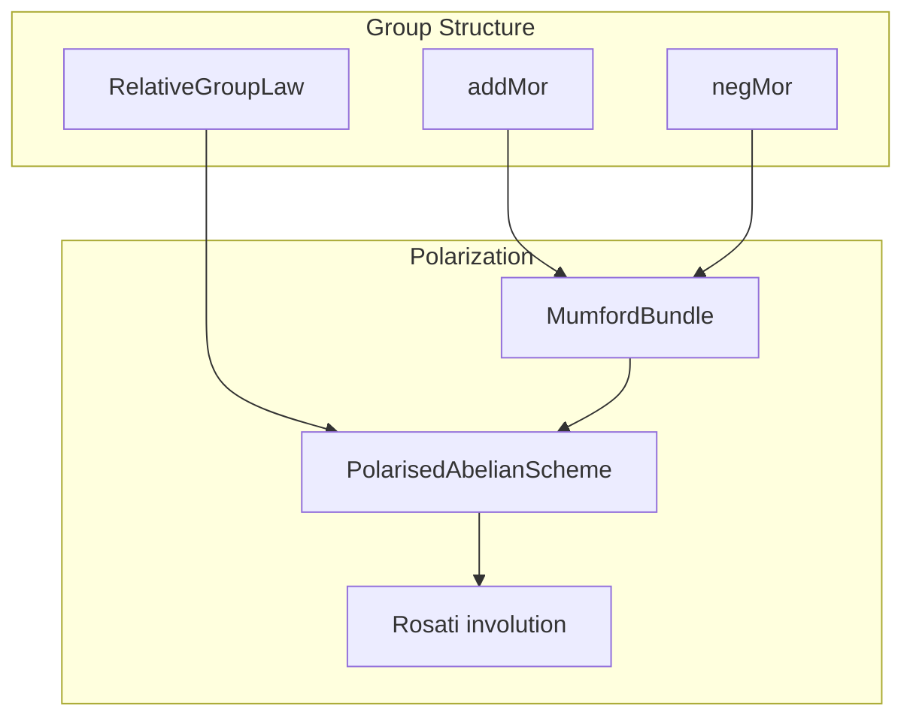
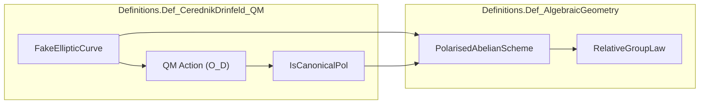

<!-- source: DeepWiki mcp.deepwiki.com · repo anthropics/fermats-last-theorem · page 3.1 Abelian Schemes and Polarizations · fetched 2026-10-26 -->

# Abelian Schemes and Polarizations

Relevant source files

The following files were used as context for generating this wiki page:

- [P2M/Sol/S_AlgebraicCurve_CurveModel_nonempty_iso_unit_of_eulerChar_sectionsOf_eq_of_ratFunc.lean](P2M/Sol/S_AlgebraicCurve_CurveModel_nonempty_iso_unit_of_eulerChar_sectionsOf_eq_of_ratFunc.lean)
- [P2M/Sol/S_AlgebraicCurve_finite_H0_H1_structureSheaf_of_isAlgClosed.lean](P2M/Sol/S_AlgebraicCurve_finite_H0_H1_structureSheaf_of_isAlgClosed.lean)
- [P2M/Sol/S_AlgebraicCurve_finite_H0_H1_structureSheaf_of_smoothProperCurve.lean](P2M/Sol/S_AlgebraicCurve_finite_H0_H1_structureSheaf_of_smoothProperCurve.lean)
- [P2M/Sol/S_AlgebraicCurve_finrank_H0_H1_sectionsOf_of_range_eq_lSpaceOn.lean](P2M/Sol/S_AlgebraicCurve_finrank_H0_H1_sectionsOf_of_range_eq_lSpaceOn.lean)
- [P2M/Sol/S_AlgebraicGeometry_Polarisation_KernelIsTwoTorsion_of_forall_away_of_isInvertible.lean](P2M/Sol/S_AlgebraicGeometry_Polarisation_KernelIsTwoTorsion_of_forall_away_of_isInvertible.lean)
- [P2M/Sol/S_AlgebraicGeometry_Polarisation_KernelIsTwoTorsion_of_pullback_of_faithfullyFlat.lean](P2M/Sol/S_AlgebraicGeometry_Polarisation_KernelIsTwoTorsion_of_pullback_of_faithfullyFlat.lean)
- [P2M/Sol/S_AlgebraicGeometry_Polarisation_KernelIsTwoTorsion_pullback_of_isPullback_of_isInvertible.lean](P2M/Sol/S_AlgebraicGeometry_Polarisation_KernelIsTwoTorsion_pullback_of_isPullback_of_isInvertible.lean)
- [P2M/Sol/S_AlgebraicGeometry_Polarisation_KernelTrivial_of_forall_away_of_isInvertible.lean](P2M/Sol/S_AlgebraicGeometry_Polarisation_KernelTrivial_of_forall_away_of_isInvertible.lean)
- [P2M/Sol/S_AlgebraicGeometry_Polarisation_KernelTrivial_pullback_of_isPullback.lean](P2M/Sol/S_AlgebraicGeometry_Polarisation_KernelTrivial_pullback_of_isPullback.lean)
- [P2M/Sol/S_AlgebraicGeometry_Polarisation_LocIsoOnBase_pullback_of_comp_eq.lean](P2M/Sol/S_AlgebraicGeometry_Polarisation_LocIsoOnBase_pullback_of_comp_eq.lean)
- [P2M/Sol/S_AlgebraicGeometry_Polarisation_LocIsoOnBase_pullback_of_isPullback.lean](P2M/Sol/S_AlgebraicGeometry_Polarisation_LocIsoOnBase_pullback_of_isPullback.lean)
- [P2M/Sol/S_AlgebraicGeometry_Polarisation_RosatiCompatible_of_forall_away_of_isInvertible.lean](P2M/Sol/S_AlgebraicGeometry_Polarisation_RosatiCompatible_of_forall_away_of_isInvertible.lean)
- [P2M/Sol/S_AlgebraicGeometry_Polarisation_RosatiCompatible_of_pullback_of_faithfullyFlat.lean](P2M/Sol/S_AlgebraicGeometry_Polarisation_RosatiCompatible_of_pullback_of_faithfullyFlat.lean)
- [P2M/Sol/S_AlgebraicGeometry_Polarisation_RosatiCompatible_pullback_of_isPullback.lean](P2M/Sol/S_AlgebraicGeometry_Polarisation_RosatiCompatible_pullback_of_isPullback.lean)
- [P2M/Sol/S_AlgebraicGeometry_Polarisation_eq_one_of_locIsoOnBase_sliceAt_mumfordBundle_of_kernelTrivial_pullback_of_isPullback.lean](P2M/Sol/S_AlgebraicGeometry_Polarisation_eq_one_of_locIsoOnBase_sliceAt_mumfordBundle_of_kernelTrivial_pullback_of_isPullback.lean)
- [P2M/Sol/S_AlgebraicGeometry_Polarisation_exists_faithfullyFlat_kernelTrivial_locIsoOnBase_pullback_inv_of_iso.lean](P2M/Sol/S_AlgebraicGeometry_Polarisation_exists_faithfullyFlat_kernelTrivial_locIsoOnBase_pullback_inv_of_iso.lean)
- [P2M/Sol/S_AlgebraicGeometry_Polarisation_exists_faithfullyFlat_kernelTrivial_locIsoOnBase_tensor_pullback_negMor.lean](P2M/Sol/S_AlgebraicGeometry_Polarisation_exists_faithfullyFlat_kernelTrivial_locIsoOnBase_tensor_pullback_negMor.lean)
- [P2M/Sol/S_AlgebraicGeometry_Polarisation_exists_faithfullyFlat_kernelTrivial_locIsoOnBase_tensor_pullback_negMor_of_commRing.lean](P2M/Sol/S_AlgebraicGeometry_Polarisation_exists_faithfullyFlat_kernelTrivial_locIsoOnBase_tensor_pullback_negMor_of_commRing.lean)
- [P2M/Sol/S_AlgebraicGeometry_Polarisation_exists_faithfullyFlat_principalSqrt_of_exists_pullback_of_faithfullyFlat.lean](P2M/Sol/S_AlgebraicGeometry_Polarisation_exists_faithfullyFlat_principalSqrt_of_exists_pullback_of_faithfullyFlat.lean)
- [P2M/Sol/S_AlgebraicGeometry_Polarisation_exists_faithfullyFlat_principalSqrt_of_kernelTrivial_of_locIsoOnBase.lean](P2M/Sol/S_AlgebraicGeometry_Polarisation_exists_faithfullyFlat_principalSqrt_of_kernelTrivial_of_locIsoOnBase.lean)
- [P2M/Sol/S_AlgebraicGeometry_Polarisation_exists_field_isInvertible_nonempty_iso_tensor_pullback_negMor_of_exists_faithfullyFlat.lean](P2M/Sol/S_AlgebraicGeometry_Polarisation_exists_field_isInvertible_nonempty_iso_tensor_pullback_negMor_of_exists_faithfullyFlat.lean)
- [P2M/Sol/S_AlgebraicGeometry_Polarisation_exists_isFrameOn_iSup_eq_top_of_iso_tensor_tensor_of_finrank_pos.lean](P2M/Sol/S_AlgebraicGeometry_Polarisation_exists_isFrameOn_iSup_eq_top_of_iso_tensor_tensor_of_finrank_pos.lean)
- [P2M/Sol/S_AlgebraicGeometry_Polarisation_exists_isLocalRing_faithfullyFlat_kernelTrivial_locIsoOnBase_pair_of_isLocalRing.lean](P2M/Sol/S_AlgebraicGeometry_Polarisation_exists_isLocalRing_faithfullyFlat_kernelTrivial_locIsoOnBase_pair_of_isLocalRing.lean)
- [P2M/Sol/S_AlgebraicGeometry_Polarisation_exists_nonempty_iso_mumfordBundle_of_mumfordBundle_iso_tensor_self_of_two_ne_zero.lean](P2M/Sol/S_AlgebraicGeometry_Polarisation_exists_nonempty_iso_mumfordBundle_of_mumfordBundle_iso_tensor_self_of_two_ne_zero.lean)
- [P2M/Sol/S_AlgebraicGeometry_Polarisation_exists_nonempty_tensor_iso_pullback_translate_of_inPicZero_of_kernelPts_finite.lean](P2M/Sol/S_AlgebraicGeometry_Polarisation_exists_nonempty_tensor_iso_pullback_translate_of_inPicZero_of_kernelPts_finite.lean)
- [P2M/Sol/S_AlgebraicGeometry_Polarisation_exists_rigidifiedLineBundle_iso_thetaCube_and_locIsoOnBase_faces_of_rigidified.lean](P2M/Sol/S_AlgebraicGeometry_Polarisation_exists_rigidifiedLineBundle_iso_thetaCube_and_locIsoOnBase_faces_of_rigidified.lean)
- [P2M/Sol/S_AlgebraicGeometry_Polarisation_finiteBySections_of_iso_tensorPow_three_of_finite_kernelPts_of_finrank_pos.lean](P2M/Sol/S_AlgebraicGeometry_Polarisation_finiteBySections_of_iso_tensorPow_three_of_finite_kernelPts_of_finrank_pos.lean)
- [P2M/Sol/S_AlgebraicGeometry_Polarisation_finrank_H0_baseChange_residue_sliceAt_stalk_eq_one.lean](P2M/Sol/S_AlgebraicGeometry_Polarisation_finrank_H0_baseChange_residue_sliceAt_stalk_eq_one.lean)
- [P2M/Sol/S_AlgebraicGeometry_Polarisation_forall_exists_pullbackSection_eq_iff_exists_comp_eq_of_mem_range.lean](P2M/Sol/S_AlgebraicGeometry_Polarisation_forall_exists_pullbackSection_eq_iff_exists_comp_eq_of_mem_range.lean)
- [P2M/Sol/S_AlgebraicGeometry_Polarisation_isInStabilizer_iff_locIsoOnBase_pullback_sliceAt_mumfordBundle_unit.lean](P2M/Sol/S_AlgebraicGeometry_Polarisation_isInStabilizer_iff_locIsoOnBase_pullback_sliceAt_mumfordBundle_unit.lean)
- [P2M/Sol/S_AlgebraicGeometry_Polarisation_isInStabilizer_iff_locIsoOnBase_pullback_sliceAt_mumfordBundle_unit_of_commRing.lean](P2M/Sol/S_AlgebraicGeometry_Polarisation_isInStabilizer_iff_locIsoOnBase_pullback_sliceAt_mumfordBundle_unit_of_commRing.lean)
- [P2M/Sol/S_AlgebraicGeometry_Polarisation_kernelIsTwoTorsion_baseChange_of_isInvertible.lean](P2M/Sol/S_AlgebraicGeometry_Polarisation_kernelIsTwoTorsion_baseChange_of_isInvertible.lean)
- [P2M/Sol/S_AlgebraicGeometry_Polarisation_kernelIsTwoTorsion_iff_and_kernelTrivial_iff_of_iso.lean](P2M/Sol/S_AlgebraicGeometry_Polarisation_kernelIsTwoTorsion_iff_and_kernelTrivial_iff_of_iso.lean)
- [P2M/Sol/S_AlgebraicGeometry_Polarisation_kernelIsTwoTorsion_of_isPullback_of_kernelTrivial_of_locIsoOnBase_of_isAlgClosed.lean](P2M/Sol/S_AlgebraicGeometry_Polarisation_kernelIsTwoTorsion_of_isPullback_of_kernelTrivial_of_locIsoOnBase_of_isAlgClosed.lean)
- [P2M/Sol/S_AlgebraicGeometry_Polarisation_kernelPts_eq_singleton_one_of_kernelTrivial.lean](P2M/Sol/S_AlgebraicGeometry_Polarisation_kernelPts_eq_singleton_one_of_kernelTrivial.lean)
- [P2M/Sol/S_AlgebraicGeometry_Polarisation_kernelTrivial_of_isIso_of_forall_iff_isInStabilizer.lean](P2M/Sol/S_AlgebraicGeometry_Polarisation_kernelTrivial_of_isIso_of_forall_iff_isInStabilizer.lean)
- [P2M/Sol/S_AlgebraicGeometry_Polarisation_kernelTrivial_of_iso.lean](P2M/Sol/S_AlgebraicGeometry_Polarisation_kernelTrivial_of_iso.lean)
- [P2M/Sol/S_AlgebraicGeometry_Polarisation_kernelTrivial_of_kernelTrivial_pullback_of_isPullback_of_field.lean](P2M/Sol/S_AlgebraicGeometry_Polarisation_kernelTrivial_of_kernelTrivial_pullback_of_isPullback_of_field.lean)
- [P2M/Sol/S_AlgebraicGeometry_Polarisation_locIsoOnBase_faces_pullback_cube_iff_of_isPullback.lean](P2M/Sol/S_AlgebraicGeometry_Polarisation_locIsoOnBase_faces_pullback_cube_iff_of_isPullback.lean)
- [P2M/Sol/S_AlgebraicGeometry_Polarisation_locIsoOnBase_pullback_negMor_prod_sliceAt_mumfordBundle_dual.lean](P2M/Sol/S_AlgebraicGeometry_Polarisation_locIsoOnBase_pullback_negMor_prod_sliceAt_mumfordBundle_dual.lean)
- [P2M/Sol/S_AlgebraicGeometry_Polarisation_locIsoOnBase_pullback_negMor_prod_sliceAt_mumfordBundle_dual_of_commRing.lean](P2M/Sol/S_AlgebraicGeometry_Polarisation_locIsoOnBase_pullback_negMor_prod_sliceAt_mumfordBundle_dual_of_commRing.lean)
- [P2M/Sol/S_AlgebraicGeometry_Polarisation_locIsoOnBase_pullback_sliceAt_mumfordBundle_one_unit.lean](P2M/Sol/S_AlgebraicGeometry_Polarisation_locIsoOnBase_pullback_sliceAt_mumfordBundle_one_unit.lean)
- [P2M/Sol/S_AlgebraicGeometry_Polarisation_locIsoOnBase_pullback_sliceAt_mumfordBundle_one_unit_of_commRing.lean](P2M/Sol/S_AlgebraicGeometry_Polarisation_locIsoOnBase_pullback_sliceAt_mumfordBundle_one_unit_of_commRing.lean)
- [P2M/Sol/S_AlgebraicGeometry_Polarisation_locIsoOnBase_sliceAt_mumfordBundle_inv_dual.lean](P2M/Sol/S_AlgebraicGeometry_Polarisation_locIsoOnBase_sliceAt_mumfordBundle_inv_dual.lean)
- [P2M/Sol/S_AlgebraicGeometry_Polarisation_locIsoOnBase_sliceAt_mumfordBundle_inv_dual_of_commRing.lean](P2M/Sol/S_AlgebraicGeometry_Polarisation_locIsoOnBase_sliceAt_mumfordBundle_inv_dual_of_commRing.lean)
- [P2M/Sol/S_AlgebraicGeometry_Polarisation_memKernel_iff_memKernel_comp_of_isPullback.lean](P2M/Sol/S_AlgebraicGeometry_Polarisation_memKernel_iff_memKernel_comp_of_isPullback.lean)
- [P2M/Sol/S_AlgebraicGeometry_Polarisation_nonempty_mumfordBundle_iso_of_iso.lean](P2M/Sol/S_AlgebraicGeometry_Polarisation_nonempty_mumfordBundle_iso_of_iso.lean)
- [P2M/Sol/S_AlgebraicGeometry_Polarisation_nonempty_mumfordBundle_pullback_schemeNsmul_two_iso_tensor.lean](P2M/Sol/S_AlgebraicGeometry_Polarisation_nonempty_mumfordBundle_pullback_schemeNsmul_two_iso_tensor.lean)
- [P2M/Sol/S_AlgebraicGeometry_Polarisation_nonempty_mumfordBundle_tensor_iso_tensor.lean](P2M/Sol/S_AlgebraicGeometry_Polarisation_nonempty_mumfordBundle_tensor_iso_tensor.lean)
- [P2M/Sol/S_AlgebraicGeometry_Polarisation_nonempty_pullback_schemeNsmul_two_iso_unit_of_locIsoOnBase_negMor_of_locIsoOnBase_tensor_self.lean](P2M/Sol/S_AlgebraicGeometry_Polarisation_nonempty_pullback_schemeNsmul_two_iso_unit_of_locIsoOnBase_negMor_of_locIsoOnBase_tensor_self.lean)
- [P2M/Sol/S_AlgebraicGeometry_Polarisation_principalSqrt_baseChange_of_principalSqrt_chart.lean](P2M/Sol/S_AlgebraicGeometry_Polarisation_principalSqrt_baseChange_of_principalSqrt_chart.lean)
- [P2M/Sol/S_AlgebraicGeometry_Polarisation_rosatiCompatible_of_iso_tensorPow_tensor_of_inPicZero_of_rosatiCompatible.lean](P2M/Sol/S_AlgebraicGeometry_Polarisation_rosatiCompatible_of_iso_tensorPow_tensor_of_inPicZero_of_rosatiCompatible.lean)
- [P2M/Sol/S_AlgebraicGeometry_Polarisation_rosatiCompatible_of_rosatiCompatible_pullback_of_isPullback_of_field.lean](P2M/Sol/S_AlgebraicGeometry_Polarisation_rosatiCompatible_of_rosatiCompatible_pullback_of_isPullback_of_field.lean)
- [P2M/Sol/S_AlgebraicGeometry_Polarisation_rosatiCompatible_of_rosatiCompatible_tensor_pullback_negMor_of_topologicalKrullDim_eq.lean](P2M/Sol/S_AlgebraicGeometry_Polarisation_rosatiCompatible_of_rosatiCompatible_tensor_pullback_negMor_of_topologicalKrullDim_eq.lean)
- [P2M/Sol/S_AlgebraicGeometry_PolarisedAbelianScheme_exists_fg_subalgebra_abelianScheme_closedImmersionBySections_comp_eq_comp_of_isIso_of_pullback_pol_iso.lean](P2M/Sol/S_AlgebraicGeometry_PolarisedAbelianScheme_exists_fg_subalgebra_abelianScheme_closedImmersionBySections_comp_eq_comp_of_isIso_of_pullback_pol_iso.lean)
- [P2M/Sol/S_AlgebraicGeometry_PolarisedAbelianScheme_exists_fg_subalgebra_abelianScheme_comp_eq_comp_of_isIso.lean](P2M/Sol/S_AlgebraicGeometry_PolarisedAbelianScheme_exists_fg_subalgebra_abelianScheme_comp_eq_comp_of_isIso.lean)
- [P2M/Sol/S_AlgebraicGeometry_PolarisedAbelianScheme_exists_fg_subalgebra_abelianScheme_projPresentation_pullback_isClosedImmersion_of_pullback_pol_iso.lean](P2M/Sol/S_AlgebraicGeometry_PolarisedAbelianScheme_exists_fg_subalgebra_abelianScheme_projPresentation_pullback_isClosedImmersion_of_pullback_pol_iso.lean)
- [P2M/Sol/S_AlgebraicGeometry_PolarisedAbelianScheme_exists_fg_subalgebra_abelianScheme_pullback_iso_comp_eq_comp_of_isIso.lean](P2M/Sol/S_AlgebraicGeometry_PolarisedAbelianScheme_exists_fg_subalgebra_abelianScheme_pullback_iso_comp_eq_comp_of_isIso.lean)
- [P2M/Sol/S_AlgebraicGeometry_PolarisedAbelianScheme_exists_fg_subalgebra_abelianScheme_pullback_iso_comp_eq_comp_of_isIso_of_pullback_pol_iso.lean](P2M/Sol/S_AlgebraicGeometry_PolarisedAbelianScheme_exists_fg_subalgebra_abelianScheme_pullback_iso_comp_eq_comp_of_isIso_of_pullback_pol_iso.lean)
- [P2M/Sol/S_AlgebraicGeometry_PolarisedAbelianScheme_exists_nerve_of_iso_pullbacks_of_three_le_of_rigidified.lean](P2M/Sol/S_AlgebraicGeometry_PolarisedAbelianScheme_exists_nerve_of_iso_pullbacks_of_three_le_of_rigidified.lean)
- [P2M/Sol/S_AlgebraicGeometry_PolarisedAbelianScheme_hasPrincipalRoot_of_isPullback.lean](P2M/Sol/S_AlgebraicGeometry_PolarisedAbelianScheme_hasPrincipalRoot_of_isPullback.lean)
- [P2M/Sol/S_AlgebraicGeometry_PolarisedAbelianScheme_isOfType_of_isPullback.lean](P2M/Sol/S_AlgebraicGeometry_PolarisedAbelianScheme_isOfType_of_isPullback.lean)
- [P2M/Sol/S_AlgebraicGeometry_PolarisedAbelianScheme_isSymmetric_of_isPullback.lean](P2M/Sol/S_AlgebraicGeometry_PolarisedAbelianScheme_isSymmetric_of_isPullback.lean)
- [P2M/Sol/S_AlgebraicGeometry_PolarisedAbelianScheme_iso_of_iso_of_isPullback_of_faithfullyFlat_of_three_le_of_rigidified.lean](P2M/Sol/S_AlgebraicGeometry_PolarisedAbelianScheme_iso_of_iso_of_isPullback_of_faithfullyFlat_of_three_le_of_rigidified.lean)
- [P2M/Sol/S_AlgebraicGeometry_PolarisedAbelianScheme_iso_of_iso_of_isPullback_pi_localizationAway_of_three_le.lean](P2M/Sol/S_AlgebraicGeometry_PolarisedAbelianScheme_iso_of_iso_of_isPullback_pi_localizationAway_of_three_le.lean)
- [P2M/Sol/S_AlgebraicGeometry_RiemannForm_isConstScalar_tensorHom.lean](P2M/Sol/S_AlgebraicGeometry_RiemannForm_isConstScalar_tensorHom.lean)
- [P2M/Sol/S_AlgebraicGeometry_RiemannForm_nonempty_pullback_oneProdTranslation_mumfordBundle_iso_of_nonempty_pullback_translation_iso.lean](P2M/Sol/S_AlgebraicGeometry_RiemannForm_nonempty_pullback_oneProdTranslation_mumfordBundle_iso_of_nonempty_pullback_translation_iso.lean)
- [P2M/Sol/S_AlgebraicGeometry_RiemannForm_nonempty_pullback_pullbackSymmetry_iso_of_pullback_oneProdNsmul_iso_mumfordBundle.lean](P2M/Sol/S_AlgebraicGeometry_RiemannForm_nonempty_pullback_pullbackSymmetry_iso_of_pullback_oneProdNsmul_iso_mumfordBundle.lean)
- [P2M/Sol/S_AlgebraicGeometry_Scheme_Modules_IsInvertible_exists_forall_app_unit_eq_of_isDirectLimit.lean](P2M/Sol/S_AlgebraicGeometry_Scheme_Modules_IsInvertible_exists_forall_app_unit_eq_of_isDirectLimit.lean)
- [P2M/Sol/S_AlgebraicGeometry_Scheme_Modules_IsInvertible_nontrivial_H0_sectionsOf_of_le_eulerChar_sub.lean](P2M/Sol/S_AlgebraicGeometry_Scheme_Modules_IsInvertible_nontrivial_H0_sectionsOf_of_le_eulerChar_sub.lean)
- [P2M/Sol/S_AlgebraicGeometry_Scheme_Modules_IsInvertible_subsingleton_H1_sectionsOf_of_le_eulerChar_sub.lean](P2M/Sol/S_AlgebraicGeometry_Scheme_Modules_IsInvertible_subsingleton_H1_sectionsOf_of_le_eulerChar_sub.lean)
- [P2M/Sol/S_AlgebraicGeometry_Scheme_Modules_exists_hom_tensor_app_tensorSections_eq_of_bilinear.lean](P2M/Sol/S_AlgebraicGeometry_Scheme_Modules_exists_hom_tensor_app_tensorSections_eq_of_bilinear.lean)
- [P2M/Sol/S_AlgebraicGeometry_Scheme_Modules_exists_linearEquiv_tensorProduct_sections_pullback_of_forall_isPullback_of_iso.lean](P2M/Sol/S_AlgebraicGeometry_Scheme_Modules_exists_linearEquiv_tensorProduct_sections_pullback_of_forall_isPullback_of_iso.lean)
- [P2M/Sol/S_AlgebraicGeometry_Scheme_Modules_exists_linearEquiv_tensorProduct_sections_pullback_of_isPullback.lean](P2M/Sol/S_AlgebraicGeometry_Scheme_Modules_exists_linearEquiv_tensorProduct_sections_pullback_of_isPullback.lean)
- [P2M/Sol/S_AlgebraicGeometry_Scheme_Modules_leftUnitor_hom_app_tensorSections.lean](P2M/Sol/S_AlgebraicGeometry_Scheme_Modules_leftUnitor_hom_app_tensorSections.lean)
- [P2M/Sol/S_AlgebraicGeometry_Scheme_Modules_leftUnitor_hom_app_tensorSections_monoidalV2.lean](P2M/Sol/S_AlgebraicGeometry_Scheme_Modules_leftUnitor_hom_app_tensorSections_monoidalV2.lean)
- [P2M/Sol/S_AlgebraicGeometry_Scheme_Modules_pullbackComp_app_tensorObj.lean](P2M/Sol/S_AlgebraicGeometry_Scheme_Modules_pullbackComp_app_tensorObj.lean)
- [P2M/Sol/S_AlgebraicGeometry_Scheme_Modules_rightUnitor_hom_app_tensorSections.lean](P2M/Sol/S_AlgebraicGeometry_Scheme_Modules_rightUnitor_hom_app_tensorSections.lean)
- [P2M/Sol/S_AlgebraicGeometry_Scheme_Modules_rightUnitor_hom_app_tensorSections_monoidalV2.lean](P2M/Sol/S_AlgebraicGeometry_Scheme_Modules_rightUnitor_hom_app_tensorSections_monoidalV2.lean)
- [P2M/Sol/S_AlgebraicGeometry_Scheme_Modules_tensorHom_app_tensorSections_monoidalV2.lean](P2M/Sol/S_AlgebraicGeometry_Scheme_Modules_tensorHom_app_tensorSections_monoidalV2.lean)
- [P2M/Sol/S_AlgebraicGeometry_Scheme_Modules_tensor_hom_ext_monoidalV2.lean](P2M/Sol/S_AlgebraicGeometry_Scheme_Modules_tensor_hom_ext_monoidalV2.lean)
- [P2M/Sol/S_CerednikDrinfeld_QM_FakeEllipticCurve_ExtraLevel_factorsThrough_levK_iff_nsmulPt_eq_one_and_mapPt_eq_one_of_forall_point.lean](P2M/Sol/S_CerednikDrinfeld_QM_FakeEllipticCurve_ExtraLevel_factorsThrough_levK_iff_nsmulPt_eq_one_and_mapPt_eq_one_of_forall_point.lean)
- [P2M/Sol/S_CerednikDrinfeld_QM_FakeEllipticCurve_ExtraLevel_factorsThrough_levK_symm_iff_exists_qmPeriodMap_mul_eq_of_forall_geomPoint.lean](P2M/Sol/S_CerednikDrinfeld_QM_FakeEllipticCurve_ExtraLevel_factorsThrough_levK_symm_iff_exists_qmPeriodMap_mul_eq_of_forall_geomPoint.lean)
- [P2M/Sol/S_CerednikDrinfeld_QM_FakeEllipticCurve_FullLevel_exists_P_eq_mapPt_of_isIsogenyPair_pow_of_coprime_of_intCast_mem.lean](P2M/Sol/S_CerednikDrinfeld_QM_FakeEllipticCurve_FullLevel_exists_P_eq_mapPt_of_isIsogenyPair_pow_of_coprime_of_intCast_mem.lean)
- [P2M/Sol/S_CerednikDrinfeld_QM_FakeEllipticCurve_Rigidification_forall_factorsThrough_levK_iff_of_comp_eq_comp_of_forall_geomPoint_iff.lean](P2M/Sol/S_CerednikDrinfeld_QM_FakeEllipticCurve_Rigidification_forall_factorsThrough_levK_iff_of_comp_eq_comp_of_forall_geomPoint_iff.lean)
- [P2M/Sol/S_CerednikDrinfeld_QM_FakeEllipticCurve_WithExtraLevel_exists_isAtkinLehnerQuotient.lean](P2M/Sol/S_CerednikDrinfeld_QM_FakeEllipticCurve_WithExtraLevel_exists_isAtkinLehnerQuotient.lean)
- [P2M/Sol/S_CerednikDrinfeld_QM_FakeEllipticCurve_WithExtraLevel_exists_isClosedImmersion_factorsThrough_iff_nsmulPt.lean](P2M/Sol/S_CerednikDrinfeld_QM_FakeEllipticCurve_WithExtraLevel_exists_isClosedImmersion_factorsThrough_iff_nsmulPt.lean)
- [P2M/Sol/S_CerednikDrinfeld_QM_FakeEllipticCurve_WithFullLevel_exists_fg_subalgebra_stdIsoPackage_extraLevel_of_stdIsoPackage.lean](P2M/Sol/S_CerednikDrinfeld_QM_FakeEllipticCurve_WithFullLevel_exists_fg_subalgebra_stdIsoPackage_extraLevel_of_stdIsoPackage.lean)
- [P2M/Sol/S_CerednikDrinfeld_QM_FakeEllipticCurve_WithFullLevel_exists_fg_subalgebra_stdIsoPackage_of_stdIsoPackage.lean](P2M/Sol/S_CerednikDrinfeld_QM_FakeEllipticCurve_WithFullLevel_exists_fg_subalgebra_stdIsoPackage_of_stdIsoPackage.lean)
- [P2M/Sol/S_CerednikDrinfeld_QM_FakeEllipticCurve_eq_of_nsmulPt_eq_one_of_comp_eq_of_isNilpotent_ker.lean](P2M/Sol/S_CerednikDrinfeld_QM_FakeEllipticCurve_eq_of_nsmulPt_eq_one_of_comp_eq_of_isNilpotent_ker.lean)
- [P2M/Sol/S_CerednikDrinfeld_QM_FakeEllipticCurve_eq_one_of_forall_nsmulPt_eq_one_imp_mapPt_eq_of_three_le.lean](P2M/Sol/S_CerednikDrinfeld_QM_FakeEllipticCurve_eq_one_of_forall_nsmulPt_eq_one_imp_mapPt_eq_of_three_le.lean)
- [P2M/Sol/S_CerednikDrinfeld_QM_FakeEllipticCurve_eq_one_of_nsmulPt_pow_eq_one_of_field_of_one_mem.lean](P2M/Sol/S_CerednikDrinfeld_QM_FakeEllipticCurve_eq_one_of_nsmulPt_pow_eq_one_of_field_of_one_mem.lean)
- [P2M/Sol/S_CerednikDrinfeld_QM_FakeEllipticCurve_existsUnique_hom_lift_of_isFormalModuleVia_of_one_mem.lean](P2M/Sol/S_CerednikDrinfeld_QM_FakeEllipticCurve_existsUnique_hom_lift_of_isFormalModuleVia_of_one_mem.lean)
- [P2M/Sol/S_CerednikDrinfeld_QM_FakeEllipticCurve_existsUnique_lev_lift.lean](P2M/Sol/S_CerednikDrinfeld_QM_FakeEllipticCurve_existsUnique_lev_lift.lean)
- [P2M/Sol/S_CerednikDrinfeld_QM_FakeEllipticCurve_exists_eq_act_comp_of_forall_nsmulPt_eq_one_imp_mapPt_eq_one.lean](P2M/Sol/S_CerednikDrinfeld_QM_FakeEllipticCurve_exists_eq_act_comp_of_forall_nsmulPt_eq_one_imp_mapPt_eq_one.lean)
- [P2M/Sol/S_CerednikDrinfeld_QM_FakeEllipticCurve_exists_eq_act_comp_of_forall_nsmulPt_eq_one_imp_mapPt_eq_one_of_hom.lean](P2M/Sol/S_CerednikDrinfeld_QM_FakeEllipticCurve_exists_eq_act_comp_of_forall_nsmulPt_eq_one_imp_mapPt_eq_one_of_hom.lean)
- [P2M/Sol/S_CerednikDrinfeld_QM_FakeEllipticCurve_exists_extraLevel_forall_factorsThrough_iff_of_comp_eq_act_of_not_isIsogenyPair.lean](P2M/Sol/S_CerednikDrinfeld_QM_FakeEllipticCurve_exists_extraLevel_forall_factorsThrough_iff_of_comp_eq_act_of_not_isIsogenyPair.lean)
- [P2M/Sol/S_CerednikDrinfeld_QM_FakeEllipticCurve_exists_fg_subalgebra_abelianScheme_act_isPullback.lean](P2M/Sol/S_CerednikDrinfeld_QM_FakeEllipticCurve_exists_fg_subalgebra_abelianScheme_act_isPullback.lean)
- [P2M/Sol/S_CerednikDrinfeld_QM_FakeEllipticCurve_exists_fg_subalgebra_abelianScheme_act_levelData_isPullback.lean](P2M/Sol/S_CerednikDrinfeld_QM_FakeEllipticCurve_exists_fg_subalgebra_abelianScheme_act_levelData_isPullback.lean)
- [P2M/Sol/S_CerednikDrinfeld_QM_FakeEllipticCurve_exists_fg_subalgebra_abelianScheme_act_level_isPullback.lean](P2M/Sol/S_CerednikDrinfeld_QM_FakeEllipticCurve_exists_fg_subalgebra_abelianScheme_act_level_isPullback.lean)
- [P2M/Sol/S_CerednikDrinfeld_QM_FakeEllipticCurve_exists_fg_subalgebra_extension_kernelIsTwoTorsion_pullback.lean](P2M/Sol/S_CerednikDrinfeld_QM_FakeEllipticCurve_exists_fg_subalgebra_extension_kernelIsTwoTorsion_pullback.lean)
- [P2M/Sol/S_CerednikDrinfeld_QM_FakeEllipticCurve_exists_fg_subalgebra_extension_kernelTrivial_pullback.lean](P2M/Sol/S_CerednikDrinfeld_QM_FakeEllipticCurve_exists_fg_subalgebra_extension_kernelTrivial_pullback.lean)
- [P2M/Sol/S_CerednikDrinfeld_QM_FakeEllipticCurve_exists_fg_subalgebra_rawData_isPullback_sections.lean](P2M/Sol/S_CerednikDrinfeld_QM_FakeEllipticCurve_exists_fg_subalgebra_rawData_isPullback_sections.lean)
- [P2M/Sol/S_CerednikDrinfeld_QM_FakeEllipticCurve_exists_isAffineOpen_forall_action_mem_of_nsmulPt_eq_one.lean](P2M/Sol/S_CerednikDrinfeld_QM_FakeEllipticCurve_exists_isAffineOpen_forall_action_mem_of_nsmulPt_eq_one.lean)
- [P2M/Sol/S_CerednikDrinfeld_QM_FakeEllipticCurve_exists_isAtkinLehnerQuotient.lean](P2M/Sol/S_CerednikDrinfeld_QM_FakeEllipticCurve_exists_isAtkinLehnerQuotient.lean)
- [P2M/Sol/S_CerednikDrinfeld_QM_FakeEllipticCurve_exists_isAtkinLehnerQuotientVia_epi_and_forall_existsUnique_comp_eq.lean](P2M/Sol/S_CerednikDrinfeld_QM_FakeEllipticCurve_exists_isAtkinLehnerQuotientVia_epi_and_forall_existsUnique_comp_eq.lean)
- [P2M/Sol/S_CerednikDrinfeld_QM_FakeEllipticCurve_exists_isIsogenyPair_preservesLevel_comp_act_eq_of_schemeNsmul_comp_eq_of_forall_ker.lean](P2M/Sol/S_CerednikDrinfeld_QM_FakeEllipticCurve_exists_isIsogenyPair_preservesLevel_comp_act_eq_of_schemeNsmul_comp_eq_of_forall_ker.lean)
- [P2M/Sol/S_CerednikDrinfeld_QM_FakeEllipticCurve_exists_mapPt_mapPt_mul_zpow_eq_zpow_sub_of_mapPt_mapPt_mul_zpow_eq_zpow.lean](P2M/Sol/S_CerednikDrinfeld_QM_FakeEllipticCurve_exists_mapPt_mapPt_mul_zpow_eq_zpow_sub_of_mapPt_mapPt_mul_zpow_eq_zpow.lean)
- [P2M/Sol/S_CerednikDrinfeld_QM_FakeEllipticCurve_exists_nsmulPt_eq_one_and_specMap_comp_eq_of_isNilpotent_ker.lean](P2M/Sol/S_CerednikDrinfeld_QM_FakeEllipticCurve_exists_nsmulPt_eq_one_and_specMap_comp_eq_of_isNilpotent_ker.lean)
- [P2M/Sol/S_CerednikDrinfeld_QM_FakeEllipticCurve_exists_opens_mem_and_comp_eq_comp_of_nsmulPt_eq_one_of_isAlgClosed.lean](P2M/Sol/S_CerednikDrinfeld_QM_FakeEllipticCurve_exists_opens_mem_and_comp_eq_comp_of_nsmulPt_eq_one_of_isAlgClosed.lean)
- [P2M/Sol/S_CerednikDrinfeld_QM_FakeEllipticCurve_exists_withExtraLevel_isLevelIsogeny_of_levelLift.lean](P2M/Sol/S_CerednikDrinfeld_QM_FakeEllipticCurve_exists_withExtraLevel_isLevelIsogeny_of_levelLift.lean)
- [P2M/Sol/S_CerednikDrinfeld_QM_FakeEllipticCurve_finite_and_natCard_mapPt_eq_one_of_mapPt_mapPt_mul_zpow_eq_zpow.lean](P2M/Sol/S_CerednikDrinfeld_QM_FakeEllipticCurve_finite_and_natCard_mapPt_eq_one_of_mapPt_mapPt_mul_zpow_eq_zpow.lean)
- [P2M/Sol/S_CerednikDrinfeld_QM_FakeEllipticCurve_finite_and_natCard_torsion_eq_pow_four_of_isUnit.lean](P2M/Sol/S_CerednikDrinfeld_QM_FakeEllipticCurve_finite_and_natCard_torsion_eq_pow_four_of_isUnit.lean)
- [P2M/Sol/S_CerednikDrinfeld_QM_FakeEllipticCurve_forall_preservesExtraLevel_iff_mem_inf_map_conj_of_heckeDictionary_star_of_comp_eq.lean](P2M/Sol/S_CerednikDrinfeld_QM_FakeEllipticCurve_forall_preservesExtraLevel_iff_mem_inf_map_conj_of_heckeDictionary_star_of_comp_eq.lean)
- [P2M/Sol/S_CerednikDrinfeld_QM_FakeEllipticCurve_hasFrobeniusVerschiebung_of_relFrobenius_of_flat.lean](P2M/Sol/S_CerednikDrinfeld_QM_FakeEllipticCurve_hasFrobeniusVerschiebung_of_relFrobenius_of_flat.lean)
- [P2M/Sol/S_CerednikDrinfeld_QM_FakeEllipticCurve_isAtkinLehnerQuotient_of_quotients_of_card_eq_mul_sq.lean](P2M/Sol/S_CerednikDrinfeld_QM_FakeEllipticCurve_isAtkinLehnerQuotient_of_quotients_of_card_eq_mul_sq.lean)
- [P2M/Sol/S_CerednikDrinfeld_QM_FakeEllipticCurve_isCanonicalPolData_localizationAtPrime_of_locIsoOnBase_of_isCanonicalPolData_of_faithfullyFlat.lean](P2M/Sol/S_CerednikDrinfeld_QM_FakeEllipticCurve_isCanonicalPolData_localizationAtPrime_of_locIsoOnBase_of_isCanonicalPolData_of_faithfullyFlat.lean)
- [P2M/Sol/S_CerednikDrinfeld_QM_FakeEllipticCurve_isCanonicalPol_of_isCanonicalPol_pullback_of_injective_of_isLocalHom.lean](P2M/Sol/S_CerednikDrinfeld_QM_FakeEllipticCurve_isCanonicalPol_of_isCanonicalPol_pullback_of_injective_of_isLocalHom.lean)
- [P2M/Sol/S_CerednikDrinfeld_QM_FakeEllipticCurve_isFinite_and_finrank_kernel_eq_of_comp_eq_nsmulPt_of_finrank_eq.lean](P2M/Sol/S_CerednikDrinfeld_QM_FakeEllipticCurve_isFinite_and_finrank_kernel_eq_of_comp_eq_nsmulPt_of_finrank_eq.lean)
- [P2M/Sol/S_CerednikDrinfeld_QM_FakeEllipticCurve_isFinite_flat_schemeKerStr_and_finrank_eq_pow_four.lean](P2M/Sol/S_CerednikDrinfeld_QM_FakeEllipticCurve_isFinite_flat_schemeKerStr_and_finrank_eq_pow_four.lean)
- [P2M/Sol/S_CerednikDrinfeld_QM_FakeEllipticCurve_levelStructure_lev_comp_of_disjoint.lean](P2M/Sol/S_CerednikDrinfeld_QM_FakeEllipticCurve_levelStructure_lev_comp_of_disjoint.lean)
- [P2M/Sol/S_CerednikDrinfeld_QM_FakeEllipticCurve_natCard_torsionPoints_eq_pow_four.lean](P2M/Sol/S_CerednikDrinfeld_QM_FakeEllipticCurve_natCard_torsionPoints_eq_pow_four.lean)
- [P2M/Sol/S_CerednikDrinfeld_QM_FakeEllipticCurve_one_lt_finrank_act_pow_of_isFinite_of_flat.lean](P2M/Sol/S_CerednikDrinfeld_QM_FakeEllipticCurve_one_lt_finrank_act_pow_of_isFinite_of_flat.lean)
- [P2M/Sol/S_CerednikDrinfeld_QM_IsCanonicalPolData_exists_isAlgClosed_forall_isPullback_exists_kernelTrivial_locIsoOnBase_pair.lean](P2M/Sol/S_CerednikDrinfeld_QM_IsCanonicalPolData_exists_isAlgClosed_forall_isPullback_exists_kernelTrivial_locIsoOnBase_pair.lean)
- [P2M/Sol/S_CerednikDrinfeld_QM_IsCanonicalPolData_pullback_of_isPullback.lean](P2M/Sol/S_CerednikDrinfeld_QM_IsCanonicalPolData_pullback_of_isPullback.lean)
- [P2M/Sol/S_GoodReductionJacobian_AbelianSchemePropertyBundle_exists_fg_subalgebra_abelianScheme_closedImmersionBySections_pullback_iso.lean](P2M/Sol/S_GoodReductionJacobian_AbelianSchemePropertyBundle_exists_fg_subalgebra_abelianScheme_closedImmersionBySections_pullback_iso.lean)
- [P2M/Sol/S_GoodReductionJacobian_AbelianSchemePropertyBundle_exists_isClosedImmersion_forall_iff_locIsoOnBase_sliceAt_mumfordBundle_of_isNoetherianRing.lean](P2M/Sol/S_GoodReductionJacobian_AbelianSchemePropertyBundle_exists_isClosedImmersion_forall_iff_locIsoOnBase_sliceAt_mumfordBundle_of_isNoetherianRing.lean)
- [P2M/Sol/S_GoodReductionJacobian_AbelianSchemePropertyBundle_exists_isClosedImmersion_relativeGroupLaw_forall_iff_locIsoOnBase_sliceAt_mumfordBundle_of_isAlgClosed.lean](P2M/Sol/S_GoodReductionJacobian_AbelianSchemePropertyBundle_exists_isClosedImmersion_relativeGroupLaw_forall_iff_locIsoOnBase_sliceAt_mumfordBundle_of_isAlgClosed.lean)
- [P2M/Sol/S_GoodReductionJacobian_AbelianSchemePropertyBundle_nonempty_iso_of_pullback_iso_of_sliceAt_one_of_isPullback_of_ker_mul_self_of_isNoetherianRing.lean](P2M/Sol/S_GoodReductionJacobian_AbelianSchemePropertyBundle_nonempty_iso_of_pullback_iso_of_sliceAt_one_of_isPullback_of_ker_mul_self_of_isNoetherianRing.lean)
- [P2M/Sol/S_GoodReductionJacobian_AbelianSchemePropertyBundle_nonempty_iso_unit_of_pullback_iso_unit_of_isSymmetric_of_ker_mul_maximalIdeal_of_isUnit_two_of_isNoetherianRing.lean](P2M/Sol/S_GoodReductionJacobian_AbelianSchemePropertyBundle_nonempty_iso_unit_of_pullback_iso_unit_of_isSymmetric_of_ker_mul_maximalIdeal_of_isUnit_two_of_isNoetherianRing.lean)
- [P2M/Sol/S_GoodReductionJacobian_BareDeformation_exists_isFormalCoordinates_liftsCoordinates_of_ker_mul_maximalIdeal_eq_bot.lean](P2M/Sol/S_GoodReductionJacobian_BareDeformation_exists_isFormalCoordinates_liftsCoordinates_of_ker_mul_maximalIdeal_eq_bot.lean)
- [P2M/Sol/S_GoodReductionJacobian_RelativeGroupLaw_exists_hom_comp_eq_comp_schemeNsmul_comp_of_natCast_eq_zero.lean](P2M/Sol/S_GoodReductionJacobian_RelativeGroupLaw_exists_hom_comp_eq_comp_schemeNsmul_comp_of_natCast_eq_zero.lean)
- [P2M/Sol/S_GoodReductionJacobian_RelativeGroupLaw_exists_isClosedImmersion_forall_iff_isInStabilizer.lean](P2M/Sol/S_GoodReductionJacobian_RelativeGroupLaw_exists_isClosedImmersion_forall_iff_isInStabilizer.lean)
- [P2M/Sol/S_GoodReductionJacobian_RelativeGroupLaw_exists_natural_forall_eq_nsmul_pow_of_isFormalCoordinates.lean](P2M/Sol/S_GoodReductionJacobian_RelativeGroupLaw_exists_natural_forall_eq_nsmul_pow_of_isFormalCoordinates.lean)
- [P2M/Sol/S_GoodReductionJacobian_RelativeGroupLaw_principalSqrt_pi_of_forall.lean](P2M/Sol/S_GoodReductionJacobian_RelativeGroupLaw_principalSqrt_pi_of_forall.lean)
- [P2M/Sol/S_GoodReductionJacobian_RelativeGroupLaw_rosatiCompatible_of_rosatiCompatible_generic_of_isDiscreteValuationRing.lean](P2M/Sol/S_GoodReductionJacobian_RelativeGroupLaw_rosatiCompatible_of_rosatiCompatible_generic_of_isDiscreteValuationRing.lean)

This section covers the formalization of abelian schemes and their polarizations within the repository. It details the algebraic structures representing group laws on schemes, the construction of Mumford bundles, the Rosati involution, and the specialization to abelian surfaces with quaternion multiplication (QM).

## Overview of Abelian Schemes

An abelian scheme is represented as a smooth proper group scheme over a base $S$. The codebase encapsulates these properties through the `RelativeGroupLaw` structure, which defines the group operations (identity, multiplication, inversion) and their compatibility with the base scheme.

### Relative Group Laws and Morphisms

The `RelativeGroupLaw` structure provides the identity section `one`, the multiplication morphism `mul`, and the inversion morphism `inv`. These are required to satisfy the standard group axioms relative to the base $S$.

| Entity | Description |
| :--- | :--- |
| `RelativeGroupLaw` | Defines the group scheme structure on a morphism $f: A \to S$. |
| `SchemeHomOver` | A morphism $T \to A$ that factors through a given $T \to S$. |
| `addMor` / `negMor` | The global multiplication and negation morphisms of the abelian scheme. |

**Sources:** [P2M/Sol/S_AlgebraicGeometry_Polarisation_RosatiCompatible_pullback_of_isPullback.lean:34-65](), [P2M/Sol/S_AlgebraicGeometry_Polarisation_RosatiCompatible_pullback_of_isPullback.lean:87-138]()

### Naturality and Base Change

Group operations are stable under base change. If $A \to S$ is an abelian scheme and $S' \to S$ is a morphism, the pullback $A \times_S S'$ inherits a canonical `RelativeGroupLaw`. The function `pushAlong` and the theorem `pushAlong_mul` demonstrate how points (sections) are transported across these base changes while preserving the group structure.

**Sources:** [P2M/Sol/S_AlgebraicGeometry_Polarisation_RosatiCompatible_pullback_of_isPullback.lean:69-112](), [P2M/Sol/S_AlgebraicGeometry_Polarisation_principalSqrt_baseChange_of_principalSqrt_chart.lean:68-111]()

## Polarizations and the Rosati Involution

Polarizations are defined via line bundles and their associated morphisms to the dual abelian scheme. A key component is the `MumfordBundle`, which relates the polarization to the geometry of the Picard functor.

### Polarization Structures

The `PolarisedAbelianScheme` class bundles an abelian scheme with a polarization $\lambda: A \to A^\vee$.

**Sources:** [P2M/Sol/S_AlgebraicGeometry_Polarisation_RosatiCompatible_pullback_of_isPullback.lean:9-15](), [P2M/Sol/S_AlgebraicGeometry_PolarisedAbelianScheme_iso_of_iso_of_isPullback_pi_localizationAway_of_three_le.lean:1-3]()

### Rosati Compatibility

The Rosati involution is an involution on the endomorphism ring of the abelian scheme induced by the polarization. The predicate `RosatiCompatible` ensures that endomorphisms behave correctly with respect to the polarization.

*   **Kernel Properties**: The kernel of a polarization is often related to two-torsion. The codebase includes proofs for `KernelIsTwoTorsion` under specific conditions, such as pullback stability and behavior over faithfully flat extensions.
*   **Stability**: The `RosatiCompatible_pullback_of_isPullback` theorem ensures that if an endomorphism is compatible with a polarization, its pullback remains compatible.

**Sources:** [P2M/Sol/S_AlgebraicGeometry_Polarisation_RosatiCompatible_pullback_of_isPullback.lean:122-138](), [P2M/Sol/S_AlgebraicGeometry_Polarisation_RosatiCompatible_of_pullback_of_faithfullyFlat.lean]()

## The principalSqrt Construction

The `principalSqrt` construction is used to handle square roots of polarizations in the context of the Picard group. This is essential for defining the "canonical" polarization on Jacobians and Shimura curves.

*   **Base Change**: The theorem `principalSqrt_baseChange_of_principalSqrt_chart` proves that the existence of a principal square root is stable under base change.
*   **LocIsoOnBase**: The property `LocIsoOnBase` is used to track isomorphisms of line bundles that only hold locally on the base scheme $S$.

**Sources:** [P2M/Sol/S_AlgebraicGeometry_Polarisation_principalSqrt_baseChange_of_principalSqrt_chart.lean:34-65](), [P2M/Sol/S_AlgebraicGeometry_Polarisation_LocIsoOnBase_pullback_of_comp_eq.lean]()

## QM Specialization (Fake Elliptic Curves)

In the context of the Čerednik-Drinfeld uniformization, the codebase focuses on **Fake Elliptic Curves** (FECs). These are abelian surfaces $A$ equipped with an action of a maximal order $\mathcal{O}_D$ in a quaternion algebra $D$.

### Data Flow for QM Polarizations

The diagram below shows how the QM action interacts with the polarization machinery to define a `FakeEllipticCurve`.

**Sources:** [P2M/Sol/S_CerednikDrinfeld_QM_IsCanonicalPolData_pullback_of_isPullback.lean:1-9](), [P2M/Sol/S_CerednikDrinfeld_QM_FakeEllipticCurve_isCanonicalPol_of_isCanonicalPol_pullback_of_injective_of_isLocalHom.lean:1-15]()

### Key QM Theorems
1.  **IsCanonicalPol Pullback**: `IsCanonicalPolData_pullback_of_isPullback` establishes that the canonical polarization property is preserved under pullback along scheme morphisms.
2.  **Level Structures**: `FakeEllipticCurve_exists_extraLevel` handles the existence of level structures (e.g., $N$-torsion markings) compatible with the QM action.
3.  **Endomorphism Lifting**: `RelativeGroupLaw_exists_hom_comp_eq_comp_schemeNsmul` handles the lifting of $n$-multiplication maps, which is critical for defining $p$-divisible groups associated with these schemes.

**Sources:** [P2M/Sol/S_CerednikDrinfeld_QM_IsCanonicalPolData_pullback_of_isPullback.lean:23-31](), [P2M/Sol/S_CerednikDrinfeld_QM_FakeEllipticCurve_exists_extraLevel_forall_factorsThrough_iff_of_comp_eq_act_of_not_isIsogenyPair.lean:7-10](), [P2M/Sol/S_GoodReductionJacobian_RelativeGroupLaw_exists_hom_comp_eq_comp_schemeNsmul_comp_of_natCast_eq_zero.lean:5-7]()

## Descent and Faithfully Flat Extensions

The repository contains extensive machinery for descending abelian schemes and polarizations from faithfully flat extensions.

*   **Rigidification**: Polarizations are often rigidified at the identity section to eliminate automorphism ambiguities. The theorem `iso_of_iso_of_isPullback_of_faithfullyFlat_of_three_le_of_rigidified` provides conditions under which an isomorphism of polarized abelian schemes descends.
*   **Finite Presentation**: Several lemmas (e.g., `exists_fg_subalgebra_abelianScheme_act_isPullback`) use the property that abelian schemes are locally of finite presentation to reduce problems to sub-algebras of finite type.

**Sources:** [P2M/Sol/S_AlgebraicGeometry_PolarisedAbelianScheme_iso_of_iso_of_isPullback_of_faithfullyFlat_of_three_le_of_rigidified.lean:1-6](), [P2M/Sol/S_CerednikDrinfeld_QM_FakeEllipticCurve_exists_fg_subalgebra_abelianScheme_act_isPullback.lean]()

---

