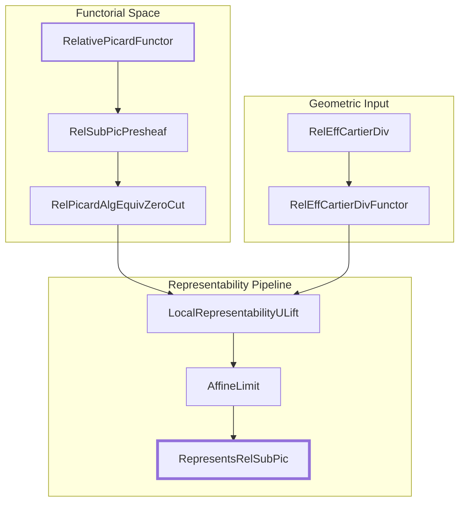
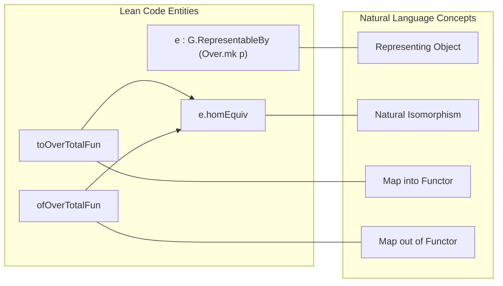

<!-- source: DeepWiki mcp.deepwiki.com · repo anthropics/fermats-last-theorem · page 3.2 Relative Picard Functor and Line Bundles · fetched 2026-10-26 -->

# Relative Picard Functor and Line Bundles

Relevant source files

The following files were used as context for generating this wiki page:

- [Definitions/Def_AlgebraicGeometry_RelPicardAlgEquivZeroCut.lean](Definitions/Def_AlgebraicGeometry_RelPicardAlgEquivZeroCut.lean)
- [P2M/Sol/S_AlgebraicCurve_CurveModel_smoothOfRelativeDimension_genusFF_of_representsRelSubPic.lean](P2M/Sol/S_AlgebraicCurve_CurveModel_smoothOfRelativeDimension_genusFF_of_representsRelSubPic.lean)
- [P2M/Sol/S_AlgebraicCurve_Pic0_map_maximalIdeal_le_sq_of_pushforwardAlong_frobenius_of_representsRelSubPic.lean](P2M/Sol/S_AlgebraicCurve_Pic0_map_maximalIdeal_le_sq_of_pushforwardAlong_frobenius_of_representsRelSubPic.lean)
- [P2M/Sol/S_AlgebraicGeometry_RelEffCartierDiv_eq_of_isAlgEquivZero_of_nonempty_tensor_lineBundle_iso_lineBundle.lean](P2M/Sol/S_AlgebraicGeometry_RelEffCartierDiv_eq_of_isAlgEquivZero_of_nonempty_tensor_lineBundle_iso_lineBundle.lean)
- [P2M/Sol/S_AlgebraicGeometry_RelEffCartierDiv_eq_of_isAlgEquivZero_pullback_mapOnProdOver_of_nonempty_tensor_lineBundle_iso_lineBundle.lean](P2M/Sol/S_AlgebraicGeometry_RelEffCartierDiv_eq_of_isAlgEquivZero_pullback_mapOnProdOver_of_nonempty_tensor_lineBundle_iso_lineBundle.lean)
- [P2M/Sol/S_AlgebraicGeometry_RelEffCartierDiv_existsUnique_pullbackAlong_eq_of_isPullback_of_isAffine.lean](P2M/Sol/S_AlgebraicGeometry_RelEffCartierDiv_existsUnique_pullbackAlong_eq_of_isPullback_of_isAffine.lean)
- [P2M/Sol/S_AlgebraicGeometry_RelEffCartierDiv_exists_I_eq_zeroSchemeIdeal.lean](P2M/Sol/S_AlgebraicGeometry_RelEffCartierDiv_exists_I_eq_zeroSchemeIdeal.lean)
- [P2M/Sol/S_AlgebraicGeometry_RelEffCartierDiv_exists_I_eq_zeroSchemeIdeal_of_supportedIn.lean](P2M/Sol/S_AlgebraicGeometry_RelEffCartierDiv_exists_I_eq_zeroSchemeIdeal_of_supportedIn.lean)
- [P2M/Sol/S_AlgebraicGeometry_RelEffCartierDiv_exists_nonempty_tensor_lineBundle_iso_lineBundle.lean](P2M/Sol/S_AlgebraicGeometry_RelEffCartierDiv_exists_nonempty_tensor_lineBundle_iso_lineBundle.lean)
- [P2M/Sol/S_AlgebraicGeometry_RelEffCartierDiv_nonempty_pullback_curveChange_ofPoint_comp_lineBundle_iso_and_idealModule_iso_of_isInvertible.lean](P2M/Sol/S_AlgebraicGeometry_RelEffCartierDiv_nonempty_pullback_curveChange_ofPoint_comp_lineBundle_iso_and_idealModule_iso_of_isInvertible.lean)
- [P2M/Sol/S_AlgebraicGeometry_RelEffCartierDiv_nonempty_pullback_lineBundle_pullbackAlong_iso_of_supportedIn.lean](P2M/Sol/S_AlgebraicGeometry_RelEffCartierDiv_nonempty_pullback_lineBundle_pullbackAlong_iso_of_supportedIn.lean)
- [P2M/Sol/S_AlgebraicGeometry_RelEffCartierDiv_nonempty_pullback_ofPoint_lineBundle_iso_and_idealModule_iso_of_range_subset.lean](P2M/Sol/S_AlgebraicGeometry_RelEffCartierDiv_nonempty_pullback_ofPoint_lineBundle_iso_and_idealModule_iso_of_range_subset.lean)
- [P2M/Sol/S_AlgebraicGeometry_RelPicard_FibrewiseAlgEquivZero_ofInvertible_normModule_curveChange.lean](P2M/Sol/S_AlgebraicGeometry_RelPicard_FibrewiseAlgEquivZero_ofInvertible_normModule_curveChange.lean)
- [P2M/Sol/S_AlgebraicGeometry_RelPicard_IsAlgEquivZero_nonempty_pullback_iso_pullback_unit_and_eulerChar_eq_one_of_curveModel_ratFunc.lean](P2M/Sol/S_AlgebraicGeometry_RelPicard_IsAlgEquivZero_nonempty_pullback_iso_pullback_unit_and_eulerChar_eq_one_of_curveModel_ratFunc.lean)
- [P2M/Sol/S_AlgebraicGeometry_RelPicard_IsAlgEquivZero_pullback_ofInvertible_of_iso_normModule_morphismRestrict.lean](P2M/Sol/S_AlgebraicGeometry_RelPicard_IsAlgEquivZero_pullback_ofInvertible_of_iso_normModule_morphismRestrict.lean)
- [P2M/Sol/S_AlgebraicGeometry_RelPicard_IsDeformationClassMap_cechH1ToH1_germ_eq_of_two_covers.lean](P2M/Sol/S_AlgebraicGeometry_RelPicard_IsDeformationClassMap_cechH1ToH1_germ_eq_of_two_covers.lean)
- [P2M/Sol/S_AlgebraicGeometry_RelPicard_IsDeformationClassMap_exists_cechH1ToH1_germ_eq_traceAlong_of_classifies_normModule_pullback_of_field.lean](P2M/Sol/S_AlgebraicGeometry_RelPicard_IsDeformationClassMap_exists_cechH1ToH1_germ_eq_traceAlong_of_classifies_normModule_pullback_of_field.lean)
- [P2M/Sol/S_AlgebraicGeometry_RelPicard_IsDeformationClassMap_exists_cechH1ToH1_germ_eq_traceAlong_of_classifies_normModule_pullback_of_mono.lean](P2M/Sol/S_AlgebraicGeometry_RelPicard_IsDeformationClassMap_exists_cechH1ToH1_germ_eq_traceAlong_of_classifies_normModule_pullback_of_mono.lean)
- [P2M/Sol/S_AlgebraicGeometry_RelPicard_RepresentsRelSubPic_comp_mul_eq_mul_comp_of_classifies_rigidify_normModule.lean](P2M/Sol/S_AlgebraicGeometry_RelPicard_RepresentsRelSubPic_comp_mul_eq_mul_comp_of_classifies_rigidify_normModule.lean)
- [P2M/Sol/S_AlgebraicGeometry_RelPicard_RepresentsRelSubPic_exists_hom_classifies_normModule_pullback_and_schemeHomOverComp_eq_of_comp_eq.lean](P2M/Sol/S_AlgebraicGeometry_RelPicard_RepresentsRelSubPic_exists_hom_classifies_normModule_pullback_and_schemeHomOverComp_eq_of_comp_eq.lean)
- [P2M/Sol/S_AlgebraicGeometry_RelPicard_RepresentsRelSubPic_exists_hom_classifies_norm_pullback_poincare_of_twoGluedCurves_of_mem_of_ringKrullDim_le_one.lean](P2M/Sol/S_AlgebraicGeometry_RelPicard_RepresentsRelSubPic_exists_hom_classifies_norm_pullback_poincare_of_twoGluedCurves_of_mem_of_ringKrullDim_le_one.lean)
- [P2M/Sol/S_AlgebraicGeometry_RelPicard_RepresentsRelSubPic_exists_hom_classifies_rigidify_normModule_pullback_curveChange.lean](P2M/Sol/S_AlgebraicGeometry_RelPicard_RepresentsRelSubPic_exists_hom_classifies_rigidify_normModule_pullback_curveChange.lean)
- [P2M/Sol/S_AlgebraicGeometry_RelPicard_RepresentsRelSubPic_exists_hom_classifies_rigidify_pullback_curveChange.lean](P2M/Sol/S_AlgebraicGeometry_RelPicard_RepresentsRelSubPic_exists_hom_classifies_rigidify_pullback_curveChange.lean)
- [P2M/Sol/S_AlgebraicGeometry_RelPicard_RepresentsRelSubPic_exists_hom_classifies_rigidify_pullback_map_of_comp_eq_comp.lean](P2M/Sol/S_AlgebraicGeometry_RelPicard_RepresentsRelSubPic_exists_hom_classifies_rigidify_pullback_map_of_comp_eq_comp.lean)
- [P2M/Sol/S_AlgebraicGeometry_RelPicard_RepresentsRelSubPic_exists_normHom_abelJacobi.lean](P2M/Sol/S_AlgebraicGeometry_RelPicard_RepresentsRelSubPic_exists_normHom_abelJacobi.lean)
- [P2M/Sol/S_AlgebraicGeometry_RelPicard_RepresentsRelSubPic_fibrewiseAlgEquivZero_ofInvertible_norm_pullback_poincare_of_twoGluedCurves_of_mem_of_ringKrullDim_le_one.lean](P2M/Sol/S_AlgebraicGeometry_RelPicard_RepresentsRelSubPic_fibrewiseAlgEquivZero_ofInvertible_norm_pullback_poincare_of_twoGluedCurves_of_mem_of_ringKrullDim_le_one.lean)
- [P2M/Sol/S_AlgebraicGeometry_RelPicard_RepresentsRelSubPic_mul_comp_eq_of_classifies_rigidify_normModule_of_ofPoint.lean](P2M/Sol/S_AlgebraicGeometry_RelPicard_RepresentsRelSubPic_mul_comp_eq_of_classifies_rigidify_normModule_of_ofPoint.lean)
- [P2M/Sol/S_AlgebraicGeometry_RelPicard_RepresentsRelSubPic_nonempty_poincare_pullbackAlong_comp_iso_rigidify_normModule_of_range_subset.lean](P2M/Sol/S_AlgebraicGeometry_RelPicard_RepresentsRelSubPic_nonempty_poincare_pullbackAlong_comp_iso_rigidify_normModule_of_range_subset.lean)
- [P2M/Sol/S_AlgebraicGeometry_RelPicard_RepresentsRelSubPic_nonempty_poincare_pullbackAlong_iso_rigidify_normModule_baseChange.lean](P2M/Sol/S_AlgebraicGeometry_RelPicard_RepresentsRelSubPic_nonempty_poincare_pullbackAlong_iso_rigidify_normModule_baseChange.lean)
- [P2M/Sol/S_AlgebraicGeometry_RelPicard_RepresentsRelSubPic_nonempty_poincare_pullbackAlong_iso_rigidify_normModule_baseChange_of_forall.lean](P2M/Sol/S_AlgebraicGeometry_RelPicard_RepresentsRelSubPic_nonempty_poincare_pullbackAlong_iso_rigidify_normModule_baseChange_of_forall.lean)
- [P2M/Sol/S_AlgebraicGeometry_RelPicard_RepresentsRelSubPic_nonempty_pullbackAlong_mul_iso_tensor_ofInvertible_norm_pullback_poincare.lean](P2M/Sol/S_AlgebraicGeometry_RelPicard_RepresentsRelSubPic_nonempty_pullbackAlong_mul_iso_tensor_ofInvertible_norm_pullback_poincare.lean)
- [P2M/Sol/S_AlgebraicGeometry_RelPicard_RepresentsRelSubPic_nonempty_pullback_zeroSection_norm_pullback_poincare_iso_unit_of_mem_of_ringKrullDim_le_one.lean](P2M/Sol/S_AlgebraicGeometry_RelPicard_RepresentsRelSubPic_nonempty_pullback_zeroSection_norm_pullback_poincare_iso_unit_of_mem_of_ringKrullDim_le_one.lean)
- [P2M/Sol/S_AlgebraicGeometry_RelPicard_RepresentsRelSubPic_relativeGroupLaw_mul_eq_baseChange_mul_of_nonempty_poincare_iso_ofR.lean](P2M/Sol/S_AlgebraicGeometry_RelPicard_RepresentsRelSubPic_relativeGroupLaw_mul_eq_baseChange_mul_of_nonempty_poincare_iso_ofR.lean)
- [P2M/Sol/S_AlgebraicGeometry_RelPicard_RepresentsRelSubPic_schemeHomOverComp_mul_eq_mul_and_zeroSection_comp_of_classifies_normModule_pullback.lean](P2M/Sol/S_AlgebraicGeometry_RelPicard_RepresentsRelSubPic_schemeHomOverComp_mul_eq_mul_and_zeroSection_comp_of_classifies_normModule_pullback.lean)
- [P2M/Sol/S_AlgebraicGeometry_RelPicard_RigidifiedLineBundle_nonempty_pullbackAlong_iso_unit_of_smallExtension_of_locIsoOnBase_faces.lean](P2M/Sol/S_AlgebraicGeometry_RelPicard_RigidifiedLineBundle_nonempty_pullbackAlong_iso_unit_of_smallExtension_of_locIsoOnBase_faces.lean)
- [P2M/Sol/S_AlgebraicGeometry_RelPicard_RigidifiedLineBundle_nonempty_pullbackAlong_one_iso_unit_of_locIsoOnBase_face.lean](P2M/Sol/S_AlgebraicGeometry_RelPicard_RigidifiedLineBundle_nonempty_pullbackAlong_one_iso_unit_of_locIsoOnBase_face.lean)
- [P2M/Sol/S_AlgebraicGeometry_RelPicard_eulerChar_fibre_lineBundle_tensor_idealModule_eq_one_of_supportedIn.lean](P2M/Sol/S_AlgebraicGeometry_RelPicard_eulerChar_fibre_lineBundle_tensor_idealModule_eq_one_of_supportedIn.lean)
- [P2M/Sol/S_AlgebraicGeometry_RelPicard_eulerChar_fibre_sectionTwist_tensor_idealModule_eq_one.lean](P2M/Sol/S_AlgebraicGeometry_RelPicard_eulerChar_fibre_sectionTwist_tensor_idealModule_eq_one.lean)
- [P2M/Sol/S_AlgebraicGeometry_RelPicard_eulerChar_fibre_sectionTwist_tensor_idealModule_eq_one_of_supportedIn.lean](P2M/Sol/S_AlgebraicGeometry_RelPicard_eulerChar_fibre_sectionTwist_tensor_idealModule_eq_one_of_supportedIn.lean)
- [P2M/Sol/S_AlgebraicGeometry_RelPicard_eulerChar_pullback_fibreModule_tensor_sectionTwist_tensor_idealModule_eq.lean](P2M/Sol/S_AlgebraicGeometry_RelPicard_eulerChar_pullback_fibreModule_tensor_sectionTwist_tensor_idealModule_eq.lean)
- [P2M/Sol/S_AlgebraicGeometry_RelPicard_eulerChar_pullback_firstLine_sectionTwist_tensor_idealModule_eq.lean](P2M/Sol/S_AlgebraicGeometry_RelPicard_eulerChar_pullback_firstLine_sectionTwist_tensor_idealModule_eq.lean)
- [P2M/Sol/S_AlgebraicGeometry_RelPicard_eulerChar_pullback_tensor_invModule_pow_ker_tensor_module_prod_ker_eq_of_twoLineDegeneration.lean](P2M/Sol/S_AlgebraicGeometry_RelPicard_eulerChar_pullback_tensor_invModule_pow_ker_tensor_module_prod_ker_eq_of_twoLineDegeneration.lean)
- [P2M/Sol/S_AlgebraicGeometry_RelPicard_exists_abelJacobi_of_representsRelSubPic.lean](P2M/Sol/S_AlgebraicGeometry_RelPicard_exists_abelJacobi_of_representsRelSubPic.lean)
- [P2M/Sol/S_AlgebraicGeometry_RelPicard_exists_chart_subsingleton_H1_and_support_subset_fibre_of_twoSidedBlocks_of_injective.lean](P2M/Sol/S_AlgebraicGeometry_RelPicard_exists_chart_subsingleton_H1_and_support_subset_fibre_of_twoSidedBlocks_of_injective.lean)
- [P2M/Sol/S_AlgebraicGeometry_RelPicard_exists_chart_subsingleton_H1_fibre.lean](P2M/Sol/S_AlgebraicGeometry_RelPicard_exists_chart_subsingleton_H1_fibre.lean)
- [P2M/Sol/S_AlgebraicGeometry_RelPicard_exists_chart_subsingleton_H1_fibre_of_blocks_of_injective.lean](P2M/Sol/S_AlgebraicGeometry_RelPicard_exists_chart_subsingleton_H1_fibre_of_blocks_of_injective.lean)
- [P2M/Sol/S_AlgebraicGeometry_RelPicard_exists_chart_subsingleton_H1_fibre_of_blocks_of_not_smooth.lean](P2M/Sol/S_AlgebraicGeometry_RelPicard_exists_chart_subsingleton_H1_fibre_of_blocks_of_not_smooth.lean)
- [P2M/Sol/S_AlgebraicGeometry_RelPicard_exists_forall_subsingleton_H1_sectionsOf_fibreModule_chartModule_of_smooth.lean](P2M/Sol/S_AlgebraicGeometry_RelPicard_exists_forall_subsingleton_H1_sectionsOf_fibreModule_chartModule_of_smooth.lean)
- [P2M/Sol/S_AlgebraicGeometry_RelPicard_exists_injective_forall_finrank_H0_add_eq_and_subsingleton_H1_of_blocks_of_isAlgEquivZero_of_lt_card.lean](P2M/Sol/S_AlgebraicGeometry_RelPicard_exists_injective_forall_finrank_H0_add_eq_and_subsingleton_H1_of_blocks_of_isAlgEquivZero_of_lt_card.lean)
- [P2M/Sol/S_AlgebraicGeometry_RelPicard_exists_injective_forall_finrank_H0_eq_zero_and_subsingleton_H1_restrict_fst_of_nearBlocks_of_twoGluedSmoothCurveDegeneration.lean](P2M/Sol/S_AlgebraicGeometry_RelPicard_exists_injective_forall_finrank_H0_eq_zero_and_subsingleton_H1_restrict_fst_of_nearBlocks_of_twoGluedSmoothCurveDegeneration.lean)
- [P2M/Sol/S_AlgebraicGeometry_RelPicard_exists_injective_forall_subsingleton_H1_and_finrank_H0_restrict_snd_of_farBlocks_of_twoGluedSmoothCurveDegeneration.lean](P2M/Sol/S_AlgebraicGeometry_RelPicard_exists_injective_forall_subsingleton_H1_and_finrank_H0_restrict_snd_of_farBlocks_of_twoGluedSmoothCurveDegeneration.lean)
- [P2M/Sol/S_AlgebraicGeometry_RelPicard_exists_injective_forall_subsingleton_H1_of_blocks_of_pool_of_bijective_sections.lean](P2M/Sol/S_AlgebraicGeometry_RelPicard_exists_injective_forall_subsingleton_H1_of_blocks_of_pool_of_bijective_sections.lean)
- [P2M/Sol/S_AlgebraicGeometry_RelPicard_exists_injective_forall_subsingleton_H1_of_blocks_of_smooth_fibre.lean](P2M/Sol/S_AlgebraicGeometry_RelPicard_exists_injective_forall_subsingleton_H1_of_blocks_of_smooth_fibre.lean)
- [P2M/Sol/S_AlgebraicGeometry_RelPicard_exists_injective_forall_subsingleton_H1_of_blocks_of_twoLineDegeneration_of_sectionInSmoothLocus.lean](P2M/Sol/S_AlgebraicGeometry_RelPicard_exists_injective_forall_subsingleton_H1_of_blocks_of_twoLineDegeneration_of_sectionInSmoothLocus.lean)
- [P2M/Sol/S_AlgebraicGeometry_RelPicard_exists_injective_forall_subsingleton_H1_sectionsOf_tensor_of_isAlgEquivZero_of_lt_card.lean](P2M/Sol/S_AlgebraicGeometry_RelPicard_exists_injective_forall_subsingleton_H1_sectionsOf_tensor_of_isAlgEquivZero_of_lt_card.lean)
- [P2M/Sol/S_AlgebraicGeometry_RelPicard_exists_isAlgEquivZero_pullback_curveChange_iso_of_isAlgEquivZero_of_twoGluedSmoothCurves.lean](P2M/Sol/S_AlgebraicGeometry_RelPicard_exists_isAlgEquivZero_pullback_curveChange_iso_of_isAlgEquivZero_of_twoGluedSmoothCurves.lean)
- [P2M/Sol/S_AlgebraicGeometry_RelPicard_exists_isOpen_inter_preimage_eq_setOf_isAlgEquivZero_fibre_of_smoothLocus_of_twoGluedSmoothCurveDegenerations.lean](P2M/Sol/S_AlgebraicGeometry_RelPicard_exists_isOpen_inter_preimage_eq_setOf_isAlgEquivZero_fibre_of_smoothLocus_of_twoGluedSmoothCurveDegenerations.lean)
- [P2M/Sol/S_AlgebraicGeometry_RelPicard_exists_isOpen_inter_preimage_eq_setOf_isAlgEquivZero_fibre_of_smoothLocus_of_twoLineDegenerations.lean](P2M/Sol/S_AlgebraicGeometry_RelPicard_exists_isOpen_inter_preimage_eq_setOf_isAlgEquivZero_fibre_of_smoothLocus_of_twoLineDegenerations.lean)
- [P2M/Sol/S_AlgebraicGeometry_RelPicard_exists_openChart_openImmersion_relSubPicPresheaf_algEquivZeroCut_of_fibrewise_zeroScheme.lean](P2M/Sol/S_AlgebraicGeometry_RelPicard_exists_openChart_openImmersion_relSubPicPresheaf_algEquivZeroCut_of_fibrewise_zeroScheme.lean)
- [P2M/Sol/S_AlgebraicGeometry_RelPicard_exists_openChart_openImmersion_relSubPicPresheaf_algEquivZeroCut_of_polarisation_of_fibrewise_zeroScheme.lean](P2M/Sol/S_AlgebraicGeometry_RelPicard_exists_openChart_openImmersion_relSubPicPresheaf_algEquivZeroCut_of_polarisation_of_fibrewise_zeroScheme.lean)
- [P2M/Sol/S_AlgebraicGeometry_RelPicard_exists_openChart_relSubPicPresheaf_algEquivZeroCut_of_relEffCartierDiv.lean](P2M/Sol/S_AlgebraicGeometry_RelPicard_exists_openChart_relSubPicPresheaf_algEquivZeroCut_of_relEffCartierDiv.lean)
- [P2M/Sol/S_AlgebraicGeometry_RelPicard_exists_openCharts_relSubPicPresheaf_algEquivZeroCut_of_finiteMapData_of_isReduced.lean](P2M/Sol/S_AlgebraicGeometry_RelPicard_exists_openCharts_relSubPicPresheaf_algEquivZeroCut_of_finiteMapData_of_isReduced.lean)
- [P2M/Sol/S_AlgebraicGeometry_RelPicard_exists_openCharts_relSubPicPresheaf_algEquivZeroCut_of_polarisation_supportedIn_of_fibrewise_zeroScheme.lean](P2M/Sol/S_AlgebraicGeometry_RelPicard_exists_openCharts_relSubPicPresheaf_algEquivZeroCut_of_polarisation_supportedIn_of_fibrewise_zeroScheme.lean)
- [P2M/Sol/S_AlgebraicGeometry_RelPicard_exists_openCharts_relSubPicPresheaf_algEquivZeroCut_of_relEffCartierDiv_supportedIn_of_fibrewise_zeroScheme.lean](P2M/Sol/S_AlgebraicGeometry_RelPicard_exists_openCharts_relSubPicPresheaf_algEquivZeroCut_of_relEffCartierDiv_supportedIn_of_fibrewise_zeroScheme.lean)
- [P2M/Sol/S_AlgebraicGeometry_RelPicard_exists_opens_range_subset_iff_forall_subsingleton_H1_fibre.lean](P2M/Sol/S_AlgebraicGeometry_RelPicard_exists_opens_range_subset_iff_forall_subsingleton_H1_fibre.lean)
- [P2M/Sol/S_AlgebraicGeometry_RelPicard_exists_opens_range_subset_iff_forall_subsingleton_H1_fibre_of_twoAffineOpenCover.lean](P2M/Sol/S_AlgebraicGeometry_RelPicard_exists_opens_range_subset_iff_forall_subsingleton_H1_fibre_of_twoAffineOpenCover.lean)
- [P2M/Sol/S_AlgebraicGeometry_RelPicard_exists_opens_range_subset_iff_forall_support_zeroSchemeIdeal_subset_of_forall_fibre.lean](P2M/Sol/S_AlgebraicGeometry_RelPicard_exists_opens_range_subset_iff_forall_support_zeroSchemeIdeal_subset_of_forall_fibre.lean)
- [P2M/Sol/S_AlgebraicGeometry_RelPicard_exists_opens_range_subset_iff_isAlgEquivZero_rigidify_lineBundle_baseChange_of_twoGluedSmoothCurveDegenerations.lean](P2M/Sol/S_AlgebraicGeometry_RelPicard_exists_opens_range_subset_iff_isAlgEquivZero_rigidify_lineBundle_baseChange_of_twoGluedSmoothCurveDegenerations.lean)
- [P2M/Sol/S_AlgebraicGeometry_RelPicard_exists_opens_range_subset_iff_isAlgEquivZero_twistModule_baseChange_of_twoLineDegenerations.lean](P2M/Sol/S_AlgebraicGeometry_RelPicard_exists_opens_range_subset_iff_isAlgEquivZero_twistModule_baseChange_of_twoLineDegenerations.lean)
- [P2M/Sol/S_AlgebraicGeometry_RelPicard_exists_pic0_equiv_points_of_representsRelSubPic_of_abelJacobi.lean](P2M/Sol/S_AlgebraicGeometry_RelPicard_exists_pic0_equiv_points_of_representsRelSubPic_of_abelJacobi.lean)
- [P2M/Sol/S_AlgebraicGeometry_RelPicard_exists_relEffCartierDiv_I_eq_zeroSchemeIdeal_chartModule_fibre.lean](P2M/Sol/S_AlgebraicGeometry_RelPicard_exists_relEffCartierDiv_I_eq_zeroSchemeIdeal_chartModule_fibre.lean)
- [P2M/Sol/S_AlgebraicGeometry_RelPicard_exists_relEffCartierDiv_I_eq_zeroSchemeIdeal_chartModule_fibre_of_not_smooth_of_isReduced.lean](P2M/Sol/S_AlgebraicGeometry_RelPicard_exists_relEffCartierDiv_I_eq_zeroSchemeIdeal_chartModule_fibre_of_not_smooth_of_isReduced.lean)
- [P2M/Sol/S_AlgebraicGeometry_RelPicard_exists_relEffCartierDiv_I_eq_zeroSchemeIdeal_chartModule_fibre_of_smooth.lean](P2M/Sol/S_AlgebraicGeometry_RelPicard_exists_relEffCartierDiv_I_eq_zeroSchemeIdeal_chartModule_fibre_of_smooth.lean)
- [P2M/Sol/S_AlgebraicGeometry_RelPicard_exists_relEffCartierDiv_I_eq_zeroSchemeIdeal_polarisedChartModule_fibre_of_support_subset_of_twoGluedSmoothCurveDegenerations.lean](P2M/Sol/S_AlgebraicGeometry_RelPicard_exists_relEffCartierDiv_I_eq_zeroSchemeIdeal_polarisedChartModule_fibre_of_support_subset_of_twoGluedSmoothCurveDegenerations.lean)
- [P2M/Sol/S_AlgebraicGeometry_RelPicard_exists_relEffCartierDiv_I_eq_zeroSchemeIdeal_polarisedChartModule_fibre_of_support_subset_of_twoGluedSmoothCurveDegenerations_of_not_smooth.lean](P2M/Sol/S_AlgebraicGeometry_RelPicard_exists_relEffCartierDiv_I_eq_zeroSchemeIdeal_polarisedChartModule_fibre_of_support_subset_of_twoGluedSmoothCurveDegenerations_of_not_smooth.lean)
- [P2M/Sol/S_AlgebraicGeometry_RelPicard_exists_relEffCartierDiv_I_eq_zeroSchemeIdeal_polarisedChartModule_fibre_of_support_subset_of_twoGluedSmoothCurveDegenerations_of_smooth.lean](P2M/Sol/S_AlgebraicGeometry_RelPicard_exists_relEffCartierDiv_I_eq_zeroSchemeIdeal_polarisedChartModule_fibre_of_support_subset_of_twoGluedSmoothCurveDegenerations_of_smooth.lean)
- [P2M/Sol/S_AlgebraicGeometry_RelPicard_exists_relEffCartierDiv_lineBundle_iso_of_forall_fibre.lean](P2M/Sol/S_AlgebraicGeometry_RelPicard_exists_relEffCartierDiv_lineBundle_iso_of_forall_fibre.lean)
- [P2M/Sol/S_AlgebraicGeometry_RelPicard_exists_relEffCartierDiv_lineBundle_iso_of_forall_fibre_of_supportedIn.lean](P2M/Sol/S_AlgebraicGeometry_RelPicard_exists_relEffCartierDiv_lineBundle_iso_of_forall_fibre_of_supportedIn.lean)
- [P2M/Sol/S_AlgebraicGeometry_RelPicard_exists_relEffCartierDiv_supportedIn_rigidify_iso_of_subsingleton_H1_of_support_subset.lean](P2M/Sol/S_AlgebraicGeometry_RelPicard_exists_relEffCartierDiv_supportedIn_rigidify_iso_of_subsingleton_H1_of_support_subset.lean)
- [P2M/Sol/S_AlgebraicGeometry_RelPicard_exists_relEffCartierDiv_twistModule_iso_of_subsingleton_H1.lean](P2M/Sol/S_AlgebraicGeometry_RelPicard_exists_relEffCartierDiv_twistModule_iso_of_subsingleton_H1.lean)
- [P2M/Sol/S_AlgebraicGeometry_RelPicard_exists_relativeGroupLaw_abelJacobi_of_representsRelSubPic.lean](P2M/Sol/S_AlgebraicGeometry_RelPicard_exists_relativeGroupLaw_abelJacobi_of_representsRelSubPic.lean)
- [P2M/Sol/S_AlgebraicGeometry_RelPicard_exists_representsRelSubPic_algEquivZeroCut_of_chartData.lean](P2M/Sol/S_AlgebraicGeometry_RelPicard_exists_representsRelSubPic_algEquivZeroCut_of_chartData.lean)
- [P2M/Sol/S_AlgebraicGeometry_RelPicard_exists_representsRelSubPic_algEquivZeroCut_of_smoothLocus_of_twoGluedSmoothCurveDegenerations.lean](P2M/Sol/S_AlgebraicGeometry_RelPicard_exists_representsRelSubPic_algEquivZeroCut_of_smoothLocus_of_twoGluedSmoothCurveDegenerations.lean)
- [P2M/Sol/S_AlgebraicGeometry_RelPicard_exists_representsRelSubPic_algEquivZeroCut_of_smoothLocus_of_twoLineDegenerations.lean](P2M/Sol/S_AlgebraicGeometry_RelPicard_exists_representsRelSubPic_algEquivZeroCut_of_smoothLocus_of_twoLineDegenerations.lean)
- [P2M/Sol/S_AlgebraicGeometry_RelPicard_exists_restrictHom_pair_of_twoGluedSmoothCurves.lean](P2M/Sol/S_AlgebraicGeometry_RelPicard_exists_restrictHom_pair_of_twoGluedSmoothCurves.lean)
- [P2M/Sol/S_AlgebraicGeometry_RelPicard_exists_shortExact_pushforward_tensor_idealOfSection_of_forall_fibre.lean](P2M/Sol/S_AlgebraicGeometry_RelPicard_exists_shortExact_pushforward_tensor_idealOfSection_of_forall_fibre.lean)
- [P2M/Sol/S_AlgebraicGeometry_RelPicard_exists_split_injective_forall_subsingleton_H1_and_support_subset_of_twoSidedBlocks_of_bijective_sections.lean](P2M/Sol/S_AlgebraicGeometry_RelPicard_exists_split_injective_forall_subsingleton_H1_and_support_subset_of_twoSidedBlocks_of_bijective_sections.lean)
- [P2M/Sol/S_AlgebraicGeometry_RelPicard_exists_split_injective_forall_subsingleton_H1_and_support_subset_of_twoSidedBlocks_of_twoGluedSmoothCurveDegeneration.lean](P2M/Sol/S_AlgebraicGeometry_RelPicard_exists_split_injective_forall_subsingleton_H1_and_support_subset_of_twoSidedBlocks_of_twoGluedSmoothCurveDegeneration.lean)
- [P2M/Sol/S_AlgebraicGeometry_RelPicard_exists_split_injective_forall_subsingleton_H1_lineBundle_and_support_subset_of_twoSidedBlocks_of_bijective_sections.lean](P2M/Sol/S_AlgebraicGeometry_RelPicard_exists_split_injective_forall_subsingleton_H1_lineBundle_and_support_subset_of_twoSidedBlocks_of_bijective_sections.lean)
- [P2M/Sol/S_AlgebraicGeometry_RelPicard_fibrewiseAlgEquivZero_of_isAlgEquivZero_pullback_closedFibre_of_pullbackAlong_iso_tensorPow_poincare.lean](P2M/Sol/S_AlgebraicGeometry_RelPicard_fibrewiseAlgEquivZero_of_isAlgEquivZero_pullback_closedFibre_of_pullbackAlong_iso_tensorPow_poincare.lean)
- [P2M/Sol/S_AlgebraicGeometry_RelPicard_finrank_H0_fibre_eq_one_of_subsingleton_H1.lean](P2M/Sol/S_AlgebraicGeometry_RelPicard_finrank_H0_fibre_eq_one_of_subsingleton_H1.lean)
- [P2M/Sol/S_AlgebraicGeometry_RelPicard_finrank_H0_fibre_eq_one_of_subsingleton_H1_of_supportedIn.lean](P2M/Sol/S_AlgebraicGeometry_RelPicard_finrank_H0_fibre_eq_one_of_subsingleton_H1_of_supportedIn.lean)
- [P2M/Sol/S_AlgebraicGeometry_RelPicard_finrank_H0_fibre_eq_one_of_subsingleton_H1_of_supportedIn_lineBundle.lean](P2M/Sol/S_AlgebraicGeometry_RelPicard_finrank_H0_fibre_eq_one_of_subsingleton_H1_of_supportedIn_lineBundle.lean)
- [P2M/Sol/S_AlgebraicGeometry_RelPicard_finrank_H1_le_finrank_H1_unit_add_one_of_isAlgEquivZero_of_twoGluedSmoothCurves.lean](P2M/Sol/S_AlgebraicGeometry_RelPicard_finrank_H1_le_finrank_H1_unit_add_one_of_isAlgEquivZero_of_twoGluedSmoothCurves.lean)
- [P2M/Sol/S_AlgebraicGeometry_RelPicard_finrank_H1_unit_fibre_eq_of_eulerChar_chart.lean](P2M/Sol/S_AlgebraicGeometry_RelPicard_finrank_H1_unit_fibre_eq_of_eulerChar_chart.lean)
- [P2M/Sol/S_AlgebraicGeometry_RelPicard_forall_exists_isAffineOpen_forall_act_mem_of_blocks_of_isInvertible.lean](P2M/Sol/S_AlgebraicGeometry_RelPicard_forall_exists_isAffineOpen_forall_act_mem_of_blocks_of_isInvertible.lean)
- [P2M/Sol/S_AlgebraicGeometry_RelPicard_forall_exists_isAffineOpen_forall_act_mem_of_twoSidedBlocks_of_isInvertible.lean](P2M/Sol/S_AlgebraicGeometry_RelPicard_forall_exists_isAffineOpen_forall_act_mem_of_twoSidedBlocks_of_isInvertible.lean)
- [P2M/Sol/S_AlgebraicGeometry_RelPicard_forall_prime_exists_representsRelSubPic_algEquivZeroCut_baseChange_away_of_smoothLocus_of_twoGluedSmoothCurveDegenerations.lean](P2M/Sol/S_AlgebraicGeometry_RelPicard_forall_prime_exists_representsRelSubPic_algEquivZeroCut_baseChange_away_of_smoothLocus_of_twoGluedSmoothCurveDegenerations.lean)
- [P2M/Sol/S_AlgebraicGeometry_RelPicard_forall_prime_exists_representsRelSubPic_algEquivZeroCut_baseChange_away_of_smoothLocus_of_twoLineDegenerations.lean](P2M/Sol/S_AlgebraicGeometry_RelPicard_forall_prime_exists_representsRelSubPic_algEquivZeroCut_baseChange_away_of_smoothLocus_of_twoLineDegenerations.lean)
- [P2M/Sol/S_AlgebraicGeometry_RelPicard_isAlgEquivZero_fibre_of_range_subset_singleton_of_twoGluedSmoothCurveDegenerations.lean](P2M/Sol/S_AlgebraicGeometry_RelPicard_isAlgEquivZero_fibre_of_range_subset_singleton_of_twoGluedSmoothCurveDegenerations.lean)
- [P2M/Sol/S_AlgebraicGeometry_RelPicard_isAlgEquivZero_fibre_of_range_subset_singleton_of_twoLineDegenerations.lean](P2M/Sol/S_AlgebraicGeometry_RelPicard_isAlgEquivZero_fibre_of_range_subset_singleton_of_twoLineDegenerations.lean)
- [P2M/Sol/S_AlgebraicGeometry_RelPicard_isAlgEquivZero_of_eulerChar_sectionsOf_pullback_eq_of_twoGluedSmoothCurves.lean](P2M/Sol/S_AlgebraicGeometry_RelPicard_isAlgEquivZero_of_eulerChar_sectionsOf_pullback_eq_of_twoGluedSmoothCurves.lean)
- [P2M/Sol/S_AlgebraicGeometry_RelPicard_isAlgEquivZero_of_finrank_H1_tensorPow_add_two_le_of_twoGluedSmoothCurves.lean](P2M/Sol/S_AlgebraicGeometry_RelPicard_isAlgEquivZero_of_finrank_H1_tensorPow_add_two_le_of_twoGluedSmoothCurves.lean)
- [P2M/Sol/S_AlgebraicGeometry_RelPicard_isAlgEquivZero_of_pullback_curveChange_iso_unit_of_twoGluedSmoothCurves.lean](P2M/Sol/S_AlgebraicGeometry_RelPicard_isAlgEquivZero_of_pullback_curveChange_iso_unit_of_twoGluedSmoothCurves.lean)
- [P2M/Sol/S_AlgebraicGeometry_RelPicard_isClosed_setOf_exists_fibreModule_iso_unit.lean](P2M/Sol/S_AlgebraicGeometry_RelPicard_isClosed_setOf_exists_fibreModule_iso_unit.lean)
- [P2M/Sol/S_AlgebraicGeometry_RelPicard_isLFPSurj_relSubPicPresheaf_algEquivZeroCut.lean](P2M/Sol/S_AlgebraicGeometry_RelPicard_isLFPSurj_relSubPicPresheaf_algEquivZeroCut.lean)
- [P2M/Sol/S_AlgebraicGeometry_RelPicard_isLFPSurj_relSubPicPresheaf_algEquivZeroCut_baseChange_of_twoGluedSmoothCurveDegenerations.lean](P2M/Sol/S_AlgebraicGeometry_RelPicard_isLFPSurj_relSubPicPresheaf_algEquivZeroCut_baseChange_of_twoGluedSmoothCurveDegenerations.lean)
- [P2M/Sol/S_AlgebraicGeometry_RelPicard_isLFPSurj_relSubPicPresheaf_algEquivZeroCut_baseChange_of_twoLineDegenerations.lean](P2M/Sol/S_AlgebraicGeometry_RelPicard_isLFPSurj_relSubPicPresheaf_algEquivZeroCut_baseChange_of_twoLineDegenerations.lean)
- [P2M/Sol/S_AlgebraicGeometry_RelPicard_isLFPSurj_relSubPicPresheaf_algEquivZeroCut_of_isOpen_setOf_isAlgEquivZero.lean](P2M/Sol/S_AlgebraicGeometry_RelPicard_isLFPSurj_relSubPicPresheaf_algEquivZeroCut_of_isOpen_setOf_isAlgEquivZero.lean)
- [P2M/Sol/S_AlgebraicGeometry_RelPicard_isOpen_setOf_forall_fibre_subsingleton_H1.lean](P2M/Sol/S_AlgebraicGeometry_RelPicard_isOpen_setOf_forall_fibre_subsingleton_H1.lean)
- [P2M/Sol/S_AlgebraicGeometry_RelPicard_isOpen_setOf_forall_fibre_subsingleton_H1_of_twoAffineOpenCover.lean](P2M/Sol/S_AlgebraicGeometry_RelPicard_isOpen_setOf_forall_fibre_subsingleton_H1_of_twoAffineOpenCover.lean)
- [P2M/Sol/S_AlgebraicGeometry_RelPicard_isOpen_setOf_isAlgEquivZero_fibre.lean](P2M/Sol/S_AlgebraicGeometry_RelPicard_isOpen_setOf_isAlgEquivZero_fibre.lean)
- [P2M/Sol/S_AlgebraicGeometry_RelPicard_isOpen_setOf_isAlgEquivZero_fibre_of_twoStrata.lean](P2M/Sol/S_AlgebraicGeometry_RelPicard_isOpen_setOf_isAlgEquivZero_fibre_of_twoStrata.lean)
- [P2M/Sol/S_AlgebraicGeometry_RelPicard_nonempty_normModule_curveChange_dualNumber_iso_unit_of_finrank_eq_char_of_forall_isClosed_eq.lean](P2M/Sol/S_AlgebraicGeometry_RelPicard_nonempty_normModule_curveChange_dualNumber_iso_unit_of_finrank_eq_char_of_forall_isClosed_eq.lean)
- [P2M/Sol/S_AlgebraicGeometry_RelPicard_relEffCartierDiv_eq_pullbackAlong_of_rigidify_iso_of_supportedIn_of_support_subset.lean](P2M/Sol/S_AlgebraicGeometry_RelPicard_relEffCartierDiv_eq_pullbackAlong_of_rigidify_iso_of_supportedIn_of_support_subset.lean)
- [P2M/Sol/S_AlgebraicGeometry_RelPicard_relEffCartierDiv_eq_pullbackAlong_of_twistModule_iso.lean](P2M/Sol/S_AlgebraicGeometry_RelPicard_relEffCartierDiv_eq_pullbackAlong_of_twistModule_iso.lean)
- [P2M/Sol/S_AlgebraicGeometry_RelPicard_relEffCartierDiv_eq_pullbackAlong_of_twistModule_iso_of_supportedIn_of_zeroScheme.lean](P2M/Sol/S_AlgebraicGeometry_RelPicard_relEffCartierDiv_eq_pullbackAlong_of_twistModule_iso_of_supportedIn_of_zeroScheme.lean)
- [P2M/Sol/S_AlgebraicGeometry_RelPicard_subsingleton_H1_and_finrank_H0_fibre_of_twoGluedProjectiveLines.lean](P2M/Sol/S_AlgebraicGeometry_RelPicard_subsingleton_H1_and_finrank_H0_fibre_of_twoGluedProjectiveLines.lean)
- [P2M/Sol/S_AlgebraicGeometry_RelPicard_subsingleton_H1_and_finrank_H0_fibre_poincare_tensor_sectionTwist.lean](P2M/Sol/S_AlgebraicGeometry_RelPicard_subsingleton_H1_and_finrank_H0_fibre_poincare_tensor_sectionTwist.lean)
- [P2M/Sol/S_AlgebraicGeometry_RelPicard_subsingleton_H1_and_finrank_H0_fibre_poincare_tensor_sectionTwist_of_isAlgClosed.lean](P2M/Sol/S_AlgebraicGeometry_RelPicard_subsingleton_H1_and_finrank_H0_fibre_poincare_tensor_sectionTwist_of_isAlgClosed.lean)
- [P2M/Sol/S_AlgebraicGeometry_RelPicard_subsingleton_H1_and_finrank_H0_fibre_tensor_sectionTwist_of_fibrewiseAlgEquivZero.lean](P2M/Sol/S_AlgebraicGeometry_RelPicard_subsingleton_H1_and_finrank_H0_fibre_tensor_sectionTwist_of_fibrewiseAlgEquivZero.lean)
- [P2M/Sol/S_AlgebraicGeometry_RelPicard_subsingleton_H1_and_finrank_H0_fibre_tensor_sectionTwist_of_fibrewiseAlgEquivZero_of_isAlgClosed.lean](P2M/Sol/S_AlgebraicGeometry_RelPicard_subsingleton_H1_and_finrank_H0_fibre_tensor_sectionTwist_of_fibrewiseAlgEquivZero_of_isAlgClosed.lean)
- [P2M/Sol/S_AlgebraicGeometry_RelPicard_subsingleton_H1_fibre_of_subsingleton_H1_residueField_chart.lean](P2M/Sol/S_AlgebraicGeometry_RelPicard_subsingleton_H1_fibre_of_subsingleton_H1_residueField_chart.lean)
- [P2M/Sol/S_AlgebraicGeometry_RelPicard_support_zeroSchemeIdeal_fibre_subset_of_support_zeroSchemeIdeal_fibre_subset_extension.lean](P2M/Sol/S_AlgebraicGeometry_RelPicard_support_zeroSchemeIdeal_fibre_subset_of_support_zeroSchemeIdeal_fibre_subset_extension.lean)
- [P2M/Sol/S_AlgebraicGeometry_Scheme_IdealSheafData_comap_injective_of_flat_of_surjective.lean](P2M/Sol/S_AlgebraicGeometry_Scheme_IdealSheafData_comap_injective_of_flat_of_surjective.lean)
- [P2M/Sol/S_AlgebraicGeometry_Scheme_IdealSheafData_comap_mul.lean](P2M/Sol/S_AlgebraicGeometry_Scheme_IdealSheafData_comap_mul.lean)
- [P2M/Sol/S_AlgebraicGeometry_Scheme_IdealSheafData_ideal_comap_of_le.lean](P2M/Sol/S_AlgebraicGeometry_Scheme_IdealSheafData_ideal_comap_of_le.lean)
- [P2M/Sol/S_AlgebraicGeometry_Scheme_IdealSheafData_isInvertible_of_isInvertible_comap.lean](P2M/Sol/S_AlgebraicGeometry_Scheme_IdealSheafData_isInvertible_of_isInvertible_comap.lean)
- [P2M/Sol/S_AlgebraicGeometry_Scheme_IdealSheafData_pullbackModuleComparison_locallySurjective.lean](P2M/Sol/S_AlgebraicGeometry_Scheme_IdealSheafData_pullbackModuleComparison_locallySurjective.lean)
- [P2M/Sol/S_AlgebraicGeometry_Scheme_Modules_IsInvertible_isInvertible_zeroSchemeIdeal_and_flat.lean](P2M/Sol/S_AlgebraicGeometry_Scheme_Modules_IsInvertible_isInvertible_zeroSchemeIdeal_and_flat.lean)
- [P2M/Sol/S_AlgebraicGeometry_Scheme_TwoAffineOpenCover_eulerChar_sectionsOf_invModule_pow_ker_tensor_module_prod_ker_eq.lean](P2M/Sol/S_AlgebraicGeometry_Scheme_TwoAffineOpenCover_eulerChar_sectionsOf_invModule_pow_ker_tensor_module_prod_ker_eq.lean)
- [P2M/Sol/S_AlgebraicGeometry_Scheme_TwoAffineOpenCover_exists_linearEquiv_sectionsOf_of_iso.lean](P2M/Sol/S_AlgebraicGeometry_Scheme_TwoAffineOpenCover_exists_linearEquiv_sectionsOf_of_iso.lean)
- [P2M/Sol/S_AlgebraicGeometry_Scheme_TwoAffineOpenCover_finrank_H1_sectionsOf_unit_eq_and_finrank_H0_eq_one.lean](P2M/Sol/S_AlgebraicGeometry_Scheme_TwoAffineOpenCover_finrank_H1_sectionsOf_unit_eq_and_finrank_H0_eq_one.lean)
- [P2M/Sol/S_AlgebraicGeometry_Scheme_TwoAffineOpenCover_finrank_H1_sectionsOf_unit_eq_genusFF_of_curveModel.lean](P2M/Sol/S_AlgebraicGeometry_Scheme_TwoAffineOpenCover_finrank_H1_sectionsOf_unit_eq_genusFF_of_curveModel.lean)
- [P2M/Sol/S_AlgebraicGeometry_SmoothProperCurve_exists_section_pullback_invModule_pow_ker_notMem_support_of_twoAffineOpenCover.lean](P2M/Sol/S_AlgebraicGeometry_SmoothProperCurve_exists_section_pullback_invModule_pow_ker_notMem_support_of_twoAffineOpenCover.lean)
- [P2M/Sol/S_AlgebraicGeometry_SmoothProperCurve_subsingleton_H1_and_finrank_H0_sectionsOf_pullback_invModule_pow_ker.lean](P2M/Sol/S_AlgebraicGeometry_SmoothProperCurve_subsingleton_H1_and_finrank_H0_sectionsOf_pullback_invModule_pow_ker.lean)
- [P2M/Sol/S_AlgebraicGeometry_SmoothProperCurve_surjective_unit_app_top_invModule_pow_ker.lean](P2M/Sol/S_AlgebraicGeometry_SmoothProperCurve_surjective_unit_app_top_invModule_pow_ker.lean)
- [P2M/Sol/S_AlgebraicGeometry_TowerQuotientDatum_exists_baseChange_of_flat_of_isPullback.lean](P2M/Sol/S_AlgebraicGeometry_TowerQuotientDatum_exists_baseChange_of_flat_of_isPullback.lean)
- [P2M/Sol/S_AlgebraicGeometry_TwoGluedCurves_finrank_H1_add_finrank_H1_add_eq_of_finrank_H1_unit_eq.lean](P2M/Sol/S_AlgebraicGeometry_TwoGluedCurves_finrank_H1_add_finrank_H1_add_eq_of_finrank_H1_unit_eq.lean)
- [P2M/Sol/S_AlgebraicGeometry_TwoGluedCurves_isAlgEquivZero_fibre_of_isAlgEquivZero_fibre_of_preconnectedSpace.lean](P2M/Sol/S_AlgebraicGeometry_TwoGluedCurves_isAlgEquivZero_fibre_of_isAlgEquivZero_fibre_of_preconnectedSpace.lean)
- [P2M/Sol/S_AlgebraicGeometry_TwoGluedProjectiveLines_nonempty_iso_unit_of_isAlgEquivZero_of_ne_zero.lean](P2M/Sol/S_AlgebraicGeometry_TwoGluedProjectiveLines_nonempty_iso_unit_of_isAlgEquivZero_of_ne_zero.lean)
- [P2M/Sol/S_ModularCurve_DRLevel_isReduced_pullback_comp.lean](P2M/Sol/S_ModularCurve_DRLevel_isReduced_pullback_comp.lean)
- [P2M/Sol/S_ModularCurve_DRModelPackageLevel_exists_degeneracyHom_classifies_normModule.lean](P2M/Sol/S_ModularCurve_DRModelPackageLevel_exists_degeneracyHom_classifies_normModule.lean)
- [P2M/Sol/S_ModularCurve_DRModelPackageLevel_exists_frobHom_classifies_normModule_baseChange.lean](P2M/Sol/S_ModularCurve_DRModelPackageLevel_exists_frobHom_classifies_normModule_baseChange.lean)
- [P2M/Sol/S_ModularCurve_DRModelPackageLevel_exists_heckeHom_classifies_norm_pullback_poincare_of_flat.lean](P2M/Sol/S_ModularCurve_DRModelPackageLevel_exists_heckeHom_classifies_norm_pullback_poincare_of_flat.lean)
- [P2M/Sol/S_ModularCurve_DRModelPackageLevel_fibrewiseAlgEquivZero_ofInvertible_norm_pullback_poincare.lean](P2M/Sol/S_ModularCurve_DRModelPackageLevel_fibrewiseAlgEquivZero_ofInvertible_norm_pullback_poincare.lean)
- [P2M/Sol/S_ModularCurve_DRModelPackageLevel_isAlgEquivZero_fibre_ofInvertible_of_pullback_zeroSection_iso_unit_of_charP.lean](P2M/Sol/S_ModularCurve_DRModelPackageLevel_isAlgEquivZero_fibre_ofInvertible_of_pullback_zeroSection_iso_unit_of_charP.lean)
- [P2M/Sol/S_ModularCurve_DRModelPackageLevel_nonempty_pullbackAlong_mul_iso_tensor_ofInvertible_norm_pullback_poincare.lean](P2M/Sol/S_ModularCurve_DRModelPackageLevel_nonempty_pullbackAlong_mul_iso_tensor_ofInvertible_norm_pullback_poincare.lean)
- [P2M/Sol/S_ModularCurve_DRModelPackageLevel_nonempty_pullbackAlong_zeroSection_ofInvertible_norm_pullback_poincare_iso_unit.lean](P2M/Sol/S_ModularCurve_DRModelPackageLevel_nonempty_pullbackAlong_zeroSection_ofInvertible_norm_pullback_poincare_iso_unit.lean)

The **Relative Picard Functor** and its representability pipeline form the backbone of the geometric construction of Jacobians and their degenerations in the Fermat's Last Theorem proof. This module manages the transition from line bundles and Cartier divisors to representable group schemes over a base $S$, specifically handling the complexities of curve degenerations such as two-line and two-glued-smooth-curve configurations.

## The Relative Picard Functor

The relative Picard functor $Pic_{X/S}$ classifies line bundles on $X$ relative to a base $S$, rigidified along a section. In this codebase, it is implemented through several layers of presheaves and representability cuts.

### Key Definitions
*   **RelativePicardFunctor**: The core functor $(Over S)^{op} \to Type$ classifying isomorphism classes of invertible sheaves [Definitions/Def_AlgebraicGeometry_RelativePicardFunctor:2-3]().
*   **RelSubPicPresheaf**: A sub-functor used in the representability pipeline, often restricted by algebraic equivalence to zero [Definitions/Def_AlgebraicGeometry_RelSubPicPresheaf:30-30]().
*   **AlgEquivZero**: A predicate identifying line bundles that are algebraically equivalent to zero in every fiber [Definitions/Def_AlgebraicGeometry_RelPicardAlgEquivZeroCut:4-5]().
*   **RepresentsRelSubPic**: A typeclass indicating that a scheme represents the relative Picard presheaf (or a specified sub-functor) [Definitions/Def_AlgebraicGeometry_RepresentsRelSubPic:29-29]().

### Data Flow: Representability Pipeline
The pipeline for proving representability of the Picard scheme, especially in degenerate cases, involves constructing local charts via effective Cartier divisors.

Sources: [Definitions/Def_AlgebraicGeometry_RelativePicardFunctor:2-3](), [Definitions/Def_AlgebraicGeometry_RelSubPicPresheaf:30-30](), [Definitions/Def_AlgebraicGeometry_RelPicardAlgEquivZeroCut:4-5](), [Definitions/Def_AlgebraicGeometry_LocalRepresentabilityULift:32-32](), [Definitions/Def_AlgebraicGeometry_RelEffCartierDivFunctor:34-34]().

## Relative Effective Cartier Divisors

Representability of $Pic_{X/S}$ is often approached by identifying line bundles with the image of the map from the Hilbert scheme of points (relative effective Cartier divisors).

*   **RelEffCartierDiv**: Represents a relative effective Cartier divisor $D \subset X$, flat over $S$ [Definitions/Def_AlgebraicGeometry_RelEffCartierDiv:22-22]().
*   **RelEffCartierDivSupportedIn**: A predicate restricting the support of a divisor to a specific open subscheme, used to ensure regularity in degenerate fibers [Definitions/Def_AlgebraicGeometry_RelEffCartierDivSupportedIn:12-12]().
*   **IdealSheafModule**: Maps a divisor to its corresponding ideal sheaf $\mathcal{I}(D)$, which is an invertible sheaf [Definitions/Def_AlgebraicGeometry_IdealSheafModule:21-21]().

### Implementation Logic: Divisor to Ideal
The function `ker_algebraMap_eq_map_ker` and `ker_eq_map_ker_of_isPushout` are used to verify the local structure of ideal sheaves under base change and pushouts, which is critical for defining the divisor functor on non-smooth curves [P2M/Sol/S_AlgebraicGeometry_RelEffCartierDiv_exists_I_eq_zeroSchemeIdeal:44-92]().

## Curve Degenerations and Representability

A significant portion of the logic handles curves that are not smooth, specifically "two-line degenerations" (two projective lines glued at a point) and "two-glued-smooth-curves".

### Representability Pipeline Entities
| Entity | Role | File |
| :--- | :--- | :--- |
| `twoLineDegenerations` | Models a curve degenerating into two intersecting lines. | [P2M/Sol/S_AlgebraicGeometry_RelPicard_isLFPSurj_relSubPicPresheaf_algEquivZeroCut_baseChange_of_twoLineDegenerations:27-28]() |
| `twoGluedSmoothCurve` | Models a curve formed by gluing two smooth curves at a point. | [P2M/Sol/S_AlgebraicGeometry_RelPicard_exists_restrictHom_pair_of_twoGluedSmoothCurves:1-5]() |
| `isLFPSurj` | Proves the relative Picard functor is locally of finite presentation and surjective. | [P2M/Sol/S_AlgebraicGeometry_RelPicard_isLFPSurj_relSubPicPresheaf_algEquivZeroCut_of_isOpen_setOf_isAlgEquivZero:38-38]() |

### Representability Logic Diagram
This diagram bridges the natural language concept of "Representing a Functor" to the Lean implementation using `homEquiv`.

Sources: [P2M/Sol/S_AlgebraicGeometry_RelPicard_forall_exists_isAffineOpen_forall_act_mem_of_twoSidedBlocks_of_isInvertible:51-109]().

## Cech Cohomology and Euler Characteristics

To prove representability and identify the component of the identity ($Pic^0$), the codebase calculates cohomology groups using Cech covers.

*   **TwoAffineOpenCover**: A structure providing a cover of $X$ by two affine opens, sufficient for calculating $H^0$ and $H^1$ on curves [Definitions/Def_AlgebraicGeometry_TwoAffineOpenCover:6-6]().
*   **TwoChartCechSectionsOf**: Calculates the sections of a sheaf relative to the two-chart cover [Definitions/Def_AlgebraicGeometry_TwoChartCechSectionsOf:7-7]().
*   **eulerChar**: The Euler characteristic $\chi(\mathcal{L}) = h^0(\mathcal{L}) - h^1(\mathcal{L})$. The codebase proves that for $\mathcal{L} \in Pic^0$, $\chi(\mathcal{L})$ is constant [Theorems/Thm_AlgebraicGeometry_RelPicard_IsAlgEquivZero_eulerChar_sectionsOf_tensor_eq:24-24]().

### Vanishing and Rank Results
*   **finrank_H1_sectionsOf_unit_eq_zero**: Proves $H^1(X, \mathcal{O}_X) = 0$ for certain rational curves [Theorems/Thm_AlgebraicCurve_CurveModel_finrank_H1_sectionsOf_unit_eq_zero_and_finrank_H0_eq_one_of_ratFunc:29-29]().
*   **subsingleton_H1**: A condition used to identify when the Picard functor is smooth, based on the vanishing of higher cohomology [Theorems/Thm_AlgebraicGeometry_RelPicard_exists_chart_subsingleton_H1_fibre_of_blocks_of_injective:18-18]().

Sources: [P2M/Sol/S_AlgebraicGeometry_RelPicard_isLFPSurj_relSubPicPresheaf_algEquivZeroCut_baseChange_of_twoLineDegenerations:41-42](), [P2M/Sol/S_AlgebraicGeometry_RelPicard_exists_isOpen_inter_preimage_eq_setOf_isAlgEquivZero_fibre_of_smoothLocus_of_twoLineDegenerations:10-12](), [P2M/Sol/S_AlgebraicGeometry_Scheme_TwoAffineOpenCover_finrank_H1_sectionsOf_unit_eq_genusFF_of_curveModel:18-20]().

## Rigidification and Norm Modules

Rigidification anchors line bundles to a fixed isomorphism at a section, ensuring the Picard functor is representable by a scheme rather than just a stack.

*   **ModulesRigidify**: The process of rigidifying a line bundle along a section [Definitions/Def_AlgebraicGeometry_ModulesRigidify:40-40]().
*   **ModulesNormModule**: Used in the construction of the Abel-Jacobi map and the identification of the Picard scheme of a glued curve with the product of Picard schemes of its components [Definitions/Def_AlgebraicGeometry_ModulesNormModule:15-15]().
*   **RigidifiedLineBundleOfInvertible**: A structure pairing an invertible sheaf with its rigidification data [Definitions/Def_AlgebraicGeometry_RigidifiedLineBundleOfInvertible:14-14]().

Sources: [P2M/Sol/S_AlgebraicGeometry_RelPicard_exists_opens_range_subset_iff_isAlgEquivZero_rigidify_lineBundle_baseChange_of_twoGluedSmoothCurveDegenerations:39-40](), [P2M/Sol/S_AlgebraicGeometry_RelPicard_RepresentsRelSubPic_fibrewiseAlgEquivZero_ofInvertible_norm_pullback_poincare_of_twoGluedCurves_of_mem_of_ringKrullDim_le_one:13-15]().

---

