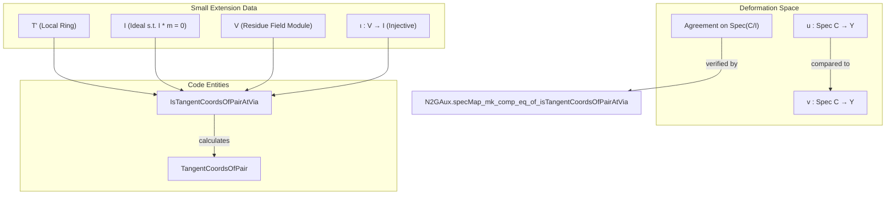
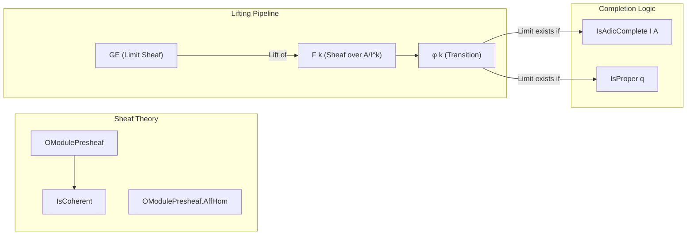

<!-- source: DeepWiki mcp.deepwiki.com · repo anthropics/fermats-last-theorem · page 3.3 Deformation Theory and Small Extensions · fetched 2026-10-26 -->

# Deformation Theory and Small Extensions

Relevant source files

The following files were used as context for generating this wiki page:

- [Definitions/Def_GoodReductionJacobian_RelativeGroupLawKernel.lean](Definitions/Def_GoodReductionJacobian_RelativeGroupLawKernel.lean)
- [Definitions/Def_WeierstrassCurve_ProjModel.lean](Definitions/Def_WeierstrassCurve_ProjModel.lean)
- [P2M/Sol/S_AlgebraicGeometry_DescentCharacter_existsUnique_iso_mapIso_eq_of_hasValue_one.lean](P2M/Sol/S_AlgebraicGeometry_DescentCharacter_existsUnique_iso_mapIso_eq_of_hasValue_one.lean)
- [P2M/Sol/S_AlgebraicGeometry_DescentCharacter_exists_isInvertible_iso_comp_eq_of_cocycle.lean](P2M/Sol/S_AlgebraicGeometry_DescentCharacter_exists_isInvertible_iso_comp_eq_of_cocycle.lean)
- [P2M/Sol/S_AlgebraicGeometry_DescentCharacter_hasValue_comp_of_comp_eq.lean](P2M/Sol/S_AlgebraicGeometry_DescentCharacter_hasValue_comp_of_comp_eq.lean)
- [P2M/Sol/S_AlgebraicGeometry_DescentCharacter_hasValue_map_pullback_of_comm_sq.lean](P2M/Sol/S_AlgebraicGeometry_DescentCharacter_hasValue_map_pullback_of_comm_sq.lean)
- [P2M/Sol/S_AlgebraicGeometry_DescentCharacter_hasValue_one_of_isBaseScalar.lean](P2M/Sol/S_AlgebraicGeometry_DescentCharacter_hasValue_one_of_isBaseScalar.lean)
- [P2M/Sol/S_AlgebraicGeometry_DescentCharacter_hasValue_pullback_mapIso_one.lean](P2M/Sol/S_AlgebraicGeometry_DescentCharacter_hasValue_pullback_mapIso_one.lean)
- [P2M/Sol/S_AlgebraicGeometry_DescentCharacter_hasValue_symm_of_mul_eq_one.lean](P2M/Sol/S_AlgebraicGeometry_DescentCharacter_hasValue_symm_of_mul_eq_one.lean)
- [P2M/Sol/S_AlgebraicGeometry_DescentCharacter_hasValue_tensor.lean](P2M/Sol/S_AlgebraicGeometry_DescentCharacter_hasValue_tensor.lean)
- [P2M/Sol/S_AlgebraicGeometry_DescentCharacter_hasValue_trans.lean](P2M/Sol/S_AlgebraicGeometry_DescentCharacter_hasValue_trans.lean)
- [P2M/Sol/S_AlgebraicGeometry_DescentCharacter_hasValue_transport_of_pullback_map_comp_sectionScalar_eq_of_appTop_eq.lean](P2M/Sol/S_AlgebraicGeometry_DescentCharacter_hasValue_transport_of_pullback_map_comp_sectionScalar_eq_of_appTop_eq.lean)
- [P2M/Sol/S_AlgebraicGeometry_DescentCharacter_isBaseScalar_pullback_map.lean](P2M/Sol/S_AlgebraicGeometry_DescentCharacter_isBaseScalar_pullback_map.lean)
- [P2M/Sol/S_AlgebraicGeometry_DescentCharacter_pullback_map_sectionScalar_comp_canonical_unit_and_cocycle.lean](P2M/Sol/S_AlgebraicGeometry_DescentCharacter_pullback_map_sectionScalar_comp_canonical_unit_and_cocycle.lean)
- [P2M/Sol/S_AlgebraicGeometry_OModulePresheaf_d_eq_zero_of_forall_eq_comp_sub_of_chartData.lean](P2M/Sol/S_AlgebraicGeometry_OModulePresheaf_d_eq_zero_of_forall_eq_comp_sub_of_chartData.lean)
- [P2M/Sol/S_AlgebraicGeometry_OModulePresheaf_existsUnique_affHom_comp_eq_of_isAdicComplete_of_isProper.lean](P2M/Sol/S_AlgebraicGeometry_OModulePresheaf_existsUnique_affHom_comp_eq_of_isAdicComplete_of_isProper.lean)
- [P2M/Sol/S_AlgebraicGeometry_OModulePresheaf_exists_adicSystem_range_eq_range_of_forall_pow_smul_top_inf_range_le.lean](P2M/Sol/S_AlgebraicGeometry_OModulePresheaf_exists_adicSystem_range_eq_range_of_forall_pow_smul_top_inf_range_le.lean)
- [P2M/Sol/S_AlgebraicGeometry_OModulePresheaf_exists_affHom_apply_eq_smul_comm_iSup_range_eq_top_of_forall_ker_eq_pow_smul_top.lean](P2M/Sol/S_AlgebraicGeometry_OModulePresheaf_exists_affHom_apply_eq_smul_comm_iSup_range_eq_top_of_forall_ker_eq_pow_smul_top.lean)
- [P2M/Sol/S_AlgebraicGeometry_OModulePresheaf_exists_affHom_cechPushforward_comp_eq_of_forall_ker_eq_pow_smul_top_of_isProper.lean](P2M/Sol/S_AlgebraicGeometry_OModulePresheaf_exists_affHom_cechPushforward_comp_eq_of_forall_ker_eq_pow_smul_top_of_isProper.lean)
- [P2M/Sol/S_AlgebraicGeometry_OModulePresheaf_exists_app_strip_eq_sum_of_box_zigzag_of_d_comap_slice_eq.lean](P2M/Sol/S_AlgebraicGeometry_OModulePresheaf_exists_app_strip_eq_sum_of_box_zigzag_of_d_comap_slice_eq.lean)
- [P2M/Sol/S_AlgebraicGeometry_OModulePresheaf_exists_basisData_of_chartData_of_cocycle_of_comp_eq.lean](P2M/Sol/S_AlgebraicGeometry_OModulePresheaf_exists_basisData_of_chartData_of_cocycle_of_comp_eq.lean)
- [P2M/Sol/S_AlgebraicGeometry_OModulePresheaf_exists_basisData_of_chartData_of_isProper_of_isAdicComplete.lean](P2M/Sol/S_AlgebraicGeometry_OModulePresheaf_exists_basisData_of_chartData_of_isProper_of_isAdicComplete.lean)
- [P2M/Sol/S_AlgebraicGeometry_OModulePresheaf_exists_basisData_range_eq_ker_comp_eq_of_surjective_of_range_eq_ker_of_isProper_of_isAdicComplete.lean](P2M/Sol/S_AlgebraicGeometry_OModulePresheaf_exists_basisData_range_eq_ker_comp_eq_of_surjective_of_range_eq_ker_of_isProper_of_isAdicComplete.lean)
- [P2M/Sol/S_AlgebraicGeometry_OModulePresheaf_exists_chartData_of_surjective_of_range_eq_ker_of_isProper_of_isAdicComplete.lean](P2M/Sol/S_AlgebraicGeometry_OModulePresheaf_exists_chartData_of_surjective_of_range_eq_ker_of_isProper_of_isAdicComplete.lean)
- [P2M/Sol/S_AlgebraicGeometry_OModulePresheaf_exists_chartModel_extPushout_of_surjective.lean](P2M/Sol/S_AlgebraicGeometry_OModulePresheaf_exists_chartModel_extPushout_of_surjective.lean)
- [P2M/Sol/S_AlgebraicGeometry_OModulePresheaf_exists_chartModels_extPushout_of_forall_res_symm_mk_eq.lean](P2M/Sol/S_AlgebraicGeometry_OModulePresheaf_exists_chartModels_extPushout_of_forall_res_symm_mk_eq.lean)
- [P2M/Sol/S_AlgebraicGeometry_OModulePresheaf_exists_cochain_internalHom_forall_eq_comp_sub_of_chartData.lean](P2M/Sol/S_AlgebraicGeometry_OModulePresheaf_exists_cochain_internalHom_forall_eq_comp_sub_of_chartData.lean)
- [P2M/Sol/S_AlgebraicGeometry_OModulePresheaf_exists_cocycle_comp_eq_of_chartData_of_components.lean](P2M/Sol/S_AlgebraicGeometry_OModulePresheaf_exists_cocycle_comp_eq_of_chartData_of_components.lean)
- [P2M/Sol/S_AlgebraicGeometry_OModulePresheaf_exists_cocycle_comp_eq_of_chartData_of_internalHom_cocycle.lean](P2M/Sol/S_AlgebraicGeometry_OModulePresheaf_exists_cocycle_comp_eq_of_chartData_of_internalHom_cocycle.lean)
- [P2M/Sol/S_AlgebraicGeometry_OModulePresheaf_exists_cocycle_comp_eq_of_chartData_of_isProper_of_isAdicComplete.lean](P2M/Sol/S_AlgebraicGeometry_OModulePresheaf_exists_cocycle_comp_eq_of_chartData_of_isProper_of_isAdicComplete.lean)
- [P2M/Sol/S_AlgebraicGeometry_OModulePresheaf_exists_coimage_adicSystem_of_forall_ker_le_range_sup_pow_smul_top.lean](P2M/Sol/S_AlgebraicGeometry_OModulePresheaf_exists_coimage_adicSystem_of_forall_ker_le_range_sup_pow_smul_top.lean)
- [P2M/Sol/S_AlgebraicGeometry_OModulePresheaf_exists_cokernel_adicSystem_of_affHom_of_forall_ker_eq_pow_smul_top.lean](P2M/Sol/S_AlgebraicGeometry_OModulePresheaf_exists_cokernel_adicSystem_of_affHom_of_forall_ker_eq_pow_smul_top.lean)
- [P2M/Sol/S_AlgebraicGeometry_OModulePresheaf_exists_d_eq_of_d_comap_slice_eq_of_bijective_algebraMap.lean](P2M/Sol/S_AlgebraicGeometry_OModulePresheaf_exists_d_eq_of_d_comap_slice_eq_of_bijective_algebraMap.lean)
- [P2M/Sol/S_AlgebraicGeometry_OModulePresheaf_exists_forall_affineOpens_thread_smul_of_forall_exists_forall_le_of_isProper.lean](P2M/Sol/S_AlgebraicGeometry_OModulePresheaf_exists_forall_affineOpens_thread_smul_of_forall_exists_forall_le_of_isProper.lean)
- [P2M/Sol/S_AlgebraicGeometry_OModulePresheaf_exists_forall_eq_thread_and_eq_zero_of_forall_eq_zero_of_isAdicComplete_of_isProper.lean](P2M/Sol/S_AlgebraicGeometry_OModulePresheaf_exists_forall_eq_thread_and_eq_zero_of_forall_eq_zero_of_isAdicComplete_of_isProper.lean)
- [P2M/Sol/S_AlgebraicGeometry_OModulePresheaf_exists_forall_range_eq_ker_of_forall_ker_eq_pow_smul_top.lean](P2M/Sol/S_AlgebraicGeometry_OModulePresheaf_exists_forall_range_eq_ker_of_forall_ker_eq_pow_smul_top.lean)
- [P2M/Sol/S_AlgebraicGeometry_OModulePresheaf_exists_forall_smul_mem_range_of_cechPushforward_of_isIso_pullback_snd_of_isProper.lean](P2M/Sol/S_AlgebraicGeometry_OModulePresheaf_exists_forall_smul_mem_range_of_cechPushforward_of_isIso_pullback_snd_of_isProper.lean)
- [P2M/Sol/S_AlgebraicGeometry_OModulePresheaf_exists_forall_smul_mem_range_of_forall_thread_of_cechPushforward.lean](P2M/Sol/S_AlgebraicGeometry_OModulePresheaf_exists_forall_smul_mem_range_of_forall_thread_of_cechPushforward.lean)
- [P2M/Sol/S_AlgebraicGeometry_OModulePresheaf_exists_forall_thread_smul_eq_apply_and_smul_eq_zero_of_isIso_pullback_snd_of_isProper.lean](P2M/Sol/S_AlgebraicGeometry_OModulePresheaf_exists_forall_thread_smul_eq_apply_and_smul_eq_zero_of_isIso_pullback_snd_of_isProper.lean)
- [P2M/Sol/S_AlgebraicGeometry_OModulePresheaf_exists_internalHom_cochain_lam_comp_eval_comp_eq_sub_of_chartData.lean](P2M/Sol/S_AlgebraicGeometry_OModulePresheaf_exists_internalHom_cochain_lam_comp_eval_comp_eq_sub_of_chartData.lean)
- [P2M/Sol/S_AlgebraicGeometry_OModulePresheaf_exists_internalHom_cochain_lam_comp_eval_comp_eq_sub_of_chartData_of_cocycle.lean](P2M/Sol/S_AlgebraicGeometry_OModulePresheaf_exists_internalHom_cochain_lam_comp_eval_comp_eq_sub_of_chartData_of_cocycle.lean)
- [P2M/Sol/S_AlgebraicGeometry_OModulePresheaf_exists_isCoherent_forall_ker_eq_pow_smul_top_of_extension_of_comp_eq.lean](P2M/Sol/S_AlgebraicGeometry_OModulePresheaf_exists_isCoherent_forall_ker_eq_pow_smul_top_of_extension_of_comp_eq.lean)
- [P2M/Sol/S_AlgebraicGeometry_OModulePresheaf_exists_isCoherent_forall_ker_eq_pow_smul_top_of_isClosedImmersion_proj_of_isAdicComplete.lean](P2M/Sol/S_AlgebraicGeometry_OModulePresheaf_exists_isCoherent_forall_ker_eq_pow_smul_top_of_isClosedImmersion_proj_of_isAdicComplete.lean)
- [P2M/Sol/S_AlgebraicGeometry_OModulePresheaf_exists_isCoherent_forall_ker_eq_pow_smul_top_of_range_eq_ker_of_isProper_of_isAdicComplete.lean](P2M/Sol/S_AlgebraicGeometry_OModulePresheaf_exists_isCoherent_forall_ker_eq_pow_smul_top_of_range_eq_ker_of_isProper_of_isAdicComplete.lean)
- [P2M/Sol/S_AlgebraicGeometry_OModulePresheaf_exists_isPullback_isProper_and_exists_forall_surjective_ker_eq_pow_smul_top_of_forall_ker_eq_pow_smul_top.lean](P2M/Sol/S_AlgebraicGeometry_OModulePresheaf_exists_isPullback_isProper_and_exists_forall_surjective_ker_eq_pow_smul_top_of_forall_ker_eq_pow_smul_top.lean)
- [P2M/Sol/S_AlgebraicGeometry_OModulePresheaf_exists_kernel_cokernel_adicSystem_of_affHom_of_forall_ker_eq_pow_smul_top.lean](P2M/Sol/S_AlgebraicGeometry_OModulePresheaf_exists_kernel_cokernel_adicSystem_of_affHom_of_forall_ker_eq_pow_smul_top.lean)
- [P2M/Sol/S_AlgebraicGeometry_OModulePresheaf_exists_pow_smul_eq_zero_and_exists_eq_pow_smul_of_forall_isAffineOpen_basicOpen.lean](P2M/Sol/S_AlgebraicGeometry_OModulePresheaf_exists_pow_smul_eq_zero_and_exists_eq_pow_smul_of_forall_isAffineOpen_basicOpen.lean)
- [P2M/Sol/S_AlgebraicGeometry_OModulePresheaf_exists_pow_smul_eq_zero_and_exists_eq_pow_smul_of_mem_vanishingIdeal_of_isIso_pullback_snd.lean](P2M/Sol/S_AlgebraicGeometry_OModulePresheaf_exists_pow_smul_eq_zero_and_exists_eq_pow_smul_of_mem_vanishingIdeal_of_isIso_pullback_snd.lean)
- [P2M/Sol/S_AlgebraicGeometry_OModulePresheaf_exists_res_eq_sum_of_box_zigzag_of_exists_strip_eq_sum.lean](P2M/Sol/S_AlgebraicGeometry_OModulePresheaf_exists_res_eq_sum_of_box_zigzag_of_exists_strip_eq_sum.lean)
- [P2M/Sol/S_AlgebraicGeometry_OModulePresheaf_exists_res_eq_sum_of_d_comap_slice_eq_of_isAffineOpen.lean](P2M/Sol/S_AlgebraicGeometry_OModulePresheaf_exists_res_eq_sum_of_d_comap_slice_eq_of_isAffineOpen.lean)
- [P2M/Sol/S_AlgebraicGeometry_OModulePresheaf_exists_strip_res_sub_eq_sum_of_box_zigzag_of_le.lean](P2M/Sol/S_AlgebraicGeometry_OModulePresheaf_exists_strip_res_sub_eq_sum_of_box_zigzag_of_le.lean)
- [P2M/Sol/S_AlgebraicGeometry_OModulePresheaf_exists_subsystem_ker_le_range_sup_pow_smul_top_of_affHom_of_forall_ker_eq_pow_smul_top.lean](P2M/Sol/S_AlgebraicGeometry_OModulePresheaf_exists_subsystem_ker_le_range_sup_pow_smul_top_of_affHom_of_forall_ker_eq_pow_smul_top.lean)
- [P2M/Sol/S_AlgebraicGeometry_OModulePresheaf_forall_of_forall_idealAnnihilates.lean](P2M/Sol/S_AlgebraicGeometry_OModulePresheaf_forall_of_forall_idealAnnihilates.lean)
- [P2M/Sol/S_AlgebraicGeometry_OModulePresheaf_forall_smul_eq_zero_and_exists_eq_smul_of_le_of_flat_of_bijective.lean](P2M/Sol/S_AlgebraicGeometry_OModulePresheaf_forall_smul_eq_zero_and_exists_eq_smul_of_le_of_flat_of_bijective.lean)
- [P2M/Sol/S_AlgebraicGeometry_OModulePresheaf_isAffineOpen_basicOpen_and_exists_pow_smul_eq_zero_and_exists_eq_pow_smul_of_mem_vanishingIdeal.lean](P2M/Sol/S_AlgebraicGeometry_OModulePresheaf_isAffineOpen_basicOpen_and_exists_pow_smul_eq_zero_and_exists_eq_pow_smul_of_mem_vanishingIdeal.lean)
- [P2M/Sol/S_AlgebraicGeometry_OModulePresheaf_mem_pow_smul_sup_range_d_of_forall_eq_comp_sub_of_chartData.lean](P2M/Sol/S_AlgebraicGeometry_OModulePresheaf_mem_pow_smul_sup_range_d_of_forall_eq_comp_sub_of_chartData.lean)
- [P2M/Sol/S_AlgebraicGeometry_Polarisation_exists_rigidifiedLineBundle_pullback_schemeNsmul_two_trivial_hasValue_translate.lean](P2M/Sol/S_AlgebraicGeometry_Polarisation_exists_rigidifiedLineBundle_pullback_schemeNsmul_two_trivial_hasValue_translate.lean)
- [P2M/Sol/S_AlgebraicGeometry_Polarisation_locIsoOnBase_negMor_and_locIsoOnBase_tensor_self_of_nonempty_pullback_schemeNsmul_two_iso_unit.lean](P2M/Sol/S_AlgebraicGeometry_Polarisation_locIsoOnBase_negMor_and_locIsoOnBase_tensor_self_of_nonempty_pullback_schemeNsmul_two_iso_unit.lean)
- [P2M/Sol/S_AlgebraicGeometry_PolarisedAbelianScheme_one_comp_eq_specMap_comp_one_of_mul.lean](P2M/Sol/S_AlgebraicGeometry_PolarisedAbelianScheme_one_comp_eq_specMap_comp_one_of_mul.lean)
- [P2M/Sol/S_AlgebraicGeometry_RiemannForm_exists_cocycle_oneProdTranslation_of_rigidified_of_forall_torsion_nonempty_iso.lean](P2M/Sol/S_AlgebraicGeometry_RiemannForm_exists_cocycle_oneProdTranslation_of_rigidified_of_forall_torsion_nonempty_iso.lean)
- [P2M/Sol/S_AlgebraicGeometry_RiemannForm_isLevelPairingValue_mul_of_isLevelPairingValue_nsmul.lean](P2M/Sol/S_AlgebraicGeometry_RiemannForm_isLevelPairingValue_mul_of_isLevelPairingValue_nsmul.lean)
- [P2M/Sol/S_AlgebraicGeometry_RiemannForm_thetaGroup_isLevelPairingValue_of_isScalarElt_commutatorElement_levelLift.lean](P2M/Sol/S_AlgebraicGeometry_RiemannForm_thetaGroup_isLevelPairingValue_of_isScalarElt_commutatorElement_levelLift.lean)
- [P2M/Sol/S_AlgebraicGeometry_Scheme_Modules_CechTrivialisation_comap_transition.lean](P2M/Sol/S_AlgebraicGeometry_Scheme_Modules_CechTrivialisation_comap_transition.lean)
- [P2M/Sol/S_AlgebraicGeometry_Scheme_Modules_CechTrivialisation_exists_refinement_transition_eq.lean](P2M/Sol/S_AlgebraicGeometry_Scheme_Modules_CechTrivialisation_exists_refinement_transition_eq.lean)
- [P2M/Sol/S_AlgebraicGeometry_Scheme_Modules_CechTrivialisation_isUnit_transition_and_transition_face_mul_eq.lean](P2M/Sol/S_AlgebraicGeometry_Scheme_Modules_CechTrivialisation_isUnit_transition_and_transition_face_mul_eq.lean)
- [P2M/Sol/S_AlgebraicGeometry_Scheme_Modules_IsInvertible_exists_pullback_iso_cocycle_of_charts_of_rigidified_of_surjective_appTop.lean](P2M/Sol/S_AlgebraicGeometry_Scheme_Modules_IsInvertible_exists_pullback_iso_cocycle_of_charts_of_rigidified_of_surjective_appTop.lean)
- [P2M/Sol/S_AlgebraicGeometry_Scheme_Modules_cocycle_of_forall_mapIso_eq_of_split.lean](P2M/Sol/S_AlgebraicGeometry_Scheme_Modules_cocycle_of_forall_mapIso_eq_of_split.lean)
- [P2M/Sol/S_AlgebraicGeometry_Scheme_Modules_exists_forall_pullback_iso_of_cocycle.lean](P2M/Sol/S_AlgebraicGeometry_Scheme_Modules_exists_forall_pullback_iso_of_cocycle.lean)
- [P2M/Sol/S_AlgebraicGeometry_Scheme_Modules_exists_iso_pullback_forall_mapIso_eq_of_free_of_split.lean](P2M/Sol/S_AlgebraicGeometry_Scheme_Modules_exists_iso_pullback_forall_mapIso_eq_of_free_of_split.lean)
- [P2M/Sol/S_AlgebraicGeometry_Scheme_Modules_forall_pullback_cocycle_of_cocycle_pullback_snd_fst.lean](P2M/Sol/S_AlgebraicGeometry_Scheme_Modules_forall_pullback_cocycle_of_cocycle_pullback_snd_fst.lean)
- [P2M/Sol/S_AlgebraicGeometry_Scheme_Modules_pullback_mapIso_pullbackComp_app_trans_eq.lean](P2M/Sol/S_AlgebraicGeometry_Scheme_Modules_pullback_mapIso_pullbackComp_app_trans_eq.lean)
- [P2M/Sol/S_AlgebraicGeometry_Scheme_Modules_pullback_map_conj_eq_trivialization_of_pullback_map_eq_trivialization.lean](P2M/Sol/S_AlgebraicGeometry_Scheme_Modules_pullback_map_conj_eq_trivialization_of_pullback_map_eq_trivialization.lean)
- [P2M/Sol/S_AlgebraicGeometry_Scheme_Modules_pullback_map_conj_eq_trivialization_pair_of_pullback_map_eq.lean](P2M/Sol/S_AlgebraicGeometry_Scheme_Modules_pullback_map_conj_eq_trivialization_pair_of_pullback_map_eq.lean)
- [P2M/Sol/S_AlgebraicGeometry_Scheme_Modules_unitAutSection_comap_refinement_eq_appLE.lean](P2M/Sol/S_AlgebraicGeometry_Scheme_Modules_unitAutSection_comap_refinement_eq_appLE.lean)
- [P2M/Sol/S_AlgebraicGeometry_Scheme_Modules_unitAutSection_trans_and_unitAutSection_refl.lean](P2M/Sol/S_AlgebraicGeometry_Scheme_Modules_unitAutSection_trans_and_unitAutSection_refl.lean)
- [P2M/Sol/S_AlgebraicGeometry_Scheme_OrderedAffineCover_exists_comp_eq_of_forall_idx_agree.lean](P2M/Sol/S_AlgebraicGeometry_Scheme_OrderedAffineCover_exists_comp_eq_of_forall_idx_agree.lean)
- [P2M/Sol/S_AlgebraicGeometry_Scheme_OrderedAffineCover_exists_isPullback_opens_local_lift.lean](P2M/Sol/S_AlgebraicGeometry_Scheme_OrderedAffineCover_exists_isPullback_opens_local_lift.lean)
- [P2M/Sol/S_AlgebraicGeometry_Scheme_OrderedAffineCover_exists_opens_local_lifts_preimage_eq.lean](P2M/Sol/S_AlgebraicGeometry_Scheme_OrderedAffineCover_exists_opens_local_lifts_preimage_eq.lean)
- [P2M/Sol/S_AlgebraicGeometry_Scheme_OrderedAffineCover_preimage_opens_local_lift_eq_of_iso_comp_eq.lean](P2M/Sol/S_AlgebraicGeometry_Scheme_OrderedAffineCover_preimage_opens_local_lift_eq_of_iso_comp_eq.lean)
- [P2M/Sol/S_AlgebraicGeometry_SmallExtension_d_two_cochain_eq_zero_of_isTangentCoordsOfPairAtVia_pin.lean](P2M/Sol/S_AlgebraicGeometry_SmallExtension_d_two_cochain_eq_zero_of_isTangentCoordsOfPairAtVia_pin.lean)
- [P2M/Sol/S_AlgebraicGeometry_SmallExtension_exists_d_eq_unitPullback_obstruction_two_cocycle_sub_of_local_lifts_hom.lean](P2M/Sol/S_AlgebraicGeometry_SmallExtension_exists_d_eq_unitPullback_obstruction_two_cocycle_sub_of_local_lifts_hom.lean)
- [P2M/Sol/S_AlgebraicGeometry_SmallExtension_exists_isPicDeformationCocycle_of_cechTrivialisation.lean](P2M/Sol/S_AlgebraicGeometry_SmallExtension_exists_isPicDeformationCocycle_of_cechTrivialisation.lean)
- [P2M/Sol/S_AlgebraicGeometry_SmallExtension_exists_isPicDeformationCocycle_tensor_add.lean](P2M/Sol/S_AlgebraicGeometry_SmallExtension_exists_isPicDeformationCocycle_tensor_add.lean)
- [P2M/Sol/S_AlgebraicGeometry_SmallExtension_exists_one_cochain_isTangentCoordsOfPairAtVia_pin_of_local_lifts_hom.lean](P2M/Sol/S_AlgebraicGeometry_SmallExtension_exists_one_cochain_isTangentCoordsOfPairAtVia_pin_of_local_lifts_hom.lean)
- [P2M/Sol/S_AlgebraicGeometry_SmallExtension_exists_overlap_isos_cocycle_of_pointDerivations_two_coboundary.lean](P2M/Sol/S_AlgebraicGeometry_SmallExtension_exists_overlap_isos_cocycle_of_pointDerivations_two_coboundary.lean)
- [P2M/Sol/S_AlgebraicGeometry_SmallExtension_isTangentCoordsOfPairAtVia_defect_eq_sign_smul_of_pin.lean](P2M/Sol/S_AlgebraicGeometry_SmallExtension_isTangentCoordsOfPairAtVia_defect_eq_sign_smul_of_pin.lean)
- [P2M/Sol/S_AlgebraicGeometry_SmallExtension_naturality_pair_comp_eq_and_quotient_comp_eq_of_local_lifts_hom.lean](P2M/Sol/S_AlgebraicGeometry_SmallExtension_naturality_pair_comp_eq_and_quotient_comp_eq_of_local_lifts_hom.lean)
- [P2M/Sol/S_AlgebraicGeometry_SmallExtension_unitPullback_obstruction_two_cocycle_sub_eq_d_of_one_cochain_pin.lean](P2M/Sol/S_AlgebraicGeometry_SmallExtension_unitPullback_obstruction_two_cocycle_sub_eq_d_of_one_cochain_pin.lean)
- [P2M/Sol/S_AlgebraicGeometry_Smooth_exists_affine_smooth_local_lift_opens_pullback.lean](P2M/Sol/S_AlgebraicGeometry_Smooth_exists_affine_smooth_local_lift_opens_pullback.lean)
- [P2M/Sol/S_AlgebraicGeometry_Smooth_exists_overlap_isos_local_lifts.lean](P2M/Sol/S_AlgebraicGeometry_Smooth_exists_overlap_isos_local_lifts.lean)
- [P2M/Sol/S_AlgebraicGeometry_Smooth_exists_section_comp_eq_of_isPullback_of_isNilpotent_ker.lean](P2M/Sol/S_AlgebraicGeometry_Smooth_exists_section_comp_eq_of_isPullback_of_isNilpotent_ker.lean)
- [P2M/Sol/S_AlgebraicGeometry_exists_isPullback_homOfLE_morphismRestrict_comp_openCover_lift.lean](P2M/Sol/S_AlgebraicGeometry_exists_isPullback_homOfLE_morphismRestrict_comp_openCover_lift.lean)
- [P2M/Sol/S_AlgebraicGeometry_exists_iso_comp_isoSpec_hom_eq_of_algEquiv_of_sub_mem.lean](P2M/Sol/S_AlgebraicGeometry_exists_iso_comp_isoSpec_hom_eq_of_algEquiv_of_sub_mem.lean)
- [P2M/Sol/S_AlgebraicGeometry_exists_iso_isoSpec_inv_comp_eq_of_specMap_comp_eq.lean](P2M/Sol/S_AlgebraicGeometry_exists_iso_isoSpec_inv_comp_eq_of_specMap_comp_eq.lean)
- [P2M/Sol/S_CerednikDrinfeld_QM_FakeEllipticCurve_IsFormalModuleOf_map_of_isPullback.lean](P2M/Sol/S_CerednikDrinfeld_QM_FakeEllipticCurve_IsFormalModuleOf_map_of_isPullback.lean)
- [P2M/Sol/S_CerednikDrinfeld_QM_FakeEllipticCurve_exists_act_of_forall_exists_comp_eq_comp_of_bareDeformation_of_isArtinianRing.lean](P2M/Sol/S_CerednikDrinfeld_QM_FakeEllipticCurve_exists_act_of_forall_exists_comp_eq_comp_of_bareDeformation_of_isArtinianRing.lean)
- [P2M/Sol/S_GoodReductionJacobian_AbelianSchemePropertyBundle_exists_d_eq_unitPullback_mul_sub_fst_sub_snd_obstruction_two_cocycle.lean](P2M/Sol/S_GoodReductionJacobian_AbelianSchemePropertyBundle_exists_d_eq_unitPullback_mul_sub_fst_sub_snd_obstruction_two_cocycle.lean)
- [P2M/Sol/S_GoodReductionJacobian_AbelianSchemePropertyBundle_exists_isPullback_forall_comp_act_eq_of_separabilityElement_of_ker_mul_maximalIdeal_eq_bot_of_isAlgClosed.lean](P2M/Sol/S_GoodReductionJacobian_AbelianSchemePropertyBundle_exists_isPullback_forall_comp_act_eq_of_separabilityElement_of_ker_mul_maximalIdeal_eq_bot_of_isAlgClosed.lean)
- [P2M/Sol/S_GoodReductionJacobian_AbelianSchemePropertyBundle_exists_orderedAffineCover_card_eq.lean](P2M/Sol/S_GoodReductionJacobian_AbelianSchemePropertyBundle_exists_orderedAffineCover_card_eq.lean)
- [P2M/Sol/S_GoodReductionJacobian_AbelianSchemePropertyBundle_exists_pointDerivations_d_eq_obstruction_two_cocycle.lean](P2M/Sol/S_GoodReductionJacobian_AbelianSchemePropertyBundle_exists_pointDerivations_d_eq_obstruction_two_cocycle.lean)
- [P2M/Sol/S_GoodReductionJacobian_AbelianSchemePropertyBundle_exists_smooth_isPullback_of_ker_mul_maximalIdeal_eq_bot_of_le_cechFinrank.lean](P2M/Sol/S_GoodReductionJacobian_AbelianSchemePropertyBundle_exists_smooth_isPullback_of_ker_mul_maximalIdeal_eq_bot_of_le_cechFinrank.lean)
- [P2M/Sol/S_GoodReductionJacobian_BareDeformation_base_eq_of_morphismRestrict_comp_eq.lean](P2M/Sol/S_GoodReductionJacobian_BareDeformation_base_eq_of_morphismRestrict_comp_eq.lean)
- [P2M/Sol/S_GoodReductionJacobian_BareDeformation_d_twisted_hom_obstruction_cochain_eq_zero_of_isRegluingBy_bare.lean](P2M/Sol/S_GoodReductionJacobian_BareDeformation_d_twisted_hom_obstruction_cochain_eq_zero_of_isRegluingBy_bare.lean)
- [P2M/Sol/S_GoodReductionJacobian_BareDeformation_exists_algHom_isTangentCoordsOfPairAt_regluing_of_local_lift_factor_bare.lean](P2M/Sol/S_GoodReductionJacobian_BareDeformation_exists_algHom_isTangentCoordsOfPairAt_regluing_of_local_lift_factor_bare.lean)
- [P2M/Sol/S_GoodReductionJacobian_BareDeformation_exists_chartIso_comp_eq_of_isRegluingBy_of_exists_d_eq_sub.lean](P2M/Sol/S_GoodReductionJacobian_BareDeformation_exists_chartIso_comp_eq_of_isRegluingBy_of_exists_d_eq_sub.lean)
- [P2M/Sol/S_GoodReductionJacobian_BareDeformation_exists_chart_lift_comp_eq_of_isRegluingBy_bare.lean](P2M/Sol/S_GoodReductionJacobian_BareDeformation_exists_chart_lift_comp_eq_of_isRegluingBy_bare.lean)
- [P2M/Sol/S_GoodReductionJacobian_BareDeformation_exists_comp_eq_comp_iff_add_map_tmul_sub_eq_zero_of_isRegluingBy_of_local_lifts_bare.lean](P2M/Sol/S_GoodReductionJacobian_BareDeformation_exists_comp_eq_comp_iff_add_map_tmul_sub_eq_zero_of_isRegluingBy_of_local_lifts_bare.lean)
- [P2M/Sol/S_GoodReductionJacobian_BareDeformation_exists_comp_eq_comp_iff_forall_mem_range_d_of_isRegluingBy_of_twisted_local_lifts_bare.lean](P2M/Sol/S_GoodReductionJacobian_BareDeformation_exists_comp_eq_comp_iff_forall_mem_range_d_of_isRegluingBy_of_twisted_local_lifts_bare.lean)
- [P2M/Sol/S_GoodReductionJacobian_BareDeformation_exists_comp_eq_comp_iff_map_tmul_sub_eq_zero_of_isRegluingBy_of_hom_bare.lean](P2M/Sol/S_GoodReductionJacobian_BareDeformation_exists_comp_eq_comp_iff_map_tmul_sub_eq_zero_of_isRegluingBy_of_hom_bare.lean)
- [P2M/Sol/S_GoodReductionJacobian_BareDeformation_exists_d_eq_sub_of_chartIso_comp_eq_of_isTangentCoordsOfPairAt.lean](P2M/Sol/S_GoodReductionJacobian_BareDeformation_exists_d_eq_sub_of_chartIso_comp_eq_of_isTangentCoordsOfPairAt.lean)
- [P2M/Sol/S_GoodReductionJacobian_BareDeformation_exists_d_eq_sub_of_isIso_of_isTangentCoordsOfPairAt.lean](P2M/Sol/S_GoodReductionJacobian_BareDeformation_exists_d_eq_sub_of_isIso_of_isTangentCoordsOfPairAt.lean)
- [P2M/Sol/S_GoodReductionJacobian_BareDeformation_exists_d_eq_sub_of_isIso_of_isTangentCoordsOfPairAt_bare.lean](P2M/Sol/S_GoodReductionJacobian_BareDeformation_exists_d_eq_sub_of_isIso_of_isTangentCoordsOfPairAt_bare.lean)
- [P2M/Sol/S_GoodReductionJacobian_BareDeformation_exists_d_eq_unitPullback_hom_obstruction_cocycle_comp_sub_map_tmul_sub_baseChange_of_local_lifts_factor_bare.lean](P2M/Sol/S_GoodReductionJacobian_BareDeformation_exists_d_eq_unitPullback_hom_obstruction_cocycle_comp_sub_map_tmul_sub_baseChange_of_local_lifts_factor_bare.lean)
- [P2M/Sol/S_GoodReductionJacobian_BareDeformation_exists_d_eq_unitPullback_hom_obstruction_cocycle_sub_baseChange_of_local_lifts_factor_bare.lean](P2M/Sol/S_GoodReductionJacobian_BareDeformation_exists_d_eq_unitPullback_hom_obstruction_cocycle_sub_baseChange_of_local_lifts_factor_bare.lean)
- [P2M/Sol/S_GoodReductionJacobian_BareDeformation_exists_factor_inf_of_local_lifts_factor_bare.lean](P2M/Sol/S_GoodReductionJacobian_BareDeformation_exists_factor_inf_of_local_lifts_factor_bare.lean)
- [P2M/Sol/S_GoodReductionJacobian_BareDeformation_exists_forall_exists_comp_eq_comp_of_separabilityElement_of_ker_mul_maximalIdeal_eq_bot.lean](P2M/Sol/S_GoodReductionJacobian_BareDeformation_exists_forall_exists_comp_eq_comp_of_separabilityElement_of_ker_mul_maximalIdeal_eq_bot.lean)
- [P2M/Sol/S_GoodReductionJacobian_BareDeformation_exists_isPullback_isFormalCoordinates_map_of_ringHom_comp_eq.lean](P2M/Sol/S_GoodReductionJacobian_BareDeformation_exists_isPullback_isFormalCoordinates_map_of_ringHom_comp_eq.lean)
- [P2M/Sol/S_GoodReductionJacobian_BareDeformation_exists_isRegluingBy_exists_isTangentCoordsOfPairAt_of_bareDeformation_bare.lean](P2M/Sol/S_GoodReductionJacobian_BareDeformation_exists_isRegluingBy_exists_isTangentCoordsOfPairAt_of_bareDeformation_bare.lean)
- [P2M/Sol/S_GoodReductionJacobian_BareDeformation_exists_isRegluingBy_isTangentCoordsOfPairAt.lean](P2M/Sol/S_GoodReductionJacobian_BareDeformation_exists_isRegluingBy_isTangentCoordsOfPairAt.lean)
- [P2M/Sol/S_GoodReductionJacobian_BareDeformation_exists_isRegluingBy_isTangentCoordsOfPairAt_bare.lean](P2M/Sol/S_GoodReductionJacobian_BareDeformation_exists_isRegluingBy_isTangentCoordsOfPairAt_bare.lean)
- [P2M/Sol/S_GoodReductionJacobian_BareDeformation_exists_isRegluingBy_isTangentCoordsOfPairAt_comp_of_isPullback_ringHom_bare.lean](P2M/Sol/S_GoodReductionJacobian_BareDeformation_exists_isRegluingBy_isTangentCoordsOfPairAt_comp_of_isPullback_ringHom_bare.lean)
- [P2M/Sol/S_GoodReductionJacobian_BareDeformation_exists_isRegluingBy_of_bareDeformation_bare.lean](P2M/Sol/S_GoodReductionJacobian_BareDeformation_exists_isRegluingBy_of_bareDeformation_bare.lean)
- [P2M/Sol/S_GoodReductionJacobian_BareDeformation_exists_isTangentCoordsOfPairAt_comp_local_lifts_factor_bare.lean](P2M/Sol/S_GoodReductionJacobian_BareDeformation_exists_isTangentCoordsOfPairAt_comp_local_lifts_factor_bare.lean)
- [P2M/Sol/S_GoodReductionJacobian_BareDeformation_exists_isTangentCoordsOfPairAt_comp_of_isPullback_ringHom_of_comp_eq_of_over_over_bare.lean](P2M/Sol/S_GoodReductionJacobian_BareDeformation_exists_isTangentCoordsOfPairAt_comp_of_isPullback_ringHom_of_comp_eq_of_over_over_bare.lean)
- [P2M/Sol/S_GoodReductionJacobian_BareDeformation_exists_isTangentCoordsOfPairAt_local_lifts_factor_bare.lean](P2M/Sol/S_GoodReductionJacobian_BareDeformation_exists_isTangentCoordsOfPairAt_local_lifts_factor_bare.lean)
- [P2M/Sol/S_GoodReductionJacobian_BareDeformation_exists_isTangentCoordsOfPairAt_local_lifts_untwist_bare.lean](P2M/Sol/S_GoodReductionJacobian_BareDeformation_exists_isTangentCoordsOfPairAt_local_lifts_untwist_bare.lean)
- [P2M/Sol/S_GoodReductionJacobian_BareDeformation_exists_linearMap_pointDerivations_forall_isShiftBy.lean](P2M/Sol/S_GoodReductionJacobian_BareDeformation_exists_linearMap_pointDerivations_forall_isShiftBy.lean)
- [P2M/Sol/S_GoodReductionJacobian_BareDeformation_exists_orderedAffineCover_d_eq_unitPullback_hom_obstruction_cocycle_sub_of_isRegluingBy_bare.lean](P2M/Sol/S_GoodReductionJacobian_BareDeformation_exists_orderedAffineCover_d_eq_unitPullback_hom_obstruction_cocycle_sub_of_isRegluingBy_bare.lean)
- [P2M/Sol/S_GoodReductionJacobian_BareDeformation_exists_orderedAffineCover_local_lifts_factor_bare.lean](P2M/Sol/S_GoodReductionJacobian_BareDeformation_exists_orderedAffineCover_local_lifts_factor_bare.lean)
- [P2M/Sol/S_GoodReductionJacobian_BareDeformation_exists_orderedAffineCover_unit_chart_frame_bare.lean](P2M/Sol/S_GoodReductionJacobian_BareDeformation_exists_orderedAffineCover_unit_chart_frame_bare.lean)
- [P2M/Sol/S_GoodReductionJacobian_BareDeformation_exists_overlap_iso_isTangentCoordsOfPairAt.lean](P2M/Sol/S_GoodReductionJacobian_BareDeformation_exists_overlap_iso_isTangentCoordsOfPairAt.lean)
- [P2M/Sol/S_GoodReductionJacobian_BareDeformation_exists_overlap_iso_isTangentCoordsOfPairAt_bare.lean](P2M/Sol/S_GoodReductionJacobian_BareDeformation_exists_overlap_iso_isTangentCoordsOfPairAt_bare.lean)
- [P2M/Sol/S_GoodReductionJacobian_BareDeformation_exists_pointDerivations_forall_map_hom_obstruction_cocycle_add_sub_eq_zero_of_separabilityElement_bare.lean](P2M/Sol/S_GoodReductionJacobian_BareDeformation_exists_pointDerivations_forall_map_hom_obstruction_cocycle_add_sub_eq_zero_of_separabilityElement_bare.lean)
- [P2M/Sol/S_GoodReductionJacobian_BareDeformation_isIso_of_isRegluingBy_of_exists_d_eq_sub.lean](P2M/Sol/S_GoodReductionJacobian_BareDeformation_isIso_of_isRegluingBy_of_exists_d_eq_sub.lean)
- [P2M/Sol/S_GoodReductionJacobian_BareDeformation_isIso_of_isRegluingBy_of_exists_d_eq_sub_bare.lean](P2M/Sol/S_GoodReductionJacobian_BareDeformation_isIso_of_isRegluingBy_of_exists_d_eq_sub_bare.lean)
- [P2M/Sol/S_GoodReductionJacobian_BareDeformation_isIso_of_isRegluingBy_of_forall_comp_hom_eq.lean](P2M/Sol/S_GoodReductionJacobian_BareDeformation_isIso_of_isRegluingBy_of_forall_comp_hom_eq.lean)
- [P2M/Sol/S_GoodReductionJacobian_BareDeformation_isShiftBy_add_smul_of_isRegluingBy_of_isTangentCoordsOfPairAt_add_smul.lean](P2M/Sol/S_GoodReductionJacobian_BareDeformation_isShiftBy_add_smul_of_isRegluingBy_of_isTangentCoordsOfPairAt_add_smul.lean)
- [P2M/Sol/S_GoodReductionJacobian_BareDeformation_isShiftBy_of_isShiftBy_of_isRegluingBy_of_exists_d_eq_sub.lean](P2M/Sol/S_GoodReductionJacobian_BareDeformation_isShiftBy_of_isShiftBy_of_isRegluingBy_of_exists_d_eq_sub.lean)
- [P2M/Sol/S_GoodReductionJacobian_BareDeformation_isTangentOfPair_specMap_comp_of_isPullback_ringHom_of_comp_eq_bare.lean](P2M/Sol/S_GoodReductionJacobian_BareDeformation_isTangentOfPair_specMap_comp_of_isPullback_ringHom_of_comp_eq_bare.lean)
- [P2M/Sol/S_GoodReductionJacobian_BareDeformation_map_app_app_eq_map_app_of_specMap_comp_eq_of_local_lift_factor_bare.lean](P2M/Sol/S_GoodReductionJacobian_BareDeformation_map_app_app_eq_map_app_of_specMap_comp_eq_of_local_lift_factor_bare.lean)
- [P2M/Sol/S_GoodReductionJacobian_BareDeformation_map_hom_obstruction_cocycle_comp_eq_add_map_tmul_of_local_lifts_bare.lean](P2M/Sol/S_GoodReductionJacobian_BareDeformation_map_hom_obstruction_cocycle_comp_eq_add_map_tmul_of_local_lifts_bare.lean)
- [P2M/Sol/S_GoodReductionJacobian_BareDeformation_map_hom_obstruction_cocycle_eq_add_of_local_lifts_mul_bare.lean](P2M/Sol/S_GoodReductionJacobian_BareDeformation_map_hom_obstruction_cocycle_eq_add_of_local_lifts_mul_bare.lean)
- [P2M/Sol/S_GoodReductionJacobian_RelativeGroupLaw_existsUnique_comp_eq_of_isTorsionPoint_of_torsion_points_equiv.lean](P2M/Sol/S_GoodReductionJacobian_RelativeGroupLaw_existsUnique_comp_eq_of_isTorsionPoint_of_torsion_points_equiv.lean)
- [P2M/Sol/S_GoodReductionJacobian_RelativeGroupLaw_exists_action_isIso_shear_of_existsUnique_isTorsionPoint.lean](P2M/Sol/S_GoodReductionJacobian_RelativeGroupLaw_exists_action_isIso_shear_of_existsUnique_isTorsionPoint.lean)
- [P2M/Sol/S_GoodReductionJacobian_RelativeGroupLaw_exists_action_isIso_shear_of_existsUnique_isTorsionPoint_of_commRing.lean](P2M/Sol/S_GoodReductionJacobian_RelativeGroupLaw_exists_action_isIso_shear_of_existsUnique_isTorsionPoint_of_commRing.lean)
- [P2M/Sol/S_GoodReductionJacobian_RelativeGroupLaw_exists_action_isIso_shear_of_torsion_points_equiv.lean](P2M/Sol/S_GoodReductionJacobian_RelativeGroupLaw_exists_action_isIso_shear_of_torsion_points_equiv.lean)
- [P2M/Sol/S_GoodReductionJacobian_RelativeGroupLaw_exists_algEquiv_forall_coe_equiv_eq_specMap_comp_of_torsion_points_equiv.lean](P2M/Sol/S_GoodReductionJacobian_RelativeGroupLaw_exists_algEquiv_forall_coe_equiv_eq_specMap_comp_of_torsion_points_equiv.lean)
- [P2M/Sol/S_GoodReductionJacobian_RelativeGroupLaw_exists_isFormalCoordinates_baseChange.lean](P2M/Sol/S_GoodReductionJacobian_RelativeGroupLaw_exists_isFormalCoordinates_baseChange.lean)
- [P2M/Sol/S_GoodReductionJacobian_RelativeGroupLaw_exists_isGalois_forall_isTorsionPoint_exists_specMap_comp_eq_and_forall_eq_one.lean](P2M/Sol/S_GoodReductionJacobian_RelativeGroupLaw_exists_isGalois_forall_isTorsionPoint_exists_specMap_comp_eq_and_forall_eq_one.lean)
- [P2M/Sol/S_GoodReductionJacobian_RelativeGroupLaw_exists_isOpenImmersion_preimage_range_eq_connectedComponent_of_isClosedImmersion.lean](P2M/Sol/S_GoodReductionJacobian_RelativeGroupLaw_exists_isOpenImmersion_preimage_range_eq_connectedComponent_of_isClosedImmersion.lean)
- [P2M/Sol/S_GoodReductionJacobian_RelativeGroupLaw_exists_iso_spec_schemeKer_of_forall_equiv_torsionSubset.lean](P2M/Sol/S_GoodReductionJacobian_RelativeGroupLaw_exists_iso_spec_schemeKer_of_forall_equiv_torsionSubset.lean)
- [P2M/Sol/S_GoodReductionJacobian_RelativeGroupLaw_exists_orderedAffineCover_exists_comp_eq_one.lean](P2M/Sol/S_GoodReductionJacobian_RelativeGroupLaw_exists_orderedAffineCover_exists_comp_eq_one.lean)
- [P2M/Sol/S_GoodReductionJacobian_RelativeGroupLaw_exists_pDivisibleGroup_closedImmersion_finitePart_of_henselianLocalRing.lean](P2M/Sol/S_GoodReductionJacobian_RelativeGroupLaw_exists_pDivisibleGroup_closedImmersion_finitePart_of_henselianLocalRing.lean)
- [P2M/Sol/S_GoodReductionJacobian_RelativeGroupLaw_exists_pDivisibleGroup_closedImmersion_isIso_torsion_of_smoothOfRelativeDimension.lean](P2M/Sol/S_GoodReductionJacobian_RelativeGroupLaw_exists_pDivisibleGroup_closedImmersion_isIso_torsion_of_smoothOfRelativeDimension.lean)
- [P2M/Sol/S_GoodReductionJacobian_RelativeGroupLaw_exists_pDivisibleGroup_point_equiv_torsionSubset_of_isFinite_of_flat.lean](P2M/Sol/S_GoodReductionJacobian_RelativeGroupLaw_exists_pDivisibleGroup_point_equiv_torsionSubset_of_isFinite_of_flat.lean)
- [P2M/Sol/S_GoodReductionJacobian_RelativeGroupLaw_exists_product_local_lifts_of_local_lifts.lean](P2M/Sol/S_GoodReductionJacobian_RelativeGroupLaw_exists_product_local_lifts_of_local_lifts.lean)
- [P2M/Sol/S_GoodReductionJacobian_RelativeGroupLaw_isTorsionPoint_fst_schemeKer_and_existsUnique_comp_eq.lean](P2M/Sol/S_GoodReductionJacobian_RelativeGroupLaw_isTorsionPoint_fst_schemeKer_and_existsUnique_comp_eq.lean)
- [P2M/Sol/S_GoodReductionJacobian_RelativeGroupLaw_nsmul_eq_one_of_factor_of_flat_of_genericFibre_iso.lean](P2M/Sol/S_GoodReductionJacobian_RelativeGroupLaw_nsmul_eq_one_of_factor_of_flat_of_genericFibre_iso.lean)
- [P2M/Sol/S_LinearMap_exists_isBaseChange_extQuot_of_flat_of_surjective.lean](P2M/Sol/S_LinearMap_exists_isBaseChange_extQuot_of_flat_of_surjective.lean)
- [P2M/Sol/S_LinearMap_exists_isBaseChange_ker_span_range_eq_top_of_flat.lean](P2M/Sol/S_LinearMap_exists_isBaseChange_ker_span_range_eq_top_of_flat.lean)

This section covers the formal deformation theory of schemes and abelian schemes, specifically focusing on lifting structures across **small extensions** of rings. The codebase implements the infinitesimal machinery required to study the deformation space of Jacobians and their reductions, using Cech cohomology, obstruction theory, and coherent sheaf presheaves.

## Small Extensions and Square-Zero Deformations

A **small extension** is defined by a surjective ring homomorphism $T' \to B$ whose kernel $I$ satisfies $I \cdot \mathfrak{m}_{T'} = 0$, where $\mathfrak{m}_{T'}$ is the maximal ideal of the local ring $T'$. This infinitesimal step is the building block for lifting morphisms and group laws.

The structure `IsTangentCoordsOfPairAtVia` represents the data of a deformation between two morphisms $u, v: \text{Spec}(C) \to Y$ that agree when restricted to the fiber [P2M/Sol/S_AlgebraicGeometry_SmallExtension_unitPullback_obstruction_two_cocycle_sub_eq_d_of_one_cochain_pin.lean:56-58]().

### Key Definitions and Operations
*   **Tangent Coordinates**: `TangentCoordsOfPair` and `TangentCoordsOfPairAt` quantify the difference between two lifts of a morphism.
*   **Square-Zero Deformations**: The type `SquareZeroDeformation` [P2M/Sol/S_GoodReductionJacobian_BareDeformation_exists_overlap_iso_isTangentCoordsOfPairAt.lean:10-10]() handles cases where the kernel $I$ satisfies $I^2 = 0$.
*   **Obstruction Cocycle**: When attempting to glue local lifts, the failure to satisfy the cocycle condition is captured by a 2-cocycle in the Cech complex of the tangent bundle [P2M/Sol/S_GoodReductionJacobian_BareDeformation_exists_orderedAffineCover_d_eq_unitPullback_hom_obstruction_cocycle_sub_of_isRegluingBy_bare.lean:60-64]().

### Data Flow for Morphism Lifting
The following diagram illustrates how local lifts are compared and measured using tangent coordinates.

**Sources:** [P2M/Sol/S_AlgebraicGeometry_SmallExtension_unitPullback_obstruction_two_cocycle_sub_eq_d_of_one_cochain_pin.lean:47-65](), [P2M/Sol/S_GoodReductionJacobian_BareDeformation_exists_d_eq_unitPullback_hom_obstruction_cocycle_sub_baseChange_of_local_lifts_factor_bare.lean:101-107]()

## BareDeformation and Abelian Schemes

The `BareDeformation` structure [P2M/Sol/S_GoodReductionJacobian_BareDeformation_exists_overlap_iso_isTangentCoordsOfPairAt.lean:4-4]() bundles a scheme $A$ over a base $B$ with a relative group law $L$. It is used to represent an infinitesimal lift of an abelian scheme $A_1$ from $B_1$ to $B$.

### Regluing and Obstructions
Lifting a global object often involves choosing local lifts on an `OrderedAffineCover` and regluing them. The predicate `IsRegluingBy` [P2M/Sol/S_GoodReductionJacobian_BareDeformation_exists_orderedAffineCover_d_eq_unitPullback_hom_obstruction_cocycle_sub_of_isRegluingBy_bare.lean:67-67]() describes how one deformation is obtained from another by twisting the gluing isomorphisms $\tau_s$ on overlaps.

*   **Chart Isomorphisms**: The theorem `exists_chartIso_comp_eq_of_isRegluingBy` [P2M/Sol/S_GoodReductionJacobian_BareDeformation_exists_chartIso_comp_eq_of_isRegluingBy_of_exists_d_eq_sub.lean:22-22]() constructs the necessary isomorphisms between affine charts of the deformed schemes.
*   **Cech Coboundary**: If the difference between local lifts is a Cech coboundary ($d=0$), the global deformation exists and is unique [P2M/Sol/S_AlgebraicGeometry_SmallExtension_exists_overlap_isos_cocycle_of_pointDerivations_two_coboundary.lean:28-28]().

**Sources:** [P2M/Sol/S_GoodReductionJacobian_BareDeformation_exists_orderedAffineCover_d_eq_unitPullback_hom_obstruction_cocycle_sub_of_isRegluingBy_bare.lean:41-77](), [P2M/Sol/S_GoodReductionJacobian_BareDeformation_exists_chartIso_comp_eq_of_isRegluingBy_of_exists_d_eq_sub.lean:67-73]()

## OModulePresheaf and Coherent Sheaves

The `OModulePresheaf` machinery provides the categorical framework for handling sheaves of modules over schemes during deformation. This is critical for the Taylor-Wiles patching method and the study of $p$-adic completions.

### Coherence and Quasicoherence
The system tracks coherence (`IsCoherent`) and quasicoherence (`IsQuasicoherent`) across extensions [P2M/Sol/S_AlgebraicGeometry_OModulePresheaf_exists_isCoherent_forall_ker_eq_pow_smul_top_of_extension_of_comp_eq.lean:15-15]().

### Adic Completion of Modules
For a proper morphism $q: P \to \text{Spec}(A)$ and an $I$-adic complete ring $A$, the system proves the existence of coherent sheaves $G$ that lift a sequence of sheaves $F_k$ defined over $A/I^{k+1}$.
*   **Kernel Conditions**: The kernels of transition maps $\phi_k: F_{k+1} \to F_k$ must satisfy $ker(\phi_k) = I^{k+1} \cdot F_{k+1}$ [P2M/Sol/S_AlgebraicGeometry_OModulePresheaf_exists_isCoherent_forall_ker_eq_pow_smul_top_of_extension_of_comp_eq.lean:18-19]().
*   **Properness**: The properness of $q$ is invoked via `IsProper` to ensure the global sections of these sheaves behave well under completion [P2M/Sol/S_AlgebraicGeometry_OModulePresheaf_exists_forall_thread_smul_eq_apply_and_smul_eq_zero_of_isIso_pullback_snd_of_isProper.lean:80-80]().

### Cech Picard Obstruction
For line bundles (invertible sheaves), the deformation is tracked via `CechPicardObstruction` [P2M/Sol/S_AlgebraicGeometry_SmallExtension_exists_isPicDeformationCocycle_of_cechTrivialisation.lean:6-6](). The function `unitAutSection` [P2M/Sol/S_AlgebraicGeometry_SmallExtension_exists_isPicDeformationCocycle_of_cechTrivialisation.lean:39-41]() maps automorphisms of the structure sheaf to sections of the unit group, which are then used to define the 1-cocycle for the Picard group.

**Sources:** [P2M/Sol/S_AlgebraicGeometry_OModulePresheaf_exists_isCoherent_forall_ker_eq_pow_smul_top_of_extension_of_comp_eq.lean:12-55](), [P2M/Sol/S_AlgebraicGeometry_SmallExtension_exists_isPicDeformationCocycle_of_cechTrivialisation.lean:25-30]()

## Picard Functor and Pullbacks

The relative Picard functor and the machinery for pulling back modules are defined in `AlgebraicGeometry.Scheme.Modules`.

### Pseudofunctorial Pullback
The pullback of modules is not strictly functorial but pseudofunctorial. The code uses `pullbackComp` [P2M/Sol/S_AlgebraicGeometry_Scheme_Modules_cocycle_of_forall_mapIso_eq_of_split.lean:27-31]() and `pullbackCongr` [P2M/Sol/S_AlgebraicGeometry_Scheme_Modules_cocycle_of_forall_mapIso_eq_of_split.lean:17-20]() to handle the natural isomorphisms $f^*(g^* M) \cong (g \circ f)^* M$.

### Cech Trivialization
Line bundles are often handled via `CechTrivialisation` [P2M/Sol/S_AlgebraicGeometry_SmallExtension_exists_isPicDeformationCocycle_of_cechTrivialisation.lean:25-25](). The transition functions of these trivializations satisfy the cocycle condition, and the theorem `exists_isPicDeformationCocycle_of_cechTrivialisation` [P2M/Sol/S_AlgebraicGeometry_SmallExtension_exists_isPicDeformationCocycle_of_cechTrivialisation.lean:16-16]() links these to the deformation of the Picard group.

**Sources:** [P2M/Sol/S_AlgebraicGeometry_Scheme_Modules_cocycle_of_forall_mapIso_eq_of_split.lean:54-58](), [P2M/Sol/S_AlgebraicGeometry_SmallExtension_exists_isPicDeformationCocycle_of_cechTrivialisation.lean:58-62](), [P2M/Sol/S_AlgebraicGeometry_Scheme_Modules_pullback_map_conj_eq_trivialization_pair_of_pullback_map_eq.lean:29-32]()

---

