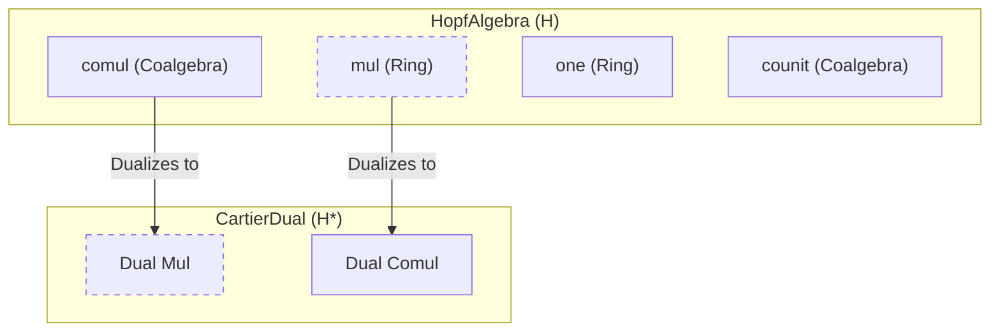
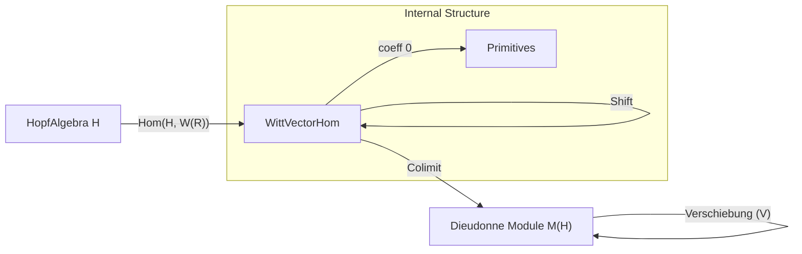

<!-- source: DeepWiki mcp.deepwiki.com · repo anthropics/fermats-last-theorem · page 3.4 Hopf Algebras, p-Divisible Groups, and Dieudonné Modules · fetched 2026-10-26 -->

# Hopf Algebras, p-Divisible Groups, and Dieudonné Modules

Relevant source files

The following files were used as context for generating this wiki page:

- [Definitions/Def_HopfAlgebra_HopfIdealQuotient.lean](Definitions/Def_HopfAlgebra_HopfIdealQuotient.lean)
- [Definitions/Def_PDivisibleGroup_Points.lean](Definitions/Def_PDivisibleGroup_Points.lean)
- [P2M/Sol/S_Deformation_DieudonneModule_exists_finrank_eq_pow_and_natCard_eq_pow_of_isLocalRing_cartierDual.lean](P2M/Sol/S_Deformation_DieudonneModule_exists_finrank_eq_pow_and_natCard_eq_pow_of_isLocalRing_cartierDual.lean)
- [P2M/Sol/S_Deformation_DieudonneModule_exists_finrank_eq_pow_and_natCard_le_pow_of_isLocalRing_cartierDual.lean](P2M/Sol/S_Deformation_DieudonneModule_exists_finrank_eq_pow_and_natCard_le_pow_of_isLocalRing_cartierDual.lean)
- [P2M/Sol/S_Deformation_adjoin_coeff_wittHom_eq_top_of_isLocalRing_cartierDual.lean](P2M/Sol/S_Deformation_adjoin_coeff_wittHom_eq_top_of_isLocalRing_cartierDual.lean)
- [P2M/Sol/S_HopfAlgebra_bijective_of_bijective_baseChange_of_pow_eq_one.lean](P2M/Sol/S_HopfAlgebra_bijective_of_bijective_baseChange_of_pow_eq_one.lean)
- [P2M/Sol/S_HopfAlgebra_exists_finiteFlat_model_bialgHom_surjective_baseChange_of_algEquiv_baseChange.lean](P2M/Sol/S_HopfAlgebra_exists_finiteFlat_model_bialgHom_surjective_baseChange_of_algEquiv_baseChange.lean)
- [P2M/Sol/S_HopfAlgebra_exists_finiteFlat_quotient_of_forall_fixing_smul_mem.lean](P2M/Sol/S_HopfAlgebra_exists_finiteFlat_quotient_of_forall_fixing_smul_mem.lean)
- [P2M/Sol/S_HopfAlgebra_exists_quotientFlag_of_galoisStableChain.lean](P2M/Sol/S_HopfAlgebra_exists_quotientFlag_of_galoisStableChain.lean)
- [P2M/Sol/S_HopfAlgebra_exists_quotientFlag_of_galoisStableChain_of_fixedPoints.lean](P2M/Sol/S_HopfAlgebra_exists_quotientFlag_of_galoisStableChain_of_fixedPoints.lean)
- [P2M/Sol/S_HopfAlgebra_finrank_quotient_span_pow_mul_finrank_cartierDual_quotient_eq.lean](P2M/Sol/S_HopfAlgebra_finrank_quotient_span_pow_mul_finrank_cartierDual_quotient_eq.lean)
- [P2M/Sol/S_HopfAlgebra_finrank_quotient_span_pow_prime_eq_pow_finrank_cotangent.lean](P2M/Sol/S_HopfAlgebra_finrank_quotient_span_pow_prime_eq_pow_finrank_cotangent.lean)
- [P2M/Sol/S_HopfAlgebra_formallyUnramified_of_isIdempotentElem_ker_counit.lean](P2M/Sol/S_HopfAlgebra_formallyUnramified_of_isIdempotentElem_ker_counit.lean)
- [P2M/Sol/S_HopfAlgebra_mem_ker_counit_sq_of_map_mem_sq_of_injective_of_forall_pow_prime_eq_zero.lean](P2M/Sol/S_HopfAlgebra_mem_ker_counit_sq_of_map_mem_sq_of_injective_of_forall_pow_prime_eq_zero.lean)
- [P2M/Sol/S_HopfAlgebra_wittHomMap_surjective_of_surjective_of_forall_convPow_eq_zero.lean](P2M/Sol/S_HopfAlgebra_wittHomMap_surjective_of_surjective_of_forall_convPow_eq_zero.lean)

This section covers the theory of finite flat group schemes, represented via their coordinate rings as Hopf algebras, and their extension to $p$-divisible groups. It details the Cartier duality, the construction of Dieudonné modules via Witt vector hom-sets, and the specific structural results (like the Raynaud normal form) required for the Čerednik-Drinfeld uniformization and level-lowering steps in the proof of Fermat's Last Theorem.

## Hopf Algebras and Finite Flat Group Schemes

In the codebase, finite flat group schemes are handled by studying their coordinate rings $H$ over a base ring $R$. The class `HopfAlgebra` encapsulates the structure of the comultiplication ($\Delta$), counit ($\epsilon$), and antipode ($S$).

### Hopf Ideals and Quotients
A central technique in the codebase is the construction of quotient group schemes. This is implemented via `IsHopfIdeal'`, a property of an ideal $I \subseteq H$ that ensures the Hopf structure descends to the quotient $H/I$.

| Entity | Role | Definition |
| :--- | :--- | :--- |
| `IsHopfIdeal'` | Prop-class defining ideals compatible with $\Delta, \epsilon, S$ | [Definitions/Def_HopfAlgebra_HopfIdealQuotient.lean:79-84]() |
| `HopfIdealQuotient.comul` | The descended comultiplication $\bar{\Delta}: H/I \to H/I \otimes H/I$ | [Definitions/Def_HopfAlgebra_HopfIdealQuotient.lean:100-104]() |
| `HopfIdealQuotient.counit` | The descended counit $\bar{\epsilon}: H/I \to R$ | [Definitions/Def_HopfAlgebra_HopfIdealQuotient.lean:117-118]() |
| `HopfIdealQuotient.antipode` | The descended antipode $\bar{S}: H/I \to H/I$ | [Definitions/Def_HopfAlgebra_HopfIdealQuotient.lean:126-130]() |

The antipode is often treated as an algebra homomorphism `antipodeAlgHom` to facilitate calculations involving the convolution product [P2M/Sol/S_HopfAlgebra_bijective_of_bijective_baseChange_of_pow_eq_one.lean:28-31]().

### Key Structural Theorems
*   **Surjectivity and Bijectivity**: Criteria for morphisms of Hopf algebras to be surjective or bijective, often involving base change and properties of the `hopfKer` [P2M/Sol/S_HopfAlgebra_bijective_of_bijective_baseChange_of_pow_eq_one.lean:18-18]().
*   **Rank and Dimensions**: The relation between the rank of a Hopf algebra and its cotangent space, specifically for $p$-groups where $x^p=0$ for elements in the augmentation ideal [P2M/Sol/S_HopfAlgebra_finrank_quotient_span_pow_prime_eq_pow_finrank_cotangent.lean:124-124]().

**Sources:** [Definitions/Def_HopfAlgebra_HopfIdealQuotient.lean:1-165](), [P2M/Sol/S_HopfAlgebra_bijective_of_bijective_baseChange_of_pow_eq_one.lean:1-53](), [P2M/Sol/S_HopfAlgebra_finrank_quotient_span_pow_prime_eq_pow_finrank_cotangent.lean:1-152]().

## Cartier Duality

Cartier duality relates a finite flat group scheme to its dual. In the codebase, this is represented by `CartierDual`, which transforms a Hopf algebra into its dual coalgebra/algebra structure.

### Code Entity Mapping: Hopf Structure to Dual
The following diagram illustrates how the codebase maps standard Hopf operations to their Cartier duals.

**Sources:** [Definitions/Def_HopfAlgebra_CartierDual.lean](), [P2M/Sol/S_HopfAlgebra_finrank_quotient_span_pow_mul_finrank_cartierDual_quotient_eq.lean:1-11]().

## Dieudonne Modules and Witt Vectors

Dieudonne theory provides a linear-algebraic classification of $p$-divisible groups over a perfect field. The codebase implements this by studying the hom-sets from a Hopf algebra to the ring of Witt vectors $W(R)$.

### Witt Vector Hom-Sets
The class `WittVectorHom` (and its colimit version `WittHomColimit`) represents the elements of the Dieudonne module.

*   **Primitive Elements**: Elements $x$ such that $\Delta(x) = x \otimes 1 + 1 \otimes x$. These correspond to the first coordinate of a Witt vector hom [P2M/Sol/S_Deformation_adjoin_coeff_wittHom_eq_top_of_isLocalRing_cartierDual.lean:10-10]().
*   **Surjectivity of Witt Maps**: The theorem `wittHomMap_surjective_of_surjective_of_forall_convPow_eq_zero` establishes when a map of Hopf algebras induces a surjective map on their associated Dieudonne modules [P2M/Sol/S_HopfAlgebra_wittHomMap_surjective_of_surjective_of_forall_convPow_eq_zero.lean:35-35]().

### Data Flow: From Hopf Algebra to Dieudonne Module

**Sources:** [P2M/Sol/S_Deformation_adjoin_coeff_wittHom_eq_top_of_isLocalRing_cartierDual.lean:1-59](), [P2M/Sol/S_Deformation_DieudonneModule_exists_finrank_eq_pow_and_natCard_eq_pow_of_isLocalRing_cartierDual.lean:1-64](), [P2M/Sol/S_HopfAlgebra_wittHomMap_surjective_of_surjective_of_forall_convPow_eq_zero.lean:1-129]().

## p-Divisible Groups and Raynaud Normal Form

A $p$-divisible group (or Barsotti-Tate group) is an inductive system of finite flat group schemes $G[p^n]$.

### Key Entities
*   **PDivisibleGroup**: Defined as a tower of `HopfAlgebra` instances with specific transition maps.
*   **Raynaud Conservative**: A sub-theory used to handle the "Raynaud normal form" for group schemes of type $(p, \dots, p)$, crucial for calculating the action of inertia in the Frey representation [P2M/Sol/S_HopfAlgebra_bijective_of_bijective_baseChange_of_pow_eq_one.lean:19-20]().

### Galois Stability and Flags
The proof requires the existence of flags of sub-group-schemes that are stable under the Galois action. This is implemented in `S_HopfAlgebra_exists_quotientFlag_of_galoisStableChain`, which proves that a Galois-stable chain of sub-Hopf-algebras allows for a composition series of the group scheme [P2M/Sol/S_HopfAlgebra_exists_quotientFlag_of_galoisStableChain.lean:13-162]().

**Sources:** [P2M/Sol/S_HopfAlgebra_exists_quotientFlag_of_galoisStableChain.lean:1-162](), [P2M/Sol/S_HopfAlgebra_exists_quotientFlag_of_galoisStableChain_of_fixedPoints.lean:1-162](), [P2M/Sol/S_HopfAlgebra_exists_finiteFlat_quotient_of_forall_fixing_smul_mem.lean:79-179]().

## Implementation Details: Convolution Product

The `WithConv` namespace handles the convolution algebra structure on $\text{Hom}_R(H, A)$. This is used to define the antipode as the inverse of the identity map under convolution.

*   `toConv`: Wraps an algebra homomorphism into the convolution monoid [P2M/Sol/S_HopfAlgebra_bijective_of_bijective_baseChange_of_pow_eq_one.lean:22-22]().
*   `convMul_comp_antipodeAlgHom`: Proves that $\text{id} * S = \epsilon$ (the unit in the convolution algebra) [P2M/Sol/S_HopfAlgebra_finrank_quotient_span_pow_mul_finrank_cartierDual_quotient_eq.lean:62-68]().

**Sources:** [P2M/Sol/S_HopfAlgebra_bijective_of_bijective_baseChange_of_pow_eq_one.lean:22-53](), [P2M/Sol/S_HopfAlgebra_finrank_quotient_span_pow_mul_finrank_cartierDual_quotient_eq.lean:31-79]().

---

