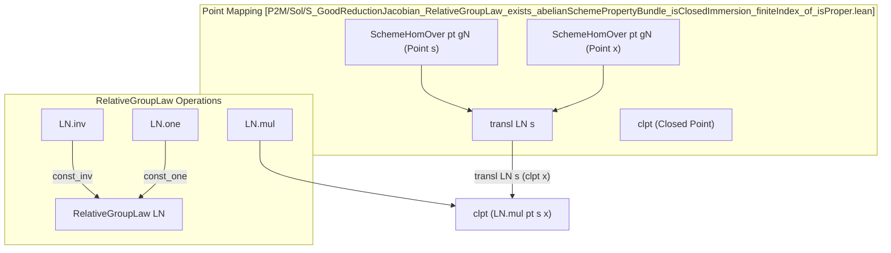
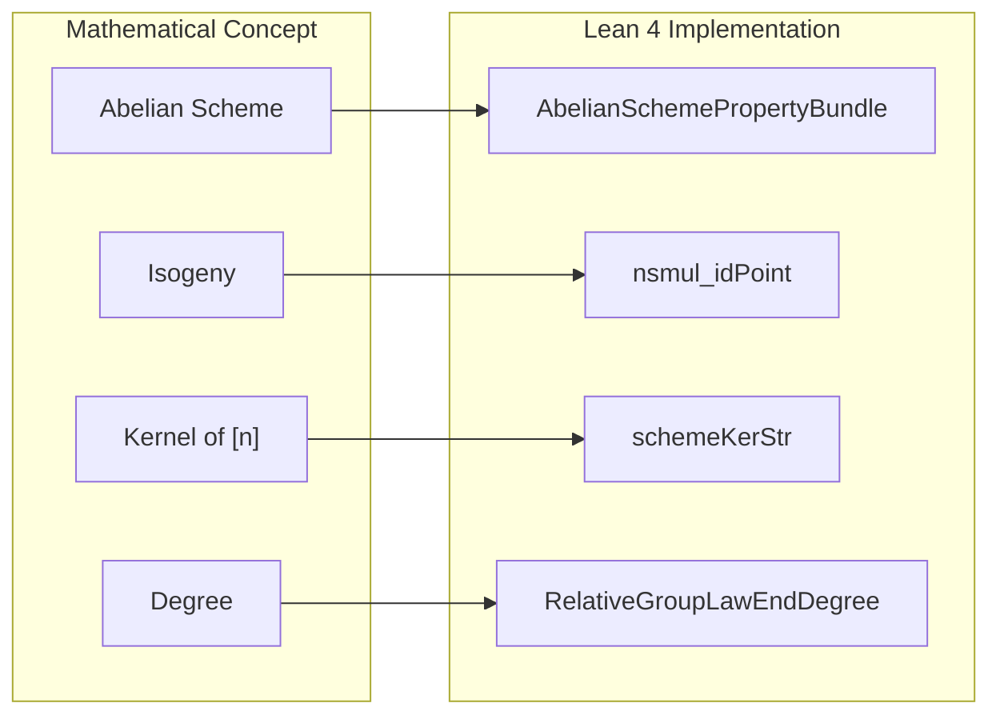

<!-- source: DeepWiki mcp.deepwiki.com · repo anthropics/fermats-last-theorem · page 3.5 Good Reduction Jacobians and RelativeGroupLaw · fetched 2026-10-26 -->

# Good Reduction Jacobians and RelativeGroupLaw

Relevant source files

The following files were used as context for generating this wiki page:

- [Definitions/Def_GoodReductionJacobian_RelativeGroupLawKerPair.lean](Definitions/Def_GoodReductionJacobian_RelativeGroupLawKerPair.lean)
- [P2M/Sol/S_AddCommGroup_natCard_primaryComponent_ker_aeval_of_forall_natCard_ker_aeval_eq_natAbs_resultant.lean](P2M/Sol/S_AddCommGroup_natCard_primaryComponent_ker_aeval_of_forall_natCard_ker_aeval_eq_natAbs_resultant.lean)
- [P2M/Sol/S_AlgebraicCurve_Pic0_eq_map_of_natCard_ker_aeval_eq_abs_resultant_of_natCard_fixedPoints_restrictAlong_eq_of_isAlgebraic.lean](P2M/Sol/S_AlgebraicCurve_Pic0_eq_map_of_natCard_ker_aeval_eq_abs_resultant_of_natCard_fixedPoints_restrictAlong_eq_of_isAlgebraic.lean)
- [P2M/Sol/S_AlgebraicCurve_Pic0_eq_of_natCard_ker_aeval_eq_natAbs_resultant_of_natCard_fixedPoints_restrictAlong_eq_of_isAlgebraic.lean](P2M/Sol/S_AlgebraicCurve_Pic0_eq_of_natCard_ker_aeval_eq_natAbs_resultant_of_natCard_fixedPoints_restrictAlong_eq_of_isAlgebraic.lean)
- [P2M/Sol/S_AlgebraicCurve_Pic0_exists_monic_natCard_fixedPoints_iterate_eq_resultant_of_pushforwardAlong_frobenius.lean](P2M/Sol/S_AlgebraicCurve_Pic0_exists_monic_natCard_fixedPoints_iterate_eq_resultant_of_pushforwardAlong_frobenius.lean)
- [P2M/Sol/S_AlgebraicCurve_Pic0_exists_monic_natCard_ker_aeval_eq_resultant_map_of_pushforwardAlong_frobenius.lean](P2M/Sol/S_AlgebraicCurve_Pic0_exists_monic_natCard_ker_aeval_eq_resultant_map_of_pushforwardAlong_frobenius.lean)
- [P2M/Sol/S_AlgebraicCurve_Pic0_exists_monic_natCard_primaryComponent_ker_aeval_of_pushforwardAlong_frobenius.lean](P2M/Sol/S_AlgebraicCurve_Pic0_exists_monic_natCard_primaryComponent_ker_aeval_of_pushforwardAlong_frobenius.lean)
- [P2M/Sol/S_AlgebraicCurve_Pic0_surjective_aeval_of_finite_ker_of_pushforwardAlong_frobenius.lean](P2M/Sol/S_AlgebraicCurve_Pic0_surjective_aeval_of_finite_ker_of_pushforwardAlong_frobenius.lean)
- [P2M/Sol/S_AlgebraicGeometry_OModulePresheaf_cechFinite_preimage_of_ih.lean](P2M/Sol/S_AlgebraicGeometry_OModulePresheaf_cechFinite_preimage_of_ih.lean)
- [P2M/Sol/S_AlgebraicGeometry_OModulePresheaf_exists_affHom_pushforward_ofModules_adicThickening_surjective_ker_eq_pow_smul_top.lean](P2M/Sol/S_AlgebraicGeometry_OModulePresheaf_exists_affHom_pushforward_ofModules_adicThickening_surjective_ker_eq_pow_smul_top.lean)
- [P2M/Sol/S_AlgebraicGeometry_OModulePresheaf_exists_basicOpen_bijective_smul_res_of_affHom_pushforward_adicThickening_of_le_asIdeal.lean](P2M/Sol/S_AlgebraicGeometry_OModulePresheaf_exists_basicOpen_bijective_smul_res_of_affHom_pushforward_adicThickening_of_le_asIdeal.lean)
- [P2M/Sol/S_AlgebraicGeometry_OModulePresheaf_exists_polynomial_forall_eulerChar_tensor_tensorPow_eq.lean](P2M/Sol/S_AlgebraicGeometry_OModulePresheaf_exists_polynomial_forall_eulerChar_tensor_tensorPow_eq.lean)
- [P2M/Sol/S_AlgebraicGeometry_OModulePresheaf_exists_polynomial_forall_eulerChar_tensor_tensorPow_eq_monoidalV2.lean](P2M/Sol/S_AlgebraicGeometry_OModulePresheaf_exists_polynomial_forall_eulerChar_tensor_tensorPow_eq_monoidalV2.lean)
- [P2M/Sol/S_AlgebraicGeometry_OModulePresheaf_isCoherent_isQuasicoherent_supportedIn_pushforwardUnit.lean](P2M/Sol/S_AlgebraicGeometry_OModulePresheaf_isCoherent_isQuasicoherent_supportedIn_pushforwardUnit.lean)
- [P2M/Sol/S_AlgebraicGeometry_OModulePresheaf_isCoherent_pushforwardUnit_and_exists_affHom_of_forall_isFinite_isPullback.lean](P2M/Sol/S_AlgebraicGeometry_OModulePresheaf_isCoherent_pushforwardUnit_and_exists_affHom_of_forall_isFinite_isPullback.lean)
- [P2M/Sol/S_AlgebraicGeometry_RelPicard_RepresentsRelSubPic_flat_mul_fst_snd.lean](P2M/Sol/S_AlgebraicGeometry_RelPicard_RepresentsRelSubPic_flat_mul_fst_snd.lean)
- [P2M/Sol/S_AlgebraicGeometry_RelPicard_RepresentsRelSubPic_kerPoints_mul_mem_and_comp_mem.lean](P2M/Sol/S_AlgebraicGeometry_RelPicard_RepresentsRelSubPic_kerPoints_mul_mem_and_comp_mem.lean)
- [P2M/Sol/S_AlgebraicGeometry_Scheme_Modules_IsInvertible_bijective_lift_tensorSectionsBilin.lean](P2M/Sol/S_AlgebraicGeometry_Scheme_Modules_IsInvertible_bijective_lift_tensorSectionsBilin.lean)
- [P2M/Sol/S_AlgebraicGeometry_Scheme_Modules_IsInvertible_bijective_lift_tensorSectionsBilin_monoidalV2.lean](P2M/Sol/S_AlgebraicGeometry_Scheme_Modules_IsInvertible_bijective_lift_tensorSectionsBilin_monoidalV2.lean)
- [P2M/Sol/S_AlgebraicGeometry_Scheme_Modules_IsInvertible_zeroSchemeIdeal_tensorHom.lean](P2M/Sol/S_AlgebraicGeometry_Scheme_Modules_IsInvertible_zeroSchemeIdeal_tensorHom.lean)
- [P2M/Sol/S_AlgebraicGeometry_Scheme_Modules_IsInvertible_zeroSchemeIdeal_tensorHom_monoidalV2.lean](P2M/Sol/S_AlgebraicGeometry_Scheme_Modules_IsInvertible_zeroSchemeIdeal_tensorHom_monoidalV2.lean)
- [P2M/Sol/S_AlgebraicGeometry_bijective_appTop_of_isProper_of_flat_of_isAdicComplete.lean](P2M/Sol/S_AlgebraicGeometry_bijective_appTop_of_isProper_of_flat_of_isAdicComplete.lean)
- [P2M/Sol/S_AlgebraicGeometry_exists_appTop_pullback_map_eq_appTop_pullback_fst_of_isProper.lean](P2M/Sol/S_AlgebraicGeometry_exists_appTop_pullback_map_eq_appTop_pullback_fst_of_isProper.lean)
- [P2M/Sol/S_AlgebraicGeometry_finite_appTop_of_isProper_of_isNoetherianRing.lean](P2M/Sol/S_AlgebraicGeometry_finite_appTop_of_isProper_of_isNoetherianRing.lean)
- [P2M/Sol/S_AlgebraicGeometry_formallyUnramified_of_forall_etale_pullback_snd.lean](P2M/Sol/S_AlgebraicGeometry_formallyUnramified_of_forall_etale_pullback_snd.lean)
- [P2M/Sol/S_AlgebraicGeometry_isIso_of_forall_isIso_adicThickening_of_isAdicComplete_of_isClosedImmersion_proj.lean](P2M/Sol/S_AlgebraicGeometry_isIso_of_forall_isIso_adicThickening_of_isAdicComplete_of_isClosedImmersion_proj.lean)
- [P2M/Sol/S_CerednikDrinfeld_QM_FakeEllipticCurve_WithFullLevel_iso_of_comp_hom_eq_of_isPullbackVia_fstHom.lean](P2M/Sol/S_CerednikDrinfeld_QM_FakeEllipticCurve_WithFullLevel_iso_of_comp_hom_eq_of_isPullbackVia_fstHom.lean)
- [P2M/Sol/S_CerednikDrinfeld_QM_FakeEllipticCurve_endDegree_eq_natAbs_sq_of_mapPt_mapPt_mul_zpow_eq_zpow.lean](P2M/Sol/S_CerednikDrinfeld_QM_FakeEllipticCurve_endDegree_eq_natAbs_sq_of_mapPt_mapPt_mul_zpow_eq_zpow.lean)
- [P2M/Sol/S_CerednikDrinfeld_QM_FakeEllipticCurve_endDegree_ne_zero_of_forall_act_comp_eq_of_ne_one.lean](P2M/Sol/S_CerednikDrinfeld_QM_FakeEllipticCurve_endDegree_ne_zero_of_forall_act_comp_eq_of_ne_one.lean)
- [P2M/Sol/S_CerednikDrinfeld_QM_FakeEllipticCurve_exists_forall_mapPt_mapPt_mul_zpow_eq_zpow_of_forall_act_comp_eq.lean](P2M/Sol/S_CerednikDrinfeld_QM_FakeEllipticCurve_exists_forall_mapPt_mapPt_mul_zpow_eq_zpow_of_forall_act_comp_eq.lean)
- [P2M/Sol/S_CerednikDrinfeld_QM_FakeEllipticCurve_exists_inv_act_forall_comp_eq_of_tower_of_forall_isPullback.lean](P2M/Sol/S_CerednikDrinfeld_QM_FakeEllipticCurve_exists_inv_act_forall_comp_eq_of_tower_of_forall_isPullback.lean)
- [P2M/Sol/S_CerednikDrinfeld_QM_FakeEllipticCurve_exists_isPullbackVia_id_of_iso_comp_eq.lean](P2M/Sol/S_CerednikDrinfeld_QM_FakeEllipticCurve_exists_isPullbackVia_id_of_iso_comp_eq.lean)
- [P2M/Sol/S_CerednikDrinfeld_QM_FakeEllipticCurve_exists_mul_forall_coe_mul_comp_eq_lift_comp_of_tower_of_forall_isPullback.lean](P2M/Sol/S_CerednikDrinfeld_QM_FakeEllipticCurve_exists_mul_forall_coe_mul_comp_eq_lift_comp_of_tower_of_forall_isPullback.lean)
- [P2M/Sol/S_CerednikDrinfeld_QM_FakeEllipticCurve_exists_section_forall_coe_one_comp_eq_of_tower_of_forall_isPullback.lean](P2M/Sol/S_CerednikDrinfeld_QM_FakeEllipticCurve_exists_section_forall_coe_one_comp_eq_of_tower_of_forall_isPullback.lean)
- [P2M/Sol/S_CerednikDrinfeld_QM_FakeEllipticCurve_kernelTrivial_isSymmetric_isCanonicalPolData_of_forall_thickening.lean](P2M/Sol/S_CerednikDrinfeld_QM_FakeEllipticCurve_kernelTrivial_isSymmetric_isCanonicalPolData_of_forall_thickening.lean)
- [P2M/Sol/S_CerednikDrinfeld_QM_FakeEllipticCurve_natCard_factorsThrough_nsmulPt_eq_one_eq_sq_of_isPullback_of_fg_of_isCommutative.lean](P2M/Sol/S_CerednikDrinfeld_QM_FakeEllipticCurve_natCard_factorsThrough_nsmulPt_eq_one_eq_sq_of_isPullback_of_fg_of_isCommutative.lean)
- [P2M/Sol/S_GoodReductionJacobian_AbelianSchemePropertyBundle_exists_eq_comp_of_hom_spec_polynomial.lean](P2M/Sol/S_GoodReductionJacobian_AbelianSchemePropertyBundle_exists_eq_comp_of_hom_spec_polynomial.lean)
- [P2M/Sol/S_GoodReductionJacobian_BareDeformation_exists_act_of_forall_exists_comp_eq_comp_of_isArtinianRing.lean](P2M/Sol/S_GoodReductionJacobian_BareDeformation_exists_act_of_forall_exists_comp_eq_comp_of_isArtinianRing.lean)
- [P2M/Sol/S_GoodReductionJacobian_PartialAction_exists_compatible_stable_defined_one_of_not_isProper.lean](P2M/Sol/S_GoodReductionJacobian_PartialAction_exists_compatible_stable_defined_one_of_not_isProper.lean)
- [P2M/Sol/S_GoodReductionJacobian_PartialAction_exists_isClosedImmersion_range_ne_univ_of_act_ne.lean](P2M/Sol/S_GoodReductionJacobian_PartialAction_exists_isClosedImmersion_range_ne_univ_of_act_ne.lean)
- [P2M/Sol/S_GoodReductionJacobian_PartialAction_exists_stable_defined_one_of_closure_image_eq_closure_singleton.lean](P2M/Sol/S_GoodReductionJacobian_PartialAction_exists_stable_defined_one_of_closure_image_eq_closure_singleton.lean)
- [P2M/Sol/S_GoodReductionJacobian_PartialAction_isAffine_of_forall_act_eq.lean](P2M/Sol/S_GoodReductionJacobian_PartialAction_isAffine_of_forall_act_eq.lean)
- [P2M/Sol/S_GoodReductionJacobian_PartialAction_unitActs_and_assoc_of_compatible_of_maximal.lean](P2M/Sol/S_GoodReductionJacobian_PartialAction_unitActs_and_assoc_of_compatible_of_maximal.lean)
- [P2M/Sol/S_GoodReductionJacobian_RelativeGroupLaw_coeff_eq_endDegree_mul_coeff_of_forall_eulerChar_tensorPow_eq.lean](P2M/Sol/S_GoodReductionJacobian_RelativeGroupLaw_coeff_eq_endDegree_mul_coeff_of_forall_eulerChar_tensorPow_eq.lean)
- [P2M/Sol/S_GoodReductionJacobian_RelativeGroupLaw_coeff_eq_zero_of_not_isFinite_endKerStr_of_forall_eulerChar_tensorPow_eq.lean](P2M/Sol/S_GoodReductionJacobian_RelativeGroupLaw_coeff_eq_zero_of_not_isFinite_endKerStr_of_forall_eulerChar_tensorPow_eq.lean)
- [P2M/Sol/S_GoodReductionJacobian_RelativeGroupLaw_dualNumber_eq_comp_of_ker_ribetMatrix.lean](P2M/Sol/S_GoodReductionJacobian_RelativeGroupLaw_dualNumber_eq_comp_of_ker_ribetMatrix.lean)
- [P2M/Sol/S_GoodReductionJacobian_RelativeGroupLaw_endDegree_nsmul_idPoint_eq_pow_of_natCast_ne_zero.lean](P2M/Sol/S_GoodReductionJacobian_RelativeGroupLaw_endDegree_nsmul_idPoint_eq_pow_of_natCast_ne_zero.lean)
- [P2M/Sol/S_GoodReductionJacobian_RelativeGroupLaw_eq_of_forall_isTorsionPoint_pow_schemeHomOverComp_eq.lean](P2M/Sol/S_GoodReductionJacobian_RelativeGroupLaw_eq_of_forall_isTorsionPoint_pow_schemeHomOverComp_eq.lean)
- [P2M/Sol/S_GoodReductionJacobian_RelativeGroupLaw_eq_of_mem_irreducibleComponents_of_apply_closedPoint_mem.lean](P2M/Sol/S_GoodReductionJacobian_RelativeGroupLaw_eq_of_mem_irreducibleComponents_of_apply_closedPoint_mem.lean)
- [P2M/Sol/S_GoodReductionJacobian_RelativeGroupLaw_eq_schemeHomOverId_of_schemeHomOverNpow_eq_of_forall_isTorsionPoint_of_three_le.lean](P2M/Sol/S_GoodReductionJacobian_RelativeGroupLaw_eq_schemeHomOverId_of_schemeHomOverNpow_eq_of_forall_isTorsionPoint_of_three_le.lean)
- [P2M/Sol/S_GoodReductionJacobian_RelativeGroupLaw_existsUnique_schemeKer_comp_fst_eq_fst_comp_of_hom.lean](P2M/Sol/S_GoodReductionJacobian_RelativeGroupLaw_existsUnique_schemeKer_comp_fst_eq_fst_comp_of_hom.lean)
- [P2M/Sol/S_GoodReductionJacobian_RelativeGroupLaw_exists_abelianSchemePropertyBundle_isClosedImmersion_finiteIndex_of_isProper.lean](P2M/Sol/S_GoodReductionJacobian_RelativeGroupLaw_exists_abelianSchemePropertyBundle_isClosedImmersion_finiteIndex_of_isProper.lean)
- [P2M/Sol/S_GoodReductionJacobian_RelativeGroupLaw_exists_abelianSchemePropertyBundle_isPullback_inf_toSubring_of_directed_iUnion_of_isIso.lean](P2M/Sol/S_GoodReductionJacobian_RelativeGroupLaw_exists_abelianSchemePropertyBundle_isPullback_inf_toSubring_of_directed_iUnion_of_isIso.lean)
- [P2M/Sol/S_GoodReductionJacobian_RelativeGroupLaw_exists_existsUnique_eq_prod_zpow_of_forall_comm_of_forall_endDegree_ne_zero.lean](P2M/Sol/S_GoodReductionJacobian_RelativeGroupLaw_exists_existsUnique_eq_prod_zpow_of_forall_comm_of_forall_endDegree_ne_zero.lean)
- [P2M/Sol/S_GoodReductionJacobian_RelativeGroupLaw_exists_fg_subalgebra_abelianSchemePropertyBundle_isPullback_of_isNoetherianRing.lean](P2M/Sol/S_GoodReductionJacobian_RelativeGroupLaw_exists_fg_subalgebra_abelianSchemePropertyBundle_isPullback_of_isNoetherianRing.lean)
- [P2M/Sol/S_GoodReductionJacobian_RelativeGroupLaw_exists_forall_nsmul_eq_one_of_isFinite_pullback_snd.lean](P2M/Sol/S_GoodReductionJacobian_RelativeGroupLaw_exists_forall_nsmul_eq_one_of_isFinite_pullback_snd.lean)
- [P2M/Sol/S_GoodReductionJacobian_RelativeGroupLaw_exists_grpObj_schemeKer_eq.lean](P2M/Sol/S_GoodReductionJacobian_RelativeGroupLaw_exists_grpObj_schemeKer_eq.lean)
- [P2M/Sol/S_GoodReductionJacobian_RelativeGroupLaw_exists_isAffine_isClosedImmersion_abelianSchemePropertyBundle_of_not_isProper.lean](P2M/Sol/S_GoodReductionJacobian_RelativeGroupLaw_exists_isAffine_isClosedImmersion_abelianSchemePropertyBundle_of_not_isProper.lean)
- [P2M/Sol/S_GoodReductionJacobian_RelativeGroupLaw_exists_isClosedImmersion_isReduced_range_eq_of_isClosed_of_mul_mem.lean](P2M/Sol/S_GoodReductionJacobian_RelativeGroupLaw_exists_isClosedImmersion_isReduced_range_eq_of_isClosed_of_mul_mem.lean)
- [P2M/Sol/S_GoodReductionJacobian_RelativeGroupLaw_exists_isClosedImmersion_range_eq_closure_endomorphisms_of_field.lean](P2M/Sol/S_GoodReductionJacobian_RelativeGroupLaw_exists_isClosedImmersion_range_eq_closure_endomorphisms_of_field.lean)
- [P2M/Sol/S_GoodReductionJacobian_RelativeGroupLaw_exists_isClosedImmersion_surjective_mul_of_isProper_of_isCommutative.lean](P2M/Sol/S_GoodReductionJacobian_RelativeGroupLaw_exists_isClosedImmersion_surjective_mul_of_isProper_of_isCommutative.lean)
- [P2M/Sol/S_GoodReductionJacobian_RelativeGroupLaw_exists_isGreatest_opens_difference_extension.lean](P2M/Sol/S_GoodReductionJacobian_RelativeGroupLaw_exists_isGreatest_opens_difference_extension.lean)
- [P2M/Sol/S_GoodReductionJacobian_RelativeGroupLaw_exists_isGreatest_opens_difference_extension_of_dense.lean](P2M/Sol/S_GoodReductionJacobian_RelativeGroupLaw_exists_isGreatest_opens_difference_extension_of_dense.lean)
- [P2M/Sol/S_GoodReductionJacobian_RelativeGroupLaw_exists_isOpenImmersion_geometricallyConnected_range_eq_connectedComponent.lean](P2M/Sol/S_GoodReductionJacobian_RelativeGroupLaw_exists_isOpenImmersion_geometricallyConnected_range_eq_connectedComponent.lean)
- [P2M/Sol/S_GoodReductionJacobian_RelativeGroupLaw_exists_isOpenImmersion_irreducibleSpace_range_eq_connectedComponent_finiteIndex.lean](P2M/Sol/S_GoodReductionJacobian_RelativeGroupLaw_exists_isOpenImmersion_irreducibleSpace_range_eq_connectedComponent_finiteIndex.lean)
- [P2M/Sol/S_GoodReductionJacobian_RelativeGroupLaw_exists_isTorsionPoint_pow_and_reduction_eq_of_mem_closure_endomorphisms_of_forall_isTorsionPoint.lean](P2M/Sol/S_GoodReductionJacobian_RelativeGroupLaw_exists_isTorsionPoint_pow_and_reduction_eq_of_mem_closure_endomorphisms_of_forall_isTorsionPoint.lean)
- [P2M/Sol/S_GoodReductionJacobian_RelativeGroupLaw_exists_opens_etale_preimage_snd_action_of_etale_nhds.lean](P2M/Sol/S_GoodReductionJacobian_RelativeGroupLaw_exists_opens_etale_preimage_snd_action_of_etale_nhds.lean)
- [P2M/Sol/S_GoodReductionJacobian_RelativeGroupLaw_exists_partialAction_compatible_maximal_of_isProper.lean](P2M/Sol/S_GoodReductionJacobian_RelativeGroupLaw_exists_partialAction_compatible_maximal_of_isProper.lean)
- [P2M/Sol/S_GoodReductionJacobian_RelativeGroupLaw_exists_polynomial_eval_eq_endDegree_zpow_mul_of_abelianSchemePropertyBundle.lean](P2M/Sol/S_GoodReductionJacobian_RelativeGroupLaw_exists_polynomial_eval_eq_endDegree_zpow_mul_of_abelianSchemePropertyBundle.lean)
- [P2M/Sol/S_GoodReductionJacobian_RelativeGroupLaw_exists_relativeGroupLaw_comp_eq_mul_of_isPullback_of_faithfullyFlat.lean](P2M/Sol/S_GoodReductionJacobian_RelativeGroupLaw_exists_relativeGroupLaw_comp_eq_mul_of_isPullback_of_faithfullyFlat.lean)
- [P2M/Sol/S_GoodReductionJacobian_RelativeGroupLaw_exists_relativeGroupLaw_glued_charts_mul_eq.lean](P2M/Sol/S_GoodReductionJacobian_RelativeGroupLaw_exists_relativeGroupLaw_glued_charts_mul_eq.lean)
- [P2M/Sol/S_GoodReductionJacobian_RelativeGroupLaw_exists_relativeGroupLaw_image_of_homomorphism.lean](P2M/Sol/S_GoodReductionJacobian_RelativeGroupLaw_exists_relativeGroupLaw_image_of_homomorphism.lean)
- [P2M/Sol/S_GoodReductionJacobian_RelativeGroupLaw_exists_relativeGroupLaw_image_of_homomorphism_baseChange.lean](P2M/Sol/S_GoodReductionJacobian_RelativeGroupLaw_exists_relativeGroupLaw_image_of_homomorphism_baseChange.lean)
- [P2M/Sol/S_GoodReductionJacobian_RelativeGroupLaw_exists_relativeGroupLaw_image_of_homomorphism_of_flat.lean](P2M/Sol/S_GoodReductionJacobian_RelativeGroupLaw_exists_relativeGroupLaw_image_of_homomorphism_of_flat.lean)
- [P2M/Sol/S_GoodReductionJacobian_RelativeGroupLaw_exists_relativeGroupLaw_quotient_of_isColimit.lean](P2M/Sol/S_GoodReductionJacobian_RelativeGroupLaw_exists_relativeGroupLaw_quotient_of_isColimit.lean)
- [P2M/Sol/S_GoodReductionJacobian_RelativeGroupLaw_exists_relativeGroupLaw_quotient_of_isPullback_action_of_surjective.lean](P2M/Sol/S_GoodReductionJacobian_RelativeGroupLaw_exists_relativeGroupLaw_quotient_of_isPullback_action_of_surjective.lean)
- [P2M/Sol/S_GoodReductionJacobian_RelativeGroupLaw_exists_relativeGroupLaw_schemeKer_forall_mem_torsionSubset_iff.lean](P2M/Sol/S_GoodReductionJacobian_RelativeGroupLaw_exists_relativeGroupLaw_schemeKer_forall_mem_torsionSubset_iff.lean)
- [P2M/Sol/S_GoodReductionJacobian_RelativeGroupLaw_exists_residueField_point_solutionScheme_of_cocycle.lean](P2M/Sol/S_GoodReductionJacobian_RelativeGroupLaw_exists_residueField_point_solutionScheme_of_cocycle.lean)
- [P2M/Sol/S_GoodReductionJacobian_RelativeGroupLaw_exists_schemeHomOverComp_schemeHomOverComp_eq_nsmul_of_isProper_of_isCommutative_of_isAlgClosed.lean](P2M/Sol/S_GoodReductionJacobian_RelativeGroupLaw_exists_schemeHomOverComp_schemeHomOverComp_eq_nsmul_of_isProper_of_isCommutative_of_isAlgClosed.lean)
- [P2M/Sol/S_GoodReductionJacobian_RelativeGroupLaw_exists_solutionScheme_existsUnique.lean](P2M/Sol/S_GoodReductionJacobian_RelativeGroupLaw_exists_solutionScheme_existsUnique.lean)
- [P2M/Sol/S_GoodReductionJacobian_RelativeGroupLaw_finiteLocallyFree_equivalenceRelation_action.lean](P2M/Sol/S_GoodReductionJacobian_RelativeGroupLaw_finiteLocallyFree_equivalenceRelation_action.lean)
- [P2M/Sol/S_GoodReductionJacobian_RelativeGroupLaw_finiteLocallyFree_mono_equivalence_actionGroupoid.lean](P2M/Sol/S_GoodReductionJacobian_RelativeGroupLaw_finiteLocallyFree_mono_equivalence_actionGroupoid.lean)
- [P2M/Sol/S_GoodReductionJacobian_RelativeGroupLaw_finite_setOf_schemeHomOverComp_eq_one_of_isProper_of_forall_isTorsionPoint.lean](P2M/Sol/S_GoodReductionJacobian_RelativeGroupLaw_finite_setOf_schemeHomOverComp_eq_one_of_isProper_of_forall_isTorsionPoint.lean)
- [P2M/Sol/S_GoodReductionJacobian_RelativeGroupLaw_forall_mvPolynomial_exists_hom_mul_and_pts_smul_eq_comp_of_forall_X.lean](P2M/Sol/S_GoodReductionJacobian_RelativeGroupLaw_forall_mvPolynomial_exists_hom_mul_and_pts_smul_eq_comp_of_forall_X.lean)
- [P2M/Sol/S_GoodReductionJacobian_RelativeGroupLaw_isAffine_of_smooth_of_forall_generalLinearGroup_eq_one_imp_eq_one.lean](P2M/Sol/S_GoodReductionJacobian_RelativeGroupLaw_isAffine_of_smooth_of_forall_generalLinearGroup_eq_one_imp_eq_one.lean)
- [P2M/Sol/S_GoodReductionJacobian_RelativeGroupLaw_isClopen_setOf_forall_finComb_injective_of_isUnit.lean](P2M/Sol/S_GoodReductionJacobian_RelativeGroupLaw_isClopen_setOf_forall_finComb_injective_of_isUnit.lean)
- [P2M/Sol/S_GoodReductionJacobian_RelativeGroupLaw_isClopen_setOf_forall_torsion_exists_finComb_eq_of_isUnit.lean](P2M/Sol/S_GoodReductionJacobian_RelativeGroupLaw_isClopen_setOf_forall_torsion_exists_finComb_eq_of_isUnit.lean)
- [P2M/Sol/S_GoodReductionJacobian_RelativeGroupLaw_isClosedImmersion_of_mono_of_forall_schemeHomOverComp_mul_eq_of_isAlgClosed.lean](P2M/Sol/S_GoodReductionJacobian_RelativeGroupLaw_isClosedImmersion_of_mono_of_forall_schemeHomOverComp_mul_eq_of_isAlgClosed.lean)
- [P2M/Sol/S_GoodReductionJacobian_RelativeGroupLaw_isClosed_range_of_forall_schemeHomOverComp_mul_eq_of_isAlgClosed.lean](P2M/Sol/S_GoodReductionJacobian_RelativeGroupLaw_isClosed_range_of_forall_schemeHomOverComp_mul_eq_of_isAlgClosed.lean)
- [P2M/Sol/S_GoodReductionJacobian_RelativeGroupLaw_isFinite_endKerStr_of_surjective.lean](P2M/Sol/S_GoodReductionJacobian_RelativeGroupLaw_isFinite_endKerStr_of_surjective.lean)
- [P2M/Sol/S_GoodReductionJacobian_RelativeGroupLaw_isFinite_schemeKerStr_and_finrank_eq_pow_and_finrank_schemeNsmul_eq_pow.lean](P2M/Sol/S_GoodReductionJacobian_RelativeGroupLaw_isFinite_schemeKerStr_and_finrank_eq_pow_and_finrank_schemeNsmul_eq_pow.lean)
- [P2M/Sol/S_GoodReductionJacobian_RelativeGroupLaw_isProper_of_forall_isAffine_isClosedImmersion_eq_zero.lean](P2M/Sol/S_GoodReductionJacobian_RelativeGroupLaw_isProper_of_forall_isAffine_isClosedImmersion_eq_zero.lean)
- [P2M/Sol/S_GoodReductionJacobian_RelativeGroupLaw_isProper_or_natCard_isTorsionPoint_le_pow_sub_one.lean](P2M/Sol/S_GoodReductionJacobian_RelativeGroupLaw_isProper_or_natCard_isTorsionPoint_le_pow_sub_one.lean)
- [P2M/Sol/S_GoodReductionJacobian_RelativeGroupLaw_locallyQuasiFinite_of_finite_setOf_schemeHomOverComp_eq_one.lean](P2M/Sol/S_GoodReductionJacobian_RelativeGroupLaw_locallyQuasiFinite_of_finite_setOf_schemeHomOverComp_eq_one.lean)
- [P2M/Sol/S_GoodReductionJacobian_RelativeGroupLaw_natCard_torsionBy_algPoints_eq_pow_of_topologicalKrullDim_eq.lean](P2M/Sol/S_GoodReductionJacobian_RelativeGroupLaw_natCard_torsionBy_algPoints_eq_pow_of_topologicalKrullDim_eq.lean)
- [P2M/Sol/S_GoodReductionJacobian_RelativeGroupLaw_nonempty_pullback_schemeNsmul_iso_tensorPow_tensor_pullback_inv_tensorPow_monoidalV2.lean](P2M/Sol/S_GoodReductionJacobian_RelativeGroupLaw_nonempty_pullback_schemeNsmul_iso_tensorPow_tensor_pullback_inv_tensorPow_monoidalV2.lean)
- [P2M/Sol/S_GoodReductionJacobian_RelativeGroupLaw_smooth_of_solutionScheme_of_cocycle.lean](P2M/Sol/S_GoodReductionJacobian_RelativeGroupLaw_smooth_of_solutionScheme_of_cocycle.lean)
- [P2M/Sol/S_GoodReductionJacobian_exists_away_relativeGroupLaw_baseChange_one_eq_of_isNoetherianRing_of_isClopen.lean](P2M/Sol/S_GoodReductionJacobian_exists_away_relativeGroupLaw_baseChange_one_eq_of_isNoetherianRing_of_isClopen.lean)
- [P2M/Sol/S_GoodReductionJacobian_exists_forall_relativeGroupLaw_adicThickening_one_eq_of_isNoetherianRing_of_isClopen.lean](P2M/Sol/S_GoodReductionJacobian_exists_forall_relativeGroupLaw_adicThickening_one_eq_of_isNoetherianRing_of_isClopen.lean)
- [P2M/Sol/S_GoodReductionJacobian_exists_not_mem_forall_nonempty_relativeGroupLaw_geometricFibre_of_not_mem.lean](P2M/Sol/S_GoodReductionJacobian_exists_not_mem_forall_nonempty_relativeGroupLaw_geometricFibre_of_not_mem.lean)
- [P2M/Sol/S_GoodReductionJacobian_nonempty_relativeGroupLaw_geometricFibre_of_nonempty_of_ker_eq.lean](P2M/Sol/S_GoodReductionJacobian_nonempty_relativeGroupLaw_geometricFibre_of_nonempty_of_ker_eq.lean)
- [P2M/Sol/S_ModularCurve_DRModelPackageLevel_exists_hom_mul_and_pts_heckeOperatorBar_self_eq_comp.lean](P2M/Sol/S_ModularCurve_DRModelPackageLevel_exists_hom_mul_and_pts_heckeOperatorBar_self_eq_comp.lean)

This section covers the formalization of abelian schemes and their group law structures over general base schemes, specifically focusing on the theory of Jacobians with good reduction. The core of this machinery is the `RelativeGroupLaw` structure, which provides the axiomatic framework for group operations on schemes over a base, and the `AbelianSchemePropertyBundle`, which aggregates the geometric properties required for an abelian scheme (properness, smoothness, and connected fibers).

## RelativeGroupLaw and Group Operations

The `RelativeGroupLaw` structure defines the group operations (multiplication, inversion, and identity) for a scheme $G$ over a base $S$ as morphisms in the category of schemes, satisfying the group axioms relative to $S$ [P2M/Sol/S_GoodReductionJacobian_RelativeGroupLaw_exists_relativeGroupLaw_quotient_of_isColimit.lean:15-17]().

### Key Structures and Operations

| Entity | Description |
| :--- | :--- |
| `RelativeGroupLaw k gN` | Defines the group law on scheme `N` over base `Spec k` [P2M/Sol/S_GoodReductionJacobian_RelativeGroupLaw_exists_abelianSchemePropertyBundle_isClosedImmersion_finiteIndex_of_isProper.lean:28-29](). |
| `SchemeHomOver t gN` | Represents a section or point of the scheme `N` over a base morphism `t` [P2M/Sol/S_GoodReductionJacobian_RelativeGroupLaw_exists_abelianSchemePropertyBundle_isClosedImmersion_finiteIndex_of_isProper.lean:33-34](). |
| `transl LN s` | The translation automorphism on the scheme $N$ induced by a point $s$ [P2M/Sol/S_GoodReductionJacobian_RelativeGroupLaw_exists_abelianSchemePropertyBundle_isClosedImmersion_finiteIndex_of_isProper.lean:74-75](). |
| `pointGroup` | An instance providing a standard `Group` structure on the set of sections `SchemeHomOver t gN` [P2M/Sol/S_GoodReductionJacobian_RelativeGroupLaw_exists_relativeGroupLaw_quotient_of_isColimit.lean:17-17](). |

### Data Flow: Translation and Naturality
The group law is compatible with base change (naturality). For any morphism of base schemes $\psi: T' \to T$, the group operations commute with the pullback of sections [P2M/Sol/S_GoodReductionJacobian_RelativeGroupLaw_exists_relativeGroupLaw_quotient_of_isColimit.lean:25-41]().

Sources: [P2M/Sol/S_GoodReductionJacobian_RelativeGroupLaw_exists_abelianSchemePropertyBundle_isClosedImmersion_finiteIndex_of_isProper.lean:74-128](), [P2M/Sol/S_GoodReductionJacobian_RelativeGroupLaw_exists_relativeGroupLaw_quotient_of_isColimit.lean:25-52]().

## AbelianSchemePropertyBundle

The `AbelianSchemePropertyBundle` encapsulates the requirement that a `RelativeGroupLaw` resides on a scheme that is proper and smooth over the base, with geometrically integral fibers.

*   **Properness:** Essential for the existence of the Néron model and the valuative criterion applications [P2M/Sol/S_GoodReductionJacobian_RelativeGroupLaw_exists_abelianSchemePropertyBundle_isClosedImmersion_finiteIndex_of_isProper.lean:13-18]().
*   **Geometric Integrality:** Over a field, this ensures the scheme is a variety in the classical sense [P2M/Sol/S_GoodReductionJacobian_RelativeGroupLaw_isFinite_endKerStr_of_surjective.lean:6-6]().
*   **Commutativity:** While not assumed in the raw `RelativeGroupLaw`, abelian schemes are proved to be commutative using the rigidity lemma [P2M/Sol/S_GoodReductionJacobian_RelativeGroupLaw_exists_abelianSchemePropertyBundle_isClosedImmersion_finiteIndex_of_isProper.lean:10-10]().

Sources: [P2M/Sol/S_GoodReductionJacobian_RelativeGroupLaw_exists_abelianSchemePropertyBundle_isClosedImmersion_finiteIndex_of_isProper.lean:10-13](), [P2M/Sol/S_GoodReductionJacobian_RelativeGroupLaw_isFinite_endKerStr_of_surjective.lean:6-6]().

## The Néron Model and Extension Properties

A Jacobian $J$ of a curve $X$ over a local field $K$ has good reduction if its Néron model $\mathcal{J}$ over the ring of integers $\mathcal{O}_K$ is an abelian scheme. The implementation handles the extension of endomorphisms from the generic fiber to the Néron model [P2M/Sol/S_GoodReductionJacobian_RelativeGroupLaw_exists_abelianSchemePropertyBundle_isClosedImmersion_finiteIndex_of_isProper.lean:4-4]().

### Group Scheme Quotients and Kernels
The codebase constructs quotient group schemes via the `ActionGroupoid` machinery.
1.  **Shear Morphism:** A key tool in constructing quotients, defined as $\text{shear}(e, x) = (e, e \cdot x)$ [P2M/Sol/S_GoodReductionJacobian_RelativeGroupLaw_exists_relativeGroupLaw_quotient_of_isColimit.lean:78-82]().
2.  **Unshear Morphism:** The inverse $\text{unshear}(e, x) = (e, e^{-1} \cdot x)$ [P2M/Sol/S_GoodReductionJacobian_RelativeGroupLaw_exists_relativeGroupLaw_quotient_of_isColimit.lean:96-103]().
3.  **Kernel Schemes:** The kernel of an isogeny (like $[n]$) is represented as a finite flat group scheme `schemeKerStr` [P2M/Sol/S_GoodReductionJacobian_RelativeGroupLaw_exists_isClosedImmersion_surjective_mul_of_isProper_of_isCommutative.lean:10-10]().

Sources: [P2M/Sol/S_GoodReductionJacobian_RelativeGroupLaw_exists_relativeGroupLaw_quotient_of_isColimit.lean:78-126](), [P2M/Sol/S_GoodReductionJacobian_RelativeGroupLaw_exists_isClosedImmersion_surjective_mul_of_isProper_of_isCommutative.lean:3-10]().

## Degree and p-Divisible Groups

For an endomorphism $\phi$ of an abelian scheme (typically the multiplication-by-$n$ map $[n]$), the codebase defines the `RelativeGroupLawEndDegree` [P2M/Sol/S_GoodReductionJacobian_RelativeGroupLaw_isFinite_endKerStr_of_surjective.lean:5-5]().

### Key Results on Isogenies
*   **Degree of $[n]$:** The degree of the multiplication-by-$n$ map on an abelian scheme of dimension $g$ is $n^{2g}$ [P2M/Sol/S_GoodReductionJacobian_RelativeGroupLaw_endDegree_nsmul_idPoint_eq_pow_of_natCast_ne_zero.lean:1-7]().
*   **Finite Kernels:** If the kernel of an endomorphism is finite, the endomorphism is an isogeny [P2M/Sol/S_GoodReductionJacobian_RelativeGroupLaw_isFinite_of_isFinite_endKerStr.lean:22-22]().
*   **p-Divisible Group:** The system of kernels $J[p^n]$ forms a $p$-divisible group, crucial for the Galois representations attached to the Jacobian.

### System Mapping: Theory to Code

Sources: [P2M/Sol/S_GoodReductionJacobian_RelativeGroupLaw_endDegree_nsmul_idPoint_eq_pow_of_natCast_ne_zero.lean:1-7](), [P2M/Sol/S_GoodReductionJacobian_RelativeGroupLaw_isFinite_endKerStr_of_surjective.lean:5-8]().

## Smoothness and Deformation Theory

The smoothness of the Jacobian is verified via the lifting property of `RelativeGroupLaw`.
*   **Cocycle Condition:** Smoothness is related to the existence of sections for `solutionScheme_of_cocycle` [P2M/Sol/S_GoodReductionJacobian_RelativeGroupLaw_smooth_of_solutionScheme_of_cocycle.lean:61-92]().
*   **Adic Thickening:** The `RelativeGroupLaw` is extended through adic thickenings, verifying that the group structure persists under infinitesimal deformations [P2M/Sol/S_GoodReductionJacobian_exists_forall_relativeGroupLaw_adicThickening_one_eq_of_isNoetherianRing_of_isClopen.lean:5-10]().

Sources: [P2M/Sol/S_GoodReductionJacobian_RelativeGroupLaw_smooth_of_solutionScheme_of_cocycle.lean:61-102](), [P2M/Sol/S_GoodReductionJacobian_exists_forall_relativeGroupLaw_adicThickening_one_eq_of_isNoetherianRing_of_isClopen.lean:5-10]().

---

