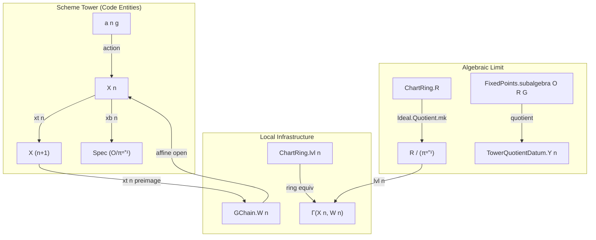
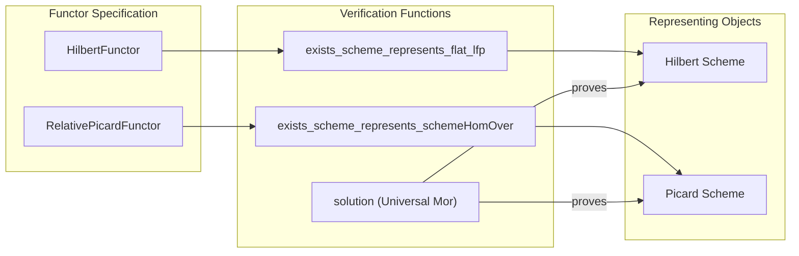

<!-- source: DeepWiki mcp.deepwiki.com · repo anthropics/fermats-last-theorem · page 3.6 Tower Quotient Data and Scheme Morphisms · fetched 2026-10-26 -->

# Tower Quotient Data and Scheme Morphisms

Relevant source files

The following files were used as context for generating this wiki page:

- [Definitions/Def_CerednikDrinfeld_FormalQuotientDatum.lean](Definitions/Def_CerednikDrinfeld_FormalQuotientDatum.lean)
- [P2M/Sol/S_Algebra_Smooth_fg_and_isIntegral_mem_and_minimalPrimes_and_formallySmooth_localizationAtPrime.lean](P2M/Sol/S_Algebra_Smooth_fg_and_isIntegral_mem_and_minimalPrimes_and_formallySmooth_localizationAtPrime.lean)
- [P2M/Sol/S_Algebra_exists_forall_dual_quotient_eq_trace_of_mem_comap_one_div_traceDual.lean](P2M/Sol/S_Algebra_exists_forall_dual_quotient_eq_trace_of_mem_comap_one_div_traceDual.lean)
- [P2M/Sol/S_Algebra_exists_le_height_eq_one_of_comap_one_div_traceDual_le_of_free_of_isIntegrallyClosed.lean](P2M/Sol/S_Algebra_exists_le_height_eq_one_of_comap_one_div_traceDual_le_of_free_of_isIntegrallyClosed.lean)
- [P2M/Sol/S_Algebra_isPrincipal_map_comap_one_div_traceDual_of_uniqueFactorizationMonoid.lean](P2M/Sol/S_Algebra_isPrincipal_map_comap_one_div_traceDual_of_uniqueFactorizationMonoid.lean)
- [P2M/Sol/S_Algebra_not_comap_one_div_traceDual_le_iff_exists_notMem_forall_dual_eq_trace.lean](P2M/Sol/S_Algebra_not_comap_one_div_traceDual_le_iff_exists_notMem_forall_dual_eq_trace.lean)
- [P2M/Sol/S_AlgebraicCurve_CurveModel_existsUnique_point_and_ord_eq_and_ord_eq_zero_of_iso_pullback_of_ffEquiv_symm_germToFunctionField_eq.lean](P2M/Sol/S_AlgebraicCurve_CurveModel_existsUnique_point_and_ord_eq_and_ord_eq_zero_of_iso_pullback_of_ffEquiv_symm_germToFunctionField_eq.lean)
- [P2M/Sol/S_AlgebraicCurve_CurveModel_exists_differentiableOn_lift_pointEquiv_comp_of_differentiableOn_appLE_of_isSeparated.lean](P2M/Sol/S_AlgebraicCurve_CurveModel_exists_differentiableOn_lift_pointEquiv_comp_of_differentiableOn_appLE_of_isSeparated.lean)
- [P2M/Sol/S_AlgebraicGeometry_AdmissibleAlgebra_exists_forall_sub_tmul_mem_span_pow_of_flat.lean](P2M/Sol/S_AlgebraicGeometry_AdmissibleAlgebra_exists_forall_sub_tmul_mem_span_pow_of_flat.lean)
- [P2M/Sol/S_AlgebraicGeometry_AdmissibleAlgebra_fixedPoints_isAdicComplete_and_finite_and_finiteType.lean](P2M/Sol/S_AlgebraicGeometry_AdmissibleAlgebra_fixedPoints_isAdicComplete_and_finite_and_finiteType.lean)
- [P2M/Sol/S_AlgebraicGeometry_AdmissibleAlgebra_isAdicComplete_fixedPoints_and_exists_ringEquiv_quotient_of_ringEquiv_tensorProduct_quotient.lean](P2M/Sol/S_AlgebraicGeometry_AdmissibleAlgebra_isAdicComplete_fixedPoints_and_exists_ringEquiv_quotient_of_ringEquiv_tensorProduct_quotient.lean)
- [P2M/Sol/S_AlgebraicGeometry_IdealSheafData_comap_pullbackMap_eq_ker_of_forall_affineOpens_comap_eq_ker_of_forall_spec_point.lean](P2M/Sol/S_AlgebraicGeometry_IdealSheafData_comap_pullbackMap_eq_ker_of_forall_affineOpens_comap_eq_ker_of_forall_spec_point.lean)
- [P2M/Sol/S_AlgebraicGeometry_IsAffineOpen_eq_of_appLE_eq_and_exists_appLE_eq_of_ringHom.lean](P2M/Sol/S_AlgebraicGeometry_IsAffineOpen_eq_of_appLE_eq_and_exists_appLE_eq_of_ringHom.lean)
- [P2M/Sol/S_AlgebraicGeometry_OModulePresheaf_isPushout_app_of_affHom_pushforwardUnit_of_ker_eq_pow_smul_top.lean](P2M/Sol/S_AlgebraicGeometry_OModulePresheaf_isPushout_app_of_affHom_pushforwardUnit_of_ker_eq_pow_smul_top.lean)
- [P2M/Sol/S_AlgebraicGeometry_Polarisation_subsingleton_HSucc_of_closedImmersionBySections_of_isAlgClosed.lean](P2M/Sol/S_AlgebraicGeometry_Polarisation_subsingleton_HSucc_of_closedImmersionBySections_of_isAlgClosed.lean)
- [P2M/Sol/S_AlgebraicGeometry_RelPicard_exists_algEquiv_sections_stage_baseChange_of_isAffineOpen.lean](P2M/Sol/S_AlgebraicGeometry_RelPicard_exists_algEquiv_sections_stage_baseChange_of_isAffineOpen.lean)
- [P2M/Sol/S_AlgebraicGeometry_RelTangentPoints_const_bijective_of_bijective_of_compactSpace.lean](P2M/Sol/S_AlgebraicGeometry_RelTangentPoints_const_bijective_of_bijective_of_compactSpace.lean)
- [P2M/Sol/S_AlgebraicGeometry_Scheme_Hom_bijective_app_of_isPullback_of_bijective_of_isAffineOpen.lean](P2M/Sol/S_AlgebraicGeometry_Scheme_Hom_bijective_app_of_isPullback_of_bijective_of_isAffineOpen.lean)
- [P2M/Sol/S_AlgebraicGeometry_Scheme_Hom_fiberInclusion_mem_smoothLocus_of_mem_smoothLocus_fiberToSpecResidueField.lean](P2M/Sol/S_AlgebraicGeometry_Scheme_Hom_fiberInclusion_mem_smoothLocus_of_mem_smoothLocus_fiberToSpecResidueField.lean)
- [P2M/Sol/S_AlgebraicGeometry_Scheme_Hom_topFormMap_eq_topFormMap_of_specMap_comp_fromSpec_eq.lean](P2M/Sol/S_AlgebraicGeometry_Scheme_Hom_topFormMap_eq_topFormMap_of_specMap_comp_fromSpec_eq.lean)
- [P2M/Sol/S_AlgebraicGeometry_Scheme_Modules_exists_linearEquiv_sections_baseChange_of_locallyTrivial.lean](P2M/Sol/S_AlgebraicGeometry_Scheme_Modules_exists_linearEquiv_sections_baseChange_of_locallyTrivial.lean)
- [P2M/Sol/S_AlgebraicGeometry_Scheme_Modules_exists_linearEquiv_sections_pullback_of_isClosedImmersion_of_locallyTrivial.lean](P2M/Sol/S_AlgebraicGeometry_Scheme_Modules_exists_linearEquiv_sections_pullback_of_isClosedImmersion_of_locallyTrivial.lean)
- [P2M/Sol/S_AlgebraicGeometry_Scheme_TwoAffineOpenCover_exists_baseChangeIsos_structureSheaf.lean](P2M/Sol/S_AlgebraicGeometry_Scheme_TwoAffineOpenCover_exists_baseChangeIsos_structureSheaf.lean)
- [P2M/Sol/S_AlgebraicGeometry_Scheme_exists_algEquiv_tensor_sections_pullback_fst_preimage_of_isAffineOpen.lean](P2M/Sol/S_AlgebraicGeometry_Scheme_exists_algEquiv_tensor_sections_pullback_fst_preimage_of_isAffineOpen.lean)
- [P2M/Sol/S_AlgebraicGeometry_SmallExtension_exists_injective_isTangentOfPair_of_flat.lean](P2M/Sol/S_AlgebraicGeometry_SmallExtension_exists_injective_isTangentOfPair_of_flat.lean)
- [P2M/Sol/S_AlgebraicGeometry_SmoothOfRelativeDimension_exists_relChart_differentiableOn_appLE_of_analyticChart.lean](P2M/Sol/S_AlgebraicGeometry_SmoothOfRelativeDimension_exists_relChart_differentiableOn_appLE_of_analyticChart.lean)
- [P2M/Sol/S_AlgebraicGeometry_TowerQuotientDatum_existsUnique_forall_p_comp_eq.lean](P2M/Sol/S_AlgebraicGeometry_TowerQuotientDatum_existsUnique_forall_p_comp_eq.lean)
- [P2M/Sol/S_AlgebraicGeometry_TowerQuotientDatum_exists_flat_ringEquiv_tensorProduct_quotient_and_sections_basicOpen.lean](P2M/Sol/S_AlgebraicGeometry_TowerQuotientDatum_exists_flat_ringEquiv_tensorProduct_quotient_and_sections_basicOpen.lean)
- [P2M/Sol/S_AlgebraicGeometry_TowerQuotientDatum_exists_ringEquiv_fixedPoints_quotient_basicOpen_of_isPullback_of_flat.lean](P2M/Sol/S_AlgebraicGeometry_TowerQuotientDatum_exists_ringEquiv_fixedPoints_quotient_basicOpen_of_isPullback_of_flat.lean)
- [P2M/Sol/S_AlgebraicGeometry_TowerQuotientDatum_exists_ringEquiv_fixedPoints_quotient_of_isAffineOpen.lean](P2M/Sol/S_AlgebraicGeometry_TowerQuotientDatum_exists_ringEquiv_fixedPoints_quotient_of_isAffineOpen.lean)
- [P2M/Sol/S_AlgebraicGeometry_TowerQuotientDatum_exists_ringEquiv_quotient_sections_preimage_and_basicOpen.lean](P2M/Sol/S_AlgebraicGeometry_TowerQuotientDatum_exists_ringEquiv_quotient_sections_preimage_and_basicOpen.lean)
- [P2M/Sol/S_AlgebraicGeometry_TowerQuotientDatum_exists_ringEquiv_tensorProduct_quotient_of_ringEquiv_sections_basicOpen.lean](P2M/Sol/S_AlgebraicGeometry_TowerQuotientDatum_exists_ringEquiv_tensorProduct_quotient_of_ringEquiv_sections_basicOpen.lean)
- [P2M/Sol/S_AlgebraicGeometry_TowerQuotientDatum_exists_sections_eq_of_forall_specMap_comp_eq.lean](P2M/Sol/S_AlgebraicGeometry_TowerQuotientDatum_exists_sections_eq_of_forall_specMap_comp_eq.lean)
- [P2M/Sol/S_AlgebraicGeometry_TowerQuotientDatum_isAdicComplete_fixedPoints_and_exists_ringEquiv_quotient_basicOpen.lean](P2M/Sol/S_AlgebraicGeometry_TowerQuotientDatum_isAdicComplete_fixedPoints_and_exists_ringEquiv_quotient_basicOpen.lean)
- [P2M/Sol/S_AlgebraicGeometry_TowerQuotientDatum_univ_loc_of_isPullback_of_flat.lean](P2M/Sol/S_AlgebraicGeometry_TowerQuotientDatum_univ_loc_of_isPullback_of_flat.lean)
- [P2M/Sol/S_AlgebraicGeometry_TowerQuotientDatum_univ_loc_of_isPullback_of_flat_of_forall_exists_chart.lean](P2M/Sol/S_AlgebraicGeometry_TowerQuotientDatum_univ_loc_of_isPullback_of_flat_of_forall_exists_chart.lean)
- [P2M/Sol/S_AlgebraicGeometry_appLE_surjective_of_isAffineOpen_preimage_of_isPullback_of_flat.lean](P2M/Sol/S_AlgebraicGeometry_appLE_surjective_of_isAffineOpen_preimage_of_isPullback_of_flat.lean)
- [P2M/Sol/S_AlgebraicGeometry_bijective_appTop_of_isProper_of_flat_of_locallyOfFinitePresentation_of_isLocalRing.lean](P2M/Sol/S_AlgebraicGeometry_bijective_appTop_of_isProper_of_flat_of_locallyOfFinitePresentation_of_isLocalRing.lean)
- [P2M/Sol/S_AlgebraicGeometry_bijective_appTop_pullback_snd_of_forall_bijective_algebraMap_sections.lean](P2M/Sol/S_AlgebraicGeometry_bijective_appTop_pullback_snd_of_forall_bijective_algebraMap_sections.lean)
- [P2M/Sol/S_AlgebraicGeometry_bijective_app_of_isProper_of_flat_of_forall_bijective_appTop_fiberToSpecResidueField.lean](P2M/Sol/S_AlgebraicGeometry_bijective_app_of_isProper_of_flat_of_forall_bijective_appTop_fiberToSpecResidueField.lean)
- [P2M/Sol/S_AlgebraicGeometry_bijective_app_of_isProper_of_flat_of_forall_bijective_appTop_fiberToSpecResidueField_of_isLocallyNoetherian.lean](P2M/Sol/S_AlgebraicGeometry_bijective_app_of_isProper_of_flat_of_forall_bijective_appTop_fiberToSpecResidueField_of_isLocallyNoetherian.lean)
- [P2M/Sol/S_AlgebraicGeometry_differentiableOn_appLE_pullback_pair_of_relChart.lean](P2M/Sol/S_AlgebraicGeometry_differentiableOn_appLE_pullback_pair_of_relChart.lean)
- [P2M/Sol/S_AlgebraicGeometry_exists_addMonoidHom_tmul_sections_preimage_of_isPullback.lean](P2M/Sol/S_AlgebraicGeometry_exists_addMonoidHom_tmul_sections_preimage_of_isPullback.lean)
- [P2M/Sol/S_AlgebraicGeometry_exists_algEquiv_tensorProduct_functionField_pullback_of_isAlgebraic.lean](P2M/Sol/S_AlgebraicGeometry_exists_algEquiv_tensorProduct_functionField_pullback_of_isAlgebraic.lean)
- [P2M/Sol/S_AlgebraicGeometry_exists_algHom_tensorProduct_functionField_pullback_injective_isFractionRing.lean](P2M/Sol/S_AlgebraicGeometry_exists_algHom_tensorProduct_functionField_pullback_injective_isFractionRing.lean)
- [P2M/Sol/S_AlgebraicGeometry_exists_closedSubscheme_pullback_flat_forall_isPullback_of_forall_spec_point.lean](P2M/Sol/S_AlgebraicGeometry_exists_closedSubscheme_pullback_flat_forall_isPullback_of_forall_spec_point.lean)
- [P2M/Sol/S_AlgebraicGeometry_exists_closedSubscheme_pullback_flat_of_idealSheafData_comap_ker_eq.lean](P2M/Sol/S_AlgebraicGeometry_exists_closedSubscheme_pullback_flat_of_idealSheafData_comap_ker_eq.lean)
- [P2M/Sol/S_AlgebraicGeometry_exists_eq_smul_chart_of_mapOfRingHom_germ_eq_smul_of_isIntegral_fibre_of_smoothOfRelativeDimension_one.lean](P2M/Sol/S_AlgebraicGeometry_exists_eq_smul_chart_of_mapOfRingHom_germ_eq_smul_of_isIntegral_fibre_of_smoothOfRelativeDimension_one.lean)
- [P2M/Sol/S_AlgebraicGeometry_exists_forall_affineOpens_closedSubscheme_ker_comap_eq_of_forall_spec_point.lean](P2M/Sol/S_AlgebraicGeometry_exists_forall_affineOpens_closedSubscheme_ker_comap_eq_of_forall_spec_point.lean)
- [P2M/Sol/S_AlgebraicGeometry_exists_hom_pullback_comp_eq_and_forall_pullbackMap_comp_eq_of_forall_spec_point.lean](P2M/Sol/S_AlgebraicGeometry_exists_hom_pullback_comp_eq_and_forall_pullbackMap_comp_eq_of_forall_spec_point.lean)
- [P2M/Sol/S_AlgebraicGeometry_exists_ideal_residueField_pullback_algEquiv_fractionRing_tensorProduct_stalk_quotient.lean](P2M/Sol/S_AlgebraicGeometry_exists_ideal_residueField_pullback_algEquiv_fractionRing_tensorProduct_stalk_quotient.lean)
- [P2M/Sol/S_AlgebraicGeometry_exists_mem_and_smoothOfRelativeDimension_one_of_smoothOfRelativeDimension_pullback_snd.lean](P2M/Sol/S_AlgebraicGeometry_exists_mem_and_smoothOfRelativeDimension_one_of_smoothOfRelativeDimension_pullback_snd.lean)
- [P2M/Sol/S_AlgebraicGeometry_exists_pt_sigma_nat_and_eq_comp_sigmaInj_of_forall_represents_hilbertPolynomial_eq.lean](P2M/Sol/S_AlgebraicGeometry_exists_pt_sigma_nat_and_eq_comp_sigmaInj_of_forall_represents_hilbertPolynomial_eq.lean)
- [P2M/Sol/S_AlgebraicGeometry_exists_ringEquiv_quotient_sections_of_isPullback_of_flat.lean](P2M/Sol/S_AlgebraicGeometry_exists_ringEquiv_quotient_sections_of_isPullback_of_flat.lean)
- [P2M/Sol/S_AlgebraicGeometry_exists_scheme_represents_flat_lfp_closedSubscheme_hilbertPieces_of_closedImmersionBySections.lean](P2M/Sol/S_AlgebraicGeometry_exists_scheme_represents_flat_lfp_closedSubscheme_hilbertPieces_of_closedImmersionBySections.lean)
- [P2M/Sol/S_AlgebraicGeometry_exists_scheme_represents_flat_lfp_closedSubscheme_hilbertPolynomial_eq_of_closedImmersionBySections.lean](P2M/Sol/S_AlgebraicGeometry_exists_scheme_represents_flat_lfp_closedSubscheme_hilbertPolynomial_eq_of_closedImmersionBySections.lean)
- [P2M/Sol/S_AlgebraicGeometry_exists_scheme_represents_schemeHomOver_hilbertPieces_of_isProper_of_flat.lean](P2M/Sol/S_AlgebraicGeometry_exists_scheme_represents_schemeHomOver_hilbertPieces_of_isProper_of_flat.lean)
- [P2M/Sol/S_AlgebraicGeometry_exists_tendsto_forall_eq_of_injOn_of_differentiableOn_appLE_of_tendsto_appLE.lean](P2M/Sol/S_AlgebraicGeometry_exists_tendsto_forall_eq_of_injOn_of_differentiableOn_appLE_of_tendsto_appLE.lean)
- [P2M/Sol/S_AlgebraicGeometry_isAffineOpen_of_isAffineOpen_preimage_of_isPullback_of_flat.lean](P2M/Sol/S_AlgebraicGeometry_isAffineOpen_of_isAffineOpen_preimage_of_isPullback_of_flat.lean)
- [P2M/Sol/S_AlgebraicGeometry_isIso_pullbackMap_opens_of_forall_exists_le_isIso_pullbackMap_opens.lean](P2M/Sol/S_AlgebraicGeometry_isIso_pullbackMap_opens_of_forall_exists_le_isIso_pullbackMap_opens.lean)
- [P2M/Sol/S_AlgebraicGeometry_isPrime_span_germ_and_ne_zero_of_isIntegral_fibre_of_smoothOfRelativeDimension_one.lean](P2M/Sol/S_AlgebraicGeometry_isPrime_span_germ_and_ne_zero_of_isIntegral_fibre_of_smoothOfRelativeDimension_one.lean)
- [P2M/Sol/S_AlgebraicGeometry_locallyOfFinitePresentation_of_forall_directed_colimit.lean](P2M/Sol/S_AlgebraicGeometry_locallyOfFinitePresentation_of_forall_directed_colimit.lean)
- [P2M/Sol/S_AlgebraicGeometry_nonempty_towerQuotientDatum_of_isProper_of_flat.lean](P2M/Sol/S_AlgebraicGeometry_nonempty_towerQuotientDatum_of_isProper_of_flat.lean)
- [P2M/Sol/S_AlgebraicGeometry_nonempty_towerQuotientDatum_of_isProper_of_flat_of_forall_exists_isAffineOpen.lean](P2M/Sol/S_AlgebraicGeometry_nonempty_towerQuotientDatum_of_isProper_of_flat_of_forall_exists_isAffineOpen.lean)
- [P2M/Sol/S_AlgebraicGeometry_surj_inj_isSeparated_pieces_sigmaDesc_of_forall_represents_hilbertPolynomial_eq_of_nat_of_eq_comp_sigmaInj.lean](P2M/Sol/S_AlgebraicGeometry_surj_inj_isSeparated_pieces_sigmaDesc_of_forall_represents_hilbertPolynomial_eq_of_nat_of_eq_comp_sigmaInj.lean)
- [P2M/Sol/S_AlgebraicGeometry_surjective_app_and_ker_eq_map_of_isPullback_specMap_of_surjective.lean](P2M/Sol/S_AlgebraicGeometry_surjective_app_and_ker_eq_map_of_isPullback_specMap_of_surjective.lean)
- [P2M/Sol/S_CerednikDrinfeld_FormalOmega_MumfordGlueCore_exists_finite_cover_isPullback_of_zeta_comp_eq.lean](P2M/Sol/S_CerednikDrinfeld_FormalOmega_MumfordGlueCore_exists_finite_cover_isPullback_of_zeta_comp_eq.lean)
- [P2M/Sol/S_CerednikDrinfeld_FormalOmega_MumfordGlueCore_exists_isPullback_of_zeta_comp_eq_of_isUnit_eta.lean](P2M/Sol/S_CerednikDrinfeld_FormalOmega_MumfordGlueCore_exists_isPullback_of_zeta_comp_eq_of_isUnit_eta.lean)
- [P2M/Sol/S_CerednikDrinfeld_FormalOmega_MumfordGlueCore_exists_isPullback_of_zeta_comp_eq_of_isUnit_xi.lean](P2M/Sol/S_CerednikDrinfeld_FormalOmega_MumfordGlueCore_exists_isPullback_of_zeta_comp_eq_of_isUnit_xi.lean)
- [P2M/Sol/S_CerednikDrinfeld_FormalOmega_MumfordGlueCore_zeta_comp_eq_of_exists_isPullback.lean](P2M/Sol/S_CerednikDrinfeld_FormalOmega_MumfordGlueCore_zeta_comp_eq_of_exists_isPullback.lean)
- [P2M/Sol/S_CerednikDrinfeld_FormalOmega_MumfordGlueCore_zeta_univ_law.lean](P2M/Sol/S_CerednikDrinfeld_FormalOmega_MumfordGlueCore_zeta_univ_law.lean)
- [P2M/Sol/S_CerednikDrinfeld_FormalOmega_MumfordGlue_existsUnique_quotientFamily_of_chartLaw.lean](P2M/Sol/S_CerednikDrinfeld_FormalOmega_MumfordGlue_existsUnique_quotientFamily_of_chartLaw.lean)
- [P2M/Sol/S_CerednikDrinfeld_FormalOmega_MumfordGlue_exists_quotientMap.lean](P2M/Sol/S_CerednikDrinfeld_FormalOmega_MumfordGlue_exists_quotientMap.lean)
- [P2M/Sol/S_CerednikDrinfeld_FormalOmega_MumfordTower_eq_of_q_eq_of_natural_of_invariant.lean](P2M/Sol/S_CerednikDrinfeld_FormalOmega_MumfordTower_eq_of_q_eq_of_natural_of_invariant.lean)
- [P2M/Sol/S_CerednikDrinfeld_FormalOmega_MumfordTower_existsUnique_hom_pullback_of_natural_of_invariant.lean](P2M/Sol/S_CerednikDrinfeld_FormalOmega_MumfordTower_existsUnique_hom_pullback_of_natural_of_invariant.lean)
- [P2M/Sol/S_CerednikDrinfeld_FormalOmega_MumfordTower_exists_hom_pullback_of_natural_of_invariant.lean](P2M/Sol/S_CerednikDrinfeld_FormalOmega_MumfordTower_exists_hom_pullback_of_natural_of_invariant.lean)
- [P2M/Sol/S_CerednikDrinfeld_FormalOmega_MumfordTower_exists_monoidHom_aut_forall_q_eq_q_comp_of_le.lean](P2M/Sol/S_CerednikDrinfeld_FormalOmega_MumfordTower_exists_monoidHom_aut_forall_q_eq_q_comp_of_le.lean)
- [P2M/Sol/S_CerednikDrinfeld_FormalOmega_MumfordTower_hom_ext_of_comp_eq_of_q.lean](P2M/Sol/S_CerednikDrinfeld_FormalOmega_MumfordTower_hom_ext_of_comp_eq_of_q.lean)
- [P2M/Sol/S_CerednikDrinfeld_FormalOmega_descendedFamily_comp_frobenius_zpow_eq_of_isPullback.lean](P2M/Sol/S_CerednikDrinfeld_FormalOmega_descendedFamily_comp_frobenius_zpow_eq_of_isPullback.lean)
- [P2M/Sol/S_CerednikDrinfeld_QM_FakeEllipticCurve_WithFullLevel_exists_const_generator_frameCoords_of_uniformization_family_of_smooth.lean](P2M/Sol/S_CerednikDrinfeld_QM_FakeEllipticCurve_WithFullLevel_exists_const_generator_frameCoords_of_uniformization_family_of_smooth.lean)
- [P2M/Sol/S_CerednikDrinfeld_QM_FakeEllipticCurve_bijective_algebraMap_sections_pullback.lean](P2M/Sol/S_CerednikDrinfeld_QM_FakeEllipticCurve_bijective_algebraMap_sections_pullback.lean)
- [P2M/Sol/S_GoodReductionJacobian_AbelianSchemePropertyBundle_bijective_algebraMap_sections_pullback.lean](P2M/Sol/S_GoodReductionJacobian_AbelianSchemePropertyBundle_bijective_algebraMap_sections_pullback.lean)
- [P2M/Sol/S_GoodReductionJacobian_AbelianSchemePropertyBundle_exists_forall_subsingleton_HSucc_pullback_fst_of_closedImmersionBySections.lean](P2M/Sol/S_GoodReductionJacobian_AbelianSchemePropertyBundle_exists_forall_subsingleton_HSucc_pullback_fst_of_closedImmersionBySections.lean)
- [P2M/Sol/S_GoodReductionJacobian_AbelianSchemePropertyBundle_exists_hom_curve_mapPt_eq_pointEquiv_symm_quotientMap_mapPt.lean](P2M/Sol/S_GoodReductionJacobian_AbelianSchemePropertyBundle_exists_hom_curve_mapPt_eq_pointEquiv_symm_quotientMap_mapPt.lean)
- [P2M/Sol/S_GoodReductionJacobian_AbelianSchemePropertyBundle_exists_hom_mapPt_eq_pointEquiv_symm_quotientMap_of_le_comap.lean](P2M/Sol/S_GoodReductionJacobian_AbelianSchemePropertyBundle_exists_hom_mapPt_eq_pointEquiv_symm_quotientMap_of_le_comap.lean)
- [P2M/Sol/S_GoodReductionJacobian_AbelianSchemePropertyBundle_exists_isOpen_forall_isSectionBasisOn_pullback_iff.lean](P2M/Sol/S_GoodReductionJacobian_AbelianSchemePropertyBundle_exists_isOpen_forall_isSectionBasisOn_pullback_iff.lean)
- [P2M/Sol/S_GoodReductionJacobian_AbelianSchemePropertyBundle_exists_linearMap_primitives_HSucc_unit_injective_of_isIso_shear.lean](P2M/Sol/S_GoodReductionJacobian_AbelianSchemePropertyBundle_exists_linearMap_primitives_HSucc_unit_injective_of_isIso_shear.lean)
- [P2M/Sol/S_GoodReductionJacobian_AbelianSchemePropertyBundle_exists_linearMap_primitives_HSucc_unit_injective_of_torsion_points_equiv.lean](P2M/Sol/S_GoodReductionJacobian_AbelianSchemePropertyBundle_exists_linearMap_primitives_HSucc_unit_injective_of_torsion_points_equiv.lean)
- [P2M/Sol/S_GoodReductionJacobian_AbelianSchemePropertyBundle_exists_relativeGroupLaw_pullbackSnd_specMap_and_closedImmersionBySections.lean](P2M/Sol/S_GoodReductionJacobian_AbelianSchemePropertyBundle_exists_relativeGroupLaw_pullbackSnd_specMap_and_closedImmersionBySections.lean)
- [P2M/Sol/S_GoodReductionJacobian_AbelianSchemePropertyBundle_subsingleton_HSucc_unit_of_le.lean](P2M/Sol/S_GoodReductionJacobian_AbelianSchemePropertyBundle_subsingleton_HSucc_unit_of_le.lean)
- [P2M/Sol/S_GoodReductionJacobian_RelativeGroupLaw_existsUnique_linearMap_forall_pointEquiv_mapPt_eq_of_differentiableOn_appLE.lean](P2M/Sol/S_GoodReductionJacobian_RelativeGroupLaw_existsUnique_linearMap_forall_pointEquiv_mapPt_eq_of_differentiableOn_appLE.lean)
- [P2M/Sol/S_GoodReductionJacobian_RelativeGroupLaw_exists_chart_differentiableOn_mul_of_smoothOfRelativeDimension.lean](P2M/Sol/S_GoodReductionJacobian_RelativeGroupLaw_exists_chart_differentiableOn_mul_of_smoothOfRelativeDimension.lean)
- [P2M/Sol/S_GoodReductionJacobian_RelativeGroupLaw_exists_differentiableOn_appLE_one_of_analyticChart.lean](P2M/Sol/S_GoodReductionJacobian_RelativeGroupLaw_exists_differentiableOn_appLE_one_of_analyticChart.lean)
- [P2M/Sol/S_GoodReductionJacobian_RelativeGroupLaw_relAn_relCov_of_isLocalHom_family_of_differentiableOn_near_zero.lean](P2M/Sol/S_GoodReductionJacobian_RelativeGroupLaw_relAn_relCov_of_isLocalHom_family_of_differentiableOn_near_zero.lean)
- [P2M/Sol/S_GoodReductionJacobian_RelativeGroupLaw_topFormMap_mul_eq_of_forall_topFormMap_appLE_mul_eq.lean](P2M/Sol/S_GoodReductionJacobian_RelativeGroupLaw_topFormMap_mul_eq_of_forall_topFormMap_appLE_mul_eq.lean)
- [P2M/Sol/S_Ideal_IsMaximal_of_isPrime_of_ne_bot_of_isIntegral_adjoin_singleton.lean](P2M/Sol/S_Ideal_IsMaximal_of_isPrime_of_ne_bot_of_isIntegral_adjoin_singleton.lean)
- [P2M/Sol/S_Ideal_comap_adjoin_singleton_eq_bot_of_mem_minimalPrimes_of_flat_of_isIntegral.lean](P2M/Sol/S_Ideal_comap_adjoin_singleton_eq_bot_of_mem_minimalPrimes_of_flat_of_isIntegral.lean)
- [P2M/Sol/S_Ideal_isPrime_span_algebraMap_of_isDomain_tensor.lean](P2M/Sol/S_Ideal_isPrime_span_algebraMap_of_isDomain_tensor.lean)
- [P2M/Sol/S_Ideal_minimalPrimes_tensorProduct_fractionRing_dictionary.lean](P2M/Sol/S_Ideal_minimalPrimes_tensorProduct_fractionRing_dictionary.lean)

This section describes the algebraic geometry infrastructure used to manage towers of schemes, flat pullbacks, and the construction of quotient schemes. The primary focus is the `TowerQuotientDatum` and the associated representability machinery for Hilbert functors and group scheme quotients.

## TowerQuotientDatum and Chain Structures

The `TowerQuotientDatum` represents a formal tower of schemes $X_n$ over a base valuation ring $\mathcal{O}$, equipped with a group action $G$ and compatibility morphisms. This structure is essential for constructing $p$-adic formal schemes as limits of schemes over $\mathcal{O}/\pi^{n+1}$.

### GChain and ChartRing
To analyze these towers locally, the codebase defines `GChain` and `ChartRing` to manage affine open covers that are stable under the group action and compatible with the tower transitions.

*   **`GChain`**: A collection of open sets $W_n \subseteq X_n$ that are affine, $G$-stable, and satisfy $(xt_n)^{-1}(W_{n+1}) = W_n$ [P2M/Sol/S_AlgebraicGeometry_nonempty_towerQuotientDatum_of_isProper_of_flat_of_forall_exists_isAffineOpen.lean:24-33]().
*   **`ChartRing`**: An algebra $R$ over $\mathcal{O}$ that represents the limit of the sections $\Gamma(X_n, W_n)$, providing the local integral structure for the tower [P2M/Sol/S_AlgebraicGeometry_nonempty_towerQuotientDatum_of_isProper_of_flat_of_forall_exists_isAffineOpen.lean:34-59]().

### Tower Data Flow
The following diagram illustrates the relationship between the tower components and the local ring structures.

**Tower to Ring Mapping**

Sources: [P2M/Sol/S_AlgebraicGeometry_nonempty_towerQuotientDatum_of_isProper_of_flat_of_forall_exists_isAffineOpen.lean:18-59](), [P2M/Sol/S_AlgebraicGeometry_TowerQuotientDatum_exists_ringEquiv_tensorProduct_quotient_of_ringEquiv_sections_basicOpen.lean:96-113]()

## Flat Pullbacks and Scheme Morphisms

The infrastructure provides rigorous verification of properties under base change, specifically for flat and proper morphisms.

### Pullback Property Verification
Key lemmas verify that properties like `IsAffineOpen` and `Surjective` are preserved or reflected under flat pullbacks:
*   **`isAffineOpen_of_isAffineOpen_preimage_of_isPullback_of_flat`**: Ensures that if a preimage is affine under a flat pullback, the original open set was affine [P2M/Sol/S_AlgebraicGeometry_TowerQuotientDatum_univ_loc_of_isPullback_of_flat_of_forall_exists_chart.lean:3-3]().
*   **`isPushout_appLE_of_isPullback`**: Converts a scheme-theoretic pullback into a pushout of ring sections for affine opens [P2M/Sol/S_AlgebraicGeometry_exists_addMonoidHom_tmul_sections_preimage_of_isPullback.lean:25-31]().
*   **`level_surjective_and_ker`**: Specifically handles the transition morphisms $xt_n$ in the tower, proving surjectivity and identifying the kernel in terms of the uniformizer $\pi$ [P2M/Sol/S_AlgebraicGeometry_appLE_surjective_of_isAffineOpen_preimage_of_isPullback_of_flat.lean:111-123]().

### Morphism Section Infrastructure
The file `P2M/Sol/S_AlgebraicGeometry_TowerQuotientDatum_univ_loc_of_isPullback_of_flat_of_forall_exists_chart.lean` defines utilities for handling morphisms to affine schemes:
*   `homSpecOf`: Constructs a morphism $S \to \text{Spec } B$ from a ring homomorphism $B \to \Gamma(S, \top)$ [P2M/Sol/S_AlgebraicGeometry_TowerQuotientDatum_univ_loc_of_isPullback_of_flat_of_forall_exists_chart.lean:15-16]().
*   `secOf`: Extracts the ring homomorphism from a morphism into a Spec [P2M/Sol/S_AlgebraicGeometry_TowerQuotientDatum_univ_loc_of_isPullback_of_flat_of_forall_exists_chart.lean:32-34]().

## Hilbert Functor and Representability

The representability of the Hilbert functor and Picard functor is constructed through a pipeline that verifies representability via closed immersions and Hilbert polynomials.

### Representability Pipeline
1.  **Closed Subschemes**: Proving representability for flat, locally of finite presentation (lfp) closed subschemes [P2M/Sol/S_AlgebraicGeometry_exists_scheme_represents_flat_lfp_closedSubscheme_hilbertPolynomial_eq_of_closedImmersionBySections.lean:1-18]().
2.  **Hilbert Pieces**: Constructing the scheme that represents morphisms over a base that satisfy specific Hilbert polynomial conditions [P2M/Sol/S_AlgebraicGeometry_exists_scheme_represents_schemeHomOver_hilbertPieces_of_isProper_of_flat.lean:1-16]().
3.  **Universal Morphisms**: `UnivMor.solution` provides the logic for constructing a universal morphism $\Phi$ from a family of morphisms over arbitrary base rings $S'$, effectively showing representability for certain functors [P2M/Sol/S_AlgebraicGeometry_exists_hom_pullback_comp_eq_and_forall_pullbackMap_comp_eq_of_forall_spec_point.lean:49-75]().

**Representability Data Flow**

Sources: [P2M/Sol/S_AlgebraicGeometry_exists_scheme_represents_flat_lfp_closedSubscheme_hilbertPolynomial_eq_of_closedImmersionBySections.lean:8-17](), [P2M/Sol/S_AlgebraicGeometry_exists_scheme_represents_schemeHomOver_hilbertPieces_of_isProper_of_flat.lean:1-18](), [P2M/Sol/S_AlgebraicGeometry_exists_hom_pullback_comp_eq_and_forall_pullbackMap_comp_eq_of_forall_spec_point.lean:49-75]()

## Module Sections and Base Change

The codebase implements a sophisticated "Unit Calculus" for sheaves of modules, particularly for handling pullbacks under closed immersions and locally trivial sheaves.

*   **`UnitCalculus.unit_app_comp`**: Proves compatibility of the adjunction unit for a composition of morphisms $g \circ f$ [P2M/Sol/S_AlgebraicGeometry_Scheme_Modules_exists_linearEquiv_sections_pullback_of_isClosedImmersion_of_locallyTrivial.lean:70-82]().
*   **`sigma`**: A core ring isomorphism $( \Gamma(X, U) \otimes_R A ) \cong \Gamma(X_A, fst^{-1}(U))$ that anchors the affine base change theory [P2M/Sol/S_AlgebraicGeometry_exists_mem_and_smoothOfRelativeDimension_one_of_smoothOfRelativeDimension_pullback_snd.lean:62-68]().
*   **`surjective_of_forall_tmul`**: A technical lemma used to prove surjectivity of maps from tensor products to scheme sections, critical for showing that base-changed sections are generated by original sections [P2M/Sol/S_AlgebraicGeometry_exists_addMonoidHom_tmul_sections_preimage_of_isPullback.lean:52-76]().

Sources: [P2M/Sol/S_AlgebraicGeometry_Scheme_Modules_exists_linearEquiv_sections_pullback_of_isClosedImmersion_of_locallyTrivial.lean:70-94](), [P2M/Sol/S_AlgebraicGeometry_exists_mem_and_smoothOfRelativeDimension_one_of_smoothOfRelativeDimension_pullback_snd.lean:62-117](), [P2M/Sol/S_AlgebraicGeometry_exists_addMonoidHom_tmul_sections_preimage_of_isPullback.lean:52-111]()

---

