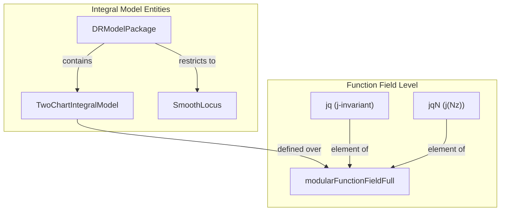
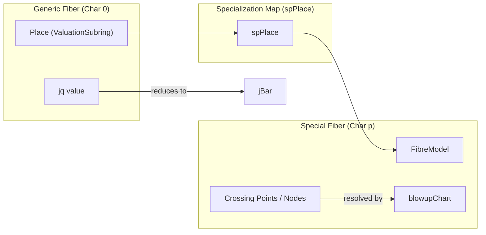

<!-- source: DeepWiki mcp.deepwiki.com · repo anthropics/fermats-last-theorem · page 4.1 Modular Curves: DRModelPackage and Specialization · fetched 2026-10-26 -->

# Modular Curves: DRModelPackage and Specialization

Relevant source files

The following files were used as context for generating this wiki page:

- [Definitions/Def_ModularCurve_SpecializationMap.lean](Definitions/Def_ModularCurve_SpecializationMap.lean)
- [P2M/Sol/S_Algebra_exists_etale_localizationAway_of_forall_isEtaleAt.lean](P2M/Sol/S_Algebra_exists_etale_localizationAway_of_forall_isEtaleAt.lean)
- [P2M/Sol/S_AlgebraicCurve_CurveModel_ffEquiv_symm_germToFunctionField_mem_and_sub_algebraMap_appLE_mem_nonunits_pointEquivPlace.lean](P2M/Sol/S_AlgebraicCurve_CurveModel_ffEquiv_symm_germToFunctionField_mem_and_sub_algebraMap_appLE_mem_nonunits_pointEquivPlace.lean)
- [P2M/Sol/S_AlgebraicCurve_CurveModel_ffEquiv_symm_mem_and_evalAt_pointEquivPlace_eq_stalkClosedPointTo.lean](P2M/Sol/S_AlgebraicCurve_CurveModel_ffEquiv_symm_mem_and_evalAt_pointEquivPlace_eq_stalkClosedPointTo.lean)
- [P2M/Sol/S_AlgebraicCurve_CurveModel_finrank_H0_sectionsOf_invModule_prod_ker_tensor_module_prod_ker_eq_ell.lean](P2M/Sol/S_AlgebraicCurve_CurveModel_finrank_H0_sectionsOf_invModule_prod_ker_tensor_module_prod_ker_eq_ell.lean)
- [P2M/Sol/S_AlgebraicCurve_Place_exists_of_isPrime_over_valuationSubring.lean](P2M/Sol/S_AlgebraicCurve_Place_exists_of_isPrime_over_valuationSubring.lean)
- [P2M/Sol/S_AlgebraicCurve_Place_isRational_of_range_stalk_section_eq.lean](P2M/Sol/S_AlgebraicCurve_Place_isRational_of_range_stalk_section_eq.lean)
- [P2M/Sol/S_AlgebraicCurve_exists_closedPoint_specializes_reads_and_unique_of_isProper.lean](P2M/Sol/S_AlgebraicCurve_exists_closedPoint_specializes_reads_and_unique_of_isProper.lean)
- [P2M/Sol/S_AlgebraicCurve_exists_forall_specializes_of_isResidueDisc_of_reads_smooth.lean](P2M/Sol/S_AlgebraicCurve_exists_forall_specializes_of_isResidueDisc_of_reads_smooth.lean)
- [P2M/Sol/S_AlgebraicCurve_exists_kaehlerToFunctionField_eq_smul_dCoord_of_mem_placesOf.lean](P2M/Sol/S_AlgebraicCurve_exists_kaehlerToFunctionField_eq_smul_dCoord_of_mem_placesOf.lean)
- [P2M/Sol/S_AlgebraicCurve_exists_place_range_stalk_eq.lean](P2M/Sol/S_AlgebraicCurve_exists_place_range_stalk_eq.lean)
- [P2M/Sol/S_AlgebraicCurve_exists_smoothCentre_of_isResidueDisc_of_reads_smooth.lean](P2M/Sol/S_AlgebraicCurve_exists_smoothCentre_of_isResidueDisc_of_reads_smooth.lean)
- [P2M/Sol/S_AlgebraicGeometry_Polarisation_exists_isFrameOn_iSup_eq_top_of_iso_tensor_self_of_finrank_pos.lean](P2M/Sol/S_AlgebraicGeometry_Polarisation_exists_isFrameOn_iSup_eq_top_of_iso_tensor_self_of_finrank_pos.lean)
- [P2M/Sol/S_AlgebraicGeometry_Polarisation_exists_isInvertible_nonempty_iso_tensor_pullback_negMor_geomFibre_of_field.lean](P2M/Sol/S_AlgebraicGeometry_Polarisation_exists_isInvertible_nonempty_iso_tensor_pullback_negMor_geomFibre_of_field.lean)
- [P2M/Sol/S_AlgebraicGeometry_Polarisation_exists_locIsoOnBase_pullback_unit_stage_of_locIsoOnBase_pullback_unit_of_isDirectLimit.lean](P2M/Sol/S_AlgebraicGeometry_Polarisation_exists_locIsoOnBase_pullback_unit_stage_of_locIsoOnBase_pullback_unit_of_isDirectLimit.lean)
- [P2M/Sol/S_AlgebraicGeometry_RelPicard_exists_representsRelSubPic_algEquivZeroCut_of_isAlgClosed.lean](P2M/Sol/S_AlgebraicGeometry_RelPicard_exists_representsRelSubPic_algEquivZeroCut_of_isAlgClosed.lean)
- [P2M/Sol/S_AlgebraicGeometry_RelPicard_preimage_support_prodKerGraph_subset_connectedComponentIn_of_blocks.lean](P2M/Sol/S_AlgebraicGeometry_RelPicard_preimage_support_prodKerGraph_subset_connectedComponentIn_of_blocks.lean)
- [P2M/Sol/S_AlgebraicGeometry_Scheme_Modules_IsInvertible_nonempty_iso_tensorUnit_of_nonempty_pullback_iso_tensorUnit.lean](P2M/Sol/S_AlgebraicGeometry_Scheme_Modules_IsInvertible_nonempty_iso_tensorUnit_of_nonempty_pullback_iso_tensorUnit.lean)
- [P2M/Sol/S_AlgebraicGeometry_Scheme_Modules_ProjPresentation_isFinite_toProj_of_finite_setOf_forall_pullbackSection_eq_zero_iff.lean](P2M/Sol/S_AlgebraicGeometry_Scheme_Modules_ProjPresentation_isFinite_toProj_of_finite_setOf_forall_pullbackSection_eq_zero_iff.lean)
- [P2M/Sol/S_AlgebraicGeometry_Scheme_Modules_ProjPresentation_isFinite_toProj_of_finite_setOf_forall_pullbackSection_eq_zero_iff_monoidalV2.lean](P2M/Sol/S_AlgebraicGeometry_Scheme_Modules_ProjPresentation_isFinite_toProj_of_finite_setOf_forall_pullbackSection_eq_zero_iff_monoidalV2.lean)
- [P2M/Sol/S_AlgebraicGeometry_Scheme_Modules_ProjPresentation_isFinite_toProj_of_forall_pullbackSection_eq_zero_iff.lean](P2M/Sol/S_AlgebraicGeometry_Scheme_Modules_ProjPresentation_isFinite_toProj_of_forall_pullbackSection_eq_zero_iff.lean)
- [P2M/Sol/S_AlgebraicGeometry_Scheme_Modules_exists_forall_nonempty_pullback_iso_of_nonempty_pullback_iso_of_isDirectLimit_of_comp_eq.lean](P2M/Sol/S_AlgebraicGeometry_Scheme_Modules_exists_forall_nonempty_pullback_iso_of_nonempty_pullback_iso_of_isDirectLimit_of_comp_eq.lean)
- [P2M/Sol/S_AlgebraicGeometry_Scheme_Modules_exists_isFrameOn_tensorPow_three_of_forall_nonempty_pullback_tensor_iso.lean](P2M/Sol/S_AlgebraicGeometry_Scheme_Modules_exists_isFrameOn_tensorPow_three_of_forall_nonempty_pullback_tensor_iso.lean)
- [P2M/Sol/S_AlgebraicGeometry_Scheme_Modules_exists_isFrameOn_tensorPow_three_of_forall_nonempty_pullback_tensor_iso_monoidalV2.lean](P2M/Sol/S_AlgebraicGeometry_Scheme_Modules_exists_isFrameOn_tensorPow_three_of_forall_nonempty_pullback_tensor_iso_monoidalV2.lean)
- [P2M/Sol/S_AlgebraicGeometry_Scheme_Modules_exists_isInvertible_forall_nonempty_pullback_iso_of_isDirectLimit_of_comp_eq.lean](P2M/Sol/S_AlgebraicGeometry_Scheme_Modules_exists_isInvertible_forall_nonempty_pullback_iso_of_isDirectLimit_of_comp_eq.lean)
- [P2M/Sol/S_AlgebraicGeometry_Scheme_Modules_exists_isInvertible_pullback_map_iso_unit_nonempty_pullback_iso_of_isDirectLimit.lean](P2M/Sol/S_AlgebraicGeometry_Scheme_Modules_exists_isInvertible_pullback_map_iso_unit_nonempty_pullback_iso_of_isDirectLimit.lean)
- [P2M/Sol/S_AlgebraicGeometry_Scheme_Modules_exists_unit_hom_pullback_ne_zero_of_isIso_and_tensor.lean](P2M/Sol/S_AlgebraicGeometry_Scheme_Modules_exists_unit_hom_pullback_ne_zero_of_isIso_and_tensor.lean)
- [P2M/Sol/S_AlgebraicGeometry_Scheme_exists_eq_closedPoint_and_forall_mem_of_valuationSubring.lean](P2M/Sol/S_AlgebraicGeometry_Scheme_exists_eq_closedPoint_and_forall_mem_of_valuationSubring.lean)
- [P2M/Sol/S_AlgebraicGeometry_Scheme_ker_stalkMap_eq_branchIdeal_and_branchIdeal_sup_branchIdeal_eq_maximalIdeal_of_isReduced_pullback.lean](P2M/Sol/S_AlgebraicGeometry_Scheme_ker_stalkMap_eq_branchIdeal_and_branchIdeal_sup_branchIdeal_eq_maximalIdeal_of_isReduced_pullback.lean)
- [P2M/Sol/S_AlgebraicGeometry_TwoGluedCurves_nonempty_pullback_chartModule_iso_snd.lean](P2M/Sol/S_AlgebraicGeometry_TwoGluedCurves_nonempty_pullback_chartModule_iso_snd.lean)
- [P2M/Sol/S_AlgebraicGeometry_TwoGluedCurves_nonempty_pullback_chartModule_tensor_module_ker_fst_iso_of_isInvertible.lean](P2M/Sol/S_AlgebraicGeometry_TwoGluedCurves_nonempty_pullback_chartModule_tensor_module_ker_fst_iso_of_isInvertible.lean)
- [P2M/Sol/S_AlgebraicGeometry_existsUnique_comp_eq_of_etale_of_isLocalRing_of_surjective_of_isNilpotent.lean](P2M/Sol/S_AlgebraicGeometry_existsUnique_comp_eq_of_etale_of_isLocalRing_of_surjective_of_isNilpotent.lean)
- [P2M/Sol/S_IsLocalRing_length_quotient_map_maximalIdeal_eq_finsum_ramificationIdx_mul_inertiaDeg.lean](P2M/Sol/S_IsLocalRing_length_quotient_map_maximalIdeal_eq_finsum_ramificationIdx_mul_inertiaDeg.lean)
- [P2M/Sol/S_KaehlerDifferential_exists_eq_smul_D_of_retraction_of_ker_le_span_sup_sq.lean](P2M/Sol/S_KaehlerDifferential_exists_eq_smul_D_of_retraction_of_ker_le_span_sup_sq.lean)
- [P2M/Sol/S_ModularCurve_CharPModel_FibreModel_place_eq_of_forall_finChart_mem_nonunits_iff.lean](P2M/Sol/S_ModularCurve_CharPModel_FibreModel_place_eq_of_forall_finChart_mem_nonunits_iff.lean)
- [P2M/Sol/S_ModularCurve_CharPModel_FibreModel_place_eq_of_forall_infChart_mem_nonunits_iff.lean](P2M/Sol/S_ModularCurve_CharPModel_FibreModel_place_eq_of_forall_infChart_mem_nonunits_iff.lean)
- [P2M/Sol/S_ModularCurve_CharPModel_FibreModel_spPlace_d0_j.lean](P2M/Sol/S_ModularCurve_CharPModel_FibreModel_spPlace_d0_j.lean)
- [P2M/Sol/S_ModularCurve_CharPModel_FibreModel_spPlace_d0_jN.lean](P2M/Sol/S_ModularCurve_CharPModel_FibreModel_spPlace_d0_jN.lean)
- [P2M/Sol/S_ModularCurve_CharPModel_FibreModel_spPlace_d0_jN_pole.lean](P2M/Sol/S_ModularCurve_CharPModel_FibreModel_spPlace_d0_jN_pole.lean)
- [P2M/Sol/S_ModularCurve_CharPModel_FibreModel_spPlace_d0_j_pole.lean](P2M/Sol/S_ModularCurve_CharPModel_FibreModel_spPlace_d0_j_pole.lean)
- [P2M/Sol/S_ModularCurve_CharPModel_FibreModel_spPlace_d7_dictInfty.lean](P2M/Sol/S_ModularCurve_CharPModel_FibreModel_spPlace_d7_dictInfty.lean)
- [P2M/Sol/S_ModularCurve_CharPModel_FibreModel_spPlace_d7_dictInfty_of_level.lean](P2M/Sol/S_ModularCurve_CharPModel_FibreModel_spPlace_d7_dictInfty_of_level.lean)
- [P2M/Sol/S_ModularCurve_CharPModel_FibreModel_spPlace_d7_dictZero.lean](P2M/Sol/S_ModularCurve_CharPModel_FibreModel_spPlace_d7_dictZero.lean)
- [P2M/Sol/S_ModularCurve_CharPModel_FibreModel_spPlace_d7_dictZero_of_prime.lean](P2M/Sol/S_ModularCurve_CharPModel_FibreModel_spPlace_d7_dictZero_of_prime.lean)
- [P2M/Sol/S_ModularCurve_CharPModel_FibreModel_spPlace_surjective.lean](P2M/Sol/S_ModularCurve_CharPModel_FibreModel_spPlace_surjective.lean)
- [P2M/Sol/S_ModularCurve_CharPModel_chart_dichotomy_jBar.lean](P2M/Sol/S_ModularCurve_CharPModel_chart_dichotomy_jBar.lean)
- [P2M/Sol/S_ModularCurve_CharPModel_exists_unique_valueHom.lean](P2M/Sol/S_ModularCurve_CharPModel_exists_unique_valueHom.lean)
- [P2M/Sol/S_ModularCurve_CharPModel_finiteDimensional_adjoin_jBar.lean](P2M/Sol/S_ModularCurve_CharPModel_finiteDimensional_adjoin_jBar.lean)
- [P2M/Sol/S_ModularCurve_CharPModel_finiteDimensional_adjoin_jLine.lean](P2M/Sol/S_ModularCurve_CharPModel_finiteDimensional_adjoin_jLine.lean)
- [P2M/Sol/S_ModularCurve_DRLevel_isClosed_singleton_bcMap_residue_apply.lean](P2M/Sol/S_ModularCurve_DRLevel_isClosed_singleton_bcMap_residue_apply.lean)
- [P2M/Sol/S_ModularCurve_DRModelPackageLevel_abq_reduction_eq_one_of_toPic0Pair_glueData_eq_zero_residueField.lean](P2M/Sol/S_ModularCurve_DRModelPackageLevel_abq_reduction_eq_one_of_toPic0Pair_glueData_eq_zero_residueField.lean)
- [P2M/Sol/S_ModularCurve_DRModelPackageLevel_base_closedPoint_eq_crossing_of_reduceFst_eq_of_sp_eq_spPlace.lean](P2M/Sol/S_ModularCurve_DRModelPackageLevel_base_closedPoint_eq_crossing_of_reduceFst_eq_of_sp_eq_spPlace.lean)
- [P2M/Sol/S_ModularCurve_DRModelPackageLevel_branchIdeal_xiInf_inf_branchIdeal_xiZero_eq_span_baseGerm.lean](P2M/Sol/S_ModularCurve_DRModelPackageLevel_branchIdeal_xiInf_inf_branchIdeal_xiZero_eq_span_baseGerm.lean)
- [P2M/Sol/S_ModularCurve_DRModelPackageLevel_branchIdeal_xiInf_sup_branchIdeal_xiZero_eq_maximalIdeal.lean](P2M/Sol/S_ModularCurve_DRModelPackageLevel_branchIdeal_xiInf_sup_branchIdeal_xiZero_eq_maximalIdeal.lean)
- [P2M/Sol/S_ModularCurve_DRModelPackageLevel_comp_eq_zero_of_exists_schemeHomOver_of_depthCompLaw_of_abelJacobiPin_of_surjective_red_of_sp_eq_spPlace.lean](P2M/Sol/S_ModularCurve_DRModelPackageLevel_comp_eq_zero_of_exists_schemeHomOver_of_depthCompLaw_of_abelJacobiPin_of_surjective_red_of_sp_eq_spPlace.lean)
- [P2M/Sol/S_ModularCurve_DRModelPackageLevel_compat_reduceFst_reduceSnd_of_sp_eq_spPlace.lean](P2M/Sol/S_ModularCurve_DRModelPackageLevel_compat_reduceFst_reduceSnd_of_sp_eq_spPlace.lean)
- [P2M/Sol/S_ModularCurve_DRModelPackageLevel_eq_xi_of_specializes.lean](P2M/Sol/S_ModularCurve_DRModelPackageLevel_eq_xi_of_specializes.lean)
- [P2M/Sol/S_ModularCurve_DRModelPackageLevel_exists_dRResolvedModelPackageLevel_nodeEquiv_swap_nodeCoordinates_of_surjective_of_sp_eq_spPlace.lean](P2M/Sol/S_ModularCurve_DRModelPackageLevel_exists_dRResolvedModelPackageLevel_nodeEquiv_swap_nodeCoordinates_of_surjective_of_sp_eq_spPlace.lean)
- [P2M/Sol/S_ModularCurve_DRModelPackageLevel_exists_eq_crossingPt_of_mem_closure_of_mem_closure.lean](P2M/Sol/S_ModularCurve_DRModelPackageLevel_exists_eq_crossingPt_of_mem_closure_of_mem_closure.lean)
- [P2M/Sol/S_ModularCurve_DRModelPackageLevel_exists_finite_etale_quotient_span_aeval.lean](P2M/Sol/S_ModularCurve_DRModelPackageLevel_exists_finite_etale_quotient_span_aeval.lean)
- [P2M/Sol/S_ModularCurve_DRModelPackageLevel_exists_fst_comp_genericPoint_eq_iotaFin_and_eq_iotaInf.lean](P2M/Sol/S_ModularCurve_DRModelPackageLevel_exists_fst_comp_genericPoint_eq_iotaFin_and_eq_iotaInf.lean)
- [P2M/Sol/S_ModularCurve_DRModelPackageLevel_exists_germ_jq_sub_pow_and_stalkSpecializes_mem_maximalIdeal_comp_zero.lean](P2M/Sol/S_ModularCurve_DRModelPackageLevel_exists_germ_jq_sub_pow_and_stalkSpecializes_mem_maximalIdeal_comp_zero.lean)
- [P2M/Sol/S_ModularCurve_DRModelPackageLevel_exists_hom_mul_and_pts_heckeOperatorBar_eq_comp_of_ne.lean](P2M/Sol/S_ModularCurve_DRModelPackageLevel_exists_hom_mul_and_pts_heckeOperatorBar_eq_comp_of_ne.lean)
- [P2M/Sol/S_ModularCurve_DRModelPackageLevel_exists_jZeroNeronObjectAtP_and_bridge_representsRelSubPic_abqFibre_of_levelModel.lean](P2M/Sol/S_ModularCurve_DRModelPackageLevel_exists_jZeroNeronObjectAtP_and_bridge_representsRelSubPic_abqFibre_of_levelModel.lean)
- [P2M/Sol/S_ModularCurve_DRModelPackageLevel_exists_nodeCoordinates_and_forall_mem_support_iff_chainPos_of_chartPresentation.lean](P2M/Sol/S_ModularCurve_DRModelPackageLevel_exists_nodeCoordinates_and_forall_mem_support_iff_chainPos_of_chartPresentation.lean)
- [P2M/Sol/S_ModularCurve_DRModelPackageLevel_exists_nodeCoordinates_and_forall_mem_support_iff_chainPos_of_charts_of_sp_eq_spPlace.lean](P2M/Sol/S_ModularCurve_DRModelPackageLevel_exists_nodeCoordinates_and_forall_mem_support_iff_chainPos_of_charts_of_sp_eq_spPlace.lean)
- [P2M/Sol/S_ModularCurve_DRModelPackageLevel_exists_placeOfPoint_eq_reduceFst_of_isStrictFst.lean](P2M/Sol/S_ModularCurve_DRModelPackageLevel_exists_placeOfPoint_eq_reduceFst_of_isStrictFst.lean)
- [P2M/Sol/S_ModularCurve_DRModelPackageLevel_exists_placeOfPoint_eq_reduceSnd_of_isStrictSnd.lean](P2M/Sol/S_ModularCurve_DRModelPackageLevel_exists_placeOfPoint_eq_reduceSnd_of_isStrictSnd.lean)
- [P2M/Sol/S_ModularCurve_DRModelPackageLevel_exists_swap_forall_isStrict_range_subset_range_comp.lean](P2M/Sol/S_ModularCurve_DRModelPackageLevel_exists_swap_forall_isStrict_range_subset_range_comp.lean)
- [P2M/Sol/S_ModularCurve_DRModelPackageLevel_exists_swap_forall_isStrict_section_mem_range_comp_of_sp_eq_spPlace.lean](P2M/Sol/S_ModularCurve_DRModelPackageLevel_exists_swap_forall_isStrict_section_mem_range_comp_of_sp_eq_spPlace.lean)
- [P2M/Sol/S_ModularCurve_DRModelPackageLevel_exists_torusFibre_abqFibre_degeneracy_specialFibre_pins_of_levelModel.lean](P2M/Sol/S_ModularCurve_DRModelPackageLevel_exists_torusFibre_abqFibre_degeneracy_specialFibre_pins_of_levelModel.lean)
- [P2M/Sol/S_ModularCurve_DRModelPackageLevel_extendsToPlace_pts_mk_smul_single_sub_single_of_not_mem_range_comp_inter.lean](P2M/Sol/S_ModularCurve_DRModelPackageLevel_extendsToPlace_pts_mk_smul_single_sub_single_of_not_mem_range_comp_inter.lean)
- [P2M/Sol/S_ModularCurve_DRModelPackageLevel_extendsToPlace_pts_neg.lean](P2M/Sol/S_ModularCurve_DRModelPackageLevel_extendsToPlace_pts_neg.lean)
- [P2M/Sol/S_ModularCurve_DRModelPackageLevel_extendsToPlace_pts_of_isGoodClass.lean](P2M/Sol/S_ModularCurve_DRModelPackageLevel_extendsToPlace_pts_of_isGoodClass.lean)
- [P2M/Sol/S_ModularCurve_DRModelPackageLevel_extendsToPlace_pts_smul_sub.lean](P2M/Sol/S_ModularCurve_DRModelPackageLevel_extendsToPlace_pts_smul_sub.lean)
- [P2M/Sol/S_ModularCurve_DRModelPackageLevel_ffEquiv_symm_stalkMap_genericPoint_eq_residue_phi.lean](P2M/Sol/S_ModularCurve_DRModelPackageLevel_ffEquiv_symm_stalkMap_genericPoint_eq_residue_phi.lean)
- [P2M/Sol/S_ModularCurve_DRModelPackageLevel_forall_heckeAlg_exists_hom_mul_and_pts_smul_eq_comp.lean](P2M/Sol/S_ModularCurve_DRModelPackageLevel_forall_heckeAlg_exists_hom_mul_and_pts_smul_eq_comp.lean)
- [P2M/Sol/S_ModularCurve_DRModelPackageLevel_forall_isStrict_section_mem_range_comp_zero_comp_one_of_sp_eq_spPlace.lean](P2M/Sol/S_ModularCurve_DRModelPackageLevel_forall_isStrict_section_mem_range_comp_zero_comp_one_of_sp_eq_spPlace.lean)
- [P2M/Sol/S_ModularCurve_DRModelPackageLevel_forall_width_eq_of_charts_of_sp_eq_spPlace.lean](P2M/Sol/S_ModularCurve_DRModelPackageLevel_forall_width_eq_of_charts_of_sp_eq_spPlace.lean)
- [P2M/Sol/S_ModularCurve_DRModelPackageLevel_isGoodClass_of_extendsToPlace_pts.lean](P2M/Sol/S_ModularCurve_DRModelPackageLevel_isGoodClass_of_extendsToPlace_pts.lean)
- [P2M/Sol/S_ModularCurve_DRModelPackageLevel_isIntegral_pullback_toBase_specMap.lean](P2M/Sol/S_ModularCurve_DRModelPackageLevel_isIntegral_pullback_toBase_specMap.lean)
- [P2M/Sol/S_ModularCurve_DRModelPackageLevel_isRadical_span_natCast_sections_XO.lean](P2M/Sol/S_ModularCurve_DRModelPackageLevel_isRadical_span_natCast_sections_XO.lean)
- [P2M/Sol/S_ModularCurve_DRModelPackageLevel_mem_nodeIntegers_of_stalk_of_specializes_of_nodeEquiv_eq.lean](P2M/Sol/S_ModularCurve_DRModelPackageLevel_mem_nodeIntegers_of_stalk_of_specializes_of_nodeEquiv_eq.lean)
- [P2M/Sol/S_ModularCurve_DRModelPackageLevel_mem_preimage_basicOpen_or_mem_preimage_smoothLocus_or_exists_eq_crossingPt.lean](P2M/Sol/S_ModularCurve_DRModelPackageLevel_mem_preimage_basicOpen_or_mem_preimage_smoothLocus_or_exists_eq_crossingPt.lean)
- [P2M/Sol/S_ModularCurve_DRModelPackageLevel_not_isStrict_and_reduceFst_mem_of_range_subset_range_comp_inter.lean](P2M/Sol/S_ModularCurve_DRModelPackageLevel_not_isStrict_and_reduceFst_mem_of_range_subset_range_comp_inter.lean)
- [P2M/Sol/S_ModularCurve_DRModelPackageLevel_placeOfPoint_eq_reduce_of_isModel_of_orderLawFixed.lean](P2M/Sol/S_ModularCurve_DRModelPackageLevel_placeOfPoint_eq_reduce_of_isModel_of_orderLawFixed.lean)
- [P2M/Sol/S_ModularCurve_DRModelPackageLevel_pts_atkinLehner_smul_eq_comp_atkinLehnerHom.lean](P2M/Sol/S_ModularCurve_DRModelPackageLevel_pts_atkinLehner_smul_eq_comp_atkinLehnerHom.lean)
- [P2M/Sol/S_ModularCurve_DRModelPackageLevel_pts_degeneracyPullbackPair_one_eq_comp_degeneracyPullbackHom.lean](P2M/Sol/S_ModularCurve_DRModelPackageLevel_pts_degeneracyPullbackPair_one_eq_comp_degeneracyPullbackHom.lean)
- [P2M/Sol/S_ModularCurve_DRModelPackageLevel_pts_degeneracyPullbackPair_one_mk_eq_abelJacobi_comp_degeneracyPullbackHom.lean](P2M/Sol/S_ModularCurve_DRModelPackageLevel_pts_degeneracyPullbackPair_one_mk_eq_abelJacobi_comp_degeneracyPullbackHom.lean)
- [P2M/Sol/S_ModularCurve_DRModelPackageLevel_pts_degeneracyPushforwardPair_eq_comp_degeneracyHom.lean](P2M/Sol/S_ModularCurve_DRModelPackageLevel_pts_degeneracyPushforwardPair_eq_comp_degeneracyHom.lean)
- [P2M/Sol/S_ModularCurve_DRModelPackageLevel_pts_mk_pullbackAlong_heckeBetaBar_single_sub_eq_abelJacobi_comp_degeneracyPullbackHom.lean](P2M/Sol/S_ModularCurve_DRModelPackageLevel_pts_mk_pullbackAlong_heckeBetaBar_single_sub_eq_abelJacobi_comp_degeneracyPullbackHom.lean)
- [P2M/Sol/S_ModularCurve_DRModelPackageLevel_range_comp_bcMap_eq_closure_and_isClosed.lean](P2M/Sol/S_ModularCurve_DRModelPackageLevel_range_comp_bcMap_eq_closure_and_isClosed.lean)
- [P2M/Sol/S_ModularCurve_DRModelPackageLevel_residue_baseGerm_surjective_and_isClosed_crossingPt.lean](P2M/Sol/S_ModularCurve_DRModelPackageLevel_residue_baseGerm_surjective_and_isClosed_crossingPt.lean)
- [P2M/Sol/S_ModularCurve_DRModelPackageLevel_section_base_closedPoint_eq_crossing_of_reduceFst_mem_of_sp_eq_spPlace.lean](P2M/Sol/S_ModularCurve_DRModelPackageLevel_section_base_closedPoint_eq_crossing_of_reduceFst_mem_of_sp_eq_spPlace.lean)
- [P2M/Sol/S_ModularCurve_DRModelPackageLevel_xi_mem_preimage_smoothLocus.lean](P2M/Sol/S_ModularCurve_DRModelPackageLevel_xi_mem_preimage_smoothLocus.lean)
- [P2M/Sol/S_ModularCurve_DRModelPackage_baseChangeMap_compInf_genericPoint_ne_baseChangeMap_compZero_genericPoint.lean](P2M/Sol/S_ModularCurve_DRModelPackage_baseChangeMap_compInf_genericPoint_ne_baseChangeMap_compZero_genericPoint.lean)
- [P2M/Sol/S_ModularCurve_DRModelPackage_baseChangeMap_genericPoint_mem_preimage_smoothLocus.lean](P2M/Sol/S_ModularCurve_DRModelPackage_baseChangeMap_genericPoint_mem_preimage_smoothLocus.lean)
- [P2M/Sol/S_ModularCurve_DRModelPackage_baseChangeMap_genericPoint_specializes_or.lean](P2M/Sol/S_ModularCurve_DRModelPackage_baseChangeMap_genericPoint_specializes_or.lean)
- [P2M/Sol/S_ModularCurve_DRModelPackage_branchIdeal_xiInf_inf_branchIdeal_xiZero_eq_span_baseGerm.lean](P2M/Sol/S_ModularCurve_DRModelPackage_branchIdeal_xiInf_inf_branchIdeal_xiZero_eq_span_baseGerm.lean)
- [P2M/Sol/S_ModularCurve_DRModelPackage_branchIdeal_xiInf_sup_branchIdeal_xiZero_eq_maximalIdeal.lean](P2M/Sol/S_ModularCurve_DRModelPackage_branchIdeal_xiInf_sup_branchIdeal_xiZero_eq_maximalIdeal.lean)
- [P2M/Sol/S_ModularCurve_DRModelPackage_eq_baseChangeMap_genericPoint_of_specializes.lean](P2M/Sol/S_ModularCurve_DRModelPackage_eq_baseChangeMap_genericPoint_of_specializes.lean)
- [P2M/Sol/S_ModularCurve_DRModelPackage_exists_eq_baseChangeMap_crossing_of_ne_of_mem_closure_of_mem_closure.lean](P2M/Sol/S_ModularCurve_DRModelPackage_exists_eq_baseChangeMap_crossing_of_ne_of_mem_closure_of_mem_closure.lean)
- [P2M/Sol/S_ModularCurve_DRModelPackage_exists_equiv_pullback_compInf_compZero_ssJSet_germ_jCoordBC_sub_constSection_mem.lean](P2M/Sol/S_ModularCurve_DRModelPackage_exists_equiv_pullback_compInf_compZero_ssJSet_germ_jCoordBC_sub_constSection_mem.lean)
- [P2M/Sol/S_ModularCurve_DRModelPackage_exists_germ_jq_sub_pow_and_stalkSpecializes_mem_maximalIdeal_of_swap.lean](P2M/Sol/S_ModularCurve_DRModelPackage_exists_germ_jq_sub_pow_and_stalkSpecializes_mem_maximalIdeal_of_swap.lean)
- [P2M/Sol/S_ModularCurve_DRModelPackage_exists_nodeCoordinates_and_forall_mem_support_iff_chainPos_of_chartPresentation_of_branch_of_jPin.lean](P2M/Sol/S_ModularCurve_DRModelPackage_exists_nodeCoordinates_and_forall_mem_support_iff_chainPos_of_chartPresentation_of_branch_of_jPin.lean)
- [P2M/Sol/S_ModularCurve_DRModelPackage_exists_residueField_point_baseChangeMap_eq_of_isAlgClosed_residueField.lean](P2M/Sol/S_ModularCurve_DRModelPackage_exists_residueField_point_baseChangeMap_eq_of_isAlgClosed_residueField.lean)
- [P2M/Sol/S_ModularCurve_DRModelPackage_exists_schemeHomOver_of_comp_eq_zero_of_abelJacobiPin_of_surjective.lean](P2M/Sol/S_ModularCurve_DRModelPackage_exists_schemeHomOver_of_comp_eq_zero_of_abelJacobiPin_of_surjective.lean)
- [P2M/Sol/S_ModularCurve_DRModelPackage_exists_swap_forall_isStrict_section_mem_range_comp_of_reading.lean](P2M/Sol/S_ModularCurve_DRModelPackage_exists_swap_forall_isStrict_section_mem_range_comp_of_reading.lean)
- [P2M/Sol/S_ModularCurve_DRModelPackage_injective_baseChangeMap_compInf_of_exists_section.lean](P2M/Sol/S_ModularCurve_DRModelPackage_injective_baseChangeMap_compInf_of_exists_section.lean)
- [P2M/Sol/S_ModularCurve_DRModelPackage_mem_nodeIntegers_of_stalk_of_specializes_of_exists_sub_mem.lean](P2M/Sol/S_ModularCurve_DRModelPackage_mem_nodeIntegers_of_stalk_of_specializes_of_exists_sub_mem.lean)
- [P2M/Sol/S_ModularCurve_DRModelPackage_nodeResidue_eq_zero_iff_and_ord_eq_of_specializes_of_mem_maximalIdeal.lean](P2M/Sol/S_ModularCurve_DRModelPackage_nodeResidue_eq_zero_iff_and_ord_eq_of_specializes_of_mem_maximalIdeal.lean)
- [P2M/Sol/S_ModularCurve_DRModelPackage_nodeResidue_eq_zero_iff_and_ord_eq_of_specializes_of_mem_maximalIdeal_swap.lean](P2M/Sol/S_ModularCurve_DRModelPackage_nodeResidue_eq_zero_iff_and_ord_eq_of_specializes_of_mem_maximalIdeal_swap.lean)
- [P2M/Sol/S_ModularCurve_DRModelPackage_range_compInf_comp_baseChangeMap_eq_closure_and_isClosed.lean](P2M/Sol/S_ModularCurve_DRModelPackage_range_compInf_comp_baseChangeMap_eq_closure_and_isClosed.lean)
- [P2M/Sol/S_ModularCurve_DRModelPackage_range_compZero_comp_baseChangeMap_eq_closure_and_isClosed.lean](P2M/Sol/S_ModularCurve_DRModelPackage_range_compZero_comp_baseChangeMap_eq_closure_and_isClosed.lean)
- [P2M/Sol/S_ModularCurve_DRModelPackage_residue_baseGerm_surjective_and_isClosed_crossingPt.lean](P2M/Sol/S_ModularCurve_DRModelPackage_residue_baseGerm_surjective_and_isClosed_crossingPt.lean)
- [P2M/Sol/S_ModularCurve_DRModelPackage_section_base_closedPoint_eq_crossing_of_reduceFst_mem.lean](P2M/Sol/S_ModularCurve_DRModelPackage_section_base_closedPoint_eq_crossing_of_reduceFst_mem.lean)
- [P2M/Sol/S_ModularCurve_DRModel_isClosed_singleton_baseChangeMap_residue_apply.lean](P2M/Sol/S_ModularCurve_DRModel_isClosed_singleton_baseChangeMap_residue_apply.lean)
- [P2M/Sol/S_ModularCurve_DRModel_isIntegral_pullback_toBase.lean](P2M/Sol/S_ModularCurve_DRModel_isIntegral_pullback_toBase.lean)
- [P2M/Sol/S_ModularCurve_DRResolvedModelPackageLevel_eulerChar_sectionsOf_pullback_foldr_ker_tensor_prod_comp_eq_add_sum_single_add_intersectionAlpha.lean](P2M/Sol/S_ModularCurve_DRResolvedModelPackageLevel_eulerChar_sectionsOf_pullback_foldr_ker_tensor_prod_comp_eq_add_sum_single_add_intersectionAlpha.lean)
- [P2M/Sol/S_ModularCurve_DRResolvedModelPackageLevel_eulerChar_sectionsOf_pullback_pow_comp_invModule_tensor_and_module_tensor_self.lean](P2M/Sol/S_ModularCurve_DRResolvedModelPackageLevel_eulerChar_sectionsOf_pullback_pow_comp_invModule_tensor_and_module_tensor_self.lean)
- [P2M/Sol/S_ModularCurve_DRResolvedModelPackageLevel_exists_pullback_toDR_iso_foldr_ker_tensor_invModule_prod_comp.lean](P2M/Sol/S_ModularCurve_DRResolvedModelPackageLevel_exists_pullback_toDR_iso_foldr_ker_tensor_invModule_prod_comp.lean)
- [P2M/Sol/S_ModularCurve_DRResolvedModelPackage_eEta_comp_pullbackMap_eq_comp_toDR_of_comp_fst_eq.lean](P2M/Sol/S_ModularCurve_DRResolvedModelPackage_eEta_comp_pullbackMap_eq_comp_toDR_of_comp_fst_eq.lean)
- [P2M/Sol/S_ModularCurve_DRResolvedModelPackage_eulerChar_sectionsOf_pullback_strictTransform_eq_of_multidegree_eq_zero_of_surjective.lean](P2M/Sol/S_ModularCurve_DRResolvedModelPackage_eulerChar_sectionsOf_pullback_strictTransform_eq_of_multidegree_eq_zero_of_surjective.lean)
- [P2M/Sol/S_ModularCurve_DRResolvedModelPackage_exists_nodeEquiv_swap_forall_comp_eq_dict_of_sections_of_charts.lean](P2M/Sol/S_ModularCurve_DRResolvedModelPackage_exists_nodeEquiv_swap_forall_comp_eq_dict_of_sections_of_charts.lean)
- [P2M/Sol/S_ModularCurve_DRResolvedModelPackage_exists_verticalTwist_multidegree_eq_zero_and_generic_iso_sectionTwist.lean](P2M/Sol/S_ModularCurve_DRResolvedModelPackage_exists_verticalTwist_multidegree_eq_zero_and_generic_iso_sectionTwist.lean)
- [P2M/Sol/S_ModularCurve_DRResolvedModelPackage_multidegree_mem_range_intersectionAlpha_of_comp_eq_zero.lean](P2M/Sol/S_ModularCurve_DRResolvedModelPackage_multidegree_mem_range_intersectionAlpha_of_comp_eq_zero.lean)
- [P2M/Sol/S_ModularCurve_DRResolvedModelPackage_nonempty_pullback_comp_toDR_iso_sectionTwist_of_iso_divisorial.lean](P2M/Sol/S_ModularCurve_DRResolvedModelPackage_nonempty_pullback_comp_toDR_iso_sectionTwist_of_iso_divisorial.lean)
- [P2M/Sol/S_ModularCurve_DRResolvedModelPackage_width_eq_jWidth_of_exists_jFun_sub_mem_maximalIdeal_of_prolongationTuple.lean](P2M/Sol/S_ModularCurve_DRResolvedModelPackage_width_eq_jWidth_of_exists_jFun_sub_mem_maximalIdeal_of_prolongationTuple.lean)
- [P2M/Sol/S_ModularCurve_FullLevel_AuxLevelOne_blowupChart_centre_levelAut_stable_of_eq_adjoin_of_drinfeldChartWitness_of_dvd.lean](P2M/Sol/S_ModularCurve_FullLevel_AuxLevelOne_blowupChart_centre_levelAut_stable_of_eq_adjoin_of_drinfeldChartWitness_of_dvd.lean)
- [P2M/Sol/S_ModularCurve_FullLevel_AuxLevelOne_blowupChart_drinfeldFibre_hAction_of_isLevelAutAt_of_fibrePackage_of_dvd.lean](P2M/Sol/S_ModularCurve_FullLevel_AuxLevelOne_blowupChart_drinfeldFibre_hAction_of_isLevelAutAt_of_fibrePackage_of_dvd.lean)
- [P2M/Sol/S_ModularCurve_FullLevel_AuxLevelOne_blowupChart_drinfeldFibre_levelAut_linkedScalars_inertia_of_decomposition_of_eq_adjoin_of_drinfeldChartWitness_of_stalk_drinfeldChart_inertia_of_dvd.lean](P2M/Sol/S_ModularCurve_FullLevel_AuxLevelOne_blowupChart_drinfeldFibre_levelAut_linkedScalars_inertia_of_decomposition_of_eq_adjoin_of_drinfeldChartWitness_of_stalk_drinfeldChart_inertia_of_dvd.lean)
- [P2M/Sol/S_ModularCurve_FullLevel_AuxLevelOne_blowupChart_primes_over_supersingular_exceptional_generic_or_end_on_unique_component_of_drinfeldChartWitness_linked_of_dvd.lean](P2M/Sol/S_ModularCurve_FullLevel_AuxLevelOne_blowupChart_primes_over_supersingular_exceptional_generic_or_end_on_unique_component_of_drinfeldChartWitness_linked_of_dvd.lean)
- [P2M/Sol/S_ModularCurve_FullLevel_AuxLevelOne_blowupChart_primes_transitive_reduced_of_levelAut_stable_of_exceptional_eq_span_of_dvd.lean](P2M/Sol/S_ModularCurve_FullLevel_AuxLevelOne_blowupChart_primes_transitive_reduced_of_levelAut_stable_of_exceptional_eq_span_of_dvd.lean)
- [P2M/Sol/S_ModularCurve_FullLevel_AuxLevelOne_comap_span_pow_eq_comap_span_pow_of_drinfeldChartWitness_linked_of_dvd.lean](P2M/Sol/S_ModularCurve_FullLevel_AuxLevelOne_comap_span_pow_eq_comap_span_pow_of_drinfeldChartWitness_linked_of_dvd.lean)
- [P2M/Sol/S_ModularCurve_FullLevel_AuxLevelOne_eq_of_forall_mem_of_isEnd_blowupChart_of_drinfeldChartWitness_linked_of_dvd.lean](P2M/Sol/S_ModularCurve_FullLevel_AuxLevelOne_eq_of_forall_mem_of_isEnd_blowupChart_of_drinfeldChartWitness_linked_of_dvd.lean)
- [P2M/Sol/S_ModularCurve_FullLevel_AuxLevelOne_exceptionalValuation_stable_of_end_le_translate_blowupChart_of_drinfeldChartWitness_linked_of_dvd.lean](P2M/Sol/S_ModularCurve_FullLevel_AuxLevelOne_exceptionalValuation_stable_of_end_le_translate_blowupChart_of_drinfeldChartWitness_linked_of_dvd.lean)
- [P2M/Sol/S_ModularCurve_FullLevel_AuxLevelOne_exists_apply_jqNModC_sub_eq_unit_mul_V_pow_of_end_blowupChart_of_moduliHasse_linked_of_dvd.lean](P2M/Sol/S_ModularCurve_FullLevel_AuxLevelOne_exists_apply_jqNModC_sub_eq_unit_mul_V_pow_of_end_blowupChart_of_moduliHasse_linked_of_dvd.lean)
- [P2M/Sol/S_ModularCurve_FullLevel_AuxLevelOne_exists_blowupChart_ringHom_away_eq_div_add_sum_of_eq_add_sum_of_drinfeldChartWitness_linked_of_dvd.lean](P2M/Sol/S_ModularCurve_FullLevel_AuxLevelOne_exists_blowupChart_ringHom_away_eq_div_add_sum_of_eq_add_sum_of_drinfeldChartWitness_linked_of_dvd.lean)
- [P2M/Sol/S_ModularCurve_FullLevel_AuxLevelOne_exists_commonChart_and_stabilizer_and_valuativeCover_ends_blowupChart_of_drinfeldChartWitness_linked_of_dvd.lean](P2M/Sol/S_ModularCurve_FullLevel_AuxLevelOne_exists_commonChart_and_stabilizer_and_valuativeCover_ends_blowupChart_of_drinfeldChartWitness_linked_of_dvd.lean)
- [P2M/Sol/S_ModularCurve_FullLevel_AuxLevelOne_exists_crossingPresentation_apply_jqNModC_sub_eq_unit_mul_V_pow_of_end_blowupChart_of_moduliHasse_linked_of_dvd.lean](P2M/Sol/S_ModularCurve_FullLevel_AuxLevelOne_exists_crossingPresentation_apply_jqNModC_sub_eq_unit_mul_V_pow_of_end_blowupChart_of_moduliHasse_linked_of_dvd.lean)
- [P2M/Sol/S_ModularCurve_FullLevel_AuxLevelOne_exists_cyclicDecomposition_ends_moduliHasse_igusaSepTranslate_commonChart_cover_blowupChart_linked_of_eq_adjoin_of_drinfeldChartWitness_of_dvd.lean](P2M/Sol/S_ModularCurve_FullLevel_AuxLevelOne_exists_cyclicDecomposition_ends_moduliHasse_igusaSepTranslate_commonChart_cover_blowupChart_linked_of_eq_adjoin_of_drinfeldChartWitness_of_dvd.lean)
- [P2M/Sol/S_ModularCurve_FullLevel_AuxLevelOne_exists_endChart_finiteType_isLocalization_pole_of_end_blowupChart_of_drinfeldChartWitness_linked_of_dvd.lean](P2M/Sol/S_ModularCurve_FullLevel_AuxLevelOne_exists_endChart_finiteType_isLocalization_pole_of_end_blowupChart_of_drinfeldChartWitness_linked_of_dvd.lean)
- [P2M/Sol/S_ModularCurve_FullLevel_AuxLevelOne_exists_finset_ends_iff_isLocalization_blowupChart_card_eq_of_eq_adjoin_of_drinfeldChartWitness_linked_of_dvd.lean](P2M/Sol/S_ModularCurve_FullLevel_AuxLevelOne_exists_finset_ends_iff_isLocalization_blowupChart_card_eq_of_eq_adjoin_of_drinfeldChartWitness_linked_of_dvd.lean)
- [P2M/Sol/S_ModularCurve_FullLevel_AuxLevelOne_exists_finset_isPrime_lt_supersingular_card_eq_succ_of_drinfeldChartWitness_linked_of_dvd.lean](P2M/Sol/S_ModularCurve_FullLevel_AuxLevelOne_exists_finset_isPrime_lt_supersingular_card_eq_succ_of_drinfeldChartWitness_linked_of_dvd.lean)
- [P2M/Sol/S_ModularCurve_FullLevel_AuxLevelOne_exists_igusaBranch_valuationSubring_of_mem_ends_crossing_linked_of_dvd.lean](P2M/Sol/S_ModularCurve_FullLevel_AuxLevelOne_exists_igusaBranch_valuationSubring_of_mem_ends_crossing_linked_of_dvd.lean)
- [P2M/Sol/S_ModularCurve_FullLevel_AuxLevelOne_exists_igusaType_valuationSubring_not_le_end_of_end_blowupChart_of_dvd.lean](P2M/Sol/S_ModularCurve_FullLevel_AuxLevelOne_exists_igusaType_valuationSubring_not_le_end_of_end_blowupChart_of_dvd.lean)
- [P2M/Sol/S_ModularCurve_FullLevel_AuxLevelOne_exists_igusaValuationSubring_of_mem_ends_blowupChart_of_drinfeldChartWitness_linked_of_dvd.lean](P2M/Sol/S_ModularCurve_FullLevel_AuxLevelOne_exists_igusaValuationSubring_of_mem_ends_blowupChart_of_drinfeldChartWitness_linked_of_dvd.lean)
- [P2M/Sol/S_ModularCurve_FullLevel_AuxLevelOne_exists_igusaValuationSubring_translateSep_of_mem_ends_blowupChart_of_drinfeldChartWitness_linked_of_dvd.lean](P2M/Sol/S_ModularCurve_FullLevel_AuxLevelOne_exists_igusaValuationSubring_translateSep_of_mem_ends_blowupChart_of_drinfeldChartWitness_linked_of_dvd.lean)
- [P2M/Sol/S_ModularCurve_FullLevel_AuxLevelOne_exists_isEnd_blowupChart_map_of_isLevelAutAt_of_mem_valuationSubring_iff_of_drinfeldChartWitness_linked_of_dvd.lean](P2M/Sol/S_ModularCurve_FullLevel_AuxLevelOne_exists_isEnd_blowupChart_map_of_isLevelAutAt_of_mem_valuationSubring_iff_of_drinfeldChartWitness_linked_of_dvd.lean)
- [P2M/Sol/S_ModularCurve_FullLevel_AuxLevelOne_exists_isPrime_forall_igusaType_mem_maximalIdeal_iff_of_end_blowupChart_of_dvd.lean](P2M/Sol/S_ModularCurve_FullLevel_AuxLevelOne_exists_isPrime_forall_igusaType_mem_maximalIdeal_iff_of_end_blowupChart_of_dvd.lean)
- [P2M/Sol/S_ModularCurve_FullLevel_AuxLevelOne_exists_isPrime_forall_mem_iff_germ_mem_comap_of_le_of_ne_of_drinfeldChartWitness_of_dvd.lean](P2M/Sol/S_ModularCurve_FullLevel_AuxLevelOne_exists_isPrime_forall_mem_iff_germ_mem_comap_of_le_of_ne_of_drinfeldChartWitness_of_dvd.lean)
- [P2M/Sol/S_ModularCurve_FullLevel_AuxLevelOne_exists_isPrime_mem_iff_forall_coeff_mem_maximalIdeal_le_ne_of_drinfeldChartWitness_of_dvd.lean](P2M/Sol/S_ModularCurve_FullLevel_AuxLevelOne_exists_isPrime_mem_iff_forall_coeff_mem_maximalIdeal_le_ne_of_drinfeldChartWitness_of_dvd.lean)
- [P2M/Sol/S_ModularCurve_FullLevel_AuxLevelOne_exists_isUnit_iterate_apply_V_mul_sub_const_mem_sq_of_ringEquiv_compat_levelAut_of_isEnd_blowupChart_of_drinfeldChartWitness_linked_of_dvd.lean](P2M/Sol/S_ModularCurve_FullLevel_AuxLevelOne_exists_isUnit_iterate_apply_V_mul_sub_const_mem_sq_of_ringEquiv_compat_levelAut_of_isEnd_blowupChart_of_drinfeldChartWitness_linked_of_dvd.lean)
- [P2M/Sol/S_ModularCurve_FullLevel_AuxLevelOne_exists_labelUnit_chartAlgFin_of_end_blowupChart_of_dvd.lean](P2M/Sol/S_ModularCurve_FullLevel_AuxLevelOne_exists_labelUnit_chartAlgFin_of_end_blowupChart_of_dvd.lean)
- [P2M/Sol/S_ModularCurve_FullLevel_AuxLevelOne_exists_levelAut_pow_eq_and_forall_eq_pow_blowupChart_of_eq_adjoin_of_drinfeldChartWitness_linked_of_dvd.lean](P2M/Sol/S_ModularCurve_FullLevel_AuxLevelOne_exists_levelAut_pow_eq_and_forall_eq_pow_blowupChart_of_eq_adjoin_of_drinfeldChartWitness_linked_of_dvd.lean)
- [P2M/Sol/S_ModularCurve_FullLevel_AuxLevelOne_exists_mem_Gamma_isLevelAutAt_forall_mem_iff_coeff_mem_maximalIdeal_of_le_of_ne_of_drinfeldChartWitness_of_dvd.lean](P2M/Sol/S_ModularCurve_FullLevel_AuxLevelOne_exists_mem_Gamma_isLevelAutAt_forall_mem_iff_coeff_mem_maximalIdeal_of_le_of_ne_of_drinfeldChartWitness_of_dvd.lean)
- [P2M/Sol/S_ModularCurve_FullLevel_AuxLevelOne_exists_mem_blowupChart_not_mem_igusaValuation_of_eq_adjoin_of_drinfeldChartWitness_of_stalk_drinfeldChart_of_dvd.lean](P2M/Sol/S_ModularCurve_FullLevel_AuxLevelOne_exists_mem_blowupChart_not_mem_igusaValuation_of_eq_adjoin_of_drinfeldChartWitness_of_stalk_drinfeldChart_of_dvd.lean)
- [P2M/Sol/S_ModularCurve_FullLevel_AuxLevelOne_exists_mem_blowupChart_not_mem_igusaValuation_orbitPole_of_eq_adjoin_of_drinfeldChartWitness_of_stalk_drinfeldChart_of_dvd.lean](P2M/Sol/S_ModularCurve_FullLevel_AuxLevelOne_exists_mem_blowupChart_not_mem_igusaValuation_orbitPole_of_eq_adjoin_of_drinfeldChartWitness_of_stalk_drinfeldChart_of_dvd.lean)
- [P2M/Sol/S_ModularCurve_FullLevel_AuxLevelOne_exists_mem_centre_not_mem_maximalIdeal_of_igusaType_blowupChart_of_dvd.lean](P2M/Sol/S_ModularCurve_FullLevel_AuxLevelOne_exists_mem_centre_not_mem_maximalIdeal_of_igusaType_blowupChart_of_dvd.lean)
- [P2M/Sol/S_ModularCurve_FullLevel_AuxLevelOne_exists_mem_not_mem_span_U_const_of_mem_ends_crossing_linked_of_dvd.lean](P2M/Sol/S_ModularCurve_FullLevel_AuxLevelOne_exists_mem_not_mem_span_U_const_of_mem_ends_crossing_linked_of_dvd.lean)
- [P2M/Sol/S_ModularCurve_FullLevel_AuxLevelOne_exists_not_mem_forall_mem_of_oggProfile_of_drinfeldChartWitness_of_dvd.lean](P2M/Sol/S_ModularCurve_FullLevel_AuxLevelOne_exists_not_mem_forall_mem_of_oggProfile_of_drinfeldChartWitness_of_dvd.lean)
- [P2M/Sol/S_ModularCurve_FullLevel_AuxLevelOne_exists_not_mem_iff_mem_of_ne_of_mem_ends_igusaBranch_linked_of_dvd.lean](P2M/Sol/S_ModularCurve_FullLevel_AuxLevelOne_exists_not_mem_iff_mem_of_ne_of_mem_ends_igusaBranch_linked_of_dvd.lean)
- [P2M/Sol/S_ModularCurve_FullLevel_AuxLevelOne_exists_pow_mem_centre_pow_of_labelUnit_of_end_blowupChart_of_dvd.lean](P2M/Sol/S_ModularCurve_FullLevel_AuxLevelOne_exists_pow_mem_centre_pow_of_labelUnit_of_end_blowupChart_of_dvd.lean)
- [P2M/Sol/S_ModularCurve_FullLevel_AuxLevelOne_exists_pow_mem_invariant_generates_ends_blowupChart_of_drinfeldChartWitness_linked_of_dvd.lean](P2M/Sol/S_ModularCurve_FullLevel_AuxLevelOne_exists_pow_mem_invariant_generates_ends_blowupChart_of_drinfeldChartWitness_linked_of_dvd.lean)
- [P2M/Sol/S_ModularCurve_FullLevel_AuxLevelOne_exists_primes_exceptional_igusa_trichotomy_of_end_blowupChart_linked_of_dvd.lean](P2M/Sol/S_ModularCurve_FullLevel_AuxLevelOne_exists_primes_exceptional_igusa_trichotomy_of_end_blowupChart_linked_of_dvd.lean)
- [P2M/Sol/S_ModularCurve_FullLevel_AuxLevelOne_exists_ringEquiv_adicCompletion_stalk_drinfeldChart_levelAut_linearPart_inertia_of_mem_ssJSet_of_pow_eq_mul_of_isPrimitiveRoot_mul_of_dvd.lean](P2M/Sol/S_ModularCurve_FullLevel_AuxLevelOne_exists_ringEquiv_adicCompletion_stalk_drinfeldChart_levelAut_linearPart_inertia_of_mem_ssJSet_of_pow_eq_mul_of_isPrimitiveRoot_mul_of_dvd.lean)
- [P2M/Sol/S_ModularCurve_FullLevel_AuxLevelOne_exists_ringEquiv_adicCompletion_stalk_drinfeldChart_of_mem_ssJSet_of_pow_eq_mul_moduliHasse_of_isPrimitiveRoot_mul_of_dvd.lean](P2M/Sol/S_ModularCurve_FullLevel_AuxLevelOne_exists_ringEquiv_adicCompletion_stalk_drinfeldChart_of_mem_ssJSet_of_pow_eq_mul_moduliHasse_of_isPrimitiveRoot_mul_of_dvd.lean)
- [P2M/Sol/S_ModularCurve_FullLevel_AuxLevelOne_exists_ringEquiv_adicCompletion_uvCrossingModel_tangent_of_end_blowupChart_of_drinfeldChartWitness_linked_of_dvd.lean](P2M/Sol/S_ModularCurve_FullLevel_AuxLevelOne_exists_ringEquiv_adicCompletion_uvCrossingModel_tangent_of_end_blowupChart_of_drinfeldChartWitness_linked_of_dvd.lean)
- [P2M/Sol/S_ModularCurve_FullLevel_AuxLevelOne_exists_ringEquiv_adicCompletion_uvCrossingModel_tangent_of_isEnd_of_levelAut_mem_iff_blowupChart_of_drinfeldChartWitness_linked_of_dvd.lean](P2M/Sol/S_ModularCurve_FullLevel_AuxLevelOne_exists_ringEquiv_adicCompletion_uvCrossingModel_tangent_of_isEnd_of_levelAut_mem_iff_blowupChart_of_drinfeldChartWitness_linked_of_dvd.lean)
- [P2M/Sol/S_ModularCurve_FullLevel_AuxLevelOne_exists_ringHom_ringEquiv_adicCompletion_blowupChartAt_localChart_of_drinfeldChartWitness_linked_of_dvd.lean](P2M/Sol/S_ModularCurve_FullLevel_AuxLevelOne_exists_ringHom_ringEquiv_adicCompletion_blowupChartAt_localChart_of_drinfeldChartWitness_linked_of_dvd.lean)
- [P2M/Sol/S_ModularCurve_FullLevel_AuxLevelOne_exists_ringHom_ringEquiv_adicCompletion_uvCrossingModel_coeff_tangent_centre_of_end_blowupChart_of_drinfeldChartWitness_linked_of_dvd.lean](P2M/Sol/S_ModularCurve_FullLevel_AuxLevelOne_exists_ringHom_ringEquiv_adicCompletion_uvCrossingModel_coeff_tangent_centre_of_end_blowupChart_of_drinfeldChartWitness_linked_of_dvd.lean)
- [P2M/Sol/S_ModularCurve_FullLevel_AuxLevelOne_exists_sub_mul_mem_or_of_isPrime_lt_supersingular_of_drinfeldChartWitness_linked_of_dvd.lean](P2M/Sol/S_ModularCurve_FullLevel_AuxLevelOne_exists_sub_mul_mem_or_of_isPrime_lt_supersingular_of_drinfeldChartWitness_linked_of_dvd.lean)
- [P2M/Sol/S_ModularCurve_FullLevel_AuxLevelOne_exists_subalgebra_le_blowupChart_inf_end_finiteType_isLocalization_of_end_blowupChart_of_dvd.lean](P2M/Sol/S_ModularCurve_FullLevel_AuxLevelOne_exists_subalgebra_le_blowupChart_inf_end_finiteType_isLocalization_of_end_blowupChart_of_dvd.lean)
- [P2M/Sol/S_ModularCurve_FullLevel_AuxLevelOne_exists_supersingularAffineChart_ends_moduliHasse_commonChart_orbitPoles_chartAlgFin_igusaSep_deckSep_linkedScalars_linkedInertia_of_tame_of_dvd.lean](P2M/Sol/S_ModularCurve_FullLevel_AuxLevelOne_exists_supersingularAffineChart_ends_moduliHasse_commonChart_orbitPoles_chartAlgFin_igusaSep_deckSep_linkedScalars_linkedInertia_of_tame_of_dvd.lean)
- [P2M/Sol/S_ModularCurve_FullLevel_AuxLevelOne_exists_verticalUnit_chartAlgFin_mem_maximalIdeal_iff_of_end_blowupChart_of_dvd.lean](P2M/Sol/S_ModularCurve_FullLevel_AuxLevelOne_exists_verticalUnit_chartAlgFin_mem_maximalIdeal_iff_of_end_blowupChart_of_dvd.lean)
- [P2M/Sol/S_ModularCurve_FullLevel_AuxLevelOne_exists_verticalUnit_pow_centre_of_end_blowupChart_of_dvd.lean](P2M/Sol/S_ModularCurve_FullLevel_AuxLevelOne_exists_verticalUnit_pow_centre_of_end_blowupChart_of_dvd.lean)
- [P2M/Sol/S_ModularCurve_FullLevel_AuxLevelOne_forall_aeval_jqNModC_mem_maximalIdeal_of_igusaBranch_linked_of_dvd.lean](P2M/Sol/S_ModularCurve_FullLevel_AuxLevelOne_forall_aeval_jqNModC_mem_maximalIdeal_of_igusaBranch_linked_of_dvd.lean)
- [P2M/Sol/S_ModularCurve_FullLevel_AuxLevelOne_forall_coeff_mem_maximalIdeal_iff_of_isLevelAutAt_gamma_of_drinfeldChartWitness_of_dvd.lean](P2M/Sol/S_ModularCurve_FullLevel_AuxLevelOne_forall_coeff_mem_maximalIdeal_iff_of_isLevelAutAt_gamma_of_drinfeldChartWitness_of_dvd.lean)
- [P2M/Sol/S_ModularCurve_FullLevel_AuxLevelOne_forall_ends_exists_not_mem_igusaBranch_of_mem_ends_linked_of_dvd.lean](P2M/Sol/S_ModularCurve_FullLevel_AuxLevelOne_forall_ends_exists_not_mem_igusaBranch_of_mem_ends_linked_of_dvd.lean)
- [P2M/Sol/S_ModularCurve_FullLevel_AuxLevelOne_forall_mem_iff_map_mem_igusaValuation_of_isLevelAutAt_gamma_of_drinfeldChartWitness_of_dvd.lean](P2M/Sol/S_ModularCurve_FullLevel_AuxLevelOne_forall_mem_iff_map_mem_igusaValuation_of_isLevelAutAt_gamma_of_drinfeldChartWitness_of_dvd.lean)
- [P2M/Sol/S_ModularCurve_FullLevel_AuxLevelOne_formallySmooth_blowupChart_of_drinfeldChartWitness_of_dvd.lean](P2M/Sol/S_ModularCurve_FullLevel_AuxLevelOne_formallySmooth_blowupChart_of_drinfeldChartWitness_of_dvd.lean)
- [P2M/Sol/S_ModularCurve_FullLevel_AuxLevelOne_formallySmooth_fiber_bot_blowupChart_of_drinfeldChartWitness_of_dvd.lean](P2M/Sol/S_ModularCurve_FullLevel_AuxLevelOne_formallySmooth_fiber_bot_blowupChart_of_drinfeldChartWitness_of_dvd.lean)
- [P2M/Sol/S_ModularCurve_FullLevel_AuxLevelOne_formallySmooth_fiber_maximalIdeal_blowupChart_of_drinfeldChartWitness_of_dvd.lean](P2M/Sol/S_ModularCurve_FullLevel_AuxLevelOne_formallySmooth_fiber_maximalIdeal_blowupChart_of_drinfeldChartWitness_of_dvd.lean)
- [P2M/Sol/S_ModularCurve_FullLevel_AuxLevelOne_inertia_drinfeldChart_semilinear_linearPart_diagOneElem_of_linearPart_riders_twoChartIntegralModel_of_isPrimitiveRoot_mul_of_dvd.lean](P2M/Sol/S_ModularCurve_FullLevel_AuxLevelOne_inertia_drinfeldChart_semilinear_linearPart_diagOneElem_of_linearPart_riders_twoChartIntegralModel_of_isPrimitiveRoot_mul_of_dvd.lean)
- [P2M/Sol/S_ModularCurve_FullLevel_AuxLevelOne_inertia_drinfeldChart_semilinear_linearPart_transport_of_levelAut_linearPart_of_pow_eq_mul_of_isPrimitiveRoot_mul_of_dvd.lean](P2M/Sol/S_ModularCurve_FullLevel_AuxLevelOne_inertia_drinfeldChart_semilinear_linearPart_transport_of_levelAut_linearPart_of_pow_eq_mul_of_isPrimitiveRoot_mul_of_dvd.lean)
- [P2M/Sol/S_ModularCurve_FullLevel_AuxLevelOne_isMaximal_of_isPrime_of_supersingular_le_of_div_mem_blowupChart_of_drinfeldChartWitness_linked_of_dvd.lean](P2M/Sol/S_ModularCurve_FullLevel_AuxLevelOne_isMaximal_of_isPrime_of_supersingular_le_of_div_mem_blowupChart_of_drinfeldChartWitness_linked_of_dvd.lean)
- [P2M/Sol/S_ModularCurve_FullLevel_AuxLevelOne_isNoetherianRing_and_mem_iff_and_exists_sub_of_end_blowupChart_of_drinfeldChartWitness_linked_of_dvd.lean](P2M/Sol/S_ModularCurve_FullLevel_AuxLevelOne_isNoetherianRing_and_mem_iff_and_exists_sub_of_end_blowupChart_of_drinfeldChartWitness_linked_of_dvd.lean)
- [P2M/Sol/S_ModularCurve_FullLevel_AuxLevelOne_isUnit_of_notMem_maximalIdeal_exceptional_igusa_of_end_blowupChart_of_dvd.lean](P2M/Sol/S_ModularCurve_FullLevel_AuxLevelOne_isUnit_of_notMem_maximalIdeal_exceptional_igusa_of_end_blowupChart_of_dvd.lean)
- [P2M/Sol/S_ModularCurve_FullLevel_AuxLevelOne_linearPart_offDiag_mem_maximalIdeal_of_coeffMap_of_drinfeldChartWitness_linearPart_twoChartIntegralModel_of_isPrimitiveRoot_mul_of_dvd.lean](P2M/Sol/S_ModularCurve_FullLevel_AuxLevelOne_linearPart_offDiag_mem_maximalIdeal_of_coeffMap_of_drinfeldChartWitness_linearPart_twoChartIntegralModel_of_isPrimitiveRoot_mul_of_dvd.lean)
- [P2M/Sol/S_ModularCurve_FullLevel_AuxLevelOne_mem_exceptionalValuation_of_mem_end_of_ringEquiv_adicCompletion_uvCrossingModel_centre_of_end_blowupChart_linked_of_dvd.lean](P2M/Sol/S_ModularCurve_FullLevel_AuxLevelOne_mem_exceptionalValuation_of_mem_end_of_ringEquiv_adicCompletion_uvCrossingModel_centre_of_end_blowupChart_linked_of_dvd.lean)
- [P2M/Sol/S_ModularCurve_FullLevel_AuxLevelOne_mem_weightedCentre_pow_of_eq_pow_mul_mem_blowupChart_of_drinfeldChartWitness_linked_of_dvd.lean](P2M/Sol/S_ModularCurve_FullLevel_AuxLevelOne_mem_weightedCentre_pow_of_eq_pow_mul_mem_blowupChart_of_drinfeldChartWitness_linked_of_dvd.lean)
- [P2M/Sol/S_ModularCurve_FullLevel_AuxLevelOne_ord_nonneg_of_mem_blowupChart_of_ord_j_nonneg_of_eq_adjoin_of_drinfeldChartWitness_linked_of_dvd.lean](P2M/Sol/S_ModularCurve_FullLevel_AuxLevelOne_ord_nonneg_of_mem_blowupChart_of_ord_j_nonneg_of_eq_adjoin_of_drinfeldChartWitness_linked_of_dvd.lean)
- [P2M/Sol/S_ModularCurve_FullLevel_AuxLevelOne_valuativeCover_ends_blowupChart_of_drinfeldChartWitness_linked_of_dvd.lean](P2M/Sol/S_ModularCurve_FullLevel_AuxLevelOne_valuativeCover_ends_blowupChart_of_drinfeldChartWitness_linked_of_dvd.lean)
- [P2M/Sol/S_ModularCurve_FullLevel_AuxLevelOne_weightedCentre_pow_eq_sInf_comap_levelAut_comap_span_pow_of_drinfeldChartWitness_linked_of_dvd.lean](P2M/Sol/S_ModularCurve_FullLevel_AuxLevelOne_weightedCentre_pow_eq_sInf_comap_levelAut_comap_span_pow_of_drinfeldChartWitness_linked_of_dvd.lean)
- [P2M/Sol/S_ModularCurve_FullLevel_AuxLevel_blowupChart_centre_levelAut_stable_of_eq_adjoin_of_drinfeldChartWitness.lean](P2M/Sol/S_ModularCurve_FullLevel_AuxLevel_blowupChart_centre_levelAut_stable_of_eq_adjoin_of_drinfeldChartWitness.lean)
- [P2M/Sol/S_ModularCurve_FullLevel_AuxLevel_blowupChart_drinfeldFibre_hAction_of_isLevelAutAt_of_fibrePackage.lean](P2M/Sol/S_ModularCurve_FullLevel_AuxLevel_blowupChart_drinfeldFibre_hAction_of_isLevelAutAt_of_fibrePackage.lean)
- [P2M/Sol/S_ModularCurve_FullLevel_AuxLevel_blowupChart_drinfeldFibre_levelAut_linkedScalars_inertia_of_decomposition_of_eq_adjoin_of_drinfeldChartWitness_of_stalk_drinfeldChart_inertia.lean](P2M/Sol/S_ModularCurve_FullLevel_AuxLevel_blowupChart_drinfeldFibre_levelAut_linkedScalars_inertia_of_decomposition_of_eq_adjoin_of_drinfeldChartWitness_of_stalk_drinfeldChart_inertia.lean)
- [P2M/Sol/S_ModularCurve_FullLevel_AuxLevel_blowupChart_primes_over_supersingular_exceptional_generic_or_end_on_unique_component_of_drinfeldChartWitness_linked.lean](P2M/Sol/S_ModularCurve_FullLevel_AuxLevel_blowupChart_primes_over_supersingular_exceptional_generic_or_end_on_unique_component_of_drinfeldChartWitness_linked.lean)
- [P2M/Sol/S_ModularCurve_FullLevel_AuxLevel_blowupChart_primes_transitive_reduced_of_levelAut_stable_of_exceptional_eq_span.lean](P2M/Sol/S_ModularCurve_FullLevel_AuxLevel_blowupChart_primes_transitive_reduced_of_levelAut_stable_of_exceptional_eq_span.lean)
- [P2M/Sol/S_ModularCurve_FullLevel_AuxLevel_comap_span_pow_eq_comap_span_pow_of_drinfeldChartWitness_linked.lean](P2M/Sol/S_ModularCurve_FullLevel_AuxLevel_comap_span_pow_eq_comap_span_pow_of_drinfeldChartWitness_linked.lean)
- [P2M/Sol/S_ModularCurve_FullLevel_AuxLevel_eq_of_forall_mem_of_isEnd_blowupChart_of_drinfeldChartWitness_linked.lean](P2M/Sol/S_ModularCurve_FullLevel_AuxLevel_eq_of_forall_mem_of_isEnd_blowupChart_of_drinfeldChartWitness_linked.lean)
- [P2M/Sol/S_ModularCurve_FullLevel_AuxLevel_exists_apply_jqNModC_sub_eq_unit_mul_V_pow_of_end_blowupChart_of_moduliHasse_linked.lean](P2M/Sol/S_ModularCurve_FullLevel_AuxLevel_exists_apply_jqNModC_sub_eq_unit_mul_V_pow_of_end_blowupChart_of_moduliHasse_linked.lean)
- [P2M/Sol/S_ModularCurve_FullLevel_AuxLevel_exists_blowupChart_ringHom_away_eq_div_add_sum_of_eq_add_sum_of_drinfeldChartWitness_linked.lean](P2M/Sol/S_ModularCurve_FullLevel_AuxLevel_exists_blowupChart_ringHom_away_eq_div_add_sum_of_eq_add_sum_of_drinfeldChartWitness_linked.lean)
- [P2M/Sol/S_ModularCurve_FullLevel_AuxLevel_exists_commonChart_and_stabilizer_and_valuativeCover_ends_blowupChart_of_drinfeldChartWitness_linked.lean](P2M/Sol/S_ModularCurve_FullLevel_AuxLevel_exists_commonChart_and_stabilizer_and_valuativeCover_ends_blowupChart_of_drinfeldChartWitness_linked.lean)
- [P2M/Sol/S_ModularCurve_FullLevel_AuxLevel_exists_commonChart_ends_blowupChart_of_drinfeldChartWitness_linked.lean](P2M/Sol/S_ModularCurve_FullLevel_AuxLevel_exists_commonChart_ends_blowupChart_of_drinfeldChartWitness_linked.lean)
- [P2M/Sol/S_ModularCurve_FullLevel_AuxLevel_exists_crossingPresentation_apply_jqNModC_sub_eq_unit_mul_V_pow_of_end_blowupChart_of_moduliHasse_linked.lean](P2M/Sol/S_ModularCurve_FullLevel_AuxLevel_exists_crossingPresentation_apply_jqNModC_sub_eq_unit_mul_V_pow_of_end_blowupChart_of_moduliHasse_linked.lean)
- [P2M/Sol/S_ModularCurve_FullLevel_AuxLevel_exists_cyclicDecomposition_ends_moduliHasse_igusaSepTranslate_commonChart_cover_blowupChart_linked_of_eq_adjoin_of_drinfeldChartWitness.lean](P2M/Sol/S_ModularCurve_FullLevel_AuxLevel_exists_cyclicDecomposition_ends_moduliHasse_igusaSepTranslate_commonChart_cover_blowupChart_linked_of_eq_adjoin_of_drinfeldChartWitness.lean)
- [P2M/Sol/S_ModularCurve_FullLevel_AuxLevel_exists_endChart_finiteType_isLocalization_pole_of_end_blowupChart_of_drinfeldChartWitness_linked.lean](P2M/Sol/S_ModularCurve_FullLevel_AuxLevel_exists_endChart_finiteType_isLocalization_pole_of_end_blowupChart_of_drinfeldChartWitness_linked.lean)
- [P2M/Sol/S_ModularCurve_FullLevel_AuxLevel_exists_finset_ends_iff_isLocalization_blowupChart_card_eq_of_eq_adjoin_of_drinfeldChartWitness_linked.lean](P2M/Sol/S_ModularCurve_FullLevel_AuxLevel_exists_finset_ends_iff_isLocalization_blowupChart_card_eq_of_eq_adjoin_of_drinfeldChartWitness_linked.lean)
- [P2M/Sol/S_ModularCurve_FullLevel_AuxLevel_exists_finset_isPrime_lt_supersingular_card_eq_succ_of_drinfeldChartWitness_linked.lean](P2M/Sol/S_ModularCurve_FullLevel_AuxLevel_exists_finset_isPrime_lt_supersingular_card_eq_succ_of_drinfeldChartWitness_linked.lean)
- [P2M/Sol/S_ModularCurve_FullLevel_AuxLevel_exists_igusaBranch_valuationSubring_of_mem_ends_crossing_linked.lean](P2M/Sol/S_ModularCurve_FullLevel_AuxLevel_exists_igusaBranch_valuationSubring_of_mem_ends_crossing_linked.lean)
- [P2M/Sol/S_ModularCurve_FullLevel_AuxLevel_exists_igusaType_valuationSubring_not_le_end_of_end_blowupChart.lean](P2M/Sol/S_ModularCurve_FullLevel_AuxLevel_exists_igusaType_valuationSubring_not_le_end_of_end_blowupChart.lean)
- [P2M/Sol/S_ModularCurve_FullLevel_AuxLevel_exists_igusaValuationSubring_of_mem_ends_blowupChart_of_drinfeldChartWitness_linked.lean](P2M/Sol/S_ModularCurve_FullLevel_AuxLevel_exists_igusaValuationSubring_of_mem_ends_blowupChart_of_drinfeldChartWitness_linked.lean)
- [P2M/Sol/S_ModularCurve_FullLevel_AuxLevel_exists_igusaValuationSubring_translateSep_of_mem_ends_blowupChart_of_drinfeldChartWitness_linked.lean](P2M/Sol/S_ModularCurve_FullLevel_AuxLevel_exists_igusaValuationSubring_translateSep_of_mem_ends_blowupChart_of_drinfeldChartWitness_linked.lean)
- [P2M/Sol/S_ModularCurve_FullLevel_AuxLevel_exists_isEnd_blowupChart_map_of_isLevelAutAt_of_mem_valuationSubring_iff_of_drinfeldChartWitness_linked.lean](P2M/Sol/S_ModularCurve_FullLevel_AuxLevel_exists_isEnd_blowupChart_map_of_isLevelAutAt_of_mem_valuationSubring_iff_of_drinfeldChartWitness_linked.lean)
- [P2M/Sol/S_ModularCurve_FullLevel_AuxLevel_exists_isPrime_forall_mem_iff_germ_mem_comap_of_le_of_ne_of_drinfeldChartWitness.lean](P2M/Sol/S_ModularCurve_FullLevel_AuxLevel_exists_isPrime_forall_mem_iff_germ_mem_comap_of_le_of_ne_of_drinfeldChartWitness.lean)
- [P2M/Sol/S_ModularCurve_FullLevel_AuxLevel_exists_isPrime_mem_iff_forall_coeff_mem_maximalIdeal_le_ne_of_drinfeldChartWitness.lean](P2M/Sol/S_ModularCurve_FullLevel_AuxLevel_exists_isPrime_mem_iff_forall_coeff_mem_maximalIdeal_le_ne_of_drinfeldChartWitness.lean)
- [P2M/Sol/S_ModularCurve_FullLevel_AuxLevel_exists_isUnit_iterate_apply_V_mul_sub_const_mem_sq_of_ringEquiv_compat_levelAut_of_isEnd_blowupChart_of_drinfeldChartWitness_linked.lean](P2M/Sol/S_ModularCurve_FullLevel_AuxLevel_exists_isUnit_iterate_apply_V_mul_sub_const_mem_sq_of_ringEquiv_compat_levelAut_of_isEnd_blowupChart_of_drinfeldChartWitness_linked.lean)
- [P2M/Sol/S_ModularCurve_FullLevel_AuxLevel_exists_levelAut_pow_eq_and_forall_eq_pow_blowupChart_of_eq_adjoin_of_drinfeldChartWitness_linked.lean](P2M/Sol/S_ModularCurve_FullLevel_AuxLevel_exists_levelAut_pow_eq_and_forall_eq_pow_blowupChart_of_eq_adjoin_of_drinfeldChartWitness_linked.lean)
- [P2M/Sol/S_ModularCurve_FullLevel_AuxLevel_exists_mem_Gamma_isLevelAutAt_forall_mem_iff_coeff_mem_maximalIdeal_of_le_of_ne_of_drinfeldChartWitness.lean](P2M/Sol/S_ModularCurve_FullLevel_AuxLevel_exists_mem_Gamma_isLevelAutAt_forall_mem_iff_coeff_mem_maximalIdeal_of_le_of_ne_of_drinfeldChartWitness.lean)
- [P2M/Sol/S_ModularCurve_FullLevel_AuxLevel_exists_mem_blowupChart_mem_end_not_mem_igusaValuation_of_end_blowupChart.lean](P2M/Sol/S_ModularCurve_FullLevel_AuxLevel_exists_mem_blowupChart_mem_end_not_mem_igusaValuation_of_end_blowupChart.lean)
- [P2M/Sol/S_ModularCurve_FullLevel_AuxLevel_exists_mem_blowupChart_not_mem_igusaValuation_of_eq_adjoin_of_drinfeldChartWitness_of_stalk_drinfeldChart.lean](P2M/Sol/S_ModularCurve_FullLevel_AuxLevel_exists_mem_blowupChart_not_mem_igusaValuation_of_eq_adjoin_of_drinfeldChartWitness_of_stalk_drinfeldChart.lean)
- [P2M/Sol/S_ModularCurve_FullLevel_AuxLevel_exists_mem_blowupChart_not_mem_igusaValuation_orbitPole_of_eq_adjoin_of_drinfeldChartWitness_of_stalk_drinfeldChart.lean](P2M/Sol/S_ModularCurve_FullLevel_AuxLevel_exists_mem_blowupChart_not_mem_igusaValuation_orbitPole_of_eq_adjoin_of_drinfeldChartWitness_of_stalk_drinfeldChart.lean)
- [P2M/Sol/S_ModularCurve_FullLevel_AuxLevel_exists_mem_blowupChart_orbitPole_of_pow_mem_centre_of_eq_adjoin_of_drinfeldChartWitness_of_stalk_drinfeldChart.lean](P2M/Sol/S_ModularCurve_FullLevel_AuxLevel_exists_mem_blowupChart_orbitPole_of_pow_mem_centre_of_eq_adjoin_of_drinfeldChartWitness_of_stalk_drinfeldChart.lean)
- [P2M/Sol/S_ModularCurve_FullLevel_AuxLevel_exists_mem_centre_not_mem_maximalIdeal_of_igusaType_blowupChart.lean](P2M/Sol/S_ModularCurve_FullLevel_AuxLevel_exists_mem_centre_not_mem_maximalIdeal_of_igusaType_blowupChart.lean)
- [P2M/Sol/S_ModularCurve_FullLevel_AuxLevel_exists_mem_not_mem_span_U_const_of_mem_ends_crossing_linked.lean](P2M/Sol/S_ModularCurve_FullLevel_AuxLevel_exists_mem_not_mem_span_U_const_of_mem_ends_crossing_linked.lean)

This section details the integral models of modular curves $X_0(N)$ and $X_1(N)$ as implemented via the `DRModelPackage`. It covers the Deligne-Rapoport integral model, its fibers in characteristic $p$, the specialization map from the generic fiber to the special fiber, and the local structure at crossing points and supersingular points.

## 1. The DRModelPackage and Integral Models

The `DRModelPackage` provides a scheme-theoretic model of the modular curve over a base ring (typically $\mathbb{Z}$ or a $p$-adic ring). This model extends the smooth curve defined over $\mathbb{Q}$ to a proper flat model where the fiber over a prime $p$ may be singular.

### Key Components
*   **DRModelPackage**: The main structure containing the scheme, its structural properties (properness, flatness), and the smooth locus [P2M/Sol/S_ModularCurve_DRModelPackageLevel_ffEquiv_symm_stalkMap_genericPoint_eq_residue_phi.lean:41-41]().
*   **TwoChartIntegralModel**: A construction used to define the curve by gluing two affine charts, typically around the cusps $0$ and $\infty$ [P2M/Sol/S_ModularCurve_FullLevel_AuxLevelOne_blowupChart_primes_over_supersingular_exceptional_generic_or_end_on_unique_component_of_drinfeldChartWitness_linked_of_dvd.lean:2-2]().
*   **j-invariant**: Represented by `jq` (the $j$-invariant as a modular function) and its specialization `jBar` in characteristic $p$ [P2M/Sol/S_ModularCurve_CharPModel_FibreModel_spPlace_d7_dictZero.lean:24-27]().

### Diagram: Integral Model Structure

Sources: [P2M/Sol/S_ModularCurve_DRModelPackageLevel_ffEquiv_symm_stalkMap_genericPoint_eq_residue_phi.lean:41-41](), [P2M/Sol/S_ModularCurve_CharPModel_FibreModel_spPlace_d7_dictZero.lean:24-27](), [P2M/Sol/S_ModularCurve_FullLevel_AuxLevelOne_blowupChart_primes_over_supersingular_exceptional_generic_or_end_on_unique_component_of_drinfeldChartWitness_linked_of_dvd.lean:2-2]().

## 2. Characteristic-p Fiber: CharPModel and FibreModel

The `CharPModel` describes the geometry of the modular curve fiber $X_0(N) \otimes \mathbb{F}_p$. For $p \nmid N$, the fiber is smooth. For $p | N$, the fiber consists of two copies of $X_0(N/p)$ intersecting at supersingular points.

### FibreModel Construction
The `FibreModel` is constructed using the `ModularPolynomialData`, which encodes the relationship between $j(z)$ and $j(Nz)$ via the modular polynomial $\Phi_N(X, Y)$ [P2M/Sol/S_ModularCurve_CharPModel_FibreModel_spPlace_surjective.lean:128-136]().

*   **intEval_eq_zero**: Proves that $\Phi_N(j, j_N) = 0$ in the Laurent series ring over $\mathbb{Z}$ [P2M/Sol/S_ModularCurve_CharPModel_FibreModel_spPlace_surjective.lean:130-136]().
*   **fibreEval_eq_zero**: Extends this to the fiber over any commutative ring $k$, particularly $\mathbb{F}_p$ [P2M/Sol/S_ModularCurve_CharPModel_FibreModel_spPlace_surjective.lean:138-152]().
*   **KroneckerCongruence**: Relates the modular polynomial modulo $p$ to the Frobenius map: $\Phi_p(X, Y) \equiv (X^p - Y)(Y^p - X) \pmod{p}$ [P2M/Sol/S_ModularCurve_CharPModel_FibreModel_spPlace_d7_dictZero.lean:23-23]().

Sources: [P2M/Sol/S_ModularCurve_CharPModel_FibreModel_spPlace_surjective.lean:128-152](), [P2M/Sol/S_ModularCurve_CharPModel_FibreModel_spPlace_d7_dictZero.lean:23-23]().

## 3. Specialization Map (spPlace)

The specialization map `spPlace` connects a point (Place) on the generic fiber to a point on the special fiber.

### Specialization Mechanism
1.  **Valuation Subrings**: A place on the generic fiber is represented by a `ValuationSubring` of the algebraic closure of $\mathbb{Q}$ [P2M/Sol/S_ModularCurve_CharPModel_FibreModel_spPlace_surjective.lean:50-50]().
2.  **Specialization**: The map `spPlace` maps these generic places to places over the DVR (Discrete Valuation Ring) of the base [Definitions/Def_ModularCurve_SpecializationMap.lean:10-10]().
3.  **Surjectivity**: The map `spPlace` is shown to be surjective, ensuring every point on the characteristic $p$ fiber is the reduction of some point on the generic fiber [P2M/Sol/S_ModularCurve_CharPModel_FibreModel_spPlace_surjective.lean:31-31]().

### Local Properties
*   **Branch Ideals**: The local behavior at singular points is captured by the `branchIdeal` [P2M/Sol/S_ModularCurve_DRModelPackageLevel_branchIdeal_xiInf_sup_branchIdeal_xiZero_eq_maximalIdeal.lean:41-41]().
*   **Crossing Points**: Points where components of the special fiber intersect (e.g., $\xi_{Inf}$ and $\xi_{Zero}$) [P2M/Sol/S_ModularCurve_DRModelPackageLevel_branchIdeal_xiInf_sup_branchIdeal_xiZero_eq_maximalIdeal.lean:6-8]().

Sources: [P2M/Sol/S_ModularCurve_CharPModel_FibreModel_spPlace_surjective.lean:31-50](), [Definitions/Def_ModularCurve_SpecializationMap.lean:10-10](), [P2M/Sol/S_ModularCurve_DRModelPackageLevel_branchIdeal_xiInf_sup_branchIdeal_xiZero_eq_maximalIdeal.lean:6-41]().

## 4. Blowup Chart Construction and Full-Level Structures

For modular curves with full level structure ($X(N)$), the Deligne-Rapoport model requires blowups to resolve singularities at supersingular points.

### Drinfeld Charts and Blowups
The codebase uses `drinfeldChartWitness` and `blowupChart` to handle the local coordinates near supersingular points [P2M/Sol/S_ModularCurve_FullLevel_AuxLevelOne_blowupChart_primes_over_supersingular_exceptional_generic_or_end_on_unique_component_of_drinfeldChartWitness_linked_of_dvd.lean:12-16]().

*   **UVCrossingModel**: A local model for the intersection of two components, typically of the form $UV = p^k$ [P2M/Sol/S_ModularCurve_FullLevel_AuxLevelOne_blowupChart_primes_over_supersingular_exceptional_generic_or_end_on_unique_component_of_drinfeldChartWitness_linked_of_dvd.lean:9-9]().
*   **Exceptional Divisors**: The blowup introduces exceptional components that are tracked via `exceptionalValuation` [P2M/Sol/S_ModularCurve_FullLevel_AuxLevelOne_mem_exceptionalValuation_of_mem_end_of_ringEquiv_adicCompletion_uvCrossingModel_centre_of_end_blowupChart_linked_of_dvd.lean:21-21]().

### Diagram: Specialization and Blowup Flow

Sources: [P2M/Sol/S_ModularCurve_CharPModel_FibreModel_spPlace_surjective.lean:40-40](), [P2M/Sol/S_ModularCurve_FullLevel_AuxLevelOne_blowupChart_primes_over_supersingular_exceptional_generic_or_end_on_unique_component_of_drinfeldChartWitness_linked_of_dvd.lean:6-9](), [Definitions/Def_ModularCurve_SpecializationMap.lean:27-29]().

## 5. Summary of Key Functions and Classes

| Entity | Description | File Reference |
| :--- | :--- | :--- |
| `DRModelPackage` | Main structure for the Deligne-Rapoport integral model. | [P2M/Sol/S_ModularCurve_DRModelPackageLevel_ffEquiv_symm_stalkMap_genericPoint_eq_residue_phi.lean:41-41]() |
| `FibreModel` | The characteristic-$p$ fiber of the modular curve. | [P2M/Sol/S_ModularCurve_CharPModel_FibreModel_spPlace_surjective.lean:40-40]() |
| `spPlace` | The specialization map from generic places to the special fiber. | [Definitions/Def_ModularCurve_SpecializationMap.lean:29-29]() |
| `jq` / `jBar` | The $j$-invariant and its reduction modulo $p$. | [P2M/Sol/S_ModularCurve_CharPModel_FibreModel_spPlace_d7_dictZero.lean:23-27]() |
| `blowupChart` | Local affine chart resolving singularities at supersingular points. | [P2M/Sol/S_ModularCurve_FullLevel_AuxLevelOne_blowupChart_primes_over_supersingular_exceptional_generic_or_end_on_unique_component_of_drinfeldChartWitness_linked_of_dvd.lean:12-16]() |
| `UVCrossingModel` | Formal local model $UV = \pi$ for crossing points. | [P2M/Sol/S_ModularCurve_FullLevel_AuxLevelOne_blowupChart_primes_over_supersingular_exceptional_generic_or_end_on_unique_component_of_drinfeldChartWitness_linked_of_dvd.lean:9-9]() |

Sources: [P2M/Sol/S_ModularCurve_DRModelPackageLevel_ffEquiv_symm_stalkMap_genericPoint_eq_residue_phi.lean:41-41](), [P2M/Sol/S_ModularCurve_CharPModel_FibreModel_spPlace_surjective.lean:40-40](), [Definitions/Def_ModularCurve_SpecializationMap.lean:29-29](), [P2M/Sol/S_ModularCurve_FullLevel_AuxLevelOne_blowupChart_primes_over_supersingular_exceptional_generic_or_end_on_unique_component_of_drinfeldChartWitness_linked_of_dvd.lean:9-16]().

---

