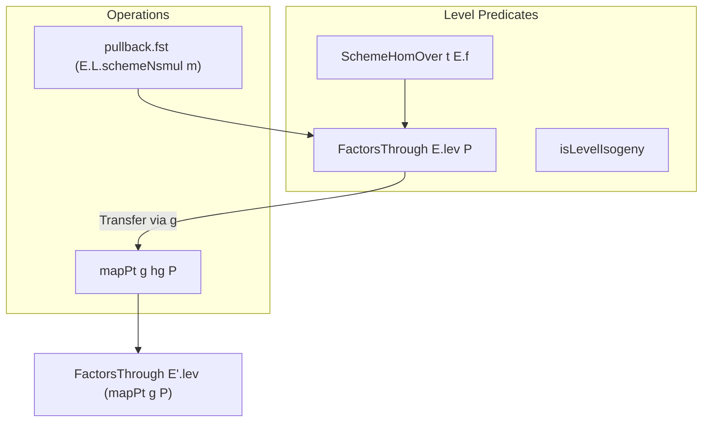

<!-- source: DeepWiki mcp.deepwiki.com · repo anthropics/fermats-last-theorem · page 4.2 Fake Elliptic Curves and QM Moduli Spaces · fetched 2026-10-26 -->

# Fake Elliptic Curves and QM Moduli Spaces

Relevant source files

The following files were used as context for generating this wiki page:

- [P2M/Sol/S_CerednikDrinfeld_QM_FakeEllipticCurve_ExtraLevel_exists_isClosed_range_subset_iff_forall_factorsThrough_iff.lean](P2M/Sol/S_CerednikDrinfeld_QM_FakeEllipticCurve_ExtraLevel_exists_isClosed_range_subset_iff_forall_factorsThrough_iff.lean)
- [P2M/Sol/S_CerednikDrinfeld_QM_FakeEllipticCurve_ExtraLevel_exists_submodule_relIndex_eq_forall_factorsThrough_iff.lean](P2M/Sol/S_CerednikDrinfeld_QM_FakeEllipticCurve_ExtraLevel_exists_submodule_relIndex_eq_forall_factorsThrough_iff.lean)
- [P2M/Sol/S_CerednikDrinfeld_QM_FakeEllipticCurve_ExtraLevel_exists_transfer_forall_factorsThrough_iff.lean](P2M/Sol/S_CerednikDrinfeld_QM_FakeEllipticCurve_ExtraLevel_exists_transfer_forall_factorsThrough_iff.lean)
- [P2M/Sol/S_CerednikDrinfeld_QM_FakeEllipticCurve_FullLevel_exists_extraLevel_forall_factorsThrough_iff.lean](P2M/Sol/S_CerednikDrinfeld_QM_FakeEllipticCurve_FullLevel_exists_extraLevel_forall_factorsThrough_iff.lean)
- [P2M/Sol/S_CerednikDrinfeld_QM_FakeEllipticCurve_FullLevel_exists_forall_factorsThrough_iff_of_mul_mem.lean](P2M/Sol/S_CerednikDrinfeld_QM_FakeEllipticCurve_FullLevel_exists_forall_factorsThrough_iff_of_mul_mem.lean)
- [P2M/Sol/S_CerednikDrinfeld_QM_FakeEllipticCurve_FullLevel_exists_isClosed_range_subset_iff_forall_factorsThrough_lev_imp_eq_one.lean](P2M/Sol/S_CerednikDrinfeld_QM_FakeEllipticCurve_FullLevel_exists_isClosed_range_subset_iff_forall_factorsThrough_lev_imp_eq_one.lean)
- [P2M/Sol/S_CerednikDrinfeld_QM_FakeEllipticCurve_FullLevel_forall_factorsThrough_iff_of_mul_mem_of_sectionAt_eq.lean](P2M/Sol/S_CerednikDrinfeld_QM_FakeEllipticCurve_FullLevel_forall_factorsThrough_iff_of_mul_mem_of_sectionAt_eq.lean)
- [P2M/Sol/S_CerednikDrinfeld_QM_FakeEllipticCurve_WithExtraLevel_exists_fin_forall_factorsThrough_mapPt_iff_of_iso_of_dvd.lean](P2M/Sol/S_CerednikDrinfeld_QM_FakeEllipticCurve_WithExtraLevel_exists_fin_forall_factorsThrough_mapPt_iff_of_iso_of_dvd.lean)
- [P2M/Sol/S_CerednikDrinfeld_QM_FakeEllipticCurve_WithExtraLevel_exists_fin_forall_isLevelIsogeny_iso.lean](P2M/Sol/S_CerednikDrinfeld_QM_FakeEllipticCurve_WithExtraLevel_exists_fin_forall_isLevelIsogeny_iso.lean)
- [P2M/Sol/S_CerednikDrinfeld_QM_FakeEllipticCurve_WithExtraLevel_isPullback_of_isAtkinLehnerQuotient_of_isAtkinLehnerQuotient.lean](P2M/Sol/S_CerednikDrinfeld_QM_FakeEllipticCurve_WithExtraLevel_isPullback_of_isAtkinLehnerQuotient_of_isAtkinLehnerQuotient.lean)
- [P2M/Sol/S_CerednikDrinfeld_QM_FakeEllipticCurve_WithExtraLevel_iso_iff_exists_smul_latt_eq_and_smul_lattLev_eq_and_smul_lattK_eq_of_pointEquiv.lean](P2M/Sol/S_CerednikDrinfeld_QM_FakeEllipticCurve_WithExtraLevel_iso_iff_exists_smul_latt_eq_and_smul_lattLev_eq_and_smul_lattK_eq_of_pointEquiv.lean)
- [P2M/Sol/S_CerednikDrinfeld_QM_FakeEllipticCurve_WithExtraLevel_iso_of_forall_mapPt_eq_one_iff_of_forall_factorsThrough_mapPt_iff.lean](P2M/Sol/S_CerednikDrinfeld_QM_FakeEllipticCurve_WithExtraLevel_iso_of_forall_mapPt_eq_one_iff_of_forall_factorsThrough_mapPt_iff.lean)
- [P2M/Sol/S_CerednikDrinfeld_QM_FakeEllipticCurve_WithExtraLevel_iso_of_isAtkinLehnerQuotient_comp_of_commRing.lean](P2M/Sol/S_CerednikDrinfeld_QM_FakeEllipticCurve_WithExtraLevel_iso_of_isAtkinLehnerQuotient_comp_of_commRing.lean)
- [P2M/Sol/S_CerednikDrinfeld_QM_FakeEllipticCurve_WithExtraLevel_iso_of_iso_of_forall_factorsThrough_iff_mul.lean](P2M/Sol/S_CerednikDrinfeld_QM_FakeEllipticCurve_WithExtraLevel_iso_of_iso_of_forall_factorsThrough_iff_mul.lean)
- [P2M/Sol/S_CerednikDrinfeld_QM_FakeEllipticCurve_WithExtraLevel_iso_of_iso_of_isAtkinLehnerQuotient_of_isAtkinLehnerQuotient.lean](P2M/Sol/S_CerednikDrinfeld_QM_FakeEllipticCurve_WithExtraLevel_iso_of_iso_of_isAtkinLehnerQuotient_of_isAtkinLehnerQuotient.lean)
- [P2M/Sol/S_CerednikDrinfeld_QM_FakeEllipticCurve_WithExtraLevel_levelExt_setOf_factorsThrough_mapPt_of_dvd.lean](P2M/Sol/S_CerednikDrinfeld_QM_FakeEllipticCurve_WithExtraLevel_levelExt_setOf_factorsThrough_mapPt_of_dvd.lean)
- [P2M/Sol/S_CerednikDrinfeld_QM_FakeEllipticCurve_WithExtraLevel_mapPt_eq_one_iff_factorsThrough_lev_of_dvd.lean](P2M/Sol/S_CerednikDrinfeld_QM_FakeEllipticCurve_WithExtraLevel_mapPt_eq_one_iff_factorsThrough_lev_of_dvd.lean)
- [P2M/Sol/S_CerednikDrinfeld_QM_FakeEllipticCurve_annihilator_ne_of_not_isIso_of_nsmulPt_eq_one.lean](P2M/Sol/S_CerednikDrinfeld_QM_FakeEllipticCurve_annihilator_ne_of_not_isIso_of_nsmulPt_eq_one.lean)
- [P2M/Sol/S_CerednikDrinfeld_QM_FakeEllipticCurve_comp_act_eq_comp_act_of_isPullbackVia_of_isIsogenyPair_of_ker_pow_eq_bot.lean](P2M/Sol/S_CerednikDrinfeld_QM_FakeEllipticCurve_comp_act_eq_comp_act_of_isPullbackVia_of_isIsogenyPair_of_ker_pow_eq_bot.lean)
- [P2M/Sol/S_CerednikDrinfeld_QM_FakeEllipticCurve_existsUnique_or_forall_reducesToZero_of_extraLevels.lean](P2M/Sol/S_CerednikDrinfeld_QM_FakeEllipticCurve_existsUnique_or_forall_reducesToZero_of_extraLevels.lean)
- [P2M/Sol/S_CerednikDrinfeld_QM_FakeEllipticCurve_existsUnique_sectionAt_eq_of_nsmulPt_eq_one.lean](P2M/Sol/S_CerednikDrinfeld_QM_FakeEllipticCurve_existsUnique_sectionAt_eq_of_nsmulPt_eq_one.lean)
- [P2M/Sol/S_CerednikDrinfeld_QM_FakeEllipticCurve_exists_extraLevel_forall_factorsThrough_mapPt_iff.lean](P2M/Sol/S_CerednikDrinfeld_QM_FakeEllipticCurve_exists_extraLevel_forall_factorsThrough_mapPt_iff.lean)
- [P2M/Sol/S_CerednikDrinfeld_QM_FakeEllipticCurve_exists_extraLevel_of_isClosedImmersion_of_equiv_points.lean](P2M/Sol/S_CerednikDrinfeld_QM_FakeEllipticCurve_exists_extraLevel_of_isClosedImmersion_of_equiv_points.lean)
- [P2M/Sol/S_CerednikDrinfeld_QM_FakeEllipticCurve_exists_fin_forall_factorsThrough_iff_of_iso_of_isLevelIsogeny.lean](P2M/Sol/S_CerednikDrinfeld_QM_FakeEllipticCurve_exists_fin_forall_factorsThrough_iff_of_iso_of_isLevelIsogeny.lean)
- [P2M/Sol/S_CerednikDrinfeld_QM_FakeEllipticCurve_exists_fin_forall_not_iso_not_exists_mapPt_mapPt_mul_zpow_eq_zpow_of_level_one.lean](P2M/Sol/S_CerednikDrinfeld_QM_FakeEllipticCurve_exists_fin_forall_not_iso_not_exists_mapPt_mapPt_mul_zpow_eq_zpow_of_level_one.lean)
- [P2M/Sol/S_CerednikDrinfeld_QM_FakeEllipticCurve_exists_generator_torsionPoints_of_isMaximalOrder_of_isIndefiniteRamifiedExactlyAt.lean](P2M/Sol/S_CerednikDrinfeld_QM_FakeEllipticCurve_exists_generator_torsionPoints_of_isMaximalOrder_of_isIndefiniteRamifiedExactlyAt.lean)
- [P2M/Sol/S_CerednikDrinfeld_QM_FakeEllipticCurve_exists_generator_torsionPoints_of_isMaximalOrder_of_prime.lean](P2M/Sol/S_CerednikDrinfeld_QM_FakeEllipticCurve_exists_generator_torsionPoints_of_isMaximalOrder_of_prime.lean)
- [P2M/Sol/S_CerednikDrinfeld_QM_FakeEllipticCurve_exists_hom_comp_eq_nsmulPt_pow_comp_of_isNilpotent_ker.lean](P2M/Sol/S_CerednikDrinfeld_QM_FakeEllipticCurve_exists_hom_comp_eq_nsmulPt_pow_comp_of_isNilpotent_ker.lean)
- [P2M/Sol/S_CerednikDrinfeld_QM_FakeEllipticCurve_exists_hom_comp_eq_nsmulPt_pow_comp_of_squareZero.lean](P2M/Sol/S_CerednikDrinfeld_QM_FakeEllipticCurve_exists_hom_comp_eq_nsmulPt_pow_comp_of_squareZero.lean)
- [P2M/Sol/S_CerednikDrinfeld_QM_FakeEllipticCurve_exists_isClopen_genLocus_schemeKer.lean](P2M/Sol/S_CerednikDrinfeld_QM_FakeEllipticCurve_exists_isClopen_genLocus_schemeKer.lean)
- [P2M/Sol/S_CerednikDrinfeld_QM_FakeEllipticCurve_exists_isInvertible_pullback_iso_of_rosatiCompatible_of_ker_mul_maximalIdeal_of_isArtinianRing_of_isAlgClosed.lean](P2M/Sol/S_CerednikDrinfeld_QM_FakeEllipticCurve_exists_isInvertible_pullback_iso_of_rosatiCompatible_of_ker_mul_maximalIdeal_of_isArtinianRing_of_isAlgClosed.lean)
- [P2M/Sol/S_CerednikDrinfeld_QM_FakeEllipticCurve_exists_pushPt_act_ne_one_of_dvd_nrd_of_eq_or_eq.lean](P2M/Sol/S_CerednikDrinfeld_QM_FakeEllipticCurve_exists_pushPt_act_ne_one_of_dvd_nrd_of_eq_or_eq.lean)
- [P2M/Sol/S_CerednikDrinfeld_QM_FakeEllipticCurve_exists_quotient_core_of_isAlgClosed.lean](P2M/Sol/S_CerednikDrinfeld_QM_FakeEllipticCurve_exists_quotient_core_of_isAlgClosed.lean)
- [P2M/Sol/S_CerednikDrinfeld_QM_FakeEllipticCurve_exists_quotient_core_of_isAlgClosed_of_nsmulPt_eq_one.lean](P2M/Sol/S_CerednikDrinfeld_QM_FakeEllipticCurve_exists_quotient_core_of_isAlgClosed_of_nsmulPt_eq_one.lean)
- [P2M/Sol/S_CerednikDrinfeld_QM_FakeEllipticCurve_exists_quotient_of_finiteFlat_stable_subgroup.lean](P2M/Sol/S_CerednikDrinfeld_QM_FakeEllipticCurve_exists_quotient_of_finiteFlat_stable_subgroup.lean)
- [P2M/Sol/S_CerednikDrinfeld_QM_FakeEllipticCurve_exists_transverseLevelLift_of_dvd.lean](P2M/Sol/S_CerednikDrinfeld_QM_FakeEllipticCurve_exists_transverseLevelLift_of_dvd.lean)
- [P2M/Sol/S_CerednikDrinfeld_QM_FakeEllipticCurve_exists_zmod_prod_equiv_factorsThrough_kernel_dual_of_not_dvd.lean](P2M/Sol/S_CerednikDrinfeld_QM_FakeEllipticCurve_exists_zmod_prod_equiv_factorsThrough_kernel_dual_of_not_dvd.lean)
- [P2M/Sol/S_CerednikDrinfeld_QM_FakeEllipticCurve_forall_factorsThrough_levelPackage_of_isClosedImmersion_of_equiv_points.lean](P2M/Sol/S_CerednikDrinfeld_QM_FakeEllipticCurve_forall_factorsThrough_levelPackage_of_isClosedImmersion_of_equiv_points.lean)
- [P2M/Sol/S_CerednikDrinfeld_QM_FakeEllipticCurve_forall_mapPt_eq_one_of_isLevelIsogeny_of_exists_factorsThrough_ne_one.lean](P2M/Sol/S_CerednikDrinfeld_QM_FakeEllipticCurve_forall_mapPt_eq_one_of_isLevelIsogeny_of_exists_factorsThrough_ne_one.lean)
- [P2M/Sol/S_CerednikDrinfeld_QM_FakeEllipticCurve_hasFrobeniusVerschiebung_of_isLevelIsogeny_of_exists_factorsThrough_ne_one.lean](P2M/Sol/S_CerednikDrinfeld_QM_FakeEllipticCurve_hasFrobeniusVerschiebung_of_isLevelIsogeny_of_exists_factorsThrough_ne_one.lean)
- [P2M/Sol/S_CerednikDrinfeld_QM_FakeEllipticCurve_hasFrobeniusVerschiebung_of_iso.lean](P2M/Sol/S_CerednikDrinfeld_QM_FakeEllipticCurve_hasFrobeniusVerschiebung_of_iso.lean)
- [P2M/Sol/S_CerednikDrinfeld_QM_FakeEllipticCurve_heckeNeighbour_iff_exists_isLevelIsogeny.lean](P2M/Sol/S_CerednikDrinfeld_QM_FakeEllipticCurve_heckeNeighbour_iff_exists_isLevelIsogeny.lean)
- [P2M/Sol/S_CerednikDrinfeld_QM_FakeEllipticCurve_heckeNeighbour_of_isAtkinLehnerQuotient.lean](P2M/Sol/S_CerednikDrinfeld_QM_FakeEllipticCurve_heckeNeighbour_of_isAtkinLehnerQuotient.lean)
- [P2M/Sol/S_CerednikDrinfeld_QM_FakeEllipticCurve_isAtkinLehnerQuotient_of_iso_of_iso.lean](P2M/Sol/S_CerednikDrinfeld_QM_FakeEllipticCurve_isAtkinLehnerQuotient_of_iso_of_iso.lean)
- [P2M/Sol/S_CerednikDrinfeld_QM_FakeEllipticCurve_isOpen_setOf_forall_factorsThrough_lev_imp_eq_one_smul_fullLevel.lean](P2M/Sol/S_CerednikDrinfeld_QM_FakeEllipticCurve_isOpen_setOf_forall_factorsThrough_lev_imp_eq_one_smul_fullLevel.lean)
- [P2M/Sol/S_CerednikDrinfeld_QM_FakeEllipticCurve_isPullback_of_isAtkinLehnerQuotient_of_isAtkinLehnerQuotient.lean](P2M/Sol/S_CerednikDrinfeld_QM_FakeEllipticCurve_isPullback_of_isAtkinLehnerQuotient_of_isAtkinLehnerQuotient.lean)
- [P2M/Sol/S_CerednikDrinfeld_QM_FakeEllipticCurve_isReduced_pullback_one_of_natCast_ne_zero.lean](P2M/Sol/S_CerednikDrinfeld_QM_FakeEllipticCurve_isReduced_pullback_one_of_natCast_ne_zero.lean)
- [P2M/Sol/S_CerednikDrinfeld_QM_FakeEllipticCurve_iso_frobeniusTwist_of_isLevelIsogeny_of_forall_factorsThrough_eq_one.lean](P2M/Sol/S_CerednikDrinfeld_QM_FakeEllipticCurve_iso_frobeniusTwist_of_isLevelIsogeny_of_forall_factorsThrough_eq_one.lean)
- [P2M/Sol/S_CerednikDrinfeld_QM_FakeEllipticCurve_iso_iff_exists_smul_latt_eq_and_smul_lattLev_eq_of_pointEquiv.lean](P2M/Sol/S_CerednikDrinfeld_QM_FakeEllipticCurve_iso_iff_exists_smul_latt_eq_and_smul_lattLev_eq_of_pointEquiv.lean)
- [P2M/Sol/S_CerednikDrinfeld_QM_FakeEllipticCurve_iso_iff_exists_smul_latt_eq_of_pointEquiv.lean](P2M/Sol/S_CerednikDrinfeld_QM_FakeEllipticCurve_iso_iff_exists_smul_latt_eq_of_pointEquiv.lean)
- [P2M/Sol/S_CerednikDrinfeld_QM_FakeEllipticCurve_iso_of_isAtkinLehnerQuotient_comp.lean](P2M/Sol/S_CerednikDrinfeld_QM_FakeEllipticCurve_iso_of_isAtkinLehnerQuotient_comp.lean)
- [P2M/Sol/S_CerednikDrinfeld_QM_FakeEllipticCurve_iso_of_isLevelIsogeny_of_isFrobeniusKernel.lean](P2M/Sol/S_CerednikDrinfeld_QM_FakeEllipticCurve_iso_of_isLevelIsogeny_of_isFrobeniusKernel.lean)
- [P2M/Sol/S_CerednikDrinfeld_QM_FakeEllipticCurve_iso_of_isLevelIsogeny_of_isLevelIsogeny.lean](P2M/Sol/S_CerednikDrinfeld_QM_FakeEllipticCurve_iso_of_isLevelIsogeny_of_isLevelIsogeny.lean)
- [P2M/Sol/S_CerednikDrinfeld_QM_FakeEllipticCurve_iso_of_iso_of_isAtkinLehnerQuotient_of_isAtkinLehnerQuotient.lean](P2M/Sol/S_CerednikDrinfeld_QM_FakeEllipticCurve_iso_of_iso_of_isAtkinLehnerQuotient_of_isAtkinLehnerQuotient.lean)
- [P2M/Sol/S_CerednikDrinfeld_QM_FakeEllipticCurve_iso_of_quotient_ker_of_mapPt_mapPt_mul_zpow_eq_zpow.lean](P2M/Sol/S_CerednikDrinfeld_QM_FakeEllipticCurve_iso_of_quotient_ker_of_mapPt_mapPt_mul_zpow_eq_zpow.lean)
- [P2M/Sol/S_CerednikDrinfeld_QM_FakeEllipticCurve_natCard_properLine_image_subset_lev.lean](P2M/Sol/S_CerednikDrinfeld_QM_FakeEllipticCurve_natCard_properLine_image_subset_lev.lean)
- [P2M/Sol/S_CerednikDrinfeld_QM_IsCoarseModuli_exists_atkinLehner_involution.lean](P2M/Sol/S_CerednikDrinfeld_QM_IsCoarseModuli_exists_atkinLehner_involution.lean)
- [P2M/Sol/S_CerednikDrinfeld_QM_IsCoarseModuli_exists_atkinLehner_involution_of_isUnit.lean](P2M/Sol/S_CerednikDrinfeld_QM_IsCoarseModuli_exists_atkinLehner_involution_of_isUnit.lean)
- [P2M/Sol/S_CerednikDrinfeld_QM_IsFineModuli_exists_algFunctor_represents_rigidifiedCurve_strata_unramified.lean](P2M/Sol/S_CerednikDrinfeld_QM_IsFineModuli_exists_algFunctor_represents_rigidifiedCurve_strata_unramified.lean)
- [P2M/Sol/S_CerednikDrinfeld_QM_IsFineModuli_mem_of_ptF_comp_eq_of_rigid.lean](P2M/Sol/S_CerednikDrinfeld_QM_IsFineModuli_mem_of_ptF_comp_eq_of_rigid.lean)
- [P2M/Sol/S_CerednikDrinfeld_QM_ModuliTowerWitness_tower_laws_of_two_mul_dvd.lean](P2M/Sol/S_CerednikDrinfeld_QM_ModuliTowerWitness_tower_laws_of_two_mul_dvd.lean)
- [P2M/Sol/S_CerednikDrinfeld_QM_WithFullLevel_iso_of_smul_latt_subset_of_level_iff_of_generator.lean](P2M/Sol/S_CerednikDrinfeld_QM_WithFullLevel_iso_of_smul_latt_subset_of_level_iff_of_generator.lean)
- [P2M/Sol/S_GoodReductionJacobian_RelativeGroupLaw_exists_image_closedSubgroup_of_isFinite.lean](P2M/Sol/S_GoodReductionJacobian_RelativeGroupLaw_exists_image_closedSubgroup_of_isFinite.lean)
- [P2M/Sol/S_GoodReductionJacobian_RelativeGroupLaw_isReduced_pullback_schemeKerStr_residueField_of_isUnit.lean](P2M/Sol/S_GoodReductionJacobian_RelativeGroupLaw_isReduced_pullback_schemeKerStr_residueField_of_isUnit.lean)
- [P2M/Sol/S_GoodReductionJacobian_RelativeGroupLaw_isReduced_schemeKer_of_flat_schemeNsmul_of_isUnit.lean](P2M/Sol/S_GoodReductionJacobian_RelativeGroupLaw_isReduced_schemeKer_of_flat_schemeNsmul_of_isUnit.lean)
- [P2M/Sol/S_Matrix_exists_submodule_addEquiv_zmod_pow_succ_of_addEquiv_zmod_pow.lean](P2M/Sol/S_Matrix_exists_submodule_addEquiv_zmod_pow_succ_of_addEquiv_zmod_pow.lean)
- [P2M/Sol/S_Matrix_natCard_leftIdeal_ne_bot_ne_top_eq_and_inf_eq_bot.lean](P2M/Sol/S_Matrix_natCard_leftIdeal_ne_bot_ne_top_eq_and_inf_eq_bot.lean)

The theory of **Fake Elliptic Curves (FECs)** provides the geometric foundation for the Čerednik-Drinfeld p-adic uniformization of Shimura curves. In this codebase, a Fake Elliptic Curve is defined as an abelian surface equipped with an action by a maximal order in a quaternion algebra (Quaternion Multiplication, or QM). These objects serve as the points for the fine moduli schemes used to construct the integral models of modular curves.

## FakeEllipticCurve and QM Action

A `FakeEllipticCurve` is a structure that bundles an abelian scheme with a prescribed action by a quaternion order $\mathcal{O}_D$.

*   **Abelian Surface**: Represented by a `RelativeGroupLaw` $L$ over a base scheme $S$ [P2M/Sol/S_CerednikDrinfeld_QM_FakeEllipticCurve_FullLevel_exists_extraLevel_forall_factorsThrough_iff.lean:26-28]().
*   **QM Action**: The action of the quaternion order $\Lambda$ is defined via the `act` function, which maps elements of the lattice to endomorphisms of the abelian scheme [P2M/Sol/S_CerednikDrinfeld_QM_FakeEllipticCurve_FullLevel_exists_extraLevel_forall_factorsThrough_iff.lean:75-78]().
*   **Linearity**: The action is compatible with the group law, satisfying `pushPt (E.act x) ... (E.L.mul ...) = E.L.mul ...` [P2M/Sol/S_CerednikDrinfeld_QM_FakeEllipticCurve_FullLevel_exists_extraLevel_forall_factorsThrough_iff.lean:77-83]().

### Mapping Natural Language to Code Entities (QM Action)

| Mathematical Concept | Code Entity | File Reference |
| :--- | :--- | :--- |
| **Fake Elliptic Curve** | `FakeEllipticCurve` | [P2M/Sol/S_CerednikDrinfeld_QM_FakeEllipticCurve_FullLevel_exists_extraLevel_forall_factorsThrough_iff.lean:75]() |
| **Quaternion Order** | `Λ : Submodule ℤ ℍ[ℚ, a, b]` | [P2M/Sol/S_CerednikDrinfeld_QM_FakeEllipticCurve_FullLevel_exists_extraLevel_forall_factorsThrough_iff.lean:75]() |
| **Group Law** | `RelativeGroupLaw` | [P2M/Sol/S_CerednikDrinfeld_QM_FakeEllipticCurve_FullLevel_exists_extraLevel_forall_factorsThrough_iff.lean:26]() |
| **Endomorphism** | `E.act x` | [P2M/Sol/S_CerednikDrinfeld_QM_FakeEllipticCurve_FullLevel_exists_extraLevel_forall_factorsThrough_iff.lean:77]() |
| **Scalar Mult.** | `nsmulPt` | [P2M/Sol/S_CerednikDrinfeld_QM_FakeEllipticCurve_FullLevel_exists_extraLevel_forall_factorsThrough_iff.lean:46]() |

**Sources:** [P2M/Sol/S_CerednikDrinfeld_QM_FakeEllipticCurve_FullLevel_exists_extraLevel_forall_factorsThrough_iff.lean:23-91]().

## Level Structures and FactorsThrough

Level structures are encoded via the `lev` property and the `FactorsThrough` predicate. A point $P$ on the curve is said to factor through a level structure if it lies in the kernel of a specific isogeny or torsion subgroup.

*   **FactorsThrough**: A predicate determining if a `SchemeHomOver` factors through a specific level immersion [P2M/Sol/S_CerednikDrinfeld_QM_FakeEllipticCurve_iso_iff_exists_smul_latt_eq_and_smul_lattLev_eq_of_pointEquiv.lean:110-113]().
*   **FullLevel and ExtraLevel**: These represent different levels of torsion data (e.g., $\Gamma_0(N)$ vs $\Gamma(N)$). The existence of `ExtraLevel` structures is often proved via the existence of transverse lifts [P2M/Sol/S_CerednikDrinfeld_QM_FakeEllipticCurve_exists_transverseLevelLift_of_dvd.lean:1-20]().
*   **Scheme Kernel**: The kernel of the $m$-multiplication map is defined as a pullback `pullback.fst (E.L.schemeNsmul m) (E.L.one (𝟙 _)).1` [P2M/Sol/S_CerednikDrinfeld_QM_FakeEllipticCurve_FullLevel_exists_extraLevel_forall_factorsThrough_iff.lean:97-103]().

### Data Flow: Level Verification

**Sources:** [P2M/Sol/S_CerednikDrinfeld_QM_FakeEllipticCurve_FullLevel_exists_extraLevel_forall_factorsThrough_iff.lean:94-104](), [P2M/Sol/S_CerednikDrinfeld_QM_FakeEllipticCurve_iso_iff_exists_smul_latt_eq_and_smul_lattLev_eq_of_pointEquiv.lean:108-119]().

## Hecke Neighbors and Isogenies

Hecke operators on the moduli space are realized geometrically via Hecke neighbors—curves related by specific isogenies.

*   **HeckeNeighbor**: A relation between two FECs where the kernel of the connecting isogeny is a specific type of torsion subgroup [P2M/Sol/S_CerednikDrinfeld_QM_FakeEllipticCurve_heckeNeighbour_iff_exists_isLevelIsogeny.lean:1-15]().
*   **IsLevelIsogeny**: A morphism between FECs that respects the QM action and the level structures. The existence of such an isogeny is equivalent to the curves being Hecke neighbors [P2M/Sol/S_CerednikDrinfeld_QM_FakeEllipticCurve_heckeNeighbour_iff_exists_isLevelIsogeny.lean:15]().
*   **Kernel Structure**: For a prime $p$, the $p$-Hecke neighbors correspond to isogenies whose kernels are $\mathcal{O}_D$-invariant subgroups of the $p$-torsion [P2M/Sol/S_CerednikDrinfeld_QM_FakeEllipticCurve_heckeNeighbour_iff_exists_isLevelIsogeny.lean:10-13]().

**Sources:** [P2M/Sol/S_CerednikDrinfeld_QM_FakeEllipticCurve_heckeNeighbour_iff_exists_isLevelIsogeny.lean:1-17](), [P2M/Sol/S_CerednikDrinfeld_QM_ModuliTowerWitness_tower_laws_of_two_mul_dvd.lean:14-28]().

## Moduli Schemes and Fine Moduli

The codebase defines properties for the moduli spaces that parameterize FECs.

*   **IsFineModuli**: A predicate indicating that the moduli scheme $M$ represents the functor of FECs with level structures. This involves verifying that every point on $M$ corresponds to a unique (up to isomorphism) FEC [P2M/Sol/S_CerednikDrinfeld_QM_FakeEllipticCurve_FullLevel_exists_extraLevel_forall_factorsThrough_iff.lean:2-3]().
*   **Atkin-Lehner Involution**: An automorphism of the moduli space induced by a specific element of the quaternion algebra that swaps level structures or shifts the QM action [P2M/Sol/S_CerednikDrinfeld_QM_ModuliTowerWitness_tower_laws_of_two_mul_dvd.lean:14-21]().
*   **IsAtkinLehnerQuotient**: A predicate used to construct the quotient of the moduli space by the Atkin-Lehner action [P2M/Sol/S_CerednikDrinfeld_QM_ModuliTowerWitness_tower_laws_of_two_mul_dvd.lean:15-18]().

### Mapping Natural Language to Code Entities (Moduli)

| Mathematical Concept | Code Entity | File Reference |
| :--- | :--- | :--- |
| **Fine Moduli Scheme** | `IsFineModuli` | [P2M/Sol/S_CerednikDrinfeld_QM_FakeEllipticCurve_FullLevel_exists_extraLevel_forall_factorsThrough_iff.lean:3]() |
| **Atkin-Lehner** | `isAtkinLehnerQuotient` | [P2M/Sol/S_CerednikDrinfeld_QM_ModuliTowerWitness_tower_laws_of_two_mul_dvd.lean:15]() |
| **Isogeny** | `isLevelIsogeny` | [P2M/Sol/S_CerednikDrinfeld_QM_ModuliTowerWitness_tower_laws_of_two_mul_dvd.lean:24]() |
| **Reduced Locus** | `isReduced_C_of_natCast_ne_zero` | [P2M/Sol/S_CerednikDrinfeld_QM_FakeEllipticCurve_iso_iff_exists_smul_latt_eq_and_smul_lattLev_eq_of_pointEquiv.lean:10]() |

**Sources:** [P2M/Sol/S_CerednikDrinfeld_QM_ModuliTowerWitness_tower_laws_of_two_mul_dvd.lean:1-30](), [P2M/Sol/S_CerednikDrinfeld_QM_FakeEllipticCurve_iso_iff_exists_smul_latt_eq_and_smul_lattLev_eq_of_pointEquiv.lean:1-12]().

## Key Theorems and Proof Steps

1.  **Isomorphism Criteria**: Two FECs are isomorphic if and only if their period lattices and level structures are related by a scalar in the quaternion algebra [P2M/Sol/S_CerednikDrinfeld_QM_FakeEllipticCurve_iso_iff_exists_smul_latt_eq_and_smul_lattLev_eq_of_pointEquiv.lean:108-119]().
2.  **Etale Kernels**: The kernel of the $m$-multiplication map is finite and etale when $m$ is invertible in the base ring [P2M/Sol/S_CerednikDrinfeld_QM_FakeEllipticCurve_FullLevel_exists_extraLevel_forall_factorsThrough_iff.lean:5]().
3.  **Existence of Level Lifts**: Given a FEC with level $N$, one can construct a lift to level $M$ (where $N|M$) provided certain transversality conditions are met [P2M/Sol/S_CerednikDrinfeld_QM_FakeEllipticCurve_exists_transverseLevelLift_of_dvd.lean:21-23]().
4.  **Points over AlgClosed Fields**: Over an algebraically closed field $K$, the number of $m$-torsion points is exactly $m^4$ (for an abelian surface) [P2M/Sol/S_CerednikDrinfeld_QM_FakeEllipticCurve_ExtraLevel_exists_isClosed_range_subset_iff_forall_factorsThrough_iff.lean:11-12]().

**Sources:** [P2M/Sol/S_CerednikDrinfeld_QM_FakeEllipticCurve_FullLevel_exists_extraLevel_forall_factorsThrough_iff.lean:5-9](), [P2M/Sol/S_CerednikDrinfeld_QM_FakeEllipticCurve_exists_transverseLevelLift_of_dvd.lean:1-20](), [P2M/Sol/S_CerednikDrinfeld_QM_FakeEllipticCurve_forall_factorsThrough_levelPackage_of_isClosedImmersion_of_equiv_points.lean:82-129]().

---

