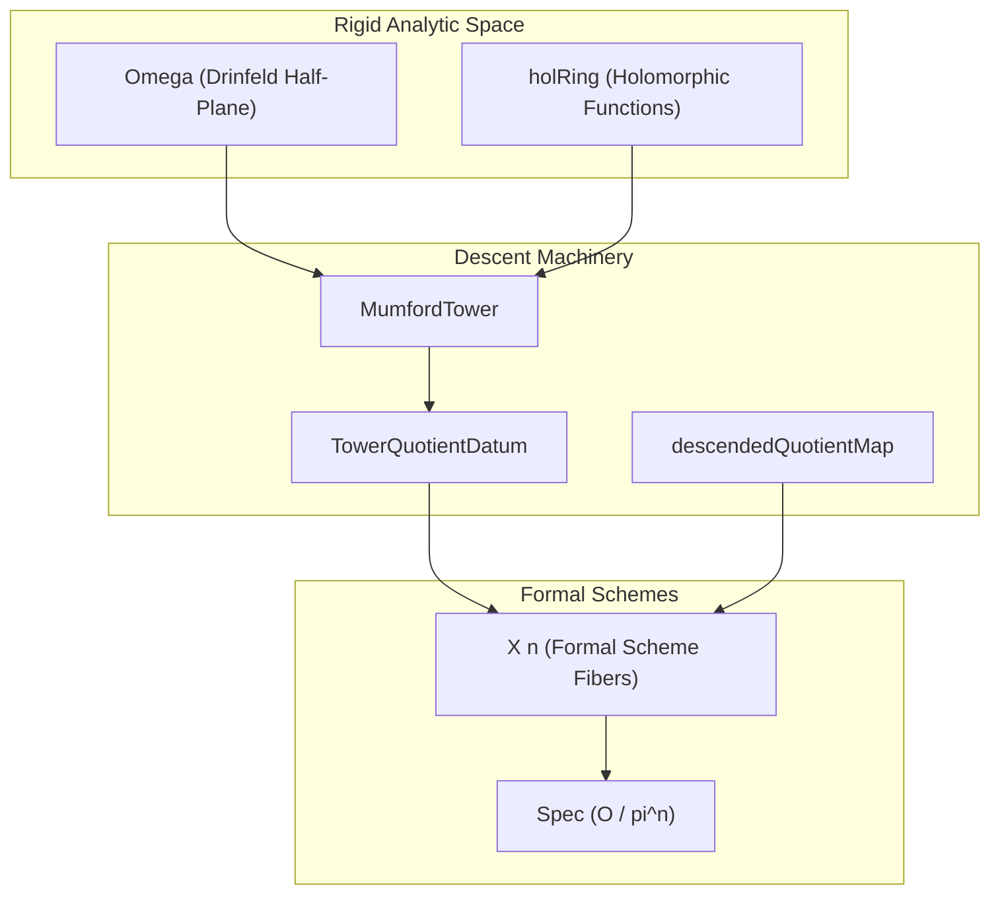
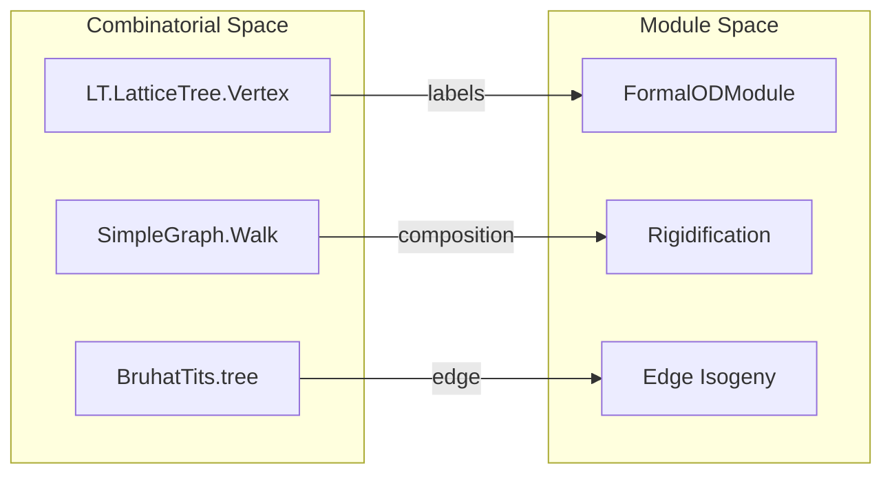

<!-- source: DeepWiki mcp.deepwiki.com · repo anthropics/fermats-last-theorem · page 4.4 Formal OD-Modules and the Drinfeld Upper Half-Plane · fetched 2026-10-26 -->

# Formal OD-Modules and the Drinfeld Upper Half-Plane

Relevant source files

The following files were used as context for generating this wiki page:

- [Definitions/Def_CerednikDrinfeld_DrinfeldHolomorphic.lean](Definitions/Def_CerednikDrinfeld_DrinfeldHolomorphic.lean)
- [P2M/Sol/S_AlgebraicCurve_Pic0_exists_periodDatum_Q_mul_period_eq_one_of_mumfordQuotient.lean](P2M/Sol/S_AlgebraicCurve_Pic0_exists_periodDatum_Q_mul_period_eq_one_of_mumfordQuotient.lean)
- [P2M/Sol/S_AlgebraicCurve_Pic0_exists_torusPoints_uniformization_of_periodDatum_of_mumfordQuotient_of_v_card_stabilizer_eq_one.lean](P2M/Sol/S_AlgebraicCurve_Pic0_exists_torusPoints_uniformization_of_periodDatum_of_mumfordQuotient_of_v_card_stabilizer_eq_one.lean)
- [P2M/Sol/S_AlgebraicCurve_Pic0_periodPairing_pullback_eq_periodPairing_pushforward_of_mumfordQuotient_theta.lean](P2M/Sol/S_AlgebraicCurve_Pic0_periodPairing_pullback_eq_periodPairing_pushforward_of_mumfordQuotient_theta.lean)
- [P2M/Sol/S_AlgebraicGeometry_RelPicard_smooth_of_representsRelSubPic_algEquivZeroCut_of_finiteMapData.lean](P2M/Sol/S_AlgebraicGeometry_RelPicard_smooth_of_representsRelSubPic_algEquivZeroCut_of_finiteMapData.lean)
- [P2M/Sol/S_AlgebraicGeometry_RelPicard_smooth_of_representsRelSubPic_algEquivZeroCut_of_twoAffineOpenCover.lean](P2M/Sol/S_AlgebraicGeometry_RelPicard_smooth_of_representsRelSubPic_algEquivZeroCut_of_twoAffineOpenCover.lean)
- [P2M/Sol/S_AlgebraicGeometry_Scheme_existsUnique_nilpPoints_factor_of_quotient_of_isAffine_of_isAffine_of_isNoetherianRing.lean](P2M/Sol/S_AlgebraicGeometry_Scheme_existsUnique_nilpPoints_factor_of_quotient_of_isAffine_of_isAffine_of_isNoetherianRing.lean)
- [P2M/Sol/S_AlgebraicGeometry_exists_sum_appLE_mul_appLE_ne_zero_and_forall_eq_zero_of_ne_of_isSeparated.lean](P2M/Sol/S_AlgebraicGeometry_exists_sum_appLE_mul_appLE_ne_zero_and_forall_eq_zero_of_ne_of_isSeparated.lean)
- [P2M/Sol/S_CerednikDrinfeld_FormalODModule_bijOn_lambda_etaPiece_of_isCanonicalLMap_of_charP.lean](P2M/Sol/S_CerednikDrinfeld_FormalODModule_bijOn_lambda_etaPiece_of_isCanonicalLMap_of_charP.lean)
- [P2M/Sol/S_CerednikDrinfeld_FormalODModule_bijOn_lambda_etaPiece_of_isCanonicalLMap_of_forall_exists.lean](P2M/Sol/S_CerednikDrinfeld_FormalODModule_bijOn_lambda_etaPiece_of_isCanonicalLMap_of_forall_exists.lean)
- [P2M/Sol/S_CerednikDrinfeld_FormalODModule_bijOn_lambda_etaPiece_of_isCanonicalLMap_of_forall_exists_of_charP.lean](P2M/Sol/S_CerednikDrinfeld_FormalODModule_bijOn_lambda_etaPiece_of_isCanonicalLMap_of_forall_exists_of_charP.lean)
- [P2M/Sol/S_CerednikDrinfeld_FormalODModule_eq_zero_of_forall_nMap_baseChange_eq_zero.lean](P2M/Sol/S_CerednikDrinfeld_FormalODModule_eq_zero_of_forall_nMap_baseChange_eq_zero.lean)
- [P2M/Sol/S_CerednikDrinfeld_FormalODModule_eq_zero_of_nsmul_eq_zero_of_mem_eta.lean](P2M/Sol/S_CerednikDrinfeld_FormalODModule_eq_zero_of_nsmul_eq_zero_of_mem_eta.lean)
- [P2M/Sol/S_CerednikDrinfeld_FormalODModule_exists_isEtaSection_one_tangent_eq_neg_mul_of_edge_isogeny_of_apply_xi_eq_zero_of_apply_eta_ne_zero.lean](P2M/Sol/S_CerednikDrinfeld_FormalODModule_exists_isEtaSection_one_tangent_eq_neg_mul_of_edge_isogeny_of_apply_xi_eq_zero_of_apply_eta_ne_zero.lean)
- [P2M/Sol/S_CerednikDrinfeld_FormalODModule_exists_isEtaSection_one_tangent_eq_neg_mul_of_edge_isogeny_of_apply_xi_ne_zero.lean](P2M/Sol/S_CerednikDrinfeld_FormalODModule_exists_isEtaSection_one_tangent_eq_neg_mul_of_edge_isogeny_of_apply_xi_ne_zero.lean)
- [P2M/Sol/S_CerednikDrinfeld_FormalODModule_exists_isEtaSection_zero_tangent_eq_neg_mul_of_edge_isogeny_of_apply_xi_eq_zero_of_apply_eta_ne_zero.lean](P2M/Sol/S_CerednikDrinfeld_FormalODModule_exists_isEtaSection_zero_tangent_eq_neg_mul_of_edge_isogeny_of_apply_xi_eq_zero_of_apply_eta_ne_zero.lean)
- [P2M/Sol/S_CerednikDrinfeld_FormalODModule_exists_isEtaSection_zero_tangent_eq_neg_mul_of_edge_isogeny_of_apply_xi_ne_zero.lean](P2M/Sol/S_CerednikDrinfeld_FormalODModule_exists_isEtaSection_zero_tangent_eq_neg_mul_of_edge_isogeny_of_apply_xi_ne_zero.lean)
- [P2M/Sol/S_CerednikDrinfeld_FormalODModule_exists_nVarpi_eq_of_mem_etaPiece_one_of_toLieQuot_eq.lean](P2M/Sol/S_CerednikDrinfeld_FormalODModule_exists_nVarpi_eq_of_mem_etaPiece_one_of_toLieQuot_eq.lean)
- [P2M/Sol/S_CerednikDrinfeld_FormalODModule_exists_nVarpi_eq_of_mem_etaPiece_zero_of_toLieQuot_eq.lean](P2M/Sol/S_CerednikDrinfeld_FormalODModule_exists_nVarpi_eq_of_mem_etaPiece_zero_of_toLieQuot_eq.lean)
- [P2M/Sol/S_CerednikDrinfeld_FormalODModule_exists_nVarpi_eq_of_mem_etaPiece_zero_of_toLieQuot_eq_of_critical_one.lean](P2M/Sol/S_CerednikDrinfeld_FormalODModule_exists_nVarpi_eq_of_mem_etaPiece_zero_of_toLieQuot_eq_of_critical_one.lean)
- [P2M/Sol/S_CerednikDrinfeld_FormalODModule_isCanonicalLMap_apply_eq_nMk_of_charP.lean](P2M/Sol/S_CerednikDrinfeld_FormalODModule_isCanonicalLMap_apply_eq_nMk_of_charP.lean)
- [P2M/Sol/S_CerednikDrinfeld_FormalODModule_isCanonicalLMap_apply_eq_nMk_of_verschiebungInt_eq_endAct_varpiEnd.lean](P2M/Sol/S_CerednikDrinfeld_FormalODModule_isCanonicalLMap_apply_eq_nMk_of_verschiebungInt_eq_endAct_varpiEnd.lean)
- [P2M/Sol/S_CerednikDrinfeld_FormalODModule_lattice_eq_of_isCartierQuadruple_map_edge_of_apply_xi_eq_zero_of_apply_eta_ne_zero.lean](P2M/Sol/S_CerednikDrinfeld_FormalODModule_lattice_eq_of_isCartierQuadruple_map_edge_of_apply_xi_eq_zero_of_apply_eta_ne_zero.lean)
- [P2M/Sol/S_CerednikDrinfeld_FormalODModule_lattice_eq_of_isCartierQuadruple_map_edge_of_apply_xi_ne_zero.lean](P2M/Sol/S_CerednikDrinfeld_FormalODModule_lattice_eq_of_isCartierQuadruple_map_edge_of_apply_xi_ne_zero.lean)
- [P2M/Sol/S_CerednikDrinfeld_FormalODModule_mem_etaPiece_iff_of_isCanonicalLMap_apply_eq_nMk.lean](P2M/Sol/S_CerednikDrinfeld_FormalODModule_mem_etaPiece_iff_of_isCanonicalLMap_apply_eq_nMk.lean)
- [P2M/Sol/S_CerednikDrinfeld_FormalODModule_mem_etaPiece_iff_of_isCanonicalLMap_apply_eq_nMk_of_charP.lean](P2M/Sol/S_CerednikDrinfeld_FormalODModule_mem_etaPiece_iff_of_isCanonicalLMap_apply_eq_nMk_of_charP.lean)
- [P2M/Sol/S_CerednikDrinfeld_FormalODModule_nMap_bijOn_etaPiece_of_eq_baseChangeEq_of_surjective_of_mul_eq_zero.lean](P2M/Sol/S_CerednikDrinfeld_FormalODModule_nMap_bijOn_etaPiece_of_eq_baseChangeEq_of_surjective_of_mul_eq_zero.lean)
- [P2M/Sol/S_CerednikDrinfeld_FormalODModule_nMap_bijOn_eta_of_eq_baseChangeEq_mk.lean](P2M/Sol/S_CerednikDrinfeld_FormalODModule_nMap_bijOn_eta_of_eq_baseChangeEq_mk.lean)
- [P2M/Sol/S_CerednikDrinfeld_FormalOmega_AlgFunctor_fibre_descent_of_fixed_fst.lean](P2M/Sol/S_CerednikDrinfeld_FormalOmega_AlgFunctor_fibre_descent_of_fixed_fst.lean)
- [P2M/Sol/S_CerednikDrinfeld_FormalOmega_AlgFunctor_formalQuotient_descent.lean](P2M/Sol/S_CerednikDrinfeld_FormalOmega_AlgFunctor_formalQuotient_descent.lean)
- [P2M/Sol/S_CerednikDrinfeld_FormalOmega_MumfordTower_exists_twistedTower.lean](P2M/Sol/S_CerednikDrinfeld_FormalOmega_MumfordTower_exists_twistedTower.lean)
- [P2M/Sol/S_CerednikDrinfeld_FormalOmega_MumfordTower_nonempty_nrPresentation.lean](P2M/Sol/S_CerednikDrinfeld_FormalOmega_MumfordTower_nonempty_nrPresentation.lean)
- [P2M/Sol/S_CerednikDrinfeld_FormalOmega_descendedQuotientMap_adicFib.lean](P2M/Sol/S_CerednikDrinfeld_FormalOmega_descendedQuotientMap_adicFib.lean)
- [P2M/Sol/S_CerednikDrinfeld_FormalOmega_descendedQuotientMap_fib.lean](P2M/Sol/S_CerednikDrinfeld_FormalOmega_descendedQuotientMap_fib.lean)
- [P2M/Sol/S_CerednikDrinfeld_FormalOmega_descendedQuotientMap_fib_adicFib.lean](P2M/Sol/S_CerednikDrinfeld_FormalOmega_descendedQuotientMap_fib_adicFib.lean)
- [P2M/Sol/S_CerednikDrinfeld_FormalOmega_descendedQuotientMap_nrCharts.lean](P2M/Sol/S_CerednikDrinfeld_FormalOmega_descendedQuotientMap_nrCharts.lean)
- [P2M/Sol/S_CerednikDrinfeld_FormalOmega_descendedQuotientMap_nrCharts_comp_rY.lean](P2M/Sol/S_CerednikDrinfeld_FormalOmega_descendedQuotientMap_nrCharts_comp_rY.lean)
- [P2M/Sol/S_CerednikDrinfeld_FormalOmega_descendedQuotientMap_nrCharts_isOpen_and_cover.lean](P2M/Sol/S_CerednikDrinfeld_FormalOmega_descendedQuotientMap_nrCharts_isOpen_and_cover.lean)
- [P2M/Sol/S_CerednikDrinfeld_FormalOmega_descendedQuotientMap_nrCharts_kappa_transition.lean](P2M/Sol/S_CerednikDrinfeld_FormalOmega_descendedQuotientMap_nrCharts_kappa_transition.lean)
- [P2M/Sol/S_CerednikDrinfeld_FormalOmega_descendedQuotientMap_nrCharts_transition.lean](P2M/Sol/S_CerednikDrinfeld_FormalOmega_descendedQuotientMap_nrCharts_transition.lean)
- [P2M/Sol/S_CerednikDrinfeld_FormalOmega_descendedQuotientMap_nrFunctions.lean](P2M/Sol/S_CerednikDrinfeld_FormalOmega_descendedQuotientMap_nrFunctions.lean)
- [P2M/Sol/S_CerednikDrinfeld_FormalOmega_descendedQuotientMap_nrFunctions_inj.lean](P2M/Sol/S_CerednikDrinfeld_FormalOmega_descendedQuotientMap_nrFunctions_inj.lean)
- [P2M/Sol/S_CerednikDrinfeld_FormalOmega_descendedQuotientMap_nrFunctions_inv_of_sections.lean](P2M/Sol/S_CerednikDrinfeld_FormalOmega_descendedQuotientMap_nrFunctions_inv_of_sections.lean)
- [P2M/Sol/S_CerednikDrinfeld_FormalOmega_descendedQuotientMap_nrFunctions_overlap_agreement.lean](P2M/Sol/S_CerednikDrinfeld_FormalOmega_descendedQuotientMap_nrFunctions_overlap_agreement.lean)
- [P2M/Sol/S_CerednikDrinfeld_FormalOmega_descendedQuotientMap_nrFunctions_related_locally.lean](P2M/Sol/S_CerednikDrinfeld_FormalOmega_descendedQuotientMap_nrFunctions_related_locally.lean)
- [P2M/Sol/S_CerednikDrinfeld_FormalOmega_descendedQuotientMap_nrFunctions_sections_of_inv.lean](P2M/Sol/S_CerednikDrinfeld_FormalOmega_descendedQuotientMap_nrFunctions_sections_of_inv.lean)
- [P2M/Sol/S_CerednikDrinfeld_FormalOmega_descendedQuotientMap_univ.lean](P2M/Sol/S_CerednikDrinfeld_FormalOmega_descendedQuotientMap_univ.lean)
- [P2M/Sol/S_CerednikDrinfeld_FormalOmega_descendedQuotientMap_unramifiedLayer.lean](P2M/Sol/S_CerednikDrinfeld_FormalOmega_descendedQuotientMap_unramifiedLayer.lean)
- [P2M/Sol/S_CerednikDrinfeld_FormalOmega_exists_descendedQuotientMap.lean](P2M/Sol/S_CerednikDrinfeld_FormalOmega_exists_descendedQuotientMap.lean)
- [P2M/Sol/S_CerednikDrinfeld_FormalQuotientDatum_isIso_of_isPullback_of_cerednikDrinfeld_quotient.lean](P2M/Sol/S_CerednikDrinfeld_FormalQuotientDatum_isIso_of_isPullback_of_cerednikDrinfeld_quotient.lean)
- [P2M/Sol/S_CerednikDrinfeld_GradedCartierModuleData_IsCanonicalLMap_apply_mem_nPiece.lean](P2M/Sol/S_CerednikDrinfeld_GradedCartierModuleData_IsCanonicalLMap_apply_mem_nPiece.lean)
- [P2M/Sol/S_CerednikDrinfeld_Omega_exists_eq_mul_prod_zpow_mul_one_add_of_isUnit.lean](P2M/Sol/S_CerednikDrinfeld_Omega_exists_eq_mul_prod_zpow_mul_one_add_of_isUnit.lean)
- [P2M/Sol/S_CerednikDrinfeld_Omega_exists_eq_sub_pow_mul_and_apply_ne_zero_of_mem_holOn_of_finite_setOf_eq_zero.lean](P2M/Sol/S_CerednikDrinfeld_Omega_exists_eq_sub_pow_mul_and_apply_ne_zero_of_mem_holOn_of_finite_setOf_eq_zero.lean)
- [P2M/Sol/S_CerednikDrinfeld_Omega_exists_finset_residueSystem_of_finite_quotient.lean](P2M/Sol/S_CerednikDrinfeld_Omega_exists_finset_residueSystem_of_finite_quotient.lean)
- [P2M/Sol/S_CerednikDrinfeld_Omega_exists_int_neighbours_sum_eq_zero_v_apply_smul_eq.lean](P2M/Sol/S_CerednikDrinfeld_Omega_exists_int_neighbours_sum_eq_zero_v_apply_smul_eq.lean)
- [P2M/Sol/S_CerednikDrinfeld_Omega_exists_isThetaPair_ordAt_eq_card.lean](P2M/Sol/S_CerednikDrinfeld_Omega_exists_isThetaPair_ordAt_eq_card.lean)
- [P2M/Sol/S_CerednikDrinfeld_Omega_exists_isUnit_coe_eq_thetaMer_apply_smul_eq_period_mul.lean](P2M/Sol/S_CerednikDrinfeld_Omega_exists_isUnit_coe_eq_thetaMer_apply_smul_eq_period_mul.lean)
- [P2M/Sol/S_CerednikDrinfeld_Omega_exists_mem_ribbonKernel_and_v_apply_smul_eq_mul_zpow_stabWidth_of_isUnit_of_forall_isOfFinOrder.lean](P2M/Sol/S_CerednikDrinfeld_Omega_exists_mem_ribbonKernel_and_v_apply_smul_eq_mul_zpow_stabWidth_of_isUnit_of_forall_isOfFinOrder.lean)
- [P2M/Sol/S_CerednikDrinfeld_Omega_exists_pair_v_theta_eq_one_and_v_theta_mul_zpow_sub_one_lt_forall_ne_pmoebius.lean](P2M/Sol/S_CerednikDrinfeld_Omega_exists_pair_v_theta_eq_one_and_v_theta_mul_zpow_sub_one_lt_forall_ne_pmoebius.lean)
- [P2M/Sol/S_CerednikDrinfeld_Omega_exists_pairs_v_prod_theta_div_sub_one_lt.lean](P2M/Sol/S_CerednikDrinfeld_Omega_exists_pairs_v_prod_theta_div_sub_one_lt.lean)
- [P2M/Sol/S_CerednikDrinfeld_Omega_exists_pairs_v_prod_theta_div_sub_one_lt_forall_ne_pmoebius.lean](P2M/Sol/S_CerednikDrinfeld_Omega_exists_pairs_v_prod_theta_div_sub_one_lt_forall_ne_pmoebius.lean)
- [P2M/Sol/S_CerednikDrinfeld_Omega_exists_pairs_v_prod_theta_eq_v_zpow_stabWidth_mul_pathCycle_forall_ne.lean](P2M/Sol/S_CerednikDrinfeld_Omega_exists_pairs_v_prod_theta_eq_v_zpow_stabWidth_mul_pathCycle_forall_ne.lean)
- [P2M/Sol/S_CerednikDrinfeld_Omega_exists_v_det_eq_one_of_isUnit_det_pathCycle_of_finite.lean](P2M/Sol/S_CerednikDrinfeld_Omega_exists_v_det_eq_one_of_isUnit_det_pathCycle_of_finite.lean)
- [P2M/Sol/S_CerednikDrinfeld_Omega_mem_holOn_of_forall_mem_holOn_halfDiscPiece_of_cover.lean](P2M/Sol/S_CerednikDrinfeld_Omega_mem_holOn_of_forall_mem_holOn_halfDiscPiece_of_cover.lean)
- [P2M/Sol/S_CerednikDrinfeld_Omega_mem_holOn_of_forall_mem_holOn_linearPiece_of_cover.lean](P2M/Sol/S_CerednikDrinfeld_Omega_mem_holOn_of_forall_mem_holOn_linearPiece_of_cover.lean)
- [P2M/Sol/S_CerednikDrinfeld_Omega_natCard_dvd_of_v_apply_smul_eq_mul_zpow_of_forall_smul_eq.lean](P2M/Sol/S_CerednikDrinfeld_Omega_natCard_dvd_of_v_apply_smul_eq_mul_zpow_of_forall_smul_eq.lean)
- [P2M/Sol/S_CerednikDrinfeld_Omega_sum_add_eq_zero_of_isUnit_of_forall_v_apply_eq_mul_zpow.lean](P2M/Sol/S_CerednikDrinfeld_Omega_sum_add_eq_zero_of_isUnit_of_forall_v_apply_eq_mul_zpow.lean)
- [P2M/Sol/S_CerednikDrinfeld_Omega_v_theta_pmoebius_mul_zpow_sum_stabWidth_mul_pathCycle_mul_walkCycle_eq.lean](P2M/Sol/S_CerednikDrinfeld_Omega_v_theta_pmoebius_mul_zpow_sum_stabWidth_mul_pathCycle_mul_walkCycle_eq.lean)
- [P2M/Sol/S_CerednikDrinfeld_QM_IsFineModuli_existsUnique_factor_of_cerednikDrinfeld_uniformization_tower_of_isUnit_two.lean](P2M/Sol/S_CerednikDrinfeld_QM_IsFineModuli_existsUnique_factor_of_cerednikDrinfeld_uniformization_tower_of_isUnit_two.lean)
- [P2M/Sol/S_CerednikDrinfeld_SpecialFormal_Rigidified_IsCartierQuadrupleVia_exists_mem_etaPiece_tangent_eq_of_line_transport.lean](P2M/Sol/S_CerednikDrinfeld_SpecialFormal_Rigidified_IsCartierQuadrupleVia_exists_mem_etaPiece_tangent_eq_of_line_transport.lean)
- [P2M/Sol/S_CerednikDrinfeld_SpecialFormal_Rigidified_IsCartierQuadrupleVia_exists_uOne_eq_mk_and_awayHom_tauOne_eq_mul_tangent_of_isEtaSection_nMk_awayHom_one.lean](P2M/Sol/S_CerednikDrinfeld_SpecialFormal_Rigidified_IsCartierQuadrupleVia_exists_uOne_eq_mk_and_awayHom_tauOne_eq_mul_tangent_of_isEtaSection_nMk_awayHom_one.lean)
- [P2M/Sol/S_CerednikDrinfeld_SpecialFormal_Rigidified_IsCartierQuadrupleVia_exists_uZero_eq_mk_and_awayHom_tauZero_eq_mul_tangent_of_isEtaSection_nMk_awayHom_one.lean](P2M/Sol/S_CerednikDrinfeld_SpecialFormal_Rigidified_IsCartierQuadrupleVia_exists_uZero_eq_mk_and_awayHom_tauZero_eq_mul_tangent_of_isEtaSection_nMk_awayHom_one.lean)
- [P2M/Sol/S_CerednikDrinfeld_SpecialFormal_Rigidified_IsCartierQuadrupleVia_isIsomorphic_of_line_transport_of_not_node.lean](P2M/Sol/S_CerednikDrinfeld_SpecialFormal_Rigidified_IsCartierQuadrupleVia_isIsomorphic_of_line_transport_of_not_node.lean)
- [P2M/Sol/S_CerednikDrinfeld_SpecialFormal_Rigidified_awayToLoc_tangent_eq_of_isEtaSection_of_isEtaSection.lean](P2M/Sol/S_CerednikDrinfeld_SpecialFormal_Rigidified_awayToLoc_tangent_eq_of_isEtaSection_of_isEtaSection.lean)
- [P2M/Sol/S_CerednikDrinfeld_SpecialFormal_Rigidified_eq_of_isEtaSection_of_isEtaSection.lean](P2M/Sol/S_CerednikDrinfeld_SpecialFormal_Rigidified_eq_of_isEtaSection_of_isEtaSection.lean)
- [P2M/Sol/S_CerednikDrinfeld_SpecialFormal_Rigidified_eq_zero_of_nsmul_rigidNum_eq_zero_of_isAlgClosed.lean](P2M/Sol/S_CerednikDrinfeld_SpecialFormal_Rigidified_eq_zero_of_nsmul_rigidNum_eq_zero_of_isAlgClosed.lean)
- [P2M/Sol/S_CerednikDrinfeld_SpecialFormal_Rigidified_exists_eq_smul_of_isEtaSection_smul_of_isEtaSection_of_isAlgClosed_of_exists_isCanonicalLMap.lean](P2M/Sol/S_CerednikDrinfeld_SpecialFormal_Rigidified_exists_eq_smul_of_isEtaSection_smul_of_isEtaSection_of_isAlgClosed_of_exists_isCanonicalLMap.lean)
- [P2M/Sol/S_CerednikDrinfeld_SpecialFormal_Rigidified_exists_forall_isEtaSection_zero_pow_smul_coe_of_isAdmissible.lean](P2M/Sol/S_CerednikDrinfeld_SpecialFormal_Rigidified_exists_forall_isEtaSection_zero_pow_smul_coe_of_isAdmissible.lean)
- [P2M/Sol/S_CerednikDrinfeld_SpecialFormal_Rigidified_exists_forall_mem_iff_exists_isEtaSection_one_awayHom_one_of_isAlgClosed_wittVector.lean](P2M/Sol/S_CerednikDrinfeld_SpecialFormal_Rigidified_exists_forall_mem_iff_exists_isEtaSection_one_awayHom_one_of_isAlgClosed_wittVector.lean)
- [P2M/Sol/S_CerednikDrinfeld_SpecialFormal_Rigidified_exists_forall_mem_iff_exists_isEtaSection_zero_awayHom_one_of_isAlgClosed_wittVector.lean](P2M/Sol/S_CerednikDrinfeld_SpecialFormal_Rigidified_exists_forall_mem_iff_exists_isEtaSection_zero_awayHom_one_of_isAlgClosed_wittVector.lean)
- [P2M/Sol/S_CerednikDrinfeld_SpecialFormal_Rigidified_exists_isEtaSection_add_of_isAdmissible.lean](P2M/Sol/S_CerednikDrinfeld_SpecialFormal_Rigidified_exists_isEtaSection_add_of_isAdmissible.lean)
- [P2M/Sol/S_CerednikDrinfeld_SpecialFormal_Rigidified_exists_isEtaSection_map_and_eq_nMap_and_tangent_eq_of_isEtaSection_of_isUnit.lean](P2M/Sol/S_CerednikDrinfeld_SpecialFormal_Rigidified_exists_isEtaSection_map_and_eq_nMap_and_tangent_eq_of_isEtaSection_of_isUnit.lean)
- [P2M/Sol/S_CerednikDrinfeld_SpecialFormal_Rigidified_exists_isEtaSection_map_of_isEtaSection_of_isAlgClosed_of_ker_eq.lean](P2M/Sol/S_CerednikDrinfeld_SpecialFormal_Rigidified_exists_isEtaSection_map_of_isEtaSection_of_isAlgClosed_of_ker_eq.lean)
- [P2M/Sol/S_CerednikDrinfeld_SpecialFormal_Rigidified_exists_isEtaSection_map_of_mem_of_isAlgClosed_of_ker_eq.lean](P2M/Sol/S_CerednikDrinfeld_SpecialFormal_Rigidified_exists_isEtaSection_map_of_mem_of_isAlgClosed_of_ker_eq.lean)
- [P2M/Sol/S_CerednikDrinfeld_SpecialFormal_Rigidified_exists_isEtaSection_pow_smul_of_isAdmissible.lean](P2M/Sol/S_CerednikDrinfeld_SpecialFormal_Rigidified_exists_isEtaSection_pow_smul_of_isAdmissible.lean)
- [P2M/Sol/S_CerednikDrinfeld_SpecialFormal_Rigidified_exists_isOpen_forall_eq_of_forall_mem_iff_isEtaSection_one_of_lieZero_le_ker_wittVector.lean](P2M/Sol/S_CerednikDrinfeld_SpecialFormal_Rigidified_exists_isOpen_forall_eq_of_forall_mem_iff_isEtaSection_one_of_lieZero_le_ker_wittVector.lean)
- [P2M/Sol/S_CerednikDrinfeld_SpecialFormal_Rigidified_exists_isOpen_forall_eq_of_forall_mem_iff_isEtaSection_zero_of_lieZero_le_ker_wittVector.lean](P2M/Sol/S_CerednikDrinfeld_SpecialFormal_Rigidified_exists_isOpen_forall_eq_of_forall_mem_iff_isEtaSection_zero_of_lieZero_le_ker_wittVector.lean)
- [P2M/Sol/S_CerednikDrinfeld_SpecialFormal_Rigidified_exists_mem_etaPiece_nsmul_rigidNum_eq_etaRed_nVarpi_of_isAlgClosed.lean](P2M/Sol/S_CerednikDrinfeld_SpecialFormal_Rigidified_exists_mem_etaPiece_nsmul_rigidNum_eq_etaRed_nVarpi_of_isAlgClosed.lean)
- [P2M/Sol/S_CerednikDrinfeld_SpecialFormal_Rigidified_exists_mem_etaPiece_smul_eq_of_smul_eq_nMap_quotient_of_inf_eq_bot.lean](P2M/Sol/S_CerednikDrinfeld_SpecialFormal_Rigidified_exists_mem_etaPiece_smul_eq_of_smul_eq_nMap_quotient_of_inf_eq_bot.lean)
- [P2M/Sol/S_CerednikDrinfeld_SpecialFormal_Rigidified_exists_nsmul_etaRed_nVarpi_eq_nMap_rhoC_of_mem_etaPiece_of_isAlgClosed_uniform.lean](P2M/Sol/S_CerednikDrinfeld_SpecialFormal_Rigidified_exists_nsmul_etaRed_nVarpi_eq_nMap_rhoC_of_mem_etaPiece_of_isAlgClosed_uniform.lean)
- [P2M/Sol/S_CerednikDrinfeld_SpecialFormal_Rigidified_exists_pow_smul_eq_coe_of_isEtaSection_zero_of_isAdmissible_of_isAlgClosed_of_lieZero_le_ker_wittVector.lean](P2M/Sol/S_CerednikDrinfeld_SpecialFormal_Rigidified_exists_pow_smul_eq_coe_of_isEtaSection_zero_of_isAdmissible_of_isAlgClosed_of_lieZero_le_ker_wittVector.lean)
- [P2M/Sol/S_CerednikDrinfeld_SpecialFormal_Rigidified_exists_pow_smul_eq_coe_of_isEtaSection_zero_of_isAdmissible_of_lieZero_le_ker_wittVector.lean](P2M/Sol/S_CerednikDrinfeld_SpecialFormal_Rigidified_exists_pow_smul_eq_coe_of_isEtaSection_zero_of_isAdmissible_of_lieZero_le_ker_wittVector.lean)
- [P2M/Sol/S_CerednikDrinfeld_SpecialFormal_Rigidified_exists_pow_smul_mem_of_isAdmissible.lean](P2M/Sol/S_CerednikDrinfeld_SpecialFormal_Rigidified_exists_pow_smul_mem_of_isAdmissible.lean)
- [P2M/Sol/S_CerednikDrinfeld_SpecialFormal_Rigidified_exists_smul_eq_nMap_nMap_of_map_eq_zero_of_forall_mul_eq_zero_of_nMap_eq_smul.lean](P2M/Sol/S_CerednikDrinfeld_SpecialFormal_Rigidified_exists_smul_eq_nMap_nMap_of_map_eq_zero_of_forall_mul_eq_zero_of_nMap_eq_smul.lean)
- [P2M/Sol/S_CerednikDrinfeld_SpecialFormal_Rigidified_exists_smul_eq_nMap_nMap_of_map_eq_zero_of_nMap_eq_smul.lean](P2M/Sol/S_CerednikDrinfeld_SpecialFormal_Rigidified_exists_smul_eq_nMap_nMap_of_map_eq_zero_of_nMap_eq_smul.lean)
- [P2M/Sol/S_CerednikDrinfeld_SpecialFormal_Rigidified_exists_smul_eq_nMap_of_exists_smul_eq_nMap_nMap_of_surjective_of_isNilpotent_ker.lean](P2M/Sol/S_CerednikDrinfeld_SpecialFormal_Rigidified_exists_smul_eq_nMap_of_exists_smul_eq_nMap_nMap_of_surjective_of_isNilpotent_ker.lean)
- [P2M/Sol/S_CerednikDrinfeld_SpecialFormal_Rigidified_exists_smul_eq_nMap_of_nMap_eq_smul_of_isAlgClosed_of_ker_eq.lean](P2M/Sol/S_CerednikDrinfeld_SpecialFormal_Rigidified_exists_smul_eq_nMap_of_nMap_eq_smul_of_isAlgClosed_of_ker_eq.lean)
- [P2M/Sol/S_CerednikDrinfeld_SpecialFormal_Rigidified_exists_smul_eq_nMap_of_nMap_eq_smul_of_isReduced_of_varpi_eq_teichmuller_smul_add_verschiebung.lean](P2M/Sol/S_CerednikDrinfeld_SpecialFormal_Rigidified_exists_smul_eq_nMap_of_nMap_eq_smul_of_isReduced_of_varpi_eq_teichmuller_smul_add_verschiebung.lean)
- [P2M/Sol/S_CerednikDrinfeld_SpecialFormal_Rigidified_exists_smul_eq_nMap_of_nMap_eq_smul_of_isReduced_of_varpi_eq_verschiebung.lean](P2M/Sol/S_CerednikDrinfeld_SpecialFormal_Rigidified_exists_smul_eq_nMap_of_nMap_eq_smul_of_isReduced_of_varpi_eq_verschiebung.lean)
- [P2M/Sol/S_CerednikDrinfeld_SpecialFormal_Rigidified_exists_smul_eq_nMap_of_nsmul_eq_lambda_of_varpi_eq_teichmuller_smul_add_verschiebung.lean](P2M/Sol/S_CerednikDrinfeld_SpecialFormal_Rigidified_exists_smul_eq_nMap_of_nsmul_eq_lambda_of_varpi_eq_teichmuller_smul_add_verschiebung.lean)
- [P2M/Sol/S_CerednikDrinfeld_SpecialFormal_Rigidified_exists_smul_eq_nMap_of_smul_eq_nMap_nMap_localization_localization.lean](P2M/Sol/S_CerednikDrinfeld_SpecialFormal_Rigidified_exists_smul_eq_nMap_of_smul_eq_nMap_nMap_localization_localization.lean)
- [P2M/Sol/S_CerednikDrinfeld_SpecialFormal_Rigidified_exists_smul_eq_nMap_of_smul_eq_nMap_nMap_quotient_localization_of_inf_eq_bot.lean](P2M/Sol/S_CerednikDrinfeld_SpecialFormal_Rigidified_exists_smul_eq_nMap_of_smul_eq_nMap_nMap_quotient_localization_of_inf_eq_bot.lean)
- [P2M/Sol/S_CerednikDrinfeld_SpecialFormal_Rigidified_exists_stalkMap_tangent_germ.lean](P2M/Sol/S_CerednikDrinfeld_SpecialFormal_Rigidified_exists_stalkMap_tangent_germ.lean)
- [P2M/Sol/S_CerednikDrinfeld_SpecialFormal_Rigidified_exists_stalkMap_tangent_germ_of_forall_mem_iff_isEtaSection_of_lieZero_le_ker_wittVector.lean](P2M/Sol/S_CerednikDrinfeld_SpecialFormal_Rigidified_exists_stalkMap_tangent_germ_of_forall_mem_iff_isEtaSection_of_lieZero_le_ker_wittVector.lean)
- [P2M/Sol/S_CerednikDrinfeld_SpecialFormal_Rigidified_exists_submodule_forall_mem_iff_isEtaSection_of_isAdmissible_of_lieZero_le_ker_wittVector.lean](P2M/Sol/S_CerednikDrinfeld_SpecialFormal_Rigidified_exists_submodule_forall_mem_iff_isEtaSection_of_isAdmissible_of_lieZero_le_ker_wittVector.lean)
- [P2M/Sol/S_CerednikDrinfeld_SpecialFormal_Rigidified_exists_submodule_mem_iff_isEtaSection_and_isFullLattice_of_isAdmissible_of_lieZero_le_ker_wittVector.lean](P2M/Sol/S_CerednikDrinfeld_SpecialFormal_Rigidified_exists_submodule_mem_iff_isEtaSection_and_isFullLattice_of_isAdmissible_of_lieZero_le_ker_wittVector.lean)
- [P2M/Sol/S_CerednikDrinfeld_SpecialFormal_Rigidified_hasDetIndex_neg_one_of_forall_mem_iff_isEtaSection_one_of_lieZero_le_ker_of_isAlgClosed_wittVector.lean](P2M/Sol/S_CerednikDrinfeld_SpecialFormal_Rigidified_hasDetIndex_neg_one_of_forall_mem_iff_isEtaSection_one_of_lieZero_le_ker_of_isAlgClosed_wittVector.lean)
- [P2M/Sol/S_CerednikDrinfeld_SpecialFormal_Rigidified_hasDetIndex_zero_of_forall_mem_iff_isEtaSection_zero_of_lieZero_le_ker_of_isAlgClosed_wittVector.lean](P2M/Sol/S_CerednikDrinfeld_SpecialFormal_Rigidified_hasDetIndex_zero_of_forall_mem_iff_isEtaSection_zero_of_lieZero_le_ker_of_isAlgClosed_wittVector.lean)
- [P2M/Sol/S_CerednikDrinfeld_SpecialFormal_Rigidified_hasDetIndex_zero_of_forall_mem_iff_isEtaSection_zero_of_lieZero_le_ker_wittVector.lean](P2M/Sol/S_CerednikDrinfeld_SpecialFormal_Rigidified_hasDetIndex_zero_of_forall_mem_iff_isEtaSection_zero_of_lieZero_le_ker_wittVector.lean)
- [P2M/Sol/S_CerednikDrinfeld_SpecialFormal_Rigidified_isEtaSection_coordinates_of_isAlgClosed.lean](P2M/Sol/S_CerednikDrinfeld_SpecialFormal_Rigidified_isEtaSection_coordinates_of_isAlgClosed.lean)
- [P2M/Sol/S_CerednikDrinfeld_SpecialFormal_Rigidified_isFullLattice_of_forall_mem_iff_isEtaSection_zero_of_lieZero_le_ker_wittVector.lean](P2M/Sol/S_CerednikDrinfeld_SpecialFormal_Rigidified_isFullLattice_of_forall_mem_iff_isEtaSection_zero_of_lieZero_le_ker_wittVector.lean)
- [P2M/Sol/S_CerednikDrinfeld_SpecialFormal_Rigidified_le_and_smul_mem_of_forall_mem_iff_isEtaSection.lean](P2M/Sol/S_CerednikDrinfeld_SpecialFormal_Rigidified_le_and_smul_mem_of_forall_mem_iff_isEtaSection.lean)
- [P2M/Sol/S_CerednikDrinfeld_SpecialFormal_Rigidified_mem_iff_exists_isEtaSection_one_map_of_isAlgClosed_of_ker_eq.lean](P2M/Sol/S_CerednikDrinfeld_SpecialFormal_Rigidified_mem_iff_exists_isEtaSection_one_map_of_isAlgClosed_of_ker_eq.lean)
- [P2M/Sol/S_CerednikDrinfeld_SpecialFormal_Rigidified_mem_iff_exists_isEtaSection_zero_map_of_isAlgClosed_of_ker_eq.lean](P2M/Sol/S_CerednikDrinfeld_SpecialFormal_Rigidified_mem_iff_exists_isEtaSection_zero_map_of_isAlgClosed_of_ker_eq.lean)
- [P2M/Sol/S_CerednikDrinfeld_SpecialFormal_Rigidified_mem_of_exists_isEtaSection_map_of_isAlgClosed_of_ker_eq.lean](P2M/Sol/S_CerednikDrinfeld_SpecialFormal_Rigidified_mem_of_exists_isEtaSection_map_of_isAlgClosed_of_ker_eq.lean)
- [P2M/Sol/S_CerednikDrinfeld_SpecialFormal_Rigidified_mem_of_smul_mem_of_exists_isEtaSection_map_of_isAlgClosed_of_ker_eq.lean](P2M/Sol/S_CerednikDrinfeld_SpecialFormal_Rigidified_mem_of_smul_mem_of_exists_isEtaSection_map_of_isAlgClosed_of_ker_eq.lean)
- [P2M/Sol/S_CerednikDrinfeld_SpecialFormal_Rigidified_nMap_bcPhi_rPhi_injective_of_isAlgClosed.lean](P2M/Sol/S_CerednikDrinfeld_SpecialFormal_Rigidified_nMap_bcPhi_rPhi_injective_of_isAlgClosed.lean)
- [P2M/Sol/S_CerednikDrinfeld_basicOpen_le_preimage_chartMorphism_of_level_zero_of_cerednikDrinfeld_quotient.lean](P2M/Sol/S_CerednikDrinfeld_basicOpen_le_preimage_chartMorphism_of_level_zero_of_cerednikDrinfeld_quotient.lean)
- [P2M/Sol/S_CerednikDrinfeld_cerednikDrinfeld_apply_eq_of_forall_fr_fr_eq.lean](P2M/Sol/S_CerednikDrinfeld_cerednikDrinfeld_apply_eq_of_forall_fr_fr_eq.lean)
- [P2M/Sol/S_CerednikDrinfeld_exists_adicPoint_to_sections_of_cerednikDrinfeld_quotient.lean](P2M/Sol/S_CerednikDrinfeld_exists_adicPoint_to_sections_of_cerednikDrinfeld_quotient.lean)
- [P2M/Sol/S_CerednikDrinfeld_exists_cover_sections_ne_zero_mul_eq_sum_of_cerednikDrinfeld_quotient.lean](P2M/Sol/S_CerednikDrinfeld_exists_cover_sections_ne_zero_mul_eq_sum_of_cerednikDrinfeld_quotient.lean)
- [P2M/Sol/S_CerednikDrinfeld_exists_disc_holOn_mul_pullback_eq_of_cover_clearing_of_cerednikDrinfeld_quotient.lean](P2M/Sol/S_CerednikDrinfeld_exists_disc_holOn_mul_pullback_eq_of_cover_clearing_of_cerednikDrinfeld_quotient.lean)
- [P2M/Sol/S_CerednikDrinfeld_exists_formalQuotientDatum_coeff_adicFib.lean](P2M/Sol/S_CerednikDrinfeld_exists_formalQuotientDatum_coeff_adicFib.lean)
- [P2M/Sol/S_CerednikDrinfeld_exists_formalQuotientDatum_coeff_adicFib_of_mumfordTower_of_towerQuotientDatum.lean](P2M/Sol/S_CerednikDrinfeld_exists_formalQuotientDatum_coeff_adicFib_of_mumfordTower_of_towerQuotientDatum.lean)
- [P2M/Sol/S_CerednikDrinfeld_exists_functionField_ne_const_of_cerednikDrinfeld_quotient.lean](P2M/Sol/S_CerednikDrinfeld_exists_functionField_ne_const_of_cerednikDrinfeld_quotient.lean)
- [P2M/Sol/S_CerednikDrinfeld_exists_holOn_affinoid_mul_pullback_eq_of_cover_clearing_of_cerednikDrinfeld_quotient.lean](P2M/Sol/S_CerednikDrinfeld_exists_holOn_affinoid_mul_pullback_eq_of_cover_clearing_of_cerednikDrinfeld_quotient.lean)
- [P2M/Sol/S_CerednikDrinfeld_exists_invariant_chartwiseMeromorphic_pullback_of_cerednikDrinfeld_quotient_of_eval_of_smooth.lean](P2M/Sol/S_CerednikDrinfeld_exists_invariant_chartwiseMeromorphic_pullback_of_cerednikDrinfeld_quotient_of_eval_of_smooth.lean)
- [P2M/Sol/S_CerednikDrinfeld_exists_invariant_chartwiseMeromorphic_pullback_of_cover_clearing_of_cerednikDrinfeld_quotient.lean](P2M/Sol/S_CerednikDrinfeld_exists_invariant_chartwiseMeromorphic_pullback_of_cover_clearing_of_cerednikDrinfeld_quotient.lean)
- [P2M/Sol/S_CerednikDrinfeld_exists_invariant_pullback_apply_toOmega_eq_of_cerednikDrinfeld_quotient.lean](P2M/Sol/S_CerednikDrinfeld_exists_invariant_pullback_apply_toOmega_eq_of_cerednikDrinfeld_quotient.lean)
- [P2M/Sol/S_CerednikDrinfeld_exists_linearPieces_le_preimage_holOn_apply_toOmega_eq_of_cerednikDrinfeld_quotient.lean](P2M/Sol/S_CerednikDrinfeld_exists_linearPieces_le_preimage_holOn_apply_toOmega_eq_of_cerednikDrinfeld_quotient.lean)
- [P2M/Sol/S_CerednikDrinfeld_exists_ne_genericPoint_pullback_of_cerednikDrinfeld_quotient.lean](P2M/Sol/S_CerednikDrinfeld_exists_ne_genericPoint_pullback_of_cerednikDrinfeld_quotient.lean)
- [P2M/Sol/S_CerednikDrinfeld_exists_opens_chartMorphism_of_cerednikDrinfeld_quotient.lean](P2M/Sol/S_CerednikDrinfeld_exists_opens_chartMorphism_of_cerednikDrinfeld_quotient.lean)
- [P2M/Sol/S_CerednikDrinfeld_exists_polynomial_ne_zero_mul_pullback_mem_holOn_edgeRegion_of_cover_clearing_of_cerednikDrinfeld_quotient.lean](P2M/Sol/S_CerednikDrinfeld_exists_polynomial_ne_zero_mul_pullback_mem_holOn_edgeRegion_of_cover_clearing_of_cerednikDrinfeld_quotient.lean)
- [P2M/Sol/S_CerednikDrinfeld_exists_ringEquiv_functionField_pullback_invariantFieldOf_smul_level_of_cerednikDrinfeld_quotient_of_tame_of_virtuallyTorsionFree_of_smooth.lean](P2M/Sol/S_CerednikDrinfeld_exists_ringEquiv_functionField_pullback_invariantFieldOf_smul_level_of_cerednikDrinfeld_quotient_of_tame_of_virtuallyTorsionFree_of_smooth.lean)
- [P2M/Sol/S_CerednikDrinfeld_exists_ringHom_functionField_invariantFieldOf_eval_of_cerednikDrinfeld_quotient_of_smooth.lean](P2M/Sol/S_CerednikDrinfeld_exists_ringHom_functionField_invariantFieldOf_eval_of_cerednikDrinfeld_quotient_of_smooth.lean)
- [P2M/Sol/S_CerednikDrinfeld_exists_ringHom_functionField_invariantFieldOf_eval_of_chartwiseMeromorphic.lean](P2M/Sol/S_CerednikDrinfeld_exists_ringHom_functionField_invariantFieldOf_eval_of_chartwiseMeromorphic.lean)
- [P2M/Sol/S_CerednikDrinfeld_exists_sections_ne_zero_mul_eq_sum_of_cerednikDrinfeld_quotient.lean](P2M/Sol/S_CerednikDrinfeld_exists_sections_ne_zero_mul_eq_sum_of_cerednikDrinfeld_quotient.lean)
- [P2M/Sol/S_CerednikDrinfeld_finite_affinoid_toOmega_eval_eq_zero_of_ne_zero_of_cerednikDrinfeld_quotient.lean](P2M/Sol/S_CerednikDrinfeld_finite_affinoid_toOmega_eval_eq_zero_of_ne_zero_of_cerednikDrinfeld_quotient.lean)
- [P2M/Sol/S_CerednikDrinfeld_finite_affinoid_toOmega_fibre_of_cerednikDrinfeld_quotient.lean](P2M/Sol/S_CerednikDrinfeld_finite_affinoid_toOmega_fibre_of_cerednikDrinfeld_quotient.lean)
- [P2M/Sol/S_CerednikDrinfeld_finite_affinoid_toOmega_not_le_preimage_of_cerednikDrinfeld_quotient_of_smooth.lean](P2M/Sol/S_CerednikDrinfeld_finite_affinoid_toOmega_not_le_preimage_of_cerednikDrinfeld_quotient_of_smooth.lean)
- [P2M/Sol/S_CerednikDrinfeld_finite_affinoid_toOmega_of_not_le_preimage_of_cerednikDrinfeld_quotient_of_smooth.lean](P2M/Sol/S_CerednikDrinfeld_finite_affinoid_toOmega_of_not_le_preimage_of_cerednikDrinfeld_quotient_of_smooth.lean)
- [P2M/Sol/S_CerednikDrinfeld_forall_exists_adicPoint_and_theta_eq_iff_of_cerednikDrinfeld_quotient.lean](P2M/Sol/S_CerednikDrinfeld_forall_exists_adicPoint_and_theta_eq_iff_of_cerednikDrinfeld_quotient.lean)
- [P2M/Sol/S_CerednikDrinfeld_isIntegral_pullback_of_cerednikDrinfeld_quotient_of_smooth.lean](P2M/Sol/S_CerednikDrinfeld_isIntegral_pullback_of_cerednikDrinfeld_quotient_of_smooth.lean)
- [P2M/Sol/S_CerednikDrinfeld_nonempty_formalQuotientDatum.lean](P2M/Sol/S_CerednikDrinfeld_nonempty_formalQuotientDatum.lean)
- [P2M/Sol/S_CerednikDrinfeld_ringHom_functionField_germ_app_eq_inv_smul_of_eval_of_cerednikDrinfeld_quotient.lean](P2M/Sol/S_CerednikDrinfeld_ringHom_functionField_germ_app_eq_inv_smul_of_eval_of_cerednikDrinfeld_quotient.lean)
- [P2M/Sol/S_CerednikDrinfeld_ringHom_functionField_germ_app_eq_inv_smul_of_frobenius_of_eval_of_cerednikDrinfeld_quotient.lean](P2M/Sol/S_CerednikDrinfeld_ringHom_functionField_germ_app_eq_inv_smul_of_frobenius_of_eval_of_cerednikDrinfeld_quotient.lean)
- [P2M/Sol/S_CerednikDrinfeld_ringHom_functionField_germ_app_eq_zpow_smul_fracMap_of_isometricAut_of_eval_of_cerednikDrinfeld_quotient.lean](P2M/Sol/S_CerednikDrinfeld_ringHom_functionField_germ_app_eq_zpow_smul_fracMap_of_isometricAut_of_eval_of_cerednikDrinfeld_quotient.lean)
- [P2M/Sol/S_CerednikDrinfeld_specPoint_eq_specMap_comp_of_map_pt_eq_act_pt_of_cerednikDrinfeld_quotient.lean](P2M/Sol/S_CerednikDrinfeld_specPoint_eq_specMap_comp_of_map_pt_eq_act_pt_of_cerednikDrinfeld_quotient.lean)

The theory of formal $\mathcal{O}_D$-modules and the Drinfeld upper half-plane $\Omega$ provides the local p-adic uniformization machinery for Shimura curves. This section details the formal groups equipped with quaternion actions, their Dieudonné-Cartier theory, and the construction of the formal upper half-plane as a moduli space.

## Formal $\mathcal{O}_D$-Modules and Cartier Theory

A `FormalODModule` is a formal group scheme $Y$ over a base ring $R$ equipped with an action of $\mathcal{O}_D$, the maximal order in a quaternion algebra $D$ [P2M/Sol/S_CerednikDrinfeld_FormalODModule_exists_isEtaSection_zero_tangent_eq_neg_mul_of_edge_isogeny_of_apply_xi_eq_zero_of_apply_eta_ne_zero.lean:58-60](). The internal structure is managed via a `CartierModule`, which represents the formal group in terms of the Cartier ring [P2M/Sol/S_CerednikDrinfeld_FormalODModule_exists_isEtaSection_zero_tangent_eq_neg_mul_of_edge_isogeny_of_apply_xi_eq_zero_of_apply_eta_ne_zero.lean:50-52]().

### Graded Cartier Modules
To study the $\mathcal{O}_D$-action, the Cartier module is decomposed into graded pieces. The `GradedCartierModuleData` structure captures this decomposition, specifically the pieces $M_0$ and $M_1$ corresponding to the action of the quadratic extension $\mathcal{O}_L \subset \mathcal{O}_D$ [P2M/Sol/S_CerednikDrinfeld_SpecialFormal_Rigidified_exists_smul_eq_nMap_nMap_of_map_eq_zero_of_forall_mul_eq_zero_of_nMap_eq_smul.lean:31-35]().

Key components include:
*   **Verschiebung and Frobenius actions**: The `verschiebung` and `varpi` (Frobenius) operators acting on the graded pieces [P2M/Sol/S_CerednikDrinfeld_SpecialFormal_Rigidified_exists_smul_eq_nMap_nMap_of_map_eq_zero_of_forall_mul_eq_zero_of_nMap_eq_smul.lean:68-70]().
*   **Canonical L-Map**: Defined by `IsCanonicalLMap`, this map $L: M \to NMod$ relates the Cartier module to the Lie algebra of the formal group [P2M/Sol/S_CerednikDrinfeld_SpecialFormal_Rigidified_exists_mem_etaPiece_nsmul_rigidNum_eq_etaRed_nVarpi_of_isAlgClosed.lean:60-62]().
*   **$\eta$ and $\xi$ Sections**: These represent specific subspaces of the Cartier module pieces that characterize the "special" nature of the formal module [P2M/Sol/S_CerednikDrinfeld_SpecialFormal_Rigidified_exists_smul_eq_nMap_nMap_of_map_eq_zero_of_forall_mul_eq_zero_of_nMap_eq_smul.lean:72-74]().

### Data Flow: Formal OD-Module to Cartier Quadruple
The transition from geometric objects to algebraic invariants is summarized below:

| Code Entity | Role |
| :--- | :--- |
| `FormalODModule` | The geometric formal group with $\mathcal{O}_D$ action. |
| `CartierModule` | The Dieudonné-style module associated with the formal group. |
| `GradedCartierModuleData` | Decomposition of the module under the $\mathcal{O}_L$ action. |
| `CartierQuadruple` | A condensed representation of the structure constants $(V, \Pi, \eta, \xi)$. |

**Sources:** [P2M/Sol/S_CerednikDrinfeld_FormalODModule_exists_isEtaSection_zero_tangent_eq_neg_mul_of_edge_isogeny_of_apply_xi_eq_zero_of_apply_eta_ne_zero.lean:12-16](), [P2M/Sol/S_CerednikDrinfeld_SpecialFormal_Rigidified_exists_smul_eq_nMap_nMap_of_map_eq_zero_of_forall_mul_eq_zero_of_nMap_eq_smul.lean:5-9]().

## The Drinfeld Upper Half-Plane $\Omega$

The formal upper half-plane $\Omega$ is the p-adic analog of the complex upper half-plane. It is constructed by removing all $K$-rational points from $\mathbb{P}^1_K$ where $K$ is a p-adic field [P2M/Sol/S_CerednikDrinfeld_Omega_exists_pairs_v_prod_theta_eq_v_zpow_stabWidth_mul_pathCycle_forall_ne.lean:35-37]().

### Rigid Analytic Structure
The space $\Omega$ is realized as an increasing union of affinoids. The `affinoid` definition identifies subsets of $\Omega$ that correspond to vertices in the Bruhat-Tits tree [P2M/Sol/S_CerednikDrinfeld_Omega_exists_pairs_v_prod_theta_eq_v_zpow_stabWidth_mul_pathCycle_forall_ne.lean:35-37]().
*   **Holomorphic Functions**: Represented by `holRing`, these are functions that are analytic on the tubes of $\Omega$ [P2M/Sol/S_CerednikDrinfeld_Omega_exists_mem_ribbonKernel_and_v_apply_smul_eq_mul_zpow_stabWidth_of_isUnit_of_forall_isOfFinOrder.lean:37-41]().
*   **Period Map**: The `MumfordPeriod` relates the analytic structure of $\Omega$ to the discrete subgroup $\Gamma$ acting on it [P2M/Sol/S_CerednikDrinfeld_Omega_exists_pairs_v_prod_theta_eq_v_zpow_stabWidth_mul_pathCycle_forall_ne.lean:1-7]().

### Period Map and Uniformization
The uniformization of a curve $X$ is given by the quotient $\Gamma \backslash \Omega$.
*   **Theta Functions**: The `thetaMer` functions are meromorphic functions on $\Omega$ satisfying specific transformation properties under $\Gamma$ [P2M/Sol/S_CerednikDrinfeld_Omega_exists_pairs_v_prod_theta_eq_v_zpow_stabWidth_mul_pathCycle_forall_ne.lean:13-15]().
*   **Period Pairing**: The pairing between $\Gamma$ and the Jacobian is established via the `periodPairing` [P2M/Sol/S_AlgebraicCurve_Pic0_periodPairing_pullback_eq_periodPairing_pushforward_of_mumfordQuotient_theta.lean:34-41]().

**Sources:** [P2M/Sol/S_CerednikDrinfeld_Omega_exists_pairs_v_prod_theta_eq_v_zpow_stabWidth_mul_pathCycle_forall_ne.lean:1-8](), [P2M/Sol/S_AlgebraicCurve_Pic0_exists_torusPoints_uniformization_of_periodDatum_of_mumfordQuotient_of_v_card_stabilizer_eq_one.lean:1-8]().

## Mumford Glue Construction

The `MumfordTower` and `TowerQuotientDatum` facilitate the descent of the formal upper half-plane to a scheme over the base ring $\mathcal{O}$ [P2M/Sol/S_CerednikDrinfeld_FormalOmega_descendedQuotientMap_nrFunctions.lean:49-75]().

### System Architecture: Formal Uniformization
The following diagram maps the mathematical descent process to the Lean implementation:

**Sources:** [P2M/Sol/S_CerednikDrinfeld_FormalOmega_descendedQuotientMap_nrFunctions.lean:17-78](), [P2M/Sol/S_CerednikDrinfeld_FormalOmega_descendedQuotientMap_unramifiedLayer.lean:1-6]().

## The Bruhat-Tits Tree Connection

The geometry of $\Omega$ is combinatorialized using the `BruhatTits.tree`. Every vertex $v$ in the tree corresponds to a maximal compact subgroup of $PGL_2(K)$ and an affinoid subset in $\Omega$ [P2M/Sol/S_CerednikDrinfeld_Omega_exists_pairs_v_prod_theta_eq_v_zpow_stabWidth_mul_pathCycle_forall_ne.lean:22-25]().

### Tree-Analytic Correspondence
The correspondence between tree operations and analytic properties is verified through several theorems:
*   `adj_stdVertex_iff_eq_smul_of_uniformizer`: Relates adjacency in the tree to the action of the uniformizer $\pi$ [P2M/Sol/S_AlgebraicCurve_Pic0_exists_periodDatum_Q_mul_period_eq_one_of_mumfordQuotient.lean:130-131]().
*   `v_apply_eq_mul_zpow_of_isUnit`: Shows that the valuation of a holomorphic unit is constant on "tubes" around edges [P2M/Sol/S_CerednikDrinfeld_Omega_exists_pairs_v_prod_theta_eq_v_zpow_stabWidth_mul_pathCycle_forall_ne.lean:10-12]().
*   `exists_adj_min_le_v_apply_le_max`: Proves a maximum principle for holomorphic functions using the tree structure [P2M/Sol/S_CerednikDrinfeld_Omega_exists_mem_ribbonKernel_and_v_apply_smul_eq_mul_zpow_stabWidth_of_isUnit_of_forall_isOfFinOrder.lean:66-68]().

### Mapping Entities to Code
The relationship between tree combinatorics and formal modules is implemented as follows:

**Sources:** [P2M/Sol/S_AlgebraicCurve_Pic0_exists_periodDatum_Q_mul_period_eq_one_of_mumfordQuotient.lean:120-131](), [P2M/Sol/S_CerednikDrinfeld_FormalODModule_exists_isEtaSection_zero_tangent_eq_neg_mul_of_edge_isogeny_of_apply_xi_eq_zero_of_apply_eta_ne_zero.lean:22-24]().

## Key Functions and Theorems

### Descent and Quotients
*   `descendedQuotientMap`: The morphism from the formal upper half-plane to the quotient scheme [P2M/Sol/S_CerednikDrinfeld_FormalOmega_descendedQuotientMap_nrFunctions.lean:1-10]().
*   `MumfordNrPresentation`: The presentation of the Mumford quotient used for calculations in the unramified layer [P2M/Sol/S_CerednikDrinfeld_FormalOmega_descendedQuotientMap_nrFunctions.lean:6-8]().

### Module Admissibility
*   `isAdmissible`: A predicate on formal modules ensuring they can be glued to form the universal family over $\Omega$ [P2M/Sol/S_CerednikDrinfeld_FormalODModule_exists_isEtaSection_zero_tangent_eq_neg_mul_of_edge_isogeny_of_apply_xi_eq_zero_of_apply_eta_ne_zero.lean:32-33]().
*   `isCanonicalLMap`: Ensures the Lie algebra mapping is compatible with the $\mathcal{O}_D$-action [P2M/Sol/S_CerednikDrinfeld_SpecialFormal_Rigidified_exists_mem_etaPiece_nsmul_rigidNum_eq_etaRed_nVarpi_of_isAlgClosed.lean:60-64]().

**Sources:** [P2M/Sol/S_CerednikDrinfeld_FormalOmega_descendedQuotientMap_nrFunctions.lean:1-10](), [P2M/Sol/S_CerednikDrinfeld_SpecialFormal_Rigidified_exists_mem_etaPiece_nsmul_rigidNum_eq_etaRed_nVarpi_of_isAlgClosed.lean:1-10]().

---

