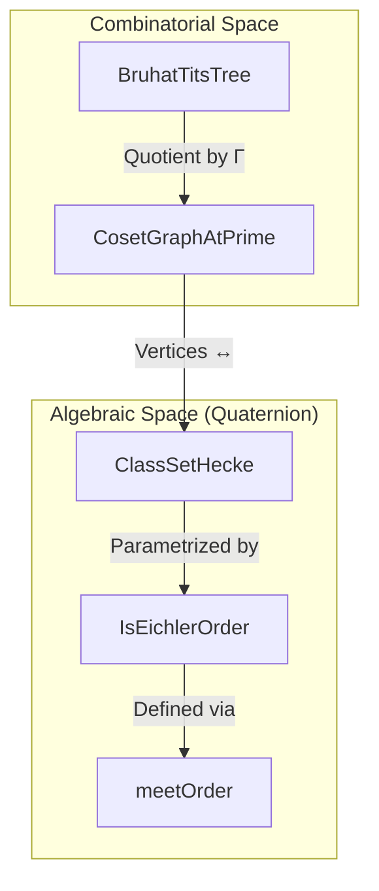
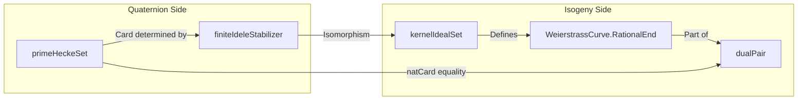

<!-- source: DeepWiki mcp.deepwiki.com · repo anthropics/fermats-last-theorem · page 4.5 Coset Graphs and the Hecke Tower · fetched 2026-10-26 -->

# Coset Graphs and the Hecke Tower

Relevant source files

The following files were used as context for generating this wiki page:

- [P2M/Sol/S_CerednikDrinfeld_CSTower_isEichlerOrder_meetOrder_and_exists_storey_of_mem_levelHeckeUSet_of_evalAt_eq_one.lean](P2M/Sol/S_CerednikDrinfeld_CSTower_isEichlerOrder_meetOrder_and_exists_storey_of_mem_levelHeckeUSet_of_evalAt_eq_one.lean)
- [P2M/Sol/S_CerednikDrinfeld_CSTower_isEichlerOrder_meetOrder_and_exists_storey_of_mem_primeHeckeSet_of_evalAt_eq_one.lean](P2M/Sol/S_CerednikDrinfeld_CSTower_isEichlerOrder_meetOrder_and_exists_storey_of_mem_primeHeckeSet_of_evalAt_eq_one.lean)
- [P2M/Sol/S_CerednikDrinfeld_CSTower_isEichlerOrder_meetOrder_of_finiteIdeleDiagonal_mul_inv_mem_primeHeckeSet_meetOrder.lean](P2M/Sol/S_CerednikDrinfeld_CSTower_isEichlerOrder_meetOrder_of_finiteIdeleDiagonal_mul_inv_mem_primeHeckeSet_meetOrder.lean)
- [P2M/Sol/S_CerednikDrinfeld_CosetGraph_awayUnits_meetOrder_eq_inf_map_conj_of_finiteAdeleEvalAt_eq.lean](P2M/Sol/S_CerednikDrinfeld_CosetGraph_awayUnits_meetOrder_eq_inf_map_conj_of_finiteAdeleEvalAt_eq.lean)
- [P2M/Sol/S_CerednikDrinfeld_CosetGraph_awayUnits_meetOrder_finiteIdeleDiagonal_eq_inf_map_conj.lean](P2M/Sol/S_CerednikDrinfeld_CosetGraph_awayUnits_meetOrder_finiteIdeleDiagonal_eq_inf_map_conj.lean)
- [P2M/Sol/S_CerednikDrinfeld_CosetGraph_exists_quotVert_equiv_classSet_and_quotEdge_equiv_classSet_of_isEichlerOrder.lean](P2M/Sol/S_CerednikDrinfeld_CosetGraph_exists_quotVert_equiv_classSet_and_quotEdge_equiv_classSet_of_isEichlerOrder.lean)
- [P2M/Sol/S_CerednikDrinfeld_CosetGraph_exists_quotVert_equiv_classSet_and_quotEdge_equiv_classSet_of_isEichlerOrder_of_level.lean](P2M/Sol/S_CerednikDrinfeld_CosetGraph_exists_quotVert_equiv_classSet_and_quotEdge_equiv_classSet_of_isEichlerOrder_of_level.lean)
- [P2M/Sol/S_CerednikDrinfeld_CosetGraph_exists_quot_equiv_classSet_shift_forget_of_mumfordSideFrame.lean](P2M/Sol/S_CerednikDrinfeld_CosetGraph_exists_quot_equiv_classSet_shift_forget_of_mumfordSideFrame.lean)
- [P2M/Sol/S_CerednikDrinfeld_CosetGraph_finite_stabilizer_and_finite_quot_and_exists_equiv_classSet_of_mumfordSideFrame.lean](P2M/Sol/S_CerednikDrinfeld_CosetGraph_finite_stabilizer_and_finite_quot_and_exists_equiv_classSet_of_mumfordSideFrame.lean)
- [P2M/Sol/S_CerednikDrinfeld_CosetGraph_quotEdge_symm_eq_classSetShift_of_forall_eq_classSet_mk.lean](P2M/Sol/S_CerednikDrinfeld_CosetGraph_quotEdge_symm_eq_classSetShift_of_forall_eq_classSet_mk.lean)
- [P2M/Sol/S_CerednikDrinfeld_CosetGraph_relIndex_inf_map_conj_eq_arrowDegree_of_hecke.lean](P2M/Sol/S_CerednikDrinfeld_CosetGraph_relIndex_inf_map_conj_eq_arrowDegree_of_hecke.lean)
- [P2M/Sol/S_CerednikDrinfeld_CosetGraph_relIndex_inf_map_conj_inv_eq_arrowDegree_of_hecke.lean](P2M/Sol/S_CerednikDrinfeld_CosetGraph_relIndex_inf_map_conj_inv_eq_arrowDegree_of_hecke.lean)
- [P2M/Sol/S_CerednikDrinfeld_LevelU_not_le_of_mem_levelHeckeUSet.lean](P2M/Sol/S_CerednikDrinfeld_LevelU_not_le_of_mem_levelHeckeUSet.lean)
- [P2M/Sol/S_CerednikDrinfeld_classSetHeckeLaws_of_isEichlerOrder_meetOrder.lean](P2M/Sol/S_CerednikDrinfeld_classSetHeckeLaws_of_isEichlerOrder_meetOrder.lean)
- [P2M/Sol/S_CerednikDrinfeld_classSetShift_mk_of_conjByFiniteIdele_eq.lean](P2M/Sol/S_CerednikDrinfeld_classSetShift_mk_of_conjByFiniteIdele_eq.lean)
- [P2M/Sol/S_CerednikDrinfeld_classSet_mk_eq_classSetShift_mk_of_finiteAdeleEvalAt_eq_mul_of_nrd_eq.lean](P2M/Sol/S_CerednikDrinfeld_classSet_mk_eq_classSetShift_mk_of_finiteAdeleEvalAt_eq_mul_of_nrd_eq.lean)
- [P2M/Sol/S_CerednikDrinfeld_classSet_mk_eq_mk_mul_of_finiteAdeleEvalAt_eq_inv_mul.lean](P2M/Sol/S_CerednikDrinfeld_classSet_mk_eq_mk_mul_of_finiteAdeleEvalAt_eq_inv_mul.lean)
- [P2M/Sol/S_CerednikDrinfeld_conj_mem_levelHeckeUSet_iff_of_mem_primeHeckeSet.lean](P2M/Sol/S_CerednikDrinfeld_conj_mem_levelHeckeUSet_iff_of_mem_primeHeckeSet.lean)
- [P2M/Sol/S_CerednikDrinfeld_exists_dualPair_image_kernelIdealSet_comp_eq_star_smul_ofFiniteIdele_mul_of_mem_finiteAdeleBox.lean](P2M/Sol/S_CerednikDrinfeld_exists_dualPair_image_kernelIdealSet_comp_eq_star_smul_ofFiniteIdele_mul_of_mem_finiteAdeleBox.lean)
- [P2M/Sol/S_CerednikDrinfeld_exists_finiteHom_classSetDegeneracyData_meetOrder_forget_and_shift_degTotal_eq_add_one.lean](P2M/Sol/S_CerednikDrinfeld_exists_finiteHom_classSetDegeneracyData_meetOrder_forget_and_shift_degTotal_eq_add_one.lean)
- [P2M/Sol/S_CerednikDrinfeld_exists_finiteHom_classSetDegeneracyData_meetOrder_forget_and_shift_degTotal_eq_of_dvd.lean](P2M/Sol/S_CerednikDrinfeld_exists_finiteHom_classSetDegeneracyData_meetOrder_forget_and_shift_degTotal_eq_of_dvd.lean)
- [P2M/Sol/S_CerednikDrinfeld_exists_forall_finiteAdeleEvalAt_eq_one_and_mem_primeHeckeSet_and_isEichlerOrder_meetOrder_of_not_dvd.lean](P2M/Sol/S_CerednikDrinfeld_exists_forall_finiteAdeleEvalAt_eq_one_and_mem_primeHeckeSet_and_isEichlerOrder_meetOrder_of_not_dvd.lean)
- [P2M/Sol/S_CerednikDrinfeld_exists_heckeFamily_map_orbit_eq_of_isEichlerOrder.lean](P2M/Sol/S_CerednikDrinfeld_exists_heckeFamily_map_orbit_eq_of_isEichlerOrder.lean)
- [P2M/Sol/S_CerednikDrinfeld_exists_mem_finiteAdeleBox_image_kernelIdealSet_comp_eq_star_smul_ofFiniteIdele_mul_of_dualPair.lean](P2M/Sol/S_CerednikDrinfeld_exists_mem_finiteAdeleBox_image_kernelIdealSet_comp_eq_star_smul_ofFiniteIdele_mul_of_dualPair.lean)
- [P2M/Sol/S_CerednikDrinfeld_exists_units_image_kernelIdealSet_pair_eq_image_mul_of_comp_eq_id_forall_mem_ker.lean](P2M/Sol/S_CerednikDrinfeld_exists_units_image_kernelIdealSet_pair_eq_image_mul_of_comp_eq_id_forall_mem_ker.lean)
- [P2M/Sol/S_CerednikDrinfeld_jointDelta_zero_classSetEdgeHecke_mulVecLin_eq_classSetVertexHecke_mulVecLin_sub_of_mem_primeHeckeSet.lean](P2M/Sol/S_CerednikDrinfeld_jointDelta_zero_classSetEdgeHecke_mulVecLin_eq_classSetVertexHecke_mulVecLin_sub_of_mem_primeHeckeSet.lean)
- [P2M/Sol/S_CerednikDrinfeld_localBox_meetOrder_eq_of_forall_finiteAdeleEvalAt_eq_one.lean](P2M/Sol/S_CerednikDrinfeld_localBox_meetOrder_eq_of_forall_finiteAdeleEvalAt_eq_one.lean)
- [P2M/Sol/S_CerednikDrinfeld_localBox_meetOrder_eq_of_map_finiteAdeleEvalAt_mem_localBoxUnits.lean](P2M/Sol/S_CerednikDrinfeld_localBox_meetOrder_eq_of_map_finiteAdeleEvalAt_mem_localBoxUnits.lean)
- [P2M/Sol/S_CerednikDrinfeld_mem_levelHeckeUSet_iff_mem_levelHeckeUSet_of_forall_localBox_eq.lean](P2M/Sol/S_CerednikDrinfeld_mem_levelHeckeUSet_iff_mem_levelHeckeUSet_of_forall_localBox_eq.lean)
- [P2M/Sol/S_CerednikDrinfeld_mul_mem_levelHeckeUSet_and_mul_mem_levelHeckeUSet_of_mem_finiteIdeleStabilizer.lean](P2M/Sol/S_CerednikDrinfeld_mul_mem_levelHeckeUSet_and_mul_mem_levelHeckeUSet_of_mem_finiteIdeleStabilizer.lean)
- [P2M/Sol/S_CerednikDrinfeld_mul_mem_uHeckeSet_and_mul_mem_uHeckeSet_of_mem_finiteIdeleStabilizer_meetOrder.lean](P2M/Sol/S_CerednikDrinfeld_mul_mem_uHeckeSet_and_mul_mem_uHeckeSet_of_mem_finiteIdeleStabilizer_meetOrder.lean)
- [P2M/Sol/S_CerednikDrinfeld_natCard_isUnitOf_conjByFiniteIdele_eq_natCard_rationalAut_map_ker_eq_of_image_kernelIdealSet_comp_eq.lean](P2M/Sol/S_CerednikDrinfeld_natCard_isUnitOf_conjByFiniteIdele_eq_natCard_rationalAut_map_ker_eq_of_image_kernelIdealSet_comp_eq.lean)
- [P2M/Sol/S_CerednikDrinfeld_natCard_ofFiniteIdele_levelHeckeUSet_eq_natCard_subgroup_dualPair_ker_of_dvd_of_inf_conjByFiniteIdele.lean](P2M/Sol/S_CerednikDrinfeld_natCard_ofFiniteIdele_levelHeckeUSet_eq_natCard_subgroup_dualPair_ker_of_dvd_of_inf_conjByFiniteIdele.lean)
- [P2M/Sol/S_CerednikDrinfeld_natCard_ofFiniteIdele_primeHeckeSet_eq_natCard_subgroup_dualPair_ker_of_inf_conjByFiniteIdele.lean](P2M/Sol/S_CerednikDrinfeld_natCard_ofFiniteIdele_primeHeckeSet_eq_natCard_subgroup_dualPair_ker_of_inf_conjByFiniteIdele.lean)
- [P2M/Sol/S_CerednikDrinfeld_natCard_setOf_exists_mem_primeHeckeSet_quotientMk_eq_eq_succ_of_prime.lean](P2M/Sol/S_CerednikDrinfeld_natCard_setOf_exists_mem_primeHeckeSet_quotientMk_eq_eq_succ_of_prime.lean)
- [P2M/Sol/S_CerednikDrinfeld_ncard_setOf_exists_mem_uHeckeSet_quotientMk_eq_of_mem_primeHeckeSet.lean](P2M/Sol/S_CerednikDrinfeld_ncard_setOf_exists_mem_uHeckeSet_quotientMk_eq_of_mem_primeHeckeSet.lean)
- [P2M/Sol/S_CerednikDrinfeld_pushforward_classSetHeckeMatrix_levelHeckeUSet_meetOrder_mulVecLin.lean](P2M/Sol/S_CerednikDrinfeld_pushforward_classSetHeckeMatrix_levelHeckeUSet_meetOrder_mulVecLin.lean)
- [P2M/Sol/S_CerednikDrinfeld_pushforward_classSetHeckeMatrix_primeHeckeSet_meetOrder_mulVecLin.lean](P2M/Sol/S_CerednikDrinfeld_pushforward_classSetHeckeMatrix_primeHeckeSet_meetOrder_mulVecLin.lean)
- [P2M/Sol/S_CerednikDrinfeld_pushforward_comp_pullbackFun_eq_classSetHeckeMatrix_levelHeckeUSet_mulVec_of_dvd.lean](P2M/Sol/S_CerednikDrinfeld_pushforward_comp_pullbackFun_eq_classSetHeckeMatrix_levelHeckeUSet_mulVec_of_dvd.lean)
- [P2M/Sol/S_CerednikDrinfeld_pushforward_comp_pullbackFun_eq_classSetHeckeMatrix_primeHeckeSet_mulVec_of_degTotal_eq.lean](P2M/Sol/S_CerednikDrinfeld_pushforward_comp_pullbackFun_eq_classSetHeckeMatrix_primeHeckeSet_mulVec_of_degTotal_eq.lean)
- [P2M/Sol/S_CerednikDrinfeld_relIndex_finiteIdeleStabilizer_meetOrder_eq_succ_of_mem_primeHeckeSet.lean](P2M/Sol/S_CerednikDrinfeld_relIndex_finiteIdeleStabilizer_meetOrder_eq_succ_of_mem_primeHeckeSet.lean)
- [P2M/Sol/S_CerednikDrinfeld_uHeckeSet_subset_primeHeckeSet.lean](P2M/Sol/S_CerednikDrinfeld_uHeckeSet_subset_primeHeckeSet.lean)

The Čerednik-Drinfeld theory describes the $p$-adic uniformization of Shimura curves. A central component of this theory is the combinatorial description of the special fiber of the modular curve at a prime $p$ of bad reduction. This fiber is described by a **Coset Graph** (a quotient of the Bruhat-Tits tree) and the **CSTower** (Čerednik-Drinfeld-Shimura tower), which captures the Hecke correspondence and level structures via quaternion algebras and Eichler orders.

## The Hecke Correspondence and Eichler Orders

The tower is constructed using a quaternion algebra $D$ over $\mathbb{Q}$ ramified at $p$ and $\infty$. The level structures are encoded by **Eichler orders**, which are intersections of two maximal orders.

### Key Hecke Sets
The codebase defines several sets to manage the combinatorial structure of Hecke operators:
*   `primeHeckeSet`: Represents the Hecke neighbors at a prime $p$. It is related to the double coset of the finite idele stabilizer [P2M/Sol/S_CerednikDrinfeld_exists_finiteHom_classSetDegeneracyData_meetOrder_forget_and_shift_degTotal_eq_add_one.lean:14]().
*   `levelHeckeUSet`: A generalized set for level-$U$ structures, used in the construction of the Hecke matrix [P2M/Sol/S_CerednikDrinfeld_natCard_ofFiniteIdele_levelHeckeUSet_eq_natCard_subgroup_dualPair_ker_of_dvd_of_inf_conjByFiniteIdele.lean:49-51]().

### Finite Idele Stabilizers
The stabilizer of an order $\Lambda$ in the finite adele ring $\mathbb{A}_f$ is denoted by `finiteIdeleStabilizer`. A crucial property is that an element $u$ is in the stabilizer if and only if both $u$ and $u^{-1}$ are in the `finiteAdeleBox` of $\Lambda$ [P2M/Sol/S_CerednikDrinfeld_localBox_meetOrder_eq_of_map_finiteAdeleEvalAt_mem_localBoxUnits:77-82]().

For an Eichler order formed by the intersection `meetOrder R g = R ⊓ (g R g⁻¹)`, the stabilizer is the intersection of the individual stabilizers:
`finiteIdeleStabilizer (meetOrder R g) = finiteIdeleStabilizer R ⊓ (finiteIdeleStabilizer R).map (MulAut.conj g)` [P2M/Sol/S_CerednikDrinfeld_localBox_meetOrder_eq_of_map_finiteAdeleEvalAt_mem_localBoxUnits:132-135]().

**Sources:**
[P2M/Sol/S_CerednikDrinfeld_localBox_meetOrder_eq_of_map_finiteAdeleEvalAt_mem_localBoxUnits.lean:77-135](), [P2M/Sol/S_CerednikDrinfeld_exists_finiteHom_classSetDegeneracyData_meetOrder_forget_and_shift_degTotal_eq_add_one.lean:1-20]()

## Coset Graphs and Bruhat-Tits Tree Quotients

The `CosetGraph` represents the quotient of the Bruhat-Tits tree $T_p$ by the action of the arithmetic group derived from the quaternion algebra.

### Structural Equivalences
The vertices and edges of the quotient graph are shown to be in bijection with class sets of quaternion orders:
*   **Vertices:** `quotVert` is equivalent to the `classSet` of the maximal order [P2M/Sol/S_CerednikDrinfeld_CosetGraph_exists_quotVert_equiv_classSet_and_quotEdge_equiv_classSet_of_isEichlerOrder.lean:31]().
*   **Edges:** `quotEdge` is equivalent to the `classSet` of the Eichler order [P2M/Sol/S_CerednikDrinfeld_CosetGraph_exists_quotVert_equiv_classSet_and_quotEdge_equiv_classSet_of_isEichlerOrder.lean:31]().

### Graph Morphisms and Degrees
The degree of the covering in the tower is related to the relative index of stabilizers. For a `primeHeckeSet` element, the relative index is $p+1$ [P2M/Sol/S_CerednikDrinfeld_exists_finiteHom_classSetDegeneracyData_meetOrder_forget_and_shift_degTotal_eq_add_one.lean:12]().

### System Entity Mapping: Coset Graph Combinatorics
The following diagram maps the mathematical concepts of the Bruhat-Tits quotient to the specific Lean entities.

| Natural Language Concept | Code Entity |
| :--- | :--- |
| Bruhat-Tits Tree | `BruhatTitsTree` [P2M/Sol/S_CerednikDrinfeld_CosetGraph_finite_stabilizer_and_finite_quot_and_exists_equiv_classSet_of_mumfordSideFrame.lean:17]() |
| Quotient Graph | `CosetGraphAtPrime` [P2M/Sol/S_CerednikDrinfeld_CosetGraph_exists_quotVert_equiv_classSet_and_quotEdge_equiv_classSet_of_isEichlerOrder.lean:22]() |
| Class Set | `QuaternionAlgebra.ClassSetHecke` [P2M/Sol/S_CerednikDrinfeld_CosetGraph_exists_quotVert_equiv_classSet_and_quotEdge_equiv_classSet_of_isEichlerOrder.lean:2]() |
| Eichler Order | `IsEichlerOrder` [P2M/Sol/S_CerednikDrinfeld_CosetGraph_exists_quotVert_equiv_classSet_and_quotEdge_equiv_classSet_of_isEichlerOrder.lean:6]() |

**Sources:**
[P2M/Sol/S_CerednikDrinfeld_CosetGraph_exists_quotVert_equiv_classSet_and_quotEdge_equiv_classSet_of_isEichlerOrder.lean:1-32](), [P2M/Sol/S_CerednikDrinfeld_CosetGraph_finite_stabilizer_and_finite_quot_and_exists_equiv_classSet_of_mumfordSideFrame.lean:1-32]()

## Dual Pairs and Kernel Cardinality

A critical link between the quaternion algebra side and the geometry of the modular curve is the cardinality of kernels of isogenies. This is handled via the `dualPair` API.

### The dualPair Kernel Identity
The proof establishes a numerical identity between the size of a `primeHeckeSet` (quaternionic) and the kernel of a `dualPair` of isogenies on the curve [P2M/Sol/S_CerednikDrinfeld_natCard_ofFiniteIdele_primeHeckeSet_eq_natCard_subgroup_dualPair_ker_of_inf_conjByFiniteIdele.lean:44]().

Key functions in this pipeline:
*   `dualPair`: Defines a pair of isogenies $(\phi, \phi^\vee)$ [P2M/Sol/S_CerednikDrinfeld_natCard_ofFiniteIdele_primeHeckeSet_eq_natCard_subgroup_dualPair_ker_of_inf_conjByFiniteIdele.lean:8]().
*   `kernelIdealSet`: Relates the kernel of the isogeny to an ideal in the quaternion algebra [P2M/Sol/S_CerednikDrinfeld_natCard_ofFiniteIdele_primeHeckeSet_eq_natCard_subgroup_dualPair_ker_of_inf_conjByFiniteIdele.lean:5]().
*   `natCard_ofFiniteIdele_primeHeckeSet_eq_natCard_subgroup_dualPair_ker`: The main theorem equating the quaternionic count to the geometric kernel size [P2M/Sol/S_CerednikDrinfeld_natCard_ofFiniteIdele_primeHeckeSet_eq_natCard_subgroup_dualPair_ker_of_inf_conjByFiniteIdele.lean:44]().

### Data Flow: Quaternions to Isogenies

**Sources:**
[P2M/Sol/S_CerednikDrinfeld_natCard_ofFiniteIdele_primeHeckeSet_eq_natCard_subgroup_dualPair_ker_of_inf_conjByFiniteIdele.lean:1-44](), [P2M/Sol/S_CerednikDrinfeld_exists_dualPair_image_kernelIdealSet_comp_eq_star_smul_ofFiniteIdele_mul_of_mem_finiteAdeleBox.lean:1-15]()

## CSTower: The Čerednik-Drinfeld-Shimura Tower

The `CSTower` is the sequence of modular curves $X_0(Np^n)$ as $n$ varies, uniformized by the Drinfeld upper half-plane.

### Tower Storeys and Eichler Orders
The tower is built by choosing a "storey" corresponding to an element in the `primeHeckeSet` [P2M/Sol/S_CerednikDrinfeld_CSTower_isEichlerOrder_meetOrder_and_exists_storey_of_mem_primeHeckeSet_of_evalAt_eq_one.lean:4]().
The property `isEichlerOrder (meetOrder R g)` is verified for these storeys, ensuring the tower correctly represents the levels of the Shimura curve [P2M/Sol/S_CerednikDrinfeld_CSTower_isEichlerOrder_meetOrder_of_finiteIdeleDiagonal_mul_inv_mem_primeHeckeSet_meetOrder.lean:4]().

### Hecke Matrix Construction
The Hecke correspondence on the tower is represented by a matrix. The codebase proves that the composition of pushforward and pullback maps on the class sets is equivalent to the action of the `classSetHeckeMatrix` [P2M/Sol/S_CerednikDrinfeld_pushforward_comp_pullbackFun_eq_classSetHeckeMatrix_primeHeckeSet_mulVec_of_degTotal_eq.lean:1]().

Specifically:
*   `classSetHeckeMatrix_primeHeckeSet`: The matrix for the $T_p$ operator.
*   `classSetHeckeMatrix_levelHeckeUSet`: The matrix for higher level Hecke operators [P2M/Sol/S_CerednikDrinfeld_pushforward_classSetHeckeMatrix_levelHeckeUSet_meetOrder_mulVecLin.lean:1]().

**Sources:**
[P2M/Sol/S_CerednikDrinfeld_CSTower_isEichlerOrder_meetOrder_and_exists_storey_of_mem_primeHeckeSet_of_evalAt_eq_one.lean:1-4](), [P2M/Sol/S_CerednikDrinfeld_pushforward_comp_pullbackFun_eq_classSetHeckeMatrix_primeHeckeSet_mulVec_of_degTotal_eq.lean:1](), [P2M/Sol/S_CerednikDrinfeld_CSTower_isEichlerOrder_meetOrder_of_finiteIdeleDiagonal_mul_inv_mem_primeHeckeSet_meetOrder.lean:1-4]()

---

