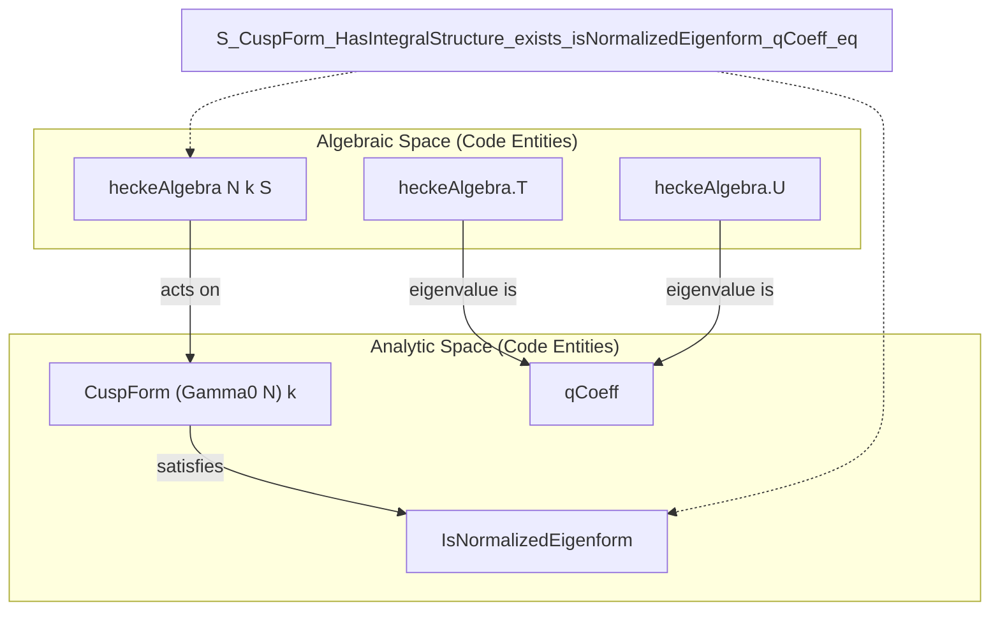
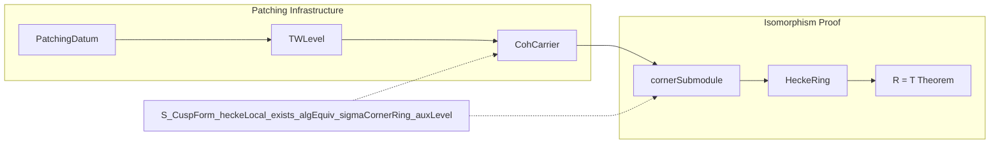

<!-- source: DeepWiki mcp.deepwiki.com · repo anthropics/fermats-last-theorem · page 5 Cusp Forms, Hecke Algebras, and Galois Representations · fetched 2026-10-26 -->

# Cusp Forms, Hecke Algebras, and Galois Representations

Relevant source files

The following files were used as context for generating this wiki page:

- [P2M/Sol/S_CerednikDrinfeld_TwoPlaceTorsionDatum_W_le_invariants_of_goodReductionOutside_of_span_eq_top.lean](P2M/Sol/S_CerednikDrinfeld_TwoPlaceTorsionDatum_W_le_invariants_of_goodReductionOutside_of_span_eq_top.lean)
- [P2M/Sol/S_CohCarrier_exists_ideal_forall_heckeAlg_baseChange_eq_smul_of_exists_jZero_pTorsion_eigenvector.lean](P2M/Sol/S_CohCarrier_exists_ideal_forall_heckeAlg_baseChange_eq_smul_of_exists_jZero_pTorsion_eigenvector.lean)
- [P2M/Sol/S_CohCarrier_exists_span_pair_union_ker_smul_eq_top_cornerSubmodule_H1_top_of_isAbsolutelyIrreducible.lean](P2M/Sol/S_CohCarrier_exists_span_pair_union_ker_smul_eq_top_cornerSubmodule_H1_top_of_isAbsolutelyIrreducible.lean)
- [P2M/Sol/S_CuspForm_AuxLevel_toML_eq_zero_of_jDeg_one_eq_zero_of_jDeg_eq_zero.lean](P2M/Sol/S_CuspForm_AuxLevel_toML_eq_zero_of_jDeg_one_eq_zero_of_jDeg_eq_zero.lean)
- [P2M/Sol/S_CuspForm_HasIntegralStructure_exists_isNormalizedEigenform_qCoeff_eq.lean](P2M/Sol/S_CuspForm_HasIntegralStructure_exists_isNormalizedEigenform_qCoeff_eq.lean)
- [P2M/Sol/S_CuspForm_IsEigenformWith_dvd_and_qCoeff_eq_or_not_dvd_and_qCoeff_sq_sub_eq_zero_of_isPrimitiveForm_of_not_sq_dvd.lean](P2M/Sol/S_CuspForm_IsEigenformWith_dvd_and_qCoeff_eq_or_not_dvd_and_qCoeff_sq_sub_eq_zero_of_isPrimitiveForm_of_not_sq_dvd.lean)
- [P2M/Sol/S_CuspForm_IsEigenformWith_exists_galoisRepAdic_charpoly_frobenius_eq_and_isUnramifiedAt.lean](P2M/Sol/S_CuspForm_IsEigenformWith_exists_galoisRepAdic_charpoly_frobenius_eq_and_isUnramifiedAt.lean)
- [P2M/Sol/S_CuspForm_IsEigenformWith_exists_galoisRepAdic_charpoly_frobenius_eq_tateModule_jOne_quotient.lean](P2M/Sol/S_CuspForm_IsEigenformWith_exists_galoisRepAdic_charpoly_frobenius_eq_tateModule_jOne_quotient.lean)
- [P2M/Sol/S_CuspForm_IsEigenformWith_exists_isPrimitiveForm_sq_sub_mul_add_eq_zero_of_eigenpacketOccursAt_div.lean](P2M/Sol/S_CuspForm_IsEigenformWith_exists_isPrimitiveForm_sq_sub_mul_add_eq_zero_of_eigenpacketOccursAt_div.lean)
- [P2M/Sol/S_CuspForm_IsEigenformWith_exists_linearIndependent_inertia_apply_eq_smul_of_dvd_of_not_sq_dvd_of_dvd_conductor_of_residual_isAbsolutelyIrreducible.lean](P2M/Sol/S_CuspForm_IsEigenformWith_exists_linearIndependent_inertia_apply_eq_smul_of_dvd_of_not_sq_dvd_of_dvd_conductor_of_residual_isAbsolutelyIrreducible.lean)
- [P2M/Sol/S_CuspForm_IsNewform_exists_galoisRepAdic_charpoly_frobenius_eq_of_dvd_of_not_sq_dvd.lean](P2M/Sol/S_CuspForm_IsNewform_exists_galoisRepAdic_charpoly_frobenius_eq_of_dvd_of_not_sq_dvd.lean)
- [P2M/Sol/S_CuspForm_IsNewform_exists_galoisRepAdic_inertia_apply_ne_and_stableLine_frobenius_eq_qCoeff_smul_of_dvd_of_not_sq_dvd.lean](P2M/Sol/S_CuspForm_IsNewform_exists_galoisRepAdic_inertia_apply_ne_and_stableLine_frobenius_eq_qCoeff_smul_of_dvd_of_not_sq_dvd.lean)
- [P2M/Sol/S_CuspForm_IsNewform_exists_galoisRepAdic_not_isUnipotentOnInertiaAt_of_factorization_eq_two_of_absIrred_odd_of_ne_two.lean](P2M/Sol/S_CuspForm_IsNewform_exists_galoisRepAdic_not_isUnipotentOnInertiaAt_of_factorization_eq_two_of_absIrred_odd_of_ne_two.lean)
- [P2M/Sol/S_CuspForm_IsNewform_exists_galoisRepAdic_ordinaryLine_frobenius_sub_qCoeff_smul_mem_of_dvd_of_not_sq_dvd.lean](P2M/Sol/S_CuspForm_IsNewform_exists_galoisRepAdic_ordinaryLine_frobenius_sub_qCoeff_smul_mem_of_dvd_of_not_sq_dvd.lean)
- [P2M/Sol/S_CuspForm_IsNewform_exists_galoisRepAdic_ordinaryLine_frobenius_sub_unitRoot_smul_mem_of_not_dvd.lean](P2M/Sol/S_CuspForm_IsNewform_exists_galoisRepAdic_ordinaryLine_frobenius_sub_unitRoot_smul_mem_of_not_dvd.lean)
- [P2M/Sol/S_CuspForm_IsNewform_exists_galoisRepAdic_stableLine_frobenius_eq_qCoeff_smul_of_dvd_of_not_sq_dvd.lean](P2M/Sol/S_CuspForm_IsNewform_exists_galoisRepAdic_stableLine_frobenius_eq_qCoeff_smul_of_dvd_of_not_sq_dvd.lean)
- [P2M/Sol/S_CuspForm_IsNewform_exists_ordLine_eigenPlane_tateModule_jZero_of_not_dvd.lean](P2M/Sol/S_CuspForm_IsNewform_exists_ordLine_eigenPlane_tateModule_jZero_of_not_dvd.lean)
- [P2M/Sol/S_CuspForm_IsNewform_finrank_le_one_of_le_reductionKernelSpan_tateModule_jZero_of_isUnit.lean](P2M/Sol/S_CuspForm_IsNewform_finrank_le_one_of_le_reductionKernelSpan_tateModule_jZero_of_isUnit.lean)
- [P2M/Sol/S_CuspForm_IsNewform_finrank_monodromySpan_eigenPlane_tateModule_jZero_le_one_of_dvd.lean](P2M/Sol/S_CuspForm_IsNewform_finrank_monodromySpan_eigenPlane_tateModule_jZero_le_one_of_dvd.lean)
- [P2M/Sol/S_CuspForm_IsNewform_frobenius_sub_heckeU_smul_mem_monodromySpan_eigenPlane_tateModule_jZero_of_dvd.lean](P2M/Sol/S_CuspForm_IsNewform_frobenius_sub_heckeU_smul_mem_monodromySpan_eigenPlane_tateModule_jZero_of_dvd.lean)
- [P2M/Sol/S_CuspForm_IsPrimitiveForm_exists_galoisRepAdic_charpoly_frobenius_eq_and_isRoot_charpoly_one_of_dvd_of_factorization_eq_conductor_factorization_of_not_sq_dvd.lean](P2M/Sol/S_CuspForm_IsPrimitiveForm_exists_galoisRepAdic_charpoly_frobenius_eq_and_isRoot_charpoly_one_of_dvd_of_factorization_eq_conductor_factorization_of_not_sq_dvd.lean)
- [P2M/Sol/S_CuspForm_IsPrimitiveForm_exists_galoisRepAdic_linearIndependent_inertia_apply_eq_smul_of_dvd_of_not_sq_dvd_of_dvd_conductor.lean](P2M/Sol/S_CuspForm_IsPrimitiveForm_exists_galoisRepAdic_linearIndependent_inertia_apply_eq_smul_of_dvd_of_not_sq_dvd_of_dvd_conductor.lean)
- [P2M/Sol/S_CuspForm_IsPrimitiveForm_exists_galoisRepAdic_ordinaryLine_frobenius_sub_qCoeff_smul_mem_of_dvd_of_not_sq_dvd_of_not_dvd_conductor.lean](P2M/Sol/S_CuspForm_IsPrimitiveForm_exists_galoisRepAdic_ordinaryLine_frobenius_sub_qCoeff_smul_mem_of_dvd_of_not_sq_dvd_of_not_dvd_conductor.lean)
- [P2M/Sol/S_CuspForm_IsPrimitiveForm_exists_galoisRepAdic_ordinaryLine_frobenius_sub_unitRoot_smul_mem_of_not_dvd.lean](P2M/Sol/S_CuspForm_IsPrimitiveForm_exists_galoisRepAdic_ordinaryLine_frobenius_sub_unitRoot_smul_mem_of_not_dvd.lean)
- [P2M/Sol/S_CuspForm_IsPrimitiveForm_exists_mem_adjoin_good_aeval_ne_zero_mul_smul_eq_smul_jOne.lean](P2M/Sol/S_CuspForm_IsPrimitiveForm_exists_mem_adjoin_good_aeval_ne_zero_mul_smul_eq_smul_jOne.lean)
- [P2M/Sol/S_CuspForm_IsPrimitiveForm_heckeU_eigenvalue_eq_qCoeff_of_common_eigenvector_of_dvd_level.lean](P2M/Sol/S_CuspForm_IsPrimitiveForm_heckeU_eigenvalue_eq_qCoeff_of_common_eigenvector_of_dvd_level.lean)
- [P2M/Sol/S_CuspForm_IsPrimitiveForm_level_eq_and_qCoeff_eq_of_forall_prime_notMem_qCoeff_eq.lean](P2M/Sol/S_CuspForm_IsPrimitiveForm_level_eq_and_qCoeff_eq_of_forall_prime_notMem_qCoeff_eq.lean)
- [P2M/Sol/S_CuspForm_IsPrimitiveForm_linearMap_eq_zero_of_hecke_coeigen_tateModule_jOne_of_dvd_of_ne.lean](P2M/Sol/S_CuspForm_IsPrimitiveForm_linearMap_eq_zero_of_hecke_coeigen_tateModule_jOne_of_dvd_of_ne.lean)
- [P2M/Sol/S_CuspForm_IsPrimitiveForm_pow_dvd_of_pow_dvd_of_sq_dvd_of_factorsThrough_of_forall_coprime_qCoeff_eq.lean](P2M/Sol/S_CuspForm_IsPrimitiveForm_pow_dvd_of_pow_dvd_of_sq_dvd_of_factorsThrough_of_forall_coprime_qCoeff_eq.lean)
- [P2M/Sol/S_CuspForm_IsPrimitiveForm_sum_slash_S_mul_T_zpow_mul_S_inv_apply_eq_of_dvd.lean](P2M/Sol/S_CuspForm_IsPrimitiveForm_sum_slash_S_mul_T_zpow_mul_S_inv_apply_eq_of_dvd.lean)
- [P2M/Sol/S_CuspForm_IsPrimitiveForm_sum_slash_S_mul_T_zpow_mul_S_inv_comp_heckeDiagMatrix_apply_eq_of_not_dvd.lean](P2M/Sol/S_CuspForm_IsPrimitiveForm_sum_slash_S_mul_T_zpow_mul_S_inv_comp_heckeDiagMatrix_apply_eq_of_not_dvd.lean)
- [P2M/Sol/S_CuspForm_eq_smul_of_isPrimitiveForm_of_qCoeff_hecke_eigen.lean](P2M/Sol/S_CuspForm_eq_smul_of_isPrimitiveForm_of_qCoeff_hecke_eigen.lean)
- [P2M/Sol/S_CuspForm_exists_apply_eq_mul_zpow_mul_apply_of_isPrimitiveForm.lean](P2M/Sol/S_CuspForm_exists_apply_eq_mul_zpow_mul_apply_of_isPrimitiveForm.lean)
- [P2M/Sol/S_CuspForm_exists_basis_gamma1_qCoeff_mem_range_ratCast.lean](P2M/Sol/S_CuspForm_exists_basis_gamma1_qCoeff_mem_range_ratCast.lean)
- [P2M/Sol/S_CuspForm_exists_basis_gammaH_qCoeff_mem_range_ratCast.lean](P2M/Sol/S_CuspForm_exists_basis_gammaH_qCoeff_mem_range_ratCast.lean)
- [P2M/Sol/S_CuspForm_exists_conj_isNormalizedEigenform_isNewAt.lean](P2M/Sol/S_CuspForm_exists_conj_isNormalizedEigenform_isNewAt.lean)
- [P2M/Sol/S_CuspForm_exists_eq_rescaleLin_add_rescaleLin_of_heckeTLin_eq_smul_of_exists_level.lean](P2M/Sol/S_CuspForm_exists_eq_rescaleLin_add_rescaleLin_of_heckeTLin_eq_smul_of_exists_level.lean)
- [P2M/Sol/S_CuspForm_exists_galoisRepAdic_inertia_eigenvector_tameCharacter_of_not_isUnit_heckeT_of_ne_two.lean](P2M/Sol/S_CuspForm_exists_galoisRepAdic_inertia_eigenvector_tameCharacter_of_not_isUnit_heckeT_of_ne_two.lean)
- [P2M/Sol/S_CuspForm_exists_galoisRep_of_point.lean](P2M/Sol/S_CuspForm_exists_galoisRep_of_point.lean)
- [P2M/Sol/S_CuspForm_exists_galoisRep_of_point_tateModule_jZero_quotient.lean](P2M/Sol/S_CuspForm_exists_galoisRep_of_point_tateModule_jZero_quotient.lean)
- [P2M/Sol/S_CuspForm_exists_hasNebentypus_qCoeff_eq_sum_primeFactors_of_forall_coprime_qCoeff_eq_zero.lean](P2M/Sol/S_CuspForm_exists_hasNebentypus_qCoeff_eq_sum_primeFactors_of_forall_coprime_qCoeff_eq_zero.lean)
- [P2M/Sol/S_CuspForm_exists_int_mul_qCoeff_alSlash_of_mem_intLattice.lean](P2M/Sol/S_CuspForm_exists_int_mul_qCoeff_alSlash_of_mem_intLattice.lean)
- [P2M/Sol/S_CuspForm_exists_int_mul_qCoeff_alSlash_of_mem_intLattice_of_ne_two.lean](P2M/Sol/S_CuspForm_exists_int_mul_qCoeff_alSlash_of_mem_intLattice_of_ne_two.lean)
- [P2M/Sol/S_CuspForm_exists_isEigenformWith_qCoeff_eq_of_heckeTLinH_eq_smul_of_heckeULinH_eq_smul_of_diamondLinH_eq_smul.lean](P2M/Sol/S_CuspForm_exists_isEigenformWith_qCoeff_eq_of_heckeTLinH_eq_smul_of_heckeULinH_eq_smul_of_diamondLinH_eq_smul.lean)
- [P2M/Sol/S_CuspForm_exists_isNormalizedEigenform_of_forall_heckeTLin_eq_smul.lean](P2M/Sol/S_CuspForm_exists_isNormalizedEigenform_of_forall_heckeTLin_eq_smul.lean)
- [P2M/Sol/S_CuspForm_exists_isPrimitiveForm_of_hasNebentypus_qCoeff_hecke_eigen.lean](P2M/Sol/S_CuspForm_exists_isPrimitiveForm_of_hasNebentypus_qCoeff_hecke_eigen.lean)
- [P2M/Sol/S_CuspForm_exists_isPrimitiveForm_of_qCoeff_hecke_eigen.lean](P2M/Sol/S_CuspForm_exists_isPrimitiveForm_of_qCoeff_hecke_eigen.lean)
- [P2M/Sol/S_CuspForm_exists_qCoeff_eq_sum_isPrimitiveForm_of_hasNebentypus.lean](P2M/Sol/S_CuspForm_exists_qCoeff_eq_sum_isPrimitiveForm_of_hasNebentypus.lean)
- [P2M/Sol/S_CuspForm_exists_ratCast_qCoeff_traceLin_of_forall_intCast_qCoeff.lean](P2M/Sol/S_CuspForm_exists_ratCast_qCoeff_traceLin_of_forall_intCast_qCoeff.lean)
- [P2M/Sol/S_CuspForm_exists_weightOne_newform_of_qCoeff_hecke_eigen.lean](P2M/Sol/S_CuspForm_exists_weightOne_newform_of_qCoeff_hecke_eigen.lean)
- [P2M/Sol/S_CuspForm_heckeAlgebra_exists_apply_ne_zero_and_squarefree_and_mul_aeval_U_eq_zero_of_apply_U_ne_zero.lean](P2M/Sol/S_CuspForm_heckeAlgebra_exists_apply_ne_zero_and_squarefree_and_mul_aeval_U_eq_zero_of_apply_U_ne_zero.lean)
- [P2M/Sol/S_CuspForm_heckeAlgebra_exists_ringHom_apply_T_eq_of_not_dvd_of_trace_frobenius_sq_ne.lean](P2M/Sol/S_CuspForm_heckeAlgebra_exists_ringHom_apply_T_eq_of_not_dvd_of_trace_frobenius_sq_ne.lean)
- [P2M/Sol/S_CuspForm_heckeLocal_exists_algEquiv_sigmaCornerRing_auxLevel.lean](P2M/Sol/S_CuspForm_heckeLocal_exists_algEquiv_sigmaCornerRing_auxLevel.lean)
- [P2M/Sol/S_CuspForm_heckeLocal_exists_smul_eq_heckeT_and_apply_eq_trace_frobenius_of_not_dvd.lean](P2M/Sol/S_CuspForm_heckeLocal_exists_smul_eq_heckeT_and_apply_eq_trace_frobenius_of_not_dvd.lean)
- [P2M/Sol/S_CuspForm_heckeULin_eq_qCoeff_smul_of_isNewform_of_dvd_of_not_dvd_div.lean](P2M/Sol/S_CuspForm_heckeULin_eq_qCoeff_smul_of_isNewform_of_dvd_of_not_dvd_div.lean)
- [P2M/Sol/S_CuspForm_isOrdinaryAt_of_point_of_isUnit_up_of_residual_isAbsolutelyIrreducible_of_residual_isOrdinaryAt.lean](P2M/Sol/S_CuspForm_isOrdinaryAt_of_point_of_isUnit_up_of_residual_isAbsolutelyIrreducible_of_residual_isOrdinaryAt.lean)
- [P2M/Sol/S_CuspForm_isPrimitiveForm_inv_of_qCoeff_eq_conj.lean](P2M/Sol/S_CuspForm_isPrimitiveForm_inv_of_qCoeff_eq_conj.lean)
- [P2M/Sol/S_CuspForm_linearIndependent_degeneracy_of_isEigenformWith_of_pairwise_qCoeff_ne.lean](P2M/Sol/S_CuspForm_linearIndependent_degeneracy_of_isEigenformWith_of_pairwise_qCoeff_ne.lean)
- [P2M/Sol/S_CuspForm_point_residual_trace_coinvariants_eq_residue_T.lean](P2M/Sol/S_CuspForm_point_residual_trace_coinvariants_eq_residue_T.lean)
- [P2M/Sol/S_CuspForm_point_residual_trace_coinvariants_eq_residue_U_of_isUnit.lean](P2M/Sol/S_CuspForm_point_residual_trace_coinvariants_eq_residue_U_of_isUnit.lean)
- [P2M/Sol/S_DeligneSerre_exists_hecke_eigen_reduction_eq_of_qCoeff_hecke_congr.lean](P2M/Sol/S_DeligneSerre_exists_hecke_eigen_reduction_eq_of_qCoeff_hecke_congr.lean)
- [P2M/Sol/S_DeligneSerre_exists_subalgebra_qCoeff_mem_forall_ringHom_exists_qCoeff_eq_of_weightOne_hecke_eigen.lean](P2M/Sol/S_DeligneSerre_exists_subalgebra_qCoeff_mem_forall_ringHom_exists_qCoeff_eq_of_weightOne_hecke_eigen.lean)
- [P2M/Sol/S_GaloisRepAdic_exists_ordinaryLine_frobenius_sub_smul_mem_of_isEigenformWith_of_isUnit_of_dvd_of_not_sq_dvd_of_not_dvd_conductor.lean](P2M/Sol/S_GaloisRepAdic_exists_ordinaryLine_frobenius_sub_smul_mem_of_isEigenformWith_of_isUnit_of_dvd_of_not_sq_dvd_of_not_dvd_conductor.lean)
- [P2M/Sol/S_GaloisRepAdic_exists_ordinaryLine_frobenius_sub_unitRoot_smul_mem_of_isNewform_of_not_dvd.lean](P2M/Sol/S_GaloisRepAdic_exists_ordinaryLine_frobenius_sub_unitRoot_smul_mem_of_isNewform_of_not_dvd.lean)
- [P2M/Sol/S_GaloisRepAdic_exists_stableLine_frobenius_eq_qCoeff_smul_of_isNewform_of_dvd_of_not_sq_dvd.lean](P2M/Sol/S_GaloisRepAdic_exists_stableLine_frobenius_eq_qCoeff_smul_of_isNewform_of_dvd_of_not_sq_dvd.lean)
- [P2M/Sol/S_GaloisRep_exists_conj_map_stableLine_of_theta_T_ne_zero_of_absolutelyIrreducible_of_eq_two.lean](P2M/Sol/S_GaloisRep_exists_conj_map_stableLine_of_theta_T_ne_zero_of_absolutelyIrreducible_of_eq_two.lean)
- [P2M/Sol/S_ModPForms_eq_zero_of_mem_modPCusp_of_expand_mem_modPCusp.lean](P2M/Sol/S_ModPForms_eq_zero_of_mem_modPCusp_of_expand_mem_modPCusp.lean)
- [P2M/Sol/S_ModularCurve_DRModelPackageLevel_exists_dRResolvedModelPackageLevel_and_dRResolvedModelChartsLevelRam.lean](P2M/Sol/S_ModularCurve_DRModelPackageLevel_exists_dRResolvedModelPackageLevel_and_dRResolvedModelChartsLevelRam.lean)
- [P2M/Sol/S_ModularCurve_DRModelPackage_exists_dRResolvedModelPackageV4_and_dRResolvedModelCharts.lean](P2M/Sol/S_ModularCurve_DRModelPackage_exists_dRResolvedModelPackageV4_and_dRResolvedModelCharts.lean)
- [P2M/Sol/S_ModularCurve_FullLevel_AuxLevelOne_exists_ringEquiv_adicCompletion_stalk_drinfeldChart_baseChange_of_cyclotomicWitness_of_isAlgClosed_of_isPrimitiveRoot_mul_of_dvd.lean](P2M/Sol/S_ModularCurve_FullLevel_AuxLevelOne_exists_ringEquiv_adicCompletion_stalk_drinfeldChart_baseChange_of_cyclotomicWitness_of_isAlgClosed_of_isPrimitiveRoot_mul_of_dvd.lean)
- [P2M/Sol/S_ModularCurve_FullLevel_AuxLevelOne_exists_ringEquiv_adicCompletion_stalk_drinfeldChart_of_levelAut_riders_inertia_of_mem_ssJSet_twoChartIntegralModel_of_isPrimitiveRoot_mul_of_dvd.lean](P2M/Sol/S_ModularCurve_FullLevel_AuxLevelOne_exists_ringEquiv_adicCompletion_stalk_drinfeldChart_of_levelAut_riders_inertia_of_mem_ssJSet_twoChartIntegralModel_of_isPrimitiveRoot_mul_of_dvd.lean)
- [P2M/Sol/S_ModularCurve_FullLevel_AuxLevelOne_exists_ringEquiv_adicCompletion_stalk_drinfeldChart_of_mem_ssJSet_twoChartIntegralModel_of_isPrimitiveRoot_mul_of_dvd.lean](P2M/Sol/S_ModularCurve_FullLevel_AuxLevelOne_exists_ringEquiv_adicCompletion_stalk_drinfeldChart_of_mem_ssJSet_twoChartIntegralModel_of_isPrimitiveRoot_mul_of_dvd.lean)

This section provides an overview of the modular forms side of the proof for Fermat's Last Theorem. It details the construction and properties of cusp forms, the structure of Hecke algebras, and the association of p-adic Galois representations to eigenforms. The culmination of this machinery is the Taylor-Wiles patching method, which establishes the $R = T$ isomorphism necessary for modularity lifting.

## Cusp Forms and Hecke Operators

Cusp forms are holomorphic functions on the upper half-plane that vanish at the cusps and satisfy specific transformation laws under congruence subgroups like $\Gamma_0(N)$ or $\Gamma_1(N)$. The codebase represents these via the `CuspForm` type [Definitions/Def_CuspForm_HeckeAlgebra:1-12](). 

Key operations include:
*   **q-Expansions**: Every cusp form has a Fourier expansion at infinity, represented by `qCoeff` [P2M/Sol/S_CuspForm_HasIntegralStructure_exists_isNormalizedEigenform_qCoeff_eq.lean:28-30]().
*   **Hecke Operators**: Linear operators $T_\ell$ (for $\ell \nmid N$) and $U_q$ (for $q \mid N$) that act on the space of cusp forms [P2M/Sol/S_CuspForm_HasIntegralStructure_exists_isNormalizedEigenform_qCoeff_eq.lean:45-58]().
*   **Newforms**: Primitive elements of the space of cusp forms that are simultaneous eigenvectors for all Hecke operators and do not come from lower levels [Definitions/Def_CuspForm_Newforms:1-5]().

For details, see [Cusp Forms: q-Expansions, Hecke Operators, and Newforms](#5.1).

### Cusp Form to Eigenform Workflow
The following diagram illustrates the relationship between the algebraic structure of the Hecke algebra and the analytic properties of normalized eigenforms.

**Diagram: Hecke Algebra and Eigenform Correspondence**

Sources: [P2M/Sol/S_CuspForm_HasIntegralStructure_exists_isNormalizedEigenform_qCoeff_eq.lean:60-117](), [Definitions/Def_CuspForm_HeckeAlgebra:1-12]().

## Galois Representations

To every normalized eigenform $f$, one associates a $p$-adic Galois representation $\rho_{f,p}: \text{Gal}(\bar{\mathbb{Q}}/\mathbb{Q}) \to \text{GL}_2(\bar{\mathbb{Q}}_p)$. The codebase defines this via `GaloisRepAdic` [Definitions/Def_GaloisRep_Adic:1-10]().

Key properties verified in the code include:
*   **Trace and Determinant**: The trace of the Frobenius element $\text{Frob}_\ell$ is equal to the $\ell$-th Fourier coefficient $a_\ell$ of the cusp form [P2M/Sol/S_CuspForm_point_residual_trace_coinvariants_eq_residue_T.lean:1-15]().
*   **Ordinary Condition**: For $p \mid N$, the representation is "ordinary" if the $U_p$ eigenvalue is a $p$-adic unit, leading to a stable line under the decomposition of the local representation [P2M/Sol/S_GaloisRepAdic_exists_ordinaryLine_frobenius_sub_unitRoot_smul_mem_of_isNewform_of_not_dvd.lean:1-15]().
*   **Absolute Irreducibility**: Crucial for the Taylor-Wiles method, established for residual representations `ResidualGaloisRep` [P2M/Sol/S_CuspForm_point_residual_trace_coinvariants_eq_residue_T.lean:9-11]().

For details, see [Galois Representations Attached to Eigenforms](#5.2).

## Taylor-Wiles Patching

The Taylor-Wiles method is the core technical tool used to prove the Modularity Lifting Theorem. It involves "patching" together Hecke algebras at different levels (by adding auxiliary primes) to create a large patched algebra that is a free module over a power series ring.

*   **Hecke Rings**: Represented by `HeckeRing`, these are the quotients of the universal deformation ring $R$ [Definitions/Def_CuspForm_HeckeLocal:1-10]().
*   **Patching Data**: The `PatchingDatum` structure coordinates the levels, representations, and modules used in the limit process [P2M/Sol/S_CuspForm_heckeLocal_exists_algEquiv_sigmaCornerRing_auxLevel.lean:1-15]().
*   **R=T Theorem**: The proof that the map from the universal deformation ring $R$ to the Hecke algebra $T$ is an isomorphism [P2M/Sol/S_CuspForm_heckeLocal_exists_algEquiv_sigmaCornerRing_auxLevel.lean:17-21]().

For details, see [Taylor-Wiles Patching and Modularity Lifting](#5.3).

### Patching and Cohomology Structure
The patching process relates the cohomology of modular curves to the Hecke modules.

**Diagram: Taylor-Wiles Patching Infrastructure**

Sources: [P2M/Sol/S_CuspForm_heckeLocal_exists_algEquiv_sigmaCornerRing_auxLevel.lean:1-24](), [Definitions/Def_CuspForm_HeckeLocal:1-10]().

## Level Raising and Lowering

This area deals with the behavior of modular forms when the level $N$ changes.
*   **Ihara's Lemma**: A key result in the cohomology of modular curves that allows for level raising [P2M/Sol/S_CuspForm_IsPrimitiveForm_linearMap_eq_zero_of_hecke_coeigen_tateModule_jOne_of_dvd_of_ne.lean:20-21]().
*   **Eisenstein Ideal**: The ideal in the Hecke algebra generated by $T_\ell - (1 + \ell)$, used to study congruences between cusp forms and Eisenstein series [P2M/Sol/S_CuspForm_heckeLocal_exists_algEquiv_sigmaCornerRing_auxLevel.lean:17-18]().
*   **Ribet's Theorem**: Handled in the context of level lowering, showing that if a residual representation comes from a form of level $Np$, it also comes from a form of level $N$ under certain conditions [P2M/Sol/S_CuspForm_exists_int_mul_qCoeff_alSlash_of_mem_intLattice.lean:1-10]().

For details, see [Eisenstein Series, Ihara's Lemma, and Level Raising](#5.4).

Sources: 
- [P2M/Sol/S_CuspForm_point_residual_trace_coinvariants_eq_residue_T.lean:1-21]()
- [P2M/Sol/S_CuspForm_HasIntegralStructure_exists_isNormalizedEigenform_qCoeff_eq.lean:45-117]()
- [P2M/Sol/S_CuspForm_heckeLocal_exists_algEquiv_sigmaCornerRing_auxLevel.lean:1-25]()
- [P2M/Sol/S_CuspForm_IsPrimitiveForm_linearMap_eq_zero_of_hecke_coeigen_tateModule_jOne_of_dvd_of_ne.lean:1-21]()

---

