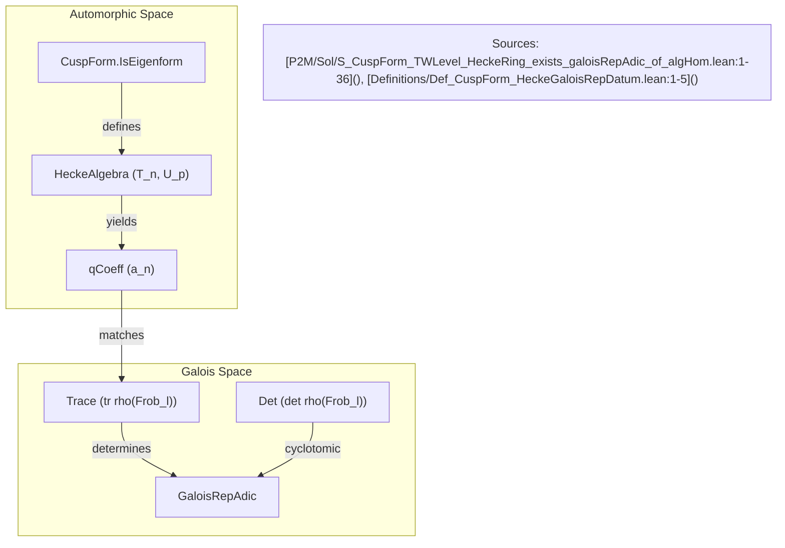
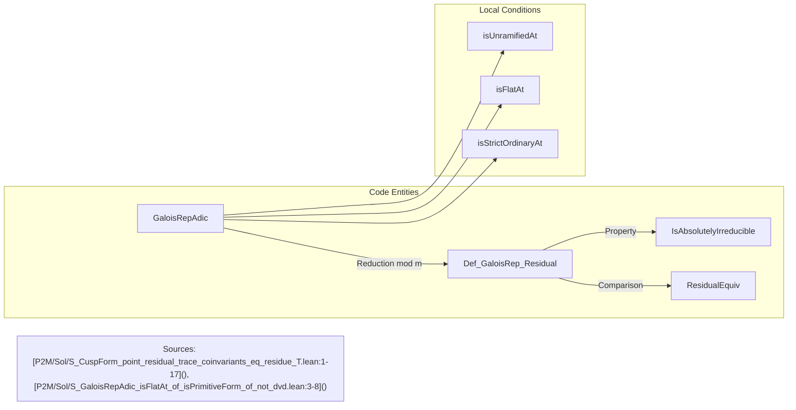

<!-- source: DeepWiki mcp.deepwiki.com · repo anthropics/fermats-last-theorem · page 5.2 Galois Representations Attached to Eigenforms · fetched 2026-10-26 -->

# Galois Representations Attached to Eigenforms

Relevant source files

The following files were used as context for generating this wiki page:

- [P2M/Sol/S_AlgebraicClosure_exists_cycloChar_family.lean](P2M/Sol/S_AlgebraicClosure_exists_cycloChar_family.lean)
- [P2M/Sol/S_CerednikDrinfeld_TwoPlaceTorsionDatum_W_le_invariants_of_goodReductionOutside_of_span_eq_top.lean](P2M/Sol/S_CerednikDrinfeld_TwoPlaceTorsionDatum_W_le_invariants_of_goodReductionOutside_of_span_eq_top.lean)
- [P2M/Sol/S_CohCarrier_eq_zero_of_mem_parabolicHoms_gammaZero_auxLevel_of_heckeT_eq_smul_of_jDeg_eq_zero.lean](P2M/Sol/S_CohCarrier_eq_zero_of_mem_parabolicHoms_gammaZero_auxLevel_of_heckeT_eq_smul_of_jDeg_eq_zero.lean)
- [P2M/Sol/S_CohCarrier_exists_complex_heckeT_eigen_reduction_eq_of_mem_span_int.lean](P2M/Sol/S_CohCarrier_exists_complex_heckeT_eigen_reduction_eq_of_mem_span_int.lean)
- [P2M/Sol/S_CohCarrier_exists_ideal_forall_heckeAlg_baseChange_eq_smul_of_exists_jZero_pTorsion_eigenvector.lean](P2M/Sol/S_CohCarrier_exists_ideal_forall_heckeAlg_baseChange_eq_smul_of_exists_jZero_pTorsion_eigenvector.lean)
- [P2M/Sol/S_CohCarrier_exists_span_pair_union_ker_smul_eq_top_cornerSubmodule_H1_top_of_isAbsolutelyIrreducible.lean](P2M/Sol/S_CohCarrier_exists_span_pair_union_ker_smul_eq_top_cornerSubmodule_H1_top_of_isAbsolutelyIrreducible.lean)
- [P2M/Sol/S_CohCarrier_finrank_cornerSubmodule_sigmaCorner_gammaZero_auxLevel_le_two_mul.lean](P2M/Sol/S_CohCarrier_finrank_cornerSubmodule_sigmaCorner_gammaZero_auxLevel_le_two_mul.lean)
- [P2M/Sol/S_CuspForm_AuxLevel_exists_heckeTL_baseML_eq_smul_of_prime_dvd.lean](P2M/Sol/S_CuspForm_AuxLevel_exists_heckeTL_baseML_eq_smul_of_prime_dvd.lean)
- [P2M/Sol/S_CuspForm_AuxLevel_toML_eq_zero_of_jDeg_one_eq_zero_of_jDeg_eq_zero.lean](P2M/Sol/S_CuspForm_AuxLevel_toML_eq_zero_of_jDeg_one_eq_zero_of_jDeg_eq_zero.lean)
- [P2M/Sol/S_CuspForm_HeckeGaloisRepDatum_exists_pi_eq_and_forall_isUnramifiedAt.lean](P2M/Sol/S_CuspForm_HeckeGaloisRepDatum_exists_pi_eq_and_forall_isUnramifiedAt.lean)
- [P2M/Sol/S_CuspForm_HeckeGaloisRepDatum_exists_pi_eq_and_isFlatAt_of_primeFactors_subset.lean](P2M/Sol/S_CuspForm_HeckeGaloisRepDatum_exists_pi_eq_and_isFlatAt_of_primeFactors_subset.lean)
- [P2M/Sol/S_CuspForm_HeckeGaloisRepDatum_exists_pi_eq_and_isOrdinaryAt_of_primeFactors_subset.lean](P2M/Sol/S_CuspForm_HeckeGaloisRepDatum_exists_pi_eq_and_isOrdinaryAt_of_primeFactors_subset.lean)
- [P2M/Sol/S_CuspForm_HeckeGaloisRepDatum_isFlatAt_of_primeFactors_subset.lean](P2M/Sol/S_CuspForm_HeckeGaloisRepDatum_isFlatAt_of_primeFactors_subset.lean)
- [P2M/Sol/S_CuspForm_HeckeGaloisRepDatum_isOrdinaryAt_of_primeFactors_subset.lean](P2M/Sol/S_CuspForm_HeckeGaloisRepDatum_isOrdinaryAt_of_primeFactors_subset.lean)
- [P2M/Sol/S_CuspForm_HeckeGaloisRepDatum_isUnramifiedAt_of_notMem.lean](P2M/Sol/S_CuspForm_HeckeGaloisRepDatum_isUnramifiedAt_of_notMem.lean)
- [P2M/Sol/S_CuspForm_IsEigenformWith_charpoly_eq_of_isFrobeniusAt_of_not_dvd_conductor_of_not_eigenpacketOccursAt_div.lean](P2M/Sol/S_CuspForm_IsEigenformWith_charpoly_eq_of_isFrobeniusAt_of_not_dvd_conductor_of_not_eigenpacketOccursAt_div.lean)
- [P2M/Sol/S_CuspForm_IsEigenformWith_exists_basis_inertia_apply_eq_smul_of_dvd_of_not_sq_dvd_of_dvd_sub_one_of_residual_isAbsolutelyIrreducible.lean](P2M/Sol/S_CuspForm_IsEigenformWith_exists_basis_inertia_apply_eq_smul_of_dvd_of_not_sq_dvd_of_dvd_sub_one_of_residual_isAbsolutelyIrreducible.lean)
- [P2M/Sol/S_CuspForm_IsEigenformWith_exists_galoisRepAdic_charpoly_frobenius_eq_and_isUnramifiedAt.lean](P2M/Sol/S_CuspForm_IsEigenformWith_exists_galoisRepAdic_charpoly_frobenius_eq_and_isUnramifiedAt.lean)
- [P2M/Sol/S_CuspForm_IsEigenformWith_exists_galoisRepAdic_charpoly_frobenius_eq_tateModule_jOne_quotient.lean](P2M/Sol/S_CuspForm_IsEigenformWith_exists_galoisRepAdic_charpoly_frobenius_eq_tateModule_jOne_quotient.lean)
- [P2M/Sol/S_CuspForm_IsEigenformWith_exists_linearIndependent_inertia_apply_eq_smul_of_dvd_of_not_sq_dvd_of_dvd_conductor_of_residual_isAbsolutelyIrreducible.lean](P2M/Sol/S_CuspForm_IsEigenformWith_exists_linearIndependent_inertia_apply_eq_smul_of_dvd_of_not_sq_dvd_of_dvd_conductor_of_residual_isAbsolutelyIrreducible.lean)
- [P2M/Sol/S_CuspForm_IsEigenformWith_inertia_eq_one_and_isRoot_charpoly_of_eigenpacketOccursAt_div.lean](P2M/Sol/S_CuspForm_IsEigenformWith_inertia_eq_one_and_isRoot_charpoly_of_eigenpacketOccursAt_div.lean)
- [P2M/Sol/S_CuspForm_IsEigenformWith_isRoot_charpoly_one_of_mem_inertiaSubgroupIn_of_factorization_eq_one_of_conductor_factorization_eq_one.lean](P2M/Sol/S_CuspForm_IsEigenformWith_isRoot_charpoly_one_of_mem_inertiaSubgroupIn_of_factorization_eq_one_of_conductor_factorization_eq_one.lean)
- [P2M/Sol/S_CuspForm_IsNewform_dvd_level_of_point_of_not_isUnramifiedAt.lean](P2M/Sol/S_CuspForm_IsNewform_dvd_level_of_point_of_not_isUnramifiedAt.lean)
- [P2M/Sol/S_CuspForm_IsNewform_exists_charpoly_inertia_eq_and_pow_eq_one_iff_of_linearMap_psCarrier_ne_zero_of_factorization_eq_two.lean](P2M/Sol/S_CuspForm_IsNewform_exists_charpoly_inertia_eq_and_pow_eq_one_iff_of_linearMap_psCarrier_ne_zero_of_factorization_eq_two.lean)
- [P2M/Sol/S_CuspForm_IsNewform_exists_charpoly_inertia_eq_principalSeries_supercuspidal_of_galoisRepAdic_of_two_laws_of_irreducible_odd_of_ne_two_of_factorization_eq_two.lean](P2M/Sol/S_CuspForm_IsNewform_exists_charpoly_inertia_eq_principalSeries_supercuspidal_of_galoisRepAdic_of_two_laws_of_irreducible_odd_of_ne_two_of_factorization_eq_two.lean)
- [P2M/Sol/S_CuspForm_IsNewform_exists_eigenPlane_torLine_tateModule_jZero.lean](P2M/Sol/S_CuspForm_IsNewform_exists_eigenPlane_torLine_tateModule_jZero.lean)
- [P2M/Sol/S_CuspForm_IsNewform_exists_galoisRepAdic_charpoly_frobenius_eq_of_dvd_of_not_sq_dvd.lean](P2M/Sol/S_CuspForm_IsNewform_exists_galoisRepAdic_charpoly_frobenius_eq_of_dvd_of_not_sq_dvd.lean)
- [P2M/Sol/S_CuspForm_IsNewform_exists_galoisRepAdic_charpoly_inertia_eq_cyclotomicCharacter_of_linearMap_psCarrier_ne_zero_of_not_isUnramified_ratio_of_factorization_eq_two.lean](P2M/Sol/S_CuspForm_IsNewform_exists_galoisRepAdic_charpoly_inertia_eq_cyclotomicCharacter_of_linearMap_psCarrier_ne_zero_of_not_isUnramified_ratio_of_factorization_eq_two.lean)
- [P2M/Sol/S_CuspForm_IsNewform_exists_galoisRepAdic_inertia_apply_ne_and_stableLine_frobenius_eq_qCoeff_smul_of_dvd_of_not_sq_dvd.lean](P2M/Sol/S_CuspForm_IsNewform_exists_galoisRepAdic_inertia_apply_ne_and_stableLine_frobenius_eq_qCoeff_smul_of_dvd_of_not_sq_dvd.lean)
- [P2M/Sol/S_CuspForm_IsNewform_exists_galoisRepAdic_not_isUnipotentOnInertiaAt_of_factorization_eq_two_of_absIrred_odd_of_ne_two.lean](P2M/Sol/S_CuspForm_IsNewform_exists_galoisRepAdic_not_isUnipotentOnInertiaAt_of_factorization_eq_two_of_absIrred_odd_of_ne_two.lean)
- [P2M/Sol/S_CuspForm_IsNewform_exists_galoisRepAdic_ordinaryLine_frobenius_sub_qCoeff_smul_mem_of_dvd_of_not_sq_dvd.lean](P2M/Sol/S_CuspForm_IsNewform_exists_galoisRepAdic_ordinaryLine_frobenius_sub_qCoeff_smul_mem_of_dvd_of_not_sq_dvd.lean)
- [P2M/Sol/S_CuspForm_IsNewform_exists_galoisRepAdic_ordinaryLine_frobenius_sub_unitRoot_smul_mem_of_not_dvd.lean](P2M/Sol/S_CuspForm_IsNewform_exists_galoisRepAdic_ordinaryLine_frobenius_sub_unitRoot_smul_mem_of_not_dvd.lean)
- [P2M/Sol/S_CuspForm_IsNewform_exists_galoisRepAdic_stableLine_frobenius_eq_qCoeff_smul_of_dvd_of_not_sq_dvd.lean](P2M/Sol/S_CuspForm_IsNewform_exists_galoisRepAdic_stableLine_frobenius_eq_qCoeff_smul_of_dvd_of_not_sq_dvd.lean)
- [P2M/Sol/S_CuspForm_IsNewform_exists_isPrimitiveForm_adelicLiftGamma1_psCarrier_isUnramified_of_not_isUnramified_ratio_of_factorization_eq_two.lean](P2M/Sol/S_CuspForm_IsNewform_exists_isPrimitiveForm_adelicLiftGamma1_psCarrier_isUnramified_of_not_isUnramified_ratio_of_factorization_eq_two.lean)
- [P2M/Sol/S_CuspForm_IsNewform_exists_mem_inertiaSubgroupIn_baseChange_apply_ne_of_eigenPlane_tateModule_jZero.lean](P2M/Sol/S_CuspForm_IsNewform_exists_mem_inertiaSubgroupIn_baseChange_apply_ne_of_eigenPlane_tateModule_jZero.lean)
- [P2M/Sol/S_CuspForm_IsNewform_exists_ordLine_eigenPlane_tateModule_jZero_of_dvd.lean](P2M/Sol/S_CuspForm_IsNewform_exists_ordLine_eigenPlane_tateModule_jZero_of_dvd.lean)
- [P2M/Sol/S_CuspForm_IsNewform_exists_ordLine_eigenPlane_tateModule_jZero_of_not_dvd.lean](P2M/Sol/S_CuspForm_IsNewform_exists_ordLine_eigenPlane_tateModule_jZero_of_not_dvd.lean)
- [P2M/Sol/S_CuspForm_IsNewform_exists_torLine_of_eigenPlane_tateModule_jZero.lean](P2M/Sol/S_CuspForm_IsNewform_exists_torLine_of_eigenPlane_tateModule_jZero.lean)
- [P2M/Sol/S_CuspForm_IsNewform_finrank_le_one_of_le_reductionKernelSpan_tateModule_jZero_of_isUnit.lean](P2M/Sol/S_CuspForm_IsNewform_finrank_le_one_of_le_reductionKernelSpan_tateModule_jZero_of_isUnit.lean)
- [P2M/Sol/S_CuspForm_IsNewform_finrank_monodromySpan_eigenPlane_tateModule_jZero_le_one_of_dvd.lean](P2M/Sol/S_CuspForm_IsNewform_finrank_monodromySpan_eigenPlane_tateModule_jZero_le_one_of_dvd.lean)
- [P2M/Sol/S_CuspForm_IsNewform_frobenius_sub_heckeU_smul_mem_monodromySpan_eigenPlane_tateModule_jZero_of_dvd.lean](P2M/Sol/S_CuspForm_IsNewform_frobenius_sub_heckeU_smul_mem_monodromySpan_eigenPlane_tateModule_jZero_of_dvd.lean)
- [P2M/Sol/S_CuspForm_IsNewform_linearMap_psCarrier_eq_zero_of_charpoly_inertia_eq_mul_of_eq_pow_of_pow_sub_one_ne_one_exponent_two.lean](P2M/Sol/S_CuspForm_IsNewform_linearMap_psCarrier_eq_zero_of_charpoly_inertia_eq_mul_of_eq_pow_of_pow_sub_one_ne_one_exponent_two.lean)
- [P2M/Sol/S_CuspForm_IsNewform_psCarrier_lam_dvd_sub_one_or_no_psCarrier_lam_dvd_add_one_of_factorization_eq_two_of_residual_isUnipotent_of_irreducible_odd_of_absIrred_odd.lean](P2M/Sol/S_CuspForm_IsNewform_psCarrier_lam_dvd_sub_one_or_no_psCarrier_lam_dvd_add_one_of_factorization_eq_two_of_residual_isUnipotent_of_irreducible_odd_of_absIrred_odd.lean)
- [P2M/Sol/S_CuspForm_IsPrimitiveForm_exists_galoisRepAdic_charpoly_frobenius_eq_and_isRoot_charpoly_one_of_dvd_of_factorization_eq_conductor_factorization_of_not_sq_dvd.lean](P2M/Sol/S_CuspForm_IsPrimitiveForm_exists_galoisRepAdic_charpoly_frobenius_eq_and_isRoot_charpoly_one_of_dvd_of_factorization_eq_conductor_factorization_of_not_sq_dvd.lean)
- [P2M/Sol/S_CuspForm_IsPrimitiveForm_exists_galoisRepAdic_forall_inertiaSubgroupIn_apply_eq_self_of_linearMap_psCarrier_isUnramified_of_factorization_eq_one.lean](P2M/Sol/S_CuspForm_IsPrimitiveForm_exists_galoisRepAdic_forall_inertiaSubgroupIn_apply_eq_self_of_linearMap_psCarrier_isUnramified_of_factorization_eq_one.lean)
- [P2M/Sol/S_CuspForm_IsPrimitiveForm_exists_galoisRepAdic_linearIndependent_inertia_apply_eq_smul_of_dvd_of_not_sq_dvd_of_dvd_conductor.lean](P2M/Sol/S_CuspForm_IsPrimitiveForm_exists_galoisRepAdic_linearIndependent_inertia_apply_eq_smul_of_dvd_of_not_sq_dvd_of_dvd_conductor.lean)
- [P2M/Sol/S_CuspForm_IsPrimitiveForm_exists_galoisRepAdic_ordinaryLine_frobenius_sub_qCoeff_smul_mem_of_dvd_of_not_sq_dvd_of_not_dvd_conductor.lean](P2M/Sol/S_CuspForm_IsPrimitiveForm_exists_galoisRepAdic_ordinaryLine_frobenius_sub_qCoeff_smul_mem_of_dvd_of_not_sq_dvd_of_not_dvd_conductor.lean)
- [P2M/Sol/S_CuspForm_IsPrimitiveForm_exists_galoisRepAdic_ordinaryLine_frobenius_sub_unitRoot_smul_mem_of_not_dvd.lean](P2M/Sol/S_CuspForm_IsPrimitiveForm_exists_galoisRepAdic_ordinaryLine_frobenius_sub_unitRoot_smul_mem_of_not_dvd.lean)
- [P2M/Sol/S_CuspForm_IsPrimitiveForm_exists_ne_zero_forall_inertiaSubgroupIn_apply_eq_self_of_linearMap_psCarrier_isUnramified_of_factorization_eq_one.lean](P2M/Sol/S_CuspForm_IsPrimitiveForm_exists_ne_zero_forall_inertiaSubgroupIn_apply_eq_self_of_linearMap_psCarrier_isUnramified_of_factorization_eq_one.lean)
- [P2M/Sol/S_CuspForm_TWLevel_HeckeRing_exists_basis_inertia_apply_eq_diamond_smul.lean](P2M/Sol/S_CuspForm_TWLevel_HeckeRing_exists_basis_inertia_apply_eq_diamond_smul.lean)
- [P2M/Sol/S_CuspForm_TWLevel_HeckeRing_exists_basis_inertia_apply_eq_diamond_smul_of_algHom.lean](P2M/Sol/S_CuspForm_TWLevel_HeckeRing_exists_basis_inertia_apply_eq_diamond_smul_of_algHom.lean)
- [P2M/Sol/S_CuspForm_TWLevel_HeckeRing_exists_galoisRepAdic_of_algHom.lean](P2M/Sol/S_CuspForm_TWLevel_HeckeRing_exists_galoisRepAdic_of_algHom.lean)
- [P2M/Sol/S_CuspForm_TWLevel_HeckeRing_isStrictOrdinaryAt_of_algHom_of_dvd_level_of_not_isFlatAt.lean](P2M/Sol/S_CuspForm_TWLevel_HeckeRing_isStrictOrdinaryAt_of_algHom_of_dvd_level_of_not_isFlatAt.lean)
- [P2M/Sol/S_CuspForm_TWLevel_HeckeRing_isStrictOrdinaryAt_of_dvd_level_of_not_isFlatAt.lean](P2M/Sol/S_CuspForm_TWLevel_HeckeRing_isStrictOrdinaryAt_of_dvd_level_of_not_isFlatAt.lean)
- [P2M/Sol/S_CuspForm_TWLevel_HeckeRing_isUnipotentOnInertiaAt_of_dvd_of_not_isUnramifiedAt.lean](P2M/Sol/S_CuspForm_TWLevel_HeckeRing_isUnipotentOnInertiaAt_of_dvd_of_not_isUnramifiedAt.lean)
- [P2M/Sol/S_CuspForm_TWLevel_HeckeRing_isUnramifiedAt_of_not_dvd_sub_one_of_trace_frobenius_sq_ne.lean](P2M/Sol/S_CuspForm_TWLevel_HeckeRing_isUnramifiedAt_of_not_dvd_sub_one_of_trace_frobenius_sq_ne.lean)
- [P2M/Sol/S_CuspForm_TWLevel_exists_galoisRepAdic_moduleEnd_ML_flat.lean](P2M/Sol/S_CuspForm_TWLevel_exists_galoisRepAdic_moduleEnd_ML_flat.lean)
- [P2M/Sol/S_CuspForm_TWLevel_exists_galoisRepAdic_moduleEnd_ML_of_not_isFlatAt_strictOrdinary.lean](P2M/Sol/S_CuspForm_TWLevel_exists_galoisRepAdic_moduleEnd_ML_of_not_isFlatAt_strictOrdinary.lean)
- [P2M/Sol/S_CuspForm_exists_galoisRepAdic_inertia_eigenvector_tameCharacter_of_not_isUnit_heckeT_of_ne_two.lean](P2M/Sol/S_CuspForm_exists_galoisRepAdic_inertia_eigenvector_tameCharacter_of_not_isUnit_heckeT_of_ne_two.lean)
- [P2M/Sol/S_CuspForm_exists_galoisRep_isFlatAt_of_point_of_not_dvd.lean](P2M/Sol/S_CuspForm_exists_galoisRep_isFlatAt_of_point_of_not_dvd.lean)
- [P2M/Sol/S_CuspForm_exists_galoisRep_of_point.lean](P2M/Sol/S_CuspForm_exists_galoisRep_of_point.lean)
- [P2M/Sol/S_CuspForm_exists_galoisRep_of_point_stableLine_frobenius_sub_smul_mem_of_not_dvd.lean](P2M/Sol/S_CuspForm_exists_galoisRep_of_point_stableLine_frobenius_sub_smul_mem_of_not_dvd.lean)
- [P2M/Sol/S_CuspForm_exists_galoisRep_of_point_tateModule_jZero_quotient.lean](P2M/Sol/S_CuspForm_exists_galoisRep_of_point_tateModule_jZero_quotient.lean)
- [P2M/Sol/S_CuspForm_heckeAlgebra_exists_ringHom_apply_T_eq_of_not_dvd_of_trace_frobenius_sq_ne.lean](P2M/Sol/S_CuspForm_heckeAlgebra_exists_ringHom_apply_T_eq_of_not_dvd_of_trace_frobenius_sq_ne.lean)
- [P2M/Sol/S_CuspForm_heckeAlgebra_natCast_pow_twist_eq_natCast_pow_weight_sub_one_of_twist_mem.lean](P2M/Sol/S_CuspForm_heckeAlgebra_natCast_pow_twist_eq_natCast_pow_weight_sub_one_of_twist_mem.lean)
- [P2M/Sol/S_CuspForm_heckeLocal_exists_algEquiv_sigmaCornerRing_auxLevel.lean](P2M/Sol/S_CuspForm_heckeLocal_exists_algEquiv_sigmaCornerRing_auxLevel.lean)
- [P2M/Sol/S_CuspForm_heckeLocal_exists_forall_point_apply_eq_qCoeff_of_not_isUnramifiedAt.lean](P2M/Sol/S_CuspForm_heckeLocal_exists_forall_point_apply_eq_qCoeff_of_not_isUnramifiedAt.lean)
- [P2M/Sol/S_CuspForm_heckeLocal_exists_forall_point_apply_eq_qCoeff_of_not_isUnramifiedAt_of_ne_two.lean](P2M/Sol/S_CuspForm_heckeLocal_exists_forall_point_apply_eq_qCoeff_of_not_isUnramifiedAt_of_ne_two.lean)
- [P2M/Sol/S_CuspForm_heckeLocal_exists_forall_point_apply_eq_unitRoot_of_isOrdinaryAt.lean](P2M/Sol/S_CuspForm_heckeLocal_exists_forall_point_apply_eq_unitRoot_of_isOrdinaryAt.lean)
- [P2M/Sol/S_CuspForm_heckeLocal_exists_h1CornerData_refinement_degeneracy_level_mul_of_cornerData_of_fullCorner_of_trace_sq_ne_of_not_cube_dvd.lean](P2M/Sol/S_CuspForm_heckeLocal_exists_h1CornerData_refinement_degeneracy_level_mul_of_cornerData_of_fullCorner_of_trace_sq_ne_of_not_cube_dvd.lean)
- [P2M/Sol/S_CuspForm_heckeLocal_exists_heckeGaloisRepDatum_localConditions.lean](P2M/Sol/S_CuspForm_heckeLocal_exists_heckeGaloisRepDatum_localConditions.lean)
- [P2M/Sol/S_CuspForm_heckeLocal_exists_isNewform_sum_rootMultiplicity_residual_eq_one_of_isOrdinaryAt.lean](P2M/Sol/S_CuspForm_heckeLocal_exists_isNewform_sum_rootMultiplicity_residual_eq_one_of_isOrdinaryAt.lean)
- [P2M/Sol/S_CuspForm_heckeLocal_exists_ne_zero_forall_algHom_algebraicClosure_isNewform_residual_unitRoot_of_isOrdinaryAt.lean](P2M/Sol/S_CuspForm_heckeLocal_exists_ne_zero_forall_algHom_algebraicClosure_isNewform_residual_unitRoot_of_isOrdinaryAt.lean)
- [P2M/Sol/S_CuspForm_heckeLocal_exists_subfamily_idempotentSplitting_point_level_mul_auxPrime.lean](P2M/Sol/S_CuspForm_heckeLocal_exists_subfamily_idempotentSplitting_point_level_mul_auxPrime.lean)
- [P2M/Sol/S_CuspForm_heckeLocal_exists_taylorWilesModule_of_linearEquiv_ML_flat.lean](P2M/Sol/S_CuspForm_heckeLocal_exists_taylorWilesModule_of_linearEquiv_ML_flat.lean)
- [P2M/Sol/S_CuspForm_heckeLocal_exists_taylorWilesModule_of_linearEquiv_ML_of_not_isFlatAt_strictOrdinary.lean](P2M/Sol/S_CuspForm_heckeLocal_exists_taylorWilesModule_of_linearEquiv_ML_of_not_isFlatAt_strictOrdinary.lean)
- [P2M/Sol/S_CuspForm_heckeLocal_not_dvd_level_and_not_isUnit_qCoeff_of_point_of_not_isOrdinaryAt.lean](P2M/Sol/S_CuspForm_heckeLocal_not_dvd_level_and_not_isUnit_qCoeff_of_point_of_not_isOrdinaryAt.lean)
- [P2M/Sol/S_CuspForm_heckeLocal_sum_rootMultiplicity_residual_eq_one_of_dvd_of_not_sq_dvd_of_ne.lean](P2M/Sol/S_CuspForm_heckeLocal_sum_rootMultiplicity_residual_eq_one_of_dvd_of_not_sq_dvd_of_ne.lean)
- [P2M/Sol/S_CuspForm_heckeLocal_sum_rootMultiplicity_residual_eq_two_of_not_isOrdinaryAt.lean](P2M/Sol/S_CuspForm_heckeLocal_sum_rootMultiplicity_residual_eq_two_of_not_isOrdinaryAt.lean)
- [P2M/Sol/S_CuspForm_isOrdinaryAt_of_point_of_isUnit_up_of_residual_isAbsolutelyIrreducible_of_residual_isOrdinaryAt.lean](P2M/Sol/S_CuspForm_isOrdinaryAt_of_point_of_isUnit_up_of_residual_isAbsolutelyIrreducible_of_residual_isOrdinaryAt.lean)
- [P2M/Sol/S_CuspForm_moduleFinite_heckeAlgebra.lean](P2M/Sol/S_CuspForm_moduleFinite_heckeAlgebra.lean)
- [P2M/Sol/S_CuspForm_point_residual_trace_coinvariants_eq_residue_T.lean](P2M/Sol/S_CuspForm_point_residual_trace_coinvariants_eq_residue_T.lean)
- [P2M/Sol/S_CuspForm_point_residual_trace_coinvariants_eq_residue_U_of_isUnit.lean](P2M/Sol/S_CuspForm_point_residual_trace_coinvariants_eq_residue_U_of_isUnit.lean)
- [P2M/Sol/S_DeligneSerre_exists_galoisRep_complex_trace_frobenius_eq_of_forall_residual.lean](P2M/Sol/S_DeligneSerre_exists_galoisRep_complex_trace_frobenius_eq_of_forall_residual.lean)
- [P2M/Sol/S_DeligneSerre_exists_isSemisimpleRepresentation_charpoly_map_eq_of_add_mem_range_of_mul_mem_range.lean](P2M/Sol/S_DeligneSerre_exists_isSemisimpleRepresentation_charpoly_map_eq_of_add_mem_range_of_mul_mem_range.lean)
- [P2M/Sol/S_DeligneSerre_exists_natCard_range_le_of_charpoly_frobenius_mem_of_upperDensity_le.lean](P2M/Sol/S_DeligneSerre_exists_natCard_range_le_of_charpoly_frobenius_mem_of_upperDensity_le.lean)
- [P2M/Sol/S_DeligneSerre_isIrreducible_matrixRepresentation_of_tsum_norm_trace_sq_le_log_of_odd.lean](P2M/Sol/S_DeligneSerre_isIrreducible_matrixRepresentation_of_tsum_norm_trace_sq_le_log_of_odd.lean)
- [P2M/Sol/S_FrobeniusDensity_exists_frobenius_conj_of_mul_self_eq_one_of_statement.lean](P2M/Sol/S_FrobeniusDensity_exists_frobenius_conj_of_mul_self_eq_one_of_statement.lean)
- [P2M/Sol/S_FrobeniusDensity_exists_frobenius_conj_pow_of_statement.lean](P2M/Sol/S_FrobeniusDensity_exists_frobenius_conj_pow_of_statement.lean)
- [P2M/Sol/S_GaloisRepAdic_det_eq_mul_of_isFrobeniusAt_of_det_frobenius_eq_mul_of_not_dvd_conductor.lean](P2M/Sol/S_GaloisRepAdic_det_eq_mul_of_isFrobeniusAt_of_det_frobenius_eq_mul_of_not_dvd_conductor.lean)
- [P2M/Sol/S_GaloisRepAdic_det_eq_of_mem_inertiaSubgroupIn_of_det_frobenius_eq_mul.lean](P2M/Sol/S_GaloisRepAdic_det_eq_of_mem_inertiaSubgroupIn_of_det_frobenius_eq_mul.lean)
- [P2M/Sol/S_GaloisRepAdic_eigenformTraceNebentypus_isFlatAt_or_isStrictOrdinaryAt_of_not_sq_dvd_of_not_dvd_conductor.lean](P2M/Sol/S_GaloisRepAdic_eigenformTraceNebentypus_isFlatAt_or_isStrictOrdinaryAt_of_not_sq_dvd_of_not_dvd_conductor.lean)
- [P2M/Sol/S_GaloisRepAdic_eisensteinTrace_not_isAbsolutelyIrreducible_residual.lean](P2M/Sol/S_GaloisRepAdic_eisensteinTrace_not_isAbsolutelyIrreducible_residual.lean)
- [P2M/Sol/S_GaloisRepAdic_exists_ordinaryLine_frobenius_sub_smul_mem_of_isEigenformWith_of_isUnit_of_dvd_of_not_sq_dvd_of_not_dvd_conductor.lean](P2M/Sol/S_GaloisRepAdic_exists_ordinaryLine_frobenius_sub_smul_mem_of_isEigenformWith_of_isUnit_of_dvd_of_not_sq_dvd_of_not_dvd_conductor.lean)
- [P2M/Sol/S_GaloisRepAdic_exists_ordinaryLine_frobenius_sub_unitRoot_smul_mem_of_isNewform_of_not_dvd.lean](P2M/Sol/S_GaloisRepAdic_exists_ordinaryLine_frobenius_sub_unitRoot_smul_mem_of_isNewform_of_not_dvd.lean)
- [P2M/Sol/S_GaloisRepAdic_exists_stableLine_frobenius_eq_qCoeff_smul_of_isNewform_of_dvd_of_not_sq_dvd.lean](P2M/Sol/S_GaloisRepAdic_exists_stableLine_frobenius_eq_qCoeff_smul_of_isNewform_of_dvd_of_not_sq_dvd.lean)
- [P2M/Sol/S_GaloisRepAdic_isFlatAt_of_isPrimitiveForm_of_not_dvd.lean](P2M/Sol/S_GaloisRepAdic_isFlatAt_of_isPrimitiveForm_of_not_dvd.lean)
- [P2M/Sol/S_GaloisRepAdic_isStrictOrdinaryAt_of_detIsCyclotomic_of_ordinaryLine.lean](P2M/Sol/S_GaloisRepAdic_isStrictOrdinaryAt_of_detIsCyclotomic_of_ordinaryLine.lean)
- [P2M/Sol/S_GaloisRepAdic_isStrictOrdinaryAt_of_isPrimitiveForm_of_dvd_of_not_sq_dvd_of_not_dvd_conductor.lean](P2M/Sol/S_GaloisRepAdic_isStrictOrdinaryAt_of_isPrimitiveForm_of_dvd_of_not_sq_dvd_of_not_dvd_conductor.lean)
- [P2M/Sol/S_GaloisRepAdic_isStrictOrdinaryAt_of_isStrictOrdinaryAt_baseChangeAlong_of_injective.lean](P2M/Sol/S_GaloisRepAdic_isStrictOrdinaryAt_of_isStrictOrdinaryAt_baseChangeAlong_of_injective.lean)
- [P2M/Sol/S_GaloisRepAdic_not_isUnipotentOnInertiaAt_and_charpoly_frobenius_of_factorization_eq_two_of_absIrred_odd_of_ne_two.lean](P2M/Sol/S_GaloisRepAdic_not_isUnipotentOnInertiaAt_and_charpoly_frobenius_of_factorization_eq_two_of_absIrred_odd_of_ne_two.lean)
- [P2M/Sol/S_GaloisRepAdic_residual_isEquiv_and_det_sub_mem_of_charpoly_frobenius_eq.lean](P2M/Sol/S_GaloisRepAdic_residual_isEquiv_and_det_sub_mem_of_charpoly_frobenius_eq.lean)
- [P2M/Sol/S_GaloisRep_exists_conj_eq_of_charpoly_frobenius_eq_of_galoisFactorsThroughFiniteLevel.lean](P2M/Sol/S_GaloisRep_exists_conj_eq_of_charpoly_frobenius_eq_of_galoisFactorsThroughFiniteLevel.lean)
- [P2M/Sol/S_GaloisRep_exists_conj_map_stableLine_of_theta_T_ne_zero_of_absolutelyIrreducible_of_eq_two.lean](P2M/Sol/S_GaloisRep_exists_conj_map_stableLine_of_theta_T_ne_zero_of_absolutelyIrreducible_of_eq_two.lean)
- [P2M/Sol/S_GaloisRep_exists_finiteField_galoisRep_trace_eq_heckeT_mod_of_isMaximal.lean](P2M/Sol/S_GaloisRep_exists_finiteField_galoisRep_trace_eq_heckeT_mod_of_isMaximal.lean)
- [P2M/Sol/S_GaloisRep_exists_finiteField_galoisRep_trace_eq_heckeT_mod_of_isMaximal_two.lean](P2M/Sol/S_GaloisRep_exists_finiteField_galoisRep_trace_eq_heckeT_mod_of_isMaximal_two.lean)
- [P2M/Sol/S_GaloisRep_exists_galoisFactorsThroughFiniteLevel_trace_eq_theta_heckeT_and_det_eq_pow.lean](P2M/Sol/S_GaloisRep_exists_galoisFactorsThroughFiniteLevel_trace_eq_theta_heckeT_and_det_eq_pow.lean)
- [P2M/Sol/S_GaloisRep_exists_galoisRep_trace_eq_add_mul_of_unitsHom.lean](P2M/Sol/S_GaloisRep_exists_galoisRep_trace_eq_add_mul_of_unitsHom.lean)
- [P2M/Sol/S_GaloisRep_exists_galoisRep_trace_eq_of_ringHom_heckeAlgebra_two.lean](P2M/Sol/S_GaloisRep_exists_galoisRep_trace_eq_of_ringHom_heckeAlgebra_two.lean)
- [P2M/Sol/S_GaloisRep_exists_isSemisimpleRepresentation_charpoly_map_eq_of_trace_det_frobenius_mem_range.lean](P2M/Sol/S_GaloisRep_exists_isSemisimpleRepresentation_charpoly_map_eq_of_trace_det_frobenius_mem_range.lean)
- [P2M/Sol/S_IharaTower_CornerData_exists_orthogonal_stable_complement_of_corner_le_of_selfAdjoint.lean](P2M/Sol/S_IharaTower_CornerData_exists_orthogonal_stable_complement_of_corner_le_of_selfAdjoint.lean)
- [P2M/Sol/S_ModularCurve_DRModelPackageLevel_exists_dRResolvedModelPackageLevel_and_dRResolvedModelChartsLevelRam.lean](P2M/Sol/S_ModularCurve_DRModelPackageLevel_exists_dRResolvedModelPackageLevel_and_dRResolvedModelChartsLevelRam.lean)
- [P2M/Sol/S_ModularCurve_DRModelPackage_exists_dRResolvedModelPackageV4_and_dRResolvedModelCharts.lean](P2M/Sol/S_ModularCurve_DRModelPackage_exists_dRResolvedModelPackageV4_and_dRResolvedModelCharts.lean)
- [P2M/Sol/S_ModularCurve_FullLevel_AuxLevelOne_exists_ringEquiv_adicCompletion_stalk_drinfeldChart_baseChange_of_cyclotomicWitness_of_isAlgClosed_of_isPrimitiveRoot_mul_of_dvd.lean](P2M/Sol/S_ModularCurve_FullLevel_AuxLevelOne_exists_ringEquiv_adicCompletion_stalk_drinfeldChart_baseChange_of_cyclotomicWitness_of_isAlgClosed_of_isPrimitiveRoot_mul_of_dvd.lean)
- [P2M/Sol/S_ModularCurve_FullLevel_AuxLevelOne_exists_ringEquiv_adicCompletion_stalk_drinfeldChart_of_levelAut_riders_inertia_of_mem_ssJSet_twoChartIntegralModel_of_isPrimitiveRoot_mul_of_dvd.lean](P2M/Sol/S_ModularCurve_FullLevel_AuxLevelOne_exists_ringEquiv_adicCompletion_stalk_drinfeldChart_of_levelAut_riders_inertia_of_mem_ssJSet_twoChartIntegralModel_of_isPrimitiveRoot_mul_of_dvd.lean)
- [P2M/Sol/S_ModularCurve_FullLevel_AuxLevelOne_exists_ringEquiv_adicCompletion_stalk_drinfeldChart_of_mem_ssJSet_twoChartIntegralModel_of_isPrimitiveRoot_mul_of_dvd.lean](P2M/Sol/S_ModularCurve_FullLevel_AuxLevelOne_exists_ringEquiv_adicCompletion_stalk_drinfeldChart_of_mem_ssJSet_twoChartIntegralModel_of_isPrimitiveRoot_mul_of_dvd.lean)

This section covers the construction and properties of $p$-adic Galois representations $\rho_{f, \lambda}$ associated to modular eigenforms $f$. These representations are the bridge between the automorphic world (Hecke eigenforms) and the arithmetic world (Galois groups), forming a central pillar of the proof of Fermat's Last Theorem.

## Overview of GaloisRepAdic

A $p$-adic Galois representation is modeled in the codebase as `GaloisRepAdic`, representing a continuous homomorphism from the absolute Galois group $G_{\mathbb{Q}}$ to $\text{GL}_2(K)$, where $K$ is a finite extension of $\mathbb{Q}_p$ [Definitions/Def_GaloisRep_Adic.lean:17]().

The primary construction relates the Hecke eigenvalues of an eigenform $f$ to the characteristic polynomial of the Frobenius element $\text{Frob}_\ell$ for primes $\ell \nmid Np$.

### Key Components and Construction
The construction of these representations often proceeds through the Tate module of the Jacobian of modular curves ($X_0(N)$ or $X_1(N)$).
*   **Tate Module**: `TateModule` represents the $p$-adic limit of $p^n$-torsion points [Definitions/Def_EllipticCurve_TateModule.lean:5]().
*   **Eigen-equivalence**: For a primitive form $f$, there exists a representation such that the trace of $\text{Frob}_\ell$ is the Hecke eigenvalue $a_\ell(f)$ and the determinant is $\chi(\ell)\ell^{k-1}$ [P2M/Sol/S_CuspForm_IsPrimitiveForm_exists_galoisRepAdic_charpoly_frobenius_eq_and_isRoot_charpoly_one_of_dvd_of_factorization_eq_conductor_factorization_of_not_sq_dvd.lean:1-15]().

### Data Flow: From Eigenform to Representation

The following diagram illustrates how an eigenform's Hecke data is mapped to a Galois representation structure.

**Diagram: Eigenform to Galois Representation Mapping**

## The Ordinary Line and Local Conditions

A representation is **ordinary** at $p$ if its restriction to the decomposition group at $p$ is reducible with a specific shape.

### Ordinary Line (`ordinaryLine`)
For an eigenform $f$ that is ordinary at $p$ (i.e., $a_p(f)$ is a $p$-adic unit), the representation $\rho_f|_{G_p}$ contains a stable subspace (the "ordinary line") on which the Galois group acts via the unramified character sending $\text{Frob}_p$ to the unit root of the Hecke polynomial [P2M/Sol/S_CuspForm_IsNewform_exists_galoisRepAdic_ordinaryLine_frobenius_sub_unitRoot_smul_mem_of_not_dvd.lean:7-15]().

### Strict Ordinary Condition
The `strict ordinary` condition is a refinement used in the Taylor-Wiles patching argument. It implies the existence of a stable line where the action is specifically constrained, often appearing in the context of level-raising or lowering [P2M/Sol/S_GaloisRepAdic_isStrictOrdinaryAt_of_isPrimitiveForm_of_dvd_of_not_sq_dvd_of_not_dvd_conductor.lean:1-10]().

| Property | Code Entity | Description |
| :--- | :--- | :--- |
| **Ordinary at p** | `isOrdinaryAt` | $a_p$ is a unit in the local ring. |
| **Stable Line** | `ordinaryLine` | The 1-dimensional subspace stable under $G_p$. |
| **Unit Root** | `unitRoot` | The eigenvalue of $\text{Frob}_p$ on the quotient/subspace. |
| **Flatness** | `isFlatAt` | Finite flatness of the representation at $p$. |

Sources: [P2M/Sol/S_CuspForm_TWLevel_HeckeRing_isStrictOrdinaryAt_of_dvd_level_of_not_isFlatAt.lean:1-24](), [P2M/Sol/S_GaloisRepAdic_isFlatAt_of_isPrimitiveForm_of_not_dvd.lean:1-13]()

## Residual Representations and Irreducibility

The residual representation $\bar{\rho}$ is the reduction of $\rho$ modulo the maximal ideal of the valuation ring.

### Absolute Irreducibility
A critical requirement for the Modularity Lifting Theorems (R=T) is that the residual representation `ResidualGaloisRep` be **absolutely irreducible** (`IsAbsolutelyIrreducible`).
*   **Mazur's Theorem**: Used to guarantee irreducibility for $p \ge 5$ in the Frey curve case.
*   **Trace Formula**: Irreducibility is often checked via the span of the image of the representation [P2M/Sol/S_CuspForm_TWLevel_HeckeRing_exists_basis_inertia_apply_eq_diamond_smul_of_algHom.lean:6-12]().

**Diagram: Residual Representation Hierarchy**

## Frobenius Eigenvalues and Characteristic Polygons

The relationship between Hecke operators and Galois representations is formalized through the characteristic polynomial of Frobenius.

### Key Theorems
1.  **Charpoly Identity**: `Thm_GaloisRepAdic_charpoly_eq_of_charpoly_frobenius_eq` proves that if two representations have the same Frobenius characteristic polynomials for a dense set of primes, they are isomorphic [P2M/Sol/S_CuspForm_point_residual_trace_coinvariants_eq_residue_T.lean:6]().
2.  **Trace Compatibility**: For $\ell \nmid Np$, $\text{tr}(\rho(\text{Frob}_\ell)) = a_\ell$ [P2M/Sol/S_CuspForm_TWLevel_HeckeRing_exists_galoisRepAdic_of_algHom.lean:8]().
3.  **Inertia Action**: At primes $\ell | N$ (where $\ell \neq p$), the representation may be ramified. The codebase handles cases where the representation is unipotent on inertia [P2M/Sol/S_CuspForm_TWLevel_HeckeRing_isUnipotentOnInertiaAt_of_dvd_of_not_isUnramifiedAt.lean:12-19]().

### Local-Global Compatibility
The `HeckeGaloisRepDatum` structure bundles the Hecke algebra data with the Galois representation, ensuring that local conditions (like being ordinary or flat) are consistent across the mapping [Definitions/Def_CuspForm_HeckeGaloisRepDatum.lean:1-13]().

Sources: [P2M/Sol/S_CuspForm_heckeLocal_exists_heckeGaloisRepDatum_localConditions.lean:1-5](), [P2M/Sol/S_GaloisRepAdic_residual_isEquiv_and_det_sub_mem_of_charpoly_frobenius_eq.lean:1-10]()

---

