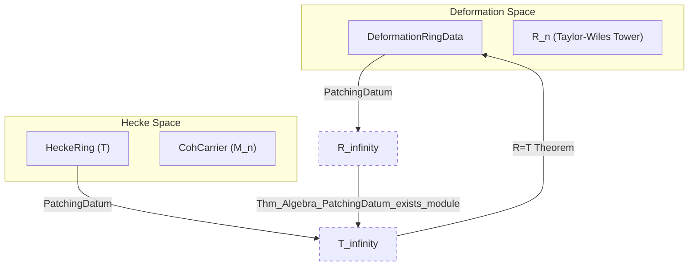
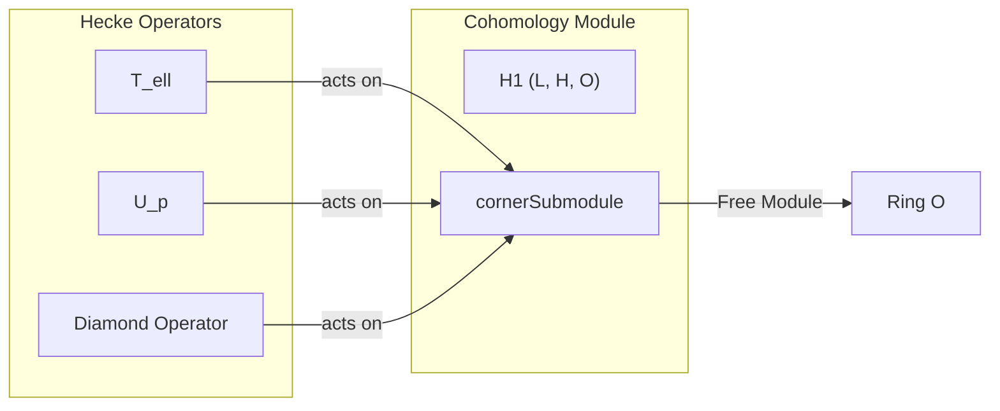

<!-- source: DeepWiki mcp.deepwiki.com · repo anthropics/fermats-last-theorem · page 5.3 Taylor-Wiles Patching and Modularity Lifting · fetched 2026-10-26 -->

# Taylor-Wiles Patching and Modularity Lifting

Relevant source files

The following files were used as context for generating this wiki page:

- [P2M/Sol/S_CerednikDrinfeld_QM_exists_fakeEllipticCurve_isFormalModuleVia_hasHeight_four_endomorphismDictionary_endIsoFull_of_isUnit_two.lean](P2M/Sol/S_CerednikDrinfeld_QM_exists_fakeEllipticCurve_isFormalModuleVia_hasHeight_four_endomorphismDictionary_endIsoFull_of_isUnit_two.lean)
- [P2M/Sol/S_CohCarrier_cornerSubmodule_sigmaCorner_gammaH_eq_map_iDegL_one_of_isUnit_index.lean](P2M/Sol/S_CohCarrier_cornerSubmodule_sigmaCorner_gammaH_eq_map_iDegL_one_of_isUnit_index.lean)
- [P2M/Sol/S_CohCarrier_cornerSubmodule_sigmaCorner_gammaZero_auxLevel_eq_iDegL_sup_iDegL.lean](P2M/Sol/S_CohCarrier_cornerSubmodule_sigmaCorner_gammaZero_auxLevel_eq_iDegL_sup_iDegL.lean)
- [P2M/Sol/S_CohCarrier_diamondL_mul_and_diamondL_one_and_diamondL_eq_one_of_mem.lean](P2M/Sol/S_CohCarrier_diamondL_mul_and_diamondL_one_and_diamondL_eq_one_of_mem.lean)
- [P2M/Sol/S_CohCarrier_diamondL_top_apply.lean](P2M/Sol/S_CohCarrier_diamondL_top_apply.lean)
- [P2M/Sol/S_CohCarrier_eq_zero_of_mem_sigmaCorner_gammaZero_auxLevel_of_jDegL_eq_zero.lean](P2M/Sol/S_CohCarrier_eq_zero_of_mem_sigmaCorner_gammaZero_auxLevel_of_jDegL_eq_zero.lean)
- [P2M/Sol/S_CohCarrier_exists_basis_cornerSubmodule_H1_monoidAlgebra_of_not_isEisenstein_subfamily.lean](P2M/Sol/S_CohCarrier_exists_basis_cornerSubmodule_H1_monoidAlgebra_of_not_isEisenstein_subfamily.lean)
- [P2M/Sol/S_CohCarrier_exists_ringHom_cornerRing_heckeT_eq_smul_of_idempotentSplitting.lean](P2M/Sol/S_CohCarrier_exists_ringHom_cornerRing_heckeT_eq_smul_of_idempotentSplitting.lean)
- [P2M/Sol/S_CohCarrier_exists_ringHom_heckeAlgebra_and_forall_exists_eigenclass_of_ker_eq.lean](P2M/Sol/S_CohCarrier_exists_ringHom_heckeAlgebra_and_forall_exists_eigenclass_of_ker_eq.lean)
- [P2M/Sol/S_CohCarrier_exists_ringHom_heckeAlgebra_apply_smul_eq_heckeT_of_mem_parabolicHoms.lean](P2M/Sol/S_CohCarrier_exists_ringHom_heckeAlgebra_apply_smul_eq_heckeT_of_mem_parabolicHoms.lean)
- [P2M/Sol/S_CohCarrier_exists_sigmaCorner_gammaZero_of_sigmaCorner_gammaH.lean](P2M/Sol/S_CohCarrier_exists_sigmaCorner_gammaZero_of_sigmaCorner_gammaH.lean)
- [P2M/Sol/S_CohCarrier_exists_sigmaCorner_gammaZero_of_sigmaCorner_gammaZero_auxLevel.lean](P2M/Sol/S_CohCarrier_exists_sigmaCorner_gammaZero_of_sigmaCorner_gammaZero_auxLevel.lean)
- [P2M/Sol/S_CohCarrier_exists_subfamily_corner_refinement_level_mul_of_corner_cofull.lean](P2M/Sol/S_CohCarrier_exists_subfamily_corner_refinement_level_mul_of_corner_cofull.lean)
- [P2M/Sol/S_CohCarrier_finrank_cornerSubmodule_H1_eq_relIndex_mul_of_not_isEisenstein_subfamily.lean](P2M/Sol/S_CohCarrier_finrank_cornerSubmodule_H1_eq_relIndex_mul_of_not_isEisenstein_subfamily.lean)
- [P2M/Sol/S_CohCarrier_finrank_range_baseChange_cornerSubmodule_inf_iInf_eigenspace_heckeTL_eq_two_mul_prod_sum_rootMultiplicity.lean](P2M/Sol/S_CohCarrier_finrank_range_baseChange_cornerSubmodule_inf_iInf_eigenspace_heckeTL_eq_two_mul_prod_sum_rootMultiplicity.lean)
- [P2M/Sol/S_CohCarrier_free_ordinary_sigmaCorner_level_mul.lean](P2M/Sol/S_CohCarrier_free_ordinary_sigmaCorner_level_mul.lean)
- [P2M/Sol/S_CohCarrier_free_sigmaCorner_gammaZero.lean](P2M/Sol/S_CohCarrier_free_sigmaCorner_gammaZero.lean)
- [P2M/Sol/S_CohCarrier_hdata_residue_U_eq_trace_frobenius_inertiaCoinvariants_of_not_sq_dvd.lean](P2M/Sol/S_CohCarrier_hdata_residue_U_eq_trace_frobenius_inertiaCoinvariants_of_not_sq_dvd.lean)
- [P2M/Sol/S_CohCarrier_heckeT_sub_algebraMap_mem_of_isMaximal_of_not_dvd.lean](P2M/Sol/S_CohCarrier_heckeT_sub_algebraMap_mem_of_isMaximal_of_not_dvd.lean)
- [P2M/Sol/S_CohCarrier_injective_iDeg_one_and_range_eq_of_isUnit_index.lean](P2M/Sol/S_CohCarrier_injective_iDeg_one_and_range_eq_of_isUnit_index.lean)
- [P2M/Sol/S_CohCarrier_saturated_torsionBySet_ordinary_sigmaCorner_level_mul.lean](P2M/Sol/S_CohCarrier_saturated_torsionBySet_ordinary_sigmaCorner_level_mul.lean)
- [P2M/Sol/S_CohCarrier_torsionBySet_ne_bot_and_finrank_sigmaCornerSubmodule_auxLevel_eq_mul.lean](P2M/Sol/S_CohCarrier_torsionBySet_ne_bot_and_finrank_sigmaCornerSubmodule_auxLevel_eq_mul.lean)
- [P2M/Sol/S_CuspForm_AuxLevel_baseML_free_range_lsmul.lean](P2M/Sol/S_CuspForm_AuxLevel_baseML_free_range_lsmul.lean)
- [P2M/Sol/S_CuspForm_AuxLevel_exists_linearEquiv_baseML_prod_ML.lean](P2M/Sol/S_CuspForm_AuxLevel_exists_linearEquiv_baseML_prod_ML.lean)
- [P2M/Sol/S_CuspForm_AuxLevel_exists_linearEquiv_cornerSubmodule_baseML_apply_eq_toML_of_squarefree.lean](P2M/Sol/S_CuspForm_AuxLevel_exists_linearEquiv_cornerSubmodule_baseML_apply_eq_toML_of_squarefree.lean)
- [P2M/Sol/S_CuspForm_AuxLevel_finrank_ML_le_two_mul_finrank_baseML.lean](P2M/Sol/S_CuspForm_AuxLevel_finrank_ML_le_two_mul_finrank_baseML.lean)
- [P2M/Sol/S_CuspForm_AuxLevel_finrank_midML_le_two_mul_finrank_baseML.lean](P2M/Sol/S_CuspForm_AuxLevel_finrank_midML_le_two_mul_finrank_baseML.lean)
- [P2M/Sol/S_CuspForm_HeckeGaloisRepDatum_exists_algHom_comp_eq_and_linearEquiv_semilinear_auxLevel_ML.lean](P2M/Sol/S_CuspForm_HeckeGaloisRepDatum_exists_algHom_comp_eq_and_linearEquiv_semilinear_auxLevel_ML.lean)
- [P2M/Sol/S_CuspForm_IsNewform_exists_charpoly_inertia_eq_and_pow_eq_one_iff_of_linearMap_psCarrier_ne_zero_of_isUnramified_ratio.lean](P2M/Sol/S_CuspForm_IsNewform_exists_charpoly_inertia_eq_and_pow_eq_one_iff_of_linearMap_psCarrier_ne_zero_of_isUnramified_ratio.lean)
- [P2M/Sol/S_CuspForm_IsNewform_exists_isCuspidalOfType_gl2ReductionRep_of_inertia_labels_eq_pow_of_irreducible_odd_of_cast_eq_neg_one.lean](P2M/Sol/S_CuspForm_IsNewform_exists_isCuspidalOfType_gl2ReductionRep_of_inertia_labels_eq_pow_of_irreducible_odd_of_cast_eq_neg_one.lean)
- [P2M/Sol/S_CuspForm_TWLevel_exists_heckeEquivariant_dual_ML_range_eq_idempotent_baseChange_tateModule_jH.lean](P2M/Sol/S_CuspForm_TWLevel_exists_heckeEquivariant_dual_ML_range_eq_idempotent_baseChange_tateModule_jH.lean)
- [P2M/Sol/S_CuspForm_TWLevel_exists_linearMap_ML_HQ_HR_surjective_and_ker_eq_span.lean](P2M/Sol/S_CuspForm_TWLevel_exists_linearMap_ML_HQ_HR_surjective_and_ker_eq_span.lean)
- [P2M/Sol/S_CuspForm_heckeAlgebra_exists_apply_ne_zero_and_mul_U_sq_sub_one_eq_zero_of_not_isUnramifiedAt.lean](P2M/Sol/S_CuspForm_heckeAlgebra_exists_apply_ne_zero_and_mul_U_sq_sub_one_eq_zero_of_not_isUnramifiedAt.lean)
- [P2M/Sol/S_CuspForm_heckeAlgebra_exists_dvr_algHom_comp_eq_and_ringHom_comp_eq_of_algHom_algebraicClosure.lean](P2M/Sol/S_CuspForm_heckeAlgebra_exists_dvr_algHom_comp_eq_and_ringHom_comp_eq_of_algHom_algebraicClosure.lean)
- [P2M/Sol/S_CuspForm_heckeAlgebra_exists_ringHom_apply_T_eq_of_insert_of_residue_eq.lean](P2M/Sol/S_CuspForm_heckeAlgebra_exists_ringHom_apply_T_eq_of_insert_of_residue_eq.lean)
- [P2M/Sol/S_CuspForm_heckeLocal_apply_eq_pi_U_of_forall_point_apply_eq_qCoeff_of_isAbsolutelyIrreducible.lean](P2M/Sol/S_CuspForm_heckeLocal_apply_eq_pi_U_of_forall_point_apply_eq_qCoeff_of_isAbsolutelyIrreducible.lean)
- [P2M/Sol/S_CuspForm_heckeLocal_bijective_and_exists_presentation_of_ordinaryCondition_of_finiteAt_of_not_cube_dvd.lean](P2M/Sol/S_CuspForm_heckeLocal_bijective_and_exists_presentation_of_ordinaryCondition_of_finiteAt_of_not_cube_dvd.lean)
- [P2M/Sol/S_CuspForm_heckeLocal_exists_algHom_algebraicClosure_residual_isRoot_of_linearEquiv_cornerSubmodule.lean](P2M/Sol/S_CuspForm_heckeLocal_exists_algHom_algebraicClosure_residual_isRoot_of_linearEquiv_cornerSubmodule.lean)
- [P2M/Sol/S_CuspForm_heckeLocal_exists_algHom_cornerRing_levelLowering_unitRoot_of_degeneracy_level_mul.lean](P2M/Sol/S_CuspForm_heckeLocal_exists_algHom_cornerRing_levelLowering_unitRoot_of_degeneracy_level_mul.lean)
- [P2M/Sol/S_CuspForm_heckeLocal_exists_algHom_length_cotangent_le_of_isResiduallyModular_of_level_of_not_sq_dvd_of_not_cube_dvd_of_level_not_cube_dvd.lean](P2M/Sol/S_CuspForm_heckeLocal_exists_algHom_length_cotangent_le_of_isResiduallyModular_of_level_of_not_sq_dvd_of_not_cube_dvd_of_level_not_cube_dvd.lean)
- [P2M/Sol/S_CuspForm_heckeLocal_exists_cornerData_unitRoot_refinement_package_level_mul_of_not_cube_dvd.lean](P2M/Sol/S_CuspForm_heckeLocal_exists_cornerData_unitRoot_refinement_package_level_mul_of_not_cube_dvd.lean)
- [P2M/Sol/S_CuspForm_heckeLocal_exists_corner_smul_eq_heckeT_and_apply_eq_trace_of_subfamily_point.lean](P2M/Sol/S_CuspForm_heckeLocal_exists_corner_smul_eq_heckeT_and_apply_eq_trace_of_subfamily_point.lean)
- [P2M/Sol/S_CuspForm_heckeLocal_exists_corner_smul_eq_heckeT_residueChar_gammaZero.lean](P2M/Sol/S_CuspForm_heckeLocal_exists_corner_smul_eq_heckeT_residueChar_gammaZero.lean)
- [P2M/Sol/S_CuspForm_heckeLocal_exists_h1CornerData_fullCorner_pairing_eq_bfam_sigmaResidue_guarded.lean](P2M/Sol/S_CuspForm_heckeLocal_exists_h1CornerData_fullCorner_pairing_eq_bfam_sigmaResidue_guarded.lean)
- [P2M/Sol/S_CuspForm_heckeLocal_exists_h1CornerData_fullCorner_sigmaPin_pairing_eq_bfam_and_free.lean](P2M/Sol/S_CuspForm_heckeLocal_exists_h1CornerData_fullCorner_sigmaPin_pairing_eq_bfam_and_free.lean)
- [P2M/Sol/S_CuspForm_heckeLocal_exists_heckeModule_rung_at_residueChar_unitRoot_of_cornerData_of_fullCorner_of_not_cube_dvd.lean](P2M/Sol/S_CuspForm_heckeLocal_exists_heckeModule_rung_at_residueChar_unitRoot_of_cornerData_of_fullCorner_of_not_cube_dvd.lean)
- [P2M/Sol/S_CuspForm_heckeLocal_exists_heckeModules_levelRaising_and_linearEquiv_baseML_of_isEis_kernel_pair_of_not_cube_dvd.lean](P2M/Sol/S_CuspForm_heckeLocal_exists_heckeModules_levelRaising_and_linearEquiv_baseML_of_isEis_kernel_pair_of_not_cube_dvd.lean)
- [P2M/Sol/S_CuspForm_heckeLocal_exists_heckeModules_levelRaising_and_taylorWiles_auxLevel_of_isEis_kernel_pair_strictOrdinary_of_not_cube_dvd.lean](P2M/Sol/S_CuspForm_heckeLocal_exists_heckeModules_levelRaising_and_taylorWiles_auxLevel_of_isEis_kernel_pair_strictOrdinary_of_not_cube_dvd.lean)
- [P2M/Sol/S_CuspForm_heckeLocal_exists_heckeModules_levelRaising_and_taylorWiles_of_index_two_irreducible_strictOrdinary_of_not_cube_dvd.lean](P2M/Sol/S_CuspForm_heckeLocal_exists_heckeModules_levelRaising_and_taylorWiles_of_index_two_irreducible_strictOrdinary_of_not_cube_dvd.lean)
- [P2M/Sol/S_CuspForm_heckeLocal_exists_heckeModules_levelRaising_auxLevel_and_linearEquiv_ML_of_isEis_kernel_pair_of_not_cube_dvd.lean](P2M/Sol/S_CuspForm_heckeLocal_exists_heckeModules_levelRaising_auxLevel_and_linearEquiv_ML_of_isEis_kernel_pair_of_not_cube_dvd.lean)
- [P2M/Sol/S_CuspForm_heckeLocal_exists_isCornerRealization_and_rung_of_isCornerRealization_of_dvd_of_not_sq_dvd_of_not_cube_dvd.lean](P2M/Sol/S_CuspForm_heckeLocal_exists_isCornerRealization_and_rung_of_isCornerRealization_of_dvd_of_not_sq_dvd_of_not_cube_dvd.lean)
- [P2M/Sol/S_CuspForm_heckeLocal_exists_isCornerRealization_and_rung_of_isCornerRealization_of_not_dvd_of_not_cube_dvd.lean](P2M/Sol/S_CuspForm_heckeLocal_exists_isCornerRealization_and_rung_of_isCornerRealization_of_not_dvd_of_not_cube_dvd.lean)
- [P2M/Sol/S_CuspForm_heckeLocal_exists_isUnit_corner_heckeT_residueChar_of_isOrdinaryAt_of_subfamily_point_of_maximalIdeal.lean](P2M/Sol/S_CuspForm_heckeLocal_exists_isUnit_corner_heckeT_residueChar_of_isOrdinaryAt_of_subfamily_point_of_maximalIdeal.lean)
- [P2M/Sol/S_CuspForm_heckeLocal_exists_moduleFinite_dvr_isNewform_chig_iota_isUnit_of_isOrdinaryAt_of_algHom.lean](P2M/Sol/S_CuspForm_heckeLocal_exists_moduleFinite_dvr_isNewform_chig_iota_isUnit_of_isOrdinaryAt_of_algHom.lean)
- [P2M/Sol/S_CuspForm_heckeLocal_exists_moduleFree_linearEquiv_auxLevel_baseML.lean](P2M/Sol/S_CuspForm_heckeLocal_exists_moduleFree_linearEquiv_auxLevel_baseML.lean)
- [P2M/Sol/S_CuspForm_heckeLocal_exists_patchingDatum_of_isResiduallyModular_of_level_of_inertia_moves_torsion_of_eq_three_of_not_cube_dvd_of_level_not_cube_dvd.lean](P2M/Sol/S_CuspForm_heckeLocal_exists_patchingDatum_of_isResiduallyModular_of_level_of_inertia_moves_torsion_of_eq_three_of_not_cube_dvd_of_level_not_cube_dvd.lean)
- [P2M/Sol/S_CuspForm_heckeLocal_exists_patchingDatum_of_isResiduallyModular_of_level_of_not_sq_dvd_of_not_cube_dvd_of_level_not_cube_dvd.lean](P2M/Sol/S_CuspForm_heckeLocal_exists_patchingDatum_of_isResiduallyModular_of_level_of_not_sq_dvd_of_not_cube_dvd_of_level_not_cube_dvd.lean)
- [P2M/Sol/S_CuspForm_heckeLocal_finrank_torsionBySet_ker_eq_two_mul_finrank_quotient_of_isCornerRealization_of_not_cube_dvd.lean](P2M/Sol/S_CuspForm_heckeLocal_finrank_torsionBySet_ker_eq_two_mul_finrank_quotient_of_isCornerRealization_of_not_cube_dvd.lean)
- [P2M/Sol/S_CuspForm_heckeLocal_finrank_torsionBySet_le_of_isCornerRealization_of_not_dvd_of_not_cube_dvd.lean](P2M/Sol/S_CuspForm_heckeLocal_finrank_torsionBySet_le_of_isCornerRealization_of_not_dvd_of_not_cube_dvd.lean)
- [P2M/Sol/S_CuspForm_heckeLocal_free_cornerModule_of_guardedSigmaCorner_of_absolutelyIrreducible.lean](P2M/Sol/S_CuspForm_heckeLocal_free_cornerModule_of_guardedSigmaCorner_of_absolutelyIrreducible.lean)
- [P2M/Sol/S_CuspForm_heckeLocal_free_of_linearEquiv_auxLevel_ML.lean](P2M/Sol/S_CuspForm_heckeLocal_free_of_linearEquiv_auxLevel_ML.lean)
- [P2M/Sol/S_CuspForm_heckeLocal_newformMultiplicity_finrank_iInf_eigenspace_algebraicClosure_eq_of_isCornerRealization_level_self.lean](P2M/Sol/S_CuspForm_heckeLocal_newformMultiplicity_finrank_iInf_eigenspace_algebraicClosure_eq_of_isCornerRealization_level_self.lean)
- [P2M/Sol/S_CuspForm_heckeLocal_newformMultiplicity_finrank_iInf_eigenspace_algebraicClosure_eq_of_isCornerRealization_of_not_cube_dvd.lean](P2M/Sol/S_CuspForm_heckeLocal_newformMultiplicity_finrank_iInf_eigenspace_algebraicClosure_eq_of_isCornerRealization_of_not_cube_dvd.lean)
- [P2M/Sol/S_CuspForm_heckeLocal_sq_sub_apply_corner_mul_add_eq_zero_of_isOrdinaryAt_point_of_isUnit_of_corner_le_parabolic.lean](P2M/Sol/S_CuspForm_heckeLocal_sq_sub_apply_corner_mul_add_eq_zero_of_isOrdinaryAt_point_of_isUnit_of_corner_le_parabolic.lean)
- [P2M/Sol/S_CuspForm_heckeLocal_unitRoot_sq_ne_one_of_point.lean](P2M/Sol/S_CuspForm_heckeLocal_unitRoot_sq_ne_one_of_point.lean)
- [P2M/Sol/S_CuspForm_point_residual_trace_coinvariants_eq_zero_of_not_isUnit_U.lean](P2M/Sol/S_CuspForm_point_residual_trace_coinvariants_eq_zero_of_not_isUnit_U.lean)
- [P2M/Sol/S_FreyPackage_level_lowering_to_two_of_conductorLevel.lean](P2M/Sol/S_FreyPackage_level_lowering_to_two_of_conductorLevel.lean)
- [P2M/Sol/S_GaloisRepAdic_exists_ordinaryLine_frobenius_sub_qCoeff_smul_mem_of_isNewform_of_dvd_of_not_sq_dvd.lean](P2M/Sol/S_GaloisRepAdic_exists_ordinaryLine_frobenius_sub_qCoeff_smul_mem_of_isNewform_of_dvd_of_not_sq_dvd.lean)
- [P2M/Sol/S_IharaTower_exists_levelPairing_cornerSubmodule_of_stable_of_selfAdjoint.lean](P2M/Sol/S_IharaTower_exists_levelPairing_cornerSubmodule_of_stable_of_selfAdjoint.lean)
- [P2M/Sol/S_IntegralClosure_exists_extend_ringHom_dvr_finite.lean](P2M/Sol/S_IntegralClosure_exists_extend_ringHom_dvr_finite.lean)
- [P2M/Sol/S_IsDiscreteValuationRing_exists_finite_extension_residueField_splits_quadratic.lean](P2M/Sol/S_IsDiscreteValuationRing_exists_finite_extension_residueField_splits_quadratic.lean)
- [P2M/Sol/S_IsLocalRing_exists_isDiscreteValuationRing_moduleFinite_algHom_injective_comp_eq_of_moduleFinite.lean](P2M/Sol/S_IsLocalRing_exists_isDiscreteValuationRing_moduleFinite_algHom_injective_comp_eq_of_moduleFinite.lean)
- [P2M/Sol/S_ModularCurve_FullLevel_AuxLevelOne_exists_isLevelAutAt_mem_chartAlgFin_coe_eq_tateToricPoint_sub_and_apply_eq_of_isPrimitiveRoot_mul_of_dvd.lean](P2M/Sol/S_ModularCurve_FullLevel_AuxLevelOne_exists_isLevelAutAt_mem_chartAlgFin_coe_eq_tateToricPoint_sub_and_apply_eq_of_isPrimitiveRoot_mul_of_dvd.lean)
- [P2M/Sol/S_ModularCurve_FullLevel_AuxLevelOne_levelAut_sub_mem_of_isLevelAutAt_of_mem_Gamma_of_mem_ssJSet_twoChartIntegralModel_of_isPrimitiveRoot_mul_of_dvd.lean](P2M/Sol/S_ModularCurve_FullLevel_AuxLevelOne_levelAut_sub_mem_of_isLevelAutAt_of_mem_Gamma_of_mem_ssJSet_twoChartIntegralModel_of_isPrimitiveRoot_mul_of_dvd.lean)
- [P2M/Sol/S_ModularCurve_FullLevel_AuxLevelOne_mem_asIdeal_of_coe_mem_nonunits_gaussValuationSubring_of_mem_ssJSet_twoChartIntegralModel_of_isPrimitiveRoot_mul_of_dvd.lean](P2M/Sol/S_ModularCurve_FullLevel_AuxLevelOne_mem_asIdeal_of_coe_mem_nonunits_gaussValuationSubring_of_mem_ssJSet_twoChartIntegralModel_of_isPrimitiveRoot_mul_of_dvd.lean)
- [P2M/Sol/S_ModularCurve_FullLevel_AuxLevelOne_mem_of_forall_coeff_mem_maximalIdeal_of_mem_ssJSet_twoChartIntegralModel_of_isPrimitiveRoot_mul_of_dvd.lean](P2M/Sol/S_ModularCurve_FullLevel_AuxLevelOne_mem_of_forall_coeff_mem_maximalIdeal_of_mem_ssJSet_twoChartIntegralModel_of_isPrimitiveRoot_mul_of_dvd.lean)
- [P2M/Sol/S_ModularCurve_FullLevel_AuxLevel_exists_isLevelAutAt_mem_chartAlgFin_coe_eq_slotSubst_sub_and_apply_eq_laurent.lean](P2M/Sol/S_ModularCurve_FullLevel_AuxLevel_exists_isLevelAutAt_mem_chartAlgFin_coe_eq_slotSubst_sub_and_apply_eq_laurent.lean)

This section details the implementation of the Taylor-Wiles patching method and the resulting modularity lifting theorems. The primary objective is to prove that certain $p$-adic Galois representations are modular by showing an isomorphism $R \simeq \mathbb{T}$ between a universal deformation ring $R$ and a Hecke algebra $\mathbb{T}$.

## Overview of Patching Infrastructure

The patching process involves constructing a sequence of augmented Hecke algebras and modules at "Taylor-Wiles levels" and taking a limit (patching) to obtain a formal power series ring structure.

### The PatchingDatum

The `PatchingDatum` structure encapsulates the necessary algebraic objects for the patching argument, including the tower of rings and modules indexed by the Taylor-Wiles levels.

| Entity | Role |
| :--- | :--- |
| `PatchingDatum` | A structure containing the tower of rings $R_n$, Hecke algebras $\mathbb{T}_n$, and modules $M_n$. [Definitions/Def_Algebra_PatchingDatum.lean:1-12]() |
| `TWLevel` | Defines the specific auxiliary primes used to increase the level in the Taylor-Wiles tower. [P2M/Sol/S_CuspForm_AuxLevel_exists_linearEquiv_baseML_prod_ML.lean:25-25]() |
| `HeckeRing` | The integral Hecke algebra acting on the cohomology of modular curves. [P2M/Sol/S_CuspForm_AuxLevel_exists_linearEquiv_baseML_prod_ML.lean:25-25]() |

### Data Flow for R=T

The following diagram illustrates the transition from the deformation theoretic data to the modularity lifting conclusion via the patching datum.

Sources: [P2M/Sol/S_CuspForm_heckeLocal_exists_patchingDatum_of_isResiduallyModular_of_level_of_not_sq_dvd_of_not_cube_dvd.lean:1-56](), [P2M/Sol/S_CuspForm_heckeLocal_bijective_and_exists_presentation_of_ordinaryCondition_of_finiteAt_of_not_cube_dvd.lean:1-32]()

## Modularity Lifting Theorems

The codebase provides two main modularity lifting theorems, distinguished by the conditions on the prime $p$ and the ramification at $p$.

### 1. The $p=3$ Case (with Inertia Condition)
This theorem proves modularity for $p=3$ under the condition that the representation is "peu ramifiée" (small ramification) at 3.
*   **Key Function**: `S_CuspForm_heckeLocal_exists_patchingDatum_of_isResiduallyModular_of_level_of_inertia_moves_torsion_of_eq_three_of_not_cube_dvd_of_level_not_cube_dvd`.
*   **Implementation**: Utilizes the `TWLevel` tower to lift modularity from the residual representation $\bar{\rho}$.
*   **Sources**: [P2M/Sol/S_CuspForm_heckeLocal_exists_patchingDatum_of_isResiduallyModular_of_level_of_inertia_moves_torsion_of_eq_three_of_not_cube_dvd_of_level_not_cube_dvd.lean:1-54]()

### 2. The $p \in \{3, 5\}$ Case (General)
A more general lifting theorem that handles $p=5$ and cases where the level is not divisible by $p^2$.
*   **Key Function**: `S_CuspForm_heckeLocal_exists_patchingDatum_of_isResiduallyModular_of_level_of_not_sq_dvd_of_not_cube_dvd_of_level_not_cube_dvd`.
*   **Conditions**: Requires the residual representation to be absolutely irreducible and modular.
*   **Sources**: [P2M/Sol/S_CuspForm_heckeLocal_exists_patchingDatum_of_isResiduallyModular_of_level_of_not_sq_dvd_of_not_cube_dvd_of_level_not_cube_dvd.lean:1-56]()

## Cohomological Carriers and Hecke Modules

The "patching" happens on the cohomology of modular curves, represented as `CohCarrier`.

### The Corner Submodule
The `cornerSubmodule` is a specific submodule of the cohomology where the Hecke action matches the desired Galois representation.
*   **Definition**: Found in [Definitions/Def_CohCarrier_Inst.lean]().
*   **Properties**: 
    *   It is shown to be free over the base ring $\mathcal{O}$ in many cases. [P2M/Sol/S_CuspForm_heckeLocal_exists_h1CornerData_fullCorner_pairing_eq_bfam_sigmaResidue_guarded.lean:36-36]()
    *   Its rank is related to the relative index of the congruence subgroups. [P2M/Sol/S_CohCarrier_finrank_cornerSubmodule_H1_eq_relIndex_mul_of_not_isEisenstein_subfamily.lean]()

### Hecke Action and Eigenclasses
The relationship between the Hecke algebra and the module is established via eigenclasses.
*   **Theorem**: `Thm_CohCarrier_exists_ringHom_heckeAlgebra_and_forall_exists_eigenclass_of_ker_eq` ensures that the Hecke algebra acts correctly on the corner submodule. [P2M/Sol/S_CohCarrier_exists_ringHom_heckeAlgebra_and_forall_exists_eigenclass_of_ker_eq.lean]()

Sources: [P2M/Sol/S_CuspForm_heckeLocal_exists_corner_smul_eq_heckeT_and_apply_eq_trace_of_subfamily_point.lean:1-28](), [P2M/Sol/S_CohCarrier_cornerSubmodule_sigmaCorner_gammaH_eq_map_iDegL_one_of_isUnit_index.lean:97-121]()

## Key Theorems in the Lifting Pipeline

1.  **Surjectivity of $R \to \mathbb{T}$**: `Thm_GaloisRep_DeformationRingData_exists_surjective_algHom_of_heckeGaloisRepDatum` proves that the map from the universal deformation ring to the Hecke algebra is surjective. [P2M/Sol/S_CuspForm_heckeLocal_exists_patchingDatum_of_isResiduallyModular_of_level_of_not_sq_dvd_of_not_cube_dvd.lean:40-40]()
2.  **Finiteness**: `Thm_CohCarrier_H1_moduleFinite` ensures that the cohomology modules are finitely generated, a prerequisite for patching. [P2M/Sol/S_CuspForm_heckeLocal_exists_corner_smul_eq_heckeT_and_apply_eq_trace_of_subfamily_point.lean:27-27]()
3.  **R=T Bijectivity**: `S_CuspForm_heckeLocal_bijective_and_exists_presentation_of_ordinaryCondition_of_finiteAt_of_not_cube_dvd` provides the final isomorphism under the ordinary condition. [P2M/Sol/S_CuspForm_heckeLocal_bijective_and_exists_presentation_of_ordinaryCondition_of_finiteAt_of_not_cube_dvd.lean:31-31]()
4.  **Strict Ordinary Condition**: The lifting often requires the "strict ordinary" condition at $p$, verified via `Thm_GaloisRepAdic_isStrictOrdinaryAt_baseChangeAlong`. [P2M/Sol/S_CuspForm_heckeLocal_exists_patchingDatum_of_isResiduallyModular_of_level_of_not_sq_dvd_of_not_cube_dvd.lean:18-18]()

Sources: [P2M/Sol/S_CuspForm_heckeLocal_bijective_and_exists_presentation_of_ordinaryCondition_of_finiteAt_of_not_cube_dvd.lean:1-134](), [P2M/Sol/S_CuspForm_heckeLocal_exists_patchingDatum_of_isResiduallyModular_of_level_of_not_sq_dvd_of_not_cube_dvd.lean:1-118]()

---

