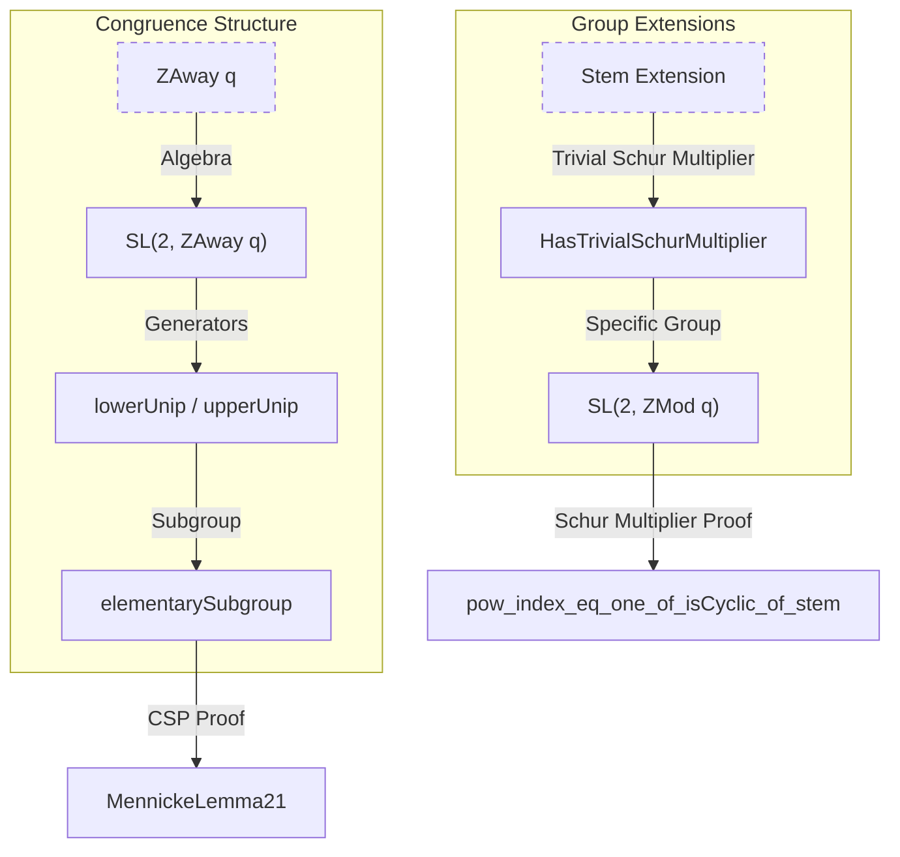
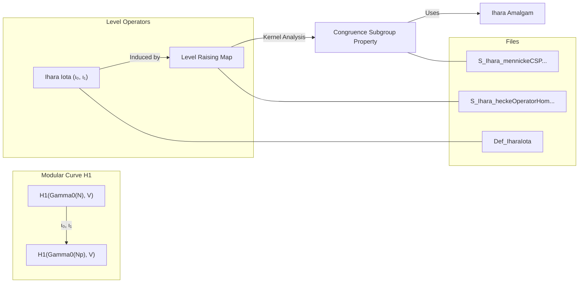

<!-- source: DeepWiki mcp.deepwiki.com · repo anthropics/fermats-last-theorem · page 5.4 Eisenstein Series, Ihara's Lemma, and Level Raising · fetched 2026-10-26 -->

# Eisenstein Series, Ihara's Lemma, and Level Raising

Relevant source files

The following files were used as context for generating this wiki page:

- [P2M/Sol/S_HeckeEis_exists_isEigensystemH1_binaryFormRepSL_empty_of_isEigensystemH1_of_ringHom.lean](P2M/Sol/S_HeckeEis_exists_isEigensystemH1_binaryFormRepSL_empty_of_isEigensystemH1_of_ringHom.lean)
- [P2M/Sol/S_HeckeEis_exists_isEigensystemH1_gamma0NebenRep_of_isEigensystemH1_binaryFormRepSL_of_dvd.lean](P2M/Sol/S_HeckeEis_exists_isEigensystemH1_gamma0NebenRep_of_isEigensystemH1_binaryFormRepSL_of_dvd.lean)
- [P2M/Sol/S_HeckeEis_exists_isEigensystemH1_one_natCast_mul_of_isEigensystemH1_one_of_three_dvd.lean](P2M/Sol/S_HeckeEis_exists_isEigensystemH1_one_natCast_mul_of_isEigensystemH1_one_of_three_dvd.lean)
- [P2M/Sol/S_HeckeEis_exists_isEigensystemH1_one_of_isEigensystemH1_gamma0NebenRep.lean](P2M/Sol/S_HeckeEis_exists_isEigensystemH1_one_of_isEigensystemH1_gamma0NebenRep.lean)
- [P2M/Sol/S_HeckeEis_exists_le_sub_one_isEigensystemH1_binaryFormRepSL_of_isEigensystemH1.lean](P2M/Sol/S_HeckeEis_exists_le_sub_one_isEigensystemH1_binaryFormRepSL_of_isEigensystemH1.lean)
- [P2M/Sol/S_HeckeEis_exists_modularForm_heckeTLin_eq_smul_of_isEigensystemH1.lean](P2M/Sol/S_HeckeEis_exists_modularForm_heckeTLin_eq_smul_of_isEigensystemH1.lean)
- [P2M/Sol/S_HeckeEis_exists_modularForm_heckeTLin_eq_smul_of_notMem_range_coeffH1parToH1.lean](P2M/Sol/S_HeckeEis_exists_modularForm_heckeTLin_eq_smul_of_notMem_range_coeffH1parToH1.lean)
- [P2M/Sol/S_HeckeEis_isEigensystemH1_binaryFormRepSL_mul_of_isEigensystemH1.lean](P2M/Sol/S_HeckeEis_isEigensystemH1_binaryFormRepSL_mul_of_isEigensystemH1.lean)
- [P2M/Sol/S_HeckeEis_isEigensystemH1_binaryFormRepSL_of_heckeTLin_eq_smul.lean](P2M/Sol/S_HeckeEis_isEigensystemH1_binaryFormRepSL_of_heckeTLin_eq_smul.lean)
- [P2M/Sol/S_HeckeEis_isEigensystemH1_of_isEigensystemH1_of_isBaseChange.lean](P2M/Sol/S_HeckeEis_isEigensystemH1_of_isEigensystemH1_of_isBaseChange.lean)
- [P2M/Sol/S_HeckeEis_isEigensystemH1_of_isEigensystemH1_of_surjective.lean](P2M/Sol/S_HeckeEis_isEigensystemH1_of_isEigensystemH1_of_surjective.lean)
- [P2M/Sol/S_HeckeEis_isEigensystemH1_of_isEigensystemH1_of_surjective_of_subsingleton_H2.lean](P2M/Sol/S_HeckeEis_isEigensystemH1_of_isEigensystemH1_of_surjective_of_subsingleton_H2.lean)
- [P2M/Sol/S_HeckeEis_isEigensystemH1_one_mul_of_isEigensystemH1_ind_comp.lean](P2M/Sol/S_HeckeEis_isEigensystemH1_one_mul_of_isEigensystemH1_ind_comp.lean)
- [P2M/Sol/S_HeckeEis_isEigensystemH1_one_natCast_add_one.lean](P2M/Sol/S_HeckeEis_isEigensystemH1_one_natCast_add_one.lean)
- [P2M/Sol/S_HeckeEis_isEigensystemH1_or_of_isEigensystemH1_of_injective.lean](P2M/Sol/S_HeckeEis_isEigensystemH1_or_of_isEigensystemH1_of_injective.lean)
- [P2M/Sol/S_Ihara_card_ker_dvd_two_of_stemExtension_SL2_ZMod_two_pow.lean](P2M/Sol/S_Ihara_card_ker_dvd_two_of_stemExtension_SL2_ZMod_two_pow.lean)
- [P2M/Sol/S_Ihara_exists_pow_prime_pow_eq_one_of_sl2_stem.lean](P2M/Sol/S_Ihara_exists_pow_prime_pow_eq_one_of_sl2_stem.lean)
- [P2M/Sol/S_Ihara_exists_replacement_lowerUnip.lean](P2M/Sol/S_Ihara_exists_replacement_lowerUnip.lean)
- [P2M/Sol/S_Ihara_gamma0Away_hom_factor.lean](P2M/Sol/S_Ihara_gamma0Away_hom_factor.lean)
- [P2M/Sol/S_Ihara_gamma0Fin_hom_factor.lean](P2M/Sol/S_Ihara_gamma0Fin_hom_factor.lean)
- [P2M/Sol/S_Ihara_hasTrivialSchurMultiplier_SL2_ZMod_odd_prime_pow.lean](P2M/Sol/S_Ihara_hasTrivialSchurMultiplier_SL2_ZMod_odd_prime_pow.lean)
- [P2M/Sol/S_Ihara_hasTrivialSchurMultiplier_SL2_ZMod_prime.lean](P2M/Sol/S_Ihara_hasTrivialSchurMultiplier_SL2_ZMod_prime.lean)
- [P2M/Sol/S_Ihara_hasTrivialSchurMultiplier_SL2_ZMod_prime_pow.lean](P2M/Sol/S_Ihara_hasTrivialSchurMultiplier_SL2_ZMod_prime_pow.lean)
- [P2M/Sol/S_Ihara_hasTrivialSchurMultiplier_SL2_ZMod_sq.lean](P2M/Sol/S_Ihara_hasTrivialSchurMultiplier_SL2_ZMod_sq.lean)
- [P2M/Sol/S_Ihara_hasTrivialSchurMultiplier_SL2_ZMod_step.lean](P2M/Sol/S_Ihara_hasTrivialSchurMultiplier_SL2_ZMod_step.lean)
- [P2M/Sol/S_Ihara_heckeOperatorHom_eisenstein_mod_three_of_parabolic_levelRaisingKernel.lean](P2M/Sol/S_Ihara_heckeOperatorHom_eisenstein_mod_three_of_parabolic_levelRaisingKernel.lean)
- [P2M/Sol/S_Ihara_isPerfect_SL2_ZMod_prime_pow.lean](P2M/Sol/S_Ihara_isPerfect_SL2_ZMod_prime_pow.lean)
- [P2M/Sol/S_Ihara_ker_eq_bot_of_stem_of_fibre.lean](P2M/Sol/S_Ihara_ker_eq_bot_of_stem_of_fibre.lean)
- [P2M/Sol/S_Ihara_mennickeCSP_of_coprime_of_stem.lean](P2M/Sol/S_Ihara_mennickeCSP_of_coprime_of_stem.lean)
- [P2M/Sol/S_Ihara_mennickeCSP_of_prime.lean](P2M/Sol/S_Ihara_mennickeCSP_of_prime.lean)
- [P2M/Sol/S_Ihara_mennickeLemma21.lean](P2M/Sol/S_Ihara_mennickeLemma21.lean)
- [P2M/Sol/S_Ihara_mennickeQ_le_commutator_sup_mennickeQ_mul.lean](P2M/Sol/S_Ihara_mennickeQ_le_commutator_sup_mennickeQ_mul.lean)
- [P2M/Sol/S_Ihara_mennickeZ_eq_top_of_corrected_reading_of_diophantine.lean](P2M/Sol/S_Ihara_mennickeZ_eq_top_of_corrected_reading_of_diophantine.lean)
- [P2M/Sol/S_Ihara_normalClosure_mennickeA_eq_top.lean](P2M/Sol/S_Ihara_normalClosure_mennickeA_eq_top.lean)
- [P2M/Sol/S_Ihara_principalCongruenceAway_le_commutator_sup_mennickeQ.lean](P2M/Sol/S_Ihara_principalCongruenceAway_le_commutator_sup_mennickeQ.lean)
- [P2M/Sol/S_Ihara_sl2_zmod_sq_congruence_preimage_commute.lean](P2M/Sol/S_Ihara_sl2_zmod_sq_congruence_preimage_commute.lean)
- [P2M/Sol/S_Matrix_GeneralLinearGroup_surjective_of_isUnipotent_of_forall_exists_mulVec_ne_smul_of_det_surjective.lean](P2M/Sol/S_Matrix_GeneralLinearGroup_surjective_of_isUnipotent_of_forall_exists_mulVec_ne_smul_of_det_surjective.lean)
- [P2M/Sol/S_ModPForms_exists_isEigensystemH1_binaryFormRepSL_of_isModPEigen.lean](P2M/Sol/S_ModPForms_exists_isEigensystemH1_binaryFormRepSL_of_isModPEigen.lean)
- [P2M/Sol/S_ModPForms_exists_mem_modPMod_isModPEigen_of_isEigensystemH1_binaryFormRepSL_three_of_exists_prime_dvd_mod_three_eq_two.lean](P2M/Sol/S_ModPForms_exists_mem_modPMod_isModPEigen_of_isEigensystemH1_binaryFormRepSL_three_of_exists_prime_dvd_mod_three_eq_two.lean)

This section covers the cohomology of the Eisenstein ideal, the construction of Hecke eigensystems on modular curves, and the group-theoretic foundations of level raising. A central pillar of this machinery is **Ihara's Lemma**, which in this codebase is established via the congruence subgroup property and the triviality of the Schur multiplier for $SL_2(\mathbb{Z}/n\mathbb{Z})$.

## Hecke Eigensystems and Eisenstein Series

The codebase defines Hecke operators acting on the cohomology of modular curves with coefficients in binary form representations. The goal is to identify eigensystems corresponding to Eisenstein series and their twists.

### Eisenstein Eigensystems on $H^1$
The system defines `IsEigensystemH1` to characterize vectors in the first cohomology group $H^1(\Gamma_0(N), V)$ that are simultaneous eigenvectors for the Hecke operators $T_\ell$ [P2M/Sol/S_HeckeEis_exists_isEigensystemH1_gamma0NebenRep_of_isEigensystemH1_binaryFormRepSL_of_dvd.lean:5-10]().

Key components include:
*   **`heckeH1`**: The linear map representing the Hecke operator acting on the quotient space $H^1 \cong Z^1/B^1$ [P2M/Sol/S_HeckeEis_exists_isEigensystemH1_gamma0NebenRep_of_isEigensystemH1_binaryFormRepSL_of_dvd.lean:50-53]().
*   **`IsCompat`**: A predicate ensuring the local linear map $a$ is compatible with the representation $\rho$ under the Hecke conjugation [P2M/Sol/S_HeckeEis_exists_isEigensystemH1_gamma0NebenRep_of_isEigensystemH1_binaryFormRepSL_of_dvd.lean:26-27]().
*   **Functoriality**: The system proves that eigensystems are preserved under twists [P2M/Sol/S_HeckeEis_exists_isEigensystemH1_gamma0NebenRep_of_isEigensystemH1_binaryFormRepSL_of_dvd.lean:127-130]() and map-surjections between representations [P2M/Sol/S_HeckeEis_isEigensystemH1_of_isEigensystemH1_of_surjective_of_subsingleton_H2.lean:143-146]().

### Binary Form Representations
The representation of $SL_2$ on binary forms (homogeneous polynomials) is used to construct specific Eisenstein eigensystems. The file `S_HeckeEis_exists_le_sub_one_isEigensystemH1_binaryFormRepSL_of_isEigensystemH1.lean` establishes filtrations on these representations to relate the cohomology of $SL_2(\mathbb{Z})$ to the Eisenstein ideal [P2M/Sol/S_HeckeEis_exists_le_sub_one_isEigensystemH1_binaryFormRepSL_of_isEigensystemH1.lean:10-12]().

### Bridge: Eigensystem Entities
| Concept | Code Entity | File |
| :--- | :--- | :--- |
| Hecke Operator on $H^1$ | `heckeH1` | [P2M/Sol/S_HeckeEis_exists_isEigensystemH1_gamma0NebenRep_of_isEigensystemH1_binaryFormRepSL_of_dvd.lean:50]() |
| Eigensystem Predicate | `IsEigensystemH1` | [P2M/Sol/S_HeckeEis_exists_isEigensystemH1_gamma0NebenRep_of_isEigensystemH1_binaryFormRepSL_of_dvd.lean:129]() |
| Cocycle Compatibility | `IsCompat` | [P2M/Sol/S_HeckeEis_exists_isEigensystemH1_gamma0NebenRep_of_isEigensystemH1_binaryFormRepSL_of_dvd.lean:26]() |
| Binary Form Rep | `binaryFormRepSL` | [P2M/Sol/S_HeckeEis_exists_le_sub_one_isEigensystemH1_binaryFormRepSL_of_isEigensystemH1.lean:4-8]() |

**Sources:** [P2M/Sol/S_HeckeEis_exists_isEigensystemH1_gamma0NebenRep_of_isEigensystemH1_binaryFormRepSL_of_dvd.lean](), [P2M/Sol/S_HeckeEis_isEigensystemH1_of_isEigensystemH1_of_surjective_of_subsingleton_H2.lean](), [P2M/Sol/S_HeckeEis_exists_le_sub_one_isEigensystemH1_binaryFormRepSL_of_isEigensystemH1.lean]()

---

## Ihara's Lemma and Schur Multipliers

Ihara's Lemma is equivalent to the statement that the kernel of the map between certain modular curve Jacobians is small. In the codebase, this is tackled via the group theory of $SL_2(\mathbb{Z}/n\mathbb{Z})$.

### Schur Multiplier Triviality
The proof shows that for an odd prime power $q = p^n$, the Schur multiplier of $SL_2(\mathbb{Z}/q\mathbb{Z})$ is trivial [P2M/Sol/S_Ihara_hasTrivialSchurMultiplier_SL2_ZMod_odd_prime_pow.lean:36](). This is done by showing that any central extension (stem extension) of the group splits.

Key functions:
*   **`pow_index_eq_one_of_isCyclic_of_stem`**: Uses transfer theory to show that elements in the kernel of a stem extension have order dividing the index of a cyclic subgroup [P2M/Sol/S_Ihara_hasTrivialSchurMultiplier_SL2_ZMod_odd_prime_pow.lean:103-108]().
*   **`ker_inf_commutator_comap_eq_bot_of_local`**: A localization argument showing the intersection of the kernel and the commutator subgroup is trivial [P2M/Sol/S_Ihara_hasTrivialSchurMultiplier_SL2_ZMod_odd_prime_pow.lean:116-120]().

### The $p=2$ Case
For $p=2$, the Schur multiplier is not necessarily trivial, but its size is bounded. The theorem `card_ker_dvd_two_of_stemExtension_SL2_ZMod_two_pow` proves that the kernel of a stem extension of $SL_2(\mathbb{Z}/2^n\mathbb{Z})$ has cardinality dividing 2 [P2M/Sol/S_Ihara_card_ker_dvd_two_of_stemExtension_SL2_ZMod_two_pow.lean:162-178]().

### Mennicke Symbols and the Congruence Subgroup Property
The proof utilizes **Mennicke symbols** and the **Congruence Subgroup Property (CSP)** for $SL_2(\mathbb{Z}[1/q])$. 
*   **`mennickeA`** and **`mennickeB`**: Specific generators in $SL_2$ used to generate the group modulo the congruence kernel [P2M/Sol/S_Ihara_mennickeLemma21.lean:82-87]().
*   **`mennickeU`**: A diagonal-like matrix $diag(q, 1/q)$ in $SL_2(\mathbb{Z}[1/q])$ [P2M/Sol/S_Ihara_mennickeLemma21.lean:146-151]().
*   **`mennickeQ`**: The subgroup generated by Mennicke symbols, which is shown to contain the principal congruence subgroup [P2M/Sol/S_Ihara_mennickeCSP_of_prime.lean:10-12]().

### Bridge: Group Theory Entities

**Sources:** [P2M/Sol/S_Ihara_hasTrivialSchurMultiplier_SL2_ZMod_odd_prime_pow.lean](), [P2M/Sol/S_Ihara_mennickeLemma21.lean](), [P2M/Sol/S_Ihara_mennickeCSP_of_prime.lean]()

---

## Level Raising and Lowering

Level raising operators are constructed to map between cohomology groups of different levels. This is critical for Ribet's Level Lowering theorem (which is technically a level raising in the context of modularity lifting).

### Parabolic Cohomology and the Eisenstein Ideal
The system defines `heckeOperatorHom` and verifies its behavior on parabolic cocycles.
*   **`heckeOperatorHom`**: A homomorphism between modular forms or cohomology groups induced by the Hecke correspondence [P2M/Sol/S_Ihara_heckeOperatorHom_eisenstein_mod_three_of_parabolic_levelRaisingKernel.lean:2-5]().
*   **`principalCongruenceAway`**: Defines the kernel of the level raising maps [P2M/Sol/S_Ihara_heckeOperatorHom_eisenstein_mod_three_of_parabolic_levelRaisingKernel.lean:28]().

### Ihara's Amalgam
The level raising process involves the **Ihara Amalgam**, a group-theoretic construction representing $SL_2(\mathbb{Z}[1/p])$ as an amalgam of $SL_2(\mathbb{Z})$ and its conjugate.
*   **`iharaAmalgam`**: The abstract group construction [P2M/Sol/S_Ihara_heckeOperatorHom_eisenstein_mod_three_of_parabolic_levelRaisingKernel.lean:35]().
*   **`amalgamToGamma0Away`**: The map from the amalgam to the $SL_2$ group with $p$ inverted. The codebase proves this map is both injective and surjective [P2M/Sol/S_Ihara_heckeOperatorHom_eisenstein_mod_three_of_parabolic_levelRaisingKernel.lean:35]().

### Level Raising Data Flow

**Sources:** [P2M/Sol/S_Ihara_heckeOperatorHom_eisenstein_mod_three_of_parabolic_levelRaisingKernel.lean](), [P2M/Sol/S_Ihara_mennickeCSP_of_prime.lean](), [P2M/Sol/S_Ihara_mennickeLemma21.lean]()

---

## Key Proof Components

### Power Identities in Extensions
For the Schur multiplier proofs, the system uses complex commutator identities to show that extensions of $SL_2$ behave like the base group:
*   **`mul_pow_eq_of_commutator_comm`**: A formula for $(ab)^n$ when the commutator $[a,b]$ commutes with $a$ and $b$ [P2M/Sol/S_Ihara_hasTrivialSchurMultiplier_SL2_ZMod_step.lean:38]().
*   **`pow_choose_two_eq_one_of_odd`**: Handles the quadratic growth of terms in the central extension [P2M/Sol/S_Ihara_hasTrivialSchurMultiplier_SL2_ZMod_step.lean:83-84]().

### Matrix Calculations for Unipotents
The CSP proof relies on explicit matrix identities for unipotent matrices:
*   **`uElt` / `vElt`**: Upper and lower unipotent matrices [P2M/Sol/S_Ihara_heckeOperatorHom_eisenstein_mod_three_of_parabolic_levelRaisingKernel.lean:47-51]().
*   **`hElt`**: Diagonal matrices in $SL_2$ [P2M/Sol/S_Ihara_heckeOperatorHom_eisenstein_mod_three_of_parabolic_levelRaisingKernel.lean:53]().
*   **`uElt_mul_vElt`**: The decomposition of a product of unipotents into the $VHU$ (Bruhat-like) form [P2M/Sol/S_Ihara_heckeOperatorHom_eisenstein_mod_three_of_parabolic_levelRaisingKernel.lean:118-119]().

**Sources:** [P2M/Sol/S_Ihara_hasTrivialSchurMultiplier_SL2_ZMod_step.lean](), [P2M/Sol/S_Ihara_heckeOperatorHom_eisenstein_mod_three_of_parabolic_levelRaisingKernel.lean]()

---

