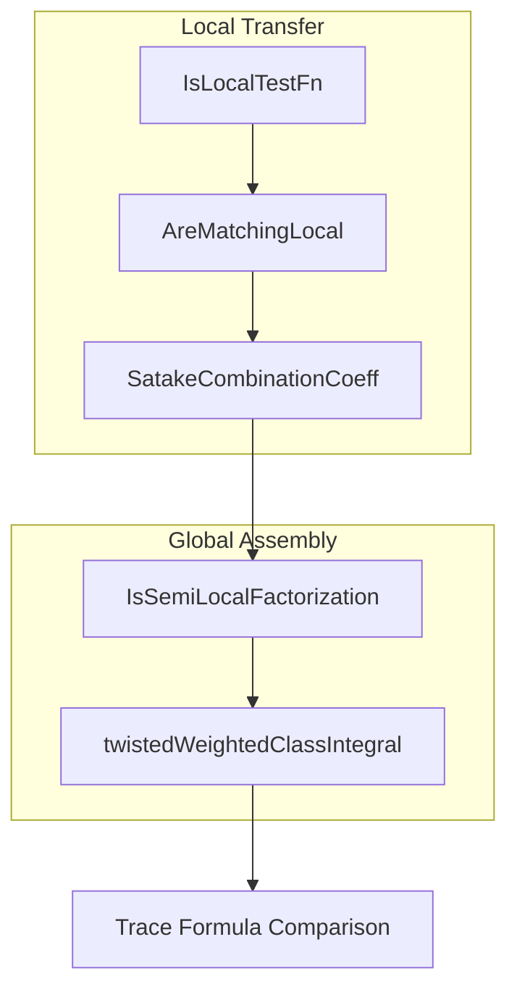

<!-- source: DeepWiki mcp.deepwiki.com · repo anthropics/fermats-last-theorem · page 6 Automorphic Forms and the Trace Formula · fetched 2026-10-26 -->

# Automorphic Forms and the Trace Formula

Relevant source files

The following files were used as context for generating this wiki page:

- [P2M/Sol/S_AutomorphicForm_CuspidalConstituent_exists_forall_norm_foldr_archDerivAtComplex_le_of_mem_cut.lean](P2M/Sol/S_AutomorphicForm_CuspidalConstituent_exists_forall_norm_foldr_archDerivAtComplex_le_of_mem_cut.lean)
- [P2M/Sol/S_AutomorphicForm_CuspidalConstituent_exists_forall_norm_foldr_archDerivAt_le_of_mem_cut.lean](P2M/Sol/S_AutomorphicForm_CuspidalConstituent_exists_forall_norm_foldr_archDerivAt_le_of_mem_cut.lean)
- [P2M/Sol/S_AutomorphicForm_analyticOnNhd_setIntegral_axis_continuation_mul_conj_cuspBasis.lean](P2M/Sol/S_AutomorphicForm_analyticOnNhd_setIntegral_axis_continuation_mul_conj_cuspBasis.lean)
- [P2M/Sol/S_AutomorphicForm_axis_continuation_eq_sum_inner_weylIntertwining_mul_axis_continuation_of_swap_normPowChar.lean](P2M/Sol/S_AutomorphicForm_axis_continuation_eq_sum_inner_weylIntertwining_mul_axis_continuation_of_swap_normPowChar.lean)
- [P2M/Sol/S_AutomorphicForm_axis_pairing_add_inv_vol_axis_pairing_weylIntertwining_eq_sum_conj_matrixCoeff_mul_inner_mul_conj_of_paleyWiener_matched.lean](P2M/Sol/S_AutomorphicForm_axis_pairing_add_inv_vol_axis_pairing_weylIntertwining_eq_sum_conj_matrixCoeff_mul_inner_mul_conj_of_paleyWiener_matched.lean)
- [P2M/Sol/S_AutomorphicForm_conj_sum_integral_axis_pairing_add_eq_mul_tsum_integral_sum_rightConv_mul_thetaPairing_of_matched_paleyWiener.lean](P2M/Sol/S_AutomorphicForm_conj_sum_integral_axis_pairing_add_eq_mul_tsum_integral_sum_rightConv_mul_thetaPairing_of_matched_paleyWiener.lean)
- [P2M/Sol/S_AutomorphicForm_continuous_and_continuous_pseudoEisenstein_of_paleyWiener_slabProfile.lean](P2M/Sol/S_AutomorphicForm_continuous_and_continuous_pseudoEisenstein_of_paleyWiener_slabProfile.lean)
- [P2M/Sol/S_AutomorphicForm_continuous_and_integrable_and_memLp_two_integral_mul_conj_flat_section_of_matched_paleyWiener.lean](P2M/Sol/S_AutomorphicForm_continuous_and_integrable_and_memLp_two_integral_mul_conj_flat_section_of_matched_paleyWiener.lean)
- [P2M/Sol/S_AutomorphicForm_continuous_and_isLsXiFunction_and_isKfSmooth_and_principalLevel_and_mem_archCutSubmodule_sum_integral_sum_inner_mul_axis_continuation_of_matched_paleyWiener.lean](P2M/Sol/S_AutomorphicForm_continuous_and_isLsXiFunction_and_isKfSmooth_and_principalLevel_and_mem_archCutSubmodule_sum_integral_sum_inner_mul_axis_continuation_of_matched_paleyWiener.lean)
- [P2M/Sol/S_AutomorphicForm_continuous_and_isLsXiFunction_and_principalLevel_sum_integral_sum_inner_mul_axis_continuation_of_matched_paleyWiener.lean](P2M/Sol/S_AutomorphicForm_continuous_and_isLsXiFunction_and_principalLevel_sum_integral_sum_inner_mul_axis_continuation_of_matched_paleyWiener.lean)
- [P2M/Sol/S_AutomorphicForm_continuous_setIntegral_finsum_integral_indicator_mul_conj_axis_continuation_and_exists_norm_le_mul_one_add_abs_pow.lean](P2M/Sol/S_AutomorphicForm_continuous_setIntegral_finsum_integral_indicator_mul_conj_axis_continuation_and_exists_norm_le_mul_one_add_abs_pow.lean)
- [P2M/Sol/S_AutomorphicForm_continuous_setIntegral_mul_conj_axis_continuation_and_exists_norm_le_mul_one_add_abs_pow_of_isAutomorphicFnAt_of_lt_adelicHeight.lean](P2M/Sol/S_AutomorphicForm_continuous_setIntegral_mul_conj_axis_continuation_and_exists_norm_le_mul_one_add_abs_pow_of_isAutomorphicFnAt_of_lt_adelicHeight.lean)
- [P2M/Sol/S_AutomorphicForm_convOp_residualProjection_of_residualProjection.lean](P2M/Sol/S_AutomorphicForm_convOp_residualProjection_of_residualProjection.lean)
- [P2M/Sol/S_AutomorphicForm_differentiable_inner_and_decay_and_eq_sum_inner_mul_flat_orthonormal_of_matched_paleyWiener.lean](P2M/Sol/S_AutomorphicForm_differentiable_inner_and_decay_and_eq_sum_inner_mul_flat_orthonormal_of_matched_paleyWiener.lean)
- [P2M/Sol/S_AutomorphicForm_etaFst_etaSnd_mul_normPowChar_eq_shift.lean](P2M/Sol/S_AutomorphicForm_etaFst_etaSnd_mul_normPowChar_eq_shift.lean)
- [P2M/Sol/S_AutomorphicForm_exists_atomic_forall_tendsto_setIntegral_lambdaT_finsum_sub_lambdaT_tsum_sub_lambdaT_finsum_chiDet_sub_mul.lean](P2M/Sol/S_AutomorphicForm_exists_atomic_forall_tendsto_setIntegral_lambdaT_finsum_sub_lambdaT_tsum_sub_lambdaT_finsum_chiDet_sub_mul.lean)
- [P2M/Sol/S_AutomorphicForm_exists_atoms_forall_exists_noAtomicMass_heckeWordSum_twistedCutTrace_sub_finrank_mul_const_mul_heckeWordSum_cutTrace_eq.lean](P2M/Sol/S_AutomorphicForm_exists_atoms_forall_exists_noAtomicMass_heckeWordSum_twistedCutTrace_sub_finrank_mul_const_mul_heckeWordSum_cutTrace_eq.lean)
- [P2M/Sol/S_AutomorphicForm_exists_common_matched_paleyWiener_family_eq_sum_integral_and_sections_eq_of_matched_paleyWiener_of_matched_paleyWiener_light.lean](P2M/Sol/S_AutomorphicForm_exists_common_matched_paleyWiener_family_eq_sum_integral_and_sections_eq_of_matched_paleyWiener_of_matched_paleyWiener_light.lean)
- [P2M/Sol/S_AutomorphicForm_exists_common_matched_paleyWiener_family_eq_sum_integral_of_matched_paleyWiener_of_matched_paleyWiener.lean](P2M/Sol/S_AutomorphicForm_exists_common_matched_paleyWiener_family_eq_sum_integral_of_matched_paleyWiener_of_matched_paleyWiener.lean)
- [P2M/Sol/S_AutomorphicForm_exists_const_forall_exists_windingDatum_hyperbolicIntercept_sub_finrank_mul_const_mul_sum_eq_sum_satakeLaurent_mul_coeff_of_eq_affine_of_areMatchingArch_of_areMatchingLocal.lean](P2M/Sol/S_AutomorphicForm_exists_const_forall_exists_windingDatum_hyperbolicIntercept_sub_finrank_mul_const_mul_sum_eq_sum_satakeLaurent_mul_coeff_of_eq_affine_of_areMatchingArch_of_areMatchingLocal.lean)
- [P2M/Sol/S_AutomorphicForm_exists_const_forall_exists_windingDatum_integrableOn_and_hyperbolicTerm_sub_finrank_mul_const_mul_sum_eq_mul_sum_coeff_add_sum_coeff_of_areMatchingAt.lean](P2M/Sol/S_AutomorphicForm_exists_const_forall_exists_windingDatum_integrableOn_and_hyperbolicTerm_sub_finrank_mul_const_mul_sum_eq_mul_sum_coeff_add_sum_coeff_of_areMatchingAt.lean)
- [P2M/Sol/S_AutomorphicForm_exists_continuous_noAtomicMass_intercept_parabolic_sub_finrank_mul_const_mul_sum_intercept_parabolic_eq_uniform.lean](P2M/Sol/S_AutomorphicForm_exists_continuous_noAtomicMass_intercept_parabolic_sub_finrank_mul_const_mul_sum_intercept_parabolic_eq_uniform.lean)
- [P2M/Sol/S_AutomorphicForm_exists_eq_archHaarK_torusFamily_isOrbitalIntegral_centralScalar_mul_diagUnits2_of_isArchTestFactor_of_isLocalTestFn.lean](P2M/Sol/S_AutomorphicForm_exists_eq_archHaarK_torusFamily_isOrbitalIntegral_centralScalar_mul_diagUnits2_of_isArchTestFactor_of_isLocalTestFn.lean)
- [P2M/Sol/S_AutomorphicForm_exists_finset_forall_slope_eq_sum_classIntegral_and_intercept_eq_sum_weightedClassIntegral_of_hyperbolicTerm_eq_affine.lean](P2M/Sol/S_AutomorphicForm_exists_finset_forall_slope_eq_sum_classIntegral_and_intercept_eq_sum_weightedClassIntegral_of_hyperbolicTerm_eq_affine.lean)
- [P2M/Sol/S_AutomorphicForm_exists_finset_forall_slope_eq_sum_twistedClassIntegral_and_intercept_eq_sum_weightedTwistedClassIntegral_haarQuotient_of_eq_affine.lean](P2M/Sol/S_AutomorphicForm_exists_finset_forall_slope_eq_sum_twistedClassIntegral_and_intercept_eq_sum_weightedTwistedClassIntegral_haarQuotient_of_eq_affine.lean)
- [P2M/Sol/S_AutomorphicForm_exists_finset_forall_window_product_eq_zero_of_not_mem.lean](P2M/Sol/S_AutomorphicForm_exists_finset_forall_window_product_eq_zero_of_not_mem.lean)
- [P2M/Sol/S_AutomorphicForm_exists_forall_ae_prod_restrict_canonicalTruncationDomain_finsum_integral_centralScalar_sub_tsum_convOp_sub_finsum_chiDet_eq_mul_tsum_integral_sum_rightConv_axis_continuation.lean](P2M/Sol/S_AutomorphicForm_exists_forall_ae_prod_restrict_canonicalTruncationDomain_finsum_integral_centralScalar_sub_tsum_convOp_sub_finsum_chiDet_eq_mul_tsum_integral_sum_rightConv_axis_continuation.lean)
- [P2M/Sol/S_AutomorphicForm_exists_forall_dominated_sum_rightConv_axis_continuation_and_integrable_prod_lambdaT.lean](P2M/Sol/S_AutomorphicForm_exists_forall_dominated_sum_rightConv_axis_continuation_and_integrable_prod_lambdaT.lean)
- [P2M/Sol/S_AutomorphicForm_exists_forall_dominated_sum_rightConv_axis_continuation_of_isCompact.lean](P2M/Sol/S_AutomorphicForm_exists_forall_dominated_sum_rightConv_axis_continuation_of_isCompact.lean)
- [P2M/Sol/S_AutomorphicForm_exists_forall_finsum_integral_centralScalar_sub_tsum_convOp_sub_finsum_chiDet_eq_mul_integral_sum_rightConv_axis_continuation.lean](P2M/Sol/S_AutomorphicForm_exists_forall_finsum_integral_centralScalar_sub_tsum_convOp_sub_finsum_chiDet_eq_mul_integral_sum_rightConv_axis_continuation.lean)
- [P2M/Sol/S_AutomorphicForm_exists_forall_finsum_mul_prod_zpow_neg_mul_ideleNorm_mul_integral_orbital_eq_sum_tsum_ite_of_smul_eq_map_partAt_of_ne_one.lean](P2M/Sol/S_AutomorphicForm_exists_forall_finsum_mul_prod_zpow_neg_mul_ideleNorm_mul_integral_orbital_eq_sum_tsum_ite_of_smul_eq_map_partAt_of_ne_one.lean)
- [P2M/Sol/S_AutomorphicForm_exists_forall_hyperbolicSlope_eq_mul_sum_slotFamilyCoeff_mul_hyperbolicSlope_of_eq_affine.lean](P2M/Sol/S_AutomorphicForm_exists_forall_hyperbolicSlope_eq_mul_sum_slotFamilyCoeff_mul_hyperbolicSlope_of_eq_affine.lean)
- [P2M/Sol/S_AutomorphicForm_exists_forall_integrable_prod_sum_rightConv_mul_axis_continuation_mul_conj_lambdaT_sigmaAdelicAct_symm_of_subset_iUnion_image_centreCutSiegelSet.lean](P2M/Sol/S_AutomorphicForm_exists_forall_integrable_prod_sum_rightConv_mul_axis_continuation_mul_conj_lambdaT_sigmaAdelicAct_symm_of_subset_iUnion_image_centreCutSiegelSet.lean)
- [P2M/Sol/S_AutomorphicForm_exists_forall_inv_vol_mul_axis_continuation_weylIntertwining_eq_sum_and_exists_forall_eq_sum_of_paleyWiener_matched_swap.lean](P2M/Sol/S_AutomorphicForm_exists_forall_inv_vol_mul_axis_continuation_weylIntertwining_eq_sum_and_exists_forall_eq_sum_of_paleyWiener_matched_swap.lean)
- [P2M/Sol/S_AutomorphicForm_exists_forall_isSlabProfile_eLpNorm_sub_restrict_rationalTorusUnipotentQuotient_le_mul_eLpNorm_sub_diagOne_mul.lean](P2M/Sol/S_AutomorphicForm_exists_forall_isSlabProfile_eLpNorm_sub_restrict_rationalTorusUnipotentQuotient_le_mul_eLpNorm_sub_diagOne_mul.lean)
- [P2M/Sol/S_AutomorphicForm_exists_forall_lintegral_norm_sq_normalizedIntertwining_axis_le_of_completedL_mul_weylIntertwiningIntegral_eq_of_flat.lean](P2M/Sol/S_AutomorphicForm_exists_forall_lintegral_norm_sq_normalizedIntertwining_axis_le_of_completedL_mul_weylIntertwiningIntegral_eq_of_flat.lean)
- [P2M/Sol/S_AutomorphicForm_exists_forall_memLp_two_and_summable_and_tsum_integral_sum_normSq_setIntegral_finsum_integral_indicator_mul_conj_axis_continuation_le_mul_setIntegral_normSq.lean](P2M/Sol/S_AutomorphicForm_exists_forall_memLp_two_and_summable_and_tsum_integral_sum_normSq_setIntegral_finsum_integral_indicator_mul_conj_axis_continuation_le_mul_setIntegral_normSq.lean)
- [P2M/Sol/S_AutomorphicForm_exists_forall_memLp_two_indicator_highSet_sum_integral_sum_inner_mul_add_inv_vol_mul_axis_continuation_weylIntertwining_of_matched_paleyWiener.lean](P2M/Sol/S_AutomorphicForm_exists_forall_memLp_two_indicator_highSet_sum_integral_sum_inner_mul_add_inv_vol_mul_axis_continuation_weylIntertwining_of_matched_paleyWiener.lean)
- [P2M/Sol/S_AutomorphicForm_exists_forall_memLp_two_lambdaT_sum_integral_sum_inner_mul_axis_continuation_restrict_canonicalTruncationDomain_of_matched_paleyWiener.lean](P2M/Sol/S_AutomorphicForm_exists_forall_memLp_two_lambdaT_sum_integral_sum_inner_mul_axis_continuation_restrict_canonicalTruncationDomain_of_matched_paleyWiener.lean)
- [P2M/Sol/S_AutomorphicForm_exists_forall_pseudoEisenstein_sub_residualProj_ae_eq_mul_sum_integral_sum_inner_mul_axis_continuation_of_matched_paleyWiener.lean](P2M/Sol/S_AutomorphicForm_exists_forall_pseudoEisenstein_sub_residualProj_ae_eq_mul_sum_integral_sum_inner_mul_axis_continuation_of_matched_paleyWiener.lean)
- [P2M/Sol/S_AutomorphicForm_exists_forall_setIntegral_convOp_continuousProjection_mul_conj_continuousProjection_eq_mul_tsum_integral_sum_rightConv_mul_setIntegral_mul_conj_axis_continuation.lean](P2M/Sol/S_AutomorphicForm_exists_forall_setIntegral_convOp_continuousProjection_mul_conj_continuousProjection_eq_mul_tsum_integral_sum_rightConv_mul_setIntegral_mul_conj_axis_continuation.lean)
- [P2M/Sol/S_AutomorphicForm_exists_forall_setIntegral_convOp_continuousProjection_pseudoEisenstein_mul_conj_eq_mul_tsum_integral_sum_rightConv_axis_pairing_of_matched_paleyWiener.lean](P2M/Sol/S_AutomorphicForm_exists_forall_setIntegral_convOp_continuousProjection_pseudoEisenstein_mul_conj_eq_mul_tsum_integral_sum_rightConv_axis_pairing_of_matched_paleyWiener.lean)
- [P2M/Sol/S_AutomorphicForm_exists_forall_setIntegral_finsum_unipotentCell_sub_indicator_constantTerm_eq_sum_mul_setIntegral_rankOne_unram.lean](P2M/Sol/S_AutomorphicForm_exists_forall_setIntegral_finsum_unipotentCell_sub_indicator_constantTerm_eq_sum_mul_setIntegral_rankOne_unram.lean)
- [P2M/Sol/S_AutomorphicForm_exists_forall_setIntegral_inv_ideleNorm_smul_integral_maximalCompact_mul_conj_constantTerm_eq_of_matched_paleyWiener.lean](P2M/Sol/S_AutomorphicForm_exists_forall_setIntegral_inv_ideleNorm_smul_integral_maximalCompact_mul_conj_constantTerm_eq_of_matched_paleyWiener.lean)
- [P2M/Sol/S_AutomorphicForm_exists_forall_setIntegral_lambdaT_finsum_sub_lambdaT_tsum_sub_lambdaT_finsum_chiDet_sigmaAdelicAct_symm_eq_mul_tsum_integral_sum_rightConv_mul_setIntegral_lambdaT_mul_conj_lambdaT_of_norm_eq_one.lean](P2M/Sol/S_AutomorphicForm_exists_forall_setIntegral_lambdaT_finsum_sub_lambdaT_tsum_sub_lambdaT_finsum_chiDet_sigmaAdelicAct_symm_eq_mul_tsum_integral_sum_rightConv_mul_setIntegral_lambdaT_mul_conj_lambdaT_of_norm_eq_one.lean)
- [P2M/Sol/S_AutomorphicForm_exists_forall_setIntegral_normSq_pseudoEisenstein_sub_residualProj_eq_mul_sum_integral_sum_normSq_inner_axis_of_matched_paleyWiener.lean](P2M/Sol/S_AutomorphicForm_exists_forall_setIntegral_normSq_pseudoEisenstein_sub_residualProj_eq_mul_sum_integral_sum_normSq_inner_axis_of_matched_paleyWiener.lean)
- [P2M/Sol/S_AutomorphicForm_exists_forall_setIntegral_norm_sq_lambdaT_axis_continuation_le_mul_pow_of_eq_or_exists_normOneIdeles_of_isArchCompAt_of_ne_bot.lean](P2M/Sol/S_AutomorphicForm_exists_forall_setIntegral_norm_sq_lambdaT_axis_continuation_le_mul_pow_of_eq_or_exists_normOneIdeles_of_isArchCompAt_of_ne_bot.lean)
- [P2M/Sol/S_AutomorphicForm_exists_forall_setIntegral_prod_restrict_canonicalTruncationDomain_finsum_integral_centralScalar_sub_tsum_convOp_sub_finsum_chiDet_eq_mul_setIntegral_tsum_integral_sum_rightConv_axis_continuation.lean](P2M/Sol/S_AutomorphicForm_exists_forall_setIntegral_prod_restrict_canonicalTruncationDomain_finsum_integral_centralScalar_sub_tsum_convOp_sub_finsum_chiDet_eq_mul_setIntegral_tsum_integral_sum_rightConv_axis_continuation.lean)
- [P2M/Sol/S_AutomorphicForm_exists_forall_setIntegral_pseudoEisenstein_mul_conj_axis_continuation_eq_mul_integral_mul_conj_add_integral_mul_conj_weylIntertwining_of_matched_paleyWiener.lean](P2M/Sol/S_AutomorphicForm_exists_forall_setIntegral_pseudoEisenstein_mul_conj_axis_continuation_eq_mul_integral_mul_conj_add_integral_mul_conj_weylIntertwining_of_matched_paleyWiener.lean)
- [P2M/Sol/S_AutomorphicForm_exists_forall_setIntegral_pseudoEisenstein_mul_conj_sub_residualProj_sub_mul_sum_integral_sum_inner_mul_axis_continuation_eq_zero_of_matched_paleyWiener_of_cuspBasis.lean](P2M/Sol/S_AutomorphicForm_exists_forall_setIntegral_pseudoEisenstein_mul_conj_sub_residualProj_sub_mul_sum_integral_sum_inner_mul_axis_continuation_eq_zero_of_matched_paleyWiener_of_cuspBasis.lean)
- [P2M/Sol/S_AutomorphicForm_exists_forall_tsum_integral_sum_axisPairing_mul_conj_axisPairing_pseudoEisenstein_eq_mul_setIntegral_mul_conj_sub_residualProj_of_matched_paleyWiener_of_lt_adelicHeight.lean](P2M/Sol/S_AutomorphicForm_exists_forall_tsum_integral_sum_axisPairing_mul_conj_axisPairing_pseudoEisenstein_eq_mul_setIntegral_mul_conj_sub_residualProj_of_matched_paleyWiener_of_lt_adelicHeight.lean)
- [P2M/Sol/S_AutomorphicForm_exists_forall_window_classSum_eq_tsum_mul_tsum_ite_kinkWindow_of_areMatchingArch_of_areMatchingLocal_of_ne_one_unweighted.lean](P2M/Sol/S_AutomorphicForm_exists_forall_window_classSum_eq_tsum_mul_tsum_ite_kinkWindow_of_areMatchingArch_of_areMatchingLocal_of_ne_one_unweighted.lean)
- [P2M/Sol/S_AutomorphicForm_exists_inv_mul_mul_map_eq_scalar_of_sigmaNormPow_eq_map_scalar_of_odd.lean](P2M/Sol/S_AutomorphicForm_exists_inv_mul_mul_map_eq_scalar_of_sigmaNormPow_eq_map_scalar_of_odd.lean)
- [P2M/Sol/S_AutomorphicForm_exists_isOrbitalIntegralOn_centralScalar_mul_eq_mul_prod_and_isWeightedOrbitalIntegralOn_eq_mul_sum_prod_of_isUnitFactorization.lean](P2M/Sol/S_AutomorphicForm_exists_isOrbitalIntegralOn_centralScalar_mul_eq_mul_prod_and_isWeightedOrbitalIntegralOn_eq_mul_sum_prod_of_isUnitFactorization.lean)
- [P2M/Sol/S_AutomorphicForm_exists_matched_paleyWiener_forall_norm_setIntegral_sub_pseudoEisenstein_sub_mul_conj_le_of_orthogonal.lean](P2M/Sol/S_AutomorphicForm_exists_matched_paleyWiener_forall_norm_setIntegral_sub_pseudoEisenstein_sub_mul_conj_le_of_orthogonal.lean)
- [P2M/Sol/S_AutomorphicForm_exists_matched_paleyWiener_injective_and_inner_eq_integral_mul_cexp_and_sum_integral_sum_conj_inner_mul_eq_and_setIntegral_normSq_sub_residualProj_le_of_contDiff_hasCompactSupport.lean](P2M/Sol/S_AutomorphicForm_exists_matched_paleyWiener_injective_and_inner_eq_integral_mul_cexp_and_sum_integral_sum_conj_inner_mul_eq_and_setIntegral_normSq_sub_residualProj_le_of_contDiff_hasCompactSupport.lean)
- [P2M/Sol/S_AutomorphicForm_exists_matched_paleyWiener_pair_eq_and_threeWay_of_matched_paleyWiener_of_matched_paleyWiener.lean](P2M/Sol/S_AutomorphicForm_exists_matched_paleyWiener_pair_eq_and_threeWay_of_matched_paleyWiener_of_matched_paleyWiener.lean)
- [P2M/Sol/S_AutomorphicForm_exists_matched_paleyWiener_pair_forall_norm_setIntegral_sub_le_and_tsum_integral_sum_normSq_sub_setIntegral_axis_continuation_le.lean](P2M/Sol/S_AutomorphicForm_exists_matched_paleyWiener_pair_forall_norm_setIntegral_sub_le_and_tsum_integral_sum_normSq_sub_setIntegral_axis_continuation_le.lean)
- [P2M/Sol/S_AutomorphicForm_exists_matched_paleyWiener_sum_integral_sum_conj_inner_mul_eq_sum_integral_sum_conj_integral_mul_cexp_mul_and_setIntegral_normSq_sub_residualProj_le_of_contDiff_hasCompactSupport.lean](P2M/Sol/S_AutomorphicForm_exists_matched_paleyWiener_sum_integral_sum_conj_inner_mul_eq_sum_integral_sum_conj_integral_mul_cexp_mul_and_setIntegral_normSq_sub_residualProj_le_of_contDiff_hasCompactSupport.lean)
- [P2M/Sol/S_AutomorphicForm_exists_matched_paleyWiener_tsum_integral_sum_normSq_setIntegral_mul_conj_axis_continuation_sub_le.lean](P2M/Sol/S_AutomorphicForm_exists_matched_paleyWiener_tsum_integral_sum_normSq_setIntegral_mul_conj_axis_continuation_sub_le.lean)
- [P2M/Sol/S_AutomorphicForm_exists_matched_paleyWiener_tsum_integral_sum_normSq_sub_setIntegral_axis_continuation_le_of_symmetric.lean](P2M/Sol/S_AutomorphicForm_exists_matched_paleyWiener_tsum_integral_sum_normSq_sub_setIntegral_axis_continuation_le_of_symmetric.lean)
- [P2M/Sol/S_AutomorphicForm_exists_partner_forall_partner_partner_eq_and_eq_mul_normPowChar_of_pairs_complete.lean](P2M/Sol/S_AutomorphicForm_exists_partner_forall_partner_partner_eq_and_eq_mul_normPowChar_of_pairs_complete.lean)
- [P2M/Sol/S_AutomorphicForm_exists_twistedTorusFamily_lift_centralScalar_mul_diagUnits2_coupled_massOne_restrictedProduct.lean](P2M/Sol/S_AutomorphicForm_exists_twistedTorusFamily_lift_centralScalar_mul_diagUnits2_coupled_massOne_restrictedProduct.lean)
- [P2M/Sol/S_AutomorphicForm_exists_windingDatum_forall_coeff_eq_mul_finsum_mul_prod_zpow_neg_mul_ideleNorm_mul_integral_orbital_of_smul_eq_map_partAt_of_ne_one_unweighted.lean](P2M/Sol/S_AutomorphicForm_exists_windingDatum_forall_coeff_eq_mul_finsum_mul_prod_zpow_neg_mul_ideleNorm_mul_integral_orbital_of_smul_eq_map_partAt_of_ne_one_unweighted.lean)
- [P2M/Sol/S_AutomorphicForm_exists_windingDatum_forall_coeff_eq_window_classSum_of_areMatchingArch_of_areMatchingLocal_of_ne_one_unweighted.lean](P2M/Sol/S_AutomorphicForm_exists_windingDatum_forall_coeff_eq_window_classSum_of_areMatchingArch_of_areMatchingLocal_of_ne_one_unweighted.lean)
- [P2M/Sol/S_AutomorphicForm_exists_windingDatum_forall_heckeWord_mul_sum_slotFamilyCoeff_mul_sum_classIntegral_eq_sum_satakeLaurent_mul_coeff.lean](P2M/Sol/S_AutomorphicForm_exists_windingDatum_forall_heckeWord_mul_sum_slotFamilyCoeff_mul_sum_classIntegral_eq_sum_satakeLaurent_mul_coeff.lean)
- [P2M/Sol/S_AutomorphicForm_exists_windingDatum_forall_heckeWord_mul_sum_slotFamilyCoeff_mul_sum_windowClassIntegral_eq_sum_satakeLaurent_mul_coeff.lean](P2M/Sol/S_AutomorphicForm_exists_windingDatum_forall_heckeWord_mul_sum_slotFamilyCoeff_mul_sum_windowClassIntegral_eq_sum_satakeLaurent_mul_coeff.lean)
- [P2M/Sol/S_AutomorphicForm_fibreSum_twistedCutTrace_eq_const_mul_fibreSum_cutTrace_of_areMatchingAt_symm_of_prime.lean](P2M/Sol/S_AutomorphicForm_fibreSum_twistedCutTrace_eq_const_mul_fibreSum_cutTrace_of_areMatchingAt_symm_of_prime.lean)
- [P2M/Sol/S_AutomorphicForm_fibreSum_twistedCutTrace_eq_const_mul_fibreSum_cutTrace_of_centralElliptic_of_prime.lean](P2M/Sol/S_AutomorphicForm_fibreSum_twistedCutTrace_eq_const_mul_fibreSum_cutTrace_of_centralElliptic_of_prime.lean)
- [P2M/Sol/S_AutomorphicForm_finsum_sigmaCentralizerDomain_centralNorm_eq_mul_sum_finsum_centralizerDomain_central_of_central_transfer.lean](P2M/Sol/S_AutomorphicForm_finsum_sigmaCentralizerDomain_centralNorm_eq_mul_sum_finsum_centralizerDomain_central_of_central_transfer.lean)
- [P2M/Sol/S_AutomorphicForm_finsum_sigmaCentralizerDomain_ellipticNorm_eq_mul_sum_finsum_centralizerDomain_elliptic_of_forall_perClass.lean](P2M/Sol/S_AutomorphicForm_finsum_sigmaCentralizerDomain_ellipticNorm_eq_mul_sum_finsum_centralizerDomain_elliptic_of_forall_perClass.lean)
- [P2M/Sol/S_AutomorphicForm_flat_section_centralScalar_mul_diagOne_mul_eq_mul_ideleNorm_cpow_and_inv_vol_mul_axis_continuation_weylIntertwining_eq_and_rationalTorusUnipotent_mul_of_matched_paleyWiener.lean](P2M/Sol/S_AutomorphicForm_flat_section_centralScalar_mul_diagOne_mul_eq_mul_ideleNorm_cpow_and_inv_vol_mul_axis_continuation_weylIntertwining_eq_and_rationalTorusUnipotent_mul_of_matched_paleyWiener.lean)
- [P2M/Sol/S_AutomorphicForm_forall_axis_continuation_sub_sum_mul_axis_continuation_eq_zero_of_forall_constantTerm_eq_zero.lean](P2M/Sol/S_AutomorphicForm_forall_axis_continuation_sub_sum_mul_axis_continuation_eq_zero_of_forall_constantTerm_eq_zero.lean)
- [P2M/Sol/S_AutomorphicForm_forall_continuous_isArchSmoothAt_bounded_foldr_archDeriv_of_mem_isotypicCuspSubmodule_principal_of_archCasimir_eq_smul.lean](P2M/Sol/S_AutomorphicForm_forall_continuous_isArchSmoothAt_bounded_foldr_archDeriv_of_mem_isotypicCuspSubmodule_principal_of_archCasimir_eq_smul.lean)
- [P2M/Sol/S_AutomorphicForm_forall_exists_eLpNorm_axis_continuation_restrict_le_mul_pow_of_isCompact_of_ne_bot.lean](P2M/Sol/S_AutomorphicForm_forall_exists_eLpNorm_axis_continuation_restrict_le_mul_pow_of_isCompact_of_ne_bot.lean)
- [P2M/Sol/S_AutomorphicForm_forall_exists_forall_norm_le_mul_inv_adelicHeight_pow_of_mem_isotypicCuspSubmodule_principal_inf_archCutSubmodule.lean](P2M/Sol/S_AutomorphicForm_forall_exists_forall_norm_le_mul_inv_adelicHeight_pow_of_mem_isotypicCuspSubmodule_principal_inf_archCutSubmodule.lean)
- [P2M/Sol/S_AutomorphicForm_forall_exists_setIntegral_norm_sq_lambdaT_axis_continuation_le_mul_mul_pow_of_isArchCompAt_of_ne_bot.lean](P2M/Sol/S_AutomorphicForm_forall_exists_setIntegral_norm_sq_lambdaT_axis_continuation_le_mul_mul_pow_of_isArchCompAt_of_ne_bot.lean)
- [P2M/Sol/S_AutomorphicForm_forall_integrableOn_and_setIntegral_lambdaT_mul_tsum_convOp_mul_conj_eq_mul_tsum_cutTrace.lean](P2M/Sol/S_AutomorphicForm_forall_integrableOn_and_setIntegral_lambdaT_mul_tsum_convOp_mul_conj_eq_mul_tsum_cutTrace.lean)
- [P2M/Sol/S_AutomorphicForm_forall_integrableOn_and_setIntegral_lambdaT_tsum_convOp_mul_conj_sigmaAdelicAct_symm_eq_tsum_finsum_setIntegral_of_orthonormal_principalLevel_of_isFundamentalDomain_slab.lean](P2M/Sol/S_AutomorphicForm_forall_integrableOn_and_setIntegral_lambdaT_tsum_convOp_mul_conj_sigmaAdelicAct_symm_eq_tsum_finsum_setIntegral_of_orthonormal_principalLevel_of_isFundamentalDomain_slab.lean)
- [P2M/Sol/S_AutomorphicForm_forall_integrableOn_and_setIntegral_lambdaT_tsum_finsum_twistedConvOp_mul_conj_eq_tsum_finsum_setIntegral_of_orthonormal_of_isFundamentalDomain_slab.lean](P2M/Sol/S_AutomorphicForm_forall_integrableOn_and_setIntegral_lambdaT_tsum_finsum_twistedConvOp_mul_conj_eq_tsum_finsum_setIntegral_of_orthonormal_of_isFundamentalDomain_slab.lean)
- [P2M/Sol/S_AutomorphicForm_forall_isSlabProfile_setIntegral_pseudoEisenstein_mul_conj_eq_zero_of_forall_matched_paleyWiener_setIntegral_pseudoEisenstein_mul_conj_eq_zero.lean](P2M/Sol/S_AutomorphicForm_forall_isSlabProfile_setIntegral_pseudoEisenstein_mul_conj_eq_zero_of_forall_matched_paleyWiener_setIntegral_pseudoEisenstein_mul_conj_eq_zero.lean)
- [P2M/Sol/S_AutomorphicForm_forall_matched_paleyWiener_setIntegral_pseudoEisenstein_mul_conj_eq_zero_of_forall_sum_extension_setIntegral_pseudoEisenstein_mul_conj_eq_zero.lean](P2M/Sol/S_AutomorphicForm_forall_matched_paleyWiener_setIntegral_pseudoEisenstein_mul_conj_eq_zero_of_forall_sum_extension_setIntegral_pseudoEisenstein_mul_conj_eq_zero.lean)
- [P2M/Sol/S_AutomorphicForm_ground_window_values_inv_mul_unitsMap_eq_of_ne_one.lean](P2M/Sol/S_AutomorphicForm_ground_window_values_inv_mul_unitsMap_eq_of_ne_one.lean)
- [P2M/Sol/S_AutomorphicForm_hasSum_setIntegral_mul_conj_mul_setIntegral_convOp_of_orthonormal_isotypicCuspSubmodule.lean](P2M/Sol/S_AutomorphicForm_hasSum_setIntegral_mul_conj_mul_setIntegral_convOp_of_orthonormal_isotypicCuspSubmodule.lean)
- [P2M/Sol/S_AutomorphicForm_inner_weylIntertwining_eq_sum_inner_mul_conj_inner_of_matched_paleyWiener.lean](P2M/Sol/S_AutomorphicForm_inner_weylIntertwining_eq_sum_inner_mul_conj_inner_of_matched_paleyWiener.lean)
- [P2M/Sol/S_AutomorphicForm_integrableOn_and_setIntegral_rationalTorusUnipotentQuotient_slab_mul_conj_eq_mul_setIntegral_inv_ideleNorm_smul_integral_maximalCompact.lean](P2M/Sol/S_AutomorphicForm_integrableOn_and_setIntegral_rationalTorusUnipotentQuotient_slab_mul_conj_eq_mul_setIntegral_inv_ideleNorm_smul_integral_maximalCompact.lean)
- [P2M/Sol/S_AutomorphicForm_integrable_and_summable_and_continuous_uncurry_tsum_integral_sum_rightConv_axis_continuation_mul_conj.lean](P2M/Sol/S_AutomorphicForm_integrable_and_summable_and_continuous_uncurry_tsum_integral_sum_rightConv_axis_continuation_mul_conj.lean)
- [P2M/Sol/S_AutomorphicForm_integrable_axis_pairing_convOp_add_inv_vol_axis_pairing_convOp_weylIntertwining_of_paleyWiener_matched.lean](P2M/Sol/S_AutomorphicForm_integrable_axis_pairing_convOp_add_inv_vol_axis_pairing_convOp_weylIntertwining_of_paleyWiener_matched.lean)
- [P2M/Sol/S_AutomorphicForm_integral_maximalCompactHaar_rightConv_mul_conj_eq_integral_mul_conj_rightConv_star_of_isInducedSection_axis.lean](P2M/Sol/S_AutomorphicForm_integral_maximalCompactHaar_rightConv_mul_conj_eq_integral_mul_conj_rightConv_star_of_isInducedSection_axis.lean)
- [P2M/Sol/S_AutomorphicForm_integral_mul_conj_eq_integral_axis_continuation_weylIntertwining_mul_conj_axis_continuation_weylIntertwining_of_paleyWiener_matched.lean](P2M/Sol/S_AutomorphicForm_integral_mul_conj_eq_integral_axis_continuation_weylIntertwining_mul_conj_axis_continuation_weylIntertwining_of_paleyWiener_matched.lean)
- [P2M/Sol/S_AutomorphicForm_integral_mul_orbital_centralScalar_eq_mul_ideleNorm_mul_prod_tsum_mul_integral_of_isUnitFactorization_of_integrable.lean](P2M/Sol/S_AutomorphicForm_integral_mul_orbital_centralScalar_eq_mul_ideleNorm_mul_prod_tsum_mul_integral_of_isUnitFactorization_of_integrable.lean)
- [P2M/Sol/S_AutomorphicForm_integral_normSq_add_inv_vol_limUnder_weylIntertwining_eq_sum_normSq_inner_axis_of_orthonormal_span_principalLevel.lean](P2M/Sol/S_AutomorphicForm_integral_normSq_add_inv_vol_limUnder_weylIntertwining_eq_sum_normSq_inner_axis_of_orthonormal_span_principalLevel.lean)
- [P2M/Sol/S_AutomorphicForm_isLocallyConstant_finprod_unitValue_and_integrable_window_product_of_ne_one_of_isLocalTestFn.lean](P2M/Sol/S_AutomorphicForm_isLocallyConstant_finprod_unitValue_and_integrable_window_product_of_ne_one_of_isLocalTestFn.lean)
- [P2M/Sol/S_AutomorphicForm_lambdaT_sum_integral_sum_inner_mul_axis_continuation_eq_sum_integral_sum_inner_mul_lambdaT_of_mem_canonicalTruncationDomain_of_matched_paleyWiener.lean](P2M/Sol/S_AutomorphicForm_lambdaT_sum_integral_sum_inner_mul_axis_continuation_eq_sum_integral_sum_inner_mul_lambdaT_of_mem_canonicalTruncationDomain_of_matched_paleyWiener.lean)
- [P2M/Sol/S_AutomorphicForm_levelTypeAverage_pseudoEisenstein_eq_pseudoEisenstein_levelTypeAverage_of_isSlabProfile.lean](P2M/Sol/S_AutomorphicForm_levelTypeAverage_pseudoEisenstein_eq_pseudoEisenstein_levelTypeAverage_of_isSlabProfile.lean)
- [P2M/Sol/S_AutomorphicForm_lintegral_maximalCompact_lintegral_Ioi_enorm_sq_integral_sum_inner_mul_cpow_mul_flat_section_add_inv_vol_mul_axis_continuation_weylIntertwining_mul_inv_lt_top_of_matched_paleyWiener.lean](P2M/Sol/S_AutomorphicForm_lintegral_maximalCompact_lintegral_Ioi_enorm_sq_integral_sum_inner_mul_cpow_mul_flat_section_add_inv_vol_mul_axis_continuation_weylIntertwining_mul_inv_lt_top_of_matched_paleyWiener.lean)
- [P2M/Sol/S_AutomorphicForm_memLp_two_and_summable_integral_sum_normSq_setIntegral_pseudoEisenstein_mul_conj_axis_continuation_of_matched_paleyWiener.lean](P2M/Sol/S_AutomorphicForm_memLp_two_and_summable_integral_sum_normSq_setIntegral_pseudoEisenstein_mul_conj_axis_continuation_of_matched_paleyWiener.lean)
- [P2M/Sol/S_AutomorphicForm_memLp_two_restrict_canonicalTruncationDomain_sum_integral_sum_inner_mul_axis_continuation_of_matched_paleyWiener.lean](P2M/Sol/S_AutomorphicForm_memLp_two_restrict_canonicalTruncationDomain_sum_integral_sum_inner_mul_axis_continuation_of_matched_paleyWiener.lean)
- [P2M/Sol/S_AutomorphicForm_mul_prod_orbital_eq_zero_of_forall_apply_conj_centralScalar_mul_diagUnits2_eq_zero.lean](P2M/Sol/S_AutomorphicForm_mul_prod_orbital_eq_zero_of_forall_apply_conj_centralScalar_mul_diagUnits2_eq_zero.lean)
- [P2M/Sol/S_AutomorphicForm_norm_tsum_integral_sum_rightConv_mul_mul_conj_sub_le_of_tsum_integral_sum_normSq_sub_le.lean](P2M/Sol/S_AutomorphicForm_norm_tsum_integral_sum_rightConv_mul_mul_conj_sub_le_of_tsum_integral_sum_normSq_sub_le.lean)
- [P2M/Sol/S_AutomorphicForm_paleyWiener_convOp_and_convOp_pseudoEisenstein_eq_pseudoEisenstein_convOp_of_isArchBiFinite.lean](P2M/Sol/S_AutomorphicForm_paleyWiener_convOp_and_convOp_pseudoEisenstein_eq_pseudoEisenstein_convOp_of_isArchBiFinite.lean)
- [P2M/Sol/S_AutomorphicForm_paleyWiener_levelTypeAverage_and_pseudoEisenstein_levelTypeAverage_eq_and_residualProjection_of_kernel_maximalCompact_detOne.lean](P2M/Sol/S_AutomorphicForm_paleyWiener_levelTypeAverage_and_pseudoEisenstein_levelTypeAverage_eq_and_residualProjection_of_kernel_maximalCompact_detOne.lean)
- [P2M/Sol/S_AutomorphicForm_rightConv_eq_sum_integral_rightConv_mul_conj_mul_of_orthonormal_complete_flat_family.lean](P2M/Sol/S_AutomorphicForm_rightConv_eq_sum_integral_rightConv_mul_conj_mul_of_orthonormal_complete_flat_family.lean)
- [P2M/Sol/S_AutomorphicForm_rightConv_eq_sum_integral_rightConv_mul_conj_mul_of_orthonormal_complete_flat_family_light.lean](P2M/Sol/S_AutomorphicForm_rightConv_eq_sum_integral_rightConv_mul_conj_mul_of_orthonormal_complete_flat_family_light.lean)
- [P2M/Sol/S_AutomorphicForm_semilocal_central_transfer_of_forall_oneplace_of_referenceMeasures.lean](P2M/Sol/S_AutomorphicForm_semilocal_central_transfer_of_forall_oneplace_of_referenceMeasures.lean)
- [P2M/Sol/S_AutomorphicForm_setIntegral_axis_continuation_mul_conj_cuspBasis_eq_zero_of_mem.lean](P2M/Sol/S_AutomorphicForm_setIntegral_axis_continuation_mul_conj_cuspBasis_eq_zero_of_mem.lean)
- [P2M/Sol/S_AutomorphicForm_setIntegral_convOp_continuousProjection_eq_inv_mul_setIntegral_convOp_mul_conj_continuousProjection.lean](P2M/Sol/S_AutomorphicForm_setIntegral_convOp_continuousProjection_eq_inv_mul_setIntegral_convOp_mul_conj_continuousProjection.lean)
- [P2M/Sol/S_AutomorphicForm_setIntegral_mul_conj_axis_continuation_eq_sum_conj_inner_weylIntertwining_mul_setIntegral_of_swap_normPowChar.lean](P2M/Sol/S_AutomorphicForm_setIntegral_mul_conj_axis_continuation_eq_sum_conj_inner_weylIntertwining_mul_setIntegral_of_swap_normPowChar.lean)
- [P2M/Sol/S_AutomorphicForm_setIntegral_mul_conj_convOp_eq_setIntegral_convOp_conj_inv_mul_conj_of_isAutomorphicFnAt.lean](P2M/Sol/S_AutomorphicForm_setIntegral_mul_conj_convOp_eq_setIntegral_convOp_conj_inv_mul_conj_of_isAutomorphicFnAt.lean)
- [P2M/Sol/S_AutomorphicForm_setIntegral_mul_conj_eq_zero_of_forall_residualSpan_of_closure.lean](P2M/Sol/S_AutomorphicForm_setIntegral_mul_conj_eq_zero_of_forall_residualSpan_of_closure.lean)
- [P2M/Sol/S_AutomorphicForm_setIntegral_mul_conj_sum_integral_sum_inner_mul_axis_continuation_eq_sum_integral_sum_conj_inner_mul_setIntegral_of_isAutomorphicFnAt_of_lt_adelicHeight.lean](P2M/Sol/S_AutomorphicForm_setIntegral_mul_conj_sum_integral_sum_inner_mul_axis_continuation_eq_sum_integral_sum_conj_inner_mul_setIntegral_of_isAutomorphicFnAt_of_lt_adelicHeight.lean)
- [P2M/Sol/S_AutomorphicForm_setIntegral_sum_integral_sum_inner_mul_axis_continuation_mul_conj_cuspBasis_eq_zero_of_matched_paleyWiener.lean](P2M/Sol/S_AutomorphicForm_setIntegral_sum_integral_sum_inner_mul_axis_continuation_mul_conj_cuspBasis_eq_zero_of_matched_paleyWiener.lean)
- [P2M/Sol/S_AutomorphicForm_sum_conj_matrixCoeff_mul_axis_pairing_weylIntertwining_mul_conj_fullCoeff_eq_axis_pairing_swap_neg_of_paleyWiener_matched.lean](P2M/Sol/S_AutomorphicForm_sum_conj_matrixCoeff_mul_axis_pairing_weylIntertwining_mul_conj_fullCoeff_eq_axis_pairing_swap_neg_of_paleyWiener_matched.lean)
- [P2M/Sol/S_AutomorphicForm_sum_integral_axis_pairing_add_eq_half_mul_sum_integral_sum_conj_matrixCoeff_mul_fullCoeff_of_paleyWiener_matched.lean](P2M/Sol/S_AutomorphicForm_sum_integral_axis_pairing_add_eq_half_mul_sum_integral_sum_conj_matrixCoeff_mul_fullCoeff_of_paleyWiener_matched.lean)
- [P2M/Sol/S_AutomorphicForm_sum_integral_sum_conj_inner_weylIntertwining_mul_setIntegral_mul_conj_axis_continuation_eq_of_isAutomorphicFnAt_of_lt_adelicHeight.lean](P2M/Sol/S_AutomorphicForm_sum_integral_sum_conj_inner_weylIntertwining_mul_setIntegral_mul_conj_axis_continuation_eq_of_isAutomorphicFnAt_of_lt_adelicHeight.lean)
- [P2M/Sol/S_AutomorphicForm_sum_integral_sum_inner_mul_axis_continuation_sub_lambdaT_eq_indicator_highSet_sum_integral_sum_inner_mul_add_inv_vol_mul_weylIntertwining_of_matched_paleyWiener.lean](P2M/Sol/S_AutomorphicForm_sum_integral_sum_inner_mul_axis_continuation_sub_lambdaT_eq_indicator_highSet_sum_integral_sum_inner_mul_add_inv_vol_mul_weylIntertwining_of_matched_paleyWiener.lean)
- [P2M/Sol/S_AutomorphicForm_sum_norm_sq_sum_conj_inner_weylIntertwining_mul_le_sum_norm_sq_of_matched_paleyWiener.lean](P2M/Sol/S_AutomorphicForm_sum_norm_sq_sum_conj_inner_weylIntertwining_mul_le_sum_norm_sq_of_matched_paleyWiener.lean)
- [P2M/Sol/S_AutomorphicForm_sum_slotFamilyCoeff_mul_sum_mul_integral_orbital_eq_sum_prod_mul_windingDatum_coeff_of_forall_coeff_eq_of_smul_eq_map_partAt_of_ne_one_unweighted.lean](P2M/Sol/S_AutomorphicForm_sum_slotFamilyCoeff_mul_sum_mul_integral_orbital_eq_sum_prod_mul_windingDatum_coeff_of_forall_coeff_eq_of_smul_eq_map_partAt_of_ne_one_unweighted.lean)
- [P2M/Sol/S_AutomorphicForm_sum_slotFamilyCoeff_mul_sum_mul_integral_window_eq_sum_prod_mul_windingDatum_coeff_of_forall_coeff_eq_of_ne_one_unweighted.lean](P2M/Sol/S_AutomorphicForm_sum_slotFamilyCoeff_mul_sum_mul_integral_window_eq_sum_prod_mul_windingDatum_coeff_of_forall_coeff_eq_of_ne_one_unweighted.lean)
- [P2M/Sol/S_AutomorphicForm_twistedWeightedClassIntegral_eq_finrank_mul_ratio_mul_weightedClassIntegral_add_mul_window_of_coupled_of_isSemiLocalFactorization.lean](P2M/Sol/S_AutomorphicForm_twistedWeightedClassIntegral_eq_finrank_mul_ratio_mul_weightedClassIntegral_add_mul_window_of_coupled_of_isSemiLocalFactorization.lean)
- [P2M/Sol/S_AutomorphicForm_twisted_window_values_inv_mul_unitsMap_eq_of_ne_one_of_prime.lean](P2M/Sol/S_AutomorphicForm_twisted_window_values_inv_mul_unitsMap_eq_of_ne_one_of_prime.lean)
- [P2M/Sol/S_AutomorphicForm_weylIntertwiningIntegral_convOp_eq_convOp_weylIntertwiningIntegral_of_isInducedSection_of_re_gt_half.lean](P2M/Sol/S_AutomorphicForm_weylIntertwiningIntegral_convOp_eq_convOp_weylIntertwiningIntegral_of_isInducedSection_of_re_gt_half.lean)
- [P2M/Sol/S_AutomorphicForm_window_bracket_eq_window_bracket_partAt_of_isWeightedOrbitalIntegralOn_of_isTwistedWeightedOrbitalIntegralOn_of_ne_one.lean](P2M/Sol/S_AutomorphicForm_window_bracket_eq_window_bracket_partAt_of_isWeightedOrbitalIntegralOn_of_isTwistedWeightedOrbitalIntegralOn_of_ne_one.lean)
- [P2M/Sol/S_AutomorphicForm_window_values_inv_mul_unitsMap_eq_of_ne_one_of_prime.lean](P2M/Sol/S_AutomorphicForm_window_values_inv_mul_unitsMap_eq_of_ne_one_of_prime.lean)
- [P2M/Sol/S_LT_TwistedNorm_finsum_inv_card_mul_eq_finsum_inv_card_mul_of_normClassMap_eq_of_mem_ellipticCell.lean](P2M/Sol/S_LT_TwistedNorm_finsum_inv_card_mul_eq_finsum_inv_card_mul_of_normClassMap_eq_of_mem_ellipticCell.lean)

This section provides a high-level overview of the analytic machinery used to compare automorphic representations via the Arthur-Selberg trace formula. The proof of Fermat's Last Theorem relies on modularity lifting, which in turn requires precise control over the spectral decomposition of $L^2(\text{GL}_2(K) \backslash \text{GL}_2(\mathbb{A}_K))$. The codebase implements the adelic approach to automorphic forms, the geometric side (orbital integrals), and the spectral side (Eisenstein series and Whittaker models).

## Adelic $\text{GL}_2$ and Automorphic Functions

The foundation of the analytic theory is the adelic algebraic group $\text{GL}_2(\mathbb{A}_K)$. Automorphic forms are realized as functions on the adelic quotient $\text{GL}_2(K) \backslash \text{GL}_2(\mathbb{A}_K)$ satisfying specific growth and transformation properties. The codebase defines `AutomorphicFnAt` [P2M/Sol/S_AutomorphicForm_exists_forall_setIntegral_convOp_continuousProjection_pseudoEisenstein_mul_conj_eq_mul_tsum_integral_sum_rightConv_axis_pairing_of_matched_paleyWiener.lean:22-22]() to represent these objects.

Key concepts include:
*   **Siegel Sets**: Used to define the fundamental domain for the action of $\text{GL}_2(K)$.
*   **Canonical Truncation**: Handled by the `TruncationOperator` [P2M/Sol/S_AutomorphicForm_exists_forall_setIntegral_convOp_continuousProjection_pseudoEisenstein_mul_conj_eq_mul_tsum_integral_sum_rightConv_axis_pairing_of_matched_paleyWiener.lean:13-13]() and the `canonicalTruncationDomain` [P2M/Sol/S_AutomorphicForm_exists_forall_setIntegral_convOp_continuousProjection_pseudoEisenstein_mul_conj_eq_mul_tsum_integral_sum_rightConv_axis_pairing_of_matched_paleyWiener.lean:7-7](), which manages the growth of Eisenstein series.
*   **Cuspidal Submodule**: The `isotypicCuspSubmodule` [P2M/Sol/S_AutomorphicForm_continuous_and_integrable_and_memLp_two_integral_mul_conj_flat_section_of_matched_paleyWiener.lean:73-76]() represents the space of cusp forms, which are the primary focus of the modularity correspondence.

For details, see [Adelic GL₂ and Automorphic Functions](#6.1).

## Orbital Integrals and the Geometric Side

The geometric side of the trace formula expresses the trace of a test function acting on the automorphic space as a sum over conjugacy classes. The codebase decomposes these classes into elliptic, hyperbolic, and unipotent cells [S_AutomorphicForm_exists_const_forall_exists_windingDatum_integrableOn_and_hyperbolicTerm_sub_finrank_mul_const_mul_sum_eq_mul_sum_coeff_add_sum_coeff_of_areMatchingAt.lean:10-10]().

A central object is the `twistedWeightedClassIntegral` [P2M/Sol/S_AutomorphicForm_twistedWeightedClassIntegral_eq_finrank_mul_ratio_mul_weightedClassIntegral_add_mul_window_of_coupled_of_isSemiLocalFactorization.lean:1-1](), which computes the orbital integral for twisted conjugacy classes. This is essential for comparing forms over a base field $K$ with those over a cyclic extension $L$ (base change).

### Geometric Trace Comparison
The following diagram maps the geometric integral components to their Lean implementations:

| Concept | Code Entity | File |
| :--- | :--- | :--- |
| Twisted Orbital Integral | `isTwistedWeightedOrbitalIntegralOn` | [P2M/Sol/S_AutomorphicForm_twistedWeightedClassIntegral_eq_finrank_mul_ratio_mul_weightedClassIntegral_add_mul_window_of_coupled_of_isSemiLocalFactorization.lean:25-25]() |
| Winding Datum | `WindingDatum` | [P2M/Sol/S_AutomorphicForm_twistedWeightedClassIntegral_eq_finrank_mul_ratio_mul_weightedClassIntegral_add_mul_window_of_coupled_of_isSemiLocalFactorization.lean:10-10]() |
| Satake Combination | `SatakeCombinationCoeff` | [P2M/Sol/S_AutomorphicForm_twistedWeightedClassIntegral_eq_finrank_mul_ratio_mul_weightedClassIntegral_add_mul_window_of_coupled_of_isSemiLocalFactorization.lean:9-9]() |

For details, see [Orbital Integrals and the Geometric Side](#6.2).

## Spectral Side: Eisenstein Series and Whittaker Coefficients

The spectral side involves the decomposition of the $L^2$ space into cuspidal and continuous parts. The continuous spectrum is described by Eisenstein series. The codebase implements `pseudoEisenstein` series [P2M/Sol/S_AutomorphicForm_exists_forall_setIntegral_convOp_continuousProjection_pseudoEisenstein_mul_conj_eq_mul_tsum_integral_sum_rightConv_axis_pairing_of_matched_paleyWiener.lean:27-27]() and the `WeylIntertwining` operator [P2M/Sol/S_AutomorphicForm_exists_forall_setIntegral_convOp_continuousProjection_pseudoEisenstein_mul_conj_eq_mul_tsum_integral_sum_rightConv_axis_pairing_of_matched_paleyWiener.lean:11-11]().

Key identities involve the `Whittaker` coefficients and the `Paley-Wiener` matching conditions (`AreMatchingLocal`, `AreMatchingArch`), which ensure that test functions on different groups produce compatible spectral data [P2M/Sol/S_AutomorphicForm_exists_forall_setIntegral_convOp_continuousProjection_pseudoEisenstein_mul_conj_eq_mul_tsum_integral_sum_rightConv_axis_pairing_of_matched_paleyWiener.lean:35-36]().

For details, see [Spectral Side: Eisenstein Series and Whittaker Coefficients](#6.3).

## Semilocal Transfer and Test Functions

To compare the trace formulas of two groups, one must construct "matching" test functions. The codebase provides infrastructure for this "transfer" in `IsLocalTestFn` and `IsSemiLocalFactorization` [P2M/Sol/S_AutomorphicForm_twistedWeightedClassIntegral_eq_finrank_mul_ratio_mul_weightedClassIntegral_add_mul_window_of_coupled_of_isSemiLocalFactorization.lean:26-26](). 

The `normString` [P2M/Sol/S_AutomorphicForm_twistedWeightedClassIntegral_eq_finrank_mul_ratio_mul_weightedClassIntegral_add_mul_window_of_coupled_of_isSemiLocalFactorization.lean:45-56]() represents the norm map between conjugacy classes in the base change context, while `twistedCentralizer` [P2M/Sol/S_AutomorphicForm_twistedWeightedClassIntegral_eq_finrank_mul_ratio_mul_weightedClassIntegral_add_mul_window_of_coupled_of_isSemiLocalFactorization.lean:21-21]() handles the stabilizer of elements under the twisted action.

### Transfer Logic Flow
The following diagram illustrates the relationship between local test functions and global matching:

Sources: [P2M/Sol/S_AutomorphicForm_twistedWeightedClassIntegral_eq_finrank_mul_ratio_mul_weightedClassIntegral_add_mul_window_of_coupled_of_isSemiLocalFactorization.lean:1-31](), [P2M/Sol/S_AutomorphicForm_exists_const_forall_exists_windingDatum_hyperbolicIntercept_sub_finrank_mul_const_mul_sum_eq_sum_satakeLaurent_mul_coeff_of_eq_affine_of_areMatchingArch_of_areMatchingLocal.lean:28-29]()

For details, see [Semilocal Transfer and Test Functions](#6.4).

## Summary of Key Theorems

The trace formula is summarized in complex identities such as `S_AutomorphicForm_twistedWeightedClassIntegral_eq_finrank_mul_ratio_mul_weightedClassIntegral_add_mul_window_of_coupled_of_isSemiLocalFactorization` [P2M/Sol/S_AutomorphicForm_twistedWeightedClassIntegral_eq_finrank_mul_ratio_mul_weightedClassIntegral_add_mul_window_of_coupled_of_isSemiLocalFactorization.lean:33-33](), which relates twisted orbital integrals to their untwisted counterparts via specific "window" terms arising from the truncation of the trace formula.

Sources:
* [P2M/Sol/S_AutomorphicForm_twistedWeightedClassIntegral_eq_finrank_mul_ratio_mul_weightedClassIntegral_add_mul_window_of_coupled_of_isSemiLocalFactorization.lean]()
* [P2M/Sol/S_AutomorphicForm_exists_forall_setIntegral_convOp_continuousProjection_pseudoEisenstein_mul_conj_eq_mul_tsum_integral_sum_rightConv_axis_pairing_of_matched_paleyWiener.lean]()
* [P2M/Sol/S_AutomorphicForm_exists_const_forall_exists_windingDatum_integrableOn_and_hyperbolicTerm_sub_finrank_mul_const_mul_sum_eq_mul_sum_coeff_add_sum_coeff_of_areMatchingAt.lean]()

---

