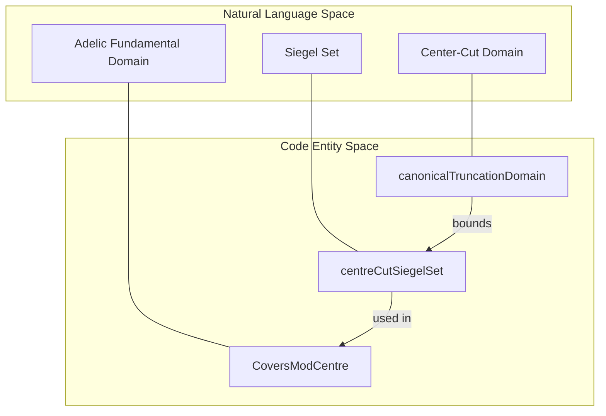
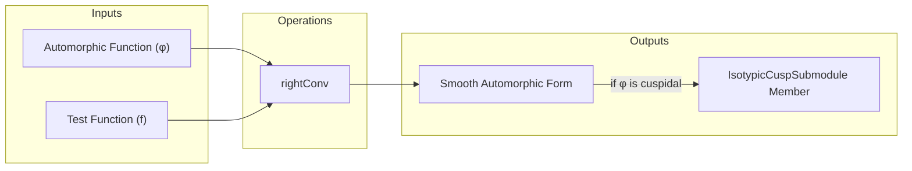

<!-- source: DeepWiki mcp.deepwiki.com · repo anthropics/fermats-last-theorem · page 6.1 Adelic GL₂ and Automorphic Functions · fetched 2026-10-26 -->

# Adelic GL₂ and Automorphic Functions

Relevant source files

The following files were used as context for generating this wiki page:

- [P2M/Sol/S_AutomorphicForm_CuspidalConstituent_continuous_and_mem_archCutSubmodule_ofChar_of_eq_integral_rightTranslate_adelicArchGLIncl.lean](P2M/Sol/S_AutomorphicForm_CuspidalConstituent_continuous_and_mem_archCutSubmodule_ofChar_of_eq_integral_rightTranslate_adelicArchGLIncl.lean)
- [P2M/Sol/S_AutomorphicForm_CuspidalConstituent_finiteDimensional_span_rightTranslate_of_mem_iSup_archTypeSubmoduleAt.lean](P2M/Sol/S_AutomorphicForm_CuspidalConstituent_finiteDimensional_span_rightTranslate_of_mem_iSup_archTypeSubmoduleAt.lean)
- [P2M/Sol/S_AutomorphicForm_CuspidalConstituent_integral_rightConv_rightTranslate_eq_rightConv_doubleAvg.lean](P2M/Sol/S_AutomorphicForm_CuspidalConstituent_integral_rightConv_rightTranslate_eq_rightConv_doubleAvg.lean)
- [P2M/Sol/S_AutomorphicForm_CuspidalConstituent_mem_span_rightTranslate_sup_span_rightConv_spherical_of_mem_span_cyclic_of_mem_archCutSubmodule_ofChar.lean](P2M/Sol/S_AutomorphicForm_CuspidalConstituent_mem_span_rightTranslate_sup_span_rightConv_spherical_of_mem_span_cyclic_of_mem_archCutSubmodule_ofChar.lean)
- [P2M/Sol/S_AutomorphicForm_SiegelCovering_exists_finset_coversModCentre_iUnion_mul_centreCutSiegelSet.lean](P2M/Sol/S_AutomorphicForm_SiegelCovering_exists_finset_coversModCentre_iUnion_mul_centreCutSiegelSet.lean)
- [P2M/Sol/S_AutomorphicForm_SmoothCuspRealizationAt_exists_rightConv_ne_zero_mem_isotypicCuspSubmodule_mem_archCutSubmodule_hasArchCharacterAt_of_isReal.lean](P2M/Sol/S_AutomorphicForm_SmoothCuspRealizationAt_exists_rightConv_ne_zero_mem_isotypicCuspSubmodule_mem_archCutSubmodule_hasArchCharacterAt_of_isReal.lean)
- [P2M/Sol/S_AutomorphicForm_convOp_mem_isotypicCuspSubmodule_inf_archCutSubmodule_of_isUnitFactorizableAboveOfType.lean](P2M/Sol/S_AutomorphicForm_convOp_mem_isotypicCuspSubmodule_inf_archCutSubmodule_of_isUnitFactorizableAboveOfType.lean)
- [P2M/Sol/S_AutomorphicForm_exists_archTypeFamily_isotypicCuspSubmodule_inf_archCutSubmodule_ne_bot.lean](P2M/Sol/S_AutomorphicForm_exists_archTypeFamily_isotypicCuspSubmodule_inf_archCutSubmodule_ne_bot.lean)
- [P2M/Sol/S_AutomorphicForm_exists_continuous_conj_invariant_integral_mul_apply_mul_eq_of_finiteDimensional_of_le_archCutSubmodule.lean](P2M/Sol/S_AutomorphicForm_exists_continuous_conj_invariant_integral_mul_apply_mul_eq_of_finiteDimensional_of_le_archCutSubmodule.lean)
- [P2M/Sol/S_AutomorphicForm_exists_countable_orthonormal_flat_isInducedSection_family_complete_principalLevel_archCutSubmodule.lean](P2M/Sol/S_AutomorphicForm_exists_countable_orthonormal_flat_isInducedSection_family_complete_principalLevel_archCutSubmodule.lean)
- [P2M/Sol/S_AutomorphicForm_exists_family_forall_isInducedSection_and_eq_of_isArchKFinite_of_isKfSmooth.lean](P2M/Sol/S_AutomorphicForm_exists_family_forall_isInducedSection_and_eq_of_isArchKFinite_of_isKfSmooth.lean)
- [P2M/Sol/S_AutomorphicForm_exists_fin_admissible_forall_flat_restrict_eq_sum_sameClass_of_principalLevel_archCutSubmodule.lean](P2M/Sol/S_AutomorphicForm_exists_fin_admissible_forall_flat_restrict_eq_sum_sameClass_of_principalLevel_archCutSubmodule.lean)
- [P2M/Sol/S_AutomorphicForm_exists_finset_sum_convOp_eq_self_of_isCuspConstituent.lean](P2M/Sol/S_AutomorphicForm_exists_finset_sum_convOp_eq_self_of_isCuspConstituent.lean)
- [P2M/Sol/S_AutomorphicForm_exists_flat_isInducedSection_family_eq_of_isInducedSection.lean](P2M/Sol/S_AutomorphicForm_exists_flat_isInducedSection_family_eq_of_isInducedSection.lean)
- [P2M/Sol/S_AutomorphicForm_exists_forall_exists_entire_whittakerCoefficient_bruhatEisenstein_eq_eulerProduct_mul_norm_tsum_le_mul_pow_archParam_weight_mul_rpow_neg_of_isCompact_of_flat.lean](P2M/Sol/S_AutomorphicForm_exists_forall_exists_entire_whittakerCoefficient_bruhatEisenstein_eq_eulerProduct_mul_norm_tsum_le_mul_pow_archParam_weight_mul_rpow_neg_of_isCompact_of_flat.lean)
- [P2M/Sol/S_AutomorphicForm_exists_forall_le_of_orthonormal_isInducedSection_principalLevel_archCutSubmodule_of_ne_bot.lean](P2M/Sol/S_AutomorphicForm_exists_forall_le_of_orthonormal_isInducedSection_principalLevel_archCutSubmodule_of_ne_bot.lean)
- [P2M/Sol/S_AutomorphicForm_exists_forall_norm_apply_le_and_norm_axis_intertwining_apply_le_of_mem_adelicMaximalCompact_of_flat.lean](P2M/Sol/S_AutomorphicForm_exists_forall_norm_apply_le_and_norm_axis_intertwining_apply_le_of_mem_adelicMaximalCompact_of_flat.lean)
- [P2M/Sol/S_AutomorphicForm_exists_forall_tsum_integral_sum_normSq_setIntegral_axis_continuation_sub_le_mul_sq_of_forall_norm_setIntegral_sub_mul_conj_le.lean](P2M/Sol/S_AutomorphicForm_exists_forall_tsum_integral_sum_normSq_setIntegral_axis_continuation_sub_le_mul_sq_of_forall_norm_setIntegral_sub_mul_conj_le.lean)
- [P2M/Sol/S_AutomorphicForm_exists_isArchFactorBiFinite_rightConv_ne_zero_and_norm_sub_le_of_isCompact.lean](P2M/Sol/S_AutomorphicForm_exists_isArchFactorBiFinite_rightConv_ne_zero_and_norm_sub_le_of_isCompact.lean)
- [P2M/Sol/S_AutomorphicForm_exists_isArchTestFactor_isArchFactorBiFinite_tendsto_integral_of_mem_archCutSubmodule.lean](P2M/Sol/S_AutomorphicForm_exists_isArchTestFactor_isArchFactorBiFinite_tendsto_integral_of_mem_archCutSubmodule.lean)
- [P2M/Sol/S_AutomorphicForm_exists_isFactorizableTestFn_rightConv_ne_zero_of_levelOne_invariant.lean](P2M/Sol/S_AutomorphicForm_exists_isFactorizableTestFn_rightConv_ne_zero_of_levelOne_invariant.lean)
- [P2M/Sol/S_AutomorphicForm_exists_isFactorizableTestFn_rightConv_ne_zero_of_principalLevel_invariant.lean](P2M/Sol/S_AutomorphicForm_exists_isFactorizableTestFn_rightConv_ne_zero_of_principalLevel_invariant.lean)
- [P2M/Sol/S_AutomorphicForm_exists_isKfSmooth_eq_prod_localChar_of_borel_fin_of_level.lean](P2M/Sol/S_AutomorphicForm_exists_isKfSmooth_eq_prod_localChar_of_borel_fin_of_level.lean)
- [P2M/Sol/S_AutomorphicForm_exists_isLevelSphericalOfType_flat_tendsto_rightConv_of_finiteDimensional.lean](P2M/Sol/S_AutomorphicForm_exists_isLevelSphericalOfType_flat_tendsto_rightConv_of_finiteDimensional.lean)
- [P2M/Sol/S_AutomorphicForm_exists_isLevelSphericalOfType_flat_tendsto_rightConv_of_finiteDimensional_of_isCompact.lean](P2M/Sol/S_AutomorphicForm_exists_isLevelSphericalOfType_flat_tendsto_rightConv_of_finiteDimensional_of_isCompact.lean)
- [P2M/Sol/S_AutomorphicForm_exists_threeWay_principalLevel_archCutSubmodule_ae_eq_pseudoEisenstein_sub_residualProjection_slab.lean](P2M/Sol/S_AutomorphicForm_exists_threeWay_principalLevel_archCutSubmodule_ae_eq_pseudoEisenstein_sub_residualProjection_slab.lean)
- [P2M/Sol/S_AutomorphicForm_finiteDimensional_iInf_iSup_typeSubmodule_mulSingle.lean](P2M/Sol/S_AutomorphicForm_finiteDimensional_iInf_iSup_typeSubmodule_mulSingle.lean)
- [P2M/Sol/S_AutomorphicForm_finiteDimensional_isotypicCuspSubmodule_inf_archCutSubmodule.lean](P2M/Sol/S_AutomorphicForm_finiteDimensional_isotypicCuspSubmodule_inf_archCutSubmodule.lean)
- [P2M/Sol/S_AutomorphicForm_finiteDimensional_isotypicCuspSubmodule_principal_inf_archCutSubmodule_of_isFundamentalDomain.lean](P2M/Sol/S_AutomorphicForm_finiteDimensional_isotypicCuspSubmodule_principal_inf_archCutSubmodule_of_isFundamentalDomain.lean)
- [P2M/Sol/S_AutomorphicForm_finiteDimensional_span_setOf_isInducedSection_principalLevel_archCutSubmodule.lean](P2M/Sol/S_AutomorphicForm_finiteDimensional_span_setOf_isInducedSection_principalLevel_archCutSubmodule.lean)
- [P2M/Sol/S_AutomorphicForm_isArchTestFactor_and_isArchFactorBiFinite_integral_prod_of_continuous_of_mem_iSup_typeSubmodule.lean](P2M/Sol/S_AutomorphicForm_isArchTestFactor_and_isArchFactorBiFinite_integral_prod_of_continuous_of_mem_iSup_typeSubmodule.lean)
- [P2M/Sol/S_AutomorphicForm_isArchTestFactor_and_isArchFactorBiFinite_ofChar_integral_of_isArchTestFactor.lean](P2M/Sol/S_AutomorphicForm_isArchTestFactor_and_isArchFactorBiFinite_ofChar_integral_of_isArchTestFactor.lean)
- [P2M/Sol/S_AutomorphicForm_isInducedSection_adelicHeight_cpow.lean](P2M/Sol/S_AutomorphicForm_isInducedSection_adelicHeight_cpow.lean)
- [P2M/Sol/S_AutomorphicForm_isInducedSection_indicator_bottomRow_mul_adelicHeight_cpow.lean](P2M/Sol/S_AutomorphicForm_isInducedSection_indicator_bottomRow_mul_adelicHeight_cpow.lean)
- [P2M/Sol/S_AutomorphicForm_isIsotypicCuspFormAt_rightConv_of_isFactorizableTestFn_of_support_subset_of_coversModCentre.lean](P2M/Sol/S_AutomorphicForm_isIsotypicCuspFormAt_rightConv_of_isFactorizableTestFn_of_support_subset_of_coversModCentre.lean)
- [P2M/Sol/S_AutomorphicForm_isotypicCuspSubmodule_inf_archCutSubmodule_le_of_isFundamentalDomain_of_pos.lean](P2M/Sol/S_AutomorphicForm_isotypicCuspSubmodule_inf_archCutSubmodule_le_of_isFundamentalDomain_of_pos.lean)
- [P2M/Sol/S_AutomorphicForm_matrixCoeff_mem_iSup_typeSubmodule_and_matrixCoeff_inv_mem_iSup_typeSubmodule_dual_of_forall_mem_iSup_typeSubmodule_comp.lean](P2M/Sol/S_AutomorphicForm_matrixCoeff_mem_iSup_typeSubmodule_and_matrixCoeff_inv_mem_iSup_typeSubmodule_dual_of_forall_mem_iSup_typeSubmodule_comp.lean)
- [P2M/Sol/S_AutomorphicForm_rightConv_mem_isotypicCuspSubmodule_inf_archCutSubmodule_of_isFundamentalDomain_of_pos.lean](P2M/Sol/S_AutomorphicForm_rightConv_mem_isotypicCuspSubmodule_inf_archCutSubmodule_of_isFundamentalDomain_of_pos.lean)
- [P2M/Sol/S_AutomorphicForm_rightConv_rightTranslate_mem_of_isCuspSubrep.lean](P2M/Sol/S_AutomorphicForm_rightConv_rightTranslate_mem_of_isCuspSubrep.lean)
- [P2M/Sol/S_AutomorphicForm_star_mem_archCutSubmodule_and_star_mem_archDualCutSubmodule_of_continuous.lean](P2M/Sol/S_AutomorphicForm_star_mem_archCutSubmodule_and_star_mem_archDualCutSubmodule_of_continuous.lean)
- [P2M/Sol/S_AutomorphicForm_star_mem_archCutSubmodule_of_finiteDimensional_of_forall_comp_mul_mem_of_support.lean](P2M/Sol/S_AutomorphicForm_star_mem_archCutSubmodule_of_finiteDimensional_of_forall_comp_mul_mem_of_support.lean)
- [P2M/Sol/S_AutomorphicForm_twistedConvOp_mem_isotypicCuspSubmodule_inf_archCutSubmodule_of_isUnitFactorizableAboveOfType.lean](P2M/Sol/S_AutomorphicForm_twistedConvOp_mem_isotypicCuspSubmodule_inf_archCutSubmodule_of_isUnitFactorizableAboveOfType.lean)
- [P2M/Sol/S_LanglandsTunnell_exists_mem_finset_inf_isotypicCuspSubmodule_inf_archCutSubmodule_ne_bot_of_mem_sup.lean](P2M/Sol/S_LanglandsTunnell_exists_mem_finset_inf_isotypicCuspSubmodule_inf_archCutSubmodule_ne_bot_of_mem_sup.lean)
- [P2M/Sol/S_LanglandsTunnell_exists_rightConv_ne_zero_mem_isotypicCuspSubmodule_mem_archCutSubmodule.lean](P2M/Sol/S_LanglandsTunnell_exists_rightConv_ne_zero_mem_isotypicCuspSubmodule_mem_archCutSubmodule.lean)

This section covers the adelic representation of the general linear group $GL_2(\mathbb{A}_F)$ and the space of automorphic functions defined on it. The implementation focuses on the spectral decomposition of the $L^2$ space, specifically the cuspidal constituents, and the geometric properties of the fundamental domain via Siegel sets.

## The Adelic $GL_2$ Group and Haar Measures

The group $G(\mathbb{A}_F) = GL_2(\mathbb{A}_F)$ is represented as `AdelicGL2 (𝓞 F) F` [P2M/Sol/S_AutomorphicForm_SmoothCuspRealizationAt_exists_rightConv_ne_zero_mem_isotypicCuspSubmodule_mem_archCutSubmodule_hasArchCharacterAt_of_isReal.lean:43-43](). It is equipped with a product Haar measure `adelicGLHaar` [P2M/Sol/S_AutomorphicForm_SmoothCuspRealizationAt_exists_rightConv_ne_zero_mem_isotypicCuspSubmodule_mem_archCutSubmodule_hasArchCharacterAt_of_isReal.lean:44-44](), which decomposes into archimedean and finite components.

The archimedean component $GL_2(F_\infty)$ uses `archHaarK` [P2M/Sol/S_AutomorphicForm_rightConv_rightTranslate_mem_of_isCuspSubrep.lean:24-25](), which is proved to be a Haar measure on the topological group of units over the infinite adele ring [P2M/Sol/S_AutomorphicForm_rightConv_rightTranslate_mem_of_isCuspSubrep.lean:30-34]().

### Group Decomposition Logic
| Entity | Code Symbol | Role |
| :--- | :--- | :--- |
| Adelic $GL_2$ | `AdelicGL2 (𝓞 F) F` | The group $GL_2(\mathbb{A}_F)$ |
| Finite Component | `glFin (𝓞 F) F` | Projection to finite adeles |
| Archimedean Component | `glArch (𝓞 F) F` | Projection to infinite adeles |
| Borel Subgroup | `borelSubgroup` | Upper triangular matrices [P2M/Sol/S_AutomorphicForm_exists_isKfSmooth_eq_prod_localChar_of_borel_fin_of_level.lean:22-22]() |

Sources: [P2M/Sol/S_AutomorphicForm_SmoothCuspRealizationAt_exists_rightConv_ne_zero_mem_isotypicCuspSubmodule_mem_archCutSubmodule_hasArchCharacterAt_of_isReal.lean:43-50](), [P2M/Sol/S_AutomorphicForm_rightConv_rightTranslate_mem_of_isCuspSubrep.lean:23-35](), [P2M/Sol/S_AutomorphicForm_exists_isKfSmooth_eq_prod_localChar_of_borel_fin_of_level.lean:39-64]()

## Automorphic Functions and Cusp Forms

Automorphic functions are complex-valued functions on $G(\mathbb{A}_F)$ satisfying specific invariance and growth conditions.

### Key Definitions
*   **`AutomorphicFnAt`**: The base class for functions on $GL_2(\mathbb{A}_F)$ [P2M/Sol/S_AutomorphicForm_exists_forall_tsum_integral_sum_normSq_setIntegral_axis_continuation_sub_le_mul_sq_of_forall_norm_setIntegral_sub_mul_conj_le.lean:22-22]().
*   **`IsCuspidalFn`**: A predicate for functions whose constant terms vanish [P2M/Sol/S_AutomorphicForm_SmoothCuspRealizationAt_exists_rightConv_ne_zero_mem_isotypicCuspSubmodule_mem_archCutSubmodule_hasArchCharacterAt_of_isReal.lean:7-7]().
*   **`IsotypicCuspSubmodule`**: The subspace of the cuspidal space where the group acts via a specific representation [P2M/Sol/S_AutomorphicForm_SmoothCuspRealizationAt_exists_rightConv_ne_zero_mem_isotypicCuspSubmodule_mem_archCutSubmodule_hasArchCharacterAt_of_isReal.lean:2-2]().
*   **`ArchCutSubmodule`**: A subspace defined by archimedean weight/character constraints [P2M/Sol/S_AutomorphicForm_exists_fin_admissible_forall_flat_restrict_eq_sum_sameClass_of_principalLevel_archCutSubmodule.lean:34-34]().

### Truncation and Constant Terms
The constant term of an automorphic form is handled via the **`canonicalTruncationDomain`** [P2M/Sol/S_AutomorphicForm_exists_forall_tsum_integral_sum_normSq_setIntegral_axis_continuation_sub_le_mul_sq_of_forall_norm_setIntegral_sub_mul_conj_le.lean:8-8](). The `TruncationOperator` [P2M/Sol/S_AutomorphicForm_exists_forall_tsum_integral_sum_normSq_setIntegral_axis_continuation_sub_le_mul_sq_of_forall_norm_setIntegral_sub_mul_conj_le.lean:13-13]() is used to subtract the constant term in the Siegel set to ensure $L^2$ integrability.

Sources: [P2M/Sol/S_AutomorphicForm_exists_fin_admissible_forall_flat_restrict_eq_sum_sameClass_of_principalLevel_archCutSubmodule.lean:1-22](), [P2M/Sol/S_AutomorphicForm_exists_forall_tsum_integral_sum_normSq_setIntegral_axis_continuation_sub_le_mul_sq_of_forall_norm_setIntegral_sub_mul_conj_le.lean:25-33]()

## Siegel Sets and Fundamental Domains

The geometry of $GL_2(F) \backslash GL_2(\mathbb{A}_F)$ is described using Siegel sets.

*   **`centreCutSiegelSet`**: A subset of the adelic group defined by bounds on the height and coordinates [P2M/Sol/S_AutomorphicForm_SmoothCuspRealizationAt_exists_rightConv_ne_zero_mem_isotypicCuspSubmodule_mem_archCutSubmodule_hasArchCharacterAt_of_isReal.lean:78-80]().
*   **`CoversModCentre`**: A predicate indicating that a set (usually a union of translates of a Siegel set) covers the quotient $GL_2(F) \backslash GL_2(\mathbb{A}_F) / Z(\mathbb{A}_F)$ [P2M/Sol/S_AutomorphicForm_SmoothCuspRealizationAt_exists_rightConv_ne_zero_mem_isotypicCuspSubmodule_mem_archCutSubmodule_hasArchCharacterAt_of_isReal.lean:78-78]().

### Domain Coverage Diagram

Sources: [P2M/Sol/S_AutomorphicForm_SmoothCuspRealizationAt_exists_rightConv_ne_zero_mem_isotypicCuspSubmodule_mem_archCutSubmodule_hasArchCharacterAt_of_isReal.lean:78-81](), [P2M/Sol/S_AutomorphicForm_isotypicCuspSubmodule_inf_archCutSubmodule_le_of_isFundamentalDomain_of_pos.lean:3-7]()

## Convolution and Smoothing

To analyze automorphic forms, the codebase employs the **`rightConv`** operator (Right Convolution).

*   **Definition**: `rightConv F φ f g = ∫ x, φ (g * x) * f x ∂μ` [P2M/Sol/S_AutomorphicForm_exists_isArchFactorBiFinite_rightConv_ne_zero_and_norm_sub_le_of_isCompact.lean:54-60]().
*   **Smoothing**: Convolution with a smooth compactly supported function `IsFactorizableTestFn` [P2M/Sol/S_AutomorphicForm_exists_isArchFactorBiFinite_rightConv_ne_zero_and_norm_sub_le_of_isCompact.lean:28-31]() produces smooth automorphic forms.
*   **Invariance**: If $\phi$ is left-invariant under $GL_2(F)$, then `rightConv F φ f` is also left-invariant [P2M/Sol/S_AutomorphicForm_SmoothCuspRealizationAt_exists_rightConv_ne_zero_mem_isotypicCuspSubmodule_mem_archCutSubmodule_hasArchCharacterAt_of_isReal.lean:72-73]().

### Data Flow for Smoothing

Sources: [P2M/Sol/S_AutomorphicForm_exists_isArchFactorBiFinite_rightConv_ne_zero_and_norm_sub_le_of_isCompact.lean:49-71](), [P2M/Sol/S_AutomorphicForm_SmoothCuspRealizationAt_exists_rightConv_ne_zero_mem_isotypicCuspSubmodule_mem_archCutSubmodule_hasArchCharacterAt_of_isReal.lean:70-75]()

## Spectral Submodules

The space of automorphic forms is decomposed into submodules that are finite-dimensional under certain constraints.

1.  **`cuspKFiniteSubmodule`**: The space of cuspidal forms that are $K$-finite at both archimedean and finite places [P2M/Sol/S_AutomorphicForm_exists_finset_sum_convOp_eq_self_of_isCuspConstituent.lean:33-34]().
2.  **`levelInvariantSubmodule`**: Functions invariant under a specific open compact subgroup $U(N)$ [P2M/Sol/S_AutomorphicForm_exists_finset_sum_convOp_eq_self_of_isCuspConstituent.lean:44-46]().
3.  **`isotypicCuspSubmodule`**: The intersection of the cuspidal space with a specific representation type [P2M/Sol/S_AutomorphicForm_isotypicCuspSubmodule_inf_archCutSubmodule_le_of_isFundamentalDomain_of_pos.lean:1-6]().

Finite dimensionality is proved for the intersection of these submodules:
`FiniteDimensional ℂ (isotypicCuspSubmodule F pins ξ ⊓ archCutSubmodule F tys)` [P2M/Sol/S_AutomorphicForm_isotypicCuspSubmodule_inf_archCutSubmodule_le_of_isFundamentalDomain_of_pos.lean:6-6]().

Sources: [P2M/Sol/S_AutomorphicForm_exists_finset_sum_convOp_eq_self_of_isCuspConstituent.lean:33-53](), [P2M/Sol/S_AutomorphicForm_isotypicCuspSubmodule_inf_archCutSubmodule_le_of_isFundamentalDomain_of_pos.lean:1-7]()

---

