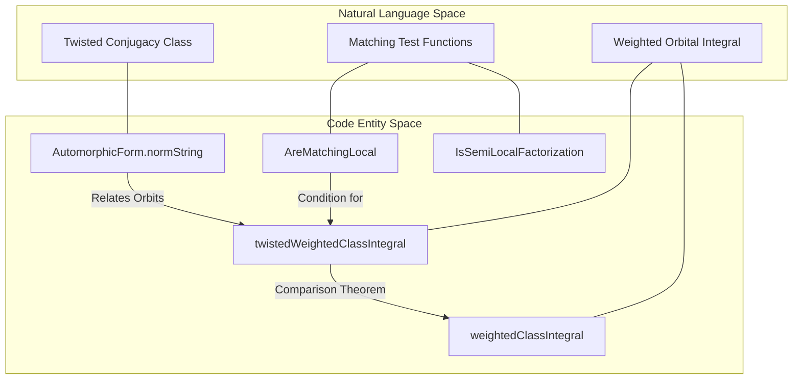
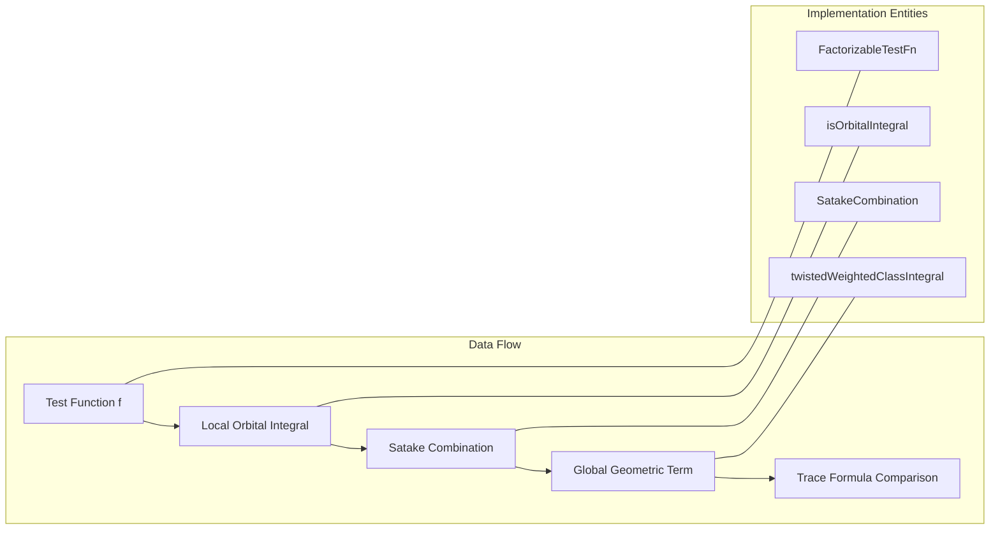

<!-- source: DeepWiki mcp.deepwiki.com · repo anthropics/fermats-last-theorem · page 6.2 Orbital Integrals and the Geometric Side · fetched 2026-10-26 -->

# Orbital Integrals and the Geometric Side

Relevant source files

The following files were used as context for generating this wiki page:

- [P2M/Sol/S_AutomorphicForm_IsOrbitalIntegralOn_unique_of_isRegularSemisimple.lean](P2M/Sol/S_AutomorphicForm_IsOrbitalIntegralOn_unique_of_isRegularSemisimple.lean)
- [P2M/Sol/S_AutomorphicForm_IsTwistedOrbitalIntegralOn_exists_of_isRegularSemisimple_normString_of_finrank_eq_two.lean](P2M/Sol/S_AutomorphicForm_IsTwistedOrbitalIntegralOn_exists_of_isRegularSemisimple_normString_of_finrank_eq_two.lean)
- [P2M/Sol/S_AutomorphicForm_IsTwistedOrbitalIntegralOn_unique_of_isRegularSemisimple_normString.lean](P2M/Sol/S_AutomorphicForm_IsTwistedOrbitalIntegralOn_unique_of_isRegularSemisimple_normString.lean)
- [P2M/Sol/S_AutomorphicForm_IsWeightedOrbitalIntegralOn_unique_of_isRegularSemisimple_of_forall_centralizer_mul_eq.lean](P2M/Sol/S_AutomorphicForm_IsWeightedOrbitalIntegralOn_unique_of_isRegularSemisimple_of_forall_centralizer_mul_eq.lean)
- [P2M/Sol/S_AutomorphicForm_LocalWeightedOrbital_eq_mul_splitOrbital_of_isOrbitalIntegral_diagUnits2.lean](P2M/Sol/S_AutomorphicForm_LocalWeightedOrbital_eq_mul_splitOrbital_of_isOrbitalIntegral_diagUnits2.lean)
- [P2M/Sol/S_AutomorphicForm_LocalWeightedOrbital_ratio_mul_sqrtRatio_mul_eq_neg_two_mul_halfWeighted_of_isWeightedOrbitalIntegral.lean](P2M/Sol/S_AutomorphicForm_LocalWeightedOrbital_ratio_mul_sqrtRatio_mul_eq_neg_two_mul_halfWeighted_of_isWeightedOrbitalIntegral.lean)
- [P2M/Sol/S_AutomorphicForm_LocalWeightedOrbital_splitOrbital_eq_zero_of_not_exists_norm_eq_of_areMatchingLocal.lean](P2M/Sol/S_AutomorphicForm_LocalWeightedOrbital_splitOrbital_eq_zero_of_not_exists_norm_eq_of_areMatchingLocal.lean)
- [P2M/Sol/S_AutomorphicForm_TwistedBruhat_integral_iwasawa_cuspKernel_sub_cuspTruncation_eq_integral_tsum_normOneFibre_of_fibrewise.lean](P2M/Sol/S_AutomorphicForm_TwistedBruhat_integral_iwasawa_cuspKernel_sub_cuspTruncation_eq_integral_tsum_normOneFibre_of_fibrewise.lean)
- [P2M/Sol/S_AutomorphicForm_TwistedBruhat_setIntegral_mul_cuspKernel_sub_cuspTruncation_centralScalar_mul_eq_of_sigmaInvariant.lean](P2M/Sol/S_AutomorphicForm_TwistedBruhat_setIntegral_mul_cuspKernel_sub_cuspTruncation_centralScalar_mul_eq_of_sigmaInvariant.lean)
- [P2M/Sol/S_AutomorphicForm_WindowedSiegel_sum_mult_mul_log_topNormSq_mul_rowNormSq_div_eq_neg_log_archHeight_sub_log_archHeight_weyl_mul.lean](P2M/Sol/S_AutomorphicForm_WindowedSiegel_sum_mult_mul_log_topNormSq_mul_rowNormSq_div_eq_neg_log_archHeight_sub_log_archHeight_weyl_mul.lean)
- [P2M/Sol/S_AutomorphicForm_continuous_and_hasCompactSupport_setIntegral_fundamentalDomain_conj_centralScalar_mul_of_mem_ellipticCell.lean](P2M/Sol/S_AutomorphicForm_continuous_and_hasCompactSupport_setIntegral_fundamentalDomain_conj_centralScalar_mul_of_mem_ellipticCell.lean)
- [P2M/Sol/S_AutomorphicForm_det_mem_range_and_isOpen_isCompact_detUnits_twistedCentralizer_of_not_isSigmaConjugate_scalar_of_finrank_eq_two.lean](P2M/Sol/S_AutomorphicForm_det_mem_range_and_isOpen_isCompact_detUnits_twistedCentralizer_of_not_isSigmaConjugate_scalar_of_finrank_eq_two.lean)
- [P2M/Sol/S_AutomorphicForm_eq_inv_mul_of_isTwistedWeightedOrbitalIntegralOn_of_normString_eq_toTensorGL_diagonal_of_coupled_one_smul_infiniteAdeleRing.lean](P2M/Sol/S_AutomorphicForm_eq_inv_mul_of_isTwistedWeightedOrbitalIntegralOn_of_normString_eq_toTensorGL_diagonal_of_coupled_one_smul_infiniteAdeleRing.lean)
- [P2M/Sol/S_AutomorphicForm_eq_ite_finrank_mul_sum_of_isTwistedWeightedOrbitalIntegral_indicator_semiLocalIntegralSet_of_relIndex_eq_of_subsingleton_extension.lean](P2M/Sol/S_AutomorphicForm_eq_ite_finrank_mul_sum_of_isTwistedWeightedOrbitalIntegral_indicator_semiLocalIntegralSet_of_relIndex_eq_of_subsingleton_extension.lean)
- [P2M/Sol/S_AutomorphicForm_eq_ite_finrank_mul_sum_of_isTwistedWeightedOrbitalIntegral_indicator_semiLocalIntegralSet_of_subsingleton_extension.lean](P2M/Sol/S_AutomorphicForm_eq_ite_finrank_mul_sum_of_isTwistedWeightedOrbitalIntegral_indicator_semiLocalIntegralSet_of_subsingleton_extension.lean)
- [P2M/Sol/S_AutomorphicForm_eq_ite_sum_of_isWeightedOrbitalIntegral_indicator_localIntegralSet_diagUnits2.lean](P2M/Sol/S_AutomorphicForm_eq_ite_sum_of_isWeightedOrbitalIntegral_indicator_localIntegralSet_diagUnits2.lean)
- [P2M/Sol/S_AutomorphicForm_eq_norm_inv_mul_integral_localIntegralSet_integral_conj_unipotentGL2_of_isOrbitalIntegral_of_diagonal.lean](P2M/Sol/S_AutomorphicForm_eq_norm_inv_mul_integral_localIntegralSet_integral_conj_unipotentGL2_of_isOrbitalIntegral_of_diagonal.lean)
- [P2M/Sol/S_AutomorphicForm_eq_of_isTwistedWeightedOrbitalIntegral_of_isTwistedWeightedOrbitalIntegral_of_normString_eq_toTensorGL_diagonal.lean](P2M/Sol/S_AutomorphicForm_eq_of_isTwistedWeightedOrbitalIntegral_of_isTwistedWeightedOrbitalIntegral_of_normString_eq_toTensorGL_diagonal.lean)
- [P2M/Sol/S_AutomorphicForm_eq_two_mul_log_mul_sum_of_isWeightedOrbitalIntegral_diagUnits2_of_biInvariant.lean](P2M/Sol/S_AutomorphicForm_eq_two_mul_log_mul_sum_of_isWeightedOrbitalIntegral_diagUnits2_of_biInvariant.lean)
- [P2M/Sol/S_AutomorphicForm_exists_algEquiv_mulEquiv_semiLocalComponent_localEmbed_eq_of_subsingleton_extension.lean](P2M/Sol/S_AutomorphicForm_exists_algEquiv_mulEquiv_semiLocalComponent_localEmbed_eq_of_subsingleton_extension.lean)
- [P2M/Sol/S_AutomorphicForm_exists_atoms_forall_exists_noAtomicMass_heckeWordSum_twistedCutTrace_sub_finrank_mul_const_mul_heckeWordSum_cutTrace_eq.lean](P2M/Sol/S_AutomorphicForm_exists_atoms_forall_exists_noAtomicMass_heckeWordSum_twistedCutTrace_sub_finrank_mul_const_mul_heckeWordSum_cutTrace_eq.lean)
- [P2M/Sol/S_AutomorphicForm_exists_clm_noAtomicMass_forall_sum_slotFamilyCoeff_mul_setIntegral_unipotentCell_eq_mul_add.lean](P2M/Sol/S_AutomorphicForm_exists_clm_noAtomicMass_forall_sum_slotFamilyCoeff_mul_setIntegral_unipotentCell_eq_mul_add.lean)
- [P2M/Sol/S_AutomorphicForm_exists_const_forall_exists_windingDatum_hyperbolicIntercept_sub_finrank_mul_const_mul_sum_eq_sum_satakeLaurent_mul_coeff_of_eq_affine_of_areMatchingArch_of_areMatchingLocal.lean](P2M/Sol/S_AutomorphicForm_exists_const_forall_exists_windingDatum_hyperbolicIntercept_sub_finrank_mul_const_mul_sum_eq_sum_satakeLaurent_mul_coeff_of_eq_affine_of_areMatchingArch_of_areMatchingLocal.lean)
- [P2M/Sol/S_AutomorphicForm_exists_const_forall_exists_windingDatum_integrableOn_and_hyperbolicTerm_sub_finrank_mul_const_mul_sum_eq_mul_sum_coeff_add_sum_coeff_of_areMatchingAt.lean](P2M/Sol/S_AutomorphicForm_exists_const_forall_exists_windingDatum_integrableOn_and_hyperbolicTerm_sub_finrank_mul_const_mul_sum_eq_mul_sum_coeff_add_sum_coeff_of_areMatchingAt.lean)
- [P2M/Sol/S_AutomorphicForm_exists_contDiff_hasCompactSupport_forall_apply_norm_eq_integral_ker_norm_prod_of_contDiff.lean](P2M/Sol/S_AutomorphicForm_exists_contDiff_hasCompactSupport_forall_apply_norm_eq_integral_ker_norm_prod_of_contDiff.lean)
- [P2M/Sol/S_AutomorphicForm_exists_contDiff_hasCompactSupport_forall_isTwistedOrbitalIntegralOn_conjAe_imp_eq.lean](P2M/Sol/S_AutomorphicForm_exists_contDiff_hasCompactSupport_forall_isTwistedOrbitalIntegralOn_conjAe_imp_eq.lean)
- [P2M/Sol/S_AutomorphicForm_exists_contDiff_hasCompactSupport_integral_ker_norm_integral_mul_log_sq_add_norm_resolvent_sq_eq_add_norm_mul_of_isComplex_place.lean](P2M/Sol/S_AutomorphicForm_exists_contDiff_hasCompactSupport_integral_ker_norm_integral_mul_log_sq_add_norm_resolvent_sq_eq_add_norm_mul_of_isComplex_place.lean)
- [P2M/Sol/S_AutomorphicForm_exists_contDiff_hasCompactSupport_integral_ker_norm_integral_mul_log_sq_add_norm_resolvent_sq_eq_add_norm_mul_of_isReal_place.lean](P2M/Sol/S_AutomorphicForm_exists_contDiff_hasCompactSupport_integral_ker_norm_integral_mul_log_sq_add_norm_resolvent_sq_eq_add_norm_mul_of_isReal_place.lean)
- [P2M/Sol/S_AutomorphicForm_exists_contDiff_hasCompactSupport_integral_ker_norm_integral_mul_log_sq_add_norm_resolvent_sq_eq_add_norm_sq_mul_log_mul_of_isComplex_isComplex.lean](P2M/Sol/S_AutomorphicForm_exists_contDiff_hasCompactSupport_integral_ker_norm_integral_mul_log_sq_add_norm_resolvent_sq_eq_add_norm_sq_mul_log_mul_of_isComplex_isComplex.lean)
- [P2M/Sol/S_AutomorphicForm_exists_contDiff_hasCompactSupport_prod_norm_pow_mul_integral_ker_norm_integral_twistedLogWeight_eq_add_norm_mul_of_isReal.lean](P2M/Sol/S_AutomorphicForm_exists_contDiff_hasCompactSupport_prod_norm_pow_mul_integral_ker_norm_integral_twistedLogWeight_eq_add_norm_mul_of_isReal.lean)
- [P2M/Sol/S_AutomorphicForm_exists_contDiff_hasCompactSupport_prod_norm_pow_mul_integral_ker_norm_integral_twistedLogWeight_eq_add_norm_sq_mul_log_mul_of_isComplex.lean](P2M/Sol/S_AutomorphicForm_exists_contDiff_hasCompactSupport_prod_norm_pow_mul_integral_ker_norm_integral_twistedLogWeight_eq_add_norm_sq_mul_log_mul_of_isComplex.lean)
- [P2M/Sol/S_AutomorphicForm_exists_contDiff_hasCompactSupport_tsupport_subset_archDisc_mul_twistedWeighted_eq_neg_two_mul_finrank_mul_sum_log_mul_twistedOrbital_add_sum_real_add_sum_complex.lean](P2M/Sol/S_AutomorphicForm_exists_contDiff_hasCompactSupport_tsupport_subset_archDisc_mul_twistedWeighted_eq_neg_two_mul_finrank_mul_sum_log_mul_twistedOrbital_add_sum_real_add_sum_complex.lean)
- [P2M/Sol/S_AutomorphicForm_exists_contDiff_hasCompactSupport_tsupport_subset_archDisc_mul_weighted_eq_neg_two_mul_sum_log_mul_orbital_add_sum_real_add_sum_complex.lean](P2M/Sol/S_AutomorphicForm_exists_contDiff_hasCompactSupport_tsupport_subset_archDisc_mul_weighted_eq_neg_two_mul_sum_log_mul_orbital_add_sum_real_add_sum_complex.lean)
- [P2M/Sol/S_AutomorphicForm_exists_continuous_hasCompactSupport_eq_of_isTwistedWeightedOrbitalIntegralOn_glArch_centralScalar_mul_diagUnits2.lean](P2M/Sol/S_AutomorphicForm_exists_continuous_hasCompactSupport_eq_of_isTwistedWeightedOrbitalIntegralOn_glArch_centralScalar_mul_diagUnits2.lean)
- [P2M/Sol/S_AutomorphicForm_exists_continuous_hasCompactSupport_forall_isOrbitalIntegralOn_mul_centralScalar_of_mem_ellipticCell.lean](P2M/Sol/S_AutomorphicForm_exists_continuous_hasCompactSupport_forall_isOrbitalIntegralOn_mul_centralScalar_of_mem_ellipticCell.lean)
- [P2M/Sol/S_AutomorphicForm_exists_continuous_isTwistedSectionFnOn_adeleRing_of_isRegularSemisimple_normString.lean](P2M/Sol/S_AutomorphicForm_exists_continuous_isTwistedSectionFnOn_adeleRing_of_isRegularSemisimple_normString.lean)
- [P2M/Sol/S_AutomorphicForm_exists_continuous_noAtomicMass_integrableOn_and_unipotentTerm_sub_const_mul_sum_eq_of_areMatchingAt.lean](P2M/Sol/S_AutomorphicForm_exists_continuous_noAtomicMass_integrableOn_and_unipotentTerm_sub_const_mul_sum_eq_of_areMatchingAt.lean)
- [P2M/Sol/S_AutomorphicForm_exists_continuous_noAtomicMass_intercept_parabolic_sub_finrank_mul_const_mul_sum_intercept_parabolic_eq_uniform.lean](P2M/Sol/S_AutomorphicForm_exists_continuous_noAtomicMass_intercept_parabolic_sub_finrank_mul_const_mul_sum_intercept_parabolic_eq_uniform.lean)
- [P2M/Sol/S_AutomorphicForm_exists_continuous_noAtomicMass_twistedGeometricRemainder_sub_finrank_mul_const_mul_sum_eq.lean](P2M/Sol/S_AutomorphicForm_exists_continuous_noAtomicMass_twistedGeometricRemainder_sub_finrank_mul_const_mul_sum_eq.lean)
- [P2M/Sol/S_AutomorphicForm_exists_ellipticTransport_coupled_straighten_of_not_isSigmaConjugate_scalar_of_finrank_eq_two.lean](P2M/Sol/S_AutomorphicForm_exists_ellipticTransport_coupled_straighten_of_not_isSigmaConjugate_scalar_of_finrank_eq_two.lean)
- [P2M/Sol/S_AutomorphicForm_exists_eq_archHaarK_torusFamily_isOrbitalIntegral_centralScalar_mul_diagUnits2_of_isArchTestFactor_of_isLocalTestFn.lean](P2M/Sol/S_AutomorphicForm_exists_eq_archHaarK_torusFamily_isOrbitalIntegral_centralScalar_mul_diagUnits2_of_isArchTestFactor_of_isLocalTestFn.lean)
- [P2M/Sol/S_AutomorphicForm_exists_finset_forall_isSectionFnOn_indicator_localIntegralSet_of_isSectionFnOn_adeleRing.lean](P2M/Sol/S_AutomorphicForm_exists_finset_forall_isSectionFnOn_indicator_localIntegralSet_of_isSectionFnOn_adeleRing.lean)
- [P2M/Sol/S_AutomorphicForm_exists_finset_forall_slope_eq_sum_classIntegral_and_intercept_eq_sum_weightedClassIntegral_of_hyperbolicTerm_eq_affine.lean](P2M/Sol/S_AutomorphicForm_exists_finset_forall_slope_eq_sum_classIntegral_and_intercept_eq_sum_weightedClassIntegral_of_hyperbolicTerm_eq_affine.lean)
- [P2M/Sol/S_AutomorphicForm_exists_finset_forall_slope_eq_sum_twistedClassIntegral_and_intercept_eq_sum_weightedTwistedClassIntegral_haarQuotient_of_eq_affine.lean](P2M/Sol/S_AutomorphicForm_exists_finset_forall_slope_eq_sum_twistedClassIntegral_and_intercept_eq_sum_weightedTwistedClassIntegral_haarQuotient_of_eq_affine.lean)
- [P2M/Sol/S_AutomorphicForm_exists_finset_forall_window_product_eq_zero_of_not_mem.lean](P2M/Sol/S_AutomorphicForm_exists_finset_forall_window_product_eq_zero_of_not_mem.lean)
- [P2M/Sol/S_AutomorphicForm_exists_finsum_sigmaCentralizerDomain_eq_mul_sum_finsum_centralizerDomain_of_areMatchingOn_of_isNormClass.lean](P2M/Sol/S_AutomorphicForm_exists_finsum_sigmaCentralizerDomain_eq_mul_sum_finsum_centralizerDomain_of_areMatchingOn_of_isNormClass.lean)
- [P2M/Sol/S_AutomorphicForm_exists_forall_encard_setOf_twistedKernelSummand_ne_zero_not_identityFamily_le.lean](P2M/Sol/S_AutomorphicForm_exists_forall_encard_setOf_twistedKernelSummand_ne_zero_not_identityFamily_le.lean)
- [P2M/Sol/S_AutomorphicForm_exists_forall_finsum_mul_prod_zpow_neg_mul_ideleNorm_mul_integral_orbital_eq_sum_tsum_ite_of_smul_eq_map_partAt_of_ne_one.lean](P2M/Sol/S_AutomorphicForm_exists_forall_finsum_mul_prod_zpow_neg_mul_ideleNorm_mul_integral_orbital_eq_sum_tsum_ite_of_smul_eq_map_partAt_of_ne_one.lean)
- [P2M/Sol/S_AutomorphicForm_exists_forall_hyperbolicSlope_eq_mul_sum_slotFamilyCoeff_mul_hyperbolicSlope_of_eq_affine.lean](P2M/Sol/S_AutomorphicForm_exists_forall_hyperbolicSlope_eq_mul_sum_slotFamilyCoeff_mul_hyperbolicSlope_of_eq_affine.lean)
- [P2M/Sol/S_AutomorphicForm_exists_forall_integrableOn_iff_and_setIntegral_lambdaT_mul_conj_lambdaT_eq_of_isTruncationDatum_of_isTruncationDatum.lean](P2M/Sol/S_AutomorphicForm_exists_forall_integrableOn_iff_and_setIntegral_lambdaT_mul_conj_lambdaT_eq_of_isTruncationDatum_of_isTruncationDatum.lean)
- [P2M/Sol/S_AutomorphicForm_exists_forall_integrable_prod_sum_rightConv_mul_axis_continuation_mul_conj_lambdaT_sigmaAdelicAct_symm_of_subset_iUnion_image_centreCutSiegelSet.lean](P2M/Sol/S_AutomorphicForm_exists_forall_integrable_prod_sum_rightConv_mul_axis_continuation_mul_conj_lambdaT_sigmaAdelicAct_symm_of_subset_iUnion_image_centreCutSiegelSet.lean)
- [P2M/Sol/S_AutomorphicForm_exists_forall_le_integrableOn_and_setIntegral_twistedParabolic_eq_hyperbolicCell_add_unipotentCell.lean](P2M/Sol/S_AutomorphicForm_exists_forall_le_integrableOn_and_setIntegral_twistedParabolic_eq_hyperbolicCell_add_unipotentCell.lean)
- [P2M/Sol/S_AutomorphicForm_exists_forall_le_integrableOn_hyperbolicCell_and_unipotentCell_sub_indicator_constantTerm.lean](P2M/Sol/S_AutomorphicForm_exists_forall_le_integrableOn_hyperbolicCell_and_unipotentCell_sub_indicator_constantTerm.lean)
- [P2M/Sol/S_AutomorphicForm_exists_forall_le_integrableOn_mul_lambdaT_twistedAdelicKernel_canonicalTruncationDomain_prod.lean](P2M/Sol/S_AutomorphicForm_exists_forall_le_integrableOn_mul_lambdaT_twistedAdelicKernel_canonicalTruncationDomain_prod.lean)
- [P2M/Sol/S_AutomorphicForm_exists_forall_le_integrableOn_setIntegral_mul_lambdaT_adelicKernel_of_isTruncationDatum.lean](P2M/Sol/S_AutomorphicForm_exists_forall_le_integrableOn_setIntegral_mul_lambdaT_adelicKernel_of_isTruncationDatum.lean)
- [P2M/Sol/S_AutomorphicForm_exists_forall_le_setIntegral_lambdaT_adelicKernel_sub_centralElliptic_eq_setIntegral_parabolic.lean](P2M/Sol/S_AutomorphicForm_exists_forall_le_setIntegral_lambdaT_adelicKernel_sub_centralElliptic_eq_setIntegral_parabolic.lean)
- [P2M/Sol/S_AutomorphicForm_exists_forall_le_setIntegral_lambdaT_twistedAdelicKernel_sub_centralElliptic_eq_setIntegral_parabolic.lean](P2M/Sol/S_AutomorphicForm_exists_forall_le_setIntegral_lambdaT_twistedAdelicKernel_sub_centralElliptic_eq_setIntegral_parabolic.lean)
- [P2M/Sol/S_AutomorphicForm_exists_forall_lintegral_semiLocalHaar_eq_mul_lintegral_pi_norm_algebraNorm_det_inv_sq.lean](P2M/Sol/S_AutomorphicForm_exists_forall_lintegral_semiLocalHaar_eq_mul_lintegral_pi_norm_algebraNorm_det_inv_sq.lean)
- [P2M/Sol/S_AutomorphicForm_exists_forall_lintegral_semiLocalHaar_eq_mul_lintegral_torus_unipotentGL2_setLIntegral_semiLocalIntegralSet.lean](P2M/Sol/S_AutomorphicForm_exists_forall_lintegral_semiLocalHaar_eq_mul_lintegral_torus_unipotentGL2_setLIntegral_semiLocalIntegralSet.lean)
- [P2M/Sol/S_AutomorphicForm_exists_forall_mem_slotIndex_integrableOn_and_setIntegral_unipotentCell_eq_weighted_moments_self.lean](P2M/Sol/S_AutomorphicForm_exists_forall_mem_slotIndex_integrableOn_and_setIntegral_unipotentCell_eq_weighted_moments_self.lean)
- [P2M/Sol/S_AutomorphicForm_exists_forall_norm_finsum_sub_indicator_highSet_constantTerm_finsum_borel_le_of_subset_centreCutSiegelSet_translates.lean](P2M/Sol/S_AutomorphicForm_exists_forall_norm_finsum_sub_indicator_highSet_constantTerm_finsum_borel_le_of_subset_centreCutSiegelSet_translates.lean)
- [P2M/Sol/S_AutomorphicForm_exists_forall_norm_lambdaT_twistedAdelicKernel_centralScalar_mul_le_of_subset_centreCutSiegelSet_translates.lean](P2M/Sol/S_AutomorphicForm_exists_forall_norm_lambdaT_twistedAdelicKernel_centralScalar_mul_le_of_subset_centreCutSiegelSet_translates.lean)
- [P2M/Sol/S_AutomorphicForm_exists_forall_norm_ratio_mul_sqrtRatio_mul_twistedWeighted_add_mul_log_mul_twistedOrbital_sub_le_of_normString_diagUnits2_eq.lean](P2M/Sol/S_AutomorphicForm_exists_forall_norm_ratio_mul_sqrtRatio_mul_twistedWeighted_add_mul_log_mul_twistedOrbital_sub_le_of_normString_diagUnits2_eq.lean)
- [P2M/Sol/S_AutomorphicForm_exists_forall_norm_sub_norm_mul_le_mul_rpow_mul_log_pow_of_isTwistedOrbitalIntegral_indicator_semiLocalIntegralSet_mul_mul.lean](P2M/Sol/S_AutomorphicForm_exists_forall_norm_sub_norm_mul_le_mul_rpow_mul_log_pow_of_isTwistedOrbitalIntegral_indicator_semiLocalIntegralSet_mul_mul.lean)
- [P2M/Sol/S_AutomorphicForm_exists_forall_setIntegral_finsum_hyperbolicCell_sub_indicator_constantTerm_eq_mul_sum_orbital_add_sum_weightedOrbital_or_eq_zero_of_isFactorizableTestFn.lean](P2M/Sol/S_AutomorphicForm_exists_forall_setIntegral_finsum_hyperbolicCell_sub_indicator_constantTerm_eq_mul_sum_orbital_add_sum_weightedOrbital_or_eq_zero_of_isFactorizableTestFn.lean)
- [P2M/Sol/S_AutomorphicForm_exists_forall_setIntegral_finsum_unipotentCell_sub_indicator_constantTerm_eq_sum_mul_setIntegral_rankOne_unram.lean](P2M/Sol/S_AutomorphicForm_exists_forall_setIntegral_finsum_unipotentCell_sub_indicator_constantTerm_eq_sum_mul_setIntegral_rankOne_unram.lean)
- [P2M/Sol/S_AutomorphicForm_exists_forall_setIntegral_lambdaT_mul_conj_eq_setIntegral_lambdaT_mul_conj_lambdaT_of_subset_iUnion_image_centreCutSiegelSet.lean](P2M/Sol/S_AutomorphicForm_exists_forall_setIntegral_lambdaT_mul_conj_eq_setIntegral_lambdaT_mul_conj_lambdaT_of_subset_iUnion_image_centreCutSiegelSet.lean)
- [P2M/Sol/S_AutomorphicForm_exists_forall_setIntegral_lambdaT_sigmaAdelicAct_sub_twistedConvOp_sub_chiDet_eq_mul_tsum_integral_sum_rightConv_mul_setIntegral_lambdaT_mul_conj_lambdaT_sigmaAdelicAct.lean](P2M/Sol/S_AutomorphicForm_exists_forall_setIntegral_lambdaT_sigmaAdelicAct_sub_twistedConvOp_sub_chiDet_eq_mul_tsum_integral_sum_rightConv_mul_setIntegral_lambdaT_mul_conj_lambdaT_sigmaAdelicAct.lean)
- [P2M/Sol/S_AutomorphicForm_exists_forall_window_classSum_eq_tsum_mul_tsum_ite_kinkWindow_of_areMatchingArch_of_areMatchingLocal_of_ne_one_unweighted.lean](P2M/Sol/S_AutomorphicForm_exists_forall_window_classSum_eq_tsum_mul_tsum_ite_kinkWindow_of_areMatchingArch_of_areMatchingLocal_of_ne_one_unweighted.lean)
- [P2M/Sol/S_AutomorphicForm_exists_integral_centralizer_eq_mul_integral_mul_prod_integral_of_isHaarMeasure.lean](P2M/Sol/S_AutomorphicForm_exists_integral_centralizer_eq_mul_integral_mul_prod_integral_of_isHaarMeasure.lean)
- [P2M/Sol/S_AutomorphicForm_exists_integral_eq_mul_integral_mul_prod_integral_localHaar_of_isHaarMeasure.lean](P2M/Sol/S_AutomorphicForm_exists_integral_eq_mul_integral_mul_prod_integral_localHaar_of_isHaarMeasure.lean)
- [P2M/Sol/S_AutomorphicForm_exists_inv_mul_mul_map_eq_scalar_of_sigmaNormPow_eq_map_scalar_of_odd.lean](P2M/Sol/S_AutomorphicForm_exists_inv_mul_mul_map_eq_scalar_of_sigmaNormPow_eq_map_scalar_of_odd.lean)
- [P2M/Sol/S_AutomorphicForm_exists_isArchTestFactor_forall_exists_isTwistedOrbitalIntegralOn_of_isEmpty_algHom.lean](P2M/Sol/S_AutomorphicForm_exists_isArchTestFactor_forall_exists_isTwistedOrbitalIntegralOn_of_isEmpty_algHom.lean)
- [P2M/Sol/S_AutomorphicForm_exists_isCompact_setOf_mem_centralizer_normString_twistedConj_mem_subset_twistedCentralizer_mul_of_isArtinianRing.lean](P2M/Sol/S_AutomorphicForm_exists_isCompact_setOf_mem_centralizer_normString_twistedConj_mem_subset_twistedCentralizer_mul_of_isArtinianRing.lean)
- [P2M/Sol/S_AutomorphicForm_exists_isCompact_setOf_twistedConj_mem_subset_twistedCentralizer_mul.lean](P2M/Sol/S_AutomorphicForm_exists_isCompact_setOf_twistedConj_mem_subset_twistedCentralizer_mul.lean)
- [P2M/Sol/S_AutomorphicForm_exists_isHaarMeasure_and_eq_integral_indicator_localIntegralSet_twistedConj_of_isTwistedOrbitalIntegral_indicator_semiLocalIntegralSet.lean](P2M/Sol/S_AutomorphicForm_exists_isHaarMeasure_and_eq_integral_indicator_localIntegralSet_twistedConj_of_isTwistedOrbitalIntegral_indicator_semiLocalIntegralSet.lean)
- [P2M/Sol/S_AutomorphicForm_exists_isOrbitalIntegralOn_adeleRing_eq_mul_prod_of_isUnitFactorization.lean](P2M/Sol/S_AutomorphicForm_exists_isOrbitalIntegralOn_adeleRing_eq_mul_prod_of_isUnitFactorization.lean)
- [P2M/Sol/S_AutomorphicForm_exists_isOrbitalIntegralOn_centralScalar_mul_eq_mul_prod_and_isWeightedOrbitalIntegralOn_eq_mul_sum_prod_of_isUnitFactorization.lean](P2M/Sol/S_AutomorphicForm_exists_isOrbitalIntegralOn_centralScalar_mul_eq_mul_prod_and_isWeightedOrbitalIntegralOn_eq_mul_sum_prod_of_isUnitFactorization.lean)
- [P2M/Sol/S_AutomorphicForm_exists_isSectionFnOn_adeleRing_of_isRegularSemisimple.lean](P2M/Sol/S_AutomorphicForm_exists_isSectionFnOn_adeleRing_of_isRegularSemisimple.lean)
- [P2M/Sol/S_AutomorphicForm_exists_isTwistedSectionFnOn_adeleRing_of_isRegularSemisimple_normString.lean](P2M/Sol/S_AutomorphicForm_exists_isTwistedSectionFnOn_adeleRing_of_isRegularSemisimple_normString.lean)
- [P2M/Sol/S_AutomorphicForm_exists_isTwistedSectionFnOn_adeleRing_of_isSigmaConjugate_scalar.lean](P2M/Sol/S_AutomorphicForm_exists_isTwistedSectionFnOn_adeleRing_of_isSigmaConjugate_scalar.lean)
- [P2M/Sol/S_AutomorphicForm_exists_isTwistedSectionFnOn_and_continuous_of_isRegularSemisimple_normString_of_hasCompactSupport_of_isArtinianRing.lean](P2M/Sol/S_AutomorphicForm_exists_isTwistedSectionFnOn_and_continuous_of_isRegularSemisimple_normString_of_hasCompactSupport_of_isArtinianRing.lean)
- [P2M/Sol/S_AutomorphicForm_exists_isTwistedSectionFnOn_integral_eq_fibreIntegral_of_isNormConjugator_one_of_mulEquiv_prod.lean](P2M/Sol/S_AutomorphicForm_exists_isTwistedSectionFnOn_integral_eq_fibreIntegral_of_isNormConjugator_one_of_mulEquiv_prod.lean)
- [P2M/Sol/S_AutomorphicForm_exists_isWeightedOrbitalIntegralOn_adeleRing_eq_mul_sum_prod_of_isUnitFactorization.lean](P2M/Sol/S_AutomorphicForm_exists_isWeightedOrbitalIntegralOn_adeleRing_eq_mul_sum_prod_of_isUnitFactorization.lean)
- [P2M/Sol/S_AutomorphicForm_exists_isWeightedOrbitalIntegral_and_integral_pi_mul_prod_indicator_cyclicString_eq_mul_of_forall_mul_eq.lean](P2M/Sol/S_AutomorphicForm_exists_isWeightedOrbitalIntegral_and_integral_pi_mul_prod_indicator_cyclicString_eq_mul_of_forall_mul_eq.lean)
- [P2M/Sol/S_AutomorphicForm_exists_nhds_forall_pow_eq_and_continuousOn_and_eq_of_isTwistedWeightedOrbitalIntegralOn_comp_toTensorGL_scalar_mul_infiniteAdeleRing.lean](P2M/Sol/S_AutomorphicForm_exists_nhds_forall_pow_eq_and_continuousOn_and_eq_of_isTwistedWeightedOrbitalIntegralOn_comp_toTensorGL_scalar_mul_infiniteAdeleRing.lean)
- [P2M/Sol/S_AutomorphicForm_exists_nhds_forall_ratio_mul_sqrtRatio_mul_twistedWeighted_eq_of_norm_sub_le_of_normString_diagUnits2_eq_of_areMatchingLocal.lean](P2M/Sol/S_AutomorphicForm_exists_nhds_forall_ratio_mul_sqrtRatio_mul_twistedWeighted_eq_of_norm_sub_le_of_normString_diagUnits2_eq_of_areMatchingLocal.lean)
- [P2M/Sol/S_AutomorphicForm_exists_nhds_nhds_forall_apply_inv_mul_diagUnits2_mul_toTensorGL_diagUnits2_mul_sigmaGL_eq_of_isSemiLocalTestFn.lean](P2M/Sol/S_AutomorphicForm_exists_nhds_nhds_forall_apply_inv_mul_diagUnits2_mul_toTensorGL_diagUnits2_mul_sigmaGL_eq_of_isSemiLocalTestFn.lean)
- [P2M/Sol/S_AutomorphicForm_exists_pos_forall_integrable_and_twistedWeighted_add_mul_twistedOrbital_eq_mul_integral_iwasawa_of_normString_diagUnits2_eq.lean](P2M/Sol/S_AutomorphicForm_exists_pos_forall_integrable_and_twistedWeighted_add_mul_twistedOrbital_eq_mul_integral_iwasawa_of_normString_diagUnits2_eq.lean)
- [P2M/Sol/S_AutomorphicForm_exists_pos_forall_integral_semiLocalHaar_eq_mul_integral_integral_setIntegral_iwasawa.lean](P2M/Sol/S_AutomorphicForm_exists_pos_forall_integral_semiLocalHaar_eq_mul_integral_integral_setIntegral_iwasawa.lean)
- [P2M/Sol/S_AutomorphicForm_exists_pos_forall_isOrbitalIntegralOn_smul_splitFibreIntegral_of_isTwistedOrbitalIntegralOn_of_algHom_of_prime_of_forall_exists_isSectionFnOn_of_isMulRightInvariant.lean](P2M/Sol/S_AutomorphicForm_exists_pos_forall_isOrbitalIntegralOn_smul_splitFibreIntegral_of_isTwistedOrbitalIntegralOn_of_algHom_of_prime_of_forall_exists_isSectionFnOn_of_isMulRightInvariant.lean)
- [P2M/Sol/S_AutomorphicForm_exists_pos_forall_prod_norm_sub_one_pow_mul_eq_and_weighted_eq_mul_prod_norm_pow_mul_integral_integral_of_scalar_mul_diagUnits2.lean](P2M/Sol/S_AutomorphicForm_exists_pos_forall_prod_norm_sub_one_pow_mul_eq_and_weighted_eq_mul_prod_norm_pow_mul_integral_integral_of_scalar_mul_diagUnits2.lean)
- [P2M/Sol/S_AutomorphicForm_exists_pos_forall_prod_norm_sub_one_pow_mul_eq_mul_prod_norm_pow_mul_integral_integral_of_isOrbitalIntegralOn_scalar_mul_diagUnits2.lean](P2M/Sol/S_AutomorphicForm_exists_pos_forall_prod_norm_sub_one_pow_mul_eq_mul_prod_norm_pow_mul_integral_integral_of_isOrbitalIntegralOn_scalar_mul_diagUnits2.lean)
- [P2M/Sol/S_AutomorphicForm_exists_pos_forall_setIntegral_lambdaT_mul_conj_eq_setIntegral_lambdaT_mul_conj_lambdaT_canonicalTruncationDomain.lean](P2M/Sol/S_AutomorphicForm_exists_pos_forall_setIntegral_lambdaT_mul_conj_eq_setIntegral_lambdaT_mul_conj_lambdaT_canonicalTruncationDomain.lean)
- [P2M/Sol/S_AutomorphicForm_exists_pos_forall_setIntegral_sub_constantTerm_mul_eq_zero_canonicalTruncationDomain_inter_lt_adelicHeight.lean](P2M/Sol/S_AutomorphicForm_exists_pos_forall_setIntegral_sub_constantTerm_mul_eq_zero_canonicalTruncationDomain_inter_lt_adelicHeight.lean)
- [P2M/Sol/S_AutomorphicForm_exists_pos_forall_setIntegral_sub_constantTerm_mul_eq_zero_inter_lt_adelicHeight_of_subset_iUnion_image_centreCutSiegelSet.lean](P2M/Sol/S_AutomorphicForm_exists_pos_forall_setIntegral_sub_constantTerm_mul_eq_zero_inter_lt_adelicHeight_of_subset_iUnion_image_centreCutSiegelSet.lean)
- [P2M/Sol/S_AutomorphicForm_exists_pos_forall_tendsto_isTwistedOrbitalIntegralOn_mul_nhdsGT_conjAe_of_neg_of_inf_twistedCentralizer.lean](P2M/Sol/S_AutomorphicForm_exists_pos_forall_tendsto_isTwistedOrbitalIntegralOn_mul_nhdsGT_conjAe_of_neg_of_inf_twistedCentralizer.lean)
- [P2M/Sol/S_AutomorphicForm_exists_torusSection_forall_normString_diagUnits2_eq.lean](P2M/Sol/S_AutomorphicForm_exists_torusSection_forall_normString_diagUnits2_eq.lean)
- [P2M/Sol/S_AutomorphicForm_exists_twistedTorusFamily_lift_centralScalar_mul_diagUnits2_coupled_massOne_restrictedProduct.lean](P2M/Sol/S_AutomorphicForm_exists_twistedTorusFamily_lift_centralScalar_mul_diagUnits2_coupled_massOne_restrictedProduct.lean)
- [P2M/Sol/S_AutomorphicForm_exists_windingDatum_forall_coeff_eq_mul_finsum_mul_prod_zpow_neg_mul_ideleNorm_mul_integral_orbital_of_smul_eq_map_partAt_of_ne_one_unweighted.lean](P2M/Sol/S_AutomorphicForm_exists_windingDatum_forall_coeff_eq_mul_finsum_mul_prod_zpow_neg_mul_ideleNorm_mul_integral_orbital_of_smul_eq_map_partAt_of_ne_one_unweighted.lean)
- [P2M/Sol/S_AutomorphicForm_exists_windingDatum_forall_coeff_eq_window_classSum_of_areMatchingArch_of_areMatchingLocal_of_ne_one_unweighted.lean](P2M/Sol/S_AutomorphicForm_exists_windingDatum_forall_coeff_eq_window_classSum_of_areMatchingArch_of_areMatchingLocal_of_ne_one_unweighted.lean)
- [P2M/Sol/S_AutomorphicForm_exists_windingDatum_forall_heckeWord_mul_sum_slotFamilyCoeff_mul_sum_classIntegral_eq_sum_satakeLaurent_mul_coeff.lean](P2M/Sol/S_AutomorphicForm_exists_windingDatum_forall_heckeWord_mul_sum_slotFamilyCoeff_mul_sum_classIntegral_eq_sum_satakeLaurent_mul_coeff.lean)
- [P2M/Sol/S_AutomorphicForm_exists_windingDatum_forall_heckeWord_mul_sum_slotFamilyCoeff_mul_sum_windowClassIntegral_eq_sum_satakeLaurent_mul_coeff.lean](P2M/Sol/S_AutomorphicForm_exists_windingDatum_forall_heckeWord_mul_sum_slotFamilyCoeff_mul_sum_windowClassIntegral_eq_sum_satakeLaurent_mul_coeff.lean)
- [P2M/Sol/S_AutomorphicForm_exists_window_mass_le_mul_domain_mass_of_isArchKFinite_of_mem_isotypicCuspSubmodule.lean](P2M/Sol/S_AutomorphicForm_exists_window_mass_le_mul_domain_mass_of_isArchKFinite_of_mem_isotypicCuspSubmodule.lean)
- [P2M/Sol/S_AutomorphicForm_fibreSum_twistedCutTrace_eq_const_mul_fibreSum_cutTrace_of_areMatchingAt_symm_of_prime.lean](P2M/Sol/S_AutomorphicForm_fibreSum_twistedCutTrace_eq_const_mul_fibreSum_cutTrace_of_areMatchingAt_symm_of_prime.lean)
- [P2M/Sol/S_AutomorphicForm_fibreSum_twistedCutTrace_eq_const_mul_fibreSum_cutTrace_of_centralElliptic_of_prime.lean](P2M/Sol/S_AutomorphicForm_fibreSum_twistedCutTrace_eq_const_mul_fibreSum_cutTrace_of_centralElliptic_of_prime.lean)
- [P2M/Sol/S_AutomorphicForm_finite_sep_exists_twistedKernelSummand_ne_zero_of_hasCompactSupport.lean](P2M/Sol/S_AutomorphicForm_finite_sep_exists_twistedKernelSummand_ne_zero_of_hasCompactSupport.lean)
- [P2M/Sol/S_AutomorphicForm_finsum_sigmaCentralizerDomain_centralNorm_eq_mul_sum_finsum_centralizerDomain_central_of_central_transfer.lean](P2M/Sol/S_AutomorphicForm_finsum_sigmaCentralizerDomain_centralNorm_eq_mul_sum_finsum_centralizerDomain_central_of_central_transfer.lean)
- [P2M/Sol/S_AutomorphicForm_finsum_sigmaCentralizerDomain_ellipticNorm_eq_mul_sum_finsum_centralizerDomain_elliptic_of_forall_perClass.lean](P2M/Sol/S_AutomorphicForm_finsum_sigmaCentralizerDomain_ellipticNorm_eq_mul_sum_finsum_centralizerDomain_elliptic_of_forall_perClass.lean)
- [P2M/Sol/S_AutomorphicForm_ground_window_values_inv_mul_unitsMap_eq_of_ne_one.lean](P2M/Sol/S_AutomorphicForm_ground_window_values_inv_mul_unitsMap_eq_of_ne_one.lean)
- [P2M/Sol/S_AutomorphicForm_hasSum_setIntegral_setIntegral_twistedOrbital_of_normClass_elliptic_or_central.lean](P2M/Sol/S_AutomorphicForm_hasSum_setIntegral_setIntegral_twistedOrbital_of_normClass_elliptic_or_central.lean)
- [P2M/Sol/S_AutomorphicForm_integrableOn_tsum_and_setIntegral_tsum_comp_globalPoints_inv_mul_eq_integral_haarQuotient_setIntegral.lean](P2M/Sol/S_AutomorphicForm_integrableOn_tsum_and_setIntegral_tsum_comp_globalPoints_inv_mul_eq_integral_haarQuotient_setIntegral.lean)
- [P2M/Sol/S_AutomorphicForm_integrableOn_tsum_bracket_mul_twistedOrbital_and_setIntegral_eq_mul_integral_setIntegral_indicator_bracket_mul.lean](P2M/Sol/S_AutomorphicForm_integrableOn_tsum_bracket_mul_twistedOrbital_and_setIntegral_eq_mul_integral_setIntegral_indicator_bracket_mul.lean)
- [P2M/Sol/S_AutomorphicForm_integrable_mul_finsum_sub_indicator_highSet_constantTerm_finsum_prod_of_forall_norm_le.lean](P2M/Sol/S_AutomorphicForm_integrable_mul_finsum_sub_indicator_highSet_constantTerm_finsum_prod_of_forall_norm_le.lean)
- [P2M/Sol/S_AutomorphicForm_integral_indicator_localIntegralSet_twistedConj_map_algEquiv_mul_eq_ite_inv_norm_sub_of_relIndex_eq.lean](P2M/Sol/S_AutomorphicForm_integral_indicator_localIntegralSet_twistedConj_map_algEquiv_mul_eq_ite_inv_norm_sub_of_relIndex_eq.lean)
- [P2M/Sol/S_AutomorphicForm_integral_indicator_localIntegralSet_twistedConj_map_algEquiv_mul_weight_eq_ite_finrank_mul_sum_of_relIndex_eq.lean](P2M/Sol/S_AutomorphicForm_integral_indicator_localIntegralSet_twistedConj_map_algEquiv_mul_weight_eq_ite_finrank_mul_sum_of_relIndex_eq.lean)
- [P2M/Sol/S_AutomorphicForm_integral_indicator_shiftTwistedConj_mul_sum_weight_mul_eq_mul_of_forall_isWeightedOrbitalIntegral_eq.lean](P2M/Sol/S_AutomorphicForm_integral_indicator_shiftTwistedConj_mul_sum_weight_mul_eq_mul_of_forall_isWeightedOrbitalIntegral_eq.lean)
- [P2M/Sol/S_AutomorphicForm_integral_mul_orbital_centralScalar_eq_mul_ideleNorm_mul_prod_tsum_mul_integral_of_isUnitFactorization_of_integrable.lean](P2M/Sol/S_AutomorphicForm_integral_mul_orbital_centralScalar_eq_mul_ideleNorm_mul_prod_tsum_mul_integral_of_isUnitFactorization_of_integrable.lean)
- [P2M/Sol/S_AutomorphicForm_integral_subgroup_centralScalar_twistedOrbital_mul_section_eq_const_mul_integral_ker_idelicNorm.lean](P2M/Sol/S_AutomorphicForm_integral_subgroup_centralScalar_twistedOrbital_mul_section_eq_const_mul_integral_ker_idelicNorm.lean)
- [P2M/Sol/S_AutomorphicForm_integral_twistedConj_map_algEquiv_mul_weight_eq_integral_unipotentGL2_of_biInvariant.lean](P2M/Sol/S_AutomorphicForm_integral_twistedConj_map_algEquiv_mul_weight_eq_integral_unipotentGL2_of_biInvariant.lean)
- [P2M/Sol/S_AutomorphicForm_isIsotypicCuspFormAt_mul_ideleNorm_det_rpow_principalLevel_and_levelOne_of_isFundamentalDomain_slab.lean](P2M/Sol/S_AutomorphicForm_isIsotypicCuspFormAt_mul_ideleNorm_det_rpow_principalLevel_and_levelOne_of_isFundamentalDomain_slab.lean)
- [P2M/Sol/S_AutomorphicForm_isLocallyConstant_finprod_unitValue_and_integrable_window_product_of_ne_one_of_isLocalTestFn.lean](P2M/Sol/S_AutomorphicForm_isLocallyConstant_finprod_unitValue_and_integrable_window_product_of_ne_one_of_isLocalTestFn.lean)
- [P2M/Sol/S_AutomorphicForm_isOrbitalIntegralOn_sum_mul_centralScalar_mul_and_measurable_of_isRegularSemisimple.lean](P2M/Sol/S_AutomorphicForm_isOrbitalIntegralOn_sum_mul_centralScalar_mul_and_measurable_of_isRegularSemisimple.lean)
- [P2M/Sol/S_AutomorphicForm_isSectionFnOn_adeleRing_indicator_prod_of_forall_isSectionFnOn.lean](P2M/Sol/S_AutomorphicForm_isSectionFnOn_adeleRing_indicator_prod_of_forall_isSectionFnOn.lean)
- [P2M/Sol/S_AutomorphicForm_isSmoothCuspAutomorphicFnAt_rightConv_of_isFundamentalDomain_slab.lean](P2M/Sol/S_AutomorphicForm_isSmoothCuspAutomorphicFnAt_rightConv_of_isFundamentalDomain_slab.lean)
- [P2M/Sol/S_AutomorphicForm_isSmoothCuspAutomorphicFnAt_rightConv_principalLevel_of_isFundamentalDomain_slab.lean](P2M/Sol/S_AutomorphicForm_isSmoothCuspAutomorphicFnAt_rightConv_principalLevel_of_isFundamentalDomain_slab.lean)
- [P2M/Sol/S_AutomorphicForm_isWeightedOrbitalIntegralOn_sum_mul_centralScalar_mul_and_measurable_of_diagonal.lean](P2M/Sol/S_AutomorphicForm_isWeightedOrbitalIntegralOn_sum_mul_centralScalar_mul_and_measurable_of_diagonal.lean)
- [P2M/Sol/S_AutomorphicForm_lambdaT_finsum_integral_sigmaAdelicAct_eq_and_lambdaT_finsum_twistedConvOp_chiDet_eq_and_rightConv_mul_ideleNorm_det_rpow_eq.lean](P2M/Sol/S_AutomorphicForm_lambdaT_finsum_integral_sigmaAdelicAct_eq_and_lambdaT_finsum_twistedConvOp_chiDet_eq_and_rightConv_mul_ideleNorm_det_rpow_eq.lean)
- [P2M/Sol/S_AutomorphicForm_lintegral_enorm_twistedConj_mul_semiLocalHaar_eq_mul_lintegral_lintegral_torus_unipotentChart_of_isTwistedSectionFnOn_of_diagonal.lean](P2M/Sol/S_AutomorphicForm_lintegral_enorm_twistedConj_mul_semiLocalHaar_eq_mul_lintegral_lintegral_torus_unipotentChart_of_isTwistedSectionFnOn_of_diagonal.lean)
- [P2M/Sol/S_AutomorphicForm_lintegral_lintegral_tsum_enorm_twistedKernel_normClass_elliptic_or_central_lt_top.lean](P2M/Sol/S_AutomorphicForm_lintegral_lintegral_tsum_enorm_twistedKernel_normClass_elliptic_or_central_lt_top.lean)
- [P2M/Sol/S_AutomorphicForm_lintegral_norm_inv_mul_torusSection_mul_eq_of_forall_mul_eq.lean](P2M/Sol/S_AutomorphicForm_lintegral_norm_inv_mul_torusSection_mul_eq_of_forall_mul_eq.lean)
- [P2M/Sol/S_AutomorphicForm_lintegral_semiLocalHaar_eq_mul_lintegral_lintegral_torus_mul_unipotentChart.lean](P2M/Sol/S_AutomorphicForm_lintegral_semiLocalHaar_eq_mul_lintegral_lintegral_torus_mul_unipotentChart.lean)
- [P2M/Sol/S_AutomorphicForm_localHaar_setOf_unipotentGL2_mul_eq_relIndex_and_setIntegral_weight_eq_of_norm_eq_inv.lean](P2M/Sol/S_AutomorphicForm_localHaar_setOf_unipotentGL2_mul_eq_relIndex_and_setIntegral_weight_eq_of_norm_eq_inv.lean)
- [P2M/Sol/S_AutomorphicForm_mul_prod_orbital_eq_zero_of_forall_apply_conj_centralScalar_mul_diagUnits2_eq_zero.lean](P2M/Sol/S_AutomorphicForm_mul_prod_orbital_eq_zero_of_forall_apply_conj_centralScalar_mul_diagUnits2_eq_zero.lean)
- [P2M/Sol/S_AutomorphicForm_relIndex_semiLocalIntegers_comap_sigmaTensor_sub_mulLeft_eq_absNorm_pow_min_of_subsingleton_extension.lean](P2M/Sol/S_AutomorphicForm_relIndex_semiLocalIntegers_comap_sigmaTensor_sub_mulLeft_eq_absNorm_pow_min_of_subsingleton_extension.lean)
- [P2M/Sol/S_AutomorphicForm_semilocal_central_transfer_of_forall_oneplace_of_referenceMeasures.lean](P2M/Sol/S_AutomorphicForm_semilocal_central_transfer_of_forall_oneplace_of_referenceMeasures.lean)
- [P2M/Sol/S_AutomorphicForm_setIntegral_chiDet_sigmaAdelicAct_mul_chiDet_inv_eq_zero_of_isFundamentalDomain_slab.lean](P2M/Sol/S_AutomorphicForm_setIntegral_chiDet_sigmaAdelicAct_mul_chiDet_inv_eq_zero_of_isFundamentalDomain_slab.lean)
- [P2M/Sol/S_AutomorphicForm_setIntegral_finsum_unipotentCell_sub_indicator_constantTerm_eq_zero_of_not_sigmaInvariant_unram.lean](P2M/Sol/S_AutomorphicForm_setIntegral_finsum_unipotentCell_sub_indicator_constantTerm_eq_zero_of_not_sigmaInvariant_unram.lean)
- [P2M/Sol/S_AutomorphicForm_setIntegral_fundamentalDomain_conj_centralScalar_mul_eq_zero_of_forall_isOrbitalIntegralOn_eq_zero.lean](P2M/Sol/S_AutomorphicForm_setIntegral_fundamentalDomain_conj_centralScalar_mul_eq_zero_of_forall_isOrbitalIntegralOn_eq_zero.lean)
- [P2M/Sol/S_AutomorphicForm_setIntegral_twistedCentralEllipticFold_eq_finsum_inv_card_mul_setIntegral_sigmaCentralizerDomain.lean](P2M/Sol/S_AutomorphicForm_setIntegral_twistedCentralEllipticFold_eq_finsum_inv_card_mul_setIntegral_sigmaCentralizerDomain.lean)
- [P2M/Sol/S_AutomorphicForm_setIntegral_twistedEllipticCentralFold_eq_const_mul_sum_of_factorization_of_normFibre.lean](P2M/Sol/S_AutomorphicForm_setIntegral_twistedEllipticCentralFold_eq_const_mul_sum_of_factorization_of_normFibre.lean)
- [P2M/Sol/S_AutomorphicForm_setIntegral_unipotentCell_fold_eq_zero_of_exists_localUnit_apply_ne_one.lean](P2M/Sol/S_AutomorphicForm_setIntegral_unipotentCell_fold_eq_zero_of_exists_localUnit_apply_ne_one.lean)
- [P2M/Sol/S_AutomorphicForm_setLIntegral_lattice_norm_det_mul_relIndex_eq_setLIntegral_closure_conj_mul_relIndex.lean](P2M/Sol/S_AutomorphicForm_setLIntegral_lattice_norm_det_mul_relIndex_eq_setLIntegral_closure_conj_mul_relIndex.lean)
- [P2M/Sol/S_AutomorphicForm_setLIntegral_lattice_norm_det_mul_relIndex_eq_setLIntegral_closure_det_mem_integers_mul_relIndex_of_not_isSigmaConjugate_scalar.lean](P2M/Sol/S_AutomorphicForm_setLIntegral_lattice_norm_det_mul_relIndex_eq_setLIntegral_closure_det_mem_integers_mul_relIndex_of_not_isSigmaConjugate_scalar.lean)
- [P2M/Sol/S_AutomorphicForm_setLIntegral_tsum_comp_globalPoints_inv_mul_eq_lintegral_haarQuotient_setLIntegral_of_subgroup.lean](P2M/Sol/S_AutomorphicForm_setLIntegral_tsum_comp_globalPoints_inv_mul_eq_lintegral_haarQuotient_setLIntegral_of_subgroup.lean)
- [P2M/Sol/S_AutomorphicForm_setLIntegral_twistedCentralizer_norm_det_mul_measure_pi_integers_eq_setLIntegral_lattice_mul_measure_preimage_of_isAddHaarMeasure.lean](P2M/Sol/S_AutomorphicForm_setLIntegral_twistedCentralizer_norm_det_mul_measure_pi_integers_eq_setLIntegral_lattice_mul_measure_preimage_of_isAddHaarMeasure.lean)
- [P2M/Sol/S_AutomorphicForm_setOf_mem_centralizer_normString_twistedConj_mem_semiLocalIntegralSet_subset_twistedCentralizer_mul_of_ramificationIdx_eq_one.lean](P2M/Sol/S_AutomorphicForm_setOf_mem_centralizer_normString_twistedConj_mem_semiLocalIntegralSet_subset_twistedCentralizer_mul_of_ramificationIdx_eq_one.lean)
- [P2M/Sol/S_AutomorphicForm_sum_slotFamilyCoeff_mul_sum_mul_integral_orbital_eq_sum_prod_mul_windingDatum_coeff_of_forall_coeff_eq_of_smul_eq_map_partAt_of_ne_one_unweighted.lean](P2M/Sol/S_AutomorphicForm_sum_slotFamilyCoeff_mul_sum_mul_integral_orbital_eq_sum_prod_mul_windingDatum_coeff_of_forall_coeff_eq_of_smul_eq_map_partAt_of_ne_one_unweighted.lean)
- [P2M/Sol/S_AutomorphicForm_sum_slotFamilyCoeff_mul_sum_mul_integral_window_eq_sum_prod_mul_windingDatum_coeff_of_forall_coeff_eq_of_ne_one_unweighted.lean](P2M/Sol/S_AutomorphicForm_sum_slotFamilyCoeff_mul_sum_mul_integral_window_eq_sum_prod_mul_windingDatum_coeff_of_forall_coeff_eq_of_ne_one_unweighted.lean)
- [P2M/Sol/S_AutomorphicForm_twistedCentralizer_diagUnits2_eq_map_toTensorGL_centralizer_of_normString_eq_of_isUnit_sub.lean](P2M/Sol/S_AutomorphicForm_twistedCentralizer_diagUnits2_eq_map_toTensorGL_centralizer_of_normString_eq_of_isUnit_sub.lean)
- [P2M/Sol/S_AutomorphicForm_twistedWeightedClassIntegral_eq_finrank_mul_ratio_mul_weightedClassIntegral_add_mul_window_of_coupled_of_isSemiLocalFactorization.lean](P2M/Sol/S_AutomorphicForm_twistedWeightedClassIntegral_eq_finrank_mul_ratio_mul_weightedClassIntegral_add_mul_window_of_coupled_of_isSemiLocalFactorization.lean)
- [P2M/Sol/S_AutomorphicForm_twistedWeighted_eq_finrank_mul_weighted_heckeWord_of_inertiaDeg_eq_finrank.lean](P2M/Sol/S_AutomorphicForm_twistedWeighted_eq_finrank_mul_weighted_heckeWord_of_inertiaDeg_eq_finrank.lean)
- [P2M/Sol/S_AutomorphicForm_twisted_window_values_inv_mul_unitsMap_eq_of_ne_one_of_prime.lean](P2M/Sol/S_AutomorphicForm_twisted_window_values_inv_mul_unitsMap_eq_of_ne_one_of_prime.lean)
- [P2M/Sol/S_AutomorphicForm_weight_localCentralizer_mul_and_semiLocalWeight_twistedCentralizer_mul_of_diagonal.lean](P2M/Sol/S_AutomorphicForm_weight_localCentralizer_mul_and_semiLocalWeight_twistedCentralizer_mul_of_diagonal.lean)
- [P2M/Sol/S_AutomorphicForm_weilConst_mul_measureReal_torusUnits_eq_of_detUnits_isCompact_isOpen_of_isNormConjugator.lean](P2M/Sol/S_AutomorphicForm_weilConst_mul_measureReal_torusUnits_eq_of_detUnits_isCompact_isOpen_of_isNormConjugator.lean)
- [P2M/Sol/S_AutomorphicForm_window_bracket_eq_window_bracket_partAt_of_isWeightedOrbitalIntegralOn_of_isTwistedWeightedOrbitalIntegralOn_of_ne_one.lean](P2M/Sol/S_AutomorphicForm_window_bracket_eq_window_bracket_partAt_of_isWeightedOrbitalIntegralOn_of_isTwistedWeightedOrbitalIntegralOn_of_ne_one.lean)
- [P2M/Sol/S_AutomorphicForm_window_values_inv_mul_unitsMap_eq_of_ne_one_of_prime.lean](P2M/Sol/S_AutomorphicForm_window_values_inv_mul_unitsMap_eq_of_ne_one_of_prime.lean)
- [P2M/Sol/S_LT_TwistedNorm_exists_eq_scalar_mul_inv_mul_map_of_apply_one_zero_eq_zero_of_normClassMap_eq_mk.lean](P2M/Sol/S_LT_TwistedNorm_exists_eq_scalar_mul_inv_mul_map_of_apply_one_zero_eq_zero_of_normClassMap_eq_mk.lean)
- [P2M/Sol/S_LT_TwistedNorm_exists_mem_unipotentCell_and_normClassMap_eq_iff_exists_mk_eq_mk_scalar_mul_unipotentGL2.lean](P2M/Sol/S_LT_TwistedNorm_exists_mem_unipotentCell_and_normClassMap_eq_iff_exists_mk_eq_mk_scalar_mul_unipotentGL2.lean)
- [P2M/Sol/S_LT_TwistedNorm_finsum_inv_card_mul_eq_finsum_inv_card_mul_of_normClassMap_eq_of_mem_ellipticCell.lean](P2M/Sol/S_LT_TwistedNorm_finsum_inv_card_mul_eq_finsum_inv_card_mul_of_normClassMap_eq_of_mem_ellipticCell.lean)
- [P2M/Sol/S_LT_TwistedNorm_sigmaConjClasses_mk_eq_of_normClassMap_eq_mk_of_mem_ellipticCell.lean](P2M/Sol/S_LT_TwistedNorm_sigmaConjClasses_mk_eq_of_normClassMap_eq_mk_of_mem_ellipticCell.lean)

The geometric side of the Arthur-Selberg trace formula provides a decomposition of the trace of a Hecke operator acting on automorphic forms into a sum over conjugacy classes in $GL_2(K)$. This page covers the cell decomposition of the adelic kernel, the construction of twisted and weighted orbital integrals, and the Satake transform machinery used to compare integrals between different groups or field extensions.

## Cell Decomposition and Geometric Terms

The adelic kernel $K(x, y)$ is decomposed into contributions from different types of elements in $GL_2(K)$, categorized by their eigenvalues and stability under the action of the group.

### Elliptic, Hyperbolic, and Unipotent Cells
The geometric side is organized by conjugacy classes, which are partitioned into:
*   **Elliptic Cells**: Elements whose eigenvalues lie in a quadratic extension of the base field $K$.
*   **Hyperbolic Cells**: Elements with distinct eigenvalues in $K$.
*   **Unipotent Cells**: Elements with a single eigenvalue in $K$ and a non-trivial Jordan block.

The implementation handles these via specific predicates and integral structures defined in the `AutomorphicForm` namespace.

| Entity | Role |
| :--- | :--- |
| `ellipticCell` | Represents the set of elliptic regular semisimple elements in $GL_2(K)$ [P2M/Sol/S_AutomorphicForm_exists_const_forall_exists_windingDatum_integrableOn_and_hyperbolicTerm_sub_finrank_mul_const_mul_sum_eq_mul_sum_coeff_add_sum_coeff_of_areMatchingAt.lean:10]() |
| `hyperbolicCell` | Represents the set of hyperbolic elements [P2M/Sol/S_AutomorphicForm_exists_const_forall_exists_windingDatum_integrableOn_and_hyperbolicTerm_sub_finrank_mul_const_mul_sum_eq_mul_sum_coeff_add_sum_coeff_of_areMatchingAt.lean:24]() |
| `unipotentCell` | Represents the unipotent elements, often requiring subtraction of the `constantTerm` for convergence [P2M/Sol/S_AutomorphicForm_exists_const_forall_exists_windingDatum_integrableOn_and_hyperbolicTerm_sub_finrank_mul_const_mul_sum_eq_mul_sum_coeff_add_sum_coeff_of_areMatchingAt.lean:27]() |
| `parabolicTerm` | The combined contribution of hyperbolic and unipotent elements [P2M/Sol/S_AutomorphicForm_exists_continuous_noAtomicMass_intercept_parabolic_sub_finrank_mul_const_mul_sum_intercept_parabolic_eq_uniform.lean:4-5]() |

### Twisted Adelic Kernel
For base change comparisons, the codebase utilizes a `twistedAdelicKernel` which incorporates a Galois action $\sigma$ on the group elements [P2M/Sol/S_AutomorphicForm_exists_const_forall_exists_windingDatum_integrableOn_and_hyperbolicTerm_sub_finrank_mul_const_mul_sum_eq_mul_sum_coeff_add_sum_coeff_of_areMatchingAt.lean:18](). The `sigmaAdelicAct` defines how the Galois group acts on the adelic points of $GL_2$ [P2M/Sol/S_AutomorphicForm_exists_const_forall_exists_windingDatum_integrableOn_and_hyperbolicTerm_sub_finrank_mul_const_mul_sum_eq_mul_sum_coeff_add_sum_coeff_of_areMatchingAt.lean:19]().

**Sources:** [P2M/Sol/S_AutomorphicForm_exists_const_forall_exists_windingDatum_integrableOn_and_hyperbolicTerm_sub_finrank_mul_const_mul_sum_eq_mul_sum_coeff_add_sum_coeff_of_areMatchingAt.lean:10-32](), [P2M/Sol/S_AutomorphicForm_exists_continuous_noAtomicMass_intercept_parabolic_sub_finrank_mul_const_mul_sum_intercept_parabolic_eq_uniform.lean:1-7]()

## Orbital Integrals and Weighting

Orbital integrals are integrals of test functions over conjugacy classes. In the trace formula, these are often weighted by a log-volume factor to ensure global convergence and to capture the "geometric remainder."

### Key Definitions
*   **`twistedWeightedClassIntegral`**: The global integral over a twisted conjugacy class, incorporating weight factors derived from adelic heights [P2M/Sol/S_AutomorphicForm_twistedWeightedClassIntegral_eq_finrank_mul_ratio_mul_weightedClassIntegral_add_mul_window_of_coupled_of_isSemiLocalFactorization.lean:64]().
*   **`normString`**: A map $GL_2(L \otimes K_v) \to GL_2(K_v)$ used to relate twisted orbits in a field extension $L/K$ to standard orbits in $K$ [P2M/Sol/S_AutomorphicForm_twistedWeightedClassIntegral_eq_finrank_mul_ratio_mul_weightedClassIntegral_add_mul_window_of_coupled_of_isSemiLocalFactorization.lean:56-63]().
*   **`twistedCentralizer`**: The stabilizer of an element under the twisted conjugacy action $g \cdot \delta = g \delta \sigma(g)^{-1}$ [P2M/Sol/S_AutomorphicForm_twistedWeightedClassIntegral_eq_finrank_mul_ratio_mul_weightedClassIntegral_add_mul_window_of_coupled_of_isSemiLocalFactorization.lean:21-24]().

### Geometric Comparison Logic

**Sources:** [P2M/Sol/S_AutomorphicForm_twistedWeightedClassIntegral_eq_finrank_mul_ratio_mul_weightedClassIntegral_add_mul_window_of_coupled_of_isSemiLocalFactorization.lean:26-31](), [P2M/Sol/S_AutomorphicForm_exists_forall_norm_ratio_mul_sqrtRatio_mul_twistedWeighted_add_mul_log_mul_twistedOrbital_sub_le_of_normString_diagUnits2_eq.lean:19-24]()

## Satake Combinations and Winding Data

To relate the trace of Hecke operators to geometric integrals, the code uses the Satake transform and combinatorial data structures.

### WindingDatum and SatakeCombination
The `WindingDatum` captures the spectral parameters (slopes) and intercepts of the trace formula's geometric terms as functions of the truncation parameter $T$.

*   **`SatakeCombination`**: A formal sum of Hecke operators whose orbital integrals match a specific local test function [P2M/Sol/S_AutomorphicForm_exists_forall_finsum_mul_prod_zpow_neg_mul_ideleNorm_mul_integral_orbital_eq_sum_tsum_ite_of_smul_eq_map_partAt_of_ne_one.lean:69]().
*   **`WindingDatum`**: Stores the coefficients and convergence bounds for the winding terms in the hyperbolic and unipotent cells [P2M/Sol/S_AutomorphicForm_exists_const_forall_exists_windingDatum_integrableOn_and_hyperbolicTerm_sub_finrank_mul_const_mul_sum_eq_mul_sum_coeff_add_sum_coeff_of_areMatchingAt.lean:23]().

### Comparison between Twisted and Untwisted Integrals
A central result in the geometric side is the identity:
`twistedWeightedClassIntegral = finrank * ratio * weightedClassIntegral + window`
This identity relates the twisted weighted orbital integral on $GL_2(\mathbb{A}_L)$ to the untwisted weighted integral on $GL_2(\mathbb{A}_K)$, up to a "window" term that vanishes as the test function's support shrinks [P2M/Sol/S_AutomorphicForm_twistedWeightedClassIntegral_eq_finrank_mul_ratio_mul_weightedClassIntegral_add_mul_window_of_coupled_of_isSemiLocalFactorization.lean:64]().

| Function | File Reference |
| :--- | :--- |
| `isTwistedWeightedOrbitalIntegralOn` | [P2M/Sol/S_AutomorphicForm_twistedWeightedClassIntegral_eq_finrank_mul_ratio_mul_weightedClassIntegral_add_mul_window_of_coupled_of_isSemiLocalFactorization.lean:25-26]() |
| `SatakeCombination.slotDeg` | [P2M/Sol/S_AutomorphicForm_exists_forall_finsum_mul_prod_zpow_neg_mul_ideleNorm_mul_integral_orbital_eq_sum_tsum_ite_of_smul_eq_map_partAt_of_ne_one.lean:69]() |
| `normString_tensorPlace` | [P2M/Sol/S_AutomorphicForm_twistedWeightedClassIntegral_eq_finrank_mul_ratio_mul_weightedClassIntegral_add_mul_window_of_coupled_of_isSemiLocalFactorization.lean:61-65]() |

**Sources:** [P2M/Sol/S_AutomorphicForm_twistedWeightedClassIntegral_eq_finrank_mul_ratio_mul_weightedClassIntegral_add_mul_window_of_coupled_of_isSemiLocalFactorization.lean:61-66](), [P2M/Sol/S_AutomorphicForm_exists_forall_finsum_mul_prod_zpow_neg_mul_ideleNorm_mul_integral_orbital_eq_sum_tsum_ite_of_smul_eq_map_partAt_of_ne_one.lean:65-72]()

## Local and Semi-Local Infrastructure

The geometric side relies on precise local calculations at both archimedean and non-archimedean places.

### Local Orbital Integrals
Local orbital integrals are computed over $GL_2(K_v)$. For non-archimedean places $v$, the `localIntegralSet` represents the compact subgroup $GL_2(\mathcal{O}_v)$ [P2M/Sol/S_AutomorphicForm_LocalWeightedOrbital_eq_mul_splitOrbital_of_isOrbitalIntegral_diagUnits2.lean:154-160]().

### Iwasawa Decomposition and Measures
Integrals are often evaluated using the Iwasawa decomposition $G = B K = ANK$.
*   **`KcSemiLocalIwasawaHaar`**: Manages the Haar measures on the semi-local factors of the Iwasawa decomposition [P2M/Sol/S_AutomorphicForm_exists_forall_norm_ratio_mul_sqrtRatio_mul_twistedWeighted_add_mul_log_mul_twistedOrbital_sub_le_of_normString_diagUnits2_eq.lean:60]().
*   **`diagUnits2`**: Represents diagonal matrices in $GL_2$ used as representatives for the torus $A$ [P2M/Sol/S_AutomorphicForm_twistedWeightedClassIntegral_eq_finrank_mul_ratio_mul_weightedClassIntegral_add_mul_window_of_coupled_of_isSemiLocalFactorization.lean:40]().

**Sources:** [P2M/Sol/S_AutomorphicForm_LocalWeightedOrbital_eq_mul_splitOrbital_of_isOrbitalIntegral_diagUnits2.lean:107-135](), [P2M/Sol/S_AutomorphicForm_exists_pos_forall_integrable_and_twistedWeighted_add_mul_twistedOrbital_eq_mul_integral_iwasawa_of_normString_diagUnits2_eq.lean:4-9](), [P2M/Sol/S_AutomorphicForm_exists_forall_window_classSum_eq_tsum_mul_tsum_ite_kinkWindow_of_areMatchingArch_of_areMatchingLocal_of_ne_one_unweighted.lean:27-35]()

---

