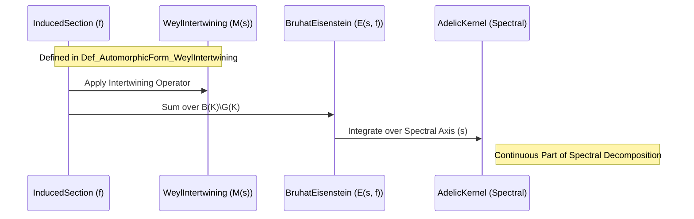

<!-- source: DeepWiki mcp.deepwiki.com · repo anthropics/fermats-last-theorem · page 6.3 Spectral Side: Eisenstein Series and Whittaker Coefficients · fetched 2026-10-26 -->

# Spectral Side: Eisenstein Series and Whittaker Coefficients

<details>
<summary>Relevant source files</summary>

The following files were used as context for generating this wiki page:

- [Definitions/Def_AutomorphicForm_IwasawaShellIndex.lean](Definitions/Def_AutomorphicForm_IwasawaShellIndex.lean)
- [Definitions/Def_NumberField_AdelicHeight.lean](Definitions/Def_NumberField_AdelicHeight.lean)
- [P2M/Sol/S_AutomorphicForm_ComplexIwasawa_contDiff_and_exists_forall_bound_iteratedFDeriv_cpow_neg_radC_of_isCompact.lean](P2M/Sol/S_AutomorphicForm_ComplexIwasawa_contDiff_and_exists_forall_bound_iteratedFDeriv_cpow_neg_radC_of_isCompact.lean)
- [P2M/Sol/S_AutomorphicForm_ComplexIwasawa_exists_forall_integrable_integral_rpow_neg_radC_le_of_isCompact.lean](P2M/Sol/S_AutomorphicForm_ComplexIwasawa_exists_forall_integrable_integral_rpow_neg_radC_le_of_isCompact.lean)
- [P2M/Sol/S_AutomorphicForm_CuspidalConstituent_exists_forall_norm_foldr_archDerivAtComplex_le_of_mem_cut.lean](P2M/Sol/S_AutomorphicForm_CuspidalConstituent_exists_forall_norm_foldr_archDerivAtComplex_le_of_mem_cut.lean)
- [P2M/Sol/S_AutomorphicForm_CuspidalConstituent_exists_forall_norm_foldr_archDerivAt_le_of_mem_cut.lean](P2M/Sol/S_AutomorphicForm_CuspidalConstituent_exists_forall_norm_foldr_archDerivAt_le_of_mem_cut.lean)
- [P2M/Sol/S_AutomorphicForm_RankinSelberg_exists_hasProd_quotientIntegral_eq_sPartIntegral_mul_of_shell_recursion.lean](P2M/Sol/S_AutomorphicForm_RankinSelberg_exists_hasProd_quotientIntegral_eq_sPartIntegral_mul_of_shell_recursion.lean)
- [P2M/Sol/S_AutomorphicForm_RankinSelberg_lintegral_sPart_quotientIntegrand_eq_mul_lintegral_torus_and_sPartIntegral_eq.lean](P2M/Sol/S_AutomorphicForm_RankinSelberg_lintegral_sPart_quotientIntegrand_eq_mul_lintegral_torus_and_sPartIntegral_eq.lean)
- [P2M/Sol/S_AutomorphicForm_WindowedSiegel_exists_forall_apply_one_zero_eq_zero_of_inv_mul_globalPoints_mul_mem.lean](P2M/Sol/S_AutomorphicForm_WindowedSiegel_exists_forall_apply_one_zero_eq_zero_of_inv_mul_globalPoints_mul_mem.lean)
- [P2M/Sol/S_AutomorphicForm_WindowedSiegel_exists_forall_apply_one_zero_eq_zero_of_inv_mul_globalPoints_mul_mul_centralScalar_mem.lean](P2M/Sol/S_AutomorphicForm_WindowedSiegel_exists_forall_apply_one_zero_eq_zero_of_inv_mul_globalPoints_mul_mul_centralScalar_mem.lean)
- [P2M/Sol/S_AutomorphicForm_ae_eq_of_residualProjection_of_residualProjection_canonicalTruncationDomain.lean](P2M/Sol/S_AutomorphicForm_ae_eq_of_residualProjection_of_residualProjection_canonicalTruncationDomain.lean)
- [P2M/Sol/S_AutomorphicForm_ae_eq_zero_cuspidalPart_of_forall_isSlabProfile_setIntegral_pseudoEisenstein_mul_conj_eq_zero.lean](P2M/Sol/S_AutomorphicForm_ae_eq_zero_cuspidalPart_of_forall_isSlabProfile_setIntegral_pseudoEisenstein_mul_conj_eq_zero.lean)
- [P2M/Sol/S_AutomorphicForm_analyticOnNhd_and_continuousOn_weylIntertwiningIntegral_family_of_re_gt_half.lean](P2M/Sol/S_AutomorphicForm_analyticOnNhd_and_continuousOn_weylIntertwiningIntegral_family_of_re_gt_half.lean)
- [P2M/Sol/S_AutomorphicForm_analyticOnNhd_setIntegral_axis_continuation_mul_conj_cuspBasis.lean](P2M/Sol/S_AutomorphicForm_analyticOnNhd_setIntegral_axis_continuation_mul_conj_cuspBasis.lean)
- [P2M/Sol/S_AutomorphicForm_axis_continuation_eq_sum_inner_weylIntertwining_mul_axis_continuation_of_swap_normPowChar.lean](P2M/Sol/S_AutomorphicForm_axis_continuation_eq_sum_inner_weylIntertwining_mul_axis_continuation_of_swap_normPowChar.lean)
- [P2M/Sol/S_AutomorphicForm_axis_pairing_add_inv_vol_axis_pairing_weylIntertwining_eq_sum_conj_matrixCoeff_mul_inner_mul_conj_of_paleyWiener_matched.lean](P2M/Sol/S_AutomorphicForm_axis_pairing_add_inv_vol_axis_pairing_weylIntertwining_eq_sum_conj_matrixCoeff_mul_inner_mul_conj_of_paleyWiener_matched.lean)
- [P2M/Sol/S_AutomorphicForm_conj_sum_integral_axis_pairing_add_eq_mul_tsum_integral_sum_rightConv_mul_thetaPairing_of_matched_paleyWiener.lean](P2M/Sol/S_AutomorphicForm_conj_sum_integral_axis_pairing_add_eq_mul_tsum_integral_sum_rightConv_mul_thetaPairing_of_matched_paleyWiener.lean)
- [P2M/Sol/S_AutomorphicForm_continuous_and_continuous_pseudoEisenstein_of_paleyWiener_slabProfile.lean](P2M/Sol/S_AutomorphicForm_continuous_and_continuous_pseudoEisenstein_of_paleyWiener_slabProfile.lean)
- [P2M/Sol/S_AutomorphicForm_continuous_and_hasDerivAt_axis_continuation_weylIntertwiningIntegral_pairings_of_flat.lean](P2M/Sol/S_AutomorphicForm_continuous_and_hasDerivAt_axis_continuation_weylIntertwiningIntegral_pairings_of_flat.lean)
- [P2M/Sol/S_AutomorphicForm_continuous_and_integrable_and_memLp_two_integral_mul_conj_flat_section_of_matched_paleyWiener.lean](P2M/Sol/S_AutomorphicForm_continuous_and_integrable_and_memLp_two_integral_mul_conj_flat_section_of_matched_paleyWiener.lean)
- [P2M/Sol/S_AutomorphicForm_continuous_and_isLsXiFunction_and_isKfSmooth_and_principalLevel_and_mem_archCutSubmodule_sum_integral_sum_inner_mul_axis_continuation_of_matched_paleyWiener.lean](P2M/Sol/S_AutomorphicForm_continuous_and_isLsXiFunction_and_isKfSmooth_and_principalLevel_and_mem_archCutSubmodule_sum_integral_sum_inner_mul_axis_continuation_of_matched_paleyWiener.lean)
- [P2M/Sol/S_AutomorphicForm_continuous_and_isLsXiFunction_and_principalLevel_sum_integral_sum_inner_mul_axis_continuation_of_matched_paleyWiener.lean](P2M/Sol/S_AutomorphicForm_continuous_and_isLsXiFunction_and_principalLevel_sum_integral_sum_inner_mul_axis_continuation_of_matched_paleyWiener.lean)
- [P2M/Sol/S_AutomorphicForm_continuous_of_isInducedSection_of_continuous_of_apply_ne_zero.lean](P2M/Sol/S_AutomorphicForm_continuous_of_isInducedSection_of_continuous_of_apply_ne_zero.lean)
- [P2M/Sol/S_AutomorphicForm_continuous_setIntegral_finsum_integral_indicator_mul_conj_axis_continuation_and_exists_norm_le_mul_one_add_abs_pow.lean](P2M/Sol/S_AutomorphicForm_continuous_setIntegral_finsum_integral_indicator_mul_conj_axis_continuation_and_exists_norm_le_mul_one_add_abs_pow.lean)
- [P2M/Sol/S_AutomorphicForm_continuous_setIntegral_mul_conj_axis_continuation_and_exists_norm_le_mul_one_add_abs_pow_of_isAutomorphicFnAt_of_lt_adelicHeight.lean](P2M/Sol/S_AutomorphicForm_continuous_setIntegral_mul_conj_axis_continuation_and_exists_norm_le_mul_one_add_abs_pow_of_isAutomorphicFnAt_of_lt_adelicHeight.lean)
- [P2M/Sol/S_AutomorphicForm_convOp_axis_continuation_weylIntertwiningIntegral_eq_sum_integral_rightConv_mul_conj_mul_axis_continuation_weylIntertwiningIntegral.lean](P2M/Sol/S_AutomorphicForm_convOp_axis_continuation_weylIntertwiningIntegral_eq_sum_integral_rightConv_mul_conj_mul_axis_continuation_weylIntertwiningIntegral.lean)
- [P2M/Sol/S_AutomorphicForm_convOp_axis_continuation_weylIntertwiningIntegral_eq_sum_mul_axis_continuation_weylIntertwiningIntegral_light.lean](P2M/Sol/S_AutomorphicForm_convOp_axis_continuation_weylIntertwiningIntegral_eq_sum_mul_axis_continuation_weylIntertwiningIntegral_light.lean)
- [P2M/Sol/S_AutomorphicForm_convOp_principalLevel_invariant_and_mem_archCutSubmodule_and_isArchKFinite_of_isAutomorphicFnAt.lean](P2M/Sol/S_AutomorphicForm_convOp_principalLevel_invariant_and_mem_archCutSubmodule_and_isArchKFinite_of_isAutomorphicFnAt.lean)
- [P2M/Sol/S_AutomorphicForm_convOp_residualProjection_of_residualProjection.lean](P2M/Sol/S_AutomorphicForm_convOp_residualProjection_of_residualProjection.lean)
- [P2M/Sol/S_AutomorphicForm_differentiable_inner_and_decay_and_eq_sum_inner_mul_flat_orthonormal_of_matched_paleyWiener.lean](P2M/Sol/S_AutomorphicForm_differentiable_inner_and_decay_and_eq_sum_inner_mul_flat_orthonormal_of_matched_paleyWiener.lean)
- [P2M/Sol/S_AutomorphicForm_eLpNorm_residualProjection_le_eLpNorm_sub_of_forall_setIntegral_mul_conj_eq_zero.lean](P2M/Sol/S_AutomorphicForm_eLpNorm_residualProjection_le_eLpNorm_sub_of_forall_setIntegral_mul_conj_eq_zero.lean)
- [P2M/Sol/S_AutomorphicForm_etaFst_etaSnd_mul_normPowChar_eq_shift.lean](P2M/Sol/S_AutomorphicForm_etaFst_etaSnd_mul_normPowChar_eq_shift.lean)
- [P2M/Sol/S_AutomorphicForm_exists_analyticOnNhd_sub_mul_weylIntertwiningIntegral_isInducedSection_of_ne_of_isArchKFinite_family.lean](P2M/Sol/S_AutomorphicForm_exists_analyticOnNhd_sub_mul_weylIntertwiningIntegral_isInducedSection_of_ne_of_isArchKFinite_family.lean)
- [P2M/Sol/S_AutomorphicForm_exists_analyticOnNhd_sub_one_half_mul_weylIntertwiningIntegral_isInducedSection_of_isArchKFinite_family.lean](P2M/Sol/S_AutomorphicForm_exists_analyticOnNhd_sub_one_half_mul_weylIntertwiningIntegral_isInducedSection_of_isArchKFinite_family.lean)
- [P2M/Sol/S_AutomorphicForm_exists_atomic_forall_tendsto_setIntegral_lambdaT_finsum_sub_lambdaT_tsum_sub_lambdaT_finsum_chiDet_sub_mul.lean](P2M/Sol/S_AutomorphicForm_exists_atomic_forall_tendsto_setIntegral_lambdaT_finsum_sub_lambdaT_tsum_sub_lambdaT_finsum_chiDet_sub_mul.lean)
- [P2M/Sol/S_AutomorphicForm_exists_bound_card_and_archParam_weight_and_summable_of_orthonormal_flat_isInducedSection_family.lean](P2M/Sol/S_AutomorphicForm_exists_bound_card_and_archParam_weight_and_summable_of_orthonormal_flat_isInducedSection_family.lean)
- [P2M/Sol/S_AutomorphicForm_exists_bound_card_and_archParam_weight_and_summable_of_orthonormal_flat_isInducedSection_family_ed2.lean](P2M/Sol/S_AutomorphicForm_exists_bound_card_and_archParam_weight_and_summable_of_orthonormal_flat_isInducedSection_family_ed2.lean)
- [P2M/Sol/S_AutomorphicForm_exists_common_matched_paleyWiener_family_eq_sum_integral_and_sections_eq_of_matched_paleyWiener_of_matched_paleyWiener_light.lean](P2M/Sol/S_AutomorphicForm_exists_common_matched_paleyWiener_family_eq_sum_integral_and_sections_eq_of_matched_paleyWiener_of_matched_paleyWiener_light.lean)
- [P2M/Sol/S_AutomorphicForm_exists_common_matched_paleyWiener_family_eq_sum_integral_of_matched_paleyWiener_of_matched_paleyWiener.lean](P2M/Sol/S_AutomorphicForm_exists_common_matched_paleyWiener_family_eq_sum_integral_of_matched_paleyWiener_of_matched_paleyWiener.lean)
- [P2M/Sol/S_AutomorphicForm_exists_entire_whittakerCoefficient_diagOne_continuation_of_flat_family_of_unitary.lean](P2M/Sol/S_AutomorphicForm_exists_entire_whittakerCoefficient_diagOne_continuation_of_flat_family_of_unitary.lean)
- [P2M/Sol/S_AutomorphicForm_exists_finite_forall_isUnramifiedCharAt_and_localChar_eq_of_isInducedSection_etaFst_etaSnd_of_ne_zero_of_principalLevel.lean](P2M/Sol/S_AutomorphicForm_exists_finite_forall_isUnramifiedCharAt_and_localChar_eq_of_isInducedSection_etaFst_etaSnd_of_ne_zero_of_principalLevel.lean)
- [P2M/Sol/S_AutomorphicForm_exists_forall_ae_prod_restrict_canonicalTruncationDomain_finsum_integral_centralScalar_sub_tsum_convOp_sub_finsum_chiDet_eq_mul_tsum_integral_sum_rightConv_axis_continuation.lean](P2M/Sol/S_AutomorphicForm_exists_forall_ae_prod_restrict_canonicalTruncationDomain_finsum_integral_centralScalar_sub_tsum_convOp_sub_finsum_chiDet_eq_mul_tsum_integral_sum_rightConv_axis_continuation.lean)
- [P2M/Sol/S_AutomorphicForm_exists_forall_dominated_sum_rightConv_axis_continuation_and_integrable_prod_lambdaT.lean](P2M/Sol/S_AutomorphicForm_exists_forall_dominated_sum_rightConv_axis_continuation_and_integrable_prod_lambdaT.lean)
- [P2M/Sol/S_AutomorphicForm_exists_forall_dominated_sum_rightConv_axis_continuation_of_isCompact.lean](P2M/Sol/S_AutomorphicForm_exists_forall_dominated_sum_rightConv_axis_continuation_of_isCompact.lean)
- [P2M/Sol/S_AutomorphicForm_exists_forall_exists_whittakerCoefficient_diagOne_eq_eulerProduct_mul_entire_norm_le_mul_pow_archParam_weight_dilation_of_flat.lean](P2M/Sol/S_AutomorphicForm_exists_forall_exists_whittakerCoefficient_diagOne_eq_eulerProduct_mul_entire_norm_le_mul_pow_archParam_weight_dilation_of_flat.lean)
- [P2M/Sol/S_AutomorphicForm_exists_forall_finsum_integral_centralScalar_sub_tsum_convOp_sub_finsum_chiDet_eq_mul_integral_sum_rightConv_axis_continuation.lean](P2M/Sol/S_AutomorphicForm_exists_forall_finsum_integral_centralScalar_sub_tsum_convOp_sub_finsum_chiDet_eq_mul_integral_sum_rightConv_axis_continuation.lean)
- [P2M/Sol/S_AutomorphicForm_exists_forall_integrableOn_and_setIntegral_lambdaT_axis_continuation_mul_conj_eq_maassSelberg_or_twoTerm_or_cross_or_zero_two_pairs_canonicalTruncationDomain_of_flat.lean](P2M/Sol/S_AutomorphicForm_exists_forall_integrableOn_and_setIntegral_lambdaT_axis_continuation_mul_conj_eq_maassSelberg_or_twoTerm_or_cross_or_zero_two_pairs_canonicalTruncationDomain_of_flat.lean)
- [P2M/Sol/S_AutomorphicForm_exists_forall_integrableOn_and_setIntegral_lambdaT_axis_continuation_mul_conj_eq_maassSelberg_or_twoTerm_or_cross_or_zero_two_pairs_slab_of_flat.lean](P2M/Sol/S_AutomorphicForm_exists_forall_integrableOn_and_setIntegral_lambdaT_axis_continuation_mul_conj_eq_maassSelberg_or_twoTerm_or_cross_or_zero_two_pairs_slab_of_flat.lean)
- [P2M/Sol/S_AutomorphicForm_exists_forall_integrableOn_and_setIntegral_lambdaT_axis_continuation_mul_conj_eq_maassSelberg_or_twoTerm_slab_of_flat.lean](P2M/Sol/S_AutomorphicForm_exists_forall_integrableOn_and_setIntegral_lambdaT_axis_continuation_mul_conj_eq_maassSelberg_or_twoTerm_slab_of_flat.lean)
- [P2M/Sol/S_AutomorphicForm_exists_forall_integrableOn_indicator_mul_setIntegral_finsum_borel_sigmaConjClassOrbit_sub_setIntegral_constantTerm_and_setIntegral_eq_zero.lean](P2M/Sol/S_AutomorphicForm_exists_forall_integrableOn_indicator_mul_setIntegral_finsum_borel_sigmaConjClassOrbit_sub_setIntegral_constantTerm_and_setIntegral_eq_zero.lean)
- [P2M/Sol/S_AutomorphicForm_exists_forall_integrable_sum_rightConv_axis_continuation_mul_conj_lambdaT_prod_restrict_canonicalTruncationDomain.lean](P2M/Sol/S_AutomorphicForm_exists_forall_integrable_sum_rightConv_axis_continuation_mul_conj_lambdaT_prod_restrict_canonicalTruncationDomain.lean)
- [P2M/Sol/S_AutomorphicForm_exists_forall_integral_iwasawa_cuspKernel_sub_cuspTruncation_eq_sum_mul_setIntegral_rankOne_of_sigmaInvariant_unram_ed2.lean](P2M/Sol/S_AutomorphicForm_exists_forall_integral_iwasawa_cuspKernel_sub_cuspTruncation_eq_sum_mul_setIntegral_rankOne_of_sigmaInvariant_unram_ed2.lean)
- [P2M/Sol/S_AutomorphicForm_exists_forall_integral_rightConv_axis_mul_conj_eq_mul_iwasawa_integral_of_flat.lean](P2M/Sol/S_AutomorphicForm_exists_forall_integral_rightConv_axis_mul_conj_eq_mul_iwasawa_integral_of_flat.lean)
- [P2M/Sol/S_AutomorphicForm_exists_forall_inv_vol_mul_axis_continuation_weylIntertwining_eq_sum_and_exists_forall_eq_sum_of_paleyWiener_matched_swap.lean](P2M/Sol/S_AutomorphicForm_exists_forall_inv_vol_mul_axis_continuation_weylIntertwining_eq_sum_and_exists_forall_eq_sum_of_paleyWiener_matched_swap.lean)
- [P2M/Sol/S_AutomorphicForm_exists_forall_isSlabProfile_eLpNorm_sub_restrict_rationalTorusUnipotentQuotient_le_mul_eLpNorm_sub_diagOne_mul.lean](P2M/Sol/S_AutomorphicForm_exists_forall_isSlabProfile_eLpNorm_sub_restrict_rationalTorusUnipotentQuotient_le_mul_eLpNorm_sub_diagOne_mul.lean)
- [P2M/Sol/S_AutomorphicForm_exists_forall_le_lambdaT_adelicKernel_eq_centralElliptic_add_unipotentCell_add_hyperbolicCell.lean](P2M/Sol/S_AutomorphicForm_exists_forall_le_lambdaT_adelicKernel_eq_centralElliptic_add_unipotentCell_add_hyperbolicCell.lean)
- [P2M/Sol/S_AutomorphicForm_exists_forall_lintegral_norm_deriv_axis_continuation_weylIntertwiningIntegral_le_mul_pow_archParam_weight.lean](P2M/Sol/S_AutomorphicForm_exists_forall_lintegral_norm_deriv_axis_continuation_weylIntertwiningIntegral_le_mul_pow_archParam_weight.lean)
- [P2M/Sol/S_AutomorphicForm_exists_forall_lintegral_norm_sq_normalizedIntertwining_axis_le_of_completedL_mul_weylIntertwiningIntegral_eq_of_flat.lean](P2M/Sol/S_AutomorphicForm_exists_forall_lintegral_norm_sq_normalizedIntertwining_axis_le_of_completedL_mul_weylIntertwiningIntegral_eq_of_flat.lean)
- [P2M/Sol/S_AutomorphicForm_exists_forall_memLp_two_and_summable_and_tsum_integral_sum_normSq_setIntegral_finsum_integral_indicator_mul_conj_axis_continuation_le_mul_setIntegral_normSq.lean](P2M/Sol/S_AutomorphicForm_exists_forall_memLp_two_and_summable_and_tsum_integral_sum_normSq_setIntegral_finsum_integral_indicator_mul_conj_axis_continuation_le_mul_setIntegral_normSq.lean)
- [P2M/Sol/S_AutomorphicForm_exists_forall_memLp_two_indicator_highSet_sum_integral_sum_inner_mul_add_inv_vol_mul_axis_continuation_weylIntertwining_of_matched_paleyWiener.lean](P2M/Sol/S_AutomorphicForm_exists_forall_memLp_two_indicator_highSet_sum_integral_sum_inner_mul_add_inv_vol_mul_axis_continuation_weylIntertwining_of_matched_paleyWiener.lean)
- [P2M/Sol/S_AutomorphicForm_exists_forall_memLp_two_lambdaT_sum_integral_sum_inner_mul_axis_continuation_restrict_canonicalTruncationDomain_of_matched_paleyWiener.lean](P2M/Sol/S_AutomorphicForm_exists_forall_memLp_two_lambdaT_sum_integral_sum_inner_mul_axis_continuation_restrict_canonicalTruncationDomain_of_matched_paleyWiener.lean)
- [P2M/Sol/S_AutomorphicForm_exists_forall_norm_iwasawa_integral_axis_add_norm_deriv_le_mul_rpow_neg_archParam_of_isUnitFactorization.lean](P2M/Sol/S_AutomorphicForm_exists_forall_norm_iwasawa_integral_axis_add_norm_deriv_le_mul_rpow_neg_archParam_of_isUnitFactorization.lean)
- [P2M/Sol/S_AutomorphicForm_exists_forall_pseudoEisenstein_sub_residualProj_ae_eq_mul_sum_integral_sum_inner_mul_axis_continuation_of_matched_paleyWiener.lean](P2M/Sol/S_AutomorphicForm_exists_forall_pseudoEisenstein_sub_residualProj_ae_eq_mul_sum_integral_sum_inner_mul_axis_continuation_of_matched_paleyWiener.lean)
- [P2M/Sol/S_AutomorphicForm_exists_forall_setIntegral_convOp_continuousProjection_eq_mul_setIntegral_prod_tsum_integral_sum_rightConv_axis_continuation.lean](P2M/Sol/S_AutomorphicForm_exists_forall_setIntegral_convOp_continuousProjection_eq_mul_setIntegral_prod_tsum_integral_sum_rightConv_axis_continuation.lean)
- [P2M/Sol/S_AutomorphicForm_exists_forall_setIntegral_convOp_continuousProjection_mul_conj_continuousProjection_eq_mul_tsum_integral_sum_rightConv_mul_setIntegral_mul_conj_axis_continuation.lean](P2M/Sol/S_AutomorphicForm_exists_forall_setIntegral_convOp_continuousProjection_mul_conj_continuousProjection_eq_mul_tsum_integral_sum_rightConv_mul_setIntegral_mul_conj_axis_continuation.lean)
- [P2M/Sol/S_AutomorphicForm_exists_forall_setIntegral_convOp_continuousProjection_pseudoEisenstein_mul_conj_eq_mul_tsum_integral_sum_rightConv_axis_pairing_of_matched_paleyWiener.lean](P2M/Sol/S_AutomorphicForm_exists_forall_setIntegral_convOp_continuousProjection_pseudoEisenstein_mul_conj_eq_mul_tsum_integral_sum_rightConv_axis_pairing_of_matched_paleyWiener.lean)
- [P2M/Sol/S_AutomorphicForm_exists_forall_setIntegral_inv_ideleNorm_smul_integral_maximalCompact_mul_conj_constantTerm_eq_of_matched_paleyWiener.lean](P2M/Sol/S_AutomorphicForm_exists_forall_setIntegral_inv_ideleNorm_smul_integral_maximalCompact_mul_conj_constantTerm_eq_of_matched_paleyWiener.lean)
- [P2M/Sol/S_AutomorphicForm_exists_forall_setIntegral_lambdaT_finsum_sub_lambdaT_tsum_sub_lambdaT_finsum_chiDet_eq_mul_integral_sum_rightConv_mul_setIntegral_lambdaT_axis_continuation.lean](P2M/Sol/S_AutomorphicForm_exists_forall_setIntegral_lambdaT_finsum_sub_lambdaT_tsum_sub_lambdaT_finsum_chiDet_eq_mul_integral_sum_rightConv_mul_setIntegral_lambdaT_axis_continuation.lean)
- [P2M/Sol/S_AutomorphicForm_exists_forall_setIntegral_lambdaT_finsum_sub_lambdaT_tsum_sub_lambdaT_finsum_chiDet_sigmaAdelicAct_symm_eq_mul_tsum_integral_sum_rightConv_mul_setIntegral_lambdaT_mul_conj_lambdaT_of_norm_eq_one.lean](P2M/Sol/S_AutomorphicForm_exists_forall_setIntegral_lambdaT_finsum_sub_lambdaT_tsum_sub_lambdaT_finsum_chiDet_sigmaAdelicAct_symm_eq_mul_tsum_integral_sum_rightConv_mul_setIntegral_lambdaT_mul_conj_lambdaT_of_norm_eq_one.lean)
- [P2M/Sol/S_AutomorphicForm_exists_forall_setIntegral_normSq_pseudoEisenstein_sub_residualProj_eq_mul_sum_integral_sum_normSq_inner_axis_of_matched_paleyWiener.lean](P2M/Sol/S_AutomorphicForm_exists_forall_setIntegral_normSq_pseudoEisenstein_sub_residualProj_eq_mul_sum_integral_sum_normSq_inner_axis_of_matched_paleyWiener.lean)
- [P2M/Sol/S_AutomorphicForm_exists_forall_setIntegral_norm_sq_lambdaT_axis_continuation_le_mul_pow_of_eq_or_exists_normOneIdeles_of_isArchCompAt_of_ne_bot.lean](P2M/Sol/S_AutomorphicForm_exists_forall_setIntegral_norm_sq_lambdaT_axis_continuation_le_mul_pow_of_eq_or_exists_normOneIdeles_of_isArchCompAt_of_ne_bot.lean)
- [P2M/Sol/S_AutomorphicForm_exists_forall_setIntegral_norm_sq_lambdaT_axis_continuation_le_of_flat_of_eLpNorm_deriv_le.lean](P2M/Sol/S_AutomorphicForm_exists_forall_setIntegral_norm_sq_lambdaT_axis_continuation_le_of_flat_of_eLpNorm_deriv_le.lean)
- [P2M/Sol/S_AutomorphicForm_exists_forall_setIntegral_prod_restrict_canonicalTruncationDomain_finsum_integral_centralScalar_sub_tsum_convOp_sub_finsum_chiDet_eq_mul_setIntegral_tsum_integral_sum_rightConv_axis_continuation.lean](P2M/Sol/S_AutomorphicForm_exists_forall_setIntegral_prod_restrict_canonicalTruncationDomain_finsum_integral_centralScalar_sub_tsum_convOp_sub_finsum_chiDet_eq_mul_setIntegral_tsum_integral_sum_rightConv_axis_continuation.lean)
- [P2M/Sol/S_AutomorphicForm_exists_forall_setIntegral_pseudoEisenstein_mul_conj_axis_continuation_eq_mul_integral_mul_conj_add_integral_mul_conj_weylIntertwining_of_matched_paleyWiener.lean](P2M/Sol/S_AutomorphicForm_exists_forall_setIntegral_pseudoEisenstein_mul_conj_axis_continuation_eq_mul_integral_mul_conj_add_integral_mul_conj_weylIntertwining_of_matched_paleyWiener.lean)
- [P2M/Sol/S_AutomorphicForm_exists_forall_setIntegral_pseudoEisenstein_mul_conj_sub_residualProj_sub_mul_sum_integral_sum_inner_mul_axis_continuation_eq_zero_of_matched_paleyWiener_of_cuspBasis.lean](P2M/Sol/S_AutomorphicForm_exists_forall_setIntegral_pseudoEisenstein_mul_conj_sub_residualProj_sub_mul_sum_integral_sum_inner_mul_axis_continuation_eq_zero_of_matched_paleyWiener_of_cuspBasis.lean)
- [P2M/Sol/S_AutomorphicForm_exists_forall_setLIntegral_tsum_borelSubgroup_cosets_eq_mul_lintegral_iwasawa.lean](P2M/Sol/S_AutomorphicForm_exists_forall_setLIntegral_tsum_borelSubgroup_cosets_eq_mul_lintegral_iwasawa.lean)
- [P2M/Sol/S_AutomorphicForm_exists_forall_tsum_integral_sum_axisPairing_mul_conj_axisPairing_pseudoEisenstein_eq_mul_setIntegral_mul_conj_sub_residualProj_of_matched_paleyWiener_of_lt_adelicHeight.lean](P2M/Sol/S_AutomorphicForm_exists_forall_tsum_integral_sum_axisPairing_mul_conj_axisPairing_pseudoEisenstein_eq_mul_setIntegral_mul_conj_sub_residualProj_of_matched_paleyWiener_of_lt_adelicHeight.lean)
- [P2M/Sol/S_AutomorphicForm_exists_lintegral_rationalCentreUnipotentQuotientMeasure_eq_mul_setLIntegral_iwasawa.lean](P2M/Sol/S_AutomorphicForm_exists_lintegral_rationalCentreUnipotentQuotientMeasure_eq_mul_setLIntegral_iwasawa.lean)
- [P2M/Sol/S_AutomorphicForm_exists_lintegral_rationalTorusUnipotentQuotientMeasure_eq_mul_setLIntegral_iwasawa.lean](P2M/Sol/S_AutomorphicForm_exists_lintegral_rationalTorusUnipotentQuotientMeasure_eq_mul_setLIntegral_iwasawa.lean)
- [P2M/Sol/S_AutomorphicForm_exists_matched_paleyWiener_forall_norm_setIntegral_sub_pseudoEisenstein_sub_mul_conj_le_of_orthogonal.lean](P2M/Sol/S_AutomorphicForm_exists_matched_paleyWiener_forall_norm_setIntegral_sub_pseudoEisenstein_sub_mul_conj_le_of_orthogonal.lean)
- [P2M/Sol/S_AutomorphicForm_exists_matched_paleyWiener_injective_and_inner_eq_integral_mul_cexp_and_sum_integral_sum_conj_inner_mul_eq_and_setIntegral_normSq_sub_residualProj_le_of_contDiff_hasCompactSupport.lean](P2M/Sol/S_AutomorphicForm_exists_matched_paleyWiener_injective_and_inner_eq_integral_mul_cexp_and_sum_integral_sum_conj_inner_mul_eq_and_setIntegral_normSq_sub_residualProj_le_of_contDiff_hasCompactSupport.lean)
- [P2M/Sol/S_AutomorphicForm_exists_matched_paleyWiener_pair_eq_and_threeWay_of_matched_paleyWiener_of_matched_paleyWiener.lean](P2M/Sol/S_AutomorphicForm_exists_matched_paleyWiener_pair_eq_and_threeWay_of_matched_paleyWiener_of_matched_paleyWiener.lean)
- [P2M/Sol/S_AutomorphicForm_exists_matched_paleyWiener_pair_forall_norm_setIntegral_sub_le_and_tsum_integral_sum_normSq_sub_setIntegral_axis_continuation_le.lean](P2M/Sol/S_AutomorphicForm_exists_matched_paleyWiener_pair_forall_norm_setIntegral_sub_le_and_tsum_integral_sum_normSq_sub_setIntegral_axis_continuation_le.lean)
- [P2M/Sol/S_AutomorphicForm_exists_matched_paleyWiener_sum_integral_sum_conj_inner_mul_eq_sum_integral_sum_conj_integral_mul_cexp_mul_and_setIntegral_normSq_sub_residualProj_le_of_contDiff_hasCompactSupport.lean](P2M/Sol/S_AutomorphicForm_exists_matched_paleyWiener_sum_integral_sum_conj_inner_mul_eq_sum_integral_sum_conj_integral_mul_cexp_mul_and_setIntegral_normSq_sub_residualProj_le_of_contDiff_hasCompactSupport.lean)
- [P2M/Sol/S_AutomorphicForm_exists_matched_paleyWiener_tsum_integral_sum_normSq_setIntegral_mul_conj_axis_continuation_sub_le.lean](P2M/Sol/S_AutomorphicForm_exists_matched_paleyWiener_tsum_integral_sum_normSq_setIntegral_mul_conj_axis_continuation_sub_le.lean)
- [P2M/Sol/S_AutomorphicForm_exists_matched_paleyWiener_tsum_integral_sum_normSq_sub_setIntegral_axis_continuation_le_of_symmetric.lean](P2M/Sol/S_AutomorphicForm_exists_matched_paleyWiener_tsum_integral_sum_normSq_sub_setIntegral_axis_continuation_le_of_symmetric.lean)
- [P2M/Sol/S_AutomorphicForm_exists_norm_le_mul_adelicHeight_rpow_of_isInducedSection.lean](P2M/Sol/S_AutomorphicForm_exists_norm_le_mul_adelicHeight_rpow_of_isInducedSection.lean)
- [P2M/Sol/S_AutomorphicForm_exists_partner_forall_partner_partner_eq_and_eq_mul_normPowChar_of_pairs_complete.lean](P2M/Sol/S_AutomorphicForm_exists_partner_forall_partner_partner_eq_and_eq_mul_normPowChar_of_pairs_complete.lean)
- [P2M/Sol/S_AutomorphicForm_exists_summable_dominant_rightConv_axis_family_maassSelberg_pairings_of_isUnitFactorization_sum_lipschitz.lean](P2M/Sol/S_AutomorphicForm_exists_summable_dominant_rightConv_axis_family_maassSelberg_pairings_of_isUnitFactorization_sum_lipschitz.lean)
- [P2M/Sol/S_AutomorphicForm_exists_summable_dominant_rightConv_axis_family_sigma_maassSelberg_pairings_of_isSemiLocalFactorization_lipschitz.lean](P2M/Sol/S_AutomorphicForm_exists_summable_dominant_rightConv_axis_family_sigma_maassSelberg_pairings_of_isSemiLocalFactorization_lipschitz.lean)
- [P2M/Sol/S_AutomorphicForm_exists_whittakerCoefficient_bruhatEisenstein_diagOne_eq_cpowChar_mul_sum_eulerProduct_of_factorizationDatum_one.lean](P2M/Sol/S_AutomorphicForm_exists_whittakerCoefficient_bruhatEisenstein_diagOne_eq_cpowChar_mul_sum_eulerProduct_of_factorizationDatum_one.lean)
- [P2M/Sol/S_AutomorphicForm_exists_whittakerCoefficient_diagOne_continuation_of_flat_family.lean](P2M/Sol/S_AutomorphicForm_exists_whittakerCoefficient_diagOne_continuation_of_flat_family.lean)
- [P2M/Sol/S_AutomorphicForm_exists_whittakerCoefficient_diagOne_continuation_of_flat_family_of_unitary.lean](P2M/Sol/S_AutomorphicForm_exists_whittakerCoefficient_diagOne_continuation_of_flat_family_of_unitary.lean)
- [P2M/Sol/S_AutomorphicForm_exists_whittakerCoefficient_diagOne_eq_eulerProduct_mul_entire_of_flat_family_of_unitary.lean](P2M/Sol/S_AutomorphicForm_exists_whittakerCoefficient_diagOne_eq_eulerProduct_mul_entire_of_flat_family_of_unitary.lean)
- [P2M/Sol/S_AutomorphicForm_flat_section_centralScalar_mul_diagOne_mul_eq_mul_ideleNorm_cpow_and_inv_vol_mul_axis_continuation_weylIntertwining_eq_and_rationalTorusUnipotent_mul_of_matched_paleyWiener.lean](P2M/Sol/S_AutomorphicForm_flat_section_centralScalar_mul_diagOne_mul_eq_mul_ideleNorm_cpow_and_inv_vol_mul_axis_continuation_weylIntertwining_eq_and_rationalTorusUnipotent_mul_of_matched_paleyWiener.lean)
- [P2M/Sol/S_AutomorphicForm_forall_axis_continuation_sub_sum_mul_axis_continuation_eq_zero_of_forall_constantTerm_eq_zero.lean](P2M/Sol/S_AutomorphicForm_forall_axis_continuation_sub_sum_mul_axis_continuation_eq_zero_of_forall_constantTerm_eq_zero.lean)
- [P2M/Sol/S_AutomorphicForm_forall_continuous_isArchSmoothAt_bounded_foldr_archDeriv_of_mem_isotypicCuspSubmodule_principal_of_archCasimir_eq_smul.lean](P2M/Sol/S_AutomorphicForm_forall_continuous_isArchSmoothAt_bounded_foldr_archDeriv_of_mem_isotypicCuspSubmodule_principal_of_archCasimir_eq_smul.lean)
- [P2M/Sol/S_AutomorphicForm_forall_exists_eLpNorm_axis_continuation_restrict_le_mul_pow_of_isCompact_of_ne_bot.lean](P2M/Sol/S_AutomorphicForm_forall_exists_eLpNorm_axis_continuation_restrict_le_mul_pow_of_isCompact_of_ne_bot.lean)
- [P2M/Sol/S_AutomorphicForm_forall_exists_forall_norm_le_mul_inv_adelicHeight_pow_of_mem_isotypicCuspSubmodule_principal_inf_archCutSubmodule.lean](P2M/Sol/S_AutomorphicForm_forall_exists_forall_norm_le_mul_inv_adelicHeight_pow_of_mem_isotypicCuspSubmodule_principal_inf_archCutSubmodule.lean)
- [P2M/Sol/S_AutomorphicForm_forall_exists_lambdaT_twistedAdelicKernel_eq_finsum_add_sub_indicator_constantTerm_add.lean](P2M/Sol/S_AutomorphicForm_forall_exists_lambdaT_twistedAdelicKernel_eq_finsum_add_sub_indicator_constantTerm_add.lean)
- [P2M/Sol/S_AutomorphicForm_forall_exists_setIntegral_finsum_unipotentCell_sub_indicator_constantTerm_eq_affine_unram.lean](P2M/Sol/S_AutomorphicForm_forall_exists_setIntegral_finsum_unipotentCell_sub_indicator_constantTerm_eq_affine_unram.lean)
- [P2M/Sol/S_AutomorphicForm_forall_exists_setIntegral_norm_sq_lambdaT_axis_continuation_le_mul_mul_pow_of_isArchCompAt_of_ne_bot.lean](P2M/Sol/S_AutomorphicForm_forall_exists_setIntegral_norm_sq_lambdaT_axis_continuation_le_mul_mul_pow_of_isArchCompAt_of_ne_bot.lean)
- [P2M/Sol/S_AutomorphicForm_forall_integrableOn_and_setIntegral_lambdaT_mul_tsum_convOp_mul_conj_eq_mul_tsum_cutTrace.lean](P2M/Sol/S_AutomorphicForm_forall_integrableOn_and_setIntegral_lambdaT_mul_tsum_convOp_mul_conj_eq_mul_tsum_cutTrace.lean)
- [P2M/Sol/S_AutomorphicForm_forall_integrableOn_and_setIntegral_lambdaT_tsum_convOp_mul_conj_sigmaAdelicAct_symm_eq_tsum_finsum_setIntegral_of_orthonormal_principalLevel_of_isFundamentalDomain_slab.lean](P2M/Sol/S_AutomorphicForm_forall_integrableOn_and_setIntegral_lambdaT_tsum_convOp_mul_conj_sigmaAdelicAct_symm_eq_tsum_finsum_setIntegral_of_orthonormal_principalLevel_of_isFundamentalDomain_slab.lean)
- [P2M/Sol/S_AutomorphicForm_forall_integrableOn_and_setIntegral_lambdaT_tsum_finsum_twistedConvOp_mul_conj_eq_tsum_finsum_setIntegral_of_orthonormal_of_isFundamentalDomain_slab.lean](P2M/Sol/S_AutomorphicForm_forall_integrableOn_and_setIntegral_lambdaT_tsum_finsum_twistedConvOp_mul_conj_eq_tsum_finsum_setIntegral_of_orthonormal_of_isFundamentalDomain_slab.lean)
- [P2M/Sol/S_AutomorphicForm_forall_integrableOn_finsum_unipotentCell_sub_indicator_constantTerm_fold_unram.lean](P2M/Sol/S_AutomorphicForm_forall_integrableOn_finsum_unipotentCell_sub_indicator_constantTerm_fold_unram.lean)
- [P2M/Sol/S_AutomorphicForm_forall_isCompact_exists_forall_norm_axis_continuation_le_mul_adelicHeight_rpow_of_mem_canonicalTruncationDomain.lean](P2M/Sol/S_AutomorphicForm_forall_isCompact_exists_forall_norm_axis_continuation_le_mul_adelicHeight_rpow_of_mem_canonicalTruncationDomain.lean)
- [P2M/Sol/S_AutomorphicForm_forall_isSlabProfile_setIntegral_pseudoEisenstein_mul_conj_eq_zero_of_forall_matched_paleyWiener_setIntegral_pseudoEisenstein_mul_conj_eq_zero.lean](P2M/Sol/S_AutomorphicForm_forall_isSlabProfile_setIntegral_pseudoEisenstein_mul_conj_eq_zero_of_forall_matched_paleyWiener_setIntegral_pseudoEisenstein_mul_conj_eq_zero.lean)
- [P2M/Sol/S_AutomorphicForm_forall_matched_paleyWiener_setIntegral_pseudoEisenstein_mul_conj_eq_zero_of_forall_sum_extension_setIntegral_pseudoEisenstein_mul_conj_eq_zero.lean](P2M/Sol/S_AutomorphicForm_forall_matched_paleyWiener_setIntegral_pseudoEisenstein_mul_conj_eq_zero_of_forall_sum_extension_setIntegral_pseudoEisenstein_mul_conj_eq_zero.lean)
- [P2M/Sol/S_AutomorphicForm_forall_mem_cuspClasses_exists_forall_isArchSmoothAt_and_archCasimirAt_eq_smul_of_mem_isotypicCuspSubmodule_principal_inf_archCutSubmodule.lean](P2M/Sol/S_AutomorphicForm_forall_mem_cuspClasses_exists_forall_isArchSmoothAt_and_archCasimirAt_eq_smul_of_mem_isotypicCuspSubmodule_principal_inf_archCutSubmodule.lean)
- [P2M/Sol/S_AutomorphicForm_forall_setIntegral_convOp_continuousProjection_mul_conj_eq_mul_tsum_integral_sum_rightConv_axis_pairing_of_forall_paleyWiener.lean](P2M/Sol/S_AutomorphicForm_forall_setIntegral_convOp_continuousProjection_mul_conj_eq_mul_tsum_integral_sum_rightConv_axis_pairing_of_forall_paleyWiener.lean)
- [P2M/Sol/S_AutomorphicForm_hasSum_setIntegral_mul_conj_mul_setIntegral_convOp_of_orthonormal_isotypicCuspSubmodule.lean](P2M/Sol/S_AutomorphicForm_hasSum_setIntegral_mul_conj_mul_setIntegral_convOp_of_orthonormal_isotypicCuspSubmodule.lean)
- [P2M/Sol/S_AutomorphicForm_inner_weylIntertwining_eq_sum_inner_mul_conj_inner_of_matched_paleyWiener.lean](P2M/Sol/S_AutomorphicForm_inner_weylIntertwining_eq_sum_inner_mul_conj_inner_of_matched_paleyWiener.lean)
- [P2M/Sol/S_AutomorphicForm_integrableOn_and_setIntegral_rationalTorusUnipotentQuotient_slab_mul_conj_eq_mul_setIntegral_inv_ideleNorm_smul_integral_maximalCompact.lean](P2M/Sol/S_AutomorphicForm_integrableOn_and_setIntegral_rationalTorusUnipotentQuotient_slab_mul_conj_eq_mul_setIntegral_inv_ideleNorm_smul_integral_maximalCompact.lean)
- [P2M/Sol/S_AutomorphicForm_integrableOn_iUnion_centreCutSiegelSet_setIntegral_mul_finsum_borel_centralElliptic.lean](P2M/Sol/S_AutomorphicForm_integrableOn_iUnion_centreCutSiegelSet_setIntegral_mul_finsum_borel_centralElliptic.lean)
- [P2M/Sol/S_AutomorphicForm_integrableOn_setIntegral_mul_finsum_centralElliptic_twistedAdelicKernel.lean](P2M/Sol/S_AutomorphicForm_integrableOn_setIntegral_mul_finsum_centralElliptic_twistedAdelicKernel.lean)
- [P2M/Sol/S_AutomorphicForm_integrable_and_eq_axis_pairings_normalForm_weylIntertwining_of_paleyWiener_family.lean](P2M/Sol/S_AutomorphicForm_integrable_and_eq_axis_pairings_normalForm_weylIntertwining_of_paleyWiener_family.lean)
- [P2M/Sol/S_AutomorphicForm_integrable_and_summable_and_continuous_uncurry_tsum_integral_sum_rightConv_axis_continuation_mul_conj.lean](P2M/Sol/S_AutomorphicForm_integrable_and_summable_and_continuous_uncurry_tsum_integral_sum_rightConv_axis_continuation_mul_conj.lean)
- [P2M/Sol/S_AutomorphicForm_integrable_axis_pairing_convOp_add_inv_vol_axis_pairing_convOp_weylIntertwining_of_paleyWiener_matched.lean](P2M/Sol/S_AutomorphicForm_integrable_axis_pairing_convOp_add_inv_vol_axis_pairing_convOp_weylIntertwining_of_paleyWiener_matched.lean)
- [P2M/Sol/S_AutomorphicForm_integral_axis_continuation_weylIntertwiningIntegral_mul_conj_eq_integral_mul_conj_of_isUnitaryChar.lean](P2M/Sol/S_AutomorphicForm_integral_axis_continuation_weylIntertwiningIntegral_mul_conj_eq_integral_mul_conj_of_isUnitaryChar.lean)
- [P2M/Sol/S_AutomorphicForm_integral_maximalCompactHaar_rightConv_mul_conj_eq_integral_mul_conj_rightConv_star_of_isInducedSection_axis.lean](P2M/Sol/S_AutomorphicForm_integral_maximalCompactHaar_rightConv_mul_conj_eq_integral_mul_conj_rightConv_star_of_isInducedSection_axis.lean)
- [P2M/Sol/S_AutomorphicForm_integral_maximalCompact_mul_sum_integral_sum_inner_mul_axis_continuation_eq_self_of_levelTypeAverage_eq_self.lean](P2M/Sol/S_AutomorphicForm_integral_maximalCompact_mul_sum_integral_sum_inner_mul_axis_continuation_eq_self_of_levelTypeAverage_eq_self.lean)
- [P2M/Sol/S_AutomorphicForm_integral_mul_conj_axis_continuation_weylIntertwiningIntegral_eq_of_swap_pair_of_principalLevel_of_ne_bot.lean](P2M/Sol/S_AutomorphicForm_integral_mul_conj_axis_continuation_weylIntertwiningIntegral_eq_of_swap_pair_of_principalLevel_of_ne_bot.lean)
- [P2M/Sol/S_AutomorphicForm_integral_mul_conj_axis_continuation_weylIntertwiningIntegral_zero_eq_of_eq_of_flat.lean](P2M/Sol/S_AutomorphicForm_integral_mul_conj_axis_continuation_weylIntertwiningIntegral_zero_eq_of_eq_of_flat.lean)
- [P2M/Sol/S_AutomorphicForm_integral_mul_conj_eq_integral_axis_continuation_weylIntertwining_mul_conj_axis_continuation_weylIntertwining_of_paleyWiener_matched.lean](P2M/Sol/S_AutomorphicForm_integral_mul_conj_eq_integral_axis_continuation_weylIntertwining_mul_conj_axis_continuation_weylIntertwining_of_paleyWiener_matched.lean)
- [P2M/Sol/S_AutomorphicForm_integral_normSq_add_inv_vol_limUnder_weylIntertwining_eq_sum_normSq_inner_axis_of_orthonormal_span_principalLevel.lean](P2M/Sol/S_AutomorphicForm_integral_normSq_add_inv_vol_limUnder_weylIntertwining_eq_sum_normSq_inner_axis_of_orthonormal_span_principalLevel.lean)
- [P2M/Sol/S_AutomorphicForm_integral_rationalTorusUnipotentQuotient_section_mul_conj_eq_mul_setIntegral_iwasawa.lean](P2M/Sol/S_AutomorphicForm_integral_rationalTorusUnipotentQuotient_section_mul_conj_eq_mul_setIntegral_iwasawa.lean)
- [P2M/Sol/S_AutomorphicForm_integral_rationalTorusUnipotentQuotient_section_mul_conj_eq_mul_setIntegral_iwasawa_of_window.lean](P2M/Sol/S_AutomorphicForm_integral_rationalTorusUnipotentQuotient_section_mul_conj_eq_mul_setIntegral_iwasawa_of_window.lean)
- [P2M/Sol/S_AutomorphicForm_isInducedSection_and_continuous_and_isArchKFinite_axis_continuation_weylIntertwiningIntegral_of_forall_mem_principalLevel.lean](P2M/Sol/S_AutomorphicForm_isInducedSection_and_continuous_and_isArchKFinite_axis_continuation_weylIntertwiningIntegral_of_forall_mem_principalLevel.lean)
- [P2M/Sol/S_AutomorphicForm_isotypicCuspSubmodule_principal_inf_archCutSubmodule_le_iSup_isCuspConstituent.lean](P2M/Sol/S_AutomorphicForm_isotypicCuspSubmodule_principal_inf_archCutSubmodule_le_iSup_isCuspConstituent.lean)
- [P2M/Sol/S_AutomorphicForm_lambdaT_sum_integral_sum_inner_mul_axis_continuation_eq_sum_integral_sum_inner_mul_lambdaT_of_mem_canonicalTruncationDomain_of_matched_paleyWiener.lean](P2M/Sol/S_AutomorphicForm_lambdaT_sum_integral_sum_inner_mul_axis_continuation_eq_sum_integral_sum_inner_mul_lambdaT_of_mem_canonicalTruncationDomain_of_matched_paleyWiener.lean)
- [P2M/Sol/S_AutomorphicForm_levelTypeAverage_pseudoEisenstein_eq_pseudoEisenstein_levelTypeAverage_of_isSlabProfile.lean](P2M/Sol/S_AutomorphicForm_levelTypeAverage_pseudoEisenstein_eq_pseudoEisenstein_levelTypeAverage_of_isSlabProfile.lean)
- [P2M/Sol/S_AutomorphicForm_limUnder_nhdsNE_eq_convOp_axis_continuation_weylIntertwiningIntegral_of_meromorphicNFOn_of_eq_weylIntertwiningIntegral_convOp.lean](P2M/Sol/S_AutomorphicForm_limUnder_nhdsNE_eq_convOp_axis_continuation_weylIntertwiningIntegral_of_meromorphicNFOn_of_eq_weylIntertwiningIntegral_convOp.lean)
- [P2M/Sol/S_AutomorphicForm_lintegral_canonicalTruncationDomain_enorm_pseudoEisenstein_mul_enorm_truncatedSection_add_tsum_lt_top_of_re_lt_re.lean](P2M/Sol/S_AutomorphicForm_lintegral_canonicalTruncationDomain_enorm_pseudoEisenstein_mul_enorm_truncatedSection_add_tsum_lt_top_of_re_lt_re.lean)
- [P2M/Sol/S_AutomorphicForm_lintegral_maximalCompact_lintegral_Ioi_enorm_sq_integral_sum_inner_mul_cpow_mul_flat_section_add_inv_vol_mul_axis_continuation_weylIntertwining_mul_inv_lt_top_of_matched_paleyWiener.lean](P2M/Sol/S_AutomorphicForm_lintegral_maximalCompact_lintegral_Ioi_enorm_sq_integral_sum_inner_mul_cpow_mul_flat_section_add_inv_vol_mul_axis_continuation_weylIntertwining_mul_inv_lt_top_of_matched_paleyWiener.lean)
- [P2M/Sol/S_AutomorphicForm_memLp_two_and_summable_integral_sum_normSq_setIntegral_pseudoEisenstein_mul_conj_axis_continuation_of_matched_paleyWiener.lean](P2M/Sol/S_AutomorphicForm_memLp_two_and_summable_integral_sum_normSq_setIntegral_pseudoEisenstein_mul_conj_axis_continuation_of_matched_paleyWiener.lean)
- [P2M/Sol/S_AutomorphicForm_memLp_two_restrict_canonicalTruncationDomain_sum_integral_sum_inner_mul_axis_continuation_of_matched_paleyWiener.lean](P2M/Sol/S_AutomorphicForm_memLp_two_restrict_canonicalTruncationDomain_sum_integral_sum_inner_mul_axis_continuation_of_matched_paleyWiener.lean)
- [P2M/Sol/S_AutomorphicForm_norm_integral_weyl_unipotent_mul_addChar_le_polyDecay_of_unitary.lean](P2M/Sol/S_AutomorphicForm_norm_integral_weyl_unipotent_mul_addChar_le_polyDecay_of_unitary.lean)
- [P2M/Sol/S_AutomorphicForm_norm_tsum_integral_sum_rightConv_mul_mul_conj_sub_le_of_tsum_integral_sum_normSq_sub_le.lean](P2M/Sol/S_AutomorphicForm_norm_tsum_integral_sum_rightConv_mul_mul_conj_sub_le_of_tsum_integral_sum_normSq_sub_le.lean)
- [P2M/Sol/S_AutomorphicForm_paleyWiener_convOp_and_convOp_pseudoEisenstein_eq_pseudoEisenstein_convOp_of_isArchBiFinite.lean](P2M/Sol/S_AutomorphicForm_paleyWiener_convOp_and_convOp_pseudoEisenstein_eq_pseudoEisenstein_convOp_of_isArchBiFinite.lean)
- [P2M/Sol/S_AutomorphicForm_paleyWiener_levelTypeAverage_and_pseudoEisenstein_levelTypeAverage_eq_and_residualProjection_of_kernel_maximalCompact_detOne.lean](P2M/Sol/S_AutomorphicForm_paleyWiener_levelTypeAverage_and_pseudoEisenstein_levelTypeAverage_eq_and_residualProjection_of_kernel_maximalCompact_detOne.lean)
- [P2M/Sol/S_AutomorphicForm_peterssonIntegral_lambdaT_sub_eq_integral_constantTerm_mul_conj_constantTerm.lean](P2M/Sol/S_AutomorphicForm_peterssonIntegral_lambdaT_sub_eq_integral_constantTerm_mul_conj_constantTerm.lean)
- [P2M/Sol/S_AutomorphicForm_pseudoEisenstein_globalPoints_mul_eq_of_forall_mem_borelSubgroup_of_summable.lean](P2M/Sol/S_AutomorphicForm_pseudoEisenstein_globalPoints_mul_eq_of_forall_mem_borelSubgroup_of_summable.lean)
- [P2M/Sol/S_AutomorphicForm_residue_weylIntertwining_continuation_self_dual_eq_div_measure_slab_mul_maximalCompact_pairing_mul_det.lean](P2M/Sol/S_AutomorphicForm_residue_weylIntertwining_continuation_self_dual_eq_div_measure_slab_mul_maximalCompact_pairing_mul_det.lean)
- [P2M/Sol/S_AutomorphicForm_rightConv_eq_sum_integral_rightConv_mul_conj_mul_of_orthonormal_complete_flat_family.lean](P2M/Sol/S_AutomorphicForm_rightConv_eq_sum_integral_rightConv_mul_conj_mul_of_orthonormal_complete_flat_family.lean)
- [P2M/Sol/S_AutomorphicForm_rightConv_eq_sum_integral_rightConv_mul_conj_mul_of_orthonormal_complete_flat_family_light.lean](P2M/Sol/S_AutomorphicForm_rightConv_eq_sum_integral_rightConv_mul_conj_mul_of_orthonormal_complete_flat_family_light.lean)
- [P2M/Sol/S_AutomorphicForm_setIntegral_axis_continuation_mul_conj_cuspBasis_eq_zero_of_mem.lean](P2M/Sol/S_AutomorphicForm_setIntegral_axis_continuation_mul_conj_cuspBasis_eq_zero_of_mem.lean)
- [P2M/Sol/S_AutomorphicForm_setIntegral_axis_continuation_mul_conj_cuspBasis_eq_zero_of_re_gt_half.lean](P2M/Sol/S_AutomorphicForm_setIntegral_axis_continuation_mul_conj_cuspBasis_eq_zero_of_re_gt_half.lean)
- [P2M/Sol/S_AutomorphicForm_setIntegral_continuousPart_mul_conj_convOp_continuousPart_eq_sub_of_pseudoEisenstein_threeWay.lean](P2M/Sol/S_AutomorphicForm_setIntegral_continuousPart_mul_conj_convOp_continuousPart_eq_sub_of_pseudoEisenstein_threeWay.lean)
- [P2M/Sol/S_AutomorphicForm_setIntegral_convOp_continuousProjection_eq_inv_mul_setIntegral_convOp_mul_conj_continuousProjection.lean](P2M/Sol/S_AutomorphicForm_setIntegral_convOp_continuousProjection_eq_inv_mul_setIntegral_convOp_mul_conj_continuousProjection.lean)
- [P2M/Sol/S_AutomorphicForm_setIntegral_convOp_residualProjection_eq_mul_setIntegral_prod_finsum_chiDet_mul_chiDet_inv.lean](P2M/Sol/S_AutomorphicForm_setIntegral_convOp_residualProjection_eq_mul_setIntegral_prod_finsum_chiDet_mul_chiDet_inv.lean)
- [P2M/Sol/S_AutomorphicForm_setIntegral_mul_conj_axis_continuation_eq_sum_conj_inner_weylIntertwining_mul_setIntegral_of_swap_normPowChar.lean](P2M/Sol/S_AutomorphicForm_setIntegral_mul_conj_axis_continuation_eq_sum_conj_inner_weylIntertwining_mul_setIntegral_of_swap_normPowChar.lean)
- [P2M/Sol/S_AutomorphicForm_setIntegral_mul_conj_convOp_eq_setIntegral_convOp_conj_inv_mul_conj_of_isAutomorphicFnAt.lean](P2M/Sol/S_AutomorphicForm_setIntegral_mul_conj_convOp_eq_setIntegral_convOp_conj_inv_mul_conj_of_isAutomorphicFnAt.lean)
- [P2M/Sol/S_AutomorphicForm_setIntegral_mul_conj_eq_zero_of_forall_residualSpan_of_closure.lean](P2M/Sol/S_AutomorphicForm_setIntegral_mul_conj_eq_zero_of_forall_residualSpan_of_closure.lean)
- [P2M/Sol/S_AutomorphicForm_setIntegral_mul_conj_sum_integral_sum_inner_mul_axis_continuation_eq_sum_integral_sum_conj_inner_mul_setIntegral_of_isAutomorphicFnAt_of_lt_adelicHeight.lean](P2M/Sol/S_AutomorphicForm_setIntegral_mul_conj_sum_integral_sum_inner_mul_axis_continuation_eq_sum_integral_sum_conj_inner_mul_setIntegral_of_isAutomorphicFnAt_of_lt_adelicHeight.lean)
- [P2M/Sol/S_AutomorphicForm_setIntegral_mul_pseudoEisenstein_eq_integral_rationalTorusUnipotentQuotient_constantTerm_mul.lean](P2M/Sol/S_AutomorphicForm_setIntegral_mul_pseudoEisenstein_eq_integral_rationalTorusUnipotentQuotient_constantTerm_mul.lean)
- [P2M/Sol/S_AutomorphicForm_setIntegral_normSq_pseudoEisenstein_sub_residualProj_eq_mul_sum_integral_normSq_add_weylIntertwining_of_principalLevel_slab.lean](P2M/Sol/S_AutomorphicForm_setIntegral_normSq_pseudoEisenstein_sub_residualProj_eq_mul_sum_integral_normSq_add_weylIntertwining_of_principalLevel_slab.lean)
- [P2M/Sol/S_AutomorphicForm_setIntegral_prod_tsum_integral_sum_rightConv_axis_continuation_mul_conj_eq_tsum_integral_sum_mul_setIntegral_indicator_mul_conj.lean](P2M/Sol/S_AutomorphicForm_setIntegral_prod_tsum_integral_sum_rightConv_axis_continuation_mul_conj_eq_tsum_integral_sum_mul_setIntegral_indicator_mul_conj.lean)
- [P2M/Sol/S_AutomorphicForm_setIntegral_pseudoEisenstein_mul_conj_convOp_pseudoEisenstein_sub_eq_mul_sum_integral_axis_pairing_convOp_of_paleyWiener.lean](P2M/Sol/S_AutomorphicForm_setIntegral_pseudoEisenstein_mul_conj_convOp_pseudoEisenstein_sub_eq_mul_sum_integral_axis_pairing_convOp_of_paleyWiener.lean)
- [P2M/Sol/S_AutomorphicForm_setIntegral_sum_integral_sum_inner_mul_axis_continuation_mul_conj_cuspBasis_eq_zero_of_matched_paleyWiener.lean](P2M/Sol/S_AutomorphicForm_setIntegral_sum_integral_sum_inner_mul_axis_continuation_mul_conj_cuspBasis_eq_zero_of_matched_paleyWiener.lean)
- [P2M/Sol/S_AutomorphicForm_setLIntegral_rationalCentreUnipotentQuotientMeasure_shellZeroOutside_eq_mul_lintegral_sPartMeasure.lean](P2M/Sol/S_AutomorphicForm_setLIntegral_rationalCentreUnipotentQuotientMeasure_shellZeroOutside_eq_mul_lintegral_sPartMeasure.lean)
- [P2M/Sol/S_AutomorphicForm_setLIntegral_tsum_norm_bracket_mul_twistedOrbital_lt_top_and_integrableOn.lean](P2M/Sol/S_AutomorphicForm_setLIntegral_tsum_norm_bracket_mul_twistedOrbital_lt_top_and_integrableOn.lean)
- [P2M/Sol/S_AutomorphicForm_sum_conj_matrixCoeff_mul_axis_pairing_weylIntertwining_mul_conj_fullCoeff_eq_axis_pairing_swap_neg_of_paleyWiener_matched.lean](P2M/Sol/S_AutomorphicForm_sum_conj_matrixCoeff_mul_axis_pairing_weylIntertwining_mul_conj_fullCoeff_eq_axis_pairing_swap_neg_of_paleyWiener_matched.lean)
- [P2M/Sol/S_AutomorphicForm_sum_integral_axis_pairing_add_eq_half_mul_sum_integral_sum_conj_matrixCoeff_mul_fullCoeff_of_paleyWiener_matched.lean](P2M/Sol/S_AutomorphicForm_sum_integral_axis_pairing_add_eq_half_mul_sum_integral_sum_conj_matrixCoeff_mul_fullCoeff_of_paleyWiener_matched.lean)
- [P2M/Sol/S_AutomorphicForm_sum_integral_sum_conj_inner_weylIntertwining_mul_setIntegral_mul_conj_axis_continuation_eq_of_isAutomorphicFnAt_of_lt_adelicHeight.lean](P2M/Sol/S_AutomorphicForm_sum_integral_sum_conj_inner_weylIntertwining_mul_setIntegral_mul_conj_axis_continuation_eq_of_isAutomorphicFnAt_of_lt_adelicHeight.lean)
- [P2M/Sol/S_AutomorphicForm_sum_integral_sum_inner_mul_axis_continuation_sub_lambdaT_eq_indicator_highSet_sum_integral_sum_inner_mul_add_inv_vol_mul_weylIntertwining_of_matched_paleyWiener.lean](P2M/Sol/S_AutomorphicForm_sum_integral_sum_inner_mul_axis_continuation_sub_lambdaT_eq_indicator_highSet_sum_integral_sum_inner_mul_add_inv_vol_mul_weylIntertwining_of_matched_paleyWiener.lean)
- [P2M/Sol/S_AutomorphicForm_sum_norm_sq_sum_conj_inner_weylIntertwining_mul_le_sum_norm_sq_of_matched_paleyWiener.lean](P2M/Sol/S_AutomorphicForm_sum_norm_sq_sum_conj_inner_weylIntertwining_mul_le_sum_norm_sq_of_matched_paleyWiener.lean)
- [P2M/Sol/S_AutomorphicForm_weylIntertwiningIntegral_convOp_eq_convOp_weylIntertwiningIntegral_of_isInducedSection_of_re_gt_half.lean](P2M/Sol/S_AutomorphicForm_weylIntertwiningIntegral_convOp_eq_convOp_weylIntertwiningIntegral_of_isInducedSection_of_re_gt_half.lean)
- [P2M/Sol/S_AutomorphicForm_whittakerCoefficient_bruhatEisenstein_diagOne_eq_cpowChar_mul_sum_eulerProduct_of_flat_family.lean](P2M/Sol/S_AutomorphicForm_whittakerCoefficient_bruhatEisenstein_diagOne_eq_cpowChar_mul_sum_eulerProduct_of_flat_family.lean)
- [P2M/Sol/S_AutomorphicForm_whittakerCoefficient_bruhatEisenstein_diagOne_eq_cpowChar_mul_sum_eulerProduct_of_flat_family_of_unitary.lean](P2M/Sol/S_AutomorphicForm_whittakerCoefficient_bruhatEisenstein_diagOne_eq_cpowChar_mul_sum_eulerProduct_of_flat_family_of_unitary.lean)
- [P2M/Sol/S_EisensteinGeneral_Piece_exists_forall_exists_factorizationDatum_one_uniform_of_flat_principalLevel_archCutSubmodule.lean](P2M/Sol/S_EisensteinGeneral_Piece_exists_forall_exists_factorizationDatum_one_uniform_of_flat_principalLevel_archCutSubmodule.lean)
- [P2M/Sol/S_EisensteinGeneral_Piece_exists_forall_nonempty_factorizationDatum.lean](P2M/Sol/S_EisensteinGeneral_Piece_exists_forall_nonempty_factorizationDatum.lean)
- [P2M/Sol/S_IsDedekindDomain_HeightOneSpectrum_exists_seq_not_mem_injective_under_forall_exists_under_eq.lean](P2M/Sol/S_IsDedekindDomain_HeightOneSpectrum_exists_seq_not_mem_injective_under_forall_exists_under_eq.lean)
- [P2M/Sol/S_LanglandsTunnell_Converse_eq_zero_or_exists_continuous_torus_recursion_of_unipotent_invariant.lean](P2M/Sol/S_LanglandsTunnell_Converse_eq_zero_or_exists_continuous_torus_recursion_of_unipotent_invariant.lean)

</details>


The spectral decomposition of the adelic trace formula involves the contribution of the continuous spectrum, which is spanned by **Eisenstein series**. This page details the construction of pseudo-Eisenstein series, their analytic continuation, the Weyl intertwining operator, and the calculation of Whittaker coefficients via Euler products.

## Overview of Eisenstein Series Construction

The spectral side relies on sections of induced representations. Given two characters $\mu, \nu$ of the idele class group, an induced section $f(s, g)$ is constructed. The Bruhat-Eisenstein series is formed by summing these sections over the Borel subgroup quotient $B(K) \backslash G(K)$.

### Key Entities

| Entity | Description | Reference |
| :--- | :--- | :--- |
| `IsInducedSection` | Predicate for sections of the principal series representation. | [Definitions/Def_AutomorphicForm_InducedSection.lean:9]() |
| `WeylIntertwining` | The operator $M(s)$ mapping sections from $\text{Ind}(\mu, \nu)$ to $\text{Ind}(\nu, \nu)$. | [Definitions/Def_AutomorphicForm_WeylIntertwining.lean:11]() |
| `PseudoEisenstein` | Eisenstein series constructed from test functions with compact support in the spectral parameter. | [Definitions/Def_AutomorphicForm_AutomorphicFnAt.lean:23]() |
| `EtaFamily` | A family of characters $\eta_s$ used to define the spectral parameter $s$. | [Definitions/Def_AutomorphicForm_EtaFamily.lean:10]() |

## Paley-Wiener Matching Conditions

For the trace formula comparison, test functions must satisfy matching conditions across different groups or local fields. The `AreMatchingLocal` and `AreMatchingArch` predicates ensure that the spectral data (eigenvalues and Whittaker coefficients) are compatible.

```mermaid
graph TD
    subgraph "Matching Infrastructure"
    A["AreMatchingLocal"] --> B["Whittaker Coefficients"]
    A --> C["Local Zeta Integrals"]
    D["AreMatchingArch"] --> E["Paley-Wiener Space"]
    D --> F["Archimedean K-types"]
    end

    subgraph "Code Entities"
    B -- "Calculated by" --> G["whittakerCoefficient"]
    E -- "Satisfied by" --> H["IsArchKFinite"]
    end
    
    Sources: [Definitions/Def_AutomorphicForm_WhittakerCoefficient.lean:3](), [Definitions/Def_AutomorphicForm_ArchKFinite.lean:17]()
```

## Whittaker Coefficients and Euler Products

The Whittaker coefficients of an Eisenstein series $E(s, f, g)$ are given by integrals against a global additive character $\psi$. A fundamental result in the codebase is the decomposition of these coefficients into an Euler product of local Whittaker integrals.

### Euler Product Expansion
The theorem `whittakerCoefficient_bruhatEisenstein_diagOne_eq_cpowChar_mul_sum_eulerProduct` establishes that for a factorizable section, the global Whittaker coefficient is the product of local terms:
$$W(E(s, f)) = \prod_v W_v(f_v, s)$$

*   **Local Components**: The local Whittaker integrals are handled for both ramified ([Theorems/Thm_EisensteinGeneral_LocalRam_integral_twisted_smooth_eq.lean:37]()) and unramified ([Theorems/Thm_EisensteinGeneral_LocalUnr_integral_twisted_eq.lean:32]()) places.
*   **Global Convergence**: The product converges for $\text{Re}(s) > 1$ and admits an analytic continuation [Theorems/Thm_NumberField_summable_heightOneSpectrum_absNorm_rpow_neg_of_one_lt.lean:13]().

### Residual Projection
The `ResidualSpan` and `residualProj` handle the discrete part of the non-cuspidal spectrum, specifically the residues of Eisenstein series at $s=1$ (the constant functions).
*   The residue is computed in `S_AutomorphicForm_residue_weylIntertwining_continuation_self_dual_eq_div_measure_slab_mul_maximalCompact_pairing_mul_det` [P2M/Sol/S_AutomorphicForm_residue_weylIntertwining_continuation_self_dual_eq_div_measure_slab_mul_maximalCompact_pairing_mul_det.lean:1]().

## Data Flow: From Section to Trace

The following diagram illustrates how induced sections are transformed into spectral kernels used in the trace formula.


Sources: [Definitions/Def_AutomorphicForm_WeylIntertwining.lean:11](), [Theorems/Thm_EisensteinGeneral_Unfolding_whittakerCoefficient_bruhatSeries_eq_of_isInducedSection.lean:32](), [Definitions/Def_AutomorphicForm_AdelicKernel.lean:6]()

## Key Functions and Implementation Details

### Weyl Intertwining Operator
The operator is defined as an integral over the unipotent subgroup $N$:
`weylIntertwiningIntegral K f s g = ∫ n in N(A), f(s, w n g) dn`
The codebase proves its analytic continuation and functional equation [Theorems/Thm_AutomorphicForm_exists_analyticOnNhd_axis_continuation_bruhatEisenstein_weylIntertwiningIntegral_of_isArchKFinite_family.lean:32]().

### Truncation and Maass-Selberg
To make Eisenstein series square-integrable, the `TruncationOperator` $\Lambda^T$ is applied. The Maass-Selberg relations, which compute the inner product of truncated Eisenstein series, are vital for the spectral side of the trace formula.
*   **Truncation Domain**: `canonicalTruncationDomain` [Definitions/Def_AutomorphicForm_CanonicalTruncationDomain.lean:7]().
*   **Inner Product**: The identity between the $L^2$ norm of truncated series and the terms involving $M(s)$ is proved in `S_AutomorphicForm_exists_forall_integrableOn_and_setIntegral_lambdaT_axis_continuation_mul_conj_eq_maassSelberg_or_twoTerm_slab_of_flat` [P2M/Sol/S_AutomorphicForm_exists_forall_setIntegral_lambdaT_finsum_sub_lambdaT_tsum_sub_lambdaT_finsum_chiDet_eq_mul_integral_sum_rightConv_mul_setIntegral_lambdaT_axis_continuation.lean:40]().

### Sources:
*   Induced Sections: [Definitions/Def_AutomorphicForm_InducedSection.lean:9]()
*   Whittaker Coefficients: [Definitions/Def_AutomorphicForm_WhittakerCoefficient.lean:3]()
*   Euler Products: [P2M/Sol/S_AutomorphicForm_whittakerCoefficient_bruhatEisenstein_diagOne_eq_cpowChar_mul_sum_eulerProduct_of_flat_family_of_unitary.lean:1]()
*   Weyl Intertwining: [Definitions/Def_AutomorphicForm_WeylIntertwining.lean:11]()
*   Truncation: [Definitions/Def_AutomorphicForm_TruncationOperator.lean:13]()
*   Residual Projection: [Definitions/Def_AutomorphicForm_ResidualSpan.lean:23]()

---

