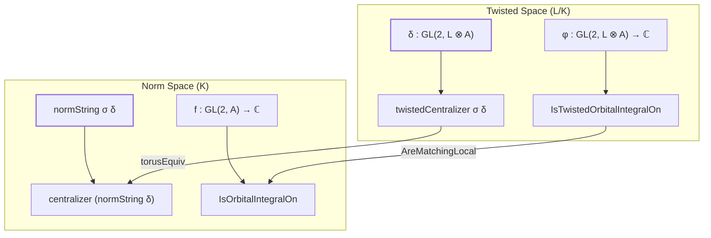
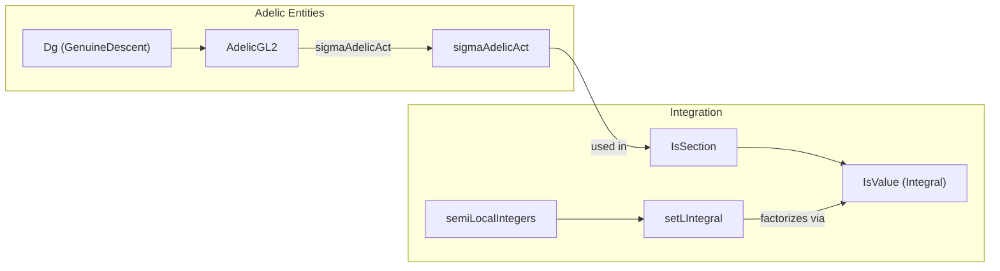

<!-- source: DeepWiki mcp.deepwiki.com · repo anthropics/fermats-last-theorem · page 6.4 Semilocal Transfer and Test Functions · fetched 2026-10-26 -->

# Semilocal Transfer and Test Functions

Relevant source files

The following files were used as context for generating this wiki page:

- [P2M/Sol/S_AutomorphicForm_TransversalMeasure_exists_forall_lintegral_and_integral_eq_mul_prod_of_forall_prod_archSemiLocalIdele.lean](P2M/Sol/S_AutomorphicForm_TransversalMeasure_exists_forall_lintegral_and_integral_eq_mul_prod_of_forall_prod_archSemiLocalIdele.lean)
- [P2M/Sol/S_AutomorphicForm_TransversalMeasure_exists_forall_lintegral_eq_lintegral_mul_prod_of_forall_prod_archSemiLocalIdele.lean](P2M/Sol/S_AutomorphicForm_TransversalMeasure_exists_forall_lintegral_eq_lintegral_mul_prod_of_forall_prod_archSemiLocalIdele.lean)
- [P2M/Sol/S_AutomorphicForm_areMatchingLocal_splitFactor_heckeAlgebra_of_prime.lean](P2M/Sol/S_AutomorphicForm_areMatchingLocal_splitFactor_heckeAlgebra_of_prime.lean)
- [P2M/Sol/S_AutomorphicForm_areMatchingOn_and_central_adeleRing_of_areMatchingAt_of_prime_of_factorization.lean](P2M/Sol/S_AutomorphicForm_areMatchingOn_and_central_adeleRing_of_areMatchingAt_of_prime_of_factorization.lean)
- [P2M/Sol/S_AutomorphicForm_constantTerm_sigmaSectionActOn_and_lambdaT_sigmaSectionActOn.lean](P2M/Sol/S_AutomorphicForm_constantTerm_sigmaSectionActOn_and_lambdaT_sigmaSectionActOn.lean)
- [P2M/Sol/S_AutomorphicForm_exists_areMatchingOn_adeleRing_of_areMatchingAt_of_prime.lean](P2M/Sol/S_AutomorphicForm_exists_areMatchingOn_adeleRing_of_areMatchingAt_of_prime.lean)
- [P2M/Sol/S_AutomorphicForm_exists_areMatchingOn_and_central_adeleRing_of_areMatchingAt_of_prime.lean](P2M/Sol/S_AutomorphicForm_exists_areMatchingOn_and_central_adeleRing_of_areMatchingAt_of_prime.lean)
- [P2M/Sol/S_AutomorphicForm_exists_atomic_forall_integrableOn_and_tendsto_setIntegral_lambdaT_finsum_twistedConvOp_chiDet_mul_chiDet_inv.lean](P2M/Sol/S_AutomorphicForm_exists_atomic_forall_integrableOn_and_tendsto_setIntegral_lambdaT_finsum_twistedConvOp_chiDet_mul_chiDet_inv.lean)
- [P2M/Sol/S_AutomorphicForm_exists_atomic_forall_tendsto_integral_lambdaT_twistedAdelicKernel_sub_twistedCutTrace_sub.lean](P2M/Sol/S_AutomorphicForm_exists_atomic_forall_tendsto_integral_lambdaT_twistedAdelicKernel_sub_twistedCutTrace_sub.lean)
- [P2M/Sol/S_AutomorphicForm_exists_atomic_forall_tendsto_integral_lambdaT_twistedAdelicKernel_sub_twistedCutTrace_sub_unram.lean](P2M/Sol/S_AutomorphicForm_exists_atomic_forall_tendsto_integral_lambdaT_twistedAdelicKernel_sub_twistedCutTrace_sub_unram.lean)
- [P2M/Sol/S_AutomorphicForm_exists_atomic_forall_tendsto_of_eq_mul_tsum_integral_sum_rightConv_mul_setIntegral_lambdaT_mul_conj_lambdaT_sigmaAdelicAct_of_isSemiLocalFactorization.lean](P2M/Sol/S_AutomorphicForm_exists_atomic_forall_tendsto_of_eq_mul_tsum_integral_sum_rightConv_mul_setIntegral_lambdaT_mul_conj_lambdaT_sigmaAdelicAct_of_isSemiLocalFactorization.lean)
- [P2M/Sol/S_AutomorphicForm_exists_atomic_forall_tendsto_setIntegral_lambdaT_adelicKernel_sub_mul.lean](P2M/Sol/S_AutomorphicForm_exists_atomic_forall_tendsto_setIntegral_lambdaT_adelicKernel_sub_mul.lean)
- [P2M/Sol/S_AutomorphicForm_exists_atomic_forall_tendsto_setIntegral_lambdaT_finsum_integral_sigmaAdelicAct_centralScalar_sub_twistedCutTrace_sub.lean](P2M/Sol/S_AutomorphicForm_exists_atomic_forall_tendsto_setIntegral_lambdaT_finsum_integral_sigmaAdelicAct_centralScalar_sub_twistedCutTrace_sub.lean)
- [P2M/Sol/S_AutomorphicForm_exists_atomic_forall_tendsto_setIntegral_lambdaT_finsum_integral_sigmaAdelicAct_sub_lambdaT_tsum_finsum_twistedConvOp_sub_lambdaT_finsum_twistedConvOp_chiDet_sub.lean](P2M/Sol/S_AutomorphicForm_exists_atomic_forall_tendsto_setIntegral_lambdaT_finsum_integral_sigmaAdelicAct_sub_lambdaT_tsum_finsum_twistedConvOp_sub_lambdaT_finsum_twistedConvOp_chiDet_sub.lean)
- [P2M/Sol/S_AutomorphicForm_exists_atomic_forall_tendsto_tsum_integral_prod_pow_mul_affine_oscillatory_sub_mul_of_placewise_bound_of_sum_lipschitz.lean](P2M/Sol/S_AutomorphicForm_exists_atomic_forall_tendsto_tsum_integral_prod_pow_mul_affine_oscillatory_sub_mul_of_placewise_bound_of_sum_lipschitz.lean)
- [P2M/Sol/S_AutomorphicForm_exists_contDiff_hasCompactSupport_forall_integral_conj_diagUnits2_mul_unipotentGL2_eq_of_isCompact.lean](P2M/Sol/S_AutomorphicForm_exists_contDiff_hasCompactSupport_forall_integral_conj_diagUnits2_mul_unipotentGL2_eq_of_isCompact.lean)
- [P2M/Sol/S_AutomorphicForm_exists_contDiff_hasCompactSupport_forall_integral_twistedConj_diagUnits2_mul_unipotentGL2_eq.lean](P2M/Sol/S_AutomorphicForm_exists_contDiff_hasCompactSupport_forall_integral_twistedConj_diagUnits2_mul_unipotentGL2_eq.lean)
- [P2M/Sol/S_AutomorphicForm_exists_contDiff_hasCompactSupport_forall_prod_norm_sub_one_pow_mul_twistedWeighted_sub_finrank_mul_weighted_eq_mul_archDisc_of_areMatchingArch.lean](P2M/Sol/S_AutomorphicForm_exists_contDiff_hasCompactSupport_forall_prod_norm_sub_one_pow_mul_twistedWeighted_sub_finrank_mul_weighted_eq_mul_archDisc_of_areMatchingArch.lean)
- [P2M/Sol/S_AutomorphicForm_exists_contDiff_hasCompactSupport_tsupport_subset_units_prod_norm_pow_mul_integral_integral_unipotentGL2_eq_of_isArchTestFactor.lean](P2M/Sol/S_AutomorphicForm_exists_contDiff_hasCompactSupport_tsupport_subset_units_prod_norm_pow_mul_integral_integral_unipotentGL2_eq_of_isArchTestFactor.lean)
- [P2M/Sol/S_AutomorphicForm_exists_continuousMulEquiv_centralizer_twistedCentralizer_of_eq_scalar.lean](P2M/Sol/S_AutomorphicForm_exists_continuousMulEquiv_centralizer_twistedCentralizer_of_eq_scalar.lean)
- [P2M/Sol/S_AutomorphicForm_exists_continuousMulEquiv_centralizer_twistedCentralizer_of_isNormConjugator.lean](P2M/Sol/S_AutomorphicForm_exists_continuousMulEquiv_centralizer_twistedCentralizer_of_isNormConjugator.lean)
- [P2M/Sol/S_AutomorphicForm_exists_continuousMulEquiv_twistedCentralizer_centralizer_coupled_of_isNormRep.lean](P2M/Sol/S_AutomorphicForm_exists_continuousMulEquiv_twistedCentralizer_centralizer_coupled_of_isNormRep.lean)
- [P2M/Sol/S_AutomorphicForm_exists_continuous_hasCompactSupport_eq_of_isWeightedOrbitalIntegralOn_scalar_mul_diagUnits2.lean](P2M/Sol/S_AutomorphicForm_exists_continuous_hasCompactSupport_eq_of_isWeightedOrbitalIntegralOn_scalar_mul_diagUnits2.lean)
- [P2M/Sol/S_AutomorphicForm_exists_continuous_isSectionFnOn_and_isOrbitalIntegralOn_iff_of_isRegularSemisimple_of_field.lean](P2M/Sol/S_AutomorphicForm_exists_continuous_isSectionFnOn_and_isOrbitalIntegralOn_iff_of_isRegularSemisimple_of_field.lean)
- [P2M/Sol/S_AutomorphicForm_exists_coupled_smul_and_eq_mul_prod_of_coupled_adeleRing.lean](P2M/Sol/S_AutomorphicForm_exists_coupled_smul_and_eq_mul_prod_of_coupled_adeleRing.lean)
- [P2M/Sol/S_AutomorphicForm_exists_diagUnits2_normString_isOrbitalIntegral_ne_zero_isTwistedOrbitalIntegral_eq_heckeWord_of_ramificationIdx_eq_one_of_prime.lean](P2M/Sol/S_AutomorphicForm_exists_diagUnits2_normString_isOrbitalIntegral_ne_zero_isTwistedOrbitalIntegral_eq_heckeWord_of_ramificationIdx_eq_one_of_prime.lean)
- [P2M/Sol/S_AutomorphicForm_exists_finset_forall_eq_mul_algebraMap_mul_of_sigmaTensor_eq_mul.lean](P2M/Sol/S_AutomorphicForm_exists_finset_forall_eq_mul_algebraMap_mul_of_sigmaTensor_eq_mul.lean)
- [P2M/Sol/S_AutomorphicForm_exists_finset_level_isOpen_isCompact_box_subset_indicator_mulVec_eq_prod_indicator_tensorPlace_of_normString_eq_toTensorGL_centralScalar_of_finrank_eq_two.lean](P2M/Sol/S_AutomorphicForm_exists_finset_level_isOpen_isCompact_box_subset_indicator_mulVec_eq_prod_indicator_tensorPlace_of_normString_eq_toTensorGL_centralScalar_of_finrank_eq_two.lean)
- [P2M/Sol/S_AutomorphicForm_exists_forall_le_integrableOn_setIntegral_mul_finsum_unipotentNormClass_sub_indicator_constantTerm_canonicalTruncationDomain.lean](P2M/Sol/S_AutomorphicForm_exists_forall_le_integrableOn_setIntegral_mul_finsum_unipotentNormClass_sub_indicator_constantTerm_canonicalTruncationDomain.lean)
- [P2M/Sol/S_AutomorphicForm_exists_forall_le_integrableOn_twistedHyperbolicCell_and_twistedUnipotentCell_sub_indicator_constantTerm.lean](P2M/Sol/S_AutomorphicForm_exists_forall_le_integrableOn_twistedHyperbolicCell_and_twistedUnipotentCell_sub_indicator_constantTerm.lean)
- [P2M/Sol/S_AutomorphicForm_exists_forall_lintegral_and_integral_maximalCompactHaar_eq_mul_prod_semiLocalHaar.lean](P2M/Sol/S_AutomorphicForm_exists_forall_lintegral_and_integral_maximalCompactHaar_eq_mul_prod_semiLocalHaar.lean)
- [P2M/Sol/S_AutomorphicForm_exists_forall_lintegral_maximalCompactHaar_eq_lintegral_mul_prod_setLIntegral_semiLocalHaar.lean](P2M/Sol/S_AutomorphicForm_exists_forall_lintegral_maximalCompactHaar_eq_lintegral_mul_prod_setLIntegral_semiLocalHaar.lean)
- [P2M/Sol/S_AutomorphicForm_exists_isArchTestFactor_isArchFactorBiFinite_areMatchingArch_of_algHom.lean](P2M/Sol/S_AutomorphicForm_exists_isArchTestFactor_isArchFactorBiFinite_areMatchingArch_of_algHom.lean)
- [P2M/Sol/S_AutomorphicForm_exists_isArchTestFactor_isArchFactorBiFinite_areMatchingArch_of_isEmpty_algHom.lean](P2M/Sol/S_AutomorphicForm_exists_isArchTestFactor_isArchFactorBiFinite_areMatchingArch_of_isEmpty_algHom.lean)
- [P2M/Sol/S_AutomorphicForm_exists_isCompact_forall_exists_includeRight_mul_mem_of_sigmaTensor_mul_inv_mem.lean](P2M/Sol/S_AutomorphicForm_exists_isCompact_forall_exists_includeRight_mul_mem_of_sigmaTensor_mul_inv_mem.lean)
- [P2M/Sol/S_AutomorphicForm_exists_isHaarMeasure_and_isTwistedOrbitalIntegral_eq_mul_apply_scalar_of_normString_eq_toTensorGL_scalar_of_finrank_eq_two.lean](P2M/Sol/S_AutomorphicForm_exists_isHaarMeasure_and_isTwistedOrbitalIntegral_eq_mul_apply_scalar_of_normString_eq_toTensorGL_scalar_of_finrank_eq_two.lean)
- [P2M/Sol/S_AutomorphicForm_exists_isHaarMeasure_twistedCentralizer_tensorArch_integral_eq_integral_prod_toTensorGL_diagUnits2.lean](P2M/Sol/S_AutomorphicForm_exists_isHaarMeasure_twistedCentralizer_tensorArch_integral_eq_integral_prod_toTensorGL_diagUnits2.lean)
- [P2M/Sol/S_AutomorphicForm_exists_isHaarMeasure_twistedCentralizer_tensorPlace_preimage_semiLocalIntegralSet_eq_one.lean](P2M/Sol/S_AutomorphicForm_exists_isHaarMeasure_twistedCentralizer_tensorPlace_preimage_semiLocalIntegralSet_eq_one.lean)
- [P2M/Sol/S_AutomorphicForm_exists_isLocalTestFn_areMatchingLocal_of_algHom.lean](P2M/Sol/S_AutomorphicForm_exists_isLocalTestFn_areMatchingLocal_of_algHom.lean)
- [P2M/Sol/S_AutomorphicForm_exists_isLocalTestFn_areMatchingLocal_of_isEmpty_algHom.lean](P2M/Sol/S_AutomorphicForm_exists_isLocalTestFn_areMatchingLocal_of_isEmpty_algHom.lean)
- [P2M/Sol/S_AutomorphicForm_exists_isNormConjugator_and_coupled_smul_of_isSigmaConjugate_scalar_of_finrank_eq_two.lean](P2M/Sol/S_AutomorphicForm_exists_isNormConjugator_and_coupled_smul_of_isSigmaConjugate_scalar_of_finrank_eq_two.lean)
- [P2M/Sol/S_AutomorphicForm_exists_isOpen_isCompact_tendsto_sub_one_mul_lintegral_twistedCentralizer_schwartzMap_mul_indicator_nhdsGT_one_of_forall_integral_eq_mul_prod_integral_of_finrank_eq_two.lean](P2M/Sol/S_AutomorphicForm_exists_isOpen_isCompact_tendsto_sub_one_mul_lintegral_twistedCentralizer_schwartzMap_mul_indicator_nhdsGT_one_of_forall_integral_eq_mul_prod_integral_of_finrank_eq_two.lean)
- [P2M/Sol/S_AutomorphicForm_exists_isOpen_one_mem_forall_exists_isLocalTestFn_of_forall_mul_sigmaTensor_ne.lean](P2M/Sol/S_AutomorphicForm_exists_isOpen_one_mem_forall_exists_isLocalTestFn_of_forall_mul_sigmaTensor_ne.lean)
- [P2M/Sol/S_AutomorphicForm_exists_isSemiLocalFactorization_comp_centralScalar_mul.lean](P2M/Sol/S_AutomorphicForm_exists_isSemiLocalFactorization_comp_centralScalar_mul.lean)
- [P2M/Sol/S_AutomorphicForm_exists_isTwistedSectionFnOn_and_continuous_completion_of_isRegularSemisimple_normString.lean](P2M/Sol/S_AutomorphicForm_exists_isTwistedSectionFnOn_and_continuous_completion_of_isRegularSemisimple_normString.lean)
- [P2M/Sol/S_AutomorphicForm_exists_isTwistedSectionFnOn_and_continuous_conjAe_of_isRegularSemisimple_normString.lean](P2M/Sol/S_AutomorphicForm_exists_isTwistedSectionFnOn_and_continuous_conjAe_of_isRegularSemisimple_normString.lean)
- [P2M/Sol/S_AutomorphicForm_exists_isTwistedSectionFnOn_infiniteAdeleRing_and_continuous_of_isRegularSemisimple_normString_of_hasCompactSupport.lean](P2M/Sol/S_AutomorphicForm_exists_isTwistedSectionFnOn_infiniteAdeleRing_and_continuous_of_isRegularSemisimple_normString_of_hasCompactSupport.lean)
- [P2M/Sol/S_AutomorphicForm_exists_isUnitFactorization_comp_centralScalar_mul.lean](P2M/Sol/S_AutomorphicForm_exists_isUnitFactorization_comp_centralScalar_mul.lean)
- [P2M/Sol/S_AutomorphicForm_exists_lintegral_twistedCentralizer_inv_one_add_norm_sq_pow_mul_indicator_mul_ideleNorm_det_rpow_lt_top_of_forall_ne_scalar_of_finrank_eq_two.lean](P2M/Sol/S_AutomorphicForm_exists_lintegral_twistedCentralizer_inv_one_add_norm_sq_pow_mul_indicator_mul_ideleNorm_det_rpow_lt_top_of_forall_ne_scalar_of_finrank_eq_two.lean)
- [P2M/Sol/S_AutomorphicForm_exists_mem_schwartzBruhat2_tendsto_sub_one_mul_lintegral_twistedCentralizer_nhdsGT_one_of_forall_integral_eq_mul_prod_integral_of_forall_ne_scalar_of_finrank_eq_two.lean](P2M/Sol/S_AutomorphicForm_exists_mem_schwartzBruhat2_tendsto_sub_one_mul_lintegral_twistedCentralizer_nhdsGT_one_of_forall_integral_eq_mul_prod_integral_of_forall_ne_scalar_of_finrank_eq_two.lean)
- [P2M/Sol/S_AutomorphicForm_exists_nhds_forall_exists_areMatchingLocal_and_central_of_not_isRegularSemisimple_normString_of_prime.lean](P2M/Sol/S_AutomorphicForm_exists_nhds_forall_exists_areMatchingLocal_and_central_of_not_isRegularSemisimple_normString_of_prime.lean)
- [P2M/Sol/S_AutomorphicForm_exists_nhds_forall_exists_isLocalTestFn_areMatchingLocal_of_isRegularSemisimple_normString.lean](P2M/Sol/S_AutomorphicForm_exists_nhds_forall_exists_isLocalTestFn_areMatchingLocal_of_isRegularSemisimple_normString.lean)
- [P2M/Sol/S_AutomorphicForm_exists_nhds_forall_exists_isLocalTestFn_areMatchingLocal_of_not_isRegularSemisimple_normString.lean](P2M/Sol/S_AutomorphicForm_exists_nhds_forall_exists_isLocalTestFn_areMatchingLocal_of_not_isRegularSemisimple_normString.lean)
- [P2M/Sol/S_AutomorphicForm_exists_pos_forall_exists_isHaarMeasure_twistedCentralizer_integral_eq_mul_integral_prod_toTensorGL_diagUnits2.lean](P2M/Sol/S_AutomorphicForm_exists_pos_forall_exists_isHaarMeasure_twistedCentralizer_integral_eq_mul_integral_prod_toTensorGL_diagUnits2.lean)
- [P2M/Sol/S_AutomorphicForm_exists_pos_forall_lintegral_units_tensor_eq_mul_lintegral_ker_norm_of_forall_lintegral_mul_includeRight_eq.lean](P2M/Sol/S_AutomorphicForm_exists_pos_forall_lintegral_units_tensor_eq_mul_lintegral_ker_norm_of_forall_lintegral_mul_includeRight_eq.lean)
- [P2M/Sol/S_AutomorphicForm_exists_pos_setIntegral_prod_semiLocalComponent_eq_mul_prod_integral.lean](P2M/Sol/S_AutomorphicForm_exists_pos_setIntegral_prod_semiLocalComponent_eq_mul_prod_integral.lean)
- [P2M/Sol/S_AutomorphicForm_exists_units_eq_inv_mul_unitsMap_sigmaTensor_of_norm_eq_one.lean](P2M/Sol/S_AutomorphicForm_exists_units_eq_inv_mul_unitsMap_sigmaTensor_of_norm_eq_one.lean)
- [P2M/Sol/S_AutomorphicForm_exists_units_mul_sigmaTensor_eq_of_norm_eq_one.lean](P2M/Sol/S_AutomorphicForm_exists_units_mul_sigmaTensor_eq_of_norm_eq_one.lean)
- [P2M/Sol/S_AutomorphicForm_exists_weightedClassIntegral_eq_mul_archWindow_mul_prod_add_mul_sum_window_and_isWeightedOrbitalIntegral_of_isUnitFactorization_of_coupled.lean](P2M/Sol/S_AutomorphicForm_exists_weightedClassIntegral_eq_mul_archWindow_mul_prod_add_mul_sum_window_and_isWeightedOrbitalIntegral_of_isUnitFactorization_of_coupled.lean)
- [P2M/Sol/S_AutomorphicForm_fibreSum_twistedCutTrace_eq_const_mul_fibreSum_cutTrace_of_docks_ed2.lean](P2M/Sol/S_AutomorphicForm_fibreSum_twistedCutTrace_eq_const_mul_fibreSum_cutTrace_of_docks_ed2.lean)
- [P2M/Sol/S_AutomorphicForm_finite_setOf_exists_mem_exists_inv_mul_globalPoints_out_mul_centralScalar_mul_mem_of_isCompact.lean](P2M/Sol/S_AutomorphicForm_finite_setOf_exists_mem_exists_inv_mul_globalPoints_out_mul_centralScalar_mul_mem_of_isCompact.lean)
- [P2M/Sol/S_AutomorphicForm_finrank_mul_ratio_mul_weightedClassIntegral_add_mul_window_eq_zero_of_mem_sup_of_not_mem_range_of_prime.lean](P2M/Sol/S_AutomorphicForm_finrank_mul_ratio_mul_weightedClassIntegral_add_mul_window_eq_zero_of_mem_sup_of_not_mem_range_of_prime.lean)
- [P2M/Sol/S_AutomorphicForm_finrank_mul_ratio_mul_weightedClassIntegral_add_mul_window_eq_zero_of_ratio_not_mem_range_norm_of_prime.lean](P2M/Sol/S_AutomorphicForm_finrank_mul_ratio_mul_weightedClassIntegral_add_mul_window_eq_zero_of_ratio_not_mem_range_norm_of_prime.lean)
- [P2M/Sol/S_AutomorphicForm_forall_exists_integral_lambdaT_twistedAdelicKernel_eq_finsum_centralElliptic_add_and_norm_le_unram.lean](P2M/Sol/S_AutomorphicForm_forall_exists_integral_lambdaT_twistedAdelicKernel_eq_finsum_centralElliptic_add_and_norm_le_unram.lean)
- [P2M/Sol/S_AutomorphicForm_forall_exists_isHaarMeasure_centralizer_globalPoints_integral_eq_mul_integral_prod_diagUnits2.lean](P2M/Sol/S_AutomorphicForm_forall_exists_isHaarMeasure_centralizer_globalPoints_integral_eq_mul_integral_prod_diagUnits2.lean)
- [P2M/Sol/S_AutomorphicForm_forall_finset_fibreSum_sub_const_mul_fibreSum_add_eq_zero_of_forall_places_exists_noAtomicMass_wordSum_eq.lean](P2M/Sol/S_AutomorphicForm_forall_finset_fibreSum_sub_const_mul_fibreSum_add_eq_zero_of_forall_places_exists_noAtomicMass_wordSum_eq.lean)
- [P2M/Sol/S_AutomorphicForm_integrable_mul_orbital_mul_prod_orbital_sPart_of_isArchTestFactor_of_isLocalTestFn.lean](P2M/Sol/S_AutomorphicForm_integrable_mul_orbital_mul_prod_orbital_sPart_of_isArchTestFactor_of_isLocalTestFn.lean)
- [P2M/Sol/S_AutomorphicForm_integrable_mul_window_bracket_sPart_of_isWeightedOrbitalIntegralOn_of_isTwistedWeightedOrbitalIntegralOn_of_ne_one.lean](P2M/Sol/S_AutomorphicForm_integrable_mul_window_bracket_sPart_of_isWeightedOrbitalIntegralOn_of_isTwistedWeightedOrbitalIntegralOn_of_ne_one.lean)
- [P2M/Sol/S_AutomorphicForm_integral_haarQuotient_orbital_eq_const_mul_integral_of_isOrbitalIntegralOn_centralScalar_mul.lean](P2M/Sol/S_AutomorphicForm_integral_haarQuotient_orbital_eq_const_mul_integral_of_isOrbitalIntegralOn_centralScalar_mul.lean)
- [P2M/Sol/S_AutomorphicForm_integral_haarQuotient_twistedOrbital_eq_const_mul_integral_quotient_ker_idelicNorm_of_isTwistedOrbitalIntegralOn.lean](P2M/Sol/S_AutomorphicForm_integral_haarQuotient_twistedOrbital_eq_const_mul_integral_quotient_ker_idelicNorm_of_isTwistedOrbitalIntegralOn.lean)
- [P2M/Sol/S_AutomorphicForm_integral_mul_chiDet_eq_prod_pow_mul_pow_mul_integral_mul_chiDet_of_isUnitFactorization.lean](P2M/Sol/S_AutomorphicForm_integral_mul_chiDet_eq_prod_pow_mul_pow_mul_integral_mul_chiDet_of_isUnitFactorization.lean)
- [P2M/Sol/S_AutomorphicForm_integral_mul_chiDet_eq_prod_sum_localChar_mul_integral_of_isSemiLocalFactorization.lean](P2M/Sol/S_AutomorphicForm_integral_mul_chiDet_eq_prod_sum_localChar_mul_integral_of_isSemiLocalFactorization.lean)
- [P2M/Sol/S_AutomorphicForm_isBiInvariantUnder_principalLevel_comap_and_conjInvariant_comp_sigmaAdelicAct.lean](P2M/Sol/S_AutomorphicForm_isBiInvariantUnder_principalLevel_comap_and_conjInvariant_comp_sigmaAdelicAct.lean)
- [P2M/Sol/S_AutomorphicForm_isInducedSection_and_isArchKFinite_and_axis_continuation_comp_sigmaAdelicAct_symm_of_flat_family_of_principalLevel.lean](P2M/Sol/S_AutomorphicForm_isInducedSection_and_isArchKFinite_and_axis_continuation_comp_sigmaAdelicAct_symm_of_flat_family_of_principalLevel.lean)
- [P2M/Sol/S_AutomorphicForm_isInvInvariant_of_coupled_of_isInvInvariant.lean](P2M/Sol/S_AutomorphicForm_isInvInvariant_of_coupled_of_isInvInvariant.lean)
- [P2M/Sol/S_AutomorphicForm_isIsotypicCuspFormAt_sigmaSectionActOn_comp_unitsMap_of_isFundamentalDomain_slab.lean](P2M/Sol/S_AutomorphicForm_isIsotypicCuspFormAt_sigmaSectionActOn_comp_unitsMap_of_isFundamentalDomain_slab.lean)
- [P2M/Sol/S_AutomorphicForm_isIsotypicCuspFormAt_sigmaSectionActOn_of_isFundamentalDomain_slab.lean](P2M/Sol/S_AutomorphicForm_isIsotypicCuspFormAt_sigmaSectionActOn_of_isFundamentalDomain_slab.lean)
- [P2M/Sol/S_AutomorphicForm_isIsotypicCuspFormAt_sigmaSectionActOn_principalLevel_of_isFundamentalDomain_slab.lean](P2M/Sol/S_AutomorphicForm_isIsotypicCuspFormAt_sigmaSectionActOn_principalLevel_of_isFundamentalDomain_slab.lean)
- [P2M/Sol/S_AutomorphicForm_isMulRightInvariant_twistedCentralizer_adeleRing_of_normString_eq_toTensorGL_centralScalar_of_finrank_eq_two.lean](P2M/Sol/S_AutomorphicForm_isMulRightInvariant_twistedCentralizer_adeleRing_of_normString_eq_toTensorGL_centralScalar_of_finrank_eq_two.lean)
- [P2M/Sol/S_AutomorphicForm_isUnit_of_mem_twistedCommutant_map_of_ne_zero_of_not_isSigmaConjugate_scalar_tensorPlace.lean](P2M/Sol/S_AutomorphicForm_isUnit_of_mem_twistedCommutant_map_of_ne_zero_of_not_isSigmaConjugate_scalar_tensorPlace.lean)
- [P2M/Sol/S_AutomorphicForm_isUnramifiedCharAt_of_isInducedSection_etaFst_etaSnd_of_ne_zero_of_principalLevel.lean](P2M/Sol/S_AutomorphicForm_isUnramifiedCharAt_of_isInducedSection_etaFst_etaSnd_of_ne_zero_of_principalLevel.lean)
- [P2M/Sol/S_AutomorphicForm_lintegral_iUnion_detShell_twistedCentralizer_eq_mul_inv_sub_one_mul_inv_one_sub_of_not_isSigmaConjugate_scalar_of_finrank_eq_two.lean](P2M/Sol/S_AutomorphicForm_lintegral_iUnion_detShell_twistedCentralizer_eq_mul_inv_sub_one_mul_inv_one_sub_of_not_isSigmaConjugate_scalar_of_finrank_eq_two.lean)
- [P2M/Sol/S_AutomorphicForm_lintegral_twistedCentralizer_enorm_mul_ideleNorm_det_rpow_lt_top_of_mem_schwartzBruhat2_of_forall_ne_scalar_of_finrank_eq_two.lean](P2M/Sol/S_AutomorphicForm_lintegral_twistedCentralizer_enorm_mul_ideleNorm_det_rpow_lt_top_of_mem_schwartzBruhat2_of_forall_ne_scalar_of_finrank_eq_two.lean)
- [P2M/Sol/S_AutomorphicForm_lintegral_twistedCentralizer_mul_indicator_mul_ideleNorm_det_rpow_eq_mul_lintegral_arch_mul_dedekindZeta_mul_prod_of_forall_le_mul_one_add_norm_rpow_neg.lean](P2M/Sol/S_AutomorphicForm_lintegral_twistedCentralizer_mul_indicator_mul_ideleNorm_det_rpow_eq_mul_lintegral_arch_mul_dedekindZeta_mul_prod_of_forall_le_mul_one_add_norm_rpow_neg.lean)
- [P2M/Sol/S_AutomorphicForm_localChar_eq_one_of_isInducedSection_etaFst_etaSnd_of_ne_zero_of_principalLevel_of_valued_sub_one_le.lean](P2M/Sol/S_AutomorphicForm_localChar_eq_one_of_isInducedSection_etaFst_etaSnd_of_ne_zero_of_principalLevel_of_valued_sub_one_le.lean)
- [P2M/Sol/S_AutomorphicForm_measurable_window_values_of_ne_one_of_prime.lean](P2M/Sol/S_AutomorphicForm_measurable_window_values_of_ne_one_of_prime.lean)
- [P2M/Sol/S_AutomorphicForm_mem_twistedCentralizer_iff_of_diagonal_of_isUnit_norm_sub_norm.lean](P2M/Sol/S_AutomorphicForm_mem_twistedCentralizer_iff_of_diagonal_of_isUnit_norm_sub_norm.lean)
- [P2M/Sol/S_AutomorphicForm_mul_eq_mul_of_isTwistedOrbitalIntegralOn_of_isOrbitalIntegralOn_centralScalar_of_areMatchingLocal.lean](P2M/Sol/S_AutomorphicForm_mul_eq_mul_of_isTwistedOrbitalIntegralOn_of_isOrbitalIntegralOn_centralScalar_of_areMatchingLocal.lean)
- [P2M/Sol/S_AutomorphicForm_mul_eq_mul_of_isTwistedOrbitalIntegralOn_of_isOrbitalIntegralOn_centralScalar_of_coupled.lean](P2M/Sol/S_AutomorphicForm_mul_eq_mul_of_isTwistedOrbitalIntegralOn_of_isOrbitalIntegralOn_centralScalar_of_coupled.lean)
- [P2M/Sol/S_AutomorphicForm_mul_eq_mul_of_isTwistedOrbitalIntegralOn_of_isOrbitalIntegralOn_centralScalar_of_forall_ne_scalar_of_finrank_eq_two.lean](P2M/Sol/S_AutomorphicForm_mul_eq_mul_of_isTwistedOrbitalIntegralOn_of_isOrbitalIntegralOn_centralScalar_of_forall_ne_scalar_of_finrank_eq_two.lean)
- [P2M/Sol/S_AutomorphicForm_mul_eq_two_mul_of_forall_isFundamentalDomain_twistedCentralizer_measure_inter_ideleNorm_det_Icc_of_forall_ne_scalar_of_finrank_eq_two.lean](P2M/Sol/S_AutomorphicForm_mul_eq_two_mul_of_forall_isFundamentalDomain_twistedCentralizer_measure_inter_ideleNorm_det_Icc_of_forall_ne_scalar_of_finrank_eq_two.lean)
- [P2M/Sol/S_AutomorphicForm_ne_top_and_setLIntegral_iUnion_detShell_twistedCentralizer_norm_algebraNorm_det_rpow_eq_mul_and_tendsto_of_not_isSigmaConjugate_scalar_of_finrank_eq_two.lean](P2M/Sol/S_AutomorphicForm_ne_top_and_setLIntegral_iUnion_detShell_twistedCentralizer_norm_algebraNorm_det_rpow_eq_mul_and_tendsto_of_not_isSigmaConjugate_scalar_of_finrank_eq_two.lean)
- [P2M/Sol/S_AutomorphicForm_normString_apply_eq_one_tmul_norm_apply_of_diagonal.lean](P2M/Sol/S_AutomorphicForm_normString_apply_eq_one_tmul_norm_apply_of_diagonal.lean)
- [P2M/Sol/S_AutomorphicForm_rate_eq_mul_rate_mul_measure_pow_three_of_forall_lintegral_mul_apply_col_det_eq_mul_lintegral_of_forall_isFundamentalDomain_op_inter_ideleNorm_det_Icc.lean](P2M/Sol/S_AutomorphicForm_rate_eq_mul_rate_mul_measure_pow_three_of_forall_lintegral_mul_apply_col_det_eq_mul_lintegral_of_forall_isFundamentalDomain_op_inter_ideleNorm_det_Icc.lean)
- [P2M/Sol/S_AutomorphicForm_rightConv_eq_prod_pow_mul_pow_mul_rightConv_of_isInducedSection_of_isSemiLocalFactorization.lean](P2M/Sol/S_AutomorphicForm_rightConv_eq_prod_pow_mul_pow_mul_rightConv_of_isInducedSection_of_isSemiLocalFactorization.lean)
- [P2M/Sol/S_AutomorphicForm_satakeData_eq_of_under_eq_of_twistedCutTrace_ne_zero_of_heckeWordShift.lean](P2M/Sol/S_AutomorphicForm_satakeData_eq_of_under_eq_of_twistedCutTrace_ne_zero_of_heckeWordShift.lean)
- [P2M/Sol/S_AutomorphicForm_semilocal_central_transfer_peel_step.lean](P2M/Sol/S_AutomorphicForm_semilocal_central_transfer_peel_step.lean)
- [P2M/Sol/S_AutomorphicForm_semilocal_central_transfer_referenceMeasures_peel_step.lean](P2M/Sol/S_AutomorphicForm_semilocal_central_transfer_referenceMeasures_peel_step.lean)
- [P2M/Sol/S_AutomorphicForm_setIntegral_canonicalTruncationDomain_finsum_hyperbolicCell_sub_indicator_constantTerm_eq_mul_sum_mul_integral_haarQuotient_ker_idelicNorm_add_sum_of_eq_mul_sum_orbital_add_sum_weightedOrbital.lean](P2M/Sol/S_AutomorphicForm_setIntegral_canonicalTruncationDomain_finsum_hyperbolicCell_sub_indicator_constantTerm_eq_mul_sum_mul_integral_haarQuotient_ker_idelicNorm_add_sum_of_eq_mul_sum_orbital_add_sum_weightedOrbital.lean)
- [P2M/Sol/S_AutomorphicForm_setIntegral_fundamentalDomain_slab_eq_measureReal_mul_of_isOrbitalIntegralOn.lean](P2M/Sol/S_AutomorphicForm_setIntegral_fundamentalDomain_slab_eq_measureReal_mul_of_isOrbitalIntegralOn.lean)
- [P2M/Sol/S_AutomorphicForm_setIntegral_fundamentalDomain_slab_sigmaAdelicAct_eq_measureReal_mul_integral_map_of_isTwistedSectionFnOn.lean](P2M/Sol/S_AutomorphicForm_setIntegral_fundamentalDomain_slab_sigmaAdelicAct_eq_measureReal_mul_integral_map_of_isTwistedSectionFnOn.lean)
- [P2M/Sol/S_AutomorphicForm_setIntegral_sigmaCentralizerDomain_eq_mul_apply_centralScalar_of_normClassMap_eq_mk_scalar_of_central_transfer.lean](P2M/Sol/S_AutomorphicForm_setIntegral_sigmaCentralizerDomain_eq_mul_apply_centralScalar_of_normClassMap_eq_mk_scalar_of_central_transfer.lean)
- [P2M/Sol/S_AutomorphicForm_setLIntegral_lattice_norm_det_mul_norm_four_eq_mul_sqrt_norm_det_trace_of_map_conj_eq_smul_map_toTensorGL_localHaar.lean](P2M/Sol/S_AutomorphicForm_setLIntegral_lattice_norm_det_mul_norm_four_eq_mul_sqrt_norm_det_trace_of_map_conj_eq_smul_map_toTensorGL_localHaar.lean)
- [P2M/Sol/S_AutomorphicForm_setLIntegral_lattice_norm_det_mul_norm_four_eq_mul_sqrt_norm_det_trace_of_not_isSigmaConjugate_scalar.lean](P2M/Sol/S_AutomorphicForm_setLIntegral_lattice_norm_det_mul_norm_four_eq_mul_sqrt_norm_det_trace_of_not_isSigmaConjugate_scalar.lean)
- [P2M/Sol/S_AutomorphicForm_setLIntegral_mem_closure_conj_map_integers_norm_det_eq_mul_inv_one_sub_mul_inv_one_sub.lean](P2M/Sol/S_AutomorphicForm_setLIntegral_mem_closure_conj_map_integers_norm_det_eq_mul_inv_one_sub_mul_inv_one_sub.lean)
- [P2M/Sol/S_AutomorphicForm_setLIntegral_mem_closure_det_mem_integers_norm_det_eq_mul_inv_sub_one_mul_inv_one_sub_of_not_isSigmaConjugate_scalar.lean](P2M/Sol/S_AutomorphicForm_setLIntegral_mem_closure_det_mem_integers_norm_det_eq_mul_inv_sub_one_mul_inv_one_sub_of_not_isSigmaConjugate_scalar.lean)
- [P2M/Sol/S_AutomorphicForm_setLIntegral_mul_ideleNorm_det_rpow_add_eq_setLIntegral_reflectPair_add_lintegral_mul_rate_of_isFundamentalDomain_twistedCentralizer_of_forall_ne_scalar_of_finrank_eq_two.lean](P2M/Sol/S_AutomorphicForm_setLIntegral_mul_ideleNorm_det_rpow_add_eq_setLIntegral_reflectPair_add_lintegral_mul_rate_of_isFundamentalDomain_twistedCentralizer_of_forall_ne_scalar_of_finrank_eq_two.lean)
- [P2M/Sol/S_AutomorphicForm_setLIntegral_twistedCentralizer_semiLocalIntegers_norm_det_eq_inv_one_sub_mul_inv_one_sub_of_map_conj_eq_map_toTensorGL_localHaar_of_measure_semiLocalIntegralSet_eq_one.lean](P2M/Sol/S_AutomorphicForm_setLIntegral_twistedCentralizer_semiLocalIntegers_norm_det_eq_inv_one_sub_mul_inv_one_sub_of_map_conj_eq_map_toTensorGL_localHaar_of_measure_semiLocalIntegralSet_eq_one.lean)
- [P2M/Sol/S_AutomorphicForm_sqrt_det_gram_mul_lintegral_schwartzMap_archIdent_mul_prod_corr_eq_lintegral_pairHaar_mul_two_pow_mul_discr_sq_of_isOpen_isCompact.lean](P2M/Sol/S_AutomorphicForm_sqrt_det_gram_mul_lintegral_schwartzMap_archIdent_mul_prod_corr_eq_lintegral_pairHaar_mul_two_pow_mul_discr_sq_of_isOpen_isCompact.lean)
- [P2M/Sol/S_AutomorphicForm_tendsto_sub_one_mul_archFactor_mul_dedekindZeta_mul_prod_nhdsGT_one_of_map_coe_eq_smul_withDensity_gram_of_covolume.lean](P2M/Sol/S_AutomorphicForm_tendsto_sub_one_mul_archFactor_mul_dedekindZeta_mul_prod_nhdsGT_one_of_map_coe_eq_smul_withDensity_gram_of_covolume.lean)
- [P2M/Sol/S_AutomorphicForm_tendsto_sub_one_mul_lintegral_twistedCentralizer_schwartzMap_mul_indicator_nhdsGT_one_of_level_of_covol.lean](P2M/Sol/S_AutomorphicForm_tendsto_sub_one_mul_lintegral_twistedCentralizer_schwartzMap_mul_indicator_nhdsGT_one_of_level_of_covol.lean)
- [P2M/Sol/S_AutomorphicForm_tsum_fibre_eq_const_mul_sum_tsum_fibre_formalBaseChange_of_forall_finset_record_of_subset.lean](P2M/Sol/S_AutomorphicForm_tsum_fibre_eq_const_mul_sum_tsum_fibre_formalBaseChange_of_forall_finset_record_of_subset.lean)
- [P2M/Sol/S_AutomorphicForm_twistedCentralizer_diagUnits2_eq_map_toTensorGL_centralizer_of_normString_eq_of_prime.lean](P2M/Sol/S_AutomorphicForm_twistedCentralizer_diagUnits2_eq_map_toTensorGL_centralizer_of_normString_eq_of_prime.lean)
- [P2M/Sol/S_AutomorphicForm_twistedCentralizer_eq_map_centralizer_of_isNormConjugator_one.lean](P2M/Sol/S_AutomorphicForm_twistedCentralizer_eq_map_centralizer_of_isNormConjugator_one.lean)
- [P2M/Sol/S_AutomorphicForm_twistedCentralizer_eq_map_toTensorGL_localCentralizer_and_exists_isHaarMeasure_map_eq_of_diagonal_of_norm_ne.lean](P2M/Sol/S_AutomorphicForm_twistedCentralizer_eq_map_toTensorGL_localCentralizer_and_exists_isHaarMeasure_map_eq_of_diagonal_of_norm_ne.lean)
- [P2M/Sol/S_AutomorphicForm_two_mul_rate_eq_mul_discr_sq_mul_dedekindZeta_two_mul_residue_of_forall_isFundamentalDomain_twistedCentralizer_inter_ideleNorm_det_Icc_of_forall_ne_scalar_of_finrank_eq_two.lean](P2M/Sol/S_AutomorphicForm_two_mul_rate_eq_mul_discr_sq_mul_dedekindZeta_two_mul_residue_of_forall_isFundamentalDomain_twistedCentralizer_inter_ideleNorm_det_Icc_of_forall_ne_scalar_of_finrank_eq_two.lean)
- [P2M/Sol/S_M4aHerbrand_IdeleGaloisDescent_apply_unitsAct_eq_of_forall_mem_normOneIdeles.lean](P2M/Sol/S_M4aHerbrand_IdeleGaloisDescent_apply_unitsAct_eq_of_forall_mem_normOneIdeles.lean)
- [P2M/Sol/S_M4aHerbrand_IdeleGaloisDescent_exists_forall_apply_unitsAct_eq_mul_normPowChar_of_forall_mem_normOneIdeles_eq_swap.lean](P2M/Sol/S_M4aHerbrand_IdeleGaloisDescent_exists_forall_apply_unitsAct_eq_mul_normPowChar_of_forall_mem_normOneIdeles_eq_swap.lean)
- [P2M/Sol/S_MeasureTheory_Measure_map_withDensity_gram_trace_matrix_pi_eq_pi_of_span_eq.lean](P2M/Sol/S_MeasureTheory_Measure_map_withDensity_gram_trace_matrix_pi_eq_pi_of_span_eq.lean)

This section covers the construction and matching of test functions across different groups, specifically focused on the **semilocal central transfer** (the "peel step") and the relationship between twisted and untwisted orbital integrals. This machinery is essential for the trace formula comparison, where functions on a group $G$ must be related to functions on its twisted counterparts or base changes.

## 1. The Semilocal Central Transfer (Peel Step)

The "peel step" refers to the process of decomposing global adelic integrals into local and semilocal components. The file `P2M/Sol/S_AutomorphicForm_semilocal_central_transfer_peel_step.lean` provides the core infrastructure for this transfer by defining how sections and orbital integrals transport under group homeomorphisms.

### Key Definitions for Transfer
The transfer mechanism relies on identifying a "section" of a group relative to a twisted conjugacy class.

*   `IsSection`: A predicate on a weight function $w$ such that the integral of $w$ over a twisted centralizer is normalized to 1 for elements in the support of a test function $f$ [P2M/Sol/S_AutomorphicForm_semilocal_central_transfer_peel_step.lean:42-47]().
*   `IsValue`: Defines the value of a twisted orbital integral using a weight function $w$ that satisfies `IsSection` [P2M/Sol/S_AutomorphicForm_semilocal_central_transfer_peel_step.lean:49-52]().
*   `torusEquiv`: A topological group isomorphism between twisted centralizers $\text{Z}_\theta(\delta)$ and $\text{Z}_{\theta'}(e(\delta))$ induced by a group isomorphism $e: G \simeq H$ [P2M/Sol/S_AutomorphicForm_semilocal_central_transfer_peel_step.lean:108-112]().

### Data Flow: Section Transport
When a group $G$ is mapped to $H$ via $e$, a section $w$ on $G$ can be transported to $H$ via $w \circ e^{-1}$. The theorem `IsSection.comp_symm` proves that this transport preserves the section property relative to the pushed-forward measure [P2M/Sol/S_AutomorphicForm_semilocal_central_transfer_peel_step.lean:119-141]().

**Sources:** [P2M/Sol/S_AutomorphicForm_semilocal_central_transfer_peel_step.lean:22-141](), [P2M/Sol/S_AutomorphicForm_semilocal_central_transfer_referenceMeasures_peel_step.lean:22-141]().

## 2. Local Test Functions and Matching

The comparison of trace formulas requires "matching" test functions $f$ and $f'$ such that their orbital integrals coincide.

### Matching Predicates
*   `IsLocalTestFn`: A predicate defining valid test functions at a local place, typically requiring compact support and local constancy (in the non-archimedean case) [P2M/Sol/S_AutomorphicForm_exists_isLocalTestFn_areMatchingLocal_of_algHom.lean:1-5]().
*   `AreMatchingLocal`: A predicate asserting that the orbital integrals of two functions $f \in \mathcal{C}_c^\infty(G(E))$ and $f' \in \mathcal{C}_c^\infty(G(F))$ match for corresponding elements [P2M/Sol/S_AutomorphicForm_exists_isLocalTestFn_areMatchingLocal_of_algHom.lean:1-24]().
*   `AreMatchingArch`: The archimedean analogue for matching test functions at infinite places [P2M/Sol/S_AutomorphicForm_exists_isArchTestFactor_isArchFactorBiFinite_areMatchingArch_of_algHom.lean:1-7]().

### The normString and twistedCentralizer
The relationship between twisted conjugacy in $GL_2(L \otimes_K A)$ and standard conjugacy in $GL_2(A)$ is mediated by the `normString`.

*   `normString`: Computes the product $\prod_{i=0}^{n-1} \sigma^i(\delta)$, which relates twisted conjugacy classes to standard conjugacy classes via the Norm map [P2M/Sol/S_AutomorphicForm_twistedCentralizer_eq_map_toTensorGL_localCentralizer_and_exists_isHaarMeasure_map_eq_of_diagonal_of_norm_ne.lean:113-114]().
*   `twistedCentralizer`: The subgroup of $G$ consisting of elements $x$ such that $x^{-1} \delta \sigma(x) = \delta$ [P2M/Sol/S_AutomorphicForm_twistedCentralizer_eq_map_toTensorGL_localCentralizer_and_exists_isHaarMeasure_map_eq_of_diagonal_of_norm_ne.lean:1-5]().

**Sources:** [P2M/Sol/S_AutomorphicForm_exists_isLocalTestFn_areMatchingLocal_of_algHom.lean:1-24](), [P2M/Sol/S_AutomorphicForm_twistedCentralizer_eq_map_toTensorGL_localCentralizer_and_exists_isHaarMeasure_map_eq_of_diagonal_of_norm_ne.lean:90-114]().

## 3. Semilocal Factorization

Global test functions are constructed as products of local functions. `IsSemiLocalFactorization` tracks this decomposition across a finite set of places.

### Factorization Infrastructure
The codebase handles the transition from a global integral to a product of local integrals by "peeling" off places one by one.

| Code Entity | Role |
| :--- | :--- |
| `IsSemiLocalFactorization` | Predicate for functions that decompose as $\bigotimes f_v$ over a set of places. |
| `sigmaAdelicAct` | The action of the Galois group on the adelic points of $GL_2$ [P2M/Sol/S_AutomorphicForm_isIsotypicCuspFormAt_sigmaSectionActOn_of_isFundamentalDomain_slab.lean:33-37]().
| `semiLocalIntegers` | The product of local rings of integers at a semilocal set of places [P2M/Sol/S_AutomorphicForm_TransversalMeasure_exists_forall_lintegral_eq_lintegral_mul_prod_of_forall_prod_archSemiLocalIdele.lean:91-94]().

**Sources:** [P2M/Sol/S_AutomorphicForm_TransversalMeasure_exists_forall_lintegral_eq_lintegral_mul_prod_of_forall_prod_archSemiLocalIdele.lean:78-105](), [P2M/Sol/S_AutomorphicForm_isIsotypicCuspFormAt_sigmaSectionActOn_of_isFundamentalDomain_slab.lean:27-64]().

## 4. Logical Relationships and Data Flow

The following diagrams map the mathematical concepts to the specific Lean entities used to implement the semilocal transfer.

### Diagram: Orbital Integral Matching Flow
This diagram illustrates how a twisted orbital integral on a base-changed group is related to a standard orbital integral.

**Sources:** [P2M/Sol/S_AutomorphicForm_semilocal_central_transfer_peel_step.lean:61-75](), [P2M/Sol/S_AutomorphicForm_twistedCentralizer_eq_map_toTensorGL_localCentralizer_and_exists_isHaarMeasure_map_eq_of_diagonal_of_norm_ne.lean:105-117]().

### Diagram: Semilocal Peel Step Logic
This diagram shows the relationship between adelic actions and the integral decomposition.

**Sources:** [P2M/Sol/S_AutomorphicForm_semilocal_central_transfer_peel_step.lean:42-53](), [P2M/Sol/S_AutomorphicForm_isIsotypicCuspFormAt_sigmaSectionActOn_of_isFundamentalDomain_slab.lean:29-37](), [P2M/Sol/S_AutomorphicForm_TransversalMeasure_exists_forall_lintegral_eq_lintegral_mul_prod_of_forall_prod_archSemiLocalIdele.lean:91-97]().

## 5. Summary of Key Theorems

*   **Section Independence**: `SectionIndependenceStatement` asserts that the value of an orbital integral is independent of the specific choice of the weight function $w$ used to define the section [P2M/Sol/S_AutomorphicForm_exists_isLocalTestFn_areMatchingLocal_of_algHom.lean:97-108]().
*   **Shift Identity**: `ShiftIdentityStatement` provides the identity used to "shift" integrals between the twisted conjugacy classes and the norm-equivalent conjugacy classes [P2M/Sol/S_AutomorphicForm_exists_isLocalTestFn_areMatchingLocal_of_algHom.lean:111-145]().
*   **Galois Fixed Points**: `exists_eq_one_tmul_of_fixed` proves that elements of $L \otimes_K A$ fixed by the Galois action $\sigma \otimes 1$ are exactly those in the image of $1 \otimes A$ (i.e., the base field scalars) [P2M/Sol/S_AutomorphicForm_twistedCentralizer_eq_map_toTensorGL_localCentralizer_and_exists_isHaarMeasure_map_eq_of_diagonal_of_norm_ne.lean:49-50]().
*   **Norm Iteration**: `prod_iterate_eq_one_of_norm_eq_one` relates the Hilbert Theorem 90-like condition (norm = 1) to the existence of a potential function $S$ such that $x \cdot \sigma(S) = S$ [P2M/Sol/S_AutomorphicForm_exists_finset_forall_eq_mul_algebraMap_mul_of_sigmaTensor_eq_mul.lean:130-154]().

**Sources:** [P2M/Sol/S_AutomorphicForm_exists_isLocalTestFn_areMatchingLocal_of_algHom.lean:97-145](), [P2M/Sol/S_AutomorphicForm_twistedCentralizer_eq_map_toTensorGL_localCentralizer_and_exists_isHaarMeasure_map_eq_of_diagonal_of_norm_ne.lean:49-82](), [P2M/Sol/S_AutomorphicForm_exists_finset_forall_eq_mul_algebraMap_mul_of_sigmaTensor_eq_mul.lean:130-154]().

---

