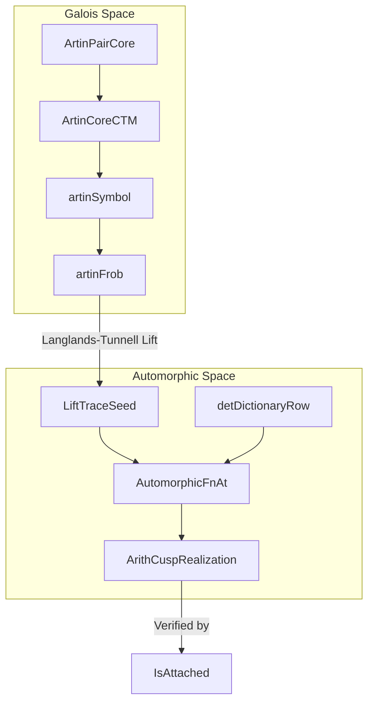
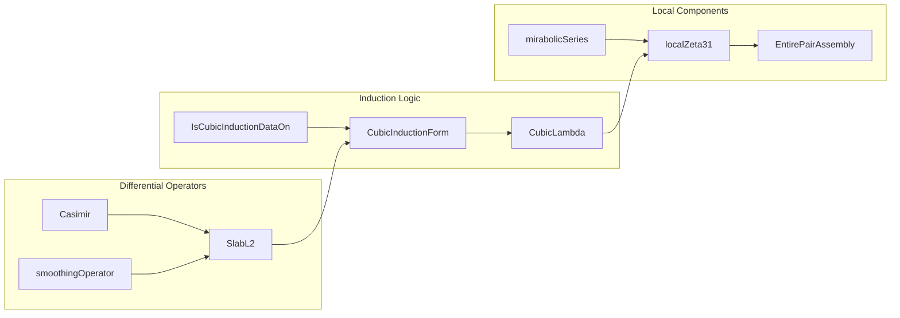

<!-- source: DeepWiki mcp.deepwiki.com · repo anthropics/fermats-last-theorem · page 7 Langlands-Tunnell and the Rankin-Selberg Method · fetched 2026-10-26 -->

# Langlands-Tunnell and the Rankin-Selberg Method

Relevant source files

The following files were used as context for generating this wiki page:

- [Definitions/Def_FrobeniusDensity_BadPrimes.lean](Definitions/Def_FrobeniusDensity_BadPrimes.lean)
- [Definitions/Def_LanglandsTunnell_ArtinCoreCTM.lean](Definitions/Def_LanglandsTunnell_ArtinCoreCTM.lean)
- [Definitions/Def_LanglandsTunnell_NormClass.lean](Definitions/Def_LanglandsTunnell_NormClass.lean)
- [P2M/Sol/S_LT_HeckeChar_exists_heckeCharOfRayClassChar.lean](P2M/Sol/S_LT_HeckeChar_exists_heckeCharOfRayClassChar.lean)
- [P2M/Sol/S_LanglandsTunnell_Artin_Ni_mem_normRaySubgroup_of_symbol_eq_one.lean](P2M/Sol/S_LanglandsTunnell_Artin_Ni_mem_normRaySubgroup_of_symbol_eq_one.lean)
- [P2M/Sol/S_LanglandsTunnell_Artin_artinSymbol_surjective_and_ker_eq_normRaySubgroup_of_dvd_twentyFour.lean](P2M/Sol/S_LanglandsTunnell_Artin_artinSymbol_surjective_and_ker_eq_normRaySubgroup_of_dvd_twentyFour.lean)
- [P2M/Sol/S_LanglandsTunnell_Artin_artinSymbol_surjective_and_ker_eq_normRaySubgroup_of_isAdmissibleModulusOfDegree.lean](P2M/Sol/S_LanglandsTunnell_Artin_artinSymbol_surjective_and_ker_eq_normRaySubgroup_of_isAdmissibleModulusOfDegree.lean)
- [P2M/Sol/S_LanglandsTunnell_Artin_artinSymbol_surjective_and_ker_eq_normRaySubgroup_of_pow_eq_one_of_isAdmissibleModulusOfDegree.lean](P2M/Sol/S_LanglandsTunnell_Artin_artinSymbol_surjective_and_ker_eq_normRaySubgroup_of_pow_eq_one_of_isAdmissibleModulusOfDegree.lean)
- [P2M/Sol/S_LanglandsTunnell_Artin_exists_Ni_eq_Ni_and_symbol_eq_of_artinPairCore.lean](P2M/Sol/S_LanglandsTunnell_Artin_exists_Ni_eq_Ni_and_symbol_eq_of_artinPairCore.lean)
- [P2M/Sol/S_LanglandsTunnell_Artin_exists_artinFieldCore_exists_artinPairCore_of_isAdmissibleModulusOfDegree.lean](P2M/Sol/S_LanglandsTunnell_Artin_exists_artinFieldCore_exists_artinPairCore_of_isAdmissibleModulusOfDegree.lean)
- [P2M/Sol/S_LanglandsTunnell_Artin_exists_artinFieldCore_nonempty_artinPairCore.lean](P2M/Sol/S_LanglandsTunnell_Artin_exists_artinFieldCore_nonempty_artinPairCore.lean)
- [P2M/Sol/S_LanglandsTunnell_Artin_exists_transferData_of_finrank_eq_three.lean](P2M/Sol/S_LanglandsTunnell_Artin_exists_transferData_of_finrank_eq_three.lean)
- [P2M/Sol/S_LanglandsTunnell_Artin_exists_transferData_of_finrank_eq_two.lean](P2M/Sol/S_LanglandsTunnell_Artin_exists_transferData_of_finrank_eq_two.lean)
- [P2M/Sol/S_LanglandsTunnell_CubicInduction_SlabL2_casimir_smoothingOperator.lean](P2M/Sol/S_LanglandsTunnell_CubicInduction_SlabL2_casimir_smoothingOperator.lean)
- [P2M/Sol/S_LanglandsTunnell_CubicInduction_SlabL2_exists_casimir_eq_smul_smooth_cuspFunction_of_ne_bot_of_stable_smoothingOperator.lean](P2M/Sol/S_LanglandsTunnell_CubicInduction_SlabL2_exists_casimir_eq_smul_smooth_cuspFunction_of_ne_bot_of_stable_smoothingOperator.lean)
- [P2M/Sol/S_LanglandsTunnell_CubicInduction_SlabL2_exists_isSmoothingKernel_leftOrthFinite_setIntegral_compl_le.lean](P2M/Sol/S_LanglandsTunnell_CubicInduction_SlabL2_exists_isSmoothingKernel_leftOrthFinite_setIntegral_compl_le.lean)
- [P2M/Sol/S_LanglandsTunnell_CubicInduction_dualWhittakerFn3_localLevelOne_and_torusValues_const_sq_of_localRankinSelbergFE.lean](P2M/Sol/S_LanglandsTunnell_CubicInduction_dualWhittakerFn3_localLevelOne_and_torusValues_const_sq_of_localRankinSelbergFE.lean)
- [P2M/Sol/S_LanglandsTunnell_CubicInduction_exists_localZeta31_fe_one_inducedEulerPoly_rational_of_isCubicInductionDataOn_of_isRamifiedIn.lean](P2M/Sol/S_LanglandsTunnell_CubicInduction_exists_localZeta31_fe_one_inducedEulerPoly_rational_of_isCubicInductionDataOn_of_isRamifiedIn.lean)
- [P2M/Sol/S_LanglandsTunnell_CubicInduction_exists_localZeta31_fe_one_inducedEulerPoly_rational_of_isCubicInductionDataOn_of_not_isRamifiedIn.lean](P2M/Sol/S_LanglandsTunnell_CubicInduction_exists_localZeta31_fe_one_inducedEulerPoly_rational_of_isCubicInductionDataOn_of_not_isRamifiedIn.lean)
- [P2M/Sol/S_LanglandsTunnell_CubicInduction_exists_mem_gl3CyclicSubspace_congruenceK1_torusValues_of_isCubicInductionDataOn.lean](P2M/Sol/S_LanglandsTunnell_CubicInduction_exists_mem_gl3CyclicSubspace_congruenceK1_torusValues_of_isCubicInductionDataOn.lean)
- [P2M/Sol/S_LanglandsTunnell_CubicInduction_exists_mem_gl3CyclicSubspace_principalLevel_le_of_isRamifiedIn_of_isCubicInductionDataOn_of_conductorBound.lean](P2M/Sol/S_LanglandsTunnell_CubicInduction_exists_mem_gl3CyclicSubspace_principalLevel_le_of_isRamifiedIn_of_isCubicInductionDataOn_of_conductorBound.lean)
- [P2M/Sol/S_LanglandsTunnell_CubicInduction_exists_rsLocalIntegral_and_dual_integrable_and_eq_rational_sphericalWhittaker_of_forall_localZeta31_fe_of_gauge.lean](P2M/Sol/S_LanglandsTunnell_CubicInduction_exists_rsLocalIntegral_and_dual_integrable_and_eq_rational_sphericalWhittaker_of_forall_localZeta31_fe_of_gauge.lean)
- [P2M/Sol/S_LanglandsTunnell_CubicInduction_exists_rsLocalIntegral_sum_translate_eq_const_of_apply_one_ne_zero.lean](P2M/Sol/S_LanglandsTunnell_CubicInduction_exists_rsLocalIntegral_sum_translate_eq_const_of_apply_one_ne_zero.lean)
- [P2M/Sol/S_LanglandsTunnell_CubicInduction_exists_whittaker3_eq_mul_prod_hasWhittakerMultOne_of_isCuspidalAlong.lean](P2M/Sol/S_LanglandsTunnell_CubicInduction_exists_whittaker3_eq_mul_prod_hasWhittakerMultOne_of_isCuspidalAlong.lean)
- [P2M/Sol/S_LanglandsTunnell_CubicInduction_hasCubicInductionForm_arch_torusValues_localPackage_bad.lean](P2M/Sol/S_LanglandsTunnell_CubicInduction_hasCubicInductionForm_arch_torusValues_localPackage_bad.lean)
- [P2M/Sol/S_LanglandsTunnell_CubicInduction_rsLocalIntegral_fe32_of_forall_localZeta31_fe_of_gauge.lean](P2M/Sol/S_LanglandsTunnell_CubicInduction_rsLocalIntegral_fe32_of_forall_localZeta31_fe_of_gauge.lean)
- [P2M/Sol/S_LanglandsTunnell_CubicInduction_whittakerArch_scalar_mul_eq_centralChar_mul_of_isCubicInductionDataOn.lean](P2M/Sol/S_LanglandsTunnell_CubicInduction_whittakerArch_scalar_mul_eq_centralChar_mul_of_isCubicInductionDataOn.lean)
- [P2M/Sol/S_LanglandsTunnell_P2_Artin_normRaySubgroup_index_eq_of_anchors.lean](P2M/Sol/S_LanglandsTunnell_P2_Artin_normRaySubgroup_index_eq_of_anchors.lean)
- [P2M/Sol/S_LanglandsTunnell_P2_raySymbol_artinValue_span_eq_one.lean](P2M/Sol/S_LanglandsTunnell_P2_raySymbol_artinValue_span_eq_one.lean)
- [P2M/Sol/S_LanglandsTunnell_P2_raySymbol_artinValue_span_eq_one_of_artinFieldCore.lean](P2M/Sol/S_LanglandsTunnell_P2_raySymbol_artinValue_span_eq_one_of_artinFieldCore.lean)
- [P2M/Sol/S_LanglandsTunnell_P2_raySymbol_artinValue_span_eq_one_of_artinPairCore.lean](P2M/Sol/S_LanglandsTunnell_P2_raySymbol_artinValue_span_eq_one_of_artinPairCore.lean)
- [P2M/Sol/S_LanglandsTunnell_RankinSelberg_EntirePairAssembly_dual_identity_family.lean](P2M/Sol/S_LanglandsTunnell_RankinSelberg_EntirePairAssembly_dual_identity_family.lean)
- [P2M/Sol/S_LanglandsTunnell_RankinSelberg_exists_entire_boundedOnStrips_eq_archFactor_mul_lFun_rsDatum_of_le_conductorExponentAt_of_centralInduced_of_localSpaceAt_of_normPin_archTrivial.lean](P2M/Sol/S_LanglandsTunnell_RankinSelberg_exists_entire_boundedOnStrips_eq_archFactor_mul_lFun_rsDatum_of_le_conductorExponentAt_of_centralInduced_of_localSpaceAt_of_normPin_archTrivial.lean)
- [P2M/Sol/S_LanglandsTunnell_RankinSelberg_exists_factor_fundamentalDomain_forall_rsGlobalIntegral_realisation_member_twisted_of_finiteFamily_arch_of_archNonvanishing.lean](P2M/Sol/S_LanglandsTunnell_RankinSelberg_exists_factor_fundamentalDomain_forall_rsGlobalIntegral_realisation_member_twisted_of_finiteFamily_arch_of_archNonvanishing.lean)
- [P2M/Sol/S_LanglandsTunnell_RankinSelberg_exists_finTranslate_not_countable_rsFinIntegral_indicator_ne_zero_of_purifier_of_finiteFamily_arch.lean](P2M/Sol/S_LanglandsTunnell_RankinSelberg_exists_finTranslate_not_countable_rsFinIntegral_indicator_ne_zero_of_purifier_of_finiteFamily_arch.lean)
- [P2M/Sol/S_LanglandsTunnell_RankinSelberg_exists_forall_integrable_rsFinCellIntegrand_translate_and_dual.lean](P2M/Sol/S_LanglandsTunnell_RankinSelberg_exists_forall_integrable_rsFinCellIntegrand_translate_and_dual.lean)
- [P2M/Sol/S_LanglandsTunnell_RankinSelberg_exists_forall_rsGlobalIntegral_eq_mul_rsArchIntegral_mul_rsFinIntegral_mul_lFun.lean](P2M/Sol/S_LanglandsTunnell_RankinSelberg_exists_forall_rsGlobalIntegral_eq_mul_rsArchIntegral_mul_rsFinIntegral_mul_lFun.lean)
- [P2M/Sol/S_LanglandsTunnell_RankinSelberg_exists_frozen_forall_sum_translate_purified_whittakerCoefficient_eq_mul_pSlot_of_finiteFamily_arch.lean](P2M/Sol/S_LanglandsTunnell_RankinSelberg_exists_frozen_forall_sum_translate_purified_whittakerCoefficient_eq_mul_pSlot_of_finiteFamily_arch.lean)
- [P2M/Sol/S_LanglandsTunnell_RankinSelberg_exists_frozen_forall_sum_translate_whittaker_iota_eq_mul_pSlot_of_finiteFamily_arch.lean](P2M/Sol/S_LanglandsTunnell_RankinSelberg_exists_frozen_forall_sum_translate_whittaker_iota_eq_mul_pSlot_of_finiteFamily_arch.lean)
- [P2M/Sol/S_LanglandsTunnell_RankinSelberg_exists_frozen_forall_sum_translate_whittaker_iota_eq_mul_pSlot_of_finiteFamily_arch_explicit.lean](P2M/Sol/S_LanglandsTunnell_RankinSelberg_exists_frozen_forall_sum_translate_whittaker_iota_eq_mul_pSlot_of_finiteFamily_arch_explicit.lean)
- [P2M/Sol/S_LanglandsTunnell_RankinSelberg_exists_gl3Translates_sum_rsFinIntegral_cells_eq_const_and_dual_eq_rootNumberMonomial_of_finWhittaker_one_ne_zero_of_localSpaceAt_of_member_of_fe32_normPin_twisted_offSQ_archPsi_bump_levelShift_global.lean](P2M/Sol/S_LanglandsTunnell_RankinSelberg_exists_gl3Translates_sum_rsFinIntegral_cells_eq_const_and_dual_eq_rootNumberMonomial_of_finWhittaker_one_ne_zero_of_localSpaceAt_of_member_of_fe32_normPin_twisted_offSQ_archPsi_bump_levelShift_global.lean)
- [P2M/Sol/S_LanglandsTunnell_RankinSelberg_exists_mem_gl3CyclicSubspace_forall_rsLocalIntegral_eq_mul_apply_of_finite.lean](P2M/Sol/S_LanglandsTunnell_RankinSelberg_exists_mem_gl3CyclicSubspace_forall_rsLocalIntegral_eq_mul_apply_of_finite.lean)
- [P2M/Sol/S_LanglandsTunnell_RankinSelberg_exists_mem_rsLocalIntegral_ne_zero_and_rational_member_twisted_of_finiteFamily_arch_deep.lean](P2M/Sol/S_LanglandsTunnell_RankinSelberg_exists_mem_rsLocalIntegral_ne_zero_and_rational_member_twisted_of_finiteFamily_arch_deep.lean)
- [P2M/Sol/S_LanglandsTunnell_RankinSelberg_exists_mem_span_forall_rsLocalIntegral_eq_const_ne_zero_of_isGL3PsiWhittakerFn.lean](P2M/Sol/S_LanglandsTunnell_RankinSelberg_exists_mem_span_forall_rsLocalIntegral_eq_const_ne_zero_of_isGL3PsiWhittakerFn.lean)
- [P2M/Sol/S_LanglandsTunnell_RankinSelberg_exists_ne_zero_forall_integrable_and_rsFinIntegral_indicator_eq_mul_finprod_rsLocalIntegral_of_pure_of_measurable.lean](P2M/Sol/S_LanglandsTunnell_RankinSelberg_exists_ne_zero_forall_integrable_and_rsFinIntegral_indicator_eq_mul_finprod_rsLocalIntegral_of_pure_of_measurable.lean)
- [P2M/Sol/S_LanglandsTunnell_RankinSelberg_exists_ne_zero_forall_rsFinIntegral_indicator_purified_eq_mul_sum_prod_rsLocalIntegral.lean](P2M/Sol/S_LanglandsTunnell_RankinSelberg_exists_ne_zero_forall_rsFinIntegral_indicator_purified_eq_mul_sum_prod_rsLocalIntegral.lean)
- [P2M/Sol/S_LanglandsTunnell_RankinSelberg_exists_ne_zero_forall_rsGlobalIntegral_reference_eq_mul_rsArchIntegral_mul_rsFinIntegral_indicator_mul_of_finiteFamily_arch.lean](P2M/Sol/S_LanglandsTunnell_RankinSelberg_exists_ne_zero_forall_rsGlobalIntegral_reference_eq_mul_rsArchIntegral_mul_rsFinIntegral_indicator_mul_of_finiteFamily_arch.lean)
- [P2M/Sol/S_LanglandsTunnell_RankinSelberg_exists_pos_forall_rsFinIntegral_eq_mul_of_support_subset_unipotent_mul.lean](P2M/Sol/S_LanglandsTunnell_RankinSelberg_exists_pos_forall_rsFinIntegral_eq_mul_of_support_subset_unipotent_mul.lean)
- [P2M/Sol/S_LanglandsTunnell_RankinSelberg_exists_pos_forall_rsLocalIntegral_eq_mul_of_support_subset_unipotent_mul.lean](P2M/Sol/S_LanglandsTunnell_RankinSelberg_exists_pos_forall_rsLocalIntegral_eq_mul_of_support_subset_unipotent_mul.lean)
- [P2M/Sol/S_LanglandsTunnell_RankinSelberg_exists_pureTranslates_combination_forall_rsGlobalIntegral_ne_zero_member_twisted_of_finiteFamily_arch_of_archNonvanishing.lean](P2M/Sol/S_LanglandsTunnell_RankinSelberg_exists_pureTranslates_combination_forall_rsGlobalIntegral_ne_zero_member_twisted_of_finiteFamily_arch_of_archNonvanishing.lean)
- [P2M/Sol/S_LanglandsTunnell_RankinSelberg_exists_rational_gamma_rsLocalIntegral_member_twisted_of_finiteFamily_arch_deep_archPsi.lean](P2M/Sol/S_LanglandsTunnell_RankinSelberg_exists_rational_gamma_rsLocalIntegral_member_twisted_of_finiteFamily_arch_deep_archPsi.lean)
- [P2M/Sol/S_LanglandsTunnell_agreesAwayFromFinite_or_twist_bcWeight_of_formalBaseChange_agree_sylowH.lean](P2M/Sol/S_LanglandsTunnell_agreesAwayFromFinite_or_twist_bcWeight_of_formalBaseChange_agree_sylowH.lean)
- [P2M/Sol/S_LanglandsTunnell_artinValue4_eq_artinValue_under_pow.lean](P2M/Sol/S_LanglandsTunnell_artinValue4_eq_artinValue_under_pow.lean)
- [P2M/Sol/S_LanglandsTunnell_exists_agreesLiftTraceSeed_isCusp_pair_of_detDictionaryRow_of_coversModCentre.lean](P2M/Sol/S_LanglandsTunnell_exists_agreesLiftTraceSeed_isCusp_pair_of_detDictionaryRow_of_coversModCentre.lean)
- [P2M/Sol/S_LanglandsTunnell_exists_finset_forall_inertia_eq_bot.lean](P2M/Sol/S_LanglandsTunnell_exists_finset_forall_inertia_eq_bot.lean)
- [P2M/Sol/S_LanglandsTunnell_exists_isArithBoundedGenuineCuspRealizable_pair_agrees_liftTraceSeed_quatH.lean](P2M/Sol/S_LanglandsTunnell_exists_isArithBoundedGenuineCuspRealizable_pair_agrees_liftTraceSeed_quatH.lean)
- [P2M/Sol/S_LanglandsTunnell_exists_isConstantOnFibers_b_formalBaseChange_arithBoundedGenuineCuspRealizable_detKer_of_quatH.lean](P2M/Sol/S_LanglandsTunnell_exists_isConstantOnFibers_b_formalBaseChange_arithBoundedGenuineCuspRealizable_detKer_of_quatH.lean)
- [P2M/Sol/S_LanglandsTunnell_face_liftValuedUpToPartner_of_b_agreesAt_liftTraceSeed_detKer_sylowH.lean](P2M/Sol/S_LanglandsTunnell_face_liftValuedUpToPartner_of_b_agreesAt_liftTraceSeed_detKer_sylowH.lean)
- [P2M/Sol/S_LanglandsTunnell_liftTraceSeed_quatH_table_eq_artinValue4.lean](P2M/Sol/S_LanglandsTunnell_liftTraceSeed_quatH_table_eq_artinValue4.lean)
- [P2M/Sol/S_LanglandsTunnell_liftTraceSeed_sylowH_table_eq_artinValue.lean](P2M/Sol/S_LanglandsTunnell_liftTraceSeed_sylowH_table_eq_artinValue.lean)
- [P2M/Sol/S_LanglandsTunnell_not_agreesAwayFromFinite_formalBaseChange_sylowH_eisensteinTableOf_of_quatH.lean](P2M/Sol/S_LanglandsTunnell_not_agreesAwayFromFinite_formalBaseChange_sylowH_eisensteinTableOf_of_quatH.lean)
- [P2M/Sol/S_M4aKummer_normClassIndex_dvd_two.lean](P2M/Sol/S_M4aKummer_normClassIndex_dvd_two.lean)

This section covers the proof of the modularity of octahedral Galois representations, a key step in the proof of Fermat's Last Theorem. The process involves constructing a specific Artin representation, lifting it to a cuspidal automorphic form on $\text{GL}_2$ via the Langlands-Tunnell theorem, and verifying the properties of this lift using the Rankin-Selberg method and converse theorems.

The implementation bridges the gap between Galois-theoretic data (Artin representations) and analytic data (automorphic forms and L-functions).

## Artin Representations and Automorphic Correspondence

The first phase involves defining the octahedral Artin representation $\rho: \text{Gal}(\bar{\mathbb{Q}}/\mathbb{Q}) \to \text{GL}_2(\mathbb{C})$ and establishing its correspondence with an automorphic form. The codebase uses `ArtinCoreCTM` to manage the field extensions and `ArtinPairCore` to handle the specific Galois data required for the lift.

Key entities include the `artinSymbol` [P2M/Sol/S_LanglandsTunnell_Artin_exists_transferData_of_finrank_eq_two.lean:66-66](), which maps idele classes to Galois elements, and the `normRaySubgroup` [P2M/Sol/S_LanglandsTunnell_P2_raySymbol_artinValue_span_eq_one_of_artinPairCore.lean:66-66](), which defines the kernel of the Artin map in the context of ray class groups. The `LiftTraceSeed` [P2M/Sol/S_LanglandsTunnell_exists_agreesLiftTraceSeed_isCusp_pair_of_detDictionaryRow_of_coversModCentre.lean:21-21]() provides the initial trace data for the automorphic lift.

### Galois to Automorphic Mapping
The following diagram illustrates how Galois representations are linked to automorphic forms through the Langlands-Tunnell machinery.

**Diagram: Artin Representation Correspondence**

Sources: [P2M/Sol/S_LanglandsTunnell_exists_agreesLiftTraceSeed_isCusp_pair_of_detDictionaryRow_of_coversModCentre.lean:49-54](), [P2M/Sol/S_LanglandsTunnell_Artin_exists_transferData_of_finrank_eq_two.lean:3-8]()

For details, see [Langlands-Tunnell: Artin Representations and Automorphic Correspondence](#7.1).

## Rankin-Selberg Integrals and the Converse Theorem

To prove that a given representation is modular, one must show that its associated L-function is "well-behaved" (entire and satisfies a functional equation). The codebase implements this via the Rankin-Selberg method, specifically through `rsGlobalIntegral` [P2M/Sol/S_LanglandsTunnell_RankinSelberg_exists_mem_rsLocalIntegral_ne_zero_and_rational_member_twisted_of_finiteFamily_arch_deep.lean:11-11]() and `rsLocalIntegral` [P2M/Sol/S_LanglandsTunnell_RankinSelberg_exists_mem_rsLocalIntegral_ne_zero_and_rational_member_twisted_of_finiteFamily_arch_deep.lean:54-54]().

The `EntirePairAssembly` [P2M/Sol/S_LanglandsTunnell_RankinSelberg_exists_entire_boundedOnStrips_eq_archFactor_mul_lFun_rsDatum_of_le_conductorExponentAt_of_centralInduced_of_localSpaceAt_of_normPin_archTrivial.lean:79-79]() collects the local factors into a global L-function. The proof relies on the `clearedFE` (cleared functional equation) to demonstrate the required symmetries.

| Entity | Role | File Reference |
| :--- | :--- | :--- |
| `rsGlobalIntegral` | The global Rankin-Selberg integral over the adeles. | [P2M/Sol/S_LanglandsTunnell_RankinSelberg_exists_entire_boundedOnStrips_eq_archFactor_mul_lFun_rsDatum_of_le_conductorExponentAt_of_centralInduced_of_localSpaceAt_of_normPin_archTrivial.lean:17-17]() |
| `rsLocalIntegral` | Local factor of the integral at a place $v$. | [P2M/Sol/S_LanglandsTunnell_RankinSelberg_exists_mem_rsLocalIntegral_ne_zero_and_rational_member_twisted_of_finiteFamily_arch_deep.lean:54-54]() |
| `HonestLDatum` | Data structure containing the L-function parameters. | [P2M/Sol/S_LanglandsTunnell_RankinSelberg_exists_entire_boundedOnStrips_eq_archFactor_mul_lFun_rsDatum_of_le_conductorExponentAt_of_centralInduced_of_localSpaceAt_of_normPin_archTrivial.lean:24-24]() |
| `KirillovModel` | Realization of the representation on a space of functions. | [P2M/Sol/S_LanglandsTunnell_RankinSelberg_exists_mem_rsLocalIntegral_ne_zero_and_rational_member_twisted_of_finiteFamily_arch_deep.lean:27-27]() |

For details, see [Rankin-Selberg Integrals and the Converse Theorem](#7.2).

## Cubic Induction and GL₃ Automorphic Forms

The Langlands-Tunnell theorem for octahedral representations often proceeds by showing that the symmetric square of the representation (which lives on $\text{GL}_3$) is modular. This involves the `CubicInductionForm` [P2M/Sol/S_LanglandsTunnell_RankinSelberg_exists_entire_boundedOnStrips_eq_archFactor_mul_lFun_rsDatum_of_le_conductorExponentAt_of_centralInduced_of_localSpaceAt_of_normPin_archTrivial.lean:38-38]() and the `SlabL2` space [P2M/Sol/S_LanglandsTunnell_RankinSelberg_exists_mem_rsLocalIntegral_ne_zero_and_rational_member_twisted_of_finiteFamily_arch_deep.lean:12-12]().

The codebase uses a `smoothingOperator` and the `Casimir` operator to manage the analytic properties of these forms, ensuring they are smooth and satisfy the required differential equations.

**Diagram: GL₃ Analytic Infrastructure**

Sources: [P2M/Sol/S_LanglandsTunnell_RankinSelberg_exists_entire_boundedOnStrips_eq_archFactor_mul_lFun_rsDatum_of_le_conductorExponentAt_of_centralInduced_of_localSpaceAt_of_normPin_archTrivial.lean:1-4](), [P2M/Sol/S_LanglandsTunnell_RankinSelberg_exists_mem_rsLocalIntegral_ne_zero_and_rational_member_twisted_of_finiteFamily_arch_deep.lean:12-19]()

For details, see [Cubic Induction and GL₃ Automorphic Forms](#7.3).

Sources:
- [P2M/Sol/S_LanglandsTunnell_exists_agreesLiftTraceSeed_isCusp_pair_of_detDictionaryRow_of_coversModCentre.lean:1-103]()
- [P2M/Sol/S_LanglandsTunnell_Artin_exists_transferData_of_finrank_eq_two.lean:1-58]()
- [P2M/Sol/S_LanglandsTunnell_RankinSelberg_exists_entire_boundedOnStrips_eq_archFactor_mul_lFun_rsDatum_of_le_conductorExponentAt_of_centralInduced_of_localSpaceAt_of_normPin_archTrivial.lean:1-90]()
- [P2M/Sol/S_LanglandsTunnell_RankinSelberg_exists_mem_rsLocalIntegral_ne_zero_and_rational_member_twisted_of_finiteFamily_arch_deep.lean:1-98]()

---

