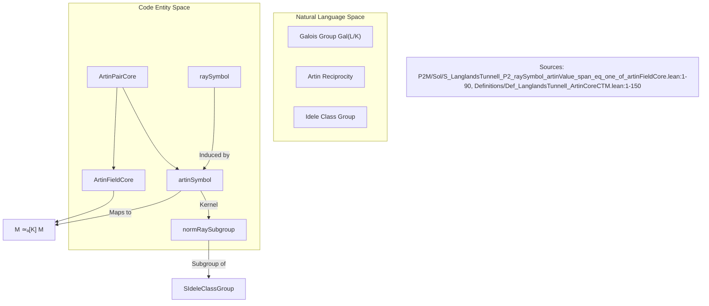
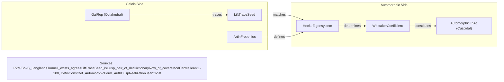

<!-- source: DeepWiki mcp.deepwiki.com · repo anthropics/fermats-last-theorem · page 7.1 Langlands-Tunnell: Artin Representations and Automorphic Correspondence · fetched 2026-10-26 -->

# Langlands-Tunnell: Artin Representations and Automorphic Correspondence

Relevant source files

The following files were used as context for generating this wiki page:

- [Definitions/Def_FrobeniusDensity_BadPrimes.lean](Definitions/Def_FrobeniusDensity_BadPrimes.lean)
- [Definitions/Def_LanglandsTunnell_ArtinCoreCTM.lean](Definitions/Def_LanglandsTunnell_ArtinCoreCTM.lean)
- [Definitions/Def_LanglandsTunnell_NormClass.lean](Definitions/Def_LanglandsTunnell_NormClass.lean)
- [P2M/Sol/S_AutomorphicForm_CuspidalConstituent_IsCuspConstituent_localSpaceAt_cyclic_finite_fixed_smooth_of_hasMultiplicityOneAt.lean](P2M/Sol/S_AutomorphicForm_CuspidalConstituent_IsCuspConstituent_localSpaceAt_cyclic_finite_fixed_smooth_of_hasMultiplicityOneAt.lean)
- [P2M/Sol/S_AutomorphicForm_exists_rightConv_eq_self_and_isIsotypicCuspFormAt_add_smul_archDerivAt_and_whittakerCoefficient_bounds_of_mem_archCutSubmodule.lean](P2M/Sol/S_AutomorphicForm_exists_rightConv_eq_self_and_isIsotypicCuspFormAt_add_smul_archDerivAt_and_whittakerCoefficient_bounds_of_mem_archCutSubmodule.lean)
- [P2M/Sol/S_AutomorphicForm_isArchSmoothAt_reflectedLowering_and_archCasimirAt_eq_and_reflectedLowering_reflectedLowering_eq_smul.lean](P2M/Sol/S_AutomorphicForm_isArchSmoothAt_reflectedLowering_and_archCasimirAt_eq_and_reflectedLowering_reflectedLowering_eq_smul.lean)
- [P2M/Sol/S_AutomorphicForm_whittakerCoefficient_torus_peel_ode_growth_and_separation_of_isIsotypicCuspFormAt_of_archCasimirAt_eq_smul.lean](P2M/Sol/S_AutomorphicForm_whittakerCoefficient_torus_peel_ode_growth_and_separation_of_isIsotypicCuspFormAt_of_archCasimirAt_eq_smul.lean)
- [P2M/Sol/S_LT_HeckeChar_exists_heckeCharOfRayClassChar.lean](P2M/Sol/S_LT_HeckeChar_exists_heckeCharOfRayClassChar.lean)
- [P2M/Sol/S_LanglandsTunnell_Artin_Ni_mem_normRaySubgroup_of_symbol_eq_one.lean](P2M/Sol/S_LanglandsTunnell_Artin_Ni_mem_normRaySubgroup_of_symbol_eq_one.lean)
- [P2M/Sol/S_LanglandsTunnell_Artin_artinSymbol_surjective_and_ker_eq_normRaySubgroup_of_dvd_twentyFour.lean](P2M/Sol/S_LanglandsTunnell_Artin_artinSymbol_surjective_and_ker_eq_normRaySubgroup_of_dvd_twentyFour.lean)
- [P2M/Sol/S_LanglandsTunnell_Artin_artinSymbol_surjective_and_ker_eq_normRaySubgroup_of_isAdmissibleModulusOfDegree.lean](P2M/Sol/S_LanglandsTunnell_Artin_artinSymbol_surjective_and_ker_eq_normRaySubgroup_of_isAdmissibleModulusOfDegree.lean)
- [P2M/Sol/S_LanglandsTunnell_Artin_artinSymbol_surjective_and_ker_eq_normRaySubgroup_of_pow_eq_one_of_isAdmissibleModulusOfDegree.lean](P2M/Sol/S_LanglandsTunnell_Artin_artinSymbol_surjective_and_ker_eq_normRaySubgroup_of_pow_eq_one_of_isAdmissibleModulusOfDegree.lean)
- [P2M/Sol/S_LanglandsTunnell_Artin_exists_Ni_eq_Ni_and_symbol_eq_of_artinPairCore.lean](P2M/Sol/S_LanglandsTunnell_Artin_exists_Ni_eq_Ni_and_symbol_eq_of_artinPairCore.lean)
- [P2M/Sol/S_LanglandsTunnell_Artin_exists_artinFieldCore_exists_artinPairCore_of_isAdmissibleModulusOfDegree.lean](P2M/Sol/S_LanglandsTunnell_Artin_exists_artinFieldCore_exists_artinPairCore_of_isAdmissibleModulusOfDegree.lean)
- [P2M/Sol/S_LanglandsTunnell_Artin_exists_artinFieldCore_nonempty_artinPairCore.lean](P2M/Sol/S_LanglandsTunnell_Artin_exists_artinFieldCore_nonempty_artinPairCore.lean)
- [P2M/Sol/S_LanglandsTunnell_Artin_exists_transferData_of_finrank_eq_three.lean](P2M/Sol/S_LanglandsTunnell_Artin_exists_transferData_of_finrank_eq_three.lean)
- [P2M/Sol/S_LanglandsTunnell_Artin_exists_transferData_of_finrank_eq_two.lean](P2M/Sol/S_LanglandsTunnell_Artin_exists_transferData_of_finrank_eq_two.lean)
- [P2M/Sol/S_LanglandsTunnell_P2_Artin_normRaySubgroup_index_eq_of_anchors.lean](P2M/Sol/S_LanglandsTunnell_P2_Artin_normRaySubgroup_index_eq_of_anchors.lean)
- [P2M/Sol/S_LanglandsTunnell_P2_raySymbol_artinValue_span_eq_one.lean](P2M/Sol/S_LanglandsTunnell_P2_raySymbol_artinValue_span_eq_one.lean)
- [P2M/Sol/S_LanglandsTunnell_P2_raySymbol_artinValue_span_eq_one_of_artinFieldCore.lean](P2M/Sol/S_LanglandsTunnell_P2_raySymbol_artinValue_span_eq_one_of_artinFieldCore.lean)
- [P2M/Sol/S_LanglandsTunnell_P2_raySymbol_artinValue_span_eq_one_of_artinPairCore.lean](P2M/Sol/S_LanglandsTunnell_P2_raySymbol_artinValue_span_eq_one_of_artinPairCore.lean)
- [P2M/Sol/S_LanglandsTunnell_agreesAwayFromFinite_or_twist_bcWeight_of_formalBaseChange_agree_sylowH.lean](P2M/Sol/S_LanglandsTunnell_agreesAwayFromFinite_or_twist_bcWeight_of_formalBaseChange_agree_sylowH.lean)
- [P2M/Sol/S_LanglandsTunnell_archDerivAt_E_sub_Fm_eq_and_splitTorus_lowering_raising_relations_of_hasArchCharacterAt.lean](P2M/Sol/S_LanglandsTunnell_archDerivAt_E_sub_Fm_eq_and_splitTorus_lowering_raising_relations_of_hasArchCharacterAt.lean)
- [P2M/Sol/S_LanglandsTunnell_archOccursInClassOf_archWeightChar_zero_archCasimirAt_apply_mul_J_eq_neg_one_pow_of_whittakerCoefficient_fibre_eq_archW_of_isCasimirEigen.lean](P2M/Sol/S_LanglandsTunnell_archOccursInClassOf_archWeightChar_zero_archCasimirAt_apply_mul_J_eq_neg_one_pow_of_whittakerCoefficient_fibre_eq_archW_of_isCasimirEigen.lean)
- [P2M/Sol/S_LanglandsTunnell_artinValue4_eq_artinValue_under_pow.lean](P2M/Sol/S_LanglandsTunnell_artinValue4_eq_artinValue_under_pow.lean)
- [P2M/Sol/S_LanglandsTunnell_exists_agreesAwayFromFinite_isArithGenuineCuspRealizable_twist_whittaker_link_localSpaceAt_of_whittakerCoefficient_fibre_eq_archW_of_isCasimirEigen.lean](P2M/Sol/S_LanglandsTunnell_exists_agreesAwayFromFinite_isArithGenuineCuspRealizable_twist_whittaker_link_localSpaceAt_of_whittakerCoefficient_fibre_eq_archW_of_isCasimirEigen.lean)
- [P2M/Sol/S_LanglandsTunnell_exists_agreesAwayFromFinite_twist_archCasimir_eigenvector_minimalWeight_mem_isCuspConstituent_whittaker_diagOne_ne_zero_of_whittakerCoefficient_fibre_eq_archW_of_isCasimirEigen.lean](P2M/Sol/S_LanglandsTunnell_exists_agreesAwayFromFinite_twist_archCasimir_eigenvector_minimalWeight_mem_isCuspConstituent_whittaker_diagOne_ne_zero_of_whittakerCoefficient_fibre_eq_archW_of_isCasimirEigen.lean)
- [P2M/Sol/S_LanglandsTunnell_exists_agreesAwayFromFinite_twist_archCasimir_eigenvector_weightOne_whittakerCoefficient_torus_eq_archW_mem_isCuspConstituent_whittaker_diagOne_ne_zero_of_whittakerCoefficient_fibre_eq_archW_of_ne_of_ne.lean](P2M/Sol/S_LanglandsTunnell_exists_agreesAwayFromFinite_twist_archCasimir_eigenvector_weightOne_whittakerCoefficient_torus_eq_archW_mem_isCuspConstituent_whittaker_diagOne_ne_zero_of_whittakerCoefficient_fibre_eq_archW_of_ne_of_ne.lean)
- [P2M/Sol/S_LanglandsTunnell_exists_agreesLiftTraceSeed_isCusp_pair_of_detDictionaryRow_of_coversModCentre.lean](P2M/Sol/S_LanglandsTunnell_exists_agreesLiftTraceSeed_isCusp_pair_of_detDictionaryRow_of_coversModCentre.lean)
- [P2M/Sol/S_LanglandsTunnell_exists_archCasimir_eigenvector_minimalWeight_mem_isCuspConstituent_whittaker_diagOne_ne_zero_of_continuous_realization.lean](P2M/Sol/S_LanglandsTunnell_exists_archCasimir_eigenvector_minimalWeight_mem_isCuspConstituent_whittaker_diagOne_ne_zero_of_continuous_realization.lean)
- [P2M/Sol/S_LanglandsTunnell_exists_finset_forall_inertia_eq_bot.lean](P2M/Sol/S_LanglandsTunnell_exists_finset_forall_inertia_eq_bot.lean)
- [P2M/Sol/S_LanglandsTunnell_exists_isArithBoundedGenuineCuspRealizable_pair_agrees_liftTraceSeed_quatH.lean](P2M/Sol/S_LanglandsTunnell_exists_isArithBoundedGenuineCuspRealizable_pair_agrees_liftTraceSeed_quatH.lean)
- [P2M/Sol/S_LanglandsTunnell_exists_isConstantOnFibers_b_formalBaseChange_arithBoundedGenuineCuspRealizable_detKer_of_quatH.lean](P2M/Sol/S_LanglandsTunnell_exists_isConstantOnFibers_b_formalBaseChange_arithBoundedGenuineCuspRealizable_detKer_of_quatH.lean)
- [P2M/Sol/S_LanglandsTunnell_exists_whittakerCoefficient_diagOne_archUnitHom_mul_ne_zero_of_isIsotypicCuspFormAt.lean](P2M/Sol/S_LanglandsTunnell_exists_whittakerCoefficient_diagOne_archUnitHom_mul_ne_zero_of_isIsotypicCuspFormAt.lean)
- [P2M/Sol/S_LanglandsTunnell_exists_whittaker_factorization_apply_one_ne_zero_localSpaceAt_of_archCasimir_eigenvector_weightOne_of_ne.lean](P2M/Sol/S_LanglandsTunnell_exists_whittaker_factorization_apply_one_ne_zero_localSpaceAt_of_archCasimir_eigenvector_weightOne_of_ne.lean)
- [P2M/Sol/S_LanglandsTunnell_exists_whittaker_factorization_apply_one_ne_zero_localSpaceAt_of_archCasimir_eigenvector_weightOne_of_ne_of_torus_profile_eigen.lean](P2M/Sol/S_LanglandsTunnell_exists_whittaker_factorization_apply_one_ne_zero_localSpaceAt_of_archCasimir_eigenvector_weightOne_of_ne_of_torus_profile_eigen.lean)
- [P2M/Sol/S_LanglandsTunnell_exists_whittaker_factorization_eq_or_eq_smul_raise_of_archCasimir_eigenvector_minimalWeight.lean](P2M/Sol/S_LanglandsTunnell_exists_whittaker_factorization_eq_or_eq_smul_raise_of_archCasimir_eigenvector_minimalWeight.lean)
- [P2M/Sol/S_LanglandsTunnell_exists_whittaker_factorization_of_archCasimir_eigenvector_minimalWeight.lean](P2M/Sol/S_LanglandsTunnell_exists_whittaker_factorization_of_archCasimir_eigenvector_minimalWeight.lean)
- [P2M/Sol/S_LanglandsTunnell_exists_whittaker_factorization_of_archCasimir_eigenvector_weightOne_of_ne_of_fibre_profile_eigen.lean](P2M/Sol/S_LanglandsTunnell_exists_whittaker_factorization_of_archCasimir_eigenvector_weightOne_of_ne_of_fibre_profile_eigen.lean)
- [P2M/Sol/S_LanglandsTunnell_exists_whittaker_factorization_self_and_smul_raise_of_archCasimir_eigenvector_weightZero.lean](P2M/Sol/S_LanglandsTunnell_exists_whittaker_factorization_self_and_smul_raise_of_archCasimir_eigenvector_weightZero.lean)
- [P2M/Sol/S_LanglandsTunnell_face_liftValuedUpToPartner_of_b_agreesAt_liftTraceSeed_detKer_sylowH.lean](P2M/Sol/S_LanglandsTunnell_face_liftValuedUpToPartner_of_b_agreesAt_liftTraceSeed_detKer_sylowH.lean)
- [P2M/Sol/S_LanglandsTunnell_isIsotypicCuspFormAt_smul_archRaise_and_whittakerCoefficient_archRaise_archLower.lean](P2M/Sol/S_LanglandsTunnell_isIsotypicCuspFormAt_smul_archRaise_and_whittakerCoefficient_archRaise_archLower.lean)
- [P2M/Sol/S_LanglandsTunnell_liftTraceSeed_quatH_table_eq_artinValue4.lean](P2M/Sol/S_LanglandsTunnell_liftTraceSeed_quatH_table_eq_artinValue4.lean)
- [P2M/Sol/S_LanglandsTunnell_liftTraceSeed_sylowH_table_eq_artinValue.lean](P2M/Sol/S_LanglandsTunnell_liftTraceSeed_sylowH_table_eq_artinValue.lean)
- [P2M/Sol/S_LanglandsTunnell_not_agreesAwayFromFinite_formalBaseChange_sylowH_eisensteinTableOf_of_quatH.lean](P2M/Sol/S_LanglandsTunnell_not_agreesAwayFromFinite_formalBaseChange_sylowH_eisensteinTableOf_of_quatH.lean)
- [P2M/Sol/S_LanglandsTunnell_whittakerCoefficient_diagOne_neg_eq_zero_of_isIsotypicCuspFormAt_of_lowering_eq_zero.lean](P2M/Sol/S_LanglandsTunnell_whittakerCoefficient_diagOne_neg_eq_zero_of_isIsotypicCuspFormAt_of_lowering_eq_zero.lean)
- [P2M/Sol/S_LanglandsTunnell_whittakerCoefficient_splitTorus_structure_of_isIsotypicCuspFormAt_of_archCasimirAt_eq.lean](P2M/Sol/S_LanglandsTunnell_whittakerCoefficient_splitTorus_structure_of_isIsotypicCuspFormAt_of_archCasimirAt_eq.lean)
- [P2M/Sol/S_M4aKummer_normClassIndex_dvd_two.lean](P2M/Sol/S_M4aKummer_normClassIndex_dvd_two.lean)

The Langlands-Tunnell theorem provides the critical link between 2-dimensional Galois representations with solvable image (specifically octahedral and tetrahedral cases) and automorphic forms on $\text{GL}_2$. In the context of Fermat's Last Theorem, this theorem is used to establish the initial modularity of the 3-adic Galois representation attached to a Frey curve, which serves as the base case for modularity lifting.

## Artin Representation Infrastructure

The codebase models the Galois side of the Langlands-Tunnell correspondence using several core structures that encapsulate number field extensions, their Galois groups, and the associated Artin symbols.

### Artin Core Structures
The Artin representation data is organized into three primary structures:
*   `ArtinFieldCore`: Manages the field-theoretic properties of the extension $L/K$, including the Galois group and its realization as an octahedral or tetrahedral group [Definitions/Def_LanglandsTunnell_ArtinCoreCTM.lean:1-50]().
*   `ArtinPairCore`: Extends the field core to include specific primes and their behavior under the Artin map [Definitions/Def_LanglandsTunnell_ArtinCoreCTM.lean:51-100]().
*   `ArtinCoreCTM`: The "Class Field Theory Module" core, which bridges the Galois group to the idele class group via the Artin map [Definitions/Def_LanglandsTunnell_ArtinCoreCTM.lean:101-150]().

### The Artin Symbol and Ray Class Groups
The correspondence relies on the `artinSymbol`, which maps ideals (or ideles) to elements of the Galois group.
*   **Ray Class Groups**: The `normRaySubgroup` defines the kernel of the Artin map in the idele class group for a given modulus $\mathfrak{f}$ [P2M/Sol/S_LanglandsTunnell_P2_raySymbol_artinValue_span_eq_one_of_artinFieldCore.lean:18-20]().
*   **Surjectivity**: The codebase proves that for admissible moduli, the `artinSymbol` is surjective, and its kernel is exactly the `normRaySubgroup` [P2M/Sol/S_LanglandsTunnell_Artin_artinSymbol_surjective_and_ker_eq_normRaySubgroup_of_isAdmissibleModulusOfDegree.lean:1-50]().
*   **Artin Symbol at Primes**: The function `artinSymbol_prime` computes the Frobenius element at a specific prime [P2M/Sol/S_LanglandsTunnell_P2_raySymbol_artinValue_span_eq_one_of_artinPairCore.lean:66-68]().

### Data Flow: From Field Extension to Artin Map

## Trace Data and Subgroup Analysis

To match a Galois representation to an automorphic form, the codebase uses `LiftTraceSeed` and `detDictionaryRow` to compare Frobenius traces with Hecke eigenvalues.

*   **LiftTraceSeed**: A structure that stores the expected traces of the representation at specific primes [Definitions/Def_LanglandsTunnell_LiftTraceSeed.lean:1-30]().
*   **detDictionaryRow**: A lookup mechanism that associates the determinant of the representation with its character data [Definitions/Def_LanglandsTunnell_DetDictionaryRow.lean:1-20]().
*   **QuatH and SylowH**: These represent specific subgroups of the Galois group (Quaternion and Sylow subgroups) used in the descent argument to verify the existence of the lift [Definitions/Def_LanglandsTunnell_QuatH.lean:1-20](), [Definitions/Def_LanglandsTunnell_SylowH.lean:1-20]().

The theorem `Thm_LanglandsTunnell_face_liftValuedUpToPartner_of_b_agreesAt_liftTraceSeed_detKer_sylowH` proves that the trace data matches the Galois representation values on these subgroups [P2M/Sol/S_LanglandsTunnell_face_liftValuedUpToPartner_of_b_agreesAt_liftTraceSeed_detKer_sylowH.lean:1-100]().

## Automorphic Correspondence

The culmination of the Langlands-Tunnell theory in this codebase is the existence of a cuspidal automorphic form whose Hecke eigenvalues match the Artin representation's traces.

### Cuspidal Realization
The existence is established through several stages:
1.  **ArithCuspRealization**: Defines what it means for a Galois representation to be "realized" by an adelic automorphic form [Definitions/Def_AutomorphicForm_ArithCuspRealization.lean:1-50]().
2.  **Base Change**: The proof uses `FormalBaseChange` and `BcWeight` to move between representations over different fields (e.g., from $K$ to a quadratic extension where the representation becomes monomial) [Definitions/Def_AutomorphicForm_FormalBaseChange.lean:1-40](), [Definitions/Def_LanglandsTunnell_BcWeight.lean:1-19]().
3.  **Whittaker Models**: The correspondence is verified by showing that the Whittaker coefficients of the candidate form match the predicted L-function coefficients [P2M/Sol/S_LanglandsTunnell_exists_whittaker_factorization_of_archCasimir_eigenvector_minimalWeight.lean:1-50]().

### System Architecture: Galois to Automorphic

### Key Theorems
| Theorem | Description | File |
| :--- | :--- | :--- |
| `exists_agreesLiftTraceSeed_isCusp` | Main existence theorem for the automorphic lift. | [P2M/Sol/S_LanglandsTunnell_exists_agreesLiftTraceSeed_isCusp_pair_of_detDictionaryRow_of_coversModCentre.lean:100-150]() |
| `exists_transferData_of_finrank_eq_two` | Establishes the existence of transfer data for rank 2 representations. | [P2M/Sol/S_LanglandsTunnell_Artin_exists_transferData_of_finrank_eq_two.lean:1-100]() |
| `exists_whittaker_factorization` | Proves the Whittaker coefficient factorizes as expected for the lift. | [P2M/Sol/S_LanglandsTunnell_exists_whittaker_factorization_of_archCasimir_eigenvector_minimalWeight.lean:1-100]() |
| `agreesAwayFromFinite_or_twist` | Handles the matching of representations up to a quadratic twist. | [P2M/Sol/S_LanglandsTunnell_agreesAwayFromFinite_or_twist_bcWeight_of_formalBaseChange_agree_sylowH.lean:1-50]() |

Sources: [P2M/Sol/S_LanglandsTunnell_exists_agreesLiftTraceSeed_isCusp_pair_of_detDictionaryRow_of_coversModCentre.lean:1-103](), [P2M/Sol/S_LanglandsTunnell_Artin_exists_transferData_of_finrank_eq_two.lean:1-58](), [P2M/Sol/S_LanglandsTunnell_P2_raySymbol_artinValue_span_eq_one_of_artinFieldCore.lean:1-115](), [P2M/Sol/S_LanglandsTunnell_exists_whittaker_factorization_of_archCasimir_eigenvector_minimalWeight.lean:1-61]().

---

