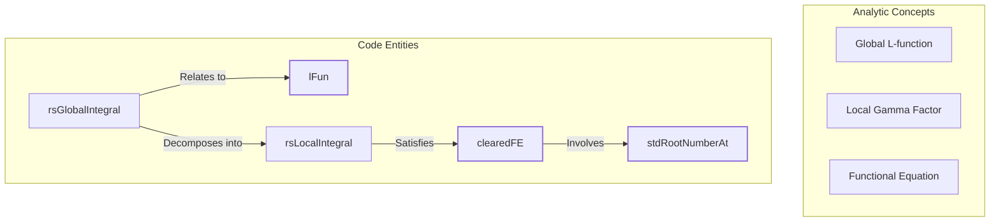
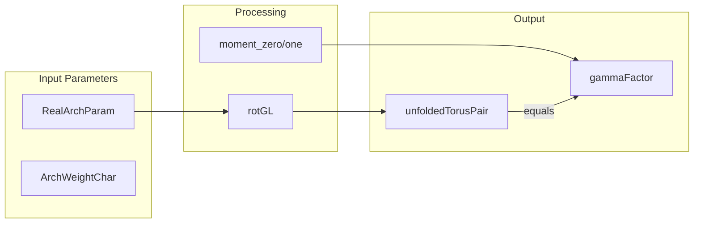

<!-- source: DeepWiki mcp.deepwiki.com · repo anthropics/fermats-last-theorem · page 7.2 Rankin-Selberg Integrals and the Converse Theorem · fetched 2026-10-26 -->

# Rankin-Selberg Integrals and the Converse Theorem

Relevant source files

The following files were used as context for generating this wiki page:

- [P2M/Sol/S_AutomorphicForm_WhittakerModel_apply_mul_apply_eq_apply_mul_apply_of_forall_diagOne_eq_smul_of_transcendental.lean](P2M/Sol/S_AutomorphicForm_WhittakerModel_apply_mul_apply_eq_apply_mul_apply_of_forall_diagOne_eq_smul_of_transcendental.lean)
- [P2M/Sol/S_AutomorphicForm_WhittakerModel_exists_mem_span_forall_diagOne_eq_of_shell_window_of_irreducible.lean](P2M/Sol/S_AutomorphicForm_WhittakerModel_exists_mem_span_forall_diagOne_eq_of_shell_window_of_irreducible.lean)
- [P2M/Sol/S_AutomorphicForm_WhittakerModel_exists_norm_diagUnits2_mul_le_and_eq_zero_of_admissible_of_centralChar.lean](P2M/Sol/S_AutomorphicForm_WhittakerModel_exists_norm_diagUnits2_mul_le_and_eq_zero_of_admissible_of_centralChar.lean)
- [P2M/Sol/S_AutomorphicForm_exists_mvPolynomial_apply_eq_mul_eval_bottomRow_of_rightTranslatesSpanFinite_of_isComplex.lean](P2M/Sol/S_AutomorphicForm_exists_mvPolynomial_apply_eq_mul_eval_bottomRow_of_rightTranslatesSpanFinite_of_isComplex.lean)
- [P2M/Sol/S_AutomorphicForm_exists_mvPolynomial_apply_eq_mul_eval_bottomRow_of_rightTranslatesSpanFinite_of_isReal.lean](P2M/Sol/S_AutomorphicForm_exists_mvPolynomial_apply_eq_mul_eval_bottomRow_of_rightTranslatesSpanFinite_of_isReal.lean)
- [P2M/Sol/S_AutomorphicForm_exists_sum_mul_localZeta_bottomRow_eq_of_rightTranslatesSpanFinite.lean](P2M/Sol/S_AutomorphicForm_exists_sum_mul_localZeta_bottomRow_eq_of_rightTranslatesSpanFinite.lean)
- [P2M/Sol/S_LanglandsTunnell_Converse_exists_ne_zero_and_W_diagOne_add_eq_mul_mulConvGaussian_of_weightOneLevi.lean](P2M/Sol/S_LanglandsTunnell_Converse_exists_ne_zero_and_W_diagOne_add_eq_mul_mulConvGaussian_of_weightOneLevi.lean)
- [P2M/Sol/S_LanglandsTunnell_Converse_exists_ne_zero_and_W_diagOne_eq_mul_exp_and_eq_zero_of_discreteLevi.lean](P2M/Sol/S_LanglandsTunnell_Converse_exists_ne_zero_and_W_diagOne_eq_mul_exp_and_eq_zero_of_discreteLevi.lean)
- [P2M/Sol/S_LanglandsTunnell_Converse_exists_ne_zero_and_W_diagOne_eq_mul_mulConvGaussian_of_weightZeroLevi.lean](P2M/Sol/S_LanglandsTunnell_Converse_exists_ne_zero_and_W_diagOne_eq_mul_mulConvGaussian_of_weightZeroLevi.lean)
- [P2M/Sol/S_LanglandsTunnell_CubicInduction_SlabL2_casimir_smoothingOperator.lean](P2M/Sol/S_LanglandsTunnell_CubicInduction_SlabL2_casimir_smoothingOperator.lean)
- [P2M/Sol/S_LanglandsTunnell_CubicInduction_SlabL2_exists_casimir_eq_smul_smooth_cuspFunction_of_ne_bot_of_stable_smoothingOperator.lean](P2M/Sol/S_LanglandsTunnell_CubicInduction_SlabL2_exists_casimir_eq_smul_smooth_cuspFunction_of_ne_bot_of_stable_smoothingOperator.lean)
- [P2M/Sol/S_LanglandsTunnell_CubicInduction_SlabL2_exists_isSmoothingKernel_leftOrthFinite_setIntegral_compl_le.lean](P2M/Sol/S_LanglandsTunnell_CubicInduction_SlabL2_exists_isSmoothingKernel_leftOrthFinite_setIntegral_compl_le.lean)
- [P2M/Sol/S_LanglandsTunnell_CubicInduction_archRoot_iota_archRealGLAt_and_dual.lean](P2M/Sol/S_LanglandsTunnell_CubicInduction_archRoot_iota_archRealGLAt_and_dual.lean)
- [P2M/Sol/S_LanglandsTunnell_CubicInduction_cellSectionOf_antidiagonal3_mul_mul_eq_integral_godementDatum.lean](P2M/Sol/S_LanglandsTunnell_CubicInduction_cellSectionOf_antidiagonal3_mul_mul_eq_integral_godementDatum.lean)
- [P2M/Sol/S_LanglandsTunnell_CubicInduction_dualWhittakerFn3_localLevelOne_and_torusValues_const_sq_of_localRankinSelbergFE.lean](P2M/Sol/S_LanglandsTunnell_CubicInduction_dualWhittakerFn3_localLevelOne_and_torusValues_const_sq_of_localRankinSelbergFE.lean)
- [P2M/Sol/S_LanglandsTunnell_CubicInduction_exists_archDatumR_W_diagOne_add_eq_mul_mulConvGaussian_of_weightOne.lean](P2M/Sol/S_LanglandsTunnell_CubicInduction_exists_archDatumR_W_diagOne_add_eq_mul_mulConvGaussian_of_weightOne.lean)
- [P2M/Sol/S_LanglandsTunnell_CubicInduction_exists_archDatumR_W_diagOne_eq_mul_exp_and_eq_zero_of_discrete.lean](P2M/Sol/S_LanglandsTunnell_CubicInduction_exists_archDatumR_W_diagOne_eq_mul_exp_and_eq_zero_of_discrete.lean)
- [P2M/Sol/S_LanglandsTunnell_CubicInduction_exists_archDatumR_W_diagOne_eq_mul_mulConvGaussian_of_weightZero.lean](P2M/Sol/S_LanglandsTunnell_CubicInduction_exists_archDatumR_W_diagOne_eq_mul_mulConvGaussian_of_weightZero.lean)
- [P2M/Sol/S_LanglandsTunnell_CubicInduction_exists_forall_integrable_rsLocalIntegrand_of_gauge.lean](P2M/Sol/S_LanglandsTunnell_CubicInduction_exists_forall_integrable_rsLocalIntegrand_of_gauge.lean)
- [P2M/Sol/S_LanglandsTunnell_CubicInduction_exists_localZeta31_fe_one_inducedEulerPoly_rational_of_isCubicInductionDataOn_of_isRamifiedIn.lean](P2M/Sol/S_LanglandsTunnell_CubicInduction_exists_localZeta31_fe_one_inducedEulerPoly_rational_of_isCubicInductionDataOn_of_isRamifiedIn.lean)
- [P2M/Sol/S_LanglandsTunnell_CubicInduction_exists_localZeta31_fe_one_inducedEulerPoly_rational_of_isCubicInductionDataOn_of_not_isRamifiedIn.lean](P2M/Sol/S_LanglandsTunnell_CubicInduction_exists_localZeta31_fe_one_inducedEulerPoly_rational_of_isCubicInductionDataOn_of_not_isRamifiedIn.lean)
- [P2M/Sol/S_LanglandsTunnell_CubicInduction_exists_mem_gl3CyclicSubspace_congruenceK1_torusValues_of_isCubicInductionDataOn.lean](P2M/Sol/S_LanglandsTunnell_CubicInduction_exists_mem_gl3CyclicSubspace_congruenceK1_torusValues_of_isCubicInductionDataOn.lean)
- [P2M/Sol/S_LanglandsTunnell_CubicInduction_exists_mem_gl3CyclicSubspace_principalLevel_le_of_isRamifiedIn_of_isCubicInductionDataOn_of_conductorBound.lean](P2M/Sol/S_LanglandsTunnell_CubicInduction_exists_mem_gl3CyclicSubspace_principalLevel_le_of_isRamifiedIn_of_isCubicInductionDataOn_of_conductorBound.lean)
- [P2M/Sol/S_LanglandsTunnell_CubicInduction_exists_rsLocalIntegral_and_dual_integrable_and_eq_rational_sphericalWhittaker_of_forall_localZeta31_fe_of_gauge.lean](P2M/Sol/S_LanglandsTunnell_CubicInduction_exists_rsLocalIntegral_and_dual_integrable_and_eq_rational_sphericalWhittaker_of_forall_localZeta31_fe_of_gauge.lean)
- [P2M/Sol/S_LanglandsTunnell_CubicInduction_exists_rsLocalIntegral_sum_translate_eq_const_of_apply_one_ne_zero.lean](P2M/Sol/S_LanglandsTunnell_CubicInduction_exists_rsLocalIntegral_sum_translate_eq_const_of_apply_one_ne_zero.lean)
- [P2M/Sol/S_LanglandsTunnell_CubicInduction_exists_whittaker3_eq_mul_prod_hasWhittakerMultOne_of_isCuspidalAlong.lean](P2M/Sol/S_LanglandsTunnell_CubicInduction_exists_whittaker3_eq_mul_prod_hasWhittakerMultOne_of_isCuspidalAlong.lean)
- [P2M/Sol/S_LanglandsTunnell_CubicInduction_godementDatum_mem_principalSeries2_and_support.lean](P2M/Sol/S_LanglandsTunnell_CubicInduction_godementDatum_mem_principalSeries2_and_support.lean)
- [P2M/Sol/S_LanglandsTunnell_CubicInduction_hasCubicInductionForm_arch_torusValues_localPackage_bad.lean](P2M/Sol/S_LanglandsTunnell_CubicInduction_hasCubicInductionForm_arch_torusValues_localPackage_bad.lean)
- [P2M/Sol/S_LanglandsTunnell_CubicInduction_hasProd_localZeta31_dualWhittakerFn3_of_isInducedSphericalAt_of_three_le.lean](P2M/Sol/S_LanglandsTunnell_CubicInduction_hasProd_localZeta31_dualWhittakerFn3_of_isInducedSphericalAt_of_three_le.lean)
- [P2M/Sol/S_LanglandsTunnell_CubicInduction_integral_frame23_mul_eq_integral_matFourier23_dualFrame23_mul.lean](P2M/Sol/S_LanglandsTunnell_CubicInduction_integral_frame23_mul_eq_integral_matFourier23_dualFrame23_mul.lean)
- [P2M/Sol/S_LanglandsTunnell_CubicInduction_integral_godementSection_upperUnipotent3_eq_godementWhittaker3_of_continuous.lean](P2M/Sol/S_LanglandsTunnell_CubicInduction_integral_godementSection_upperUnipotent3_eq_godementWhittaker3_of_continuous.lean)
- [P2M/Sol/S_LanglandsTunnell_CubicInduction_jacquetVector3_longWeyl3_transposeInv3_iota_upperUnit_eq.lean](P2M/Sol/S_LanglandsTunnell_CubicInduction_jacquetVector3_longWeyl3_transposeInv3_iota_upperUnit_eq.lean)
- [P2M/Sol/S_LanglandsTunnell_CubicInduction_localZeta31_identified_of_mem_gl3CyclicSubspace.lean](P2M/Sol/S_LanglandsTunnell_CubicInduction_localZeta31_identified_of_mem_gl3CyclicSubspace.lean)
- [P2M/Sol/S_LanglandsTunnell_CubicInduction_rsLocalIntegral_fe32_of_forall_localZeta31_fe_of_gauge.lean](P2M/Sol/S_LanglandsTunnell_CubicInduction_rsLocalIntegral_fe32_of_forall_localZeta31_fe_of_gauge.lean)
- [P2M/Sol/S_LanglandsTunnell_CubicInduction_whittakerArch_scalar_mul_eq_centralChar_mul_of_isCubicInductionDataOn.lean](P2M/Sol/S_LanglandsTunnell_CubicInduction_whittakerArch_scalar_mul_eq_centralChar_mul_of_isCubicInductionDataOn.lean)
- [P2M/Sol/S_LanglandsTunnell_RankinSelberg_EntirePairAssembly_dual_identity_family.lean](P2M/Sol/S_LanglandsTunnell_RankinSelberg_EntirePairAssembly_dual_identity_family.lean)
- [P2M/Sol/S_LanglandsTunnell_RankinSelberg_dualTorusPair_eq_const_mul_setIntegral_scaledShape_of_discreteSeries_of_conjBlockHarmonic_colHarmonic_gaussian3.lean](P2M/Sol/S_LanglandsTunnell_RankinSelberg_dualTorusPair_eq_const_mul_setIntegral_scaledShape_of_discreteSeries_of_conjBlockHarmonic_colHarmonic_gaussian3.lean)
- [P2M/Sol/S_LanglandsTunnell_RankinSelberg_dualTorusPair_eq_setIntegral_dualConfig_of_evenPrincipal_of_detPow_blockQuadratic_colHarmonicTwo_gaussian3.lean](P2M/Sol/S_LanglandsTunnell_RankinSelberg_dualTorusPair_eq_setIntegral_dualConfig_of_evenPrincipal_of_detPow_blockQuadratic_colHarmonicTwo_gaussian3.lean)
- [P2M/Sol/S_LanglandsTunnell_RankinSelberg_dualTorusPair_eq_setIntegral_dualConfig_of_evenPrincipal_of_detPow_colHarmonic_gaussian3.lean](P2M/Sol/S_LanglandsTunnell_RankinSelberg_dualTorusPair_eq_setIntegral_dualConfig_of_evenPrincipal_of_detPow_colHarmonic_gaussian3.lean)
- [P2M/Sol/S_LanglandsTunnell_RankinSelberg_dualTorusPair_eq_setIntegral_dualConfig_of_weightOne_of_blockHarmonicOne_colHarmonic_gaussian3.lean](P2M/Sol/S_LanglandsTunnell_RankinSelberg_dualTorusPair_eq_setIntegral_dualConfig_of_weightOne_of_blockHarmonicOne_colHarmonic_gaussian3.lean)
- [P2M/Sol/S_LanglandsTunnell_RankinSelberg_dualTorusPair_eq_setIntegral_dualConfig_of_weightOne_of_conjBlockHarmonicOne_colHarmonic_gaussian3.lean](P2M/Sol/S_LanglandsTunnell_RankinSelberg_dualTorusPair_eq_setIntegral_dualConfig_of_weightOne_of_conjBlockHarmonicOne_colHarmonic_gaussian3.lean)
- [P2M/Sol/S_LanglandsTunnell_RankinSelberg_dualTorusPair_eq_setIntegral_dualConfig_of_weightOne_of_minorSection_gaussian3.lean](P2M/Sol/S_LanglandsTunnell_RankinSelberg_dualTorusPair_eq_setIntegral_dualConfig_of_weightOne_of_minorSection_gaussian3.lean)
- [P2M/Sol/S_LanglandsTunnell_RankinSelberg_eq_zero_of_forall_integral_kirillov_pairing_eq_zero.lean](P2M/Sol/S_LanglandsTunnell_RankinSelberg_eq_zero_of_forall_integral_kirillov_pairing_eq_zero.lean)
- [P2M/Sol/S_LanglandsTunnell_RankinSelberg_exists_dualTorusPair_eq_archRootNumber_mul_explicit_mul_gammaFactor_of_weightOne_of_minorSection_gaussian3_of_profile.lean](P2M/Sol/S_LanglandsTunnell_RankinSelberg_exists_dualTorusPair_eq_archRootNumber_mul_explicit_mul_gammaFactor_of_weightOne_of_minorSection_gaussian3_of_profile.lean)
- [P2M/Sol/S_LanglandsTunnell_RankinSelberg_exists_entire_boundedOnStrips_eq_archFactor_mul_lFun_rsDatum_of_le_conductorExponentAt_of_centralInduced_of_localSpaceAt_of_normPin_archTrivial.lean](P2M/Sol/S_LanglandsTunnell_RankinSelberg_exists_entire_boundedOnStrips_eq_archFactor_mul_lFun_rsDatum_of_le_conductorExponentAt_of_centralInduced_of_localSpaceAt_of_normPin_archTrivial.lean)
- [P2M/Sol/S_LanglandsTunnell_RankinSelberg_exists_factor_fundamentalDomain_forall_rsGlobalIntegral_realisation_member_twisted_of_finiteFamily_arch_of_archNonvanishing.lean](P2M/Sol/S_LanglandsTunnell_RankinSelberg_exists_factor_fundamentalDomain_forall_rsGlobalIntegral_realisation_member_twisted_of_finiteFamily_arch_of_archNonvanishing.lean)
- [P2M/Sol/S_LanglandsTunnell_RankinSelberg_exists_finTranslate_not_countable_rsFinIntegral_indicator_ne_zero_of_purifier_of_finiteFamily_arch.lean](P2M/Sol/S_LanglandsTunnell_RankinSelberg_exists_finTranslate_not_countable_rsFinIntegral_indicator_ne_zero_of_purifier_of_finiteFamily_arch.lean)
- [P2M/Sol/S_LanglandsTunnell_RankinSelberg_exists_finset_eq_sum_smul_shell_character_kirillov_of_cuspidal.lean](P2M/Sol/S_LanglandsTunnell_RankinSelberg_exists_finset_eq_sum_smul_shell_character_kirillov_of_cuspidal.lean)
- [P2M/Sol/S_LanglandsTunnell_RankinSelberg_exists_forall_apply_row_localLevelOne_eq_zero_and_eq_apply_zero_of_isLocallyConstant_of_hasCompactSupport.lean](P2M/Sol/S_LanglandsTunnell_RankinSelberg_exists_forall_apply_row_localLevelOne_eq_zero_and_eq_apply_zero_of_isLocallyConstant_of_hasCompactSupport.lean)
- [P2M/Sol/S_LanglandsTunnell_RankinSelberg_exists_forall_dualTorusPair_eq_closedForm_of_discreteSeries_of_conjBlockHarmonic_colHarmonic_gaussian3_of_discreteLevi.lean](P2M/Sol/S_LanglandsTunnell_RankinSelberg_exists_forall_dualTorusPair_eq_closedForm_of_discreteSeries_of_conjBlockHarmonic_colHarmonic_gaussian3_of_discreteLevi.lean)
- [P2M/Sol/S_LanglandsTunnell_RankinSelberg_exists_forall_dualTorusPair_eq_closedForm_of_discreteSeries_of_conjBlockHarmonic_colHarmonic_gaussian3_of_weightOneLevi.lean](P2M/Sol/S_LanglandsTunnell_RankinSelberg_exists_forall_dualTorusPair_eq_closedForm_of_discreteSeries_of_conjBlockHarmonic_colHarmonic_gaussian3_of_weightOneLevi.lean)
- [P2M/Sol/S_LanglandsTunnell_RankinSelberg_exists_forall_dualTorusPair_eq_closedForm_of_discreteSeries_of_conjBlockHarmonic_colHarmonic_gaussian3_of_weightZeroLevi.lean](P2M/Sol/S_LanglandsTunnell_RankinSelberg_exists_forall_dualTorusPair_eq_closedForm_of_discreteSeries_of_conjBlockHarmonic_colHarmonic_gaussian3_of_weightZeroLevi.lean)
- [P2M/Sol/S_LanglandsTunnell_RankinSelberg_exists_forall_dualTorusPair_eq_const_mul_setIntegral_W_diagOne_of_discreteSeries_of_conjBlockHarmonic_colHarmonic_gaussian3.lean](P2M/Sol/S_LanglandsTunnell_RankinSelberg_exists_forall_dualTorusPair_eq_const_mul_setIntegral_W_diagOne_of_discreteSeries_of_conjBlockHarmonic_colHarmonic_gaussian3.lean)
- [P2M/Sol/S_LanglandsTunnell_RankinSelberg_exists_forall_integrable_and_godementZeta2_transposeInv_matFourier22_eq_mul_twoVarZeta_fourierSlice_of_mem_principalSeries2.lean](P2M/Sol/S_LanglandsTunnell_RankinSelberg_exists_forall_integrable_and_godementZeta2_transposeInv_matFourier22_eq_mul_twoVarZeta_fourierSlice_of_mem_principalSeries2.lean)
- [P2M/Sol/S_LanglandsTunnell_RankinSelberg_exists_forall_integrable_archWhittaker_torusPair_rpow_det.lean](P2M/Sol/S_LanglandsTunnell_RankinSelberg_exists_forall_integrable_archWhittaker_torusPair_rpow_det.lean)
- [P2M/Sol/S_LanglandsTunnell_RankinSelberg_exists_forall_integrable_dual_rsLocalIntegrand_of_gauge.lean](P2M/Sol/S_LanglandsTunnell_RankinSelberg_exists_forall_integrable_dual_rsLocalIntegrand_of_gauge.lean)
- [P2M/Sol/S_LanglandsTunnell_RankinSelberg_exists_forall_integrable_jacquetIntegral_mul_whittaker_mul_row_withDensity_of_admissible_of_chamber.lean](P2M/Sol/S_LanglandsTunnell_RankinSelberg_exists_forall_integrable_jacquetIntegral_mul_whittaker_mul_row_withDensity_of_admissible_of_chamber.lean)
- [P2M/Sol/S_LanglandsTunnell_RankinSelberg_exists_forall_integrable_prod_row_mul_row_mul_cpow_mul_whittaker_diagOne_mul_cpow_of_admissible_of_chamber.lean](P2M/Sol/S_LanglandsTunnell_RankinSelberg_exists_forall_integrable_prod_row_mul_row_mul_cpow_mul_whittaker_diagOne_mul_cpow_of_admissible_of_chamber.lean)
- [P2M/Sol/S_LanglandsTunnell_RankinSelberg_exists_forall_integrable_prod_row_mul_row_mul_cpow_mul_whittaker_diagOne_mul_cpow_of_chamber.lean](P2M/Sol/S_LanglandsTunnell_RankinSelberg_exists_forall_integrable_prod_row_mul_row_mul_cpow_mul_whittaker_diagOne_mul_cpow_of_chamber.lean)
- [P2M/Sol/S_LanglandsTunnell_RankinSelberg_exists_forall_integrable_rsFinCellIntegrand_translate_and_dual.lean](P2M/Sol/S_LanglandsTunnell_RankinSelberg_exists_forall_integrable_rsFinCellIntegrand_translate_and_dual.lean)
- [P2M/Sol/S_LanglandsTunnell_RankinSelberg_exists_forall_iwasawaIntegral_eq_const_mul_oneSided_torusPair_add_mirror_of_discreteProfile_conjBlockHarmonic_colHarmonic.lean](P2M/Sol/S_LanglandsTunnell_RankinSelberg_exists_forall_iwasawaIntegral_eq_const_mul_oneSided_torusPair_add_mirror_of_discreteProfile_conjBlockHarmonic_colHarmonic.lean)
- [P2M/Sol/S_LanglandsTunnell_RankinSelberg_exists_forall_jacquetIntegral_diagOne_mul_eq_sqrt_modulus_mul_add_of_mem_principalSeries2_of_chamber.lean](P2M/Sol/S_LanglandsTunnell_RankinSelberg_exists_forall_jacquetIntegral_diagOne_mul_eq_sqrt_modulus_mul_add_of_mem_principalSeries2_of_chamber.lean)
- [P2M/Sol/S_LanglandsTunnell_RankinSelberg_exists_forall_le_setIntegral_localLevelOne_dualJacquet_mul_partner_mul_eq_zero_of_dualTorusZeta_polynomial.lean](P2M/Sol/S_LanglandsTunnell_RankinSelberg_exists_forall_le_setIntegral_localLevelOne_dualJacquet_mul_partner_mul_eq_zero_of_dualTorusZeta_polynomial.lean)
- [P2M/Sol/S_LanglandsTunnell_RankinSelberg_exists_forall_le_setIntegral_localLevelOne_mul_diagZ_mul_eq_zero_of_sqrt_modulus_tail_of_forall_torusZeta_polynomial.lean](P2M/Sol/S_LanglandsTunnell_RankinSelberg_exists_forall_le_setIntegral_localLevelOne_mul_diagZ_mul_eq_zero_of_sqrt_modulus_tail_of_forall_torusZeta_polynomial.lean)
- [P2M/Sol/S_LanglandsTunnell_RankinSelberg_exists_forall_lintegral_enorm_jacquetIntegral_mul_whittaker_mul_translate_mul_row_le_of_admissible_of_chamber.lean](P2M/Sol/S_LanglandsTunnell_RankinSelberg_exists_forall_lintegral_enorm_jacquetIntegral_mul_whittaker_mul_translate_mul_row_le_of_admissible_of_chamber.lean)
- [P2M/Sol/S_LanglandsTunnell_RankinSelberg_exists_forall_localAt_eq_one_and_ne_zero_of_heckeLocal_of_levelOne_invariant.lean](P2M/Sol/S_LanglandsTunnell_RankinSelberg_exists_forall_localAt_eq_one_and_ne_zero_of_heckeLocal_of_levelOne_invariant.lean)
- [P2M/Sol/S_LanglandsTunnell_RankinSelberg_exists_forall_localLevelOne_setIntegral_units_whittaker_diagUnitGL2_eq_zero_of_le_of_torusLaurent.lean](P2M/Sol/S_LanglandsTunnell_RankinSelberg_exists_forall_localLevelOne_setIntegral_units_whittaker_diagUnitGL2_eq_zero_of_le_of_torusLaurent.lean)
- [P2M/Sol/S_LanglandsTunnell_RankinSelberg_exists_forall_lt_rsLocalIntegral_jacquetWhittaker3_twistFamily_mul_centralTate_eq_cpow_mul_eval.lean](P2M/Sol/S_LanglandsTunnell_RankinSelberg_exists_forall_lt_rsLocalIntegral_jacquetWhittaker3_twistFamily_mul_centralTate_eq_cpow_mul_eval.lean)
- [P2M/Sol/S_LanglandsTunnell_RankinSelberg_exists_forall_mem_span_apply_eq_sum_mul_setIntegral_translate_of_invariant_of_admissible.lean](P2M/Sol/S_LanglandsTunnell_RankinSelberg_exists_forall_mem_span_apply_eq_sum_mul_setIntegral_translate_of_invariant_of_admissible.lean)
- [P2M/Sol/S_LanglandsTunnell_RankinSelberg_exists_forall_mem_span_rsLocalIntegral_dual_mul_eq_mul_of_rsGlobalIntegral_realisation.lean](P2M/Sol/S_LanglandsTunnell_RankinSelberg_exists_forall_mem_span_rsLocalIntegral_dual_mul_eq_mul_of_rsGlobalIntegral_realisation.lean)
- [P2M/Sol/S_LanglandsTunnell_RankinSelberg_exists_forall_rsGlobalIntegral_eq_mul_rsArchIntegral_mul_rsFinIntegral_mul_lFun.lean](P2M/Sol/S_LanglandsTunnell_RankinSelberg_exists_forall_rsGlobalIntegral_eq_mul_rsArchIntegral_mul_rsFinIntegral_mul_lFun.lean)
- [P2M/Sol/S_LanglandsTunnell_RankinSelberg_exists_forall_setIntegral_localLevelOne_rowSlice_whittaker_shell_eq_zero_of_le.lean](P2M/Sol/S_LanglandsTunnell_RankinSelberg_exists_forall_setIntegral_localLevelOne_rowSlice_whittaker_shell_eq_zero_of_le.lean)
- [P2M/Sol/S_LanglandsTunnell_RankinSelberg_exists_forall_setIntegral_units_apply_diagUnitGL2_mul_weylJ_eq_mul_setIntegral_of_cuspidal.lean](P2M/Sol/S_LanglandsTunnell_RankinSelberg_exists_forall_setIntegral_units_apply_diagUnitGL2_mul_weylJ_eq_mul_setIntegral_of_cuspidal.lean)
- [P2M/Sol/S_LanglandsTunnell_RankinSelberg_exists_forall_unfoldedTorusPair_eq_closedForm_of_discreteSeries_of_conjBlockHarmonic_colHarmonic_gaussian3_of_discreteLevi_ed2.lean](P2M/Sol/S_LanglandsTunnell_RankinSelberg_exists_forall_unfoldedTorusPair_eq_closedForm_of_discreteSeries_of_conjBlockHarmonic_colHarmonic_gaussian3_of_discreteLevi_ed2.lean)
- [P2M/Sol/S_LanglandsTunnell_RankinSelberg_exists_forall_unfoldedTorusPair_eq_closedForm_of_discreteSeries_of_conjBlockHarmonic_colHarmonic_gaussian3_of_weightOneLevi_ed2.lean](P2M/Sol/S_LanglandsTunnell_RankinSelberg_exists_forall_unfoldedTorusPair_eq_closedForm_of_discreteSeries_of_conjBlockHarmonic_colHarmonic_gaussian3_of_weightOneLevi_ed2.lean)
- [P2M/Sol/S_LanglandsTunnell_RankinSelberg_exists_forall_unfoldedTorusPair_eq_closedForm_of_discreteSeries_of_conjBlockHarmonic_colHarmonic_gaussian3_of_weightZeroLevi_ed2.lean](P2M/Sol/S_LanglandsTunnell_RankinSelberg_exists_forall_unfoldedTorusPair_eq_closedForm_of_discreteSeries_of_conjBlockHarmonic_colHarmonic_gaussian3_of_weightZeroLevi_ed2.lean)
- [P2M/Sol/S_LanglandsTunnell_RankinSelberg_exists_frozen_forall_sum_translate_purified_whittakerCoefficient_eq_mul_pSlot_of_finiteFamily_arch.lean](P2M/Sol/S_LanglandsTunnell_RankinSelberg_exists_frozen_forall_sum_translate_purified_whittakerCoefficient_eq_mul_pSlot_of_finiteFamily_arch.lean)
- [P2M/Sol/S_LanglandsTunnell_RankinSelberg_exists_frozen_forall_sum_translate_whittaker_iota_eq_mul_pSlot_of_finiteFamily_arch.lean](P2M/Sol/S_LanglandsTunnell_RankinSelberg_exists_frozen_forall_sum_translate_whittaker_iota_eq_mul_pSlot_of_finiteFamily_arch.lean)
- [P2M/Sol/S_LanglandsTunnell_RankinSelberg_exists_frozen_forall_sum_translate_whittaker_iota_eq_mul_pSlot_of_finiteFamily_arch_explicit.lean](P2M/Sol/S_LanglandsTunnell_RankinSelberg_exists_frozen_forall_sum_translate_whittaker_iota_eq_mul_pSlot_of_finiteFamily_arch_explicit.lean)
- [P2M/Sol/S_LanglandsTunnell_RankinSelberg_exists_gl3Translates_sum_rsFinIntegral_cells_eq_const_and_dual_eq_rootNumberMonomial_of_finWhittaker_one_ne_zero_of_localSpaceAt_of_member_of_fe32_normPin_twisted_offSQ_archPsi_bump_levelShift_global.lean](P2M/Sol/S_LanglandsTunnell_RankinSelberg_exists_gl3Translates_sum_rsFinIntegral_cells_eq_const_and_dual_eq_rootNumberMonomial_of_finWhittaker_one_ne_zero_of_localSpaceAt_of_member_of_fe32_normPin_twisted_offSQ_archPsi_bump_levelShift_global.lean)
- [P2M/Sol/S_LanglandsTunnell_RankinSelberg_exists_godementDatum_primitive_of_mem_principalSeries2.lean](P2M/Sol/S_LanglandsTunnell_RankinSelberg_exists_godementDatum_primitive_of_mem_principalSeries2.lean)
- [P2M/Sol/S_LanglandsTunnell_RankinSelberg_exists_isCompact_forall_setIntegral_translate_ne_zero_of_cuspidal.lean](P2M/Sol/S_LanglandsTunnell_RankinSelberg_exists_isCompact_forall_setIntegral_translate_ne_zero_of_cuspidal.lean)
- [P2M/Sol/S_LanglandsTunnell_RankinSelberg_exists_mem_forall_setIntegral_translate_eq_kirillov_pairing_of_cuspidal.lean](P2M/Sol/S_LanglandsTunnell_RankinSelberg_exists_mem_forall_setIntegral_translate_eq_kirillov_pairing_of_cuspidal.lean)
- [P2M/Sol/S_LanglandsTunnell_RankinSelberg_exists_mem_gl3CyclicSubspace_forall_rsLocalIntegral_eq_mul_apply_of_finite.lean](P2M/Sol/S_LanglandsTunnell_RankinSelberg_exists_mem_gl3CyclicSubspace_forall_rsLocalIntegral_eq_mul_apply_of_finite.lean)
- [P2M/Sol/S_LanglandsTunnell_RankinSelberg_exists_mem_polyGauss3_iotaWeight_archZeta30_ne_zero_unfoldedTorusPair_and_dualTorusPair_eq_gammaFactor_of_archWhittakerDatum_of_isCasimirEigen_of_discreteSeries.lean](P2M/Sol/S_LanglandsTunnell_RankinSelberg_exists_mem_polyGauss3_iotaWeight_archZeta30_ne_zero_unfoldedTorusPair_and_dualTorusPair_eq_gammaFactor_of_archWhittakerDatum_of_isCasimirEigen_of_discreteSeries.lean)
- [P2M/Sol/S_LanglandsTunnell_RankinSelberg_exists_mem_polyGauss3_jacquetVector3_torusPair_eq_gammaFactor_of_archWhittakerDatum_of_isCasimirEigen_of_minimalType.lean](P2M/Sol/S_LanglandsTunnell_RankinSelberg_exists_mem_polyGauss3_jacquetVector3_torusPair_eq_gammaFactor_of_archWhittakerDatum_of_isCasimirEigen_of_minimalType.lean)
- [P2M/Sol/S_LanglandsTunnell_RankinSelberg_exists_mem_rsLocalIntegral_ne_zero_and_rational_member_twisted_of_finiteFamily_arch_deep.lean](P2M/Sol/S_LanglandsTunnell_RankinSelberg_exists_mem_rsLocalIntegral_ne_zero_and_rational_member_twisted_of_finiteFamily_arch_deep.lean)
- [P2M/Sol/S_LanglandsTunnell_RankinSelberg_exists_mem_span_forall_rsLocalIntegral_eq_const_ne_zero_of_isGL3PsiWhittakerFn.lean](P2M/Sol/S_LanglandsTunnell_RankinSelberg_exists_mem_span_forall_rsLocalIntegral_eq_const_ne_zero_of_isGL3PsiWhittakerFn.lean)
- [P2M/Sol/S_LanglandsTunnell_RankinSelberg_exists_mem_span_forall_torusZeta_twist_eq_const_and_dual_of_irreducible_admissible.lean](P2M/Sol/S_LanglandsTunnell_RankinSelberg_exists_mem_span_forall_torusZeta_twist_eq_const_and_dual_of_irreducible_admissible.lean)
- [P2M/Sol/S_LanglandsTunnell_RankinSelberg_exists_ne_zero_forall_integrable_and_rsFinIntegral_indicator_eq_mul_finprod_rsLocalIntegral_of_pure_of_measurable.lean](P2M/Sol/S_LanglandsTunnell_RankinSelberg_exists_ne_zero_forall_integrable_and_rsFinIntegral_indicator_eq_mul_finprod_rsLocalIntegral_of_pure_of_measurable.lean)
- [P2M/Sol/S_LanglandsTunnell_RankinSelberg_exists_ne_zero_forall_rsFinIntegral_indicator_purified_eq_mul_sum_prod_rsLocalIntegral.lean](P2M/Sol/S_LanglandsTunnell_RankinSelberg_exists_ne_zero_forall_rsFinIntegral_indicator_purified_eq_mul_sum_prod_rsLocalIntegral.lean)
- [P2M/Sol/S_LanglandsTunnell_RankinSelberg_exists_ne_zero_forall_rsGlobalIntegral_reference_eq_mul_rsArchIntegral_mul_rsFinIntegral_indicator_mul_of_finiteFamily_arch.lean](P2M/Sol/S_LanglandsTunnell_RankinSelberg_exists_ne_zero_forall_rsGlobalIntegral_reference_eq_mul_rsArchIntegral_mul_rsFinIntegral_indicator_mul_of_finiteFamily_arch.lean)
- [P2M/Sol/S_LanglandsTunnell_RankinSelberg_exists_pos_forall_integral_haar_eq_mul_integral_pi_det_inv_sq.lean](P2M/Sol/S_LanglandsTunnell_RankinSelberg_exists_pos_forall_integral_haar_eq_mul_integral_pi_det_inv_sq.lean)
- [P2M/Sol/S_LanglandsTunnell_RankinSelberg_exists_pos_forall_lintegral_eq_mul_lintegral_prod_lintegral_unipotent_diagUnits2.lean](P2M/Sol/S_LanglandsTunnell_RankinSelberg_exists_pos_forall_lintegral_eq_mul_lintegral_prod_lintegral_unipotent_diagUnits2.lean)
- [P2M/Sol/S_LanglandsTunnell_RankinSelberg_exists_pos_forall_rsFinIntegral_eq_mul_of_support_subset_unipotent_mul.lean](P2M/Sol/S_LanglandsTunnell_RankinSelberg_exists_pos_forall_rsFinIntegral_eq_mul_of_support_subset_unipotent_mul.lean)
- [P2M/Sol/S_LanglandsTunnell_RankinSelberg_exists_pos_forall_rsLocalIntegral_eq_mul_of_support_subset_unipotent_mul.lean](P2M/Sol/S_LanglandsTunnell_RankinSelberg_exists_pos_forall_rsLocalIntegral_eq_mul_of_support_subset_unipotent_mul.lean)
- [P2M/Sol/S_LanglandsTunnell_RankinSelberg_exists_pos_forall_rsLocalIntegral_indicator_unipotent_mul_localLevelOne_eq.lean](P2M/Sol/S_LanglandsTunnell_RankinSelberg_exists_pos_forall_rsLocalIntegral_indicator_unipotent_mul_localLevelOne_eq.lean)
- [P2M/Sol/S_LanglandsTunnell_RankinSelberg_exists_pos_integral_indicator_forall_localAt_unipotent_mul_localLevelOne_withDensity_eq.lean](P2M/Sol/S_LanglandsTunnell_RankinSelberg_exists_pos_integral_indicator_forall_localAt_unipotent_mul_localLevelOne_withDensity_eq.lean)
- [P2M/Sol/S_LanglandsTunnell_RankinSelberg_exists_pureTranslates_combination_forall_rsGlobalIntegral_ne_zero_member_twisted_of_finiteFamily_arch_of_archNonvanishing.lean](P2M/Sol/S_LanglandsTunnell_RankinSelberg_exists_pureTranslates_combination_forall_rsGlobalIntegral_ne_zero_member_twisted_of_finiteFamily_arch_of_archNonvanishing.lean)
- [P2M/Sol/S_LanglandsTunnell_RankinSelberg_exists_rational_forall_torusZeta_fe_twist_of_irreducible_admissible.lean](P2M/Sol/S_LanglandsTunnell_RankinSelberg_exists_rational_forall_torusZeta_fe_twist_of_irreducible_admissible.lean)
- [P2M/Sol/S_LanglandsTunnell_RankinSelberg_exists_rational_gamma_rsLocalIntegral_member_twisted_of_finiteFamily_arch_deep_archPsi.lean](P2M/Sol/S_LanglandsTunnell_RankinSelberg_exists_rational_gamma_rsLocalIntegral_member_twisted_of_finiteFamily_arch_deep_archPsi.lean)
- [P2M/Sol/S_LanglandsTunnell_RankinSelberg_exists_rational_rsLocalIntegral_and_dual_of_jacquetWhittaker3_ed2.lean](P2M/Sol/S_LanglandsTunnell_RankinSelberg_exists_rational_rsLocalIntegral_and_dual_of_jacquetWhittaker3_ed2.lean)
- [P2M/Sol/S_LanglandsTunnell_RankinSelberg_exists_rowSlice_shell_profile_of_isLocallyConstant_of_hasCompactSupport.lean](P2M/Sol/S_LanglandsTunnell_RankinSelberg_exists_rowSlice_shell_profile_of_isLocallyConstant_of_hasCompactSupport.lean)
- [P2M/Sol/S_LanglandsTunnell_RankinSelberg_exists_rsLocalIntegral22_dual_mul_one_sub_eq_cpow_mul_eval_of_principalSeries2_of_forall_torusZeta_polynomial.lean](P2M/Sol/S_LanglandsTunnell_RankinSelberg_exists_rsLocalIntegral22_dual_mul_one_sub_eq_cpow_mul_eval_of_principalSeries2_of_forall_torusZeta_polynomial.lean)
- [P2M/Sol/S_LanglandsTunnell_RankinSelberg_exists_rsLocalIntegral22_mul_one_sub_eq_cpow_mul_eval_of_principalSeries2_of_forall_torusZeta_polynomial.lean](P2M/Sol/S_LanglandsTunnell_RankinSelberg_exists_rsLocalIntegral22_mul_one_sub_eq_cpow_mul_eval_of_principalSeries2_of_forall_torusZeta_polynomial.lean)
- [P2M/Sol/S_LanglandsTunnell_RankinSelberg_exists_rsLocalIntegral22_mul_one_sub_eq_cpow_mul_eval_of_principalSeries2_of_forall_torusZeta_polynomial_core.lean](P2M/Sol/S_LanglandsTunnell_RankinSelberg_exists_rsLocalIntegral22_mul_one_sub_eq_cpow_mul_eval_of_principalSeries2_of_forall_torusZeta_polynomial_core.lean)
- [P2M/Sol/S_LanglandsTunnell_RankinSelberg_exists_rsLocalIntegral_clearedFE_datum_of_centralChar_eq_of_deepTwist_pairStability32_of_bump.lean](P2M/Sol/S_LanglandsTunnell_RankinSelberg_exists_rsLocalIntegral_clearedFE_datum_of_centralChar_eq_of_deepTwist_pairStability32_of_bump.lean)
- [P2M/Sol/S_LanglandsTunnell_RankinSelberg_exists_rsLocalIntegral_jacquetWhittaker3_iotaGL_eq_sum_and_dual_eq_mul_sum_of_chamber_ed2.lean](P2M/Sol/S_LanglandsTunnell_RankinSelberg_exists_rsLocalIntegral_jacquetWhittaker3_iotaGL_eq_sum_and_dual_eq_mul_sum_of_chamber_ed2.lean)
- [P2M/Sol/S_LanglandsTunnell_RankinSelberg_exists_rsLocalIntegral_jacquetWhittaker3_mul_centralTate_eq_cpow_mul_eval_and_dual_of_chamber.lean](P2M/Sol/S_LanglandsTunnell_RankinSelberg_exists_rsLocalIntegral_jacquetWhittaker3_mul_centralTate_eq_cpow_mul_eval_and_dual_of_chamber.lean)
- [P2M/Sol/S_LanglandsTunnell_RankinSelberg_exists_subgroup_isOpen_isCompact_forall_apply_mul_eq_and_det_eq_one_and_transposeInv_mem.lean](P2M/Sol/S_LanglandsTunnell_RankinSelberg_exists_subgroup_isOpen_isCompact_forall_apply_mul_eq_and_det_eq_one_and_transposeInv_mem.lean)
- [P2M/Sol/S_LanglandsTunnell_RankinSelberg_exists_unfoldedTorusPair_and_dualTorusPair_eq_gammaFactor_of_discreteSeries_of_conjBlockHarmonic_colHarmonic_gaussian3.lean](P2M/Sol/S_LanglandsTunnell_RankinSelberg_exists_unfoldedTorusPair_and_dualTorusPair_eq_gammaFactor_of_discreteSeries_of_conjBlockHarmonic_colHarmonic_gaussian3.lean)
- [P2M/Sol/S_LanglandsTunnell_RankinSelberg_exists_unfoldedTorusPair_and_dualTorusPair_eq_gammaFactor_of_discreteSeries_of_conjBlockHarmonic_colHarmonic_gaussian3_of_oneComplex_discreteLevi.lean](P2M/Sol/S_LanglandsTunnell_RankinSelberg_exists_unfoldedTorusPair_and_dualTorusPair_eq_gammaFactor_of_discreteSeries_of_conjBlockHarmonic_colHarmonic_gaussian3_of_oneComplex_discreteLevi.lean)
- [P2M/Sol/S_LanglandsTunnell_RankinSelberg_exists_unfoldedTorusPair_and_dualTorusPair_eq_gammaFactor_of_discreteSeries_of_conjBlockHarmonic_colHarmonic_gaussian3_of_oneComplex_weightOneLevi.lean](P2M/Sol/S_LanglandsTunnell_RankinSelberg_exists_unfoldedTorusPair_and_dualTorusPair_eq_gammaFactor_of_discreteSeries_of_conjBlockHarmonic_colHarmonic_gaussian3_of_oneComplex_weightOneLevi.lean)
- [P2M/Sol/S_LanglandsTunnell_RankinSelberg_exists_unfoldedTorusPair_and_dualTorusPair_eq_gammaFactor_of_discreteSeries_of_conjBlockHarmonic_colHarmonic_gaussian3_of_threeReal_oppSign.lean](P2M/Sol/S_LanglandsTunnell_RankinSelberg_exists_unfoldedTorusPair_and_dualTorusPair_eq_gammaFactor_of_discreteSeries_of_conjBlockHarmonic_colHarmonic_gaussian3_of_threeReal_oppSign.lean)
- [P2M/Sol/S_LanglandsTunnell_RankinSelberg_exists_unfoldedTorusPair_and_dualTorusPair_eq_gammaFactor_of_discreteSeries_of_conjBlockHarmonic_colHarmonic_gaussian3_of_threeReal_sameSign.lean](P2M/Sol/S_LanglandsTunnell_RankinSelberg_exists_unfoldedTorusPair_and_dualTorusPair_eq_gammaFactor_of_discreteSeries_of_conjBlockHarmonic_colHarmonic_gaussian3_of_threeReal_sameSign.lean)
- [P2M/Sol/S_LanglandsTunnell_RankinSelberg_exists_unfoldedTorusPair_and_dualTorusPair_eq_gammaFactor_of_evenPrincipal_of_detPow_blockQuadratic_colHarmonicTwo_gaussian3.lean](P2M/Sol/S_LanglandsTunnell_RankinSelberg_exists_unfoldedTorusPair_and_dualTorusPair_eq_gammaFactor_of_evenPrincipal_of_detPow_blockQuadratic_colHarmonicTwo_gaussian3.lean)
- [P2M/Sol/S_LanglandsTunnell_RankinSelberg_exists_unfoldedTorusPair_and_dualTorusPair_eq_gammaFactor_of_evenPrincipal_of_detPow_colHarmonic_gaussian3.lean](P2M/Sol/S_LanglandsTunnell_RankinSelberg_exists_unfoldedTorusPair_and_dualTorusPair_eq_gammaFactor_of_evenPrincipal_of_detPow_colHarmonic_gaussian3.lean)
- [P2M/Sol/S_LanglandsTunnell_RankinSelberg_exists_unfoldedTorusPair_and_dualTorusPair_eq_gammaFactor_of_weightOne_of_blockHarmonicOne_colHarmonic_gaussian3.lean](P2M/Sol/S_LanglandsTunnell_RankinSelberg_exists_unfoldedTorusPair_and_dualTorusPair_eq_gammaFactor_of_weightOne_of_blockHarmonicOne_colHarmonic_gaussian3.lean)
- [P2M/Sol/S_LanglandsTunnell_RankinSelberg_exists_unfoldedTorusPair_and_dualTorusPair_eq_gammaFactor_of_weightOne_of_conjBlockHarmonicOne_colHarmonic_gaussian3.lean](P2M/Sol/S_LanglandsTunnell_RankinSelberg_exists_unfoldedTorusPair_and_dualTorusPair_eq_gammaFactor_of_weightOne_of_conjBlockHarmonicOne_colHarmonic_gaussian3.lean)
- [P2M/Sol/S_LanglandsTunnell_RankinSelberg_exists_unfoldedTorusPair_and_dualTorusPair_eq_gammaFactor_of_weightOne_of_minorSection_gaussian3.lean](P2M/Sol/S_LanglandsTunnell_RankinSelberg_exists_unfoldedTorusPair_and_dualTorusPair_eq_gammaFactor_of_weightOne_of_minorSection_gaussian3.lean)
- [P2M/Sol/S_LanglandsTunnell_RankinSelberg_exists_unfoldedTorusPair_eq_explicit_mul_gammaFactor_of_evenPrincipal_of_detPow_blockQuadratic_colHarmonicTwo_gaussian3_of_profile.lean](P2M/Sol/S_LanglandsTunnell_RankinSelberg_exists_unfoldedTorusPair_eq_explicit_mul_gammaFactor_of_evenPrincipal_of_detPow_blockQuadratic_colHarmonicTwo_gaussian3_of_profile.lean)
- [P2M/Sol/S_LanglandsTunnell_RankinSelberg_exists_unfoldedTorusPair_eq_explicit_mul_gammaFactor_of_evenPrincipal_of_detPow_colHarmonic_gaussian3_of_discrete_profile.lean](P2M/Sol/S_LanglandsTunnell_RankinSelberg_exists_unfoldedTorusPair_eq_explicit_mul_gammaFactor_of_evenPrincipal_of_detPow_colHarmonic_gaussian3_of_discrete_profile.lean)
- [P2M/Sol/S_LanglandsTunnell_RankinSelberg_exists_unfoldedTorusPair_eq_explicit_mul_gammaFactor_of_evenPrincipal_of_detPow_colHarmonic_gaussian3_of_weightOne_profile.lean](P2M/Sol/S_LanglandsTunnell_RankinSelberg_exists_unfoldedTorusPair_eq_explicit_mul_gammaFactor_of_evenPrincipal_of_detPow_colHarmonic_gaussian3_of_weightOne_profile.lean)
- [P2M/Sol/S_LanglandsTunnell_RankinSelberg_exists_unfoldedTorusPair_eq_explicit_mul_gammaFactor_of_evenPrincipal_of_detPow_colHarmonic_gaussian3_of_weightZero_profile.lean](P2M/Sol/S_LanglandsTunnell_RankinSelberg_exists_unfoldedTorusPair_eq_explicit_mul_gammaFactor_of_evenPrincipal_of_detPow_colHarmonic_gaussian3_of_weightZero_profile.lean)
- [P2M/Sol/S_LanglandsTunnell_RankinSelberg_exists_unfoldedTorusPair_eq_explicit_mul_gammaFactor_of_weightOne_of_conjBlockHarmonicOne_colHarmonic_gaussian3_of_discrete_profile.lean](P2M/Sol/S_LanglandsTunnell_RankinSelberg_exists_unfoldedTorusPair_eq_explicit_mul_gammaFactor_of_weightOne_of_conjBlockHarmonicOne_colHarmonic_gaussian3_of_discrete_profile.lean)
- [P2M/Sol/S_LanglandsTunnell_RankinSelberg_exists_unfoldedTorusPair_eq_explicit_mul_gammaFactor_of_weightOne_of_conjBlockHarmonicOne_colHarmonic_gaussian3_of_weightOne_profile.lean](P2M/Sol/S_LanglandsTunnell_RankinSelberg_exists_unfoldedTorusPair_eq_explicit_mul_gammaFactor_of_weightOne_of_conjBlockHarmonicOne_colHarmonic_gaussian3_of_weightOne_profile.lean)
- [P2M/Sol/S_LanglandsTunnell_RankinSelberg_exists_unfoldedTorusPair_eq_explicit_mul_gammaFactor_of_weightOne_of_minorSection_gaussian3_of_profile.lean](P2M/Sol/S_LanglandsTunnell_RankinSelberg_exists_unfoldedTorusPair_eq_explicit_mul_gammaFactor_of_weightOne_of_minorSection_gaussian3_of_profile.lean)
- [P2M/Sol/S_LanglandsTunnell_RankinSelberg_forall_apply_diagOne_mul_weylJ_eq_of_apply_diagOne_eq_inv_mul_indicator_shell_of_cuspidal.lean](P2M/Sol/S_LanglandsTunnell_RankinSelberg_forall_apply_diagOne_mul_weylJ_eq_of_apply_diagOne_eq_inv_mul_indicator_shell_of_cuspidal.lean)
- [P2M/Sol/S_LanglandsTunnell_RankinSelberg_forall_apply_diagOne_mul_weylJ_eq_of_apply_diagOne_eq_shell_character.lean](P2M/Sol/S_LanglandsTunnell_RankinSelberg_forall_apply_diagOne_mul_weylJ_eq_of_apply_diagOne_eq_shell_character.lean)
- [P2M/Sol/S_LanglandsTunnell_RankinSelberg_forall_exists_forall_integrable_godementZeta2_whittaker_shift_of_isLocallyConstant.lean](P2M/Sol/S_LanglandsTunnell_RankinSelberg_forall_exists_forall_integrable_godementZeta2_whittaker_shift_of_isLocallyConstant.lean)
- [P2M/Sol/S_LanglandsTunnell_RankinSelberg_forall_exists_forall_integrable_godementZeta2_whittaker_transposeInvN_shift_of_isLocallyConstant.lean](P2M/Sol/S_LanglandsTunnell_RankinSelberg_forall_exists_forall_integrable_godementZeta2_whittaker_transposeInvN_shift_of_isLocallyConstant.lean)
- [P2M/Sol/S_LanglandsTunnell_RankinSelberg_forall_exists_integrable_godementZeta2_coefficient.lean](P2M/Sol/S_LanglandsTunnell_RankinSelberg_forall_exists_integrable_godementZeta2_coefficient.lean)
- [P2M/Sol/S_LanglandsTunnell_RankinSelberg_forall_exists_integrable_godementZeta2_whittaker_shift.lean](P2M/Sol/S_LanglandsTunnell_RankinSelberg_forall_exists_integrable_godementZeta2_whittaker_shift.lean)
- [P2M/Sol/S_LanglandsTunnell_RankinSelberg_forall_exists_integrable_godementZeta2_whittaker_transposeInvN_shift.lean](P2M/Sol/S_LanglandsTunnell_RankinSelberg_forall_exists_integrable_godementZeta2_whittaker_transposeInvN_shift.lean)
- [P2M/Sol/S_LanglandsTunnell_RankinSelberg_forall_exists_laurent_godementZeta2_coefficient_of_forall_torusZeta_fe.lean](P2M/Sol/S_LanglandsTunnell_RankinSelberg_forall_exists_laurent_godementZeta2_coefficient_of_forall_torusZeta_fe.lean)
- [P2M/Sol/S_LanglandsTunnell_RankinSelberg_forall_exists_laurent_godementZeta2_whittaker_of_forall_torusZeta_fe.lean](P2M/Sol/S_LanglandsTunnell_RankinSelberg_forall_exists_laurent_godementZeta2_whittaker_of_forall_torusZeta_fe.lean)
- [P2M/Sol/S_LanglandsTunnell_RankinSelberg_forall_exists_laurent_godementZeta2_whittaker_shift_of_torusLaurent.lean](P2M/Sol/S_LanglandsTunnell_RankinSelberg_forall_exists_laurent_godementZeta2_whittaker_shift_of_torusLaurent.lean)
- [P2M/Sol/S_LanglandsTunnell_RankinSelberg_forall_exists_rational_godementZeta2_whittaker_of_forall_torusZeta_fe.lean](P2M/Sol/S_LanglandsTunnell_RankinSelberg_forall_exists_rational_godementZeta2_whittaker_of_forall_torusZeta_fe.lean)
- [P2M/Sol/S_LanglandsTunnell_RankinSelberg_forall_exists_rational_rsLocalIntegral_translate_of_shellRecurrence_of_centralChar_of_rationalTorusShell_of_gauge.lean](P2M/Sol/S_LanglandsTunnell_RankinSelberg_forall_exists_rational_rsLocalIntegral_translate_of_shellRecurrence_of_centralChar_of_rationalTorusShell_of_gauge.lean)
- [P2M/Sol/S_LanglandsTunnell_RankinSelberg_forall_godementZeta2_clearedFE_of_forall_torusZeta_fe.lean](P2M/Sol/S_LanglandsTunnell_RankinSelberg_forall_godementZeta2_clearedFE_of_forall_torusZeta_fe.lean)
- [P2M/Sol/S_LanglandsTunnell_RankinSelberg_forall_godementZeta2_whittaker_clearedFE_of_forall_torusZeta_fe_of_cuspidal.lean](P2M/Sol/S_LanglandsTunnell_RankinSelberg_forall_godementZeta2_whittaker_clearedFE_of_forall_torusZeta_fe_of_cuspidal.lean)
- [P2M/Sol/S_LanglandsTunnell_RankinSelberg_forall_integrable_prod_and_integral_eq_mul_setIntegral_unipotent_diagUnits2_of_forall_lintegral_eq.lean](P2M/Sol/S_LanglandsTunnell_RankinSelberg_forall_integrable_prod_and_integral_eq_mul_setIntegral_unipotent_diagUnits2_of_forall_lintegral_eq.lean)
- [P2M/Sol/S_LanglandsTunnell_RankinSelberg_forall_mem_span_rsLocalIntegral_dual_eq_stdRootNumber_mul_of_localZeta31_identified_of_torusFinite_of_centralChar_of_gauge_of_admissible_of_principalNormPin_adm_gamma_bump_levelShift_global.lean](P2M/Sol/S_LanglandsTunnell_RankinSelberg_forall_mem_span_rsLocalIntegral_dual_eq_stdRootNumber_mul_of_localZeta31_identified_of_torusFinite_of_centralChar_of_gauge_of_admissible_of_principalNormPin_adm_gamma_bump_levelShift_global.lean)
- [P2M/Sol/S_LanglandsTunnell_RankinSelberg_forall_rsLocalIntegral22_schwartz_centralCleared_laurentFE_of_principalSeries2_of_forall_torusZeta_fe.lean](P2M/Sol/S_LanglandsTunnell_RankinSelberg_forall_rsLocalIntegral22_schwartz_centralCleared_laurentFE_of_principalSeries2_of_forall_torusZeta_fe.lean)
- [P2M/Sol/S_LanglandsTunnell_RankinSelberg_forall_rsLocalIntegral22_schwartz_centralCleared_laurentFE_of_principalSeries2_of_forall_torusZeta_fe_of_borelEigenfunctional.lean](P2M/Sol/S_LanglandsTunnell_RankinSelberg_forall_rsLocalIntegral22_schwartz_centralCleared_laurentFE_of_principalSeries2_of_forall_torusZeta_fe_of_borelEigenfunctional.lean)
- [P2M/Sol/S_LanglandsTunnell_RankinSelberg_forall_rsLocalIntegral22_schwartz_centralCleared_laurentFE_of_principalSeries2_of_forall_torusZeta_fe_of_cuspidal.lean](P2M/Sol/S_LanglandsTunnell_RankinSelberg_forall_rsLocalIntegral22_schwartz_centralCleared_laurentFE_of_principalSeries2_of_forall_torusZeta_fe_of_cuspidal.lean)
- [P2M/Sol/S_LanglandsTunnell_RankinSelberg_forall_rsLocalIntegral22_schwartz_clearedFE_of_principalSeries2_of_forall_torusZeta_fe_ed2.lean](P2M/Sol/S_LanglandsTunnell_RankinSelberg_forall_rsLocalIntegral22_schwartz_clearedFE_of_principalSeries2_of_forall_torusZeta_fe_ed2.lean)
- [P2M/Sol/S_LanglandsTunnell_RankinSelberg_forall_rsLocalIntegral_clearedFE_of_forall_rsLocalIntegral_clearedFE_of_centralChar_eq_of_deepTwist_pairStability32_of_bump.lean](P2M/Sol/S_LanglandsTunnell_RankinSelberg_forall_rsLocalIntegral_clearedFE_of_forall_rsLocalIntegral_clearedFE_of_centralChar_eq_of_deepTwist_pairStability32_of_bump.lean)
- [P2M/Sol/S_LanglandsTunnell_RankinSelberg_forall_rsLocalIntegral_clearedFE_prod_of_jacquetWhittaker3_of_forall_torusZeta_fe.lean](P2M/Sol/S_LanglandsTunnell_RankinSelberg_forall_rsLocalIntegral_clearedFE_prod_of_jacquetWhittaker3_of_forall_torusZeta_fe.lean)
- [P2M/Sol/S_LanglandsTunnell_RankinSelberg_forall_rsLocalIntegral_clearedFE_prod_of_jacquetWhittaker3_of_forall_torusZeta_fe_core.lean](P2M/Sol/S_LanglandsTunnell_RankinSelberg_forall_rsLocalIntegral_clearedFE_prod_of_jacquetWhittaker3_of_forall_torusZeta_fe_core.lean)
- [P2M/Sol/S_LanglandsTunnell_RankinSelberg_forall_rsLocalIntegral_clearedFE_prod_of_jacquetWhittaker3_of_forall_torusZeta_fe_core_of_chamber.lean](P2M/Sol/S_LanglandsTunnell_RankinSelberg_forall_rsLocalIntegral_clearedFE_prod_of_jacquetWhittaker3_of_forall_torusZeta_fe_core_of_chamber.lean)
- [P2M/Sol/S_LanglandsTunnell_RankinSelberg_forall_rsLocalIntegral_clearedFE_prod_of_principalSeries3_of_forall_torusZeta_fe_multiplicativity3_ed3.lean](P2M/Sol/S_LanglandsTunnell_RankinSelberg_forall_rsLocalIntegral_clearedFE_prod_of_principalSeries3_of_forall_torusZeta_fe_multiplicativity3_ed3.lean)
- [P2M/Sol/S_LanglandsTunnell_RankinSelberg_godementZeta2_boxIndicator_eq_mul_torusZeta_of_isOpen_of_chart.lean](P2M/Sol/S_LanglandsTunnell_RankinSelberg_godementZeta2_boxIndicator_eq_mul_torusZeta_of_isOpen_of_chart.lean)
- [P2M/Sol/S_LanglandsTunnell_RankinSelberg_godementZeta2_transposeInv_matFourier22_boxIndicator_eq_mul_torusZeta_dual_of_integrable_of_chart.lean](P2M/Sol/S_LanglandsTunnell_RankinSelberg_godementZeta2_transposeInv_matFourier22_boxIndicator_eq_mul_torusZeta_dual_of_integrable_of_chart.lean)
- [P2M/Sol/S_LanglandsTunnell_RankinSelberg_inducedE_inv_eq_of_finrank_eq_three.lean](P2M/Sol/S_LanglandsTunnell_RankinSelberg_inducedE_inv_eq_of_finrank_eq_three.lean)
- [P2M/Sol/S_LanglandsTunnell_RankinSelberg_integrable_rsIntegrand_godementSlot_of_integrable_unfold.lean](P2M/Sol/S_LanglandsTunnell_RankinSelberg_integrable_rsIntegrand_godementSlot_of_integrable_unfold.lean)
- [P2M/Sol/S_LanglandsTunnell_RankinSelberg_integral_kirillov_pairing_translate_eq_centralChar_det_mul_of_cuspidal.lean](P2M/Sol/S_LanglandsTunnell_RankinSelberg_integral_kirillov_pairing_translate_eq_centralChar_det_mul_of_cuspidal.lean)
- [P2M/Sol/S_LanglandsTunnell_RankinSelberg_integral_matFourier22_mul_eq_integral_mul_matFourier22.lean](P2M/Sol/S_LanglandsTunnell_RankinSelberg_integral_matFourier22_mul_eq_integral_mul_matFourier22.lean)
- [P2M/Sol/S_LanglandsTunnell_RankinSelberg_integral_setIntegral_translate_kirillov_pairing_eq_mul_of_invariant_of_cuspidal.lean](P2M/Sol/S_LanglandsTunnell_RankinSelberg_integral_setIntegral_translate_kirillov_pairing_eq_mul_of_invariant_of_cuspidal.lean)
- [P2M/Sol/S_LanglandsTunnell_RankinSelberg_isLocallyConstant_and_hasCompactSupport_slice_of_mem_principalSeries2.lean](P2M/Sol/S_LanglandsTunnell_RankinSelberg_isLocallyConstant_and_hasCompactSupport_slice_of_mem_principalSeries2.lean)
- [P2M/Sol/S_LanglandsTunnell_RankinSelberg_isSchwartzBruhat_and_tateFourier_shellKernels_of_conductor_le.lean](P2M/Sol/S_LanglandsTunnell_RankinSelberg_isSchwartzBruhat_and_tateFourier_shellKernels_of_conductor_le.lean)
- [P2M/Sol/S_LanglandsTunnell_RankinSelberg_matFourier22_kirillov_det_mul_coefficient_eq_of_cuspidal.lean](P2M/Sol/S_LanglandsTunnell_RankinSelberg_matFourier22_kirillov_det_mul_coefficient_eq_of_cuspidal.lean)
- [P2M/Sol/S_LanglandsTunnell_RankinSelberg_mul_eq_mul_one_and_ideleNorm_det_eq_finprod_of_mem_cut_of_blind.lean](P2M/Sol/S_LanglandsTunnell_RankinSelberg_mul_eq_mul_one_and_ideleNorm_det_eq_finprod_of_mem_cut_of_blind.lean)
- [P2M/Sol/S_LanglandsTunnell_RankinSelberg_rsLocalIntegral_godementWhittaker_iotaGL_eq_sum_rsLocalIntegral_mul_godementZeta.lean](P2M/Sol/S_LanglandsTunnell_RankinSelberg_rsLocalIntegral_godementWhittaker_iotaGL_eq_sum_rsLocalIntegral_mul_godementZeta.lean)
- [P2M/Sol/S_LanglandsTunnell_RankinSelberg_setIntegral_unitShell_pairing_ne_zero_of_kirillov_shell_of_deepTwist_of_conductor_le.lean](P2M/Sol/S_LanglandsTunnell_RankinSelberg_setIntegral_unitShell_pairing_ne_zero_of_kirillov_shell_of_deepTwist_of_conductor_le.lean)
- [P2M/Sol/S_LanglandsTunnell_RankinSelberg_shell_constants_mul_eq_centralChar_neg_one_of_weylJ_sq.lean](P2M/Sol/S_LanglandsTunnell_RankinSelberg_shell_constants_mul_eq_centralChar_neg_one_of_weylJ_sq.lean)
- [P2M/Sol/S_LanglandsTunnell_TateLocal_exists_gamma_forall_localZeta_tateFourier_mul_eq_of_strip.lean](P2M/Sol/S_LanglandsTunnell_TateLocal_exists_gamma_forall_localZeta_tateFourier_mul_eq_of_strip.lean)
- [P2M/Sol/S_LanglandsTunnell_TateLocal_exists_gamma_forall_twoVarZeta_rational_and_clearedFE.lean](P2M/Sol/S_LanglandsTunnell_TateLocal_exists_gamma_forall_twoVarZeta_rational_and_clearedFE.lean)
- [P2M/Sol/S_LanglandsTunnell_TateLocal_hasSum_setIntegral_shell_comap_val_mulMeasure_and_modulus_eq_of_valued_eq.lean](P2M/Sol/S_LanglandsTunnell_TateLocal_hasSum_setIntegral_shell_comap_val_mulMeasure_and_modulus_eq_of_valued_eq.lean)
- [P2M/Sol/S_LanglandsTunnell_TateLocal_integrable_and_hasSum_setIntegral_shell_of_isLocallyConstant_of_norm_le.lean](P2M/Sol/S_LanglandsTunnell_TateLocal_integrable_and_hasSum_setIntegral_shell_of_isLocallyConstant_of_norm_le.lean)
- [P2M/Sol/S_LanglandsTunnell_TateLocal_integrable_unitsFourier_and_integral_mul_psiLocal_eq_inv_modulus_mul_of_shell_window.lean](P2M/Sol/S_LanglandsTunnell_TateLocal_integrable_unitsFourier_and_integral_mul_psiLocal_eq_inv_modulus_mul_of_shell_window.lean)
- [P2M/Sol/S_LanglandsTunnell_TateLocal_isSchwartzBruhat_prodFourier_and_prodFourier_prodFourier_selfDualHaarAt_eq.lean](P2M/Sol/S_LanglandsTunnell_TateLocal_isSchwartzBruhat_prodFourier_and_prodFourier_prodFourier_selfDualHaarAt_eq.lean)
- [P2M/Sol/S_LanglandsTunnell_TateLocal_tateFourier_tateFourier_psiLocal_selfDualHaarAt_rat.lean](P2M/Sol/S_LanglandsTunnell_TateLocal_tateFourier_tateFourier_psiLocal_selfDualHaarAt_rat.lean)
- [P2M/Sol/S_LanglandsTunnell_TateLocal_tateFourier_tateFourier_selfDualHaarAt_of_isSchwartzBruhat.lean](P2M/Sol/S_LanglandsTunnell_TateLocal_tateFourier_tateFourier_selfDualHaarAt_of_isSchwartzBruhat.lean)

This section details the analytic machinery used to prove the automorphy of the Galois representations associated with $GL_2$ and $GL_3$ via the Converse Theorem. The implementation focuses on Rankin-Selberg integrals, the Godement-Jacquet functional equation, and the assembly of global L-functions from local data.

## 1. Global and Local Rankin-Selberg Integrals

The global Rankin-Selberg integral `rsGlobalIntegral` is defined as an integral over the adelic quotient $GL_2(\mathbb{Q}) \backslash GL_2(\mathbb{A})$. It is used to extract the L-function of an automorphic form $\phi$ twisted by a character or another automorphic form.

### Data Flow: Global to Local
The system decomposes the global integral into a product of local integrals `rsLocalIntegral` and a global L-function `lFun`.

| Entity | Description |
| :--- | :--- |
| `rsGlobalIntegral` | The global integral of an automorphic form against a Eisenstein series or theta series [Definitions/Def_LanglandsTunnell_RSGlobalIntegral.lean:11-11](). |
| `rsLocalIntegral` | The local factor at a place $v$, often expressed in terms of Whittaker models [P2M/Sol/S_LanglandsTunnell_RankinSelberg_exists_mem_rsLocalIntegral_ne_zero_and_rational_member_twisted_of_finiteFamily_arch_deep.lean:54-55](). |
| `EntirePairAssembly` | A structure that manages the analytic continuation and boundedness of the integral pair $(L(s, \pi), L(1-s, \tilde{\pi}))$ [P2M/Sol/S_LanglandsTunnell_RankinSelberg_EntirePairAssembly_dual_identity_family.lean:79-79](). |

### Global Integral Realization
The theorem `rsGlobalIntegral_eq_mul_rsArchIntegral_mul_rsFinIntegral_mul_lFun` provides the fundamental factorization used in the proof [P2M/Sol/S_LanglandsTunnell_RankinSelberg_exists_forall_rsGlobalIntegral_eq_mul_rsArchIntegral_mul_rsFinIntegral_mul_lFun.lean:83-83]().

Sources: [P2M/Sol/S_LanglandsTunnell_RankinSelberg_exists_mem_rsLocalIntegral_ne_zero_and_rational_member_twisted_of_finiteFamily_arch_deep.lean](), [P2M/Sol/S_LanglandsTunnell_RankinSelberg_exists_entire_boundedOnStrips_eq_archFactor_mul_lFun_rsDatum_of_le_conductorExponentAt_of_centralInduced_of_localSpaceAt_of_normPin_archTrivial.lean]()

## 2. Godement-Jacquet Zeta Functions

The codebase implements the Godement-Jacquet theory for $GL_n$, specifically focusing on $GL_2$ and $GL_3$ for the converse theorem.

### The Functional Equation
The "cleared" functional equation `clearedFE` represents the identity $Z(1-s, \check{\Phi}, \check{\pi}) = \gamma(s, \pi, \psi) Z(s, \Phi, \pi)$, where $Z$ is the Godement-Jacquet zeta function.

- **`godementZeta2`**: The local zeta function for $GL_2$.
- **`clearedFE`**: The functional equation cleared of denominators to handle poles [P2M/Sol/S_LanglandsTunnell_RankinSelberg_forall_godementZeta2_whittaker_clearedFE_of_forall_torusZeta_fe.lean:29-29]().
- **`torusZeta`**: A specialized zeta function involving the torus action, used to bridge Kirillov models and Whittaker models [P2M/Sol/S_LanglandsTunnell_RankinSelberg_exists_pos_forall_integral_mul_jacquetIntegral_godementSection_mul_row_eq_mul_integral_row_mul_row_mul_torusZeta.lean:26-26]().

### Local-Global Bridge: Whittaker Model
The Whittaker model realization is central to the Rankin-Selberg method. The function `whittakerCoefficient` maps an automorphic form to its Whittaker expansion [Definitions/Def_AutomorphicForm_WhittakerCoefficient.lean:10-10]().

### Mapping Code Entities to Rankin-Selberg Concepts

Sources: [P2M/Sol/S_LanglandsTunnell_RankinSelberg_forall_godementZeta2_whittaker_clearedFE_of_forall_torusZeta_fe.lean](), [P2M/Sol/S_LanglandsTunnell_RankinSelberg_forall_rsLocalIntegral22_schwartz_centralCleared_laurentFE_of_principalSeries2_of_forall_torusZeta_fe_of_cuspidal.lean]()

## 3. Kirillov Model and Torus Integrals

For $GL_2$, the Kirillov model allows viewing the representation on a space of functions on $\mathbb{Q}_p^\times$.

- **`kirillov_pairing`**: The pairing between Whittaker functions and their duals [P2M/Sol/S_LanglandsTunnell_RankinSelberg_integral_kirillov_pairing_translate_eq_centralChar_det_mul_of_cuspidal.lean:21-21]().
- **`unfoldedTorusPair`**: Represents the integral of a Whittaker function restricted to the torus, a key step in the "unfolding" of the Rankin-Selberg integral [P2M/Sol/S_LanglandsTunnell_RankinSelberg_exists_unfoldedTorusPair_and_dualTorusPair_eq_gammaFactor_of_weightOne_of_conjBlockHarmonicOne_colHarmonic_gaussian3.lean:25-25]().

### Local Non-Vanishing
A critical technical requirement for the Converse Theorem is the existence of local vectors such that the Rankin-Selberg integral does not vanish. This is proved in `rsLocalIntegral_ne_zero` [P2M/Sol/S_LanglandsTunnell_RankinSelberg_exists_mem_rsLocalIntegral_ne_zero_and_rational_member_twisted_of_finiteFamily_arch_deep.lean:54-54]().

Sources: [P2M/Sol/S_LanglandsTunnell_RankinSelberg_exists_unfoldedTorusPair_and_dualTorusPair_eq_gammaFactor_of_weightOne_of_conjBlockHarmonicOne_colHarmonic_gaussian3.lean](), [P2M/Sol/S_LanglandsTunnell_RankinSelberg_exists_mem_rsLocalIntegral_ne_zero_and_rational_member_twisted_of_finiteFamily_arch_deep.lean]()

## 4. Archmidean Components

The Archimedean places require specific handling of weight characters and Casimir operators.

- **`archWeightChar`**: The character of the maximal compact subgroup $SO(2)$ at real places [Definitions/Def_AutomorphicForm_ArchWeightChar.lean:13-13]().
- **`rotGL`**: The rotation matrix in $GL_2(\mathbb{R})$ [P2M/Sol/S_LanglandsTunnell_RankinSelberg_exists_unfoldedTorusPair_and_dualTorusPair_eq_gammaFactor_of_weightOne_of_conjBlockHarmonicOne_colHarmonic_gaussian3.lean:50-51]().
- **`archWeightOneℝ_rotGL`**: Proves the compatibility of the rotation matrix with the weight character [P2M/Sol/S_LanglandsTunnell_RankinSelberg_exists_unfoldedTorusPair_and_dualTorusPair_eq_gammaFactor_of_weightOne_of_conjBlockHarmonicOne_colHarmonic_gaussian3.lean:75-76]().

### Data Flow: Archimedean Integration

Sources: [P2M/Sol/S_LanglandsTunnell_RankinSelberg_exists_unfoldedTorusPair_and_dualTorusPair_eq_gammaFactor_of_weightOne_of_conjBlockHarmonicOne_colHarmonic_gaussian3.lean](), [P2M/Sol/S_LanglandsTunnell_RankinSelberg_exists_unfoldedTorusPair_eq_explicit_mul_gammaFactor_of_evenPrincipal_of_detPow_colHarmonic_gaussian3_of_weightZero_profile.lean]()

## 5. The Converse Theorem Assembly

The final assembly for the Converse Theorem involves verifying that the global L-function, constructed from local $GL_3$ data, satisfies the required analytic properties (entireness, boundedness, functional equation).

- **`HonestLDatum`**: A structure ensuring the local L-factors and root numbers are consistent with an automorphic representation [Definitions/Def_LanglandsTunnell_HonestLDatum.lean:14-14]().
- **`rsFinIntegral`**: The finite part of the global integral, computed as a product over finite places [P2M/Sol/S_LanglandsTunnell_RankinSelberg_exists_ne_zero_forall_rsGlobalIntegral_reference_eq_mul_rsArchIntegral_mul_rsFinIntegral_indicator_mul_of_finiteFamily_arch.lean:50-50]().
- **`rsArchIntegral`**: The Archimedean part of the global integral [P2M/Sol/S_LanglandsTunnell_RankinSelberg_exists_ne_zero_forall_rsGlobalIntegral_reference_eq_mul_rsArchIntegral_mul_rsFinIntegral_indicator_mul_of_finiteFamily_arch.lean:50-50]().

The theorem `rsGlobalIntegral_eq_mul_rsArchIntegral_mul_rsFinIntegral_mul_lFun` connects these pieces to prove that the L-function of the $GL_3$ candidate form matches the Galois-theoretic L-function [P2M/Sol/S_LanglandsTunnell_RankinSelberg_exists_entire_boundedOnStrips_eq_archFactor_mul_lFun_rsDatum_of_le_conductorExponentAt_of_centralInduced_of_localSpaceAt_of_normPin_archTrivial.lean:83-83]().

Sources: [P2M/Sol/S_LanglandsTunnell_RankinSelberg_exists_entire_boundedOnStrips_eq_archFactor_mul_lFun_rsDatum_of_le_conductorExponentAt_of_centralInduced_of_localSpaceAt_of_normPin_archTrivial.lean](), [P2M/Sol/S_LanglandsTunnell_RankinSelberg_exists_gl3Translates_sum_rsFinIntegral_cells_eq_const_and_dual_eq_rootNumberMonomial_of_finWhittaker_one_ne_zero_of_localSpaceAt_of_member_of_fe32_normPin_twisted_offSQ_archPsi_bump_levelShift_global.lean]()

---

