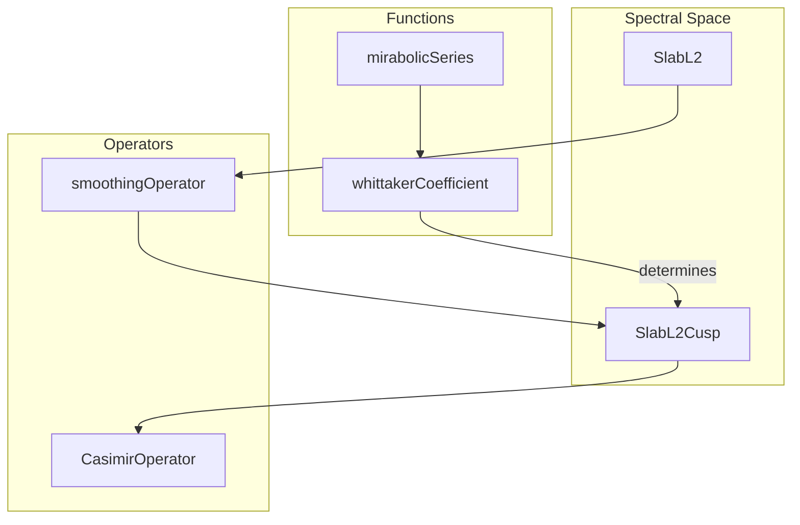
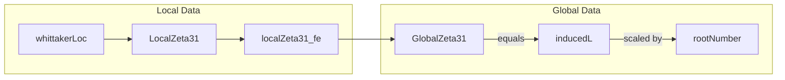

<!-- source: DeepWiki mcp.deepwiki.com · repo anthropics/fermats-last-theorem · page 7.3 Cubic Induction and GL₃ Automorphic Forms · fetched 2026-10-26 -->

# Cubic Induction and GL₃ Automorphic Forms

Relevant source files

The following files were used as context for generating this wiki page:

- [Definitions/Def_NumberField_SiegelVolume.lean](Definitions/Def_NumberField_SiegelVolume.lean)
- [P2M/Sol/S_AutomorphicForm_GL2Real_exists_map_val_centralizer_ellipticElt_eq_smul_map_ellipticElt.lean](P2M/Sol/S_AutomorphicForm_GL2Real_exists_map_val_centralizer_ellipticElt_eq_smul_map_ellipticElt.lean)
- [P2M/Sol/S_AutomorphicForm_GL2Real_exists_map_val_centralizer_upperTriangular_eq_smul_map_diag.lean](P2M/Sol/S_AutomorphicForm_GL2Real_exists_map_val_centralizer_upperTriangular_eq_smul_map_diag.lean)
- [P2M/Sol/S_AutomorphicForm_GL2Twisted_exists_forall_discreteSeriesPairing_twistedSplitTransform_twistedEllipticTransform_eq_zero.lean](P2M/Sol/S_AutomorphicForm_GL2Twisted_exists_forall_discreteSeriesPairing_twistedSplitTransform_twistedEllipticTransform_eq_zero.lean)
- [P2M/Sol/S_AutomorphicForm_GL2Twisted_exists_pos_forall_integral_eq_mul_setIntegral_iwasawaChart.lean](P2M/Sol/S_AutomorphicForm_GL2Twisted_exists_pos_forall_integral_eq_mul_setIntegral_iwasawaChart.lean)
- [P2M/Sol/S_AutomorphicForm_GL2Twisted_twistedOrbitalIntegral_eq_twistedSplitTransform_div_and_eq_twistedEllipticTransform_div.lean](P2M/Sol/S_AutomorphicForm_GL2Twisted_twistedOrbitalIntegral_eq_twistedSplitTransform_div_and_eq_twistedEllipticTransform_div.lean)
- [P2M/Sol/S_AutomorphicForm_GL2Twisted_twistedTransforms_monomialInput_eq_fibreSides.lean](P2M/Sol/S_AutomorphicForm_GL2Twisted_twistedTransforms_monomialInput_eq_fibreSides.lean)
- [P2M/Sol/S_AutomorphicForm_SmoothCuspRealizationAt_exists_isAdmissibleTwist_eq_centralChar_mul_ideleNorm_inv.lean](P2M/Sol/S_AutomorphicForm_SmoothCuspRealizationAt_exists_isAdmissibleTwist_eq_centralChar_mul_ideleNorm_inv.lean)
- [P2M/Sol/S_AutomorphicForm_exists_pos_forall_isOrbitalIntegralOn_diagonal_complex_eq_mul_integral_unitaryAverage.lean](P2M/Sol/S_AutomorphicForm_exists_pos_forall_isOrbitalIntegralOn_diagonal_complex_eq_mul_integral_unitaryAverage.lean)
- [P2M/Sol/S_AutomorphicForm_hasSum_integral_torusShells_of_integrable_withDensity_density_localGL2.lean](P2M/Sol/S_AutomorphicForm_hasSum_integral_torusShells_of_integrable_withDensity_density_localGL2.lean)
- [P2M/Sol/S_AutomorphicForm_lintegral_mul_density_eq_tsum_torusShells_localGL2.lean](P2M/Sol/S_AutomorphicForm_lintegral_mul_density_eq_tsum_torusShells_localGL2.lean)
- [P2M/Sol/S_AutomorphicForm_rightConv_eq_prod_pow_mul_pow_mul_rightConv_of_isInducedSection_of_isUnitFactorization.lean](P2M/Sol/S_AutomorphicForm_rightConv_eq_prod_pow_mul_pow_mul_rightConv_of_isInducedSection_of_isUnitFactorization.lean)
- [P2M/Sol/S_HaarQuotient_map_mk_withDensity_eq_smul_measure.lean](P2M/Sol/S_HaarQuotient_map_mk_withDensity_eq_smul_measure.lean)
- [P2M/Sol/S_LanglandsTunnell_Converse_MellinUniqueness_eq_smul_of_forall_isAdmissibleTwist_mellin_eq.lean](P2M/Sol/S_LanglandsTunnell_Converse_MellinUniqueness_eq_smul_of_forall_isAdmissibleTwist_mellin_eq.lean)
- [P2M/Sol/S_LanglandsTunnell_Converse_exists_const_rsArchIntegral_eq_mul_integral_diagonal.lean](P2M/Sol/S_LanglandsTunnell_Converse_exists_const_rsArchIntegral_eq_mul_integral_diagonal.lean)
- [P2M/Sol/S_LanglandsTunnell_Converse_isHaarMeasure_and_isMulRightInvariant_archMeasure.lean](P2M/Sol/S_LanglandsTunnell_Converse_isHaarMeasure_and_isMulRightInvariant_archMeasure.lean)
- [P2M/Sol/S_LanglandsTunnell_CubicInduction_SlabL2_archDeriv_smoothingOperator.lean](P2M/Sol/S_LanglandsTunnell_CubicInduction_SlabL2_archDeriv_smoothingOperator.lean)
- [P2M/Sol/S_LanglandsTunnell_CubicInduction_SlabL2_casimir_smoothingOperator.lean](P2M/Sol/S_LanglandsTunnell_CubicInduction_SlabL2_casimir_smoothingOperator.lean)
- [P2M/Sol/S_LanglandsTunnell_CubicInduction_SlabL2_continuous_and_hasCompactSupport_of_isSmoothingKernel.lean](P2M/Sol/S_LanglandsTunnell_CubicInduction_SlabL2_continuous_and_hasCompactSupport_of_isSmoothingKernel.lean)
- [P2M/Sol/S_LanglandsTunnell_CubicInduction_SlabL2_continuous_and_isArchSmooth3_smoothingOperator.lean](P2M/Sol/S_LanglandsTunnell_CubicInduction_SlabL2_continuous_and_isArchSmooth3_smoothingOperator.lean)
- [P2M/Sol/S_LanglandsTunnell_CubicInduction_SlabL2_eq_topologicalClosure_and_stable_of_eq_map_of_invariant_spectralOperators3.lean](P2M/Sol/S_LanglandsTunnell_CubicInduction_SlabL2_eq_topologicalClosure_and_stable_of_eq_map_of_invariant_spectralOperators3.lean)
- [P2M/Sol/S_LanglandsTunnell_CubicInduction_SlabL2_eq_topologicalClosure_span_casimir_eq_smul_of_irreducible_cuspidal.lean](P2M/Sol/S_LanglandsTunnell_CubicInduction_SlabL2_eq_topologicalClosure_span_casimir_eq_smul_of_irreducible_cuspidal.lean)
- [P2M/Sol/S_LanglandsTunnell_CubicInduction_SlabL2_exists_casimir_eq_smul_smooth_cuspFunction_of_ne_bot_of_stable_smoothingOperator.lean](P2M/Sol/S_LanglandsTunnell_CubicInduction_SlabL2_exists_casimir_eq_smul_smooth_cuspFunction_of_ne_bot_of_stable_smoothingOperator.lean)
- [P2M/Sol/S_LanglandsTunnell_CubicInduction_SlabL2_exists_expansion_whittaker3_smoothingOperator.lean](P2M/Sol/S_LanglandsTunnell_CubicInduction_SlabL2_exists_expansion_whittaker3_smoothingOperator.lean)
- [P2M/Sol/S_LanglandsTunnell_CubicInduction_SlabL2_exists_isSmoothingKernel_isCompactOperator_isCuspLift3_apply_ne_zero.lean](P2M/Sol/S_LanglandsTunnell_CubicInduction_SlabL2_exists_isSmoothingKernel_isCompactOperator_isCuspLift3_apply_ne_zero.lean)
- [P2M/Sol/S_LanglandsTunnell_CubicInduction_SlabL2_exists_isSmoothingKernel_leftOrthFinite_setIntegral_compl_le.lean](P2M/Sol/S_LanglandsTunnell_CubicInduction_SlabL2_exists_isSmoothingKernel_leftOrthFinite_setIntegral_compl_le.lean)
- [P2M/Sol/S_LanglandsTunnell_CubicInduction_SlabL2_isSmoothingKernel_star_inv_and_inner_toL2_smoothingOperator_eq.lean](P2M/Sol/S_LanglandsTunnell_CubicInduction_SlabL2_isSmoothingKernel_star_inv_and_inner_toL2_smoothingOperator_eq.lean)
- [P2M/Sol/S_LanglandsTunnell_CubicInduction_SlabL2_leftOrthFinite_archDerivKernel.lean](P2M/Sol/S_LanglandsTunnell_CubicInduction_SlabL2_leftOrthFinite_archDerivKernel.lean)
- [P2M/Sol/S_LanglandsTunnell_CubicInduction_adelicGLHaar_siegelSet_inter_setOf_ideleNorm_det_mem_Icc_lt_top.lean](P2M/Sol/S_LanglandsTunnell_CubicInduction_adelicGLHaar_siegelSet_inter_setOf_ideleNorm_det_mem_Icc_lt_top.lean)
- [P2M/Sol/S_LanglandsTunnell_CubicInduction_archPackage_comp_transposeInv3_of_isCentreFinite.lean](P2M/Sol/S_LanglandsTunnell_CubicInduction_archPackage_comp_transposeInv3_of_isCentreFinite.lean)
- [P2M/Sol/S_LanglandsTunnell_CubicInduction_box_integral_dualSeries_radical_eq_ideleNorm_mul_tsum_integral_dual.lean](P2M/Sol/S_LanglandsTunnell_CubicInduction_box_integral_dualSeries_radical_eq_ideleNorm_mul_tsum_integral_dual.lean)
- [P2M/Sol/S_LanglandsTunnell_CubicInduction_conj_radical_sub_one_mul_self_eq_zero_and_norm_le_div_archRoot_of_siegel.lean](P2M/Sol/S_LanglandsTunnell_CubicInduction_conj_radical_sub_one_mul_self_eq_zero_and_norm_le_div_archRoot_of_siegel.lean)
- [P2M/Sol/S_LanglandsTunnell_CubicInduction_dualJacquetValueSlices_eventually_eq_and_eq_zero_and_eq_mul_sum.lean](P2M/Sol/S_LanglandsTunnell_CubicInduction_dualJacquetValueSlices_eventually_eq_and_eq_zero_and_eq_mul_sum.lean)
- [P2M/Sol/S_LanglandsTunnell_CubicInduction_dualWhittakerFn3_localLevelOne_and_torusValues_const_sq_of_localRankinSelbergFE.lean](P2M/Sol/S_LanglandsTunnell_CubicInduction_dualWhittakerFn3_localLevelOne_and_torusValues_const_sq_of_localRankinSelbergFE.lean)
- [P2M/Sol/S_LanglandsTunnell_CubicInduction_eval_mul_eq_finprod_rootNumber_mul_eval_of_forall_localZeta31_fe_one_of_isCubicInductionDataOn_of_addCharLevel.lean](P2M/Sol/S_LanglandsTunnell_CubicInduction_eval_mul_eq_finprod_rootNumber_mul_eval_of_forall_localZeta31_fe_one_of_isCubicInductionDataOn_of_addCharLevel.lean)
- [P2M/Sol/S_LanglandsTunnell_CubicInduction_eventually_threefold_twistedDifference_dualJacquetValueFn_eq_zero.lean](P2M/Sol/S_LanglandsTunnell_CubicInduction_eventually_threefold_twistedDifference_dualJacquetValueFn_eq_zero.lean)
- [P2M/Sol/S_LanglandsTunnell_CubicInduction_eventually_threefold_twistedDifference_torusJacquetValueFn_eq_zero.lean](P2M/Sol/S_LanglandsTunnell_CubicInduction_eventually_threefold_twistedDifference_torusJacquetValueFn_eq_zero.lean)
- [P2M/Sol/S_LanglandsTunnell_CubicInduction_exists_dualMiddleDatum_rsLocalIntegral_dual_mul_eq_of_iotaGL_invariant_of_dominant.lean](P2M/Sol/S_LanglandsTunnell_CubicInduction_exists_dualMiddleDatum_rsLocalIntegral_dual_mul_eq_of_iotaGL_invariant_of_dominant.lean)
- [P2M/Sol/S_LanglandsTunnell_CubicInduction_exists_entire_eulerTwist_induced_of_not_exists_eq_pow_inertiaDeg.lean](P2M/Sol/S_LanglandsTunnell_CubicInduction_exists_entire_eulerTwist_induced_of_not_exists_eq_pow_inertiaDeg.lean)
- [P2M/Sol/S_LanglandsTunnell_CubicInduction_exists_eval_mul_eq_mul_eval_of_forall_localZeta31_fe_one_of_isCubicInductionDataOn_of_addCharLevel.lean](P2M/Sol/S_LanglandsTunnell_CubicInduction_exists_eval_mul_eq_mul_eval_of_forall_localZeta31_fe_one_of_isCubicInductionDataOn_of_addCharLevel.lean)
- [P2M/Sol/S_LanglandsTunnell_CubicInduction_exists_eval_mul_eq_mul_eval_of_forall_localZeta31_fe_one_of_isCubicInductionDataOn_of_isRamifiedIn.lean](P2M/Sol/S_LanglandsTunnell_CubicInduction_exists_eval_mul_eq_mul_eval_of_forall_localZeta31_fe_one_of_isCubicInductionDataOn_of_isRamifiedIn.lean)
- [P2M/Sol/S_LanglandsTunnell_CubicInduction_exists_forall_exists_localZetaDual31_ne_zero_of_irreducible.lean](P2M/Sol/S_LanglandsTunnell_CubicInduction_exists_forall_exists_localZetaDual31_ne_zero_of_irreducible.lean)
- [P2M/Sol/S_LanglandsTunnell_CubicInduction_exists_forall_linearMap_apply_eq_zero_of_transposeInv3_radicalP21_of_mem_principalSeries3.lean](P2M/Sol/S_LanglandsTunnell_CubicInduction_exists_forall_linearMap_apply_eq_zero_of_transposeInv3_radicalP21_of_mem_principalSeries3.lean)
- [P2M/Sol/S_LanglandsTunnell_CubicInduction_exists_forall_norm_dualZetaRemainder_outside_annulus_le.lean](P2M/Sol/S_LanglandsTunnell_CubicInduction_exists_forall_norm_dualZetaRemainder_outside_annulus_le.lean)
- [P2M/Sol/S_LanglandsTunnell_CubicInduction_exists_forall_norm_setIntegral_annulus_setIntegral_compl_ball_jacquetWindow_le.lean](P2M/Sol/S_LanglandsTunnell_CubicInduction_exists_forall_norm_setIntegral_annulus_setIntegral_compl_ball_jacquetWindow_le.lean)
- [P2M/Sol/S_LanglandsTunnell_CubicInduction_exists_forall_sum_smul_translate_eq_zero_of_isCuspidalAlong.lean](P2M/Sol/S_LanglandsTunnell_CubicInduction_exists_forall_sum_smul_translate_eq_zero_of_isCuspidalAlong.lean)
- [P2M/Sol/S_LanglandsTunnell_CubicInduction_exists_gauge3_le_mul_archRoot_mul_archRoot_sq_of_siegel_of_ideleNorm_det_mem_Icc.lean](P2M/Sol/S_LanglandsTunnell_CubicInduction_exists_gauge3_le_mul_archRoot_mul_archRoot_sq_of_siegel_of_ideleNorm_det_mem_Icc.lean)
- [P2M/Sol/S_LanglandsTunnell_CubicInduction_exists_globalZeta30_eq_mul_localZeta30_and_globalZetaDual31_eq_mul_of_isCubicInductionDataOn.lean](P2M/Sol/S_LanglandsTunnell_CubicInduction_exists_globalZeta30_eq_mul_localZeta30_and_globalZetaDual31_eq_mul_of_isCubicInductionDataOn.lean)
- [P2M/Sol/S_LanglandsTunnell_CubicInduction_exists_hasProd_sphericalShellSums_and_globalZeta30_eq_mul_integral_sPart.lean](P2M/Sol/S_LanglandsTunnell_CubicInduction_exists_hasProd_sphericalShellSums_and_globalZeta30_eq_mul_integral_sPart.lean)
- [P2M/Sol/S_LanglandsTunnell_CubicInduction_exists_inner_toL2_translateRight_ne_zero_of_isCosetEigenfunction_of_isCentreFinite.lean](P2M/Sol/S_LanglandsTunnell_CubicInduction_exists_inner_toL2_translateRight_ne_zero_of_isCosetEigenfunction_of_isCentreFinite.lean)
- [P2M/Sol/S_LanglandsTunnell_CubicInduction_exists_integrable_levelUniform_dominant_coupledInner.lean](P2M/Sol/S_LanglandsTunnell_CubicInduction_exists_integrable_levelUniform_dominant_coupledInner.lean)
- [P2M/Sol/S_LanglandsTunnell_CubicInduction_exists_laurent_localZetaDual31_one_sub_eq_of_norm_eq_one.lean](P2M/Sol/S_LanglandsTunnell_CubicInduction_exists_laurent_localZetaDual31_one_sub_eq_of_norm_eq_one.lean)
- [P2M/Sol/S_LanglandsTunnell_CubicInduction_exists_laurent_localZeta_eq_prod_localLFactorAt_mul_of_twistedDifference.lean](P2M/Sol/S_LanglandsTunnell_CubicInduction_exists_laurent_localZeta_eq_prod_localLFactorAt_mul_of_twistedDifference.lean)
- [P2M/Sol/S_LanglandsTunnell_CubicInduction_exists_laurent_localZeta_fe_of_jacquetWhittaker3_mul_antidiagonal3.lean](P2M/Sol/S_LanglandsTunnell_CubicInduction_exists_laurent_localZeta_fe_of_jacquetWhittaker3_mul_antidiagonal3.lean)
- [P2M/Sol/S_LanglandsTunnell_CubicInduction_exists_level_forall_foldr_archDeriv_invariant_cuspidal_archSmooth.lean](P2M/Sol/S_LanglandsTunnell_CubicInduction_exists_level_forall_foldr_archDeriv_invariant_cuspidal_archSmooth.lean)
- [P2M/Sol/S_LanglandsTunnell_CubicInduction_exists_level_forall_mul_finEmbedN_eq_of_isRightInvariant_of_isOpen.lean](P2M/Sol/S_LanglandsTunnell_CubicInduction_exists_level_forall_mul_finEmbedN_eq_of_isRightInvariant_of_isOpen.lean)
- [P2M/Sol/S_LanglandsTunnell_CubicInduction_exists_localZeta31_fe_one_inducedEulerPoly_rational_of_isCubicInductionDataOn_of_isRamifiedIn.lean](P2M/Sol/S_LanglandsTunnell_CubicInduction_exists_localZeta31_fe_one_inducedEulerPoly_rational_of_isCubicInductionDataOn_of_isRamifiedIn.lean)
- [P2M/Sol/S_LanglandsTunnell_CubicInduction_exists_localZeta31_fe_one_inducedEulerPoly_rational_of_isCubicInductionDataOn_of_not_isRamifiedIn.lean](P2M/Sol/S_LanglandsTunnell_CubicInduction_exists_localZeta31_fe_one_inducedEulerPoly_rational_of_isCubicInductionDataOn_of_not_isRamifiedIn.lean)
- [P2M/Sol/S_LanglandsTunnell_CubicInduction_exists_mem_cuspFunctions_toL2_mem_and_isCosetEigenfunction_of_forall_inner_eq_zero.lean](P2M/Sol/S_LanglandsTunnell_CubicInduction_exists_mem_cuspFunctions_toL2_mem_and_isCosetEigenfunction_of_forall_inner_eq_zero.lean)
- [P2M/Sol/S_LanglandsTunnell_CubicInduction_exists_mem_gl3CyclicSubspace_congruenceK1_torusValues_of_isCubicInductionDataOn.lean](P2M/Sol/S_LanglandsTunnell_CubicInduction_exists_mem_gl3CyclicSubspace_congruenceK1_torusValues_of_isCubicInductionDataOn.lean)
- [P2M/Sol/S_LanglandsTunnell_CubicInduction_exists_mem_gl3CyclicSubspace_principalLevel_le_of_isRamifiedIn_of_isCubicInductionDataOn_of_conductorBound.lean](P2M/Sol/S_LanglandsTunnell_CubicInduction_exists_mem_gl3CyclicSubspace_principalLevel_le_of_isRamifiedIn_of_isCubicInductionDataOn_of_conductorBound.lean)
- [P2M/Sol/S_LanglandsTunnell_CubicInduction_exists_mul_eq_unipotent_mul_diagonal_mul_compact.lean](P2M/Sol/S_LanglandsTunnell_CubicInduction_exists_mul_eq_unipotent_mul_diagonal_mul_compact.lean)
- [P2M/Sol/S_LanglandsTunnell_CubicInduction_exists_mvPolynomial_forall_dominant_rsLocalIntegral_deformedSpherical_eq_and_fe_of_forall_localZeta31_fe_of_gauge.lean](P2M/Sol/S_LanglandsTunnell_CubicInduction_exists_mvPolynomial_forall_dominant_rsLocalIntegral_deformedSpherical_eq_and_fe_of_forall_localZeta31_fe_of_gauge.lean)
- [P2M/Sol/S_LanglandsTunnell_CubicInduction_exists_mvPolynomial_forall_rsLocalIntegral_mul_eq_eval_of_iotaGL_invariant.lean](P2M/Sol/S_LanglandsTunnell_CubicInduction_exists_mvPolynomial_forall_rsLocalIntegral_mul_eq_eval_of_iotaGL_invariant.lean)
- [P2M/Sol/S_LanglandsTunnell_CubicInduction_exists_ne_zero_forall_eval_mul_eq_mul_rootNumber_mul_eval_of_forall_localZeta31_fe_twist_of_isCubicInductionDataOn_of_deep_of_archPackage_of_inv_eq_psiQ_of_whittakerLoc_one.lean](P2M/Sol/S_LanglandsTunnell_CubicInduction_exists_ne_zero_forall_eval_mul_eq_mul_rootNumber_mul_eval_of_forall_localZeta31_fe_twist_of_isCubicInductionDataOn_of_deep_of_archPackage_of_inv_eq_psiQ_of_whittakerLoc_one.lean)
- [P2M/Sol/S_LanglandsTunnell_CubicInduction_exists_norm_setIntegral_ball_truncChar_mul_charExt_mul_cpow_le.lean](P2M/Sol/S_LanglandsTunnell_CubicInduction_exists_norm_setIntegral_ball_truncChar_mul_charExt_mul_cpow_le.lean)
- [P2M/Sol/S_LanglandsTunnell_CubicInduction_exists_primalMiddleDatum_rsLocalIntegral_mul_eq_of_iotaGL_invariant_of_dominant.lean](P2M/Sol/S_LanglandsTunnell_CubicInduction_exists_primalMiddleDatum_rsLocalIntegral_mul_eq_of_iotaGL_invariant_of_dominant.lean)
- [P2M/Sol/S_LanglandsTunnell_CubicInduction_exists_rsLocalIntegral_and_dual_integrable_and_eq_rational_sphericalWhittaker_of_forall_localZeta31_fe_of_gauge.lean](P2M/Sol/S_LanglandsTunnell_CubicInduction_exists_rsLocalIntegral_and_dual_integrable_and_eq_rational_sphericalWhittaker_of_forall_localZeta31_fe_of_gauge.lean)
- [P2M/Sol/S_LanglandsTunnell_CubicInduction_exists_rsLocalIntegral_sum_translate_eq_const_of_apply_one_ne_zero.lean](P2M/Sol/S_LanglandsTunnell_CubicInduction_exists_rsLocalIntegral_sum_translate_eq_const_of_apply_one_ne_zero.lean)
- [P2M/Sol/S_LanglandsTunnell_CubicInduction_exists_spherical_mem_principalSeries3_isCosetEigenfunction.lean](P2M/Sol/S_LanglandsTunnell_CubicInduction_exists_spherical_mem_principalSeries3_isCosetEigenfunction.lean)
- [P2M/Sol/S_LanglandsTunnell_CubicInduction_exists_whittaker3_eq_mul_prod_hasWhittakerMultOne_of_isCuspidalAlong.lean](P2M/Sol/S_LanglandsTunnell_CubicInduction_exists_whittaker3_eq_mul_prod_hasWhittakerMultOne_of_isCuspidalAlong.lean)
- [P2M/Sol/S_LanglandsTunnell_CubicInduction_exists_whittaker_zeta_fe_of_forall_not_mem_isInducedSphericalAt_of_arch.lean](P2M/Sol/S_LanglandsTunnell_CubicInduction_exists_whittaker_zeta_fe_of_forall_not_mem_isInducedSphericalAt_of_arch.lean)
- [P2M/Sol/S_LanglandsTunnell_CubicInduction_finprod_sq_mul_lamSqArch_eq_one_of_forall_ne_zero_localZeta31_fe_rootNumber_of_isCubicInductionDataOn_of_archPackage_of_inv_eq_psiQ.lean](P2M/Sol/S_LanglandsTunnell_CubicInduction_finprod_sq_mul_lamSqArch_eq_one_of_forall_ne_zero_localZeta31_fe_rootNumber_of_isCubicInductionDataOn_of_archPackage_of_inv_eq_psiQ.lean)
- [P2M/Sol/S_LanglandsTunnell_CubicInduction_finsum_primeFibre_inertiaDeg_eq_three_of_not_isRamifiedIn.lean](P2M/Sol/S_LanglandsTunnell_CubicInduction_finsum_primeFibre_inertiaDeg_eq_three_of_not_isRamifiedIn.lean)
- [P2M/Sol/S_LanglandsTunnell_CubicInduction_forall_localZeta31_fe_of_twist_modulus_cpow.lean](P2M/Sol/S_LanglandsTunnell_CubicInduction_forall_localZeta31_fe_of_twist_modulus_cpow.lean)
- [P2M/Sol/S_LanglandsTunnell_CubicInduction_forall_mem_gl3CyclicSubspace_rsLocalIntegral_fe32_of_forall_localZeta31_fe_of_gauge.lean](P2M/Sol/S_LanglandsTunnell_CubicInduction_forall_mem_gl3CyclicSubspace_rsLocalIntegral_fe32_of_forall_localZeta31_fe_of_gauge.lean)
- [P2M/Sol/S_LanglandsTunnell_CubicInduction_globalZeta30_eq_sPart_mul_inducedL_of_isCubicInductionDataOn.lean](P2M/Sol/S_LanglandsTunnell_CubicInduction_globalZeta30_eq_sPart_mul_inducedL_of_isCubicInductionDataOn.lean)
- [P2M/Sol/S_LanglandsTunnell_CubicInduction_globalZeta31_eq_mul_integral_sPart_mul_of_hasProd_localZeta31_of_integrable.lean](P2M/Sol/S_LanglandsTunnell_CubicInduction_globalZeta31_eq_mul_integral_sPart_mul_of_hasProd_localZeta31_of_integrable.lean)
- [P2M/Sol/S_LanglandsTunnell_CubicInduction_hasCubicInductionForm_arch_torusValues_localPackage_bad.lean](P2M/Sol/S_LanglandsTunnell_CubicInduction_hasCubicInductionForm_arch_torusValues_localPackage_bad.lean)
- [P2M/Sol/S_LanglandsTunnell_CubicInduction_hasSum_torus_radicalCoefficient_mirabolicSeries.lean](P2M/Sol/S_LanglandsTunnell_CubicInduction_hasSum_torus_radicalCoefficient_mirabolicSeries.lean)
- [P2M/Sol/S_LanglandsTunnell_CubicInduction_hasWhittakerMultOne_of_ne_one_of_forall_mem_gl3CyclicSubspace.lean](P2M/Sol/S_LanglandsTunnell_CubicInduction_hasWhittakerMultOne_of_ne_one_of_forall_mem_gl3CyclicSubspace.lean)
- [P2M/Sol/S_LanglandsTunnell_CubicInduction_inducedCoeff_mul_comp_idelicNorm_and_isBadPlace_iff_of_conductorExponentAt_le.lean](P2M/Sol/S_LanglandsTunnell_CubicInduction_inducedCoeff_mul_comp_idelicNorm_and_isBadPlace_iff_of_conductorExponentAt_le.lean)
- [P2M/Sol/S_LanglandsTunnell_CubicInduction_integrable_and_integral_weight_mul_jacquetWindow_eq_integral_unfolded.lean](P2M/Sol/S_LanglandsTunnell_CubicInduction_integrable_and_integral_weight_mul_jacquetWindow_eq_integral_unfolded.lean)
- [P2M/Sol/S_LanglandsTunnell_CubicInduction_integrable_coupledIntegrand.lean](P2M/Sol/S_LanglandsTunnell_CubicInduction_integrable_coupledIntegrand.lean)
- [P2M/Sol/S_LanglandsTunnell_CubicInduction_integrable_mul_charExt_mul_modulus_cpow_of_twistedDifference.lean](P2M/Sol/S_LanglandsTunnell_CubicInduction_integrable_mul_charExt_mul_modulus_cpow_of_twistedDifference.lean)
- [P2M/Sol/S_LanglandsTunnell_CubicInduction_isCuspidalAlongP21_mirabolicSeries.lean](P2M/Sol/S_LanglandsTunnell_CubicInduction_isCuspidalAlongP21_mirabolicSeries.lean)
- [P2M/Sol/S_LanglandsTunnell_CubicInduction_isCuspidalAlong_foldr_archDeriv_sum_translate.lean](P2M/Sol/S_LanglandsTunnell_CubicInduction_isCuspidalAlong_foldr_archDeriv_sum_translate.lean)
- [P2M/Sol/S_LanglandsTunnell_CubicInduction_isLocalZeta31ConvergentAbove_dualWhittakerFn3_of_norm_eq_one.lean](P2M/Sol/S_LanglandsTunnell_CubicInduction_isLocalZeta31ConvergentAbove_dualWhittakerFn3_of_norm_eq_one.lean)
- [P2M/Sol/S_LanglandsTunnell_CubicInduction_isRightInvariant_and_isCosetEigenfunction_translateRight_smoothingOperator.lean](P2M/Sol/S_LanglandsTunnell_CubicInduction_isRightInvariant_and_isCosetEigenfunction_translateRight_smoothingOperator.lean)
- [P2M/Sol/S_LanglandsTunnell_CubicInduction_isRightInvariant_foldr_archDeriv_sum_translate.lean](P2M/Sol/S_LanglandsTunnell_CubicInduction_isRightInvariant_foldr_archDeriv_sum_translate.lean)
- [P2M/Sol/S_LanglandsTunnell_CubicInduction_localZetaDual31_one_sub_eq_mul_localZeta30_of_mem_strip.lean](P2M/Sol/S_LanglandsTunnell_CubicInduction_localZetaDual31_one_sub_eq_mul_localZeta30_of_mem_strip.lean)
- [P2M/Sol/S_LanglandsTunnell_CubicInduction_localZeta_primedDual_eq_pieces_add_setIntegral_annulus_of_forall_eq_zero.lean](P2M/Sol/S_LanglandsTunnell_CubicInduction_localZeta_primedDual_eq_pieces_add_setIntegral_annulus_of_forall_eq_zero.lean)
- [P2M/Sol/S_LanglandsTunnell_CubicInduction_localZeta_tateFourier_mul_localLFactorAt_eq.lean](P2M/Sol/S_LanglandsTunnell_CubicInduction_localZeta_tateFourier_mul_localLFactorAt_eq.lean)
- [P2M/Sol/S_LanglandsTunnell_CubicInduction_middleDatum_compare_of_primalMiddleDatum_of_dualMiddleDatum_of_ne_zero.lean](P2M/Sol/S_LanglandsTunnell_CubicInduction_middleDatum_compare_of_primalMiddleDatum_of_dualMiddleDatum_of_ne_zero.lean)
- [P2M/Sol/S_LanglandsTunnell_CubicInduction_mirabolicSeries_eq_dual_of_radicalCoefficient_eq.lean](P2M/Sol/S_LanglandsTunnell_CubicInduction_mirabolicSeries_eq_dual_of_radicalCoefficient_eq.lean)
- [P2M/Sol/S_LanglandsTunnell_CubicInduction_nonempty_automorphyDatum31_of_zeta_fe.lean](P2M/Sol/S_LanglandsTunnell_CubicInduction_nonempty_automorphyDatum31_of_zeta_fe.lean)
- [P2M/Sol/S_LanglandsTunnell_CubicInduction_norm_le_of_isCuspidalAlong_of_arch_oscillation_le.lean](P2M/Sol/S_LanglandsTunnell_CubicInduction_norm_le_of_isCuspidalAlong_of_arch_oscillation_le.lean)
- [P2M/Sol/S_LanglandsTunnell_CubicInduction_norm_whittaker3_archRealLift3_diag_mul_eq_norm_whittaker3_comp_transposeInv3.lean](P2M/Sol/S_LanglandsTunnell_CubicInduction_norm_whittaker3_archRealLift3_diag_mul_eq_norm_whittaker3_comp_transposeInv3.lean)
- [P2M/Sol/S_LanglandsTunnell_CubicInduction_rsLocalIntegral_fe32_of_eq_rational_of_forall_localZeta31_fe_of_gauge.lean](P2M/Sol/S_LanglandsTunnell_CubicInduction_rsLocalIntegral_fe32_of_eq_rational_of_forall_localZeta31_fe_of_gauge.lean)
- [P2M/Sol/S_LanglandsTunnell_CubicInduction_rsLocalIntegral_fe32_of_forall_localZeta31_fe_of_gauge.lean](P2M/Sol/S_LanglandsTunnell_CubicInduction_rsLocalIntegral_fe32_of_forall_localZeta31_fe_of_gauge.lean)
- [P2M/Sol/S_LanglandsTunnell_CubicInduction_setIntegral_tallBoxJacquet_div_norm_mul_charExt_mul_cpow_eq.lean](P2M/Sol/S_LanglandsTunnell_CubicInduction_setIntegral_tallBoxJacquet_div_norm_mul_charExt_mul_cpow_eq.lean)
- [P2M/Sol/S_LanglandsTunnell_CubicInduction_smoothingOperator_mem_cuspFunctions_of_isCuspidalAlong.lean](P2M/Sol/S_LanglandsTunnell_CubicInduction_smoothingOperator_mem_cuspFunctions_of_isCuspidalAlong.lean)
- [P2M/Sol/S_LanglandsTunnell_CubicInduction_tendsto_localZeta_truncChar_mul_coupled_localZeta_of_jacquetValue.lean](P2M/Sol/S_LanglandsTunnell_CubicInduction_tendsto_localZeta_truncChar_mul_coupled_localZeta_of_jacquetValue.lean)
- [P2M/Sol/S_LanglandsTunnell_CubicInduction_tendsto_localZeta_truncPsi_mul_coupled_of_forall_eq_integral_jacquetValue.lean](P2M/Sol/S_LanglandsTunnell_CubicInduction_tendsto_localZeta_truncPsi_mul_coupled_of_forall_eq_integral_jacquetValue.lean)
- [P2M/Sol/S_LanglandsTunnell_CubicInduction_tendsto_setIntegral_annulus_setIntegral_ball_jacquetWindow_sub_jacquetValue.lean](P2M/Sol/S_LanglandsTunnell_CubicInduction_tendsto_setIntegral_annulus_setIntegral_ball_jacquetWindow_sub_jacquetValue.lean)
- [P2M/Sol/S_LanglandsTunnell_CubicInduction_toL2_translateRight_mem_of_mem_of_isClosed.lean](P2M/Sol/S_LanglandsTunnell_CubicInduction_toL2_translateRight_mem_of_mem_of_isClosed.lean)
- [P2M/Sol/S_LanglandsTunnell_CubicInduction_whittakerArch_scalar_mul_eq_centralChar_mul_of_isCubicInductionDataOn.lean](P2M/Sol/S_LanglandsTunnell_CubicInduction_whittakerArch_scalar_mul_eq_centralChar_mul_of_isCubicInductionDataOn.lean)
- [P2M/Sol/S_LanglandsTunnell_CubicLambda_zetaEulerPoly_eq_of_resolvent.lean](P2M/Sol/S_LanglandsTunnell_CubicLambda_zetaEulerPoly_eq_of_resolvent.lean)
- [P2M/Sol/S_LanglandsTunnell_CubicLambda_zetaEulerPoly_eq_of_resolvent_of_ramified.lean](P2M/Sol/S_LanglandsTunnell_CubicLambda_zetaEulerPoly_eq_of_resolvent_of_ramified.lean)
- [P2M/Sol/S_LanglandsTunnell_RankinSelberg_EntirePairAssembly_dual_identity_family.lean](P2M/Sol/S_LanglandsTunnell_RankinSelberg_EntirePairAssembly_dual_identity_family.lean)
- [P2M/Sol/S_LanglandsTunnell_RankinSelberg_eval_inducedEulerPoly_eq_of_finrank_le_three.lean](P2M/Sol/S_LanglandsTunnell_RankinSelberg_eval_inducedEulerPoly_eq_of_finrank_le_three.lean)
- [P2M/Sol/S_LanglandsTunnell_RankinSelberg_exists_entire_boundedOnStrips_eq_archFactor_mul_lFun_rsDatum_of_le_conductorExponentAt_of_centralInduced_of_localSpaceAt_of_normPin_archTrivial.lean](P2M/Sol/S_LanglandsTunnell_RankinSelberg_exists_entire_boundedOnStrips_eq_archFactor_mul_lFun_rsDatum_of_le_conductorExponentAt_of_centralInduced_of_localSpaceAt_of_normPin_archTrivial.lean)
- [P2M/Sol/S_LanglandsTunnell_RankinSelberg_exists_factor_fundamentalDomain_forall_rsGlobalIntegral_realisation_member_twisted_of_finiteFamily_arch_of_archNonvanishing.lean](P2M/Sol/S_LanglandsTunnell_RankinSelberg_exists_factor_fundamentalDomain_forall_rsGlobalIntegral_realisation_member_twisted_of_finiteFamily_arch_of_archNonvanishing.lean)
- [P2M/Sol/S_LanglandsTunnell_RankinSelberg_exists_finTranslate_not_countable_rsFinIntegral_indicator_ne_zero_of_purifier_of_finiteFamily_arch.lean](P2M/Sol/S_LanglandsTunnell_RankinSelberg_exists_finTranslate_not_countable_rsFinIntegral_indicator_ne_zero_of_purifier_of_finiteFamily_arch.lean)
- [P2M/Sol/S_LanglandsTunnell_RankinSelberg_exists_forall_integrable_archWhittaker_gaussian_rpow_det_rat.lean](P2M/Sol/S_LanglandsTunnell_RankinSelberg_exists_forall_integrable_archWhittaker_gaussian_rpow_det_rat.lean)
- [P2M/Sol/S_LanglandsTunnell_RankinSelberg_exists_forall_integrable_rsFinCellIntegrand_pureTensorTerm_dual_and_hybrid_of_depth_twisted_torusFinite_central_growth_of_principalLevel_of_gammaHyp.lean](P2M/Sol/S_LanglandsTunnell_RankinSelberg_exists_forall_integrable_rsFinCellIntegrand_pureTensorTerm_dual_and_hybrid_of_depth_twisted_torusFinite_central_growth_of_principalLevel_of_gammaHyp.lean)
- [P2M/Sol/S_LanglandsTunnell_RankinSelberg_exists_forall_integrable_rsFinCellIntegrand_translate_and_dual.lean](P2M/Sol/S_LanglandsTunnell_RankinSelberg_exists_forall_integrable_rsFinCellIntegrand_translate_and_dual.lean)
- [P2M/Sol/S_LanglandsTunnell_RankinSelberg_exists_forall_integrable_whittaker_iotaGL_mul_principalSeries2_antidiagonal_of_gauge.lean](P2M/Sol/S_LanglandsTunnell_RankinSelberg_exists_forall_integrable_whittaker_iotaGL_mul_principalSeries2_antidiagonal_of_gauge.lean)
- [P2M/Sol/S_LanglandsTunnell_RankinSelberg_exists_forall_rsGlobalIntegral_eq_mul_rsArchIntegral_mul_rsFinIntegral_mul_lFun.lean](P2M/Sol/S_LanglandsTunnell_RankinSelberg_exists_forall_rsGlobalIntegral_eq_mul_rsArchIntegral_mul_rsFinIntegral_mul_lFun.lean)
- [P2M/Sol/S_LanglandsTunnell_RankinSelberg_exists_frozen_forall_sum_translate_purified_whittakerCoefficient_eq_mul_pSlot_of_finiteFamily_arch.lean](P2M/Sol/S_LanglandsTunnell_RankinSelberg_exists_frozen_forall_sum_translate_purified_whittakerCoefficient_eq_mul_pSlot_of_finiteFamily_arch.lean)
- [P2M/Sol/S_LanglandsTunnell_RankinSelberg_exists_frozen_forall_sum_translate_whittaker_iota_eq_mul_pSlot_of_finiteFamily_arch.lean](P2M/Sol/S_LanglandsTunnell_RankinSelberg_exists_frozen_forall_sum_translate_whittaker_iota_eq_mul_pSlot_of_finiteFamily_arch.lean)
- [P2M/Sol/S_LanglandsTunnell_RankinSelberg_exists_frozen_forall_sum_translate_whittaker_iota_eq_mul_pSlot_of_finiteFamily_arch_explicit.lean](P2M/Sol/S_LanglandsTunnell_RankinSelberg_exists_frozen_forall_sum_translate_whittaker_iota_eq_mul_pSlot_of_finiteFamily_arch_explicit.lean)
- [P2M/Sol/S_LanglandsTunnell_RankinSelberg_exists_gl3Translates_sum_rsFinIntegral_cells_eq_const_and_dual_eq_rootNumberMonomial_of_finWhittaker_one_ne_zero_of_localSpaceAt_of_member_of_fe32_normPin_twisted_offSQ_archPsi_bump_levelShift_global.lean](P2M/Sol/S_LanglandsTunnell_RankinSelberg_exists_gl3Translates_sum_rsFinIntegral_cells_eq_const_and_dual_eq_rootNumberMonomial_of_finWhittaker_one_ne_zero_of_localSpaceAt_of_member_of_fe32_normPin_twisted_offSQ_archPsi_bump_levelShift_global.lean)
- [P2M/Sol/S_LanglandsTunnell_RankinSelberg_exists_mem_gl3CyclicSubspace_forall_rsLocalIntegral_eq_mul_apply_of_finite.lean](P2M/Sol/S_LanglandsTunnell_RankinSelberg_exists_mem_gl3CyclicSubspace_forall_rsLocalIntegral_eq_mul_apply_of_finite.lean)
- [P2M/Sol/S_LanglandsTunnell_RankinSelberg_exists_mem_rsLocalIntegral_ne_zero_and_rational_member_twisted_of_finiteFamily_arch_deep.lean](P2M/Sol/S_LanglandsTunnell_RankinSelberg_exists_mem_rsLocalIntegral_ne_zero_and_rational_member_twisted_of_finiteFamily_arch_deep.lean)
- [P2M/Sol/S_LanglandsTunnell_RankinSelberg_exists_mem_span_forall_rsLocalIntegral_eq_const_ne_zero_of_isGL3PsiWhittakerFn.lean](P2M/Sol/S_LanglandsTunnell_RankinSelberg_exists_mem_span_forall_rsLocalIntegral_eq_const_ne_zero_of_isGL3PsiWhittakerFn.lean)
- [P2M/Sol/S_LanglandsTunnell_RankinSelberg_exists_ne_zero_forall_integrable_and_rsFinIntegral_indicator_eq_mul_finprod_rsLocalIntegral_of_pure_of_measurable.lean](P2M/Sol/S_LanglandsTunnell_RankinSelberg_exists_ne_zero_forall_integrable_and_rsFinIntegral_indicator_eq_mul_finprod_rsLocalIntegral_of_pure_of_measurable.lean)
- [P2M/Sol/S_LanglandsTunnell_RankinSelberg_exists_ne_zero_forall_rsFinIntegral_indicator_purified_eq_mul_sum_prod_rsLocalIntegral.lean](P2M/Sol/S_LanglandsTunnell_RankinSelberg_exists_ne_zero_forall_rsFinIntegral_indicator_purified_eq_mul_sum_prod_rsLocalIntegral.lean)
- [P2M/Sol/S_LanglandsTunnell_RankinSelberg_exists_ne_zero_forall_rsGlobalIntegral_reference_eq_mul_rsArchIntegral_mul_rsFinIntegral_indicator_mul_of_finiteFamily_arch.lean](P2M/Sol/S_LanglandsTunnell_RankinSelberg_exists_ne_zero_forall_rsGlobalIntegral_reference_eq_mul_rsArchIntegral_mul_rsFinIntegral_indicator_mul_of_finiteFamily_arch.lean)
- [P2M/Sol/S_LanglandsTunnell_RankinSelberg_exists_polynomial_localZeta31_dualWhittakerFn3_iotaGL_eq_and_mul_localZeta30_eq_of_forall_mem_gl3CyclicSubspace_fe_of_torusShell.lean](P2M/Sol/S_LanglandsTunnell_RankinSelberg_exists_polynomial_localZeta31_dualWhittakerFn3_iotaGL_eq_and_mul_localZeta30_eq_of_forall_mem_gl3CyclicSubspace_fe_of_torusShell.lean)
- [P2M/Sol/S_LanglandsTunnell_RankinSelberg_exists_polynomial_localZeta31_iotaGL_eq_and_localZeta30_dualWhittakerFn3_eq_mul_of_forall_mem_gl3CyclicSubspace_fe_of_torusShell.lean](P2M/Sol/S_LanglandsTunnell_RankinSelberg_exists_polynomial_localZeta31_iotaGL_eq_and_localZeta30_dualWhittakerFn3_eq_mul_of_forall_mem_gl3CyclicSubspace_fe_of_torusShell.lean)
- [P2M/Sol/S_LanglandsTunnell_RankinSelberg_exists_pos_forall_lintegral_withDensity_density_eq_mul_lintegral_prod_diagUnits2.lean](P2M/Sol/S_LanglandsTunnell_RankinSelberg_exists_pos_forall_lintegral_withDensity_density_eq_mul_lintegral_prod_diagUnits2.lean)
- [P2M/Sol/S_LanglandsTunnell_RankinSelberg_exists_pos_forall_rsFinIntegral_eq_mul_of_support_subset_unipotent_mul.lean](P2M/Sol/S_LanglandsTunnell_RankinSelberg_exists_pos_forall_rsFinIntegral_eq_mul_of_support_subset_unipotent_mul.lean)
- [P2M/Sol/S_LanglandsTunnell_RankinSelberg_exists_pos_forall_rsLocalIntegral_eq_mul_of_support_subset_unipotent_mul.lean](P2M/Sol/S_LanglandsTunnell_RankinSelberg_exists_pos_forall_rsLocalIntegral_eq_mul_of_support_subset_unipotent_mul.lean)
- [P2M/Sol/S_LanglandsTunnell_RankinSelberg_exists_pureTranslates_combination_forall_rsGlobalIntegral_ne_zero_member_twisted_of_finiteFamily_arch_of_archNonvanishing.lean](P2M/Sol/S_LanglandsTunnell_RankinSelberg_exists_pureTranslates_combination_forall_rsGlobalIntegral_ne_zero_member_twisted_of_finiteFamily_arch_of_archNonvanishing.lean)
- [P2M/Sol/S_LanglandsTunnell_RankinSelberg_exists_rational_gamma_rsLocalIntegral_member_twisted_of_finiteFamily_arch_deep_archPsi.lean](P2M/Sol/S_LanglandsTunnell_RankinSelberg_exists_rational_gamma_rsLocalIntegral_member_twisted_of_finiteFamily_arch_deep_archPsi.lean)
- [P2M/Sol/S_LanglandsTunnell_RankinSelberg_forall_mem_span_rsLocalIntegral_dual_eq_mul_of_forall_localZeta31_fe_of_deepTwist_of_principalLevel_of_admissible_of_gammaFactor_of_forall_localZeta31_fe_of_bump_levelShift_global.lean](P2M/Sol/S_LanglandsTunnell_RankinSelberg_forall_mem_span_rsLocalIntegral_dual_eq_mul_of_forall_localZeta31_fe_of_deepTwist_of_principalLevel_of_admissible_of_gammaFactor_of_forall_localZeta31_fe_of_bump_levelShift_global.lean)
- [P2M/Sol/S_LanglandsTunnell_RankinSelberg_forall_mem_span_rsLocalIntegral_dual_eq_mul_of_forall_rightTranslate_rsLocalIntegral_dual_eq_mul.lean](P2M/Sol/S_LanglandsTunnell_RankinSelberg_forall_mem_span_rsLocalIntegral_dual_eq_mul_of_forall_rightTranslate_rsLocalIntegral_dual_eq_mul.lean)
- [P2M/Sol/S_LanglandsTunnell_RankinSelberg_rsIntegrand_dual_longWeyl3_smoothedBump_invariant_support_bound_and_bigCell_eq.lean](P2M/Sol/S_LanglandsTunnell_RankinSelberg_rsIntegrand_dual_longWeyl3_smoothedBump_invariant_support_bound_and_bigCell_eq.lean)

This section covers the construction of GL₃ automorphic forms via cubic induction, a key component in the Langlands-Tunnell theorem's proof of modularity for octahedral Artin representations. It details the transition from GL₂ data to GL₃ structures, the analytic properties of the resulting Whittaker functions, and the verification of the functional equation for the global L-function.

## 1. Cubic Induction Data and Structures

The process begins with `CubicInductionForm`, which encapsulates the lifting of a GL₂ automorphic form to a GL₃ context. The predicate `IsCubicInductionDataOn` defines the compatibility conditions between the GL₂ form, a cubic extension, and the targeted GL₃ representation.

### Key Definitions
*   `CubicInductionForm`: The central object representing the induced form on $\text{GL}_3(\mathbb{A})$ [P2M/Sol/S_LanglandsTunnell_RankinSelberg_exists_entire_boundedOnStrips_eq_archFactor_mul_lFun_rsDatum_of_le_conductorExponentAt_of_centralInduced_of_localSpaceAt_of_normPin_archTrivial.lean:61-62]().
*   `IsCubicInductionDataOn`: A property bundle ensuring that local components at all places $v$ satisfy the induction requirements, including conductor exponents and central character matches [P2M/Sol/S_LanglandsTunnell_CubicInduction_eval_mul_eq_finprod_rootNumber_mul_eval_of_forall_localZeta31_fe_one_of_isCubicInductionDataOn_of_addCharLevel.lean:2-2]().
*   `AutomorphyDatum31`: Stores the global parameters for the induced GL₃ form, including its level and weight [P2M/Sol/S_LanglandsTunnell_CubicInduction_eval_mul_eq_finprod_rootNumber_mul_eval_of_forall_localZeta31_fe_one_of_isCubicInductionDataOn_of_addCharLevel.lean:57-57]().

### Sources
Sources: [P2M/Sol/S_LanglandsTunnell_CubicInduction_eval_mul_eq_finprod_rootNumber_mul_eval_of_forall_localZeta31_fe_one_of_isCubicInductionDataOn_of_addCharLevel.lean:1-60](), [P2M/Sol/S_LanglandsTunnell_RankinSelberg_exists_entire_boundedOnStrips_eq_archFactor_mul_lFun_rsDatum_of_le_conductorExponentAt_of_centralInduced_of_localSpaceAt_of_normPin_archTrivial.lean:1-90]()

## 2. The SlabL2 Space and Spectral Operators

To analyze the induced form analytically, the codebase defines `SlabL2`, a specific Hilbert space of functions on $\text{GL}_3(\mathbb{A})$ that are square-integrable on certain "slabs" or domains related to the Siegel set.

### Spectral Components
*   **Smoothing Operator**: Used to map raw automorphic data into the space of smooth functions while preserving automorphy [P2M/Sol/S_LanglandsTunnell_CubicInduction_SlabL2_exists_isSmoothingKernel_isCompactOperator_isCuspLift3_apply_ne_zero.lean:65-65]().
*   **Casimir Operator**: The `SpectralOperators3` include the Casimir element, whose eigenvalues are used to characterize the infinitesimal character of the representation [P2M/Sol/S_LanglandsTunnell_CubicInduction_SlabL2_casimir_smoothingOperator.lean:1-20]().
*   **Mirabolic Series**: The construction `mirabolicSeries` provides a way to expand the automorphic form using the mirabolic subgroup, which is essential for the Whittaker expansion [P2M/Sol/S_LanglandsTunnell_mirabolicSeries_eq_dual_of_radicalCoefficient_eq.lean:7-7]().

### Code Entity Map: Spectral Analysis

Sources: [P2M/Sol/S_LanglandsTunnell_CubicInduction_SlabL2_exists_isSmoothingKernel_isCompactOperator_isCuspLift3_apply_ne_zero.lean:1-70](), [P2M/Sol/S_LanglandsTunnell_mirabolicSeries_eq_dual_of_radicalCoefficient_eq.lean:1-33]()

## 3. Local and Global Zeta Integrals

The Converse Theorem relies on the functional equation of L-functions, which are expressed via zeta integrals. For the GL₃ induction, the codebase implements `LocalZeta31` and its global counterpart `GlobalZeta31`.

### Functional Equations
The core result `localZeta31_fe` establishes the local functional equation:
$$Z(1-s, \tilde{W}, \tilde{\phi}) = \gamma(s, \pi, \psi) Z(s, W, \phi)$$
where $W$ is a Whittaker function and $\tilde{W}$ is its dual [P2M/Sol/S_LanglandsTunnell_CubicInduction_exists_dualMiddleDatum_rsLocalIntegral_dual_mul_eq_of_iotaGL_invariant_of_dominant.lean:15-15]().

### Implementation Details
*   `localZeta31`: Defines the local integral over the mirabolic subgroup [P2M/Sol/S_LanglandsTunnell_CubicInduction_exists_dualMiddleDatum_rsLocalIntegral_dual_mul_eq_of_iotaGL_invariant_of_dominant.lean:4-4]().
*   `globalZeta31`: The adelic integral, shown to factorize into a product of local integrals `hasProd_localZeta31` [P2M/Sol/S_LanglandsTunnell_CubicInduction_eval_mul_eq_finprod_rootNumber_mul_eval_of_forall_localZeta31_fe_one_of_isCubicInductionDataOn_of_addCharLevel.lean:16-16]().
*   `whittakerLoc_ne_zero`: A crucial lemma ensuring the non-vanishing of the local Whittaker components, which allows for the division by local factors in the converse theorem [P2M/Sol/S_LanglandsTunnell_CubicInduction_eval_mul_eq_finprod_rootNumber_mul_eval_of_forall_localZeta31_fe_one_of_isCubicInductionDataOn_of_addCharLevel.lean:8-8]().

### Code Entity Map: Zeta Integration Flow

Sources: [P2M/Sol/S_LanglandsTunnell_CubicInduction_exists_dualMiddleDatum_rsLocalIntegral_dual_mul_eq_of_iotaGL_invariant_of_dominant.lean:1-50](), [P2M/Sol/S_LanglandsTunnell_CubicInduction_eval_mul_eq_finprod_rootNumber_mul_eval_of_forall_localZeta31_fe_one_of_isCubicInductionDataOn_of_addCharLevel.lean:60-77]()

## 4. Construction for the Converse Theorem

The final step in this module is the construction of the actual GL₃ automorphic form used in the Converse Theorem. This requires verifying that the induced form satisfies all conditions of the Cogdell-Piatetski-Shapiro converse theorem.

### Key Lemmas
1.  **Whittaker Multiplicity One**: `hasWhittakerMultOne_of_ne_one` ensures the uniqueness of the Whittaker model for the induced representation [P2M/Sol/S_LanglandsTunnell_CubicInduction_eval_mul_eq_finprod_rootNumber_mul_eval_of_forall_localZeta31_fe_one_of_isCubicInductionDataOn_of_addCharLevel.lean:4-4]().
2.  **Entirety**: `exists_entire_eq_globalZeta30` proves that the global L-function (represented by `globalZeta30`) is entire, a prerequisite for automorphy [P2M/Sol/S_LanglandsTunnell_CubicInduction_eval_mul_eq_finprod_rootNumber_mul_eval_of_forall_localZeta31_fe_one_of_isCubicInductionDataOn_of_addCharLevel.lean:18-18]().
3.  **Archimedean Components**: The files `exists_isArchCompAt_of_isReal` and `exists_isArchCompAt_of_isComplex` handle the specific local factors at infinite places, matching them to the Langlands parameters of the Artin representation [P2M/Sol/S_LanglandsTunnell_CubicInduction_eval_mul_eq_finprod_rootNumber_mul_eval_of_forall_localZeta31_fe_one_of_isCubicInductionDataOn_of_addCharLevel.lean:23-24]().

| Function/Theorem | Role | File |
| :--- | :--- | :--- |
| `iotaGL` | Embeds GL₂ into GL₃ | [P2M/Sol/S_LanglandsTunnell_CubicInduction_exists_dualMiddleDatum_rsLocalIntegral_dual_mul_eq_of_iotaGL_invariant_of_dominant.lean:97-97]() |
| `dualWhittakerFn3` | Defines the dual Whittaker function for the functional equation | [P2M/Sol/S_LanglandsTunnell_CubicInduction_exists_whittaker_zeta_fe_of_forall_not_mem_isInducedSphericalAt_of_arch.lean:38-38]() |
| `isCuspidalAlongP21` | Verifies the cuspidality of the induced form along the (2,1) parabolic | [P2M/Sol/S_LanglandsTunnell_mirabolicSeries_eq_dual_of_radicalCoefficient_eq.lean:7-7]() |

Sources: [P2M/Sol/S_LanglandsTunnell_CubicInduction_eval_mul_eq_finprod_rootNumber_mul_eval_of_forall_localZeta31_fe_one_of_isCubicInductionDataOn_of_addCharLevel.lean:1-77](), [P2M/Sol/S_LanglandsTunnell_CubicInduction_exists_whittaker_zeta_fe_of_forall_not_mem_isInducedSphericalAt_of_arch.lean:1-60]()

---

