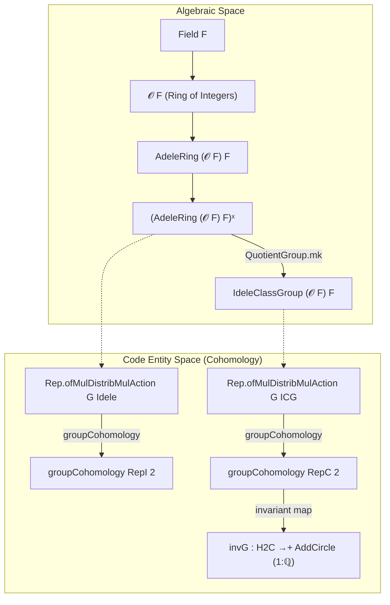
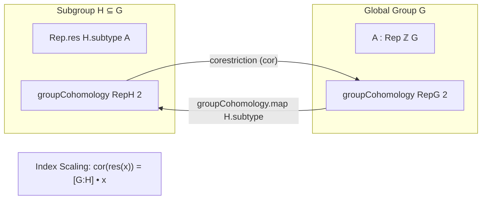

<!-- source: DeepWiki mcp.deepwiki.com · repo anthropics/fermats-last-theorem · page 8 Class Field Theory and Galois Cohomology · fetched 2026-10-26 -->

# Class Field Theory and Galois Cohomology

Relevant source files

The following files were used as context for generating this wiki page:

- [P2M/Sol/S_M4aHerbrand_bijective_groupCohomology_map_toSIdeleClass.lean](P2M/Sol/S_M4aHerbrand_bijective_groupCohomology_map_toSIdeleClass.lean)
- [P2M/Sol/S_M4aHerbrand_card_nsmul_eq_zero_and_map_eq_zero_and_exists_eq_one_div_of_forall_localSum_eq_finsum.lean](P2M/Sol/S_M4aHerbrand_card_nsmul_eq_zero_and_map_eq_zero_and_exists_eq_one_div_of_forall_localSum_eq_finsum.lean)
- [P2M/Sol/S_M4aHerbrand_div_natCard_decomp_eq_div_natCard_decomp_under_of_map_map_eq_zsmul_of_isScalarTower.lean](P2M/Sol/S_M4aHerbrand_div_natCard_decomp_eq_div_natCard_decomp_under_of_map_map_eq_zsmul_of_isScalarTower.lean)
- [P2M/Sol/S_M4aHerbrand_eq_zero_of_forall_localCoordinates_above_eq_zero_groupCohomology_ideles.lean](P2M/Sol/S_M4aHerbrand_eq_zero_of_forall_localCoordinates_above_eq_zero_groupCohomology_ideles.lean)
- [P2M/Sol/S_M4aHerbrand_exists_adeleBaseChange_invariant_groupCohomology_ideleClassGroup_map_eq_of_invariant.lean](P2M/Sol/S_M4aHerbrand_exists_adeleBaseChange_invariant_groupCohomology_ideleClassGroup_map_eq_of_invariant.lean)
- [P2M/Sol/S_M4aHerbrand_exists_fundamentalClass_ideleClassGroup.lean](P2M/Sol/S_M4aHerbrand_exists_fundamentalClass_ideleClassGroup.lean)
- [P2M/Sol/S_M4aHerbrand_exists_fundamentalClass_ideleClassGroup_map_eq_finrank_smul_of_ne_two.lean](P2M/Sol/S_M4aHerbrand_exists_fundamentalClass_ideleClassGroup_map_eq_finrank_smul_of_ne_two.lean)
- [P2M/Sol/S_M4aHerbrand_exists_fundamentalClass_ideleClassGroup_of_isPGroup.lean](P2M/Sol/S_M4aHerbrand_exists_fundamentalClass_ideleClassGroup_of_isPGroup.lean)
- [P2M/Sol/S_M4aHerbrand_exists_fundamentalClass_ideleClassGroup_res_eq_localFundamentalClass_of_isPGroup_of_ne_two.lean](P2M/Sol/S_M4aHerbrand_exists_fundamentalClass_ideleClassGroup_res_eq_localFundamentalClass_of_isPGroup_of_ne_two.lean)
- [P2M/Sol/S_M4aHerbrand_exists_fundamentalClass_ideleClassGroup_smul_res_eq_smul_localFundamentalClass_of_ne_two.lean](P2M/Sol/S_M4aHerbrand_exists_fundamentalClass_ideleClassGroup_smul_res_eq_smul_localFundamentalClass_of_ne_two.lean)
- [P2M/Sol/S_M4aHerbrand_exists_fundamentalClass_sIdeleClassGroup.lean](P2M/Sol/S_M4aHerbrand_exists_fundamentalClass_sIdeleClassGroup.lean)
- [P2M/Sol/S_M4aHerbrand_exists_hom_adicCompletion_res_decomp_ideles_apply.lean](P2M/Sol/S_M4aHerbrand_exists_hom_adicCompletion_res_decomp_ideles_apply.lean)
- [P2M/Sol/S_M4aHerbrand_exists_hom_coind_ideles_finPart_eq_and_eq_one.lean](P2M/Sol/S_M4aHerbrand_exists_hom_coind_ideles_finPart_eq_and_eq_one.lean)
- [P2M/Sol/S_M4aHerbrand_exists_hom_res_decomp_ideles_adicCompletion_apply.lean](P2M/Sol/S_M4aHerbrand_exists_hom_res_decomp_ideles_adicCompletion_apply.lean)
- [P2M/Sol/S_M4aHerbrand_exists_hom_res_inf_decomp_ideles_adicCompletion_apply.lean](P2M/Sol/S_M4aHerbrand_exists_hom_res_inf_decomp_ideles_adicCompletion_apply.lean)
- [P2M/Sol/S_M4aHerbrand_exists_invariant_forall_inv_map_eq_finsum_of_forall_localFundamentalClass_of_isPGroup.lean](P2M/Sol/S_M4aHerbrand_exists_invariant_forall_inv_map_eq_finsum_of_forall_localFundamentalClass_of_isPGroup.lean)
- [P2M/Sol/S_M4aHerbrand_exists_invariant_forall_inv_map_eq_finsum_of_forall_localFundamentalClass_of_isPGroup_of_children.lean](P2M/Sol/S_M4aHerbrand_exists_invariant_forall_inv_map_eq_finsum_of_forall_localFundamentalClass_of_isPGroup_of_children.lean)
- [P2M/Sol/S_M4aHerbrand_exists_invariant_forall_inv_map_localFundamentalClass_eq_one_div_natCard_decomp_of_isPGroup.lean](P2M/Sol/S_M4aHerbrand_exists_invariant_forall_inv_map_localFundamentalClass_eq_one_div_natCard_decomp_of_isPGroup.lean)
- [P2M/Sol/S_M4aHerbrand_exists_invariant_groupCohomology_ideleClassGroup_forall_comp_eq_index_smul_of_ne_two.lean](P2M/Sol/S_M4aHerbrand_exists_invariant_groupCohomology_ideleClassGroup_forall_comp_eq_index_smul_of_ne_two.lean)
- [P2M/Sol/S_M4aHerbrand_exists_invariant_groupCohomology_ideleClassGroup_of_isPGroup_of_ne_two.lean](P2M/Sol/S_M4aHerbrand_exists_invariant_groupCohomology_ideleClassGroup_of_isPGroup_of_ne_two.lean)
- [P2M/Sol/S_M4aHerbrand_exists_map_eq_groupCohomology_ideleClassGroup_of_isCyclic.lean](P2M/Sol/S_M4aHerbrand_exists_map_eq_groupCohomology_ideleClassGroup_of_isCyclic.lean)
- [P2M/Sol/S_M4aHerbrand_exists_map_eq_map_res_ideles.lean](P2M/Sol/S_M4aHerbrand_exists_map_eq_map_res_ideles.lean)
- [P2M/Sol/S_M4aHerbrand_exists_map_eq_of_map_eq_zero_groupCohomology_ideles_of_isCyclic.lean](P2M/Sol/S_M4aHerbrand_exists_map_eq_of_map_eq_zero_groupCohomology_ideles_of_isCyclic.lean)
- [P2M/Sol/S_M4aHerbrand_exists_map_map_eq_map_map_of_dvd_natCard_decomp.lean](P2M/Sol/S_M4aHerbrand_exists_map_map_eq_map_map_of_dvd_natCard_decomp.lean)
- [P2M/Sol/S_M4aHerbrand_exists_map_prG_eq_zsmul_of_map_prG_eq_zsmul_of_under_eq.lean](P2M/Sol/S_M4aHerbrand_exists_map_prG_eq_zsmul_of_map_prG_eq_zsmul_of_under_eq.lean)
- [P2M/Sol/S_M4aHerbrand_exists_natCard_H2_eq_card_and_span_eq_top_ideleClassGroup.lean](P2M/Sol/S_M4aHerbrand_exists_natCard_H2_eq_card_and_span_eq_top_ideleClassGroup.lean)
- [P2M/Sol/S_M4aHerbrand_exists_natCard_H2_eq_card_and_span_eq_top_ideleClassGroup_of_isPGroup.lean](P2M/Sol/S_M4aHerbrand_exists_natCard_H2_eq_card_and_span_eq_top_ideleClassGroup_of_isPGroup.lean)
- [P2M/Sol/S_M4aHerbrand_exists_surjective_and_invariant_map_eq_finsum_of_isCyclic.lean](P2M/Sol/S_M4aHerbrand_exists_surjective_and_invariant_map_eq_finsum_of_isCyclic.lean)
- [P2M/Sol/S_M4aHerbrand_exists_two_cocycle_ideles_mem_unitIdelesOutside_and_map_prG_eq_zsmul_and_eq_zero.lean](P2M/Sol/S_M4aHerbrand_exists_two_cocycle_ideles_mem_unitIdelesOutside_and_map_prG_eq_zsmul_and_eq_zero.lean)
- [P2M/Sol/S_M4aHerbrand_exists_unit_forall_exists_localFundamentalClass_eq_smul_res_and_pow_dvd_of_forall_map_inclusion_eq.lean](P2M/Sol/S_M4aHerbrand_exists_unit_forall_exists_localFundamentalClass_eq_smul_res_and_pow_dvd_of_forall_map_inclusion_eq.lean)
- [P2M/Sol/S_M4aHerbrand_exists_unit_forall_exists_localFundamentalClass_eq_smul_res_and_pow_dvd_of_ne_two.lean](P2M/Sol/S_M4aHerbrand_exists_unit_forall_exists_localFundamentalClass_eq_smul_res_and_pow_dvd_of_ne_two.lean)
- [P2M/Sol/S_M4aHerbrand_finsum_div_natCard_decomp_cores_eq_finsum_div_natCard_inf_decomp.lean](P2M/Sol/S_M4aHerbrand_finsum_div_natCard_decomp_cores_eq_finsum_div_natCard_inf_decomp.lean)
- [P2M/Sol/S_M4aHerbrand_finsum_div_natCard_decomp_eq_zero_of_isCyclic.lean](P2M/Sol/S_M4aHerbrand_finsum_div_natCard_decomp_eq_zero_of_isCyclic.lean)
- [P2M/Sol/S_M4aHerbrand_finsum_div_natCard_decomp_eq_zero_of_isPGroup.lean](P2M/Sol/S_M4aHerbrand_finsum_div_natCard_decomp_eq_zero_of_isPGroup.lean)
- [P2M/Sol/S_M4aHerbrand_finsum_div_natCard_decomp_map_eq_finsum_div_natCard_decomp_of_isScalarTower.lean](P2M/Sol/S_M4aHerbrand_finsum_div_natCard_decomp_map_eq_finsum_div_natCard_decomp_of_isScalarTower.lean)
- [P2M/Sol/S_M4aHerbrand_injective_and_finite_and_surjective_localCoordinates_groupCohomology_ideles.lean](P2M/Sol/S_M4aHerbrand_injective_and_finite_and_surjective_localCoordinates_groupCohomology_ideles.lean)
- [P2M/Sol/S_M4aHerbrand_injective_and_finite_and_surjective_localCoordinates_groupCohomology_res_ideles.lean](P2M/Sol/S_M4aHerbrand_injective_and_finite_and_surjective_localCoordinates_groupCohomology_res_ideles.lean)
- [P2M/Sol/S_M4aHerbrand_isZero_groupCohomology_unitIdelesTrivialOn_of_ramificationIdx_eq_one.lean](P2M/Sol/S_M4aHerbrand_isZero_groupCohomology_unitIdelesTrivialOn_of_ramificationIdx_eq_one.lean)
- [P2M/Sol/S_M4aHerbrand_map_decomp_map_ideles_eq_map_map_decomp_under_of_isScalarTower.lean](P2M/Sol/S_M4aHerbrand_map_decomp_map_ideles_eq_map_map_decomp_under_of_isScalarTower.lean)
- [P2M/Sol/S_M4aHerbrand_map_inclusion_map_subtype_eq_map_inclusion_map_decomp.lean](P2M/Sol/S_M4aHerbrand_map_inclusion_map_subtype_eq_map_inclusion_map_decomp.lean)
- [P2M/Sol/S_M4aHerbrand_map_inclusion_map_subtype_map_ideles_eq_zero_infinitePlace_of_forall_eq_one.lean](P2M/Sol/S_M4aHerbrand_map_inclusion_map_subtype_map_ideles_eq_zero_infinitePlace_of_forall_eq_one.lean)
- [P2M/Sol/S_M4aHerbrand_map_inclusion_map_subtype_map_ideles_eq_zero_of_dvd_natCard_decomp.lean](P2M/Sol/S_M4aHerbrand_map_inclusion_map_subtype_map_ideles_eq_zero_of_dvd_natCard_decomp.lean)
- [P2M/Sol/S_M4aHerbrand_map_pi_eq_zero_iff_finsum_eq_zero_of_pow_smul_eq_zero.lean](P2M/Sol/S_M4aHerbrand_map_pi_eq_zero_iff_finsum_eq_zero_of_pow_smul_eq_zero.lean)
- [P2M/Sol/S_M4aHerbrand_map_pi_eq_zero_iff_map_pi_eq_zero_sylow_of_pow_smul_eq_zero.lean](P2M/Sol/S_M4aHerbrand_map_pi_eq_zero_iff_map_pi_eq_zero_sylow_of_pow_smul_eq_zero.lean)
- [P2M/Sol/S_M4aHerbrand_map_prG_eq_map_map_prG_of_smul_eq.lean](P2M/Sol/S_M4aHerbrand_map_prG_eq_map_map_prG_of_smul_eq.lean)
- [P2M/Sol/S_M4aHerbrand_map_prG_eq_smul_fixedField_of_map_prG_eq_smul.lean](P2M/Sol/S_M4aHerbrand_map_prG_eq_smul_fixedField_of_map_prG_eq_smul.lean)
- [P2M/Sol/S_M4aHerbrand_map_prG_eq_smul_sylow_of_map_prG_eq_smul.lean](P2M/Sol/S_M4aHerbrand_map_prG_eq_smul_sylow_of_map_prG_eq_smul.lean)
- [P2M/Sol/S_M4aHerbrand_map_prG_map_eq_map_map_prH_of_smul_eq.lean](P2M/Sol/S_M4aHerbrand_map_prG_map_eq_map_map_prH_of_smul_eq.lean)
- [P2M/Sol/S_M4aHerbrand_map_prH_eq_map_map_prH_of_smul_eq.lean](P2M/Sol/S_M4aHerbrand_map_prH_eq_map_map_prH_of_smul_eq.lean)
- [P2M/Sol/S_M4aHerbrand_map_prInf_eq_zero_of_pow_smul_eq_zero.lean](P2M/Sol/S_M4aHerbrand_map_prInf_eq_zero_of_pow_smul_eq_zero.lean)
- [P2M/Sol/S_M4aHerbrand_map_two_res_units_ideles_injective_of_isPGroup.lean](P2M/Sol/S_M4aHerbrand_map_two_res_units_ideles_injective_of_isPGroup.lean)
- [P2M/Sol/S_M4aHerbrand_nonempty_unitIdelesTrivialOn_iso_pi_coind_localIntegerUnits.lean](P2M/Sol/S_M4aHerbrand_nonempty_unitIdelesTrivialOn_iso_pi_coind_localIntegerUnits.lean)
- [P2M/Sol/S_M4aHerbrand_subsingleton_tateCohomology_unitIdelesTrivialOn_of_ramificationIdx_eq_one.lean](P2M/Sol/S_M4aHerbrand_subsingleton_tateCohomology_unitIdelesTrivialOn_of_ramificationIdx_eq_one.lean)
- [P2M/Sol/S_M4aHerbrand_unitIdelesTrivialOn_nonempty_res_iso_fixedField_and_groupCohomology_iso.lean](P2M/Sol/S_M4aHerbrand_unitIdelesTrivialOn_nonempty_res_iso_fixedField_and_groupCohomology_iso.lean)
- [P2M/Sol/S_M4aHerbrand_zsmul_map_eq_zsmul_index_smul_of_zsmul_res_eq_zsmul_map_of_comap_decomp.lean](P2M/Sol/S_M4aHerbrand_zsmul_map_eq_zsmul_index_smul_of_zsmul_res_eq_zsmul_map_of_comap_decomp.lean)

This section provides a technical overview of the Class Field Theory (CFT) and Galois Cohomology machinery implemented in the repository. The codebase formalizes the global and local aspects of CFT, specifically focusing on the structure of the idele class group, the construction of fundamental classes, and the Artin map, which are essential for the modularity lifting theorems and the analysis of Galois representations.

The implementation relies heavily on `groupCohomology` definitions for $H^1$, $H^2$, and Tate cohomology, applied to modules such as the adele ring, idele group, and idele class group.

### Architecture Overview

The following diagram illustrates the relationship between the algebraic number field entities and their corresponding group cohomology representations in the codebase.

**Diagram: Idele Class Group Cohomology Infrastructure**

**Sources:** [P2M/Sol/S_M4aHerbrand_exists_invariant_forall_inv_map_eq_finsum_of_forall_localFundamentalClass_of_isPGroup.lean:30-56](), [P2M/Sol/S_M4aHerbrand_exists_map_eq_groupCohomology_ideleClassGroup_of_isCyclic.lean:49-62]()

### Idele Class Groups and Fundamental Classes
The core of the global class field theory implementation is the `IdeleGaloisDescent` structure [P2M/Sol/S_M4aHerbrand_exists_invariant_forall_inv_map_eq_finsum_of_forall_localFundamentalClass_of_isPGroup.lean:32-37](). This structure manages the action of the Galois group on the ideles and idele classes.

Key components include:
*   **The Invariant Map (`invG`)**: A map from $H^2(G, C_F)$ to $\mathbb{Q}/\mathbb{Z}$ (represented as `AddCircle (1:ℚ)`). The codebase proves the existence of a unique invariant map such that the global invariant is the sum of local invariants: $\text{inv}_G(x) = \sum_v \text{inv}_v(x_v)$ [P2M/Sol/S_M4aHerbrand_exists_invariant_forall_inv_map_eq_finsum_of_forall_localFundamentalClass_of_isPGroup.lean:42-56]().
*   **Fundamental Classes**: The construction of the fundamental class in $H^2(G, C_F)$ for both $p$-groups and general Galois extensions.
*   **Sylow Reduction**: Strategies to reduce global cohomology calculations to Sylow $p$-subgroups, utilizing the `IsPGroup` predicate [P2M/Sol/S_M4aHerbrand_exists_natCard_H2_eq_card_and_span_eq_top_ideleClassGroup_of_isPGroup.lean:20-23]().

For details on the descent machinery and local-global compatibility, see **[Idele Class Groups and Fundamental Classes](#8.1)**.

### Group Cohomology Infrastructure
The repository implements a robust framework for group cohomology, specifically tailored for number theoretic applications. This includes the definition of cocycles, the $H^2$ induction principle, and corestriction/inflation maps.

**Diagram: Cohomology Map Flow**

**Sources:** [P2M/Sol/S_M4aHerbrand_map_inclusion_map_subtype_map_ideles_eq_zero_of_dvd_natCard_decomp.lean:42-49](), [P2M/Sol/S_M4aHerbrand_zsmul_map_eq_zsmul_index_smul_of_zsmul_res_eq_zsmul_map_of_comap_decomp.lean:129-135]()

Major features include:
*   **Cyclic Cohomology**: Specialized tools for cyclic groups, such as `carryFun` and the `H2π` map, which simplify the calculation of $H^2$ in the cyclic case [P2M/Sol/S_M4aHerbrand_exists_map_eq_groupCohomology_ideleClassGroup_of_isCyclic.lean:28-35]().
*   **Local-Global Maps**: The `prG` and `prH` maps bridge the cohomology of the global idele group with the cohomology of local completions $F_v^\times$ [P2M/Sol/S_M4aHerbrand_map_prG_map_eq_map_map_prH_of_smul_eq.lean:41-50]().
*   **Corestriction Formulas**: Proofs of the standard identities relating restriction and corestriction, particularly the index scaling property [P2M/Sol/S_M4aHerbrand_zsmul_map_eq_zsmul_index_smul_of_zsmul_res_eq_zsmul_map_of_comap_decomp.lean:129-135]().

For details on the categorical definitions and the Poitou-Tate sequence, see **[Group Cohomology Infrastructure](#8.2)**.

### Local-Global Compatibility
A significant portion of the logic in `P2M/Sol` is dedicated to proving that the global cohomology of ideles decomposes into the direct sum of local cohomology groups. This involves:
*   **Place Decomposition**: The `NumberField.PlaceDecomp.decomp` function calculates the stabilizer of a place under the Galois action [P2M/Sol/S_M4aHerbrand_map_prG_eq_smul_fixedField_of_map_prG_eq_smul.lean:43-50]().
*   **Base Change**: The `M4aHerbrand.Bridge.genuineβ` and `genuineBaseChange` functions handle the transition between adele rings of different fields in a tower [P2M/Sol/S_M4aHerbrand_exists_adeleBaseChange_invariant_groupCohomology_ideleClassGroup_map_eq_of_invariant.lean:34-41]().

| Entity | Code Symbol | Role |
| :--- | :--- | :--- |
| **Idele Descent** | `IdeleGaloisDescent` | Manages Galois action on ideles/classes |
| **Local Completion** | `adicCompletion` | The $F_v$ completion at a height-one spectrum |
| **Invariant Map** | `invG` | The global invariant $H^2(C_F) \to \mathbb{Q}/\mathbb{Z}$ |
| **Residue Map** | `prG` | Projection from ideles to local completion |

**Sources:** [P2M/Sol/S_M4aHerbrand_exists_invariant_forall_inv_map_eq_finsum_of_forall_localFundamentalClass_of_isPGroup.lean:42-56](), [P2M/Sol/S_M4aHerbrand_map_inclusion_map_subtype_map_ideles_eq_zero_of_dvd_natCard_decomp.lean:84-94]()

---

