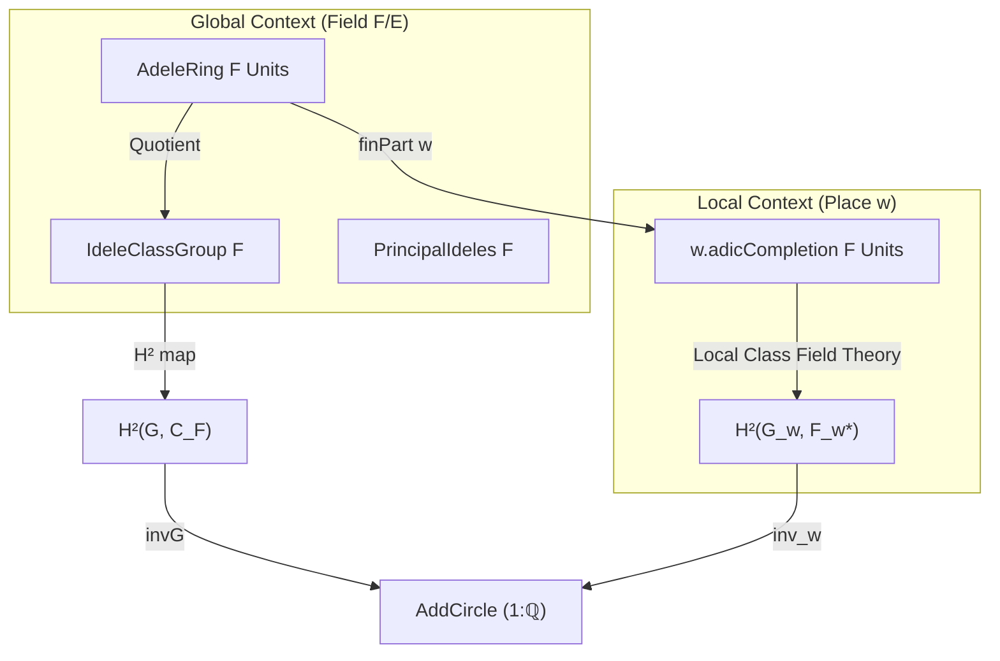
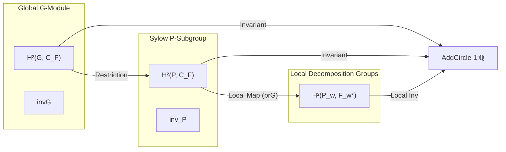

<!-- source: DeepWiki mcp.deepwiki.com · repo anthropics/fermats-last-theorem · page 8.1 Idele Class Groups and Fundamental Classes · fetched 2026-10-26 -->

# Idele Class Groups and Fundamental Classes

Relevant source files

The following files were used as context for generating this wiki page:

- [P2M/Sol/S_M4aHerbrand_bijective_groupCohomology_map_toSIdeleClass.lean](P2M/Sol/S_M4aHerbrand_bijective_groupCohomology_map_toSIdeleClass.lean)
- [P2M/Sol/S_M4aHerbrand_card_nsmul_eq_zero_and_map_eq_zero_and_exists_eq_one_div_of_forall_localSum_eq_finsum.lean](P2M/Sol/S_M4aHerbrand_card_nsmul_eq_zero_and_map_eq_zero_and_exists_eq_one_div_of_forall_localSum_eq_finsum.lean)
- [P2M/Sol/S_M4aHerbrand_div_natCard_decomp_eq_div_natCard_decomp_under_of_map_map_eq_zsmul_of_isScalarTower.lean](P2M/Sol/S_M4aHerbrand_div_natCard_decomp_eq_div_natCard_decomp_under_of_map_map_eq_zsmul_of_isScalarTower.lean)
- [P2M/Sol/S_M4aHerbrand_eq_zero_of_forall_localCoordinates_above_eq_zero_groupCohomology_ideles.lean](P2M/Sol/S_M4aHerbrand_eq_zero_of_forall_localCoordinates_above_eq_zero_groupCohomology_ideles.lean)
- [P2M/Sol/S_M4aHerbrand_exists_adeleBaseChange_invariant_groupCohomology_ideleClassGroup_map_eq_of_invariant.lean](P2M/Sol/S_M4aHerbrand_exists_adeleBaseChange_invariant_groupCohomology_ideleClassGroup_map_eq_of_invariant.lean)
- [P2M/Sol/S_M4aHerbrand_exists_fundamentalClass_ideleClassGroup.lean](P2M/Sol/S_M4aHerbrand_exists_fundamentalClass_ideleClassGroup.lean)
- [P2M/Sol/S_M4aHerbrand_exists_fundamentalClass_ideleClassGroup_map_eq_finrank_smul_of_ne_two.lean](P2M/Sol/S_M4aHerbrand_exists_fundamentalClass_ideleClassGroup_map_eq_finrank_smul_of_ne_two.lean)
- [P2M/Sol/S_M4aHerbrand_exists_fundamentalClass_ideleClassGroup_of_isPGroup.lean](P2M/Sol/S_M4aHerbrand_exists_fundamentalClass_ideleClassGroup_of_isPGroup.lean)
- [P2M/Sol/S_M4aHerbrand_exists_fundamentalClass_ideleClassGroup_res_eq_localFundamentalClass_of_isPGroup_of_ne_two.lean](P2M/Sol/S_M4aHerbrand_exists_fundamentalClass_ideleClassGroup_res_eq_localFundamentalClass_of_isPGroup_of_ne_two.lean)
- [P2M/Sol/S_M4aHerbrand_exists_fundamentalClass_ideleClassGroup_smul_res_eq_smul_localFundamentalClass_of_ne_two.lean](P2M/Sol/S_M4aHerbrand_exists_fundamentalClass_ideleClassGroup_smul_res_eq_smul_localFundamentalClass_of_ne_two.lean)
- [P2M/Sol/S_M4aHerbrand_exists_fundamentalClass_sIdeleClassGroup.lean](P2M/Sol/S_M4aHerbrand_exists_fundamentalClass_sIdeleClassGroup.lean)
- [P2M/Sol/S_M4aHerbrand_exists_hom_adicCompletion_res_decomp_ideles_apply.lean](P2M/Sol/S_M4aHerbrand_exists_hom_adicCompletion_res_decomp_ideles_apply.lean)
- [P2M/Sol/S_M4aHerbrand_exists_hom_coind_ideles_finPart_eq_and_eq_one.lean](P2M/Sol/S_M4aHerbrand_exists_hom_coind_ideles_finPart_eq_and_eq_one.lean)
- [P2M/Sol/S_M4aHerbrand_exists_hom_res_decomp_ideles_adicCompletion_apply.lean](P2M/Sol/S_M4aHerbrand_exists_hom_res_decomp_ideles_adicCompletion_apply.lean)
- [P2M/Sol/S_M4aHerbrand_exists_hom_res_inf_decomp_ideles_adicCompletion_apply.lean](P2M/Sol/S_M4aHerbrand_exists_hom_res_inf_decomp_ideles_adicCompletion_apply.lean)
- [P2M/Sol/S_M4aHerbrand_exists_invariant_forall_inv_map_eq_finsum_of_forall_localFundamentalClass_of_isPGroup.lean](P2M/Sol/S_M4aHerbrand_exists_invariant_forall_inv_map_eq_finsum_of_forall_localFundamentalClass_of_isPGroup.lean)
- [P2M/Sol/S_M4aHerbrand_exists_invariant_forall_inv_map_eq_finsum_of_forall_localFundamentalClass_of_isPGroup_of_children.lean](P2M/Sol/S_M4aHerbrand_exists_invariant_forall_inv_map_eq_finsum_of_forall_localFundamentalClass_of_isPGroup_of_children.lean)
- [P2M/Sol/S_M4aHerbrand_exists_invariant_forall_inv_map_localFundamentalClass_eq_one_div_natCard_decomp_of_isPGroup.lean](P2M/Sol/S_M4aHerbrand_exists_invariant_forall_inv_map_localFundamentalClass_eq_one_div_natCard_decomp_of_isPGroup.lean)
- [P2M/Sol/S_M4aHerbrand_exists_invariant_groupCohomology_ideleClassGroup_forall_comp_eq_index_smul_of_ne_two.lean](P2M/Sol/S_M4aHerbrand_exists_invariant_groupCohomology_ideleClassGroup_forall_comp_eq_index_smul_of_ne_two.lean)
- [P2M/Sol/S_M4aHerbrand_exists_invariant_groupCohomology_ideleClassGroup_of_isPGroup_of_ne_two.lean](P2M/Sol/S_M4aHerbrand_exists_invariant_groupCohomology_ideleClassGroup_of_isPGroup_of_ne_two.lean)
- [P2M/Sol/S_M4aHerbrand_exists_map_eq_groupCohomology_ideleClassGroup_of_isCyclic.lean](P2M/Sol/S_M4aHerbrand_exists_map_eq_groupCohomology_ideleClassGroup_of_isCyclic.lean)
- [P2M/Sol/S_M4aHerbrand_exists_map_eq_map_res_ideles.lean](P2M/Sol/S_M4aHerbrand_exists_map_eq_map_res_ideles.lean)
- [P2M/Sol/S_M4aHerbrand_exists_map_eq_of_map_eq_zero_groupCohomology_ideles_of_isCyclic.lean](P2M/Sol/S_M4aHerbrand_exists_map_eq_of_map_eq_zero_groupCohomology_ideles_of_isCyclic.lean)
- [P2M/Sol/S_M4aHerbrand_exists_map_map_eq_map_map_of_dvd_natCard_decomp.lean](P2M/Sol/S_M4aHerbrand_exists_map_map_eq_map_map_of_dvd_natCard_decomp.lean)
- [P2M/Sol/S_M4aHerbrand_exists_map_prG_eq_zsmul_of_map_prG_eq_zsmul_of_under_eq.lean](P2M/Sol/S_M4aHerbrand_exists_map_prG_eq_zsmul_of_map_prG_eq_zsmul_of_under_eq.lean)
- [P2M/Sol/S_M4aHerbrand_exists_natCard_H2_eq_card_and_span_eq_top_ideleClassGroup.lean](P2M/Sol/S_M4aHerbrand_exists_natCard_H2_eq_card_and_span_eq_top_ideleClassGroup.lean)
- [P2M/Sol/S_M4aHerbrand_exists_natCard_H2_eq_card_and_span_eq_top_ideleClassGroup_of_isPGroup.lean](P2M/Sol/S_M4aHerbrand_exists_natCard_H2_eq_card_and_span_eq_top_ideleClassGroup_of_isPGroup.lean)
- [P2M/Sol/S_M4aHerbrand_exists_surjective_and_invariant_map_eq_finsum_of_isCyclic.lean](P2M/Sol/S_M4aHerbrand_exists_surjective_and_invariant_map_eq_finsum_of_isCyclic.lean)
- [P2M/Sol/S_M4aHerbrand_exists_two_cocycle_ideles_mem_unitIdelesOutside_and_map_prG_eq_zsmul_and_eq_zero.lean](P2M/Sol/S_M4aHerbrand_exists_two_cocycle_ideles_mem_unitIdelesOutside_and_map_prG_eq_zsmul_and_eq_zero.lean)
- [P2M/Sol/S_M4aHerbrand_exists_unit_forall_exists_localFundamentalClass_eq_smul_res_and_pow_dvd_of_forall_map_inclusion_eq.lean](P2M/Sol/S_M4aHerbrand_exists_unit_forall_exists_localFundamentalClass_eq_smul_res_and_pow_dvd_of_forall_map_inclusion_eq.lean)
- [P2M/Sol/S_M4aHerbrand_exists_unit_forall_exists_localFundamentalClass_eq_smul_res_and_pow_dvd_of_ne_two.lean](P2M/Sol/S_M4aHerbrand_exists_unit_forall_exists_localFundamentalClass_eq_smul_res_and_pow_dvd_of_ne_two.lean)
- [P2M/Sol/S_M4aHerbrand_finsum_div_natCard_decomp_cores_eq_finsum_div_natCard_inf_decomp.lean](P2M/Sol/S_M4aHerbrand_finsum_div_natCard_decomp_cores_eq_finsum_div_natCard_inf_decomp.lean)
- [P2M/Sol/S_M4aHerbrand_finsum_div_natCard_decomp_eq_zero_of_isCyclic.lean](P2M/Sol/S_M4aHerbrand_finsum_div_natCard_decomp_eq_zero_of_isCyclic.lean)
- [P2M/Sol/S_M4aHerbrand_finsum_div_natCard_decomp_eq_zero_of_isPGroup.lean](P2M/Sol/S_M4aHerbrand_finsum_div_natCard_decomp_eq_zero_of_isPGroup.lean)
- [P2M/Sol/S_M4aHerbrand_finsum_div_natCard_decomp_map_eq_finsum_div_natCard_decomp_of_isScalarTower.lean](P2M/Sol/S_M4aHerbrand_finsum_div_natCard_decomp_map_eq_finsum_div_natCard_decomp_of_isScalarTower.lean)
- [P2M/Sol/S_M4aHerbrand_injective_and_finite_and_surjective_localCoordinates_groupCohomology_ideles.lean](P2M/Sol/S_M4aHerbrand_injective_and_finite_and_surjective_localCoordinates_groupCohomology_ideles.lean)
- [P2M/Sol/S_M4aHerbrand_injective_and_finite_and_surjective_localCoordinates_groupCohomology_res_ideles.lean](P2M/Sol/S_M4aHerbrand_injective_and_finite_and_surjective_localCoordinates_groupCohomology_res_ideles.lean)
- [P2M/Sol/S_M4aHerbrand_isZero_groupCohomology_unitIdelesTrivialOn_of_ramificationIdx_eq_one.lean](P2M/Sol/S_M4aHerbrand_isZero_groupCohomology_unitIdelesTrivialOn_of_ramificationIdx_eq_one.lean)
- [P2M/Sol/S_M4aHerbrand_map_decomp_map_ideles_eq_map_map_decomp_under_of_isScalarTower.lean](P2M/Sol/S_M4aHerbrand_map_decomp_map_ideles_eq_map_map_decomp_under_of_isScalarTower.lean)
- [P2M/Sol/S_M4aHerbrand_map_inclusion_map_subtype_eq_map_inclusion_map_decomp.lean](P2M/Sol/S_M4aHerbrand_map_inclusion_map_subtype_eq_map_inclusion_map_decomp.lean)
- [P2M/Sol/S_M4aHerbrand_map_inclusion_map_subtype_map_ideles_eq_zero_infinitePlace_of_forall_eq_one.lean](P2M/Sol/S_M4aHerbrand_map_inclusion_map_subtype_map_ideles_eq_zero_infinitePlace_of_forall_eq_one.lean)
- [P2M/Sol/S_M4aHerbrand_map_inclusion_map_subtype_map_ideles_eq_zero_of_dvd_natCard_decomp.lean](P2M/Sol/S_M4aHerbrand_map_inclusion_map_subtype_map_ideles_eq_zero_of_dvd_natCard_decomp.lean)
- [P2M/Sol/S_M4aHerbrand_map_pi_eq_zero_iff_finsum_eq_zero_of_pow_smul_eq_zero.lean](P2M/Sol/S_M4aHerbrand_map_pi_eq_zero_iff_finsum_eq_zero_of_pow_smul_eq_zero.lean)
- [P2M/Sol/S_M4aHerbrand_map_pi_eq_zero_iff_map_pi_eq_zero_sylow_of_pow_smul_eq_zero.lean](P2M/Sol/S_M4aHerbrand_map_pi_eq_zero_iff_map_pi_eq_zero_sylow_of_pow_smul_eq_zero.lean)
- [P2M/Sol/S_M4aHerbrand_map_prG_eq_map_map_prG_of_smul_eq.lean](P2M/Sol/S_M4aHerbrand_map_prG_eq_map_map_prG_of_smul_eq.lean)
- [P2M/Sol/S_M4aHerbrand_map_prG_eq_smul_fixedField_of_map_prG_eq_smul.lean](P2M/Sol/S_M4aHerbrand_map_prG_eq_smul_fixedField_of_map_prG_eq_smul.lean)
- [P2M/Sol/S_M4aHerbrand_map_prG_eq_smul_sylow_of_map_prG_eq_smul.lean](P2M/Sol/S_M4aHerbrand_map_prG_eq_smul_sylow_of_map_prG_eq_smul.lean)
- [P2M/Sol/S_M4aHerbrand_map_prG_map_eq_map_map_prH_of_smul_eq.lean](P2M/Sol/S_M4aHerbrand_map_prG_map_eq_map_map_prH_of_smul_eq.lean)
- [P2M/Sol/S_M4aHerbrand_map_prH_eq_map_map_prH_of_smul_eq.lean](P2M/Sol/S_M4aHerbrand_map_prH_eq_map_map_prH_of_smul_eq.lean)
- [P2M/Sol/S_M4aHerbrand_map_prInf_eq_zero_of_pow_smul_eq_zero.lean](P2M/Sol/S_M4aHerbrand_map_prInf_eq_zero_of_pow_smul_eq_zero.lean)
- [P2M/Sol/S_M4aHerbrand_map_two_res_units_ideles_injective_of_isPGroup.lean](P2M/Sol/S_M4aHerbrand_map_two_res_units_ideles_injective_of_isPGroup.lean)
- [P2M/Sol/S_M4aHerbrand_nonempty_unitIdelesTrivialOn_iso_pi_coind_localIntegerUnits.lean](P2M/Sol/S_M4aHerbrand_nonempty_unitIdelesTrivialOn_iso_pi_coind_localIntegerUnits.lean)
- [P2M/Sol/S_M4aHerbrand_subsingleton_tateCohomology_unitIdelesTrivialOn_of_ramificationIdx_eq_one.lean](P2M/Sol/S_M4aHerbrand_subsingleton_tateCohomology_unitIdelesTrivialOn_of_ramificationIdx_eq_one.lean)
- [P2M/Sol/S_M4aHerbrand_unitIdelesTrivialOn_nonempty_res_iso_fixedField_and_groupCohomology_iso.lean](P2M/Sol/S_M4aHerbrand_unitIdelesTrivialOn_nonempty_res_iso_fixedField_and_groupCohomology_iso.lean)
- [P2M/Sol/S_M4aHerbrand_zsmul_map_eq_zsmul_index_smul_of_zsmul_res_eq_zsmul_map_of_comap_decomp.lean](P2M/Sol/S_M4aHerbrand_zsmul_map_eq_zsmul_index_smul_of_zsmul_res_eq_zsmul_map_of_comap_decomp.lean)

This section covers the class field theoretic foundations required for the modularity lifting and Galois representation parts of the proof. It focuses on the construction of the **Idele Class Group** ($C_F$), the Galois cohomology of ideles, and the existence of the **Fundamental Class** in $H^2(G, C_F)$. The implementation heavily utilizes Lean's `groupCohomology` and `NumberField` modules to bridge local and global class field theory.

## The Idele Class Group and Galois Descent

The `IdeleClassGroup` is defined as the quotient of the ideles of a number field $F$ by the principal ideles [P2M/Sol/S_M4aHerbrand_exists_map_eq_groupCohomology_ideleClassGroup_of_isCyclic.lean:23-23](). The structure `IdeleGaloisDescent` manages the action of the Galois group $G = \text{Gal}(F/E)$ on both the ideles and the idele class group [P2M/Sol/S_M4aHerbrand_exists_invariant_forall_inv_map_eq_finsum_of_forall_localFundamentalClass_of_isPGroup.lean:32-37]().

### Key Structures
*   **`IdeleClassGroup (𝓞 F) F`**: The global idele class group $C_F$ [P2M/Sol/S_M4aHerbrand_exists_map_eq_groupCohomology_ideleClassGroup_of_isCyclic.lean:23-23]().
*   **`IdeleGaloisDescent`**: A bundle containing the `unitsAct` (action on ideles) and `classAct` (action on $C_F$) [P2M/Sol/S_M4aHerbrand_exists_invariant_forall_inv_map_eq_finsum_of_forall_localFundamentalClass_of_isPGroup.lean:35-37]().
*   **`SIdeleClassGroup`**: A specialized version of the idele class group used in the Herbrand quotient calculations [P2M/Sol/S_M4aHerbrand_exists_natCard_H2_eq_card_and_span_eq_top_ideleClassGroup.lean:23-23]().

### Data Flow: Idele Cohomology
The following diagram illustrates the relationship between the global idele class group and the local completions used to define the fundamental class.

**Idele Cohomology Mapping**

Sources: [P2M/Sol/S_M4aHerbrand_exists_map_eq_groupCohomology_ideleClassGroup_of_isCyclic.lean:50-62](), [P2M/Sol/S_M4aHerbrand_exists_invariant_forall_inv_map_eq_finsum_of_forall_localFundamentalClass_of_isPGroup.lean:42-56]()

## The Fundamental Class and Invariant Map

The core of the global theory is the existence of a unique invariant map `invG` on $H^2(G, C_F)$ that satisfies the "finsum formula" over all places. For a Galois extension $F/E$, there exists an injective homomorphism `invG` from $H^2(G, C_F)$ to $\mathbb{Q}/\mathbb{Z}$ (represented as `AddCircle (1:ℚ)`) [P2M/Sol/S_M4aHerbrand_exists_invariant_forall_inv_map_eq_finsum_of_forall_localFundamentalClass_of_isPGroup.lean:42-45]().

### The Finsum Formula
The global invariant of a class $x \in H^2(G, C_F)$ is related to the local invariants `inv_w` of its restrictions to local decomposition groups $G_w$ [P2M/Sol/S_M4aHerbrand_exists_invariant_forall_inv_map_eq_finsum_of_forall_localFundamentalClass_of_isPGroup.lean:52-56](). The implementation proves that for a $p$-group $G$:
1.  `invG` is injective [P2M/Sol/S_M4aHerbrand_exists_invariant_forall_inv_map_eq_finsum_of_forall_localFundamentalClass_of_isPGroup.lean:45-45]().
2.  The range of `invG` consists of elements killed by $|G|$ [P2M/Sol/S_M4aHerbrand_exists_invariant_forall_inv_map_eq_finsum_of_forall_localFundamentalClass_of_isPGroup.lean:46-46]().
3.  The global invariant is the sum of local invariants `inv_w` [P2M/Sol/S_M4aHerbrand_exists_invariant_forall_inv_map_eq_finsum_of_forall_localFundamentalClass_of_isPGroup.lean:52-56]().

### Sylow Reduction Strategy
To prove theorems about $H^2(G, C_F)$, the codebase often employs a Sylow reduction strategy. If $P$ is a Sylow $p$-subgroup of $G$, the restriction map $H^2(G, C_F) \to H^2(P, C_F)$ is used to reduce the problem to $p$-groups [P2M/Sol/S_M4aHerbrand_exists_invariant_forall_inv_map_eq_finsum_of_forall_localFundamentalClass_of_isPGroup.lean:41-43]().

**Sylow Reduction and Local-Global Flow**

Sources: [P2M/Sol/S_M4aHerbrand_exists_invariant_forall_inv_map_eq_finsum_of_forall_localFundamentalClass_of_isPGroup.lean:42-56](), [P2M/Sol/S_M4aHerbrand_map_prG_eq_smul_sylow_of_map_prG_eq_smul.lean:37-40]()

## Local Fundamental Classes and Decomposition

The mapping from global ideles to local completions is handled by `finPart` (for finite places) and `infPart` (for infinite places) [P2M/Sol/S_M4aHerbrand_exists_adeleBaseChange_invariant_groupCohomology_ideleClassGroup_map_eq_of_invariant.lean:30-30]().

### Place Decomposition
The action of the Galois group on places is modeled via `NumberField.PlaceDecomp.decomp` [P2M/Sol/S_M4aHerbrand_map_prG_eq_smul_fixedField_of_map_prG_eq_smul.lean:44-44](). For a place $w$ of $F$ above $v$ of $E$, the decomposition group $G_w$ is the stabilizer of $w$ in $G$. The theory establishes:
*   **`isLocalFundamentalClass`**: A predicate for the canonical generator of $H^2(G_w, F_w^*)$ [P2M/Sol/S_M4aHerbrand_exists_invariant_forall_inv_map_eq_finsum_of_forall_localFundamentalClass_of_isPGroup.lean:56-56]().
*   **`transport`**: A mechanism to move local elements between different places in the same orbit under the Galois action [P2M/Sol/S_M4aHerbrand_map_prG_map_eq_map_map_prH_of_smul_eq.lean:69-70]().

### Key Functions
| Function | Description | File Reference |
| :--- | :--- | :--- |
| `finPart` | Projects an idele to its component at a finite place $w$. | [P2M/Sol/S_M4aHerbrand_exists_adeleBaseChange_invariant_groupCohomology_ideleClassGroup_map_eq_of_invariant.lean:30-30]() |
| `invG` | The global invariant map $H^2(G, C_F) \to \mathbb{Q}/\mathbb{Z}$. | [P2M/Sol/S_M4aHerbrand_exists_invariant_forall_inv_map_eq_finsum_of_forall_localFundamentalClass_of_isPGroup.lean:42-42]() |
| `decompEquiv` | Isomorphism between decomposition groups for different bases. | [P2M/Sol/S_M4aHerbrand_map_prG_eq_smul_fixedField_of_map_prG_eq_smul.lean:52-54]() |
| `genuineBaseChange` | Handles the base change of ideles between number fields. | [P2M/Sol/S_M4aHerbrand_map_inclusion_map_subtype_map_ideles_eq_zero_of_dvd_natCard_decomp.lean:82-82]() |

## Galois Cohomology of Ideles

The proof requires specific vanishing results and isomorphisms for idele cohomology:
*   **Hilbert 90 for Ideles**: $H^1(G, C_F) = 0$ for $p$-groups [P2M/Sol/S_M4aHerbrand_exists_invariant_forall_inv_map_eq_finsum_of_forall_localFundamentalClass_of_isPGroup.lean:30-30]().
*   **Cyclic Case**: For cyclic extensions, $H^2(G, C_F)$ is generated by a "carry function" related to the cyclic generator [P2M/Sol/S_M4aHerbrand_exists_map_eq_groupCohomology_ideleClassGroup_of_isCyclic.lean:28-32]().
*   **Restriction/Corestriction**: The `exists_corestriction_map_map_res_eq_map_norm` theorem relates the global norm to the corestriction in cohomology [P2M/Sol/S_M4aHerbrand_zsmul_map_eq_zsmul_index_smul_of_zsmul_res_eq_zsmul_map_of_comap_decomp.lean:131-135]().

Sources:
*   `IdeleGaloisDescent` and global invariants: [P2M/Sol/S_M4aHerbrand_exists_invariant_forall_inv_map_eq_finsum_of_forall_localFundamentalClass_of_isPGroup.lean:30-56]()
*   Cyclic cohomology and carry functions: [P2M/Sol/S_M4aHerbrand_exists_map_eq_groupCohomology_ideleClassGroup_of_isCyclic.lean:28-103]()
*   Place decomposition and transport: [P2M/Sol/S_M4aHerbrand_map_prG_eq_smul_fixedField_of_map_prG_eq_smul.lean:43-113]()
*   Base change and descent: [P2M/Sol/S_M4aHerbrand_map_inclusion_map_subtype_map_ideles_eq_zero_of_dvd_natCard_decomp.lean:62-105]()

---

