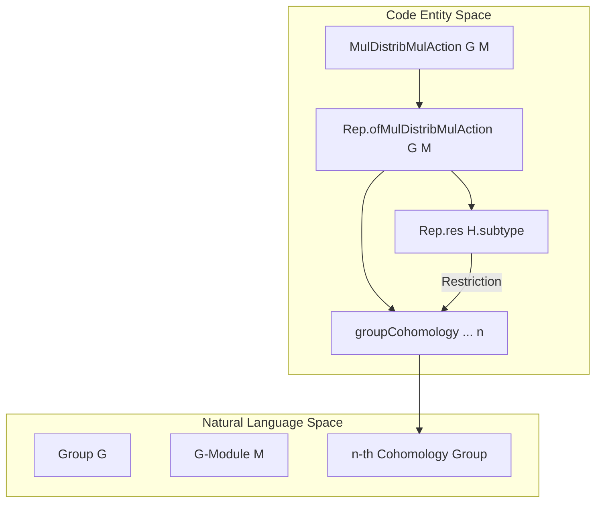
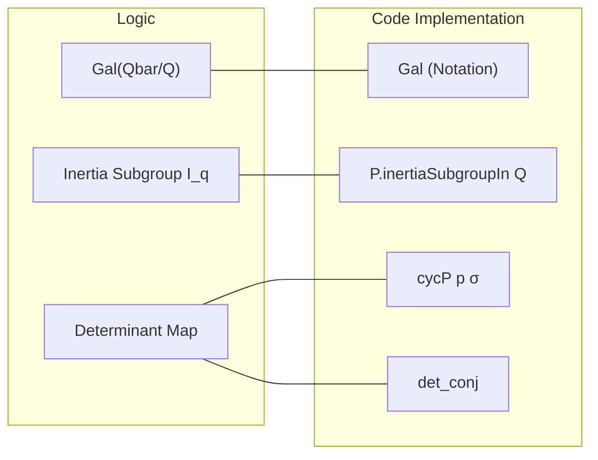

<!-- source: DeepWiki mcp.deepwiki.com · repo anthropics/fermats-last-theorem · page 8.2 Group Cohomology Infrastructure · fetched 2026-10-26 -->

# Group Cohomology Infrastructure

Relevant source files

The following files were used as context for generating this wiki page:

- [P2M/Sol/S_AlgebraicClosure_exists_cycloChar_family.lean](P2M/Sol/S_AlgebraicClosure_exists_cycloChar_family.lean)
- [P2M/Sol/S_CohCarrier_exists_complex_heckeT_eigen_reduction_eq_of_mem_span_int.lean](P2M/Sol/S_CohCarrier_exists_complex_heckeT_eigen_reduction_eq_of_mem_span_int.lean)
- [P2M/Sol/S_CuspForm_HeckeGaloisRepDatum_exists_pi_eq_and_forall_isUnramifiedAt.lean](P2M/Sol/S_CuspForm_HeckeGaloisRepDatum_exists_pi_eq_and_forall_isUnramifiedAt.lean)
- [P2M/Sol/S_CuspForm_HeckeGaloisRepDatum_exists_pi_eq_and_isFlatAt_of_primeFactors_subset.lean](P2M/Sol/S_CuspForm_HeckeGaloisRepDatum_exists_pi_eq_and_isFlatAt_of_primeFactors_subset.lean)
- [P2M/Sol/S_CuspForm_HeckeGaloisRepDatum_exists_pi_eq_and_isOrdinaryAt_of_primeFactors_subset.lean](P2M/Sol/S_CuspForm_HeckeGaloisRepDatum_exists_pi_eq_and_isOrdinaryAt_of_primeFactors_subset.lean)
- [P2M/Sol/S_CuspForm_HeckeGaloisRepDatum_isFlatAt_of_primeFactors_subset.lean](P2M/Sol/S_CuspForm_HeckeGaloisRepDatum_isFlatAt_of_primeFactors_subset.lean)
- [P2M/Sol/S_CuspForm_HeckeGaloisRepDatum_isOrdinaryAt_of_primeFactors_subset.lean](P2M/Sol/S_CuspForm_HeckeGaloisRepDatum_isOrdinaryAt_of_primeFactors_subset.lean)
- [P2M/Sol/S_CuspForm_HeckeGaloisRepDatum_isUnramifiedAt_of_notMem.lean](P2M/Sol/S_CuspForm_HeckeGaloisRepDatum_isUnramifiedAt_of_notMem.lean)
- [P2M/Sol/S_CuspForm_IsNewform_dvd_level_of_point_of_not_isUnramifiedAt.lean](P2M/Sol/S_CuspForm_IsNewform_dvd_level_of_point_of_not_isUnramifiedAt.lean)
- [P2M/Sol/S_CuspForm_IsNewform_exists_eigenPlane_torLine_tateModule_jZero.lean](P2M/Sol/S_CuspForm_IsNewform_exists_eigenPlane_torLine_tateModule_jZero.lean)
- [P2M/Sol/S_CuspForm_IsNewform_exists_galoisRepAdic_charpoly_inertia_eq_cyclotomicCharacter_of_linearMap_psCarrier_ne_zero_of_not_isUnramified_ratio_of_factorization_eq_two.lean](P2M/Sol/S_CuspForm_IsNewform_exists_galoisRepAdic_charpoly_inertia_eq_cyclotomicCharacter_of_linearMap_psCarrier_ne_zero_of_not_isUnramified_ratio_of_factorization_eq_two.lean)
- [P2M/Sol/S_CuspForm_IsNewform_exists_mem_inertiaSubgroupIn_baseChange_apply_ne_of_eigenPlane_tateModule_jZero.lean](P2M/Sol/S_CuspForm_IsNewform_exists_mem_inertiaSubgroupIn_baseChange_apply_ne_of_eigenPlane_tateModule_jZero.lean)
- [P2M/Sol/S_CuspForm_IsNewform_exists_ordLine_eigenPlane_tateModule_jZero_of_dvd.lean](P2M/Sol/S_CuspForm_IsNewform_exists_ordLine_eigenPlane_tateModule_jZero_of_dvd.lean)
- [P2M/Sol/S_CuspForm_IsNewform_exists_torLine_of_eigenPlane_tateModule_jZero.lean](P2M/Sol/S_CuspForm_IsNewform_exists_torLine_of_eigenPlane_tateModule_jZero.lean)
- [P2M/Sol/S_CuspForm_IsNewform_psCarrier_lam_dvd_sub_one_or_no_psCarrier_lam_dvd_add_one_of_factorization_eq_two_of_residual_isUnipotent_of_irreducible_odd_of_absIrred_odd.lean](P2M/Sol/S_CuspForm_IsNewform_psCarrier_lam_dvd_sub_one_or_no_psCarrier_lam_dvd_add_one_of_factorization_eq_two_of_residual_isUnipotent_of_irreducible_odd_of_absIrred_odd.lean)
- [P2M/Sol/S_CuspForm_TWLevel_HeckeRing_exists_galoisRepAdic_of_algHom.lean](P2M/Sol/S_CuspForm_TWLevel_HeckeRing_exists_galoisRepAdic_of_algHom.lean)
- [P2M/Sol/S_CuspForm_TWLevel_HeckeRing_isStrictOrdinaryAt_of_algHom_of_dvd_level_of_not_isFlatAt.lean](P2M/Sol/S_CuspForm_TWLevel_HeckeRing_isStrictOrdinaryAt_of_algHom_of_dvd_level_of_not_isFlatAt.lean)
- [P2M/Sol/S_CuspForm_TWLevel_HeckeRing_isStrictOrdinaryAt_of_dvd_level_of_not_isFlatAt.lean](P2M/Sol/S_CuspForm_TWLevel_HeckeRing_isStrictOrdinaryAt_of_dvd_level_of_not_isFlatAt.lean)
- [P2M/Sol/S_CuspForm_TWLevel_HeckeRing_isUnramifiedAt_of_not_dvd_sub_one_of_trace_frobenius_sq_ne.lean](P2M/Sol/S_CuspForm_TWLevel_HeckeRing_isUnramifiedAt_of_not_dvd_sub_one_of_trace_frobenius_sq_ne.lean)
- [P2M/Sol/S_CuspForm_exists_galoisRep_isFlatAt_of_point_of_not_dvd.lean](P2M/Sol/S_CuspForm_exists_galoisRep_isFlatAt_of_point_of_not_dvd.lean)
- [P2M/Sol/S_CuspForm_exists_galoisRep_of_point_stableLine_frobenius_sub_smul_mem_of_not_dvd.lean](P2M/Sol/S_CuspForm_exists_galoisRep_of_point_stableLine_frobenius_sub_smul_mem_of_not_dvd.lean)
- [P2M/Sol/S_CuspForm_heckeAlgebra_natCast_pow_twist_eq_natCast_pow_weight_sub_one_of_twist_mem.lean](P2M/Sol/S_CuspForm_heckeAlgebra_natCast_pow_twist_eq_natCast_pow_weight_sub_one_of_twist_mem.lean)
- [P2M/Sol/S_CuspForm_heckeLocal_exists_isNewform_sum_rootMultiplicity_residual_eq_one_of_isOrdinaryAt.lean](P2M/Sol/S_CuspForm_heckeLocal_exists_isNewform_sum_rootMultiplicity_residual_eq_one_of_isOrdinaryAt.lean)
- [P2M/Sol/S_CuspForm_heckeLocal_exists_ne_zero_forall_algHom_algebraicClosure_isNewform_residual_unitRoot_of_isOrdinaryAt.lean](P2M/Sol/S_CuspForm_heckeLocal_exists_ne_zero_forall_algHom_algebraicClosure_isNewform_residual_unitRoot_of_isOrdinaryAt.lean)
- [P2M/Sol/S_CuspForm_heckeLocal_exists_subfamily_idempotentSplitting_point_level_mul_auxPrime.lean](P2M/Sol/S_CuspForm_heckeLocal_exists_subfamily_idempotentSplitting_point_level_mul_auxPrime.lean)
- [P2M/Sol/S_CuspForm_heckeLocal_sum_rootMultiplicity_residual_eq_one_of_dvd_of_not_sq_dvd_of_ne.lean](P2M/Sol/S_CuspForm_heckeLocal_sum_rootMultiplicity_residual_eq_one_of_dvd_of_not_sq_dvd_of_ne.lean)
- [P2M/Sol/S_CuspForm_heckeLocal_sum_rootMultiplicity_residual_eq_two_of_not_isOrdinaryAt.lean](P2M/Sol/S_CuspForm_heckeLocal_sum_rootMultiplicity_residual_eq_two_of_not_isOrdinaryAt.lean)
- [P2M/Sol/S_CuspForm_moduleFinite_heckeAlgebra.lean](P2M/Sol/S_CuspForm_moduleFinite_heckeAlgebra.lean)
- [P2M/Sol/S_DeligneSerre_exists_galoisRep_complex_trace_frobenius_eq_of_forall_residual.lean](P2M/Sol/S_DeligneSerre_exists_galoisRep_complex_trace_frobenius_eq_of_forall_residual.lean)
- [P2M/Sol/S_DeligneSerre_exists_isSemisimpleRepresentation_charpoly_map_eq_of_add_mem_range_of_mul_mem_range.lean](P2M/Sol/S_DeligneSerre_exists_isSemisimpleRepresentation_charpoly_map_eq_of_add_mem_range_of_mul_mem_range.lean)
- [P2M/Sol/S_DeligneSerre_exists_natCard_range_le_of_charpoly_frobenius_mem_of_upperDensity_le.lean](P2M/Sol/S_DeligneSerre_exists_natCard_range_le_of_charpoly_frobenius_mem_of_upperDensity_le.lean)
- [P2M/Sol/S_DeligneSerre_isIrreducible_matrixRepresentation_of_tsum_norm_trace_sq_le_log_of_odd.lean](P2M/Sol/S_DeligneSerre_isIrreducible_matrixRepresentation_of_tsum_norm_trace_sq_le_log_of_odd.lean)
- [P2M/Sol/S_FrobeniusDensity_exists_frobenius_conj_of_mul_self_eq_one_of_statement.lean](P2M/Sol/S_FrobeniusDensity_exists_frobenius_conj_of_mul_self_eq_one_of_statement.lean)
- [P2M/Sol/S_FrobeniusDensity_exists_frobenius_conj_pow_of_statement.lean](P2M/Sol/S_FrobeniusDensity_exists_frobenius_conj_pow_of_statement.lean)
- [P2M/Sol/S_GaloisRepAdic_det_eq_mul_of_isFrobeniusAt_of_det_frobenius_eq_mul_of_not_dvd_conductor.lean](P2M/Sol/S_GaloisRepAdic_det_eq_mul_of_isFrobeniusAt_of_det_frobenius_eq_mul_of_not_dvd_conductor.lean)
- [P2M/Sol/S_GaloisRepAdic_det_eq_of_mem_inertiaSubgroupIn_of_det_frobenius_eq_mul.lean](P2M/Sol/S_GaloisRepAdic_det_eq_of_mem_inertiaSubgroupIn_of_det_frobenius_eq_mul.lean)
- [P2M/Sol/S_GaloisRepAdic_eigenformTraceNebentypus_isFlatAt_or_isStrictOrdinaryAt_of_not_sq_dvd_of_not_dvd_conductor.lean](P2M/Sol/S_GaloisRepAdic_eigenformTraceNebentypus_isFlatAt_or_isStrictOrdinaryAt_of_not_sq_dvd_of_not_dvd_conductor.lean)
- [P2M/Sol/S_GaloisRepAdic_eisensteinTrace_not_isAbsolutelyIrreducible_residual.lean](P2M/Sol/S_GaloisRepAdic_eisensteinTrace_not_isAbsolutelyIrreducible_residual.lean)
- [P2M/Sol/S_GaloisRepAdic_isStrictOrdinaryAt_of_detIsCyclotomic_of_ordinaryLine.lean](P2M/Sol/S_GaloisRepAdic_isStrictOrdinaryAt_of_detIsCyclotomic_of_ordinaryLine.lean)
- [P2M/Sol/S_GaloisRepAdic_isStrictOrdinaryAt_of_isPrimitiveForm_of_dvd_of_not_sq_dvd_of_not_dvd_conductor.lean](P2M/Sol/S_GaloisRepAdic_isStrictOrdinaryAt_of_isPrimitiveForm_of_dvd_of_not_sq_dvd_of_not_dvd_conductor.lean)
- [P2M/Sol/S_GaloisRepAdic_isStrictOrdinaryAt_of_isStrictOrdinaryAt_baseChangeAlong_of_injective.lean](P2M/Sol/S_GaloisRepAdic_isStrictOrdinaryAt_of_isStrictOrdinaryAt_baseChangeAlong_of_injective.lean)
- [P2M/Sol/S_GaloisRepAdic_not_isUnipotentOnInertiaAt_and_charpoly_frobenius_of_factorization_eq_two_of_absIrred_odd_of_ne_two.lean](P2M/Sol/S_GaloisRepAdic_not_isUnipotentOnInertiaAt_and_charpoly_frobenius_of_factorization_eq_two_of_absIrred_odd_of_ne_two.lean)
- [P2M/Sol/S_GaloisRepAdic_residual_isEquiv_and_det_sub_mem_of_charpoly_frobenius_eq.lean](P2M/Sol/S_GaloisRepAdic_residual_isEquiv_and_det_sub_mem_of_charpoly_frobenius_eq.lean)
- [P2M/Sol/S_GaloisRep_exists_conj_eq_of_charpoly_frobenius_eq_of_galoisFactorsThroughFiniteLevel.lean](P2M/Sol/S_GaloisRep_exists_conj_eq_of_charpoly_frobenius_eq_of_galoisFactorsThroughFiniteLevel.lean)
- [P2M/Sol/S_GaloisRep_exists_finiteField_galoisRep_trace_eq_heckeT_mod_of_isMaximal.lean](P2M/Sol/S_GaloisRep_exists_finiteField_galoisRep_trace_eq_heckeT_mod_of_isMaximal.lean)
- [P2M/Sol/S_GaloisRep_exists_finiteField_galoisRep_trace_eq_heckeT_mod_of_isMaximal_two.lean](P2M/Sol/S_GaloisRep_exists_finiteField_galoisRep_trace_eq_heckeT_mod_of_isMaximal_two.lean)
- [P2M/Sol/S_GaloisRep_exists_galoisFactorsThroughFiniteLevel_trace_eq_theta_heckeT_and_det_eq_pow.lean](P2M/Sol/S_GaloisRep_exists_galoisFactorsThroughFiniteLevel_trace_eq_theta_heckeT_and_det_eq_pow.lean)
- [P2M/Sol/S_GaloisRep_exists_galoisRep_trace_eq_add_mul_of_unitsHom.lean](P2M/Sol/S_GaloisRep_exists_galoisRep_trace_eq_add_mul_of_unitsHom.lean)
- [P2M/Sol/S_GaloisRep_exists_galoisRep_trace_eq_of_ringHom_heckeAlgebra_two.lean](P2M/Sol/S_GaloisRep_exists_galoisRep_trace_eq_of_ringHom_heckeAlgebra_two.lean)
- [P2M/Sol/S_GaloisRep_exists_isSemisimpleRepresentation_charpoly_map_eq_of_trace_det_frobenius_mem_range.lean](P2M/Sol/S_GaloisRep_exists_isSemisimpleRepresentation_charpoly_map_eq_of_trace_det_frobenius_mem_range.lean)
- [P2M/Sol/S_M4aHerbrand_bijective_groupCohomology_map_toSIdeleClass.lean](P2M/Sol/S_M4aHerbrand_bijective_groupCohomology_map_toSIdeleClass.lean)
- [P2M/Sol/S_M4aHerbrand_card_nsmul_eq_zero_and_map_eq_zero_and_exists_eq_one_div_of_forall_localSum_eq_finsum.lean](P2M/Sol/S_M4aHerbrand_card_nsmul_eq_zero_and_map_eq_zero_and_exists_eq_one_div_of_forall_localSum_eq_finsum.lean)
- [P2M/Sol/S_M4aHerbrand_div_natCard_decomp_eq_div_natCard_decomp_under_of_map_map_eq_zsmul_of_isScalarTower.lean](P2M/Sol/S_M4aHerbrand_div_natCard_decomp_eq_div_natCard_decomp_under_of_map_map_eq_zsmul_of_isScalarTower.lean)
- [P2M/Sol/S_M4aHerbrand_eq_zero_of_forall_localCoordinates_above_eq_zero_groupCohomology_ideles.lean](P2M/Sol/S_M4aHerbrand_eq_zero_of_forall_localCoordinates_above_eq_zero_groupCohomology_ideles.lean)
- [P2M/Sol/S_M4aHerbrand_exists_adeleBaseChange_invariant_groupCohomology_ideleClassGroup_map_eq_of_invariant.lean](P2M/Sol/S_M4aHerbrand_exists_adeleBaseChange_invariant_groupCohomology_ideleClassGroup_map_eq_of_invariant.lean)
- [P2M/Sol/S_M4aHerbrand_exists_fundamentalClass_ideleClassGroup.lean](P2M/Sol/S_M4aHerbrand_exists_fundamentalClass_ideleClassGroup.lean)
- [P2M/Sol/S_M4aHerbrand_exists_fundamentalClass_ideleClassGroup_map_eq_finrank_smul_of_ne_two.lean](P2M/Sol/S_M4aHerbrand_exists_fundamentalClass_ideleClassGroup_map_eq_finrank_smul_of_ne_two.lean)
- [P2M/Sol/S_M4aHerbrand_exists_fundamentalClass_ideleClassGroup_of_isPGroup.lean](P2M/Sol/S_M4aHerbrand_exists_fundamentalClass_ideleClassGroup_of_isPGroup.lean)
- [P2M/Sol/S_M4aHerbrand_exists_fundamentalClass_ideleClassGroup_res_eq_localFundamentalClass_of_isPGroup_of_ne_two.lean](P2M/Sol/S_M4aHerbrand_exists_fundamentalClass_ideleClassGroup_res_eq_localFundamentalClass_of_isPGroup_of_ne_two.lean)
- [P2M/Sol/S_M4aHerbrand_exists_fundamentalClass_ideleClassGroup_smul_res_eq_smul_localFundamentalClass_of_ne_two.lean](P2M/Sol/S_M4aHerbrand_exists_fundamentalClass_ideleClassGroup_smul_res_eq_smul_localFundamentalClass_of_ne_two.lean)
- [P2M/Sol/S_M4aHerbrand_exists_fundamentalClass_sIdeleClassGroup.lean](P2M/Sol/S_M4aHerbrand_exists_fundamentalClass_sIdeleClassGroup.lean)
- [P2M/Sol/S_M4aHerbrand_exists_hom_adicCompletion_res_decomp_ideles_apply.lean](P2M/Sol/S_M4aHerbrand_exists_hom_adicCompletion_res_decomp_ideles_apply.lean)
- [P2M/Sol/S_M4aHerbrand_exists_hom_coind_ideles_finPart_eq_and_eq_one.lean](P2M/Sol/S_M4aHerbrand_exists_hom_coind_ideles_finPart_eq_and_eq_one.lean)
- [P2M/Sol/S_M4aHerbrand_exists_hom_res_decomp_ideles_adicCompletion_apply.lean](P2M/Sol/S_M4aHerbrand_exists_hom_res_decomp_ideles_adicCompletion_apply.lean)
- [P2M/Sol/S_M4aHerbrand_exists_hom_res_inf_decomp_ideles_adicCompletion_apply.lean](P2M/Sol/S_M4aHerbrand_exists_hom_res_inf_decomp_ideles_adicCompletion_apply.lean)
- [P2M/Sol/S_M4aHerbrand_exists_invariant_forall_inv_map_eq_finsum_of_forall_localFundamentalClass_of_isPGroup.lean](P2M/Sol/S_M4aHerbrand_exists_invariant_forall_inv_map_eq_finsum_of_forall_localFundamentalClass_of_isPGroup.lean)
- [P2M/Sol/S_M4aHerbrand_exists_invariant_forall_inv_map_eq_finsum_of_forall_localFundamentalClass_of_isPGroup_of_children.lean](P2M/Sol/S_M4aHerbrand_exists_invariant_forall_inv_map_eq_finsum_of_forall_localFundamentalClass_of_isPGroup_of_children.lean)
- [P2M/Sol/S_M4aHerbrand_exists_invariant_forall_inv_map_localFundamentalClass_eq_one_div_natCard_decomp_of_isPGroup.lean](P2M/Sol/S_M4aHerbrand_exists_invariant_forall_inv_map_localFundamentalClass_eq_one_div_natCard_decomp_of_isPGroup.lean)
- [P2M/Sol/S_M4aHerbrand_exists_invariant_groupCohomology_ideleClassGroup_forall_comp_eq_index_smul_of_ne_two.lean](P2M/Sol/S_M4aHerbrand_exists_invariant_groupCohomology_ideleClassGroup_forall_comp_eq_index_smul_of_ne_two.lean)
- [P2M/Sol/S_M4aHerbrand_exists_invariant_groupCohomology_ideleClassGroup_of_isPGroup_of_ne_two.lean](P2M/Sol/S_M4aHerbrand_exists_invariant_groupCohomology_ideleClassGroup_of_isPGroup_of_ne_two.lean)
- [P2M/Sol/S_M4aHerbrand_exists_map_eq_groupCohomology_ideleClassGroup_of_isCyclic.lean](P2M/Sol/S_M4aHerbrand_exists_map_eq_groupCohomology_ideleClassGroup_of_isCyclic.lean)
- [P2M/Sol/S_M4aHerbrand_exists_map_eq_map_res_ideles.lean](P2M/Sol/S_M4aHerbrand_exists_map_eq_map_res_ideles.lean)
- [P2M/Sol/S_M4aHerbrand_exists_map_eq_of_map_eq_zero_groupCohomology_ideles_of_isCyclic.lean](P2M/Sol/S_M4aHerbrand_exists_map_eq_of_map_eq_zero_groupCohomology_ideles_of_isCyclic.lean)
- [P2M/Sol/S_M4aHerbrand_exists_map_map_eq_map_map_of_dvd_natCard_decomp.lean](P2M/Sol/S_M4aHerbrand_exists_map_map_eq_map_map_of_dvd_natCard_decomp.lean)
- [P2M/Sol/S_M4aHerbrand_exists_map_prG_eq_zsmul_of_map_prG_eq_zsmul_of_under_eq.lean](P2M/Sol/S_M4aHerbrand_exists_map_prG_eq_zsmul_of_map_prG_eq_zsmul_of_under_eq.lean)
- [P2M/Sol/S_M4aHerbrand_exists_natCard_H2_eq_card_and_span_eq_top_ideleClassGroup.lean](P2M/Sol/S_M4aHerbrand_exists_natCard_H2_eq_card_and_span_eq_top_ideleClassGroup.lean)
- [P2M/Sol/S_M4aHerbrand_exists_natCard_H2_eq_card_and_span_eq_top_ideleClassGroup_of_isPGroup.lean](P2M/Sol/S_M4aHerbrand_exists_natCard_H2_eq_card_and_span_eq_top_ideleClassGroup_of_isPGroup.lean)
- [P2M/Sol/S_M4aHerbrand_exists_surjective_and_invariant_map_eq_finsum_of_isCyclic.lean](P2M/Sol/S_M4aHerbrand_exists_surjective_and_invariant_map_eq_finsum_of_isCyclic.lean)
- [P2M/Sol/S_M4aHerbrand_exists_two_cocycle_ideles_mem_unitIdelesOutside_and_map_prG_eq_zsmul_and_eq_zero.lean](P2M/Sol/S_M4aHerbrand_exists_two_cocycle_ideles_mem_unitIdelesOutside_and_map_prG_eq_zsmul_and_eq_zero.lean)
- [P2M/Sol/S_M4aHerbrand_exists_unit_forall_exists_localFundamentalClass_eq_smul_res_and_pow_dvd_of_forall_map_inclusion_eq.lean](P2M/Sol/S_M4aHerbrand_exists_unit_forall_exists_localFundamentalClass_eq_smul_res_and_pow_dvd_of_forall_map_inclusion_eq.lean)
- [P2M/Sol/S_M4aHerbrand_exists_unit_forall_exists_localFundamentalClass_eq_smul_res_and_pow_dvd_of_ne_two.lean](P2M/Sol/S_M4aHerbrand_exists_unit_forall_exists_localFundamentalClass_eq_smul_res_and_pow_dvd_of_ne_two.lean)
- [P2M/Sol/S_M4aHerbrand_finsum_div_natCard_decomp_cores_eq_finsum_div_natCard_inf_decomp.lean](P2M/Sol/S_M4aHerbrand_finsum_div_natCard_decomp_cores_eq_finsum_div_natCard_inf_decomp.lean)
- [P2M/Sol/S_M4aHerbrand_finsum_div_natCard_decomp_eq_zero_of_isCyclic.lean](P2M/Sol/S_M4aHerbrand_finsum_div_natCard_decomp_eq_zero_of_isCyclic.lean)
- [P2M/Sol/S_M4aHerbrand_finsum_div_natCard_decomp_eq_zero_of_isPGroup.lean](P2M/Sol/S_M4aHerbrand_finsum_div_natCard_decomp_eq_zero_of_isPGroup.lean)
- [P2M/Sol/S_M4aHerbrand_finsum_div_natCard_decomp_map_eq_finsum_div_natCard_decomp_of_isScalarTower.lean](P2M/Sol/S_M4aHerbrand_finsum_div_natCard_decomp_map_eq_finsum_div_natCard_decomp_of_isScalarTower.lean)
- [P2M/Sol/S_M4aHerbrand_injective_and_finite_and_surjective_localCoordinates_groupCohomology_ideles.lean](P2M/Sol/S_M4aHerbrand_injective_and_finite_and_surjective_localCoordinates_groupCohomology_ideles.lean)
- [P2M/Sol/S_M4aHerbrand_injective_and_finite_and_surjective_localCoordinates_groupCohomology_res_ideles.lean](P2M/Sol/S_M4aHerbrand_injective_and_finite_and_surjective_localCoordinates_groupCohomology_res_ideles.lean)
- [P2M/Sol/S_M4aHerbrand_isZero_groupCohomology_unitIdelesTrivialOn_of_ramificationIdx_eq_one.lean](P2M/Sol/S_M4aHerbrand_isZero_groupCohomology_unitIdelesTrivialOn_of_ramificationIdx_eq_one.lean)
- [P2M/Sol/S_M4aHerbrand_map_decomp_map_ideles_eq_map_map_decomp_under_of_isScalarTower.lean](P2M/Sol/S_M4aHerbrand_map_decomp_map_ideles_eq_map_map_decomp_under_of_isScalarTower.lean)
- [P2M/Sol/S_M4aHerbrand_map_inclusion_map_subtype_eq_map_inclusion_map_decomp.lean](P2M/Sol/S_M4aHerbrand_map_inclusion_map_subtype_eq_map_inclusion_map_decomp.lean)
- [P2M/Sol/S_M4aHerbrand_map_inclusion_map_subtype_map_ideles_eq_zero_infinitePlace_of_forall_eq_one.lean](P2M/Sol/S_M4aHerbrand_map_inclusion_map_subtype_map_ideles_eq_zero_infinitePlace_of_forall_eq_one.lean)
- [P2M/Sol/S_M4aHerbrand_map_inclusion_map_subtype_map_ideles_eq_zero_of_dvd_natCard_decomp.lean](P2M/Sol/S_M4aHerbrand_map_inclusion_map_subtype_map_ideles_eq_zero_of_dvd_natCard_decomp.lean)
- [P2M/Sol/S_M4aHerbrand_map_pi_eq_zero_iff_finsum_eq_zero_of_pow_smul_eq_zero.lean](P2M/Sol/S_M4aHerbrand_map_pi_eq_zero_iff_finsum_eq_zero_of_pow_smul_eq_zero.lean)
- [P2M/Sol/S_M4aHerbrand_map_pi_eq_zero_iff_map_pi_eq_zero_sylow_of_pow_smul_eq_zero.lean](P2M/Sol/S_M4aHerbrand_map_pi_eq_zero_iff_map_pi_eq_zero_sylow_of_pow_smul_eq_zero.lean)
- [P2M/Sol/S_M4aHerbrand_map_prG_eq_map_map_prG_of_smul_eq.lean](P2M/Sol/S_M4aHerbrand_map_prG_eq_map_map_prG_of_smul_eq.lean)
- [P2M/Sol/S_M4aHerbrand_map_prG_eq_smul_fixedField_of_map_prG_eq_smul.lean](P2M/Sol/S_M4aHerbrand_map_prG_eq_smul_fixedField_of_map_prG_eq_smul.lean)
- [P2M/Sol/S_M4aHerbrand_map_prG_eq_smul_sylow_of_map_prG_eq_smul.lean](P2M/Sol/S_M4aHerbrand_map_prG_eq_smul_sylow_of_map_prG_eq_smul.lean)
- [P2M/Sol/S_M4aHerbrand_map_prG_map_eq_map_map_prH_of_smul_eq.lean](P2M/Sol/S_M4aHerbrand_map_prG_map_eq_map_map_prH_of_smul_eq.lean)
- [P2M/Sol/S_M4aHerbrand_map_prH_eq_map_map_prH_of_smul_eq.lean](P2M/Sol/S_M4aHerbrand_map_prH_eq_map_map_prH_of_smul_eq.lean)
- [P2M/Sol/S_M4aHerbrand_map_prInf_eq_zero_of_pow_smul_eq_zero.lean](P2M/Sol/S_M4aHerbrand_map_prInf_eq_zero_of_pow_smul_eq_zero.lean)
- [P2M/Sol/S_M4aHerbrand_map_two_res_units_ideles_injective_of_isPGroup.lean](P2M/Sol/S_M4aHerbrand_map_two_res_units_ideles_injective_of_isPGroup.lean)
- [P2M/Sol/S_M4aHerbrand_nonempty_unitIdelesTrivialOn_iso_pi_coind_localIntegerUnits.lean](P2M/Sol/S_M4aHerbrand_nonempty_unitIdelesTrivialOn_iso_pi_coind_localIntegerUnits.lean)
- [P2M/Sol/S_M4aHerbrand_subsingleton_tateCohomology_unitIdelesTrivialOn_of_ramificationIdx_eq_one.lean](P2M/Sol/S_M4aHerbrand_subsingleton_tateCohomology_unitIdelesTrivialOn_of_ramificationIdx_eq_one.lean)
- [P2M/Sol/S_M4aHerbrand_unitIdelesTrivialOn_nonempty_res_iso_fixedField_and_groupCohomology_iso.lean](P2M/Sol/S_M4aHerbrand_unitIdelesTrivialOn_nonempty_res_iso_fixedField_and_groupCohomology_iso.lean)
- [P2M/Sol/S_M4aHerbrand_zsmul_map_eq_zsmul_index_smul_of_zsmul_res_eq_zsmul_map_of_comap_decomp.lean](P2M/Sol/S_M4aHerbrand_zsmul_map_eq_zsmul_index_smul_of_zsmul_res_eq_zsmul_map_of_comap_decomp.lean)

The **Group Cohomology Infrastructure** provides the homological machinery required for Class Field Theory (CFT) and the study of Galois representations. This includes the definition of cohomology groups ($H^n$), Tate cohomology, corestriction/inflation maps, and the Poitou-Tate duality framework. The infrastructure specifically supports the local-global compatibility proofs for idele class groups and the construction of Selmer groups used in modularity lifting.

## Core Cohomology Definitions

The codebase utilizes a categorical approach to group cohomology, representing modules as objects in `Rep` (representations) and defining cohomology via the `groupCohomology` functor.

### Key Entities
| Entity | Description | Reference |
| :--- | :--- | :--- |
| `groupCohomology` | Functor computing $H^n(G, M)$ for a representation $M$. | [P2M/Sol/S_M4aHerbrand_exists_invariant_forall_inv_map_eq_finsum_of_forall_localFundamentalClass_of_isPGroup.lean:42-42]() |
| `Rep.ofMulDistribMulAction` | Constructs a representation from a group action on a module. | [P2M/Sol/S_M4aHerbrand_exists_invariant_forall_inv_map_eq_finsum_of_forall_localFundamentalClass_of_isPGroup.lean:42-42]() |
| `Rep.res` | The restriction functor for representations to a subgroup. | [P2M/Sol/S_M4aHerbrand_exists_invariant_forall_inv_map_eq_finsum_of_forall_localFundamentalClass_of_isPGroup.lean:43-43]() |
| `groupCohomology.map` | Functorial map between cohomology groups induced by representation morphisms. | [P2M/Sol/S_M4aHerbrand_exists_invariant_forall_inv_map_eq_finsum_of_forall_localFundamentalClass_of_isPGroup.lean:50-50]() |

### Data Flow: Representation to Cohomology

Sources: [P2M/Sol/S_M4aHerbrand_exists_invariant_forall_inv_map_eq_finsum_of_forall_localFundamentalClass_of_isPGroup.lean:34-50]()

## Local-Global Compatibility and Herbrand Quotient

A significant portion of the infrastructure is dedicated to the **Herbrand Quotient** and the local-global mapping of cohomology classes in the context of the `IdeleClassGroup`.

### Global Invariants and Maps
The `invG` and `inv H` maps represent the invariant maps from $H^2(G, C_F) \to \mathbb{Q}/\mathbb{Z}$ (represented as `AddCircle (1 : ℚ)`). The infrastructure proves that these maps are injective and satisfy specific range conditions related to the group order [P2M/Sol/S_M4aHerbrand_exists_invariant_forall_inv_map_eq_finsum_of_forall_localFundamentalClass_of_isPGroup.lean:42-47]().

### Local-Global Sum Formula
The compatibility between the global invariant and local fundamental classes is expressed through a `finsum` (finite sum) over places. For a Galois extension $F/E$, the global invariant of a class $x \in H^2(G, C_F)$ is the sum of local invariants of its images in local cohomology groups [P2M/Sol/S_M4aHerbrand_exists_invariant_forall_inv_map_eq_finsum_of_forall_localFundamentalClass_of_isPGroup.lean:52-56]().

### Key Theorems
*   **Corestriction-Restriction Identity**: The composition of restriction and corestriction is equivalent to multiplication by the index of the subgroup: `cores_map_res_eq_index_smul` [P2M/Sol/S_M4aHerbrand_exists_invariant_forall_inv_map_eq_finsum_of_forall_localFundamentalClass_of_isPGroup.lean:12-12]().
*   **Vanishing of H¹**: For $p$-groups acting on idele class groups, $H^1$ vanishes: `IdeleClassGroup_isZero_H1_of_isPGroup` [P2M/Sol/S_M4aHerbrand_exists_invariant_forall_inv_map_eq_finsum_of_forall_localFundamentalClass_of_isPGroup.lean:30-30]().

Sources: [P2M/Sol/S_M4aHerbrand_exists_invariant_forall_inv_map_eq_finsum_of_forall_localFundamentalClass_of_isPGroup.lean:10-56](), [P2M/Sol/S_M4aHerbrand_finsum_div_natCard_decomp_cores_eq_finsum_div_natCard_inf_decomp.lean:8-14]()

## Galois Cohomology of Representations

The infrastructure supports the analysis of $p$-adic Galois representations $\rho: G_{\mathbb{Q}} \to GL_2(\mathbb{Z}_p)$ and their residual representations.

### Determinants and Inertia
The system provides tools to compute the determinant of representations, specifically how they behave under the action of the inertia subgroup $I_q$.
*   **Cyclotomic Character**: The `cycP` function maps the Galois group to $\mathbb{Z}_p^\times$ [P2M/Sol/S_GaloisRepAdic_det_eq_of_mem_inertiaSubgroupIn_of_det_frobenius_eq_mul.lean:64-64]().
*   **Inertia Triviality**: For $q \neq p$, the cyclotomic character $\chi_p$ is proven to be trivial on the inertia subgroup $I_q$ [P2M/Sol/S_GaloisRepAdic_det_eq_of_mem_inertiaSubgroupIn_of_det_frobenius_eq_mul.lean:91-93]().

### Characteristic Polynomials
The infrastructure links the trace and determinant of a representation to its characteristic polynomial, which is vital for the Eichler-Shimura relations.
*   `charpoly_eq_of_finrank_eq_two`: Explicitly computes the charpoly for rank 2 modules as $X^2 - \text{tr}(\rho)X + \text{det}(\rho)$ [P2M/Sol/S_GaloisRepAdic_residual_isEquiv_and_det_sub_mem_of_charpoly_frobenius_eq.lean:33-34]().
*   `two_mul_det_eq`: Relates the determinant to the trace of $\rho$ and $\rho^2$ [P2M/Sol/S_GaloisRepAdic_residual_isEquiv_and_det_sub_mem_of_charpoly_frobenius_eq.lean:52-53]().

### System Mapping: Galois Representation Analysis

Sources: [P2M/Sol/S_GaloisRepAdic_det_eq_of_mem_inertiaSubgroupIn_of_det_frobenius_eq_mul.lean:22-26](), [P2M/Sol/S_GaloisRepAdic_det_eq_of_mem_inertiaSubgroupIn_of_det_frobenius_eq_mul.lean:93-93](), [P2M/Sol/S_GaloisRepAdic_residual_isEquiv_and_det_sub_mem_of_charpoly_frobenius_eq.lean:85-87]()

## Poitou-Tate and Selmer Groups

The infrastructure includes definitions for local and global cohomology used in the Poitou-Tate sequence, though primarily focused on the $H^1$ and $H^2$ groups of representations.

### Key Components
*   **Local fundamental class**: Unique classes in local cohomology $H^2(G_w, L_w^\times)$ that anchor the local-global maps [P2M/Sol/S_M4aHerbrand_exists_invariant_forall_inv_map_eq_finsum_of_forall_localFundamentalClass_of_isPGroup_of_children.lean:10-11]().
*   **Base Change**: Infrastructure for comparing cohomology under field extensions $F'/F$, using `adicCompletionSemialgHom` to map local units [P2M/Sol/S_M4aHerbrand_exists_adeleBaseChange_invariant_groupCohomology_ideleClassGroup_map_eq_of_invariant.lean:34-39]().
*   **Decomposition Action**: The action of decomposition groups on local completions, managed via `NumberField.PlaceDecomp.decomp` and `decompEquiv` [P2M/Sol/S_M4aHerbrand_map_prG_eq_smul_fixedField_of_map_prG_eq_smul.lean:43-52]().

Sources: [P2M/Sol/S_M4aHerbrand_exists_invariant_forall_inv_map_eq_finsum_of_forall_localFundamentalClass_of_isPGroup_of_children.lean:1-15](), [P2M/Sol/S_M4aHerbrand_exists_adeleBaseChange_invariant_groupCohomology_ideleClassGroup_map_eq_of_invariant.lean:34-41](), [P2M/Sol/S_M4aHerbrand_map_prG_eq_smul_fixedField_of_map_prG_eq_smul.lean:43-77]()

---

