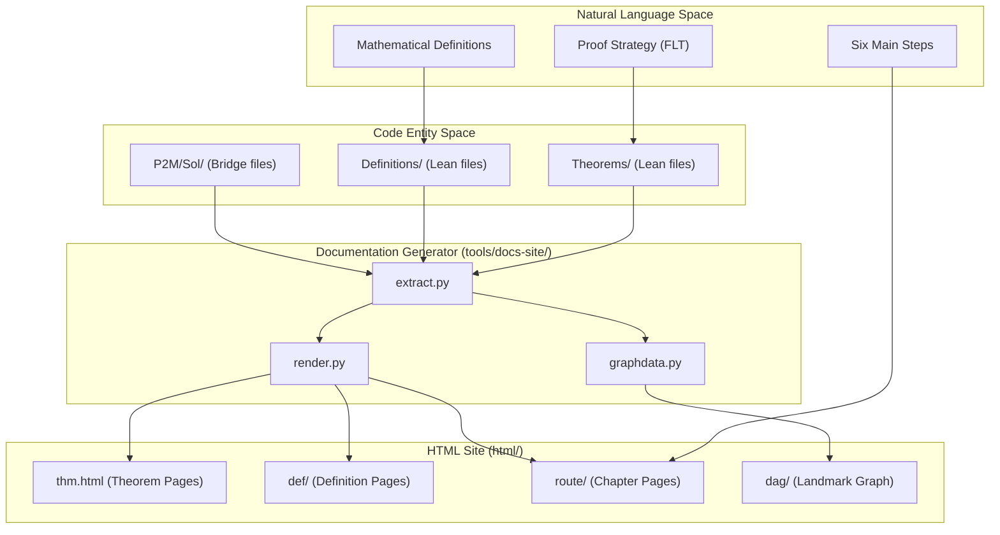

<!-- source: DeepWiki mcp.deepwiki.com · repo anthropics/fermats-last-theorem · page 9 Documentation Site and Tooling · fetched 2026-10-26 -->

# Documentation Site and Tooling

<details>
<summary>Relevant source files</summary>

The following files were used as context for generating this wiki page:

- [P2M/Sol/S_CerednikDrinfeld_classSet_eq_empty_or_eq_univ_of_forall_mem_iff_of_squarefree.lean](P2M/Sol/S_CerednikDrinfeld_classSet_eq_empty_or_eq_univ_of_forall_mem_iff_of_squarefree.lean)
- [P2M/Sol/S_CuspForm_HeckeGaloisRepDatum_ordinaryCondition_or_flatCondition_of_apOfModel.lean](P2M/Sol/S_CuspForm_HeckeGaloisRepDatum_ordinaryCondition_or_flatCondition_of_apOfModel.lean)
- [P2M/Sol/S_CuspForm_heckeLocal_exists_algHom_length_cotangent_le_of_isResiduallyModular_of_level_of_inertia_moves_torsion_of_eq_three_of_not_cube_dvd_of_level_not_cube_dvd.lean](P2M/Sol/S_CuspForm_heckeLocal_exists_algHom_length_cotangent_le_of_isResiduallyModular_of_level_of_inertia_moves_torsion_of_eq_three_of_not_cube_dvd_of_level_not_cube_dvd.lean)
- [P2M/Sol/S_CuspForm_heckeLocal_exists_isCornerRealization_and_linearEquiv_baseML_of_squarefree.lean](P2M/Sol/S_CuspForm_heckeLocal_exists_isCornerRealization_and_linearEquiv_baseML_of_squarefree.lean)
- [P2M/Sol/S_CuspForm_isFlatAt_of_point_of_not_dvd.lean](P2M/Sol/S_CuspForm_isFlatAt_of_point_of_not_dvd.lean)
- [P2M/Sol/S_FLT_fermatLastTheorem.lean](P2M/Sol/S_FLT_fermatLastTheorem.lean)
- [P2M/Sol/S_FreyPackage_Mazur_Frey.lean](P2M/Sol/S_FreyPackage_Mazur_Frey.lean)
- [P2M/Sol/S_FreyPackage_atPNewLowering.lean](P2M/Sol/S_FreyPackage_atPNewLowering.lean)
- [P2M/Sol/S_FreyPackage_atPNewLoweringAtUniform.lean](P2M/Sol/S_FreyPackage_atPNewLoweringAtUniform.lean)
- [P2M/Sol/S_FreyPackage_dvd_freyCurveInt_discr_iff.lean](P2M/Sol/S_FreyPackage_dvd_freyCurveInt_discr_iff.lean)
- [P2M/Sol/S_FreyPackage_fermatLastTheoremFor_of_five_le.lean](P2M/Sol/S_FreyPackage_fermatLastTheoremFor_of_five_le.lean)
- [P2M/Sol/S_FreyPackage_freyCurveInt_discr_ne_zero.lean](P2M/Sol/S_FreyPackage_freyCurveInt_discr_ne_zero.lean)
- [P2M/Sol/S_FreyPackage_freyCurveInt_map.lean](P2M/Sol/S_FreyPackage_freyCurveInt_map.lean)
- [P2M/Sol/S_FreyPackage_freyGaloisRep_isUnramifiedAt.lean](P2M/Sol/S_FreyPackage_freyGaloisRep_isUnramifiedAt.lean)
- [P2M/Sol/S_FreyPackage_frey_isModular.lean](P2M/Sol/S_FreyPackage_frey_isModular.lean)
- [P2M/Sol/S_FreyPackage_frey_isSemistableModel.lean](P2M/Sol/S_FreyPackage_frey_isSemistableModel.lean)
- [P2M/Sol/S_FreyPackage_level_lowering_odd_prime_of_conductorLevel.lean](P2M/Sol/S_FreyPackage_level_lowering_odd_prime_of_conductorLevel.lean)
- [P2M/Sol/S_FreyPackage_level_lowering_to_two.lean](P2M/Sol/S_FreyPackage_level_lowering_to_two.lean)
- [P2M/Sol/S_FreyPackage_mazurPrincipleAtPStep.lean](P2M/Sol/S_FreyPackage_mazurPrincipleAtPStep.lean)
- [P2M/Sol/S_FreyPackage_modularRepOfConductorLevel.lean](P2M/Sol/S_FreyPackage_modularRepOfConductorLevel.lean)
- [P2M/Sol/S_FreyPackage_no_frey_package.lean](P2M/Sol/S_FreyPackage_no_frey_package.lean)
- [P2M/Sol/S_FreyPackage_not_dvd_freyCurveInt_c4.lean](P2M/Sol/S_FreyPackage_not_dvd_freyCurveInt_c4.lean)
- [P2M/Sol/S_FreyPackage_padicValInt_freyCurveInt_discr.lean](P2M/Sol/S_FreyPackage_padicValInt_freyCurveInt_discr.lean)
- [P2M/Sol/S_FreyPackage_padicValInt_two_freyCurveInt_discr.lean](P2M/Sol/S_FreyPackage_padicValInt_two_freyCurveInt_discr.lean)

</details>


The documentation for the Fermat's Last Theorem Lean 4 formalization is generated as a comprehensive static site. It provides a human-readable interface to the 29,511 theorem pages and 1,450 definition pages that constitute the proof. The site is generated using a custom Python pipeline located in `tools/docs-site/`, which transforms the Lean source code and metadata into a navigable HTML structure.

### High-Level Documentation Flow

The documentation infrastructure bridges the gap between the formal Lean code and the mathematical narrative of the proof.

"Natural Language to Code Mapping"


**Sources:**
*   [P2M/Sol/S_FLT_fermatLastTheorem.lean:1-10]()
*   [tools/docs-site/extract.py:1-50]() (referenced by name)
*   [tools/docs-site/render.py:1-50]() (referenced by name)

---

### HTML Documentation Site Structure

The `html/` directory contains the final rendered output. The site is designed to allow users to trace the proof from the top-level Fermat's Last Theorem statement down to the most fundamental lemmas.

*   **Theorem and Definition Pages:** Every Lean `theorem` and `def` is rendered to its own page, including its formal statement, a link to the source code, and a citation graph showing its dependencies.
*   **Route Chapters:** The proof is organized into "chapters" based on the `landmark_stages.json` configuration, reflecting the six major steps of the proof route.
*   **Landmark Graph:** A Graphviz-rendered Directed Acyclic Graph (DAG) allows for visual navigation of the major milestones in the proof.
*   **KaTeX Integration:** All mathematical statements are rendered using KaTeX for high-quality display.

For a detailed breakdown of the site layout and navigation features, see **[HTML Documentation Site Structure](#9.1)**.

**Sources:**
*   [P2M/Sol/S_FreyPackage_fermatLastTheoremFor_of_five_le.lean:1-7]()
*   [P2M/Sol/S_FreyPackage_no_frey_package.lean:1-9]()

---

### Documentation Generator (`tools/docs-site`)

The documentation is built using a Python-based pipeline that processes the repository.

"Documentation Generation Pipeline"
```mermaid
graph LR
    Input1["Lean Source"] --> extract["extract.py"]
    Input2["english.jsonl"] --> extract
    Input3["landmark_stages.json"] --> extract
    
    extract --> metadata["Metadata Shards"]
    
    metadata --> render["render.py"]
    metadata --> graph["graphdata.py"]
    
    render --> html["HTML Pages"]
    graph --> dag["Landmark DAG"]
    
    html & dag --> check["selfcheck.py / qa_filetest.py"]
```

*   **Extraction:** `extract.py` parses Lean files and combines them with natural language descriptions from `english.jsonl`.
*   **Graph Processing:** `graphdata.py` calculates the citation edges between theorems, enabling the "Cited By" and "References" sections on each page.
*   **Rendering:** `render.py` uses templates to generate the thousands of individual HTML files.
*   **Quality Assurance:** `selfcheck.py` and `qa_filetest.py` ensure that all links are valid and that the generated site accurately reflects the codebase.

For details on running the build pipeline and the internal data formats, see **[Documentation Generator (tools/docs-site)](#9.2)**.

**Sources:**
*   [P2M/Sol/S_CuspForm_isFlatAt_of_point_of_not_dvd.lean:1-42]()
*   [tools/docs-site/extract.py:1-100]() (referenced by name)
*   [tools/docs-site/selfcheck.py:1-50]() (referenced by name)

---

### Navigation and Search

The site includes several indices to facilitate discovery:
*   **Namespace Index:** A hierarchical view of all Lean namespaces (e.g., `P2MW.S_FreyPackage_dvd_freyCurveInt_discr_iff` [P2M/Sol/S_FreyPackage_dvd_freyCurveInt_discr_iff.lean:7-7]()).
*   **Search:** A client-side search index covering theorem names and titles.
*   **MANIFEST.txt:** A flat list of all documented entities used for automated tooling and verification.

**Sources:**
*   [P2M/Sol/S_FreyPackage_dvd_freyCurveInt_discr_iff.lean:7-7]()
*   [P2M/Sol/S_FreyPackage_freyCurveInt_map.lean:7-7]()

---

