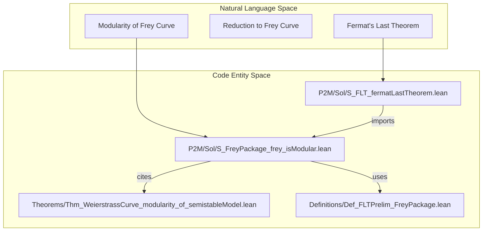

<!-- source: DeepWiki mcp.deepwiki.com · repo anthropics/fermats-last-theorem · page 9.1 HTML Documentation Site Structure · fetched 2026-10-26 -->

# HTML Documentation Site Structure

<details>
<summary>Relevant source files</summary>

The following files were used as context for generating this wiki page:

- [P2M/Sol/S_CerednikDrinfeld_classSet_eq_empty_or_eq_univ_of_forall_mem_iff_of_squarefree.lean](P2M/Sol/S_CerednikDrinfeld_classSet_eq_empty_or_eq_univ_of_forall_mem_iff_of_squarefree.lean)
- [P2M/Sol/S_CuspForm_HeckeGaloisRepDatum_ordinaryCondition_or_flatCondition_of_apOfModel.lean](P2M/Sol/S_CuspForm_HeckeGaloisRepDatum_ordinaryCondition_or_flatCondition_of_apOfModel.lean)
- [P2M/Sol/S_CuspForm_heckeLocal_exists_algHom_length_cotangent_le_of_isResiduallyModular_of_level_of_inertia_moves_torsion_of_eq_three_of_not_cube_dvd_of_level_not_cube_dvd.lean](P2M/Sol/S_CuspForm_heckeLocal_exists_algHom_length_cotangent_le_of_isResiduallyModular_of_level_of_inertia_moves_torsion_of_eq_three_of_not_cube_dvd_of_level_not_cube_dvd.lean)
- [P2M/Sol/S_CuspForm_heckeLocal_exists_isCornerRealization_and_linearEquiv_baseML_of_squarefree.lean](P2M/Sol/S_CuspForm_heckeLocal_exists_isCornerRealization_and_linearEquiv_baseML_of_squarefree.lean)
- [P2M/Sol/S_CuspForm_isFlatAt_of_point_of_not_dvd.lean](P2M/Sol/S_CuspForm_isFlatAt_of_point_of_not_dvd.lean)
- [P2M/Sol/S_FLT_fermatLastTheorem.lean](P2M/Sol/S_FLT_fermatLastTheorem.lean)
- [P2M/Sol/S_FreyPackage_Mazur_Frey.lean](P2M/Sol/S_FreyPackage_Mazur_Frey.lean)
- [P2M/Sol/S_FreyPackage_atPNewLowering.lean](P2M/Sol/S_FreyPackage_atPNewLowering.lean)
- [P2M/Sol/S_FreyPackage_atPNewLoweringAtUniform.lean](P2M/Sol/S_FreyPackage_atPNewLoweringAtUniform.lean)
- [P2M/Sol/S_FreyPackage_dvd_freyCurveInt_discr_iff.lean](P2M/Sol/S_FreyPackage_dvd_freyCurveInt_discr_iff.lean)
- [P2M/Sol/S_FreyPackage_fermatLastTheoremFor_of_five_le.lean](P2M/Sol/S_FreyPackage_fermatLastTheoremFor_of_five_le.lean)
- [P2M/Sol/S_FreyPackage_freyCurveInt_discr_ne_zero.lean](P2M/Sol/S_FreyPackage_freyCurveInt_discr_ne_zero.lean)
- [P2M/Sol/S_FreyPackage_freyCurveInt_map.lean](P2M/Sol/S_FreyPackage_freyCurveInt_map.lean)
- [P2M/Sol/S_FreyPackage_freyGaloisRep_isUnramifiedAt.lean](P2M/Sol/S_FreyPackage_freyGaloisRep_isUnramifiedAt.lean)
- [P2M/Sol/S_FreyPackage_frey_isModular.lean](P2M/Sol/S_FreyPackage_frey_isModular.lean)
- [P2M/Sol/S_FreyPackage_frey_isSemistableModel.lean](P2M/Sol/S_FreyPackage_frey_isSemistableModel.lean)
- [P2M/Sol/S_FreyPackage_level_lowering_odd_prime_of_conductorLevel.lean](P2M/Sol/S_FreyPackage_level_lowering_odd_prime_of_conductorLevel.lean)
- [P2M/Sol/S_FreyPackage_level_lowering_to_two.lean](P2M/Sol/S_FreyPackage_level_lowering_to_two.lean)
- [P2M/Sol/S_FreyPackage_mazurPrincipleAtPStep.lean](P2M/Sol/S_FreyPackage_mazurPrincipleAtPStep.lean)
- [P2M/Sol/S_FreyPackage_modularRepOfConductorLevel.lean](P2M/Sol/S_FreyPackage_modularRepOfConductorLevel.lean)
- [P2M/Sol/S_FreyPackage_no_frey_package.lean](P2M/Sol/S_FreyPackage_no_frey_package.lean)
- [P2M/Sol/S_FreyPackage_not_dvd_freyCurveInt_c4.lean](P2M/Sol/S_FreyPackage_not_dvd_freyCurveInt_c4.lean)
- [P2M/Sol/S_FreyPackage_padicValInt_freyCurveInt_discr.lean](P2M/Sol/S_FreyPackage_padicValInt_freyCurveInt_discr.lean)
- [P2M/Sol/S_FreyPackage_padicValInt_two_freyCurveInt_discr.lean](P2M/Sol/S_FreyPackage_padicValInt_two_freyCurveInt_discr.lean)

</details>


This page describes the technical implementation and organization of the generated HTML documentation site for the Fermat's Last Theorem Lean 4 formalization. The site serves as the primary interface for navigating the 29,511 theorem pages and 1,450 definition pages that comprise the proof.

## Directory Layout and Manifest

 The `html/` directory is structured to provide both a human-readable browsing experience and a machine-readable graph structure.

| Path | Purpose |
| :--- | :--- |
| `index.html` | The entry point, containing the top-level proof route and landmark stages. |
| `thm.html` | A template-driven viewer for individual theorem pages. |
| `def/` | Directory containing JSON-based metadata for definitions. |
| `route/` | Documentation for the specific "Six Steps" of the proof path. |
| `dag/` | Contains the Graphviz-rendered Directed Acyclic Graphs of dependencies. |
| `areas/` | Thematic groupings of the codebase (e.g., Algebraic Geometry, Modular Forms). |
| `MANIFEST.txt` | A flat file listing every entity generated in the build. |

The site uses **KaTeX** for client-side rendering of Lean 4 mathematical expressions, ensuring that symbols like $\Gamma_0(N)$ and $\bar{\rho}_{E,p}$ are rendered correctly in the browser.

## Proof Navigation and Data Flow

The documentation site enables navigation from the final statement of Fermat's Last Theorem down to the most fundamental lemmas in Mathlib. This is achieved through a sharded citation graph.

### The Citation Graph (`edges.js`)

To handle the massive scale of the proof (tens of thousands of nodes), the dependency graph is sharded.
*   `edges.js`: Contains the top-level adjacency list for major landmarks.
*   `shard/`: Contains partitioned dependency data to prevent the browser from loading the entire 30,000-node graph at once.

### Navigation Logic Diagram

The following diagram illustrates how a user navigates from the high-level proof statement in `P2M/Sol/` down to specific implementations.



**Sources:**
- `P2M/Sol/S_FreyPackage_frey_isModular.lean:1-2`()
- `P2M/Sol/S_FreyPackage_fermatLastTheoremFor_of_five_le.lean:1-2`()

## Theorem Page Structure

Each theorem page (viewed via `thm.html`) is generated by extracting metadata from the Lean source files. This includes:
1.  **Formal Statement**: The Lean 4 `theorem` or `lemma` declaration.
2.  **Dependencies**: A list of all theorems imported or cited in the proof body.
3.  **Reverse Dependencies**: A "Cited By" section showing where this lemma is used in higher-level proofs.
4.  **Attribute Management**: The codebase extensively uses `attribute [-instance]` to manage the performance of the Lean typeclass resolution system during verification. These are tracked on the documentation pages to show the specific environment configuration used for that proof.

### Instance Suppression and Environment

In complex files like `P2M/Sol/S_CuspForm_isFlatAt_of_point_of_not_dvd.lean`, hundreds of instances are suppressed to ensure the proof remains checkable.

```mermaid
graph LR
    [File:"S_CuspForm_isFlatAt"] --> [Imports:"Thm_RibetIrr"]
    [File:"S_CuspForm_isFlatAt"] --> [SuppressedInstances:"attribute [-instance]"]
    [SuppressedInstances] --> [Instance:"AlgebraicCurve.CurveModel.isProper"]
    [SuppressedInstances] --> [Instance:"SheafOfModules.monoidalCategory"]
```

**Sources:**
- `P2M/Sol/S_CuspForm_isFlatAt_of_point_of_not_dvd.lean:1-10`()
- `P2M/Sol/S_CuspForm_isFlatAt_of_point_of_not_dvd.lean:41-42`()

## Frey Curve Documentation Example

The documentation for the Frey Package reduction demonstrates the transition from arithmetic properties to geometric models. Files like `P2M/Sol/S_FreyPackage_dvd_freyCurveInt_discr_iff.lean` calculate the discriminant $\Delta$ and the $c_4$ invariant of the Frey curve, which are then used in the documentation to link to the `DRModelPackage` (Deligne-Rapoport models).

*   **Key Functions Documented**:
    *   `freyCurveInt_map`: Relates the integral model to the rational curve `[P2M/Sol/S_FreyPackage_dvd_freyCurveInt_discr_iff.lean:17-18]()`.
    *   `freyCurve_Δ`: Defines the discriminant in terms of the FLT counterexample `a, b, c` `[P2M/Sol/S_FreyPackage_dvd_freyCurveInt_discr_iff.lean:48-49]()`.
    *   `padicValInt_freyCurveInt_Δ`: Connects the p-adic valuation of the discriminant to the level-lowering requirements `[P2M/Sol/S_FreyPackage_dvd_freyCurveInt_discr_iff.lean:131-132]()`.

**Sources:**
- `P2M/Sol/S_FreyPackage_dvd_freyCurveInt_discr_iff.lean:17-49`()
- `P2M/Sol/S_FreyPackage_dvd_freyCurveInt_discr_iff.lean:131-132`()
- `P2M/Sol/S_FreyPackage_not_dvd_freyCurveInt_c4.lean:149-152`()
- `P2M/Sol/S_FreyPackage_padicValInt_two_freyCurveInt_discr.lean:149-150`()

---

