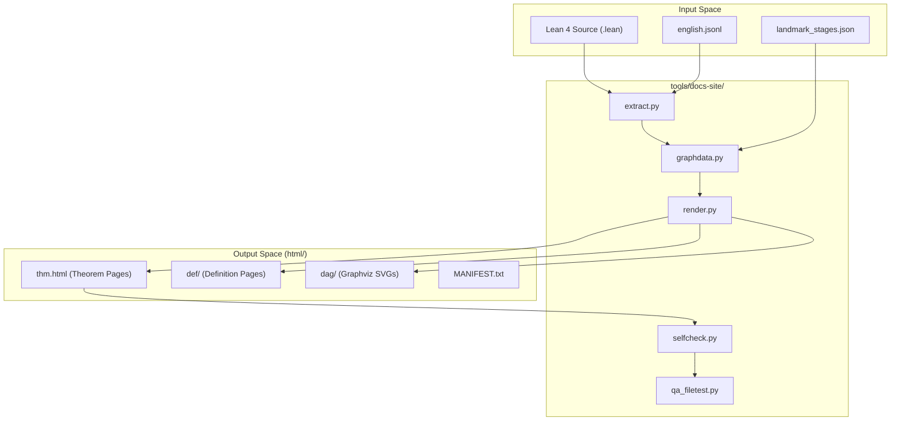
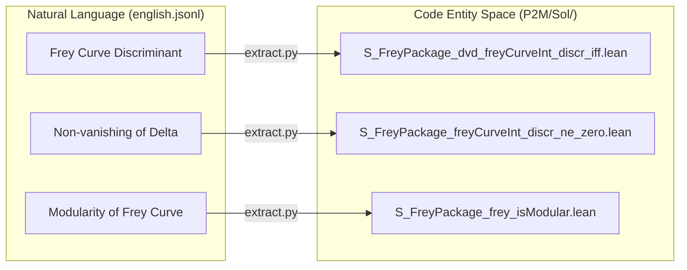

<!-- source: DeepWiki mcp.deepwiki.com · repo anthropics/fermats-last-theorem · page 9.2 Documentation Generator (tools/docs-site) · fetched 2026-10-26 -->

# Documentation Generator (tools/docs-site)

Relevant source files

The following files were used as context for generating this wiki page:

- [P2M/Sol/S_CerednikDrinfeld_classSet_eq_empty_or_eq_univ_of_forall_mem_iff_of_squarefree.lean](P2M/Sol/S_CerednikDrinfeld_classSet_eq_empty_or_eq_univ_of_forall_mem_iff_of_squarefree.lean)
- [P2M/Sol/S_CuspForm_HeckeGaloisRepDatum_ordinaryCondition_or_flatCondition_of_apOfModel.lean](P2M/Sol/S_CuspForm_HeckeGaloisRepDatum_ordinaryCondition_or_flatCondition_of_apOfModel.lean)
- [P2M/Sol/S_CuspForm_heckeLocal_exists_algHom_length_cotangent_le_of_isResiduallyModular_of_level_of_inertia_moves_torsion_of_eq_three_of_not_cube_dvd_of_level_not_cube_dvd.lean](P2M/Sol/S_CuspForm_heckeLocal_exists_algHom_length_cotangent_le_of_isResiduallyModular_of_level_of_inertia_moves_torsion_of_eq_three_of_not_cube_dvd_of_level_not_cube_dvd.lean)
- [P2M/Sol/S_CuspForm_heckeLocal_exists_isCornerRealization_and_linearEquiv_baseML_of_squarefree.lean](P2M/Sol/S_CuspForm_heckeLocal_exists_isCornerRealization_and_linearEquiv_baseML_of_squarefree.lean)
- [P2M/Sol/S_CuspForm_isFlatAt_of_point_of_not_dvd.lean](P2M/Sol/S_CuspForm_isFlatAt_of_point_of_not_dvd.lean)
- [P2M/Sol/S_FLT_fermatLastTheorem.lean](P2M/Sol/S_FLT_fermatLastTheorem.lean)
- [P2M/Sol/S_FreyPackage_Mazur_Frey.lean](P2M/Sol/S_FreyPackage_Mazur_Frey.lean)
- [P2M/Sol/S_FreyPackage_atPNewLowering.lean](P2M/Sol/S_FreyPackage_atPNewLowering.lean)
- [P2M/Sol/S_FreyPackage_atPNewLoweringAtUniform.lean](P2M/Sol/S_FreyPackage_atPNewLoweringAtUniform.lean)
- [P2M/Sol/S_FreyPackage_dvd_freyCurveInt_discr_iff.lean](P2M/Sol/S_FreyPackage_dvd_freyCurveInt_discr_iff.lean)
- [P2M/Sol/S_FreyPackage_fermatLastTheoremFor_of_five_le.lean](P2M/Sol/S_FreyPackage_fermatLastTheoremFor_of_five_le.lean)
- [P2M/Sol/S_FreyPackage_freyCurveInt_discr_ne_zero.lean](P2M/Sol/S_FreyPackage_freyCurveInt_discr_ne_zero.lean)
- [P2M/Sol/S_FreyPackage_freyCurveInt_map.lean](P2M/Sol/S_FreyPackage_freyCurveInt_map.lean)
- [P2M/Sol/S_FreyPackage_freyGaloisRep_isUnramifiedAt.lean](P2M/Sol/S_FreyPackage_freyGaloisRep_isUnramifiedAt.lean)
- [P2M/Sol/S_FreyPackage_frey_isModular.lean](P2M/Sol/S_FreyPackage_frey_isModular.lean)
- [P2M/Sol/S_FreyPackage_frey_isSemistableModel.lean](P2M/Sol/S_FreyPackage_frey_isSemistableModel.lean)
- [P2M/Sol/S_FreyPackage_level_lowering_odd_prime_of_conductorLevel.lean](P2M/Sol/S_FreyPackage_level_lowering_odd_prime_of_conductorLevel.lean)
- [P2M/Sol/S_FreyPackage_level_lowering_to_two.lean](P2M/Sol/S_FreyPackage_level_lowering_to_two.lean)
- [P2M/Sol/S_FreyPackage_mazurPrincipleAtPStep.lean](P2M/Sol/S_FreyPackage_mazurPrincipleAtPStep.lean)
- [P2M/Sol/S_FreyPackage_modularRepOfConductorLevel.lean](P2M/Sol/S_FreyPackage_modularRepOfConductorLevel.lean)
- [P2M/Sol/S_FreyPackage_no_frey_package.lean](P2M/Sol/S_FreyPackage_no_frey_package.lean)
- [P2M/Sol/S_FreyPackage_not_dvd_freyCurveInt_c4.lean](P2M/Sol/S_FreyPackage_not_dvd_freyCurveInt_c4.lean)
- [P2M/Sol/S_FreyPackage_padicValInt_freyCurveInt_discr.lean](P2M/Sol/S_FreyPackage_padicValInt_freyCurveInt_discr.lean)
- [P2M/Sol/S_FreyPackage_padicValInt_two_freyCurveInt_discr.lean](P2M/Sol/S_FreyPackage_padicValInt_two_freyCurveInt_discr.lean)

The documentation for the Fermat's Last Theorem Lean 4 formalization is generated by a specialized Python-based build pipeline located in `tools/docs-site/`. This system transforms the Lean 4 source code, metadata, and natural language descriptions into a navigable, interlinked HTML site.

## Build Pipeline Overview

The pipeline operates in stages, moving from raw data extraction to graph processing, and finally to static site generation.

### Data Flow Architecture

The following diagram illustrates how the build tools interact with input data to produce the final site.

**Documentation Generation Pipeline**

**Sources:** `tools/docs-site/extract.py`, `tools/docs-site/graphdata.py`, `tools/docs-site/render.py`

## Core Pipeline Components

### 1. Metadata Extraction (`extract.py`)
This script parses the Lean source files and merges them with `english.jsonl`. It identifies theorem and definition declarations, their formal statements, and maps them to the corresponding natural language explanations.
*   **Key Functionality:** Maps Lean namespaces (e.g., `P2MW.S_FreyPackage_dvd_freyCurveInt_discr_iff`) to their documentation targets [P2M/Sol/S_FreyPackage_dvd_freyCurveInt_discr_iff.lean:7-17]().

### 2. Dependency Graph Construction (`graphdata.py`)
This component analyzes `import` statements across the `Theorems/` and `Definitions/` directories to build a Directed Acyclic Graph (DAG) of the proof.
*   **Landmark Integration:** Uses `landmark_stages.json` to group theorems into the six major steps of the proof (e.g., Modularity, Level Lowering) [P2M/Sol/S_FreyPackage_no_frey_package.lean:1-5]().
*   **Graphviz Rendering:** Generates the visual dependency graphs found in the `dag/` directory.

### 3. Site Rendering (`render.py`)
The primary engine for generating static HTML. It uses templates to create:
*   **Theorem Pages:** Individual pages for all 29,511 theorems, including their Lean statement and dependency links.
*   **Definition Pages:** Documentation for the 1,450 core definitions.
*   **KaTeX Integration:** Ensures mathematical symbols in `english.jsonl` are rendered correctly for the browser.

### 4. Quality Assurance (`selfcheck.py` & `qa_filetest.py`)
A "smoke-test" suite that verifies the integrity of the generated site.
*   **Link Validation:** `selfcheck.py` crawls the `html/` directory to ensure no broken internal links exist.
*   **Manifest Check:** Validates that every theorem identified in the Lean source has a corresponding entry in `MANIFEST.txt`.

## Mapping Natural Language to Code Entities

The documentation generator bridges the gap between the high-level mathematical proof and the Lean implementation by associating specific files with proof steps.

**Frey Package Extraction Mapping**

**Sources:** [P2M/Sol/S_FreyPackage_dvd_freyCurveInt_discr_iff.lean:149-151](), [P2M/Sol/S_FreyPackage_freyCurveInt_discr_ne_zero.lean:149-150](), [P2M/Sol/S_FreyPackage_frey_isModular.lean:1-3]()

## Input Formats

### `english.jsonl`
A JSON Lines file containing the natural language descriptions for every theorem and definition. Each line contains:
*   `id`: The Lean name (e.g., `freyCurveInt_Δ_ne_zero`) [P2M/Sol/S_FreyPackage_freyCurveInt_discr_ne_zero.lean:119-123]().
*   `text`: The LaTeX-formatted mathematical description.

### `landmark_stages.json`
Defines the high-level organization of the documentation site. It categorizes theorems into "Stages" which correspond to the chapters in the `route/` directory.

## Implementation Details: Frey Package Example

The pipeline processes files like `S_FreyPackage_dvd_freyCurveInt_discr_iff.lean` by identifying the `theorem solution` block and linking it to the `FreyPackage` definition [P2M/Sol/S_FreyPackage_dvd_freyCurveInt_discr_iff.lean:149-150]().

| Feature | Implementation | Source |
| :--- | :--- | :--- |
| **Theorem Mapping** | `extract.py` identifies `theorem solution` | [P2M/Sol/S_FreyPackage_dvd_freyCurveInt_discr_iff.lean:149]() |
| **Namespace Logic** | Parsed via `namespace P2MW...` | [P2M/Sol/S_FreyPackage_dvd_freyCurveInt_discr_iff.lean:7]() |
| **Import Tracking** | `graphdata.py` reads `import Mathlib...` | [P2M/Sol/S_FreyPackage_dvd_freyCurveInt_discr_iff.lean:1-5]() |
| **Attribute Handling** | `extract.py` filters `attribute [-instance]` | [P2M/Sol/S_CuspForm_isFlatAt_of_point_of_not_dvd.lean:41-42]() |

**Sources:** `P2M/Sol/S_FreyPackage_dvd_freyCurveInt_discr_iff.lean`, `P2M/Sol/S_CuspForm_isFlatAt_of_point_of_not_dvd.lean`, `tools/docs-site/extract.py`

---

