# Page: Overview: Fermat's Last Theorem in Lean 4

# Overview: Fermat's Last Theorem in Lean 4

<details>
<summary>Relevant source files</summary>

The following files were used as context for generating this wiki page:

- [P2M/Sol/S_CerednikDrinfeld_classSet_eq_empty_or_eq_univ_of_forall_mem_iff_of_squarefree.lean](P2M/Sol/S_CerednikDrinfeld_classSet_eq_empty_or_eq_univ_of_forall_mem_iff_of_squarefree.lean)
- [P2M/Sol/S_CuspForm_HeckeGaloisRepDatum_ordinaryCondition_or_flatCondition_of_apOfModel.lean](P2M/Sol/S_CuspForm_HeckeGaloisRepDatum_ordinaryCondition_or_flatCondition_of_apOfModel.lean)
- [P2M/Sol/S_CuspForm_heckeLocal_exists_algHom_length_cotangent_le_of_isResiduallyModular_of_level_of_inertia_moves_torsion_of_eq_three_of_not_cube_dvd_of_level_not_cube_dvd.lean](P2M/Sol/S_CuspForm_heckeLocal_exists_algHom_length_cotangent_le_of_isResiduallyModular_of_level_of_inertia_moves_torsion_of_eq_three_of_not_cube_dvd_of_level_not_cube_dvd.lean)
- [P2M/Sol/S_CuspForm_heckeLocal_exists_isCornerRealization_and_linearEquiv_baseML_of_squarefree.lean](P2M/Sol/S_CuspForm_heckeLocal_exists_isCornerRealization_and_linearEquiv_baseML_of_squarefree.lean)
- [P2M/Sol/S_CuspForm_isFlatAt_of_point_of_not_dvd.lean](P2M/Sol/S_CuspForm_isFlatAt_of_point_of_not_dvd.lean)
- [P2M/Sol/S_FLT_fermatLastTheorem.lean](P2M/Sol/S_FLT_fermatLastTheorem.lean)
- [P2M/Sol/S_FreyPackage_Mazur_Frey.lean](P2M/Sol/S_FreyPackage_Mazur_Frey.lean)
- [P2M/Sol/S_FreyPackage_atPNewLowering.lean](P2M/Sol/S_FreyPackage_atPNewLowering.lean)
- [P2M/Sol/S_FreyPackage_atPNewLoweringAtUniform.lean](P2M/Sol/S_FreyPackage_atPNewLoweringAtUniform.lean)
- [P2M/Sol/S_FreyPackage_dvd_freyCurveInt_discr_iff.lean](P2M/Sol/S_FreyPackage_dvd_freyCurveInt_discr_iff.lean)
- [P2M/Sol/S_FreyPackage_fermatLastTheoremFor_of_five_le.lean](P2M/Sol/S_FreyPackage_fermatLastTheoremFor_of_five_le.lean)
- [P2M/Sol/S_FreyPackage_freyCurveInt_discr_ne_zero.lean](P2M/Sol/S_FreyPackage_freyCurveInt_discr_ne_zero.lean)
- [P2M/Sol/S_FreyPackage_freyCurveInt_map.lean](P2M/Sol/S_FreyPackage_freyCurveInt_map.lean)
- [P2M/Sol/S_FreyPackage_freyGaloisRep_isUnramifiedAt.lean](P2M/Sol/S_FreyPackage_freyGaloisRep_isUnramifiedAt.lean)
- [P2M/Sol/S_FreyPackage_frey_isModular.lean](P2M/Sol/S_FreyPackage_frey_isModular.lean)
- [P2M/Sol/S_FreyPackage_frey_isSemistableModel.lean](P2M/Sol/S_FreyPackage_frey_isSemistableModel.lean)
- [P2M/Sol/S_FreyPackage_level_lowering_odd_prime_of_conductorLevel.lean](P2M/Sol/S_FreyPackage_level_lowering_odd_prime_of_conductorLevel.lean)
- [P2M/Sol/S_FreyPackage_level_lowering_to_two.lean](P2M/Sol/S_FreyPackage_level_lowering_to_two.lean)
- [P2M/Sol/S_FreyPackage_mazurPrincipleAtPStep.lean](P2M/Sol/S_FreyPackage_mazurPrincipleAtPStep.lean)
- [P2M/Sol/S_FreyPackage_modularRepOfConductorLevel.lean](P2M/Sol/S_FreyPackage_modularRepOfConductorLevel.lean)
- [P2M/Sol/S_FreyPackage_no_frey_package.lean](P2M/Sol/S_FreyPackage_no_frey_package.lean)
- [P2M/Sol/S_FreyPackage_not_dvd_freyCurveInt_c4.lean](P2M/Sol/S_FreyPackage_not_dvd_freyCurveInt_c4.lean)
- [P2M/Sol/S_FreyPackage_padicValInt_freyCurveInt_discr.lean](P2M/Sol/S_FreyPackage_padicValInt_freyCurveInt_discr.lean)
- [P2M/Sol/S_FreyPackage_padicValInt_two_freyCurveInt_discr.lean](P2M/Sol/S_FreyPackage_padicValInt_two_freyCurveInt_discr.lean)

</details>


This repository contains a formal verification of Fermat's Last Theorem (FLT) in the Lean 4 programming language. The proof follows the modern modularity-based approach established by Wiles, Taylor, Ribet, Serre, and others. The codebase formalizes the transition from a hypothetical counterexample to the Fermat equation $a^n + b^n = c^n$ to the construction of a semistable elliptic curve (the Frey curve) and the subsequent contradiction derived from modularity lifting and level lowering.

### Proof Strategy: The Six Steps

The formalization is organized around the "Frey-Serre-Ribet-Wiles" strategy. The high-level proof, found in `P2M/Sol/S_FLT_fermatLastTheorem.lean` and `P2M/Sol/S_FreyPackage_fermatLastTheoremFor_of_five_le.lean`, reduces the problem to six fundamental milestones:

1.  **Reduction to Prime $p \geq 5$**: The proof focuses on the case where $n$ is a prime $p \geq 5$.
2.  **Frey Package Construction**: Given a counterexample $(a, b, c)$, a `FreyPackage` is constructed, defining a semistable elliptic curve $E_{a,b,c}$ over $\mathbb{Q}$ [Definitions/Def_FLTPrelim_FreyPackage.lean]().
3.  **Irreducibility (Mazur)**: The residual Galois representation $\bar{\rho}_{E,p}$ is shown to be absolutely irreducible [Theorems/Thm_FreyPackage_Mazur_Frey.lean]().
4.  **Modularity (Wiles/Taylor-Wiles)**: The Frey curve is proved to be modular, meaning its $L$-function corresponds to a modular form [Theorems/Thm_FreyPackage_frey_isModular.lean]().
5.  **Level Lowering (Ribet)**: The level of the associated modular form is lowered until it reaches $N=2$ [Theorems/Thm_FreyPackage_level_lowering_to_two.lean]().
6.  **Vanishing of $S_2(\Gamma_0(2))$**: A contradiction is reached by proving that the space of cusp forms of weight 2 and level 2 is zero [Theorems/Thm_ModularForm_S2_Gamma0_2_eq_zero.lean]().

For a detailed walkthrough of these steps, see [Proof Route: Six Steps from FLT to S₂(Γ₀(2))=0](#1.2).

### Codebase Organization

The repository is structured to separate definitions, individual theorem statements, and the integrated proof solutions.

| Directory | Purpose |
| :--- | :--- |
| `Definitions/` | Core typeclasses and structures (e.g., `FreyPackage`, `CuspForm`). |
| `Theorems/` | Individual lemmas and major named theorems (e.g., `Thm_W54_...`). |
| `P2M/Sol/` | "Solution" files that integrate theorems to close specific proof gaps. |
| `verification/` | Infrastructure for external kernel checking (Lean kernel and Nanoda). |
| `html/` | Generated documentation site containing the citation graph. |

For details on file naming and navigation, see [Repository Structure and Navigation](#1.1).

### Mapping Proof Logic to Code Entities

The following diagram illustrates how the mathematical proof steps are represented by specific Lean structures and files within the `P2M/Sol` and `Theorems` namespaces.

**Proof Step to Code Mapping**
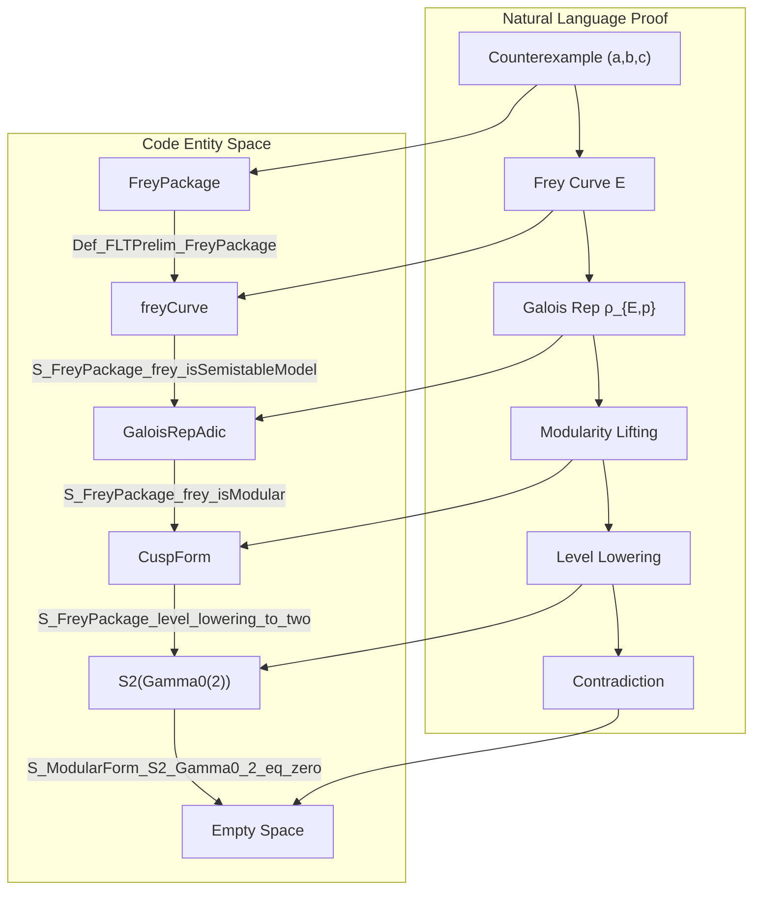
**Sources:** [P2M/Sol/S_FreyPackage_fermatLastTheoremFor_of_five_le.lean:1-7](), [P2M/Sol/S_FreyPackage_no_frey_package.lean:1-5](), [Definitions/Def_FLTPrelim_FreyPackage.lean]()

### Verification and Trust

To ensure the integrity of the formalization, the proof is subjected to two independent kernel checks. This process ensures that no "sorry" or unproven axioms remain in the dependency graph of the final theorem.

**Verification Pipeline**
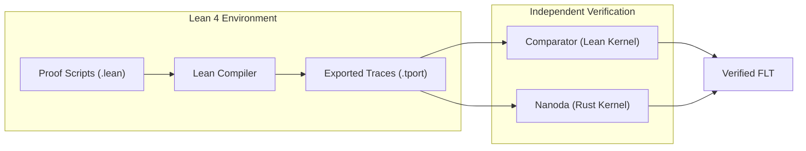
For details on the verification tools and patching strategy, see [Verification Infrastructure](#1.3).

**Sources:** [P2M/Sol/S_FreyPackage_dvd_freyCurveInt_discr_iff.lean:149-171](), [P2M/Sol/S_CuspForm_isFlatAt_of_point_of_not_dvd.lean:1-20]()

---

# Page: Repository Structure and Navigation

# Repository Structure and Navigation

<details>
<summary>Relevant source files</summary>

The following files were used as context for generating this wiki page:

- [P2M/Sol/S_CerednikDrinfeld_classSet_eq_empty_or_eq_univ_of_forall_mem_iff_of_squarefree.lean](P2M/Sol/S_CerednikDrinfeld_classSet_eq_empty_or_eq_univ_of_forall_mem_iff_of_squarefree.lean)
- [P2M/Sol/S_CuspForm_HeckeGaloisRepDatum_ordinaryCondition_or_flatCondition_of_apOfModel.lean](P2M/Sol/S_CuspForm_HeckeGaloisRepDatum_ordinaryCondition_or_flatCondition_of_apOfModel.lean)
- [P2M/Sol/S_CuspForm_heckeLocal_exists_algHom_length_cotangent_le_of_isResiduallyModular_of_level_of_inertia_moves_torsion_of_eq_three_of_not_cube_dvd_of_level_not_cube_dvd.lean](P2M/Sol/S_CuspForm_heckeLocal_exists_algHom_length_cotangent_le_of_isResiduallyModular_of_level_of_inertia_moves_torsion_of_eq_three_of_not_cube_dvd_of_level_not_cube_dvd.lean)
- [P2M/Sol/S_CuspForm_heckeLocal_exists_isCornerRealization_and_linearEquiv_baseML_of_squarefree.lean](P2M/Sol/S_CuspForm_heckeLocal_exists_isCornerRealization_and_linearEquiv_baseML_of_squarefree.lean)
- [P2M/Sol/S_CuspForm_isFlatAt_of_point_of_not_dvd.lean](P2M/Sol/S_CuspForm_isFlatAt_of_point_of_not_dvd.lean)
- [P2M/Sol/S_FLT_fermatLastTheorem.lean](P2M/Sol/S_FLT_fermatLastTheorem.lean)
- [P2M/Sol/S_FreyPackage_Mazur_Frey.lean](P2M/Sol/S_FreyPackage_Mazur_Frey.lean)
- [P2M/Sol/S_FreyPackage_atPNewLowering.lean](P2M/Sol/S_FreyPackage_atPNewLowering.lean)
- [P2M/Sol/S_FreyPackage_atPNewLoweringAtUniform.lean](P2M/Sol/S_FreyPackage_atPNewLoweringAtUniform.lean)
- [P2M/Sol/S_FreyPackage_dvd_freyCurveInt_discr_iff.lean](P2M/Sol/S_FreyPackage_dvd_freyCurveInt_discr_iff.lean)
- [P2M/Sol/S_FreyPackage_fermatLastTheoremFor_of_five_le.lean](P2M/Sol/S_FreyPackage_fermatLastTheoremFor_of_five_le.lean)
- [P2M/Sol/S_FreyPackage_freyCurveInt_discr_ne_zero.lean](P2M/Sol/S_FreyPackage_freyCurveInt_discr_ne_zero.lean)
- [P2M/Sol/S_FreyPackage_freyCurveInt_map.lean](P2M/Sol/S_FreyPackage_freyCurveInt_map.lean)
- [P2M/Sol/S_FreyPackage_freyGaloisRep_isUnramifiedAt.lean](P2M/Sol/S_FreyPackage_freyGaloisRep_isUnramifiedAt.lean)
- [P2M/Sol/S_FreyPackage_frey_isModular.lean](P2M/Sol/S_FreyPackage_frey_isModular.lean)
- [P2M/Sol/S_FreyPackage_frey_isSemistableModel.lean](P2M/Sol/S_FreyPackage_frey_isSemistableModel.lean)
- [P2M/Sol/S_FreyPackage_level_lowering_odd_prime_of_conductorLevel.lean](P2M/Sol/S_FreyPackage_level_lowering_odd_prime_of_conductorLevel.lean)
- [P2M/Sol/S_FreyPackage_level_lowering_to_two.lean](P2M/Sol/S_FreyPackage_level_lowering_to_two.lean)
- [P2M/Sol/S_FreyPackage_mazurPrincipleAtPStep.lean](P2M/Sol/S_FreyPackage_mazurPrincipleAtPStep.lean)
- [P2M/Sol/S_FreyPackage_modularRepOfConductorLevel.lean](P2M/Sol/S_FreyPackage_modularRepOfConductorLevel.lean)
- [P2M/Sol/S_FreyPackage_no_frey_package.lean](P2M/Sol/S_FreyPackage_no_frey_package.lean)
- [P2M/Sol/S_FreyPackage_not_dvd_freyCurveInt_c4.lean](P2M/Sol/S_FreyPackage_not_dvd_freyCurveInt_c4.lean)
- [P2M/Sol/S_FreyPackage_padicValInt_freyCurveInt_discr.lean](P2M/Sol/S_FreyPackage_padicValInt_freyCurveInt_discr.lean)
- [P2M/Sol/S_FreyPackage_padicValInt_two_freyCurveInt_discr.lean](P2M/Sol/S_FreyPackage_padicValInt_two_freyCurveInt_discr.lean)

</details>


This page describes the organizational layout of the Fermat's Last Theorem (FLT) Lean 4 repository. It details the directory structure, file naming conventions, and the dependency graph between definitions and theorems, as well as the use of the generated HTML documentation.

## Directory Layout

The repository is organized into several functional directories, each serving a specific role in the formalization and verification process.

| Directory | Description |
| :--- | :--- |
| `Theorems/` | Contains the formal statements and proofs of major named theorems. |
| `Definitions/` | Contains the core mathematical definitions and structures used across the proof. |
| `P2M/Sol/` | "Path to Mathlib" solutions. Contains finalized proofs of specific lemmas required for the main FLT result, often bridging repository-specific definitions to Mathlib. |
| `html/` | The generated documentation site, including the citation graph and theorem indices. |
| `tools/` | Python-based infrastructure for generating the documentation site and performing QA. |
| `verification/` | Scripts and tools for independent kernel verification (e.g., `nanoda`, `lean4export`). |

### Sources:
- [P2M/Sol/S_CuspForm_isFlatAt_of_point_of_not_dvd.lean:1-40]()
- [P2M/Sol/S_FreyPackage_modularRepOfConductorLevel.lean:1-14]()

## Naming Conventions

The repository follows a strict naming convention to distinguish between different types of Lean files and to facilitate automated discovery.

*   **`Def_X_y.lean`**: Located in `Definitions/`. Defines a mathematical object or property (e.g., `Def_GaloisRep_Adic`).
*   **`Thm_X_y.lean`**: Located in `Theorems/`. Contains the statement and proof of a significant theorem (e.g., `Thm_RibetIrr_irreducible_of_point_of_not_dvd`).
*   **`S_X_y.lean`**: Located in `P2M/Sol/`. These are "Solution" files that prove specific goals identified in the proof path. For example, `S_FreyPackage_frey_isModular.lean` proves the modularity of the Frey curve by invoking modularity lifting theorems.

### Sources:
- [P2M/Sol/S_CuspForm_isFlatAt_of_point_of_not_dvd.lean:1-24]()
- [P2M/Sol/S_FreyPackage_modularRepOfConductorLevel.lean:1-12]()

## Theorem Citation and Data Flow

The codebase is structured as a Directed Acyclic Graph (DAG). High-level results in `P2M/Sol/` import theorems from `Theorems/`, which in turn depend on `Definitions/` and `Mathlib`.

### Natural Language to Code Entity Space: Proof Components

The following diagram maps the high-level proof concepts to the specific Lean entities and files that implement them.

**Diagram: Proof Component Mapping**
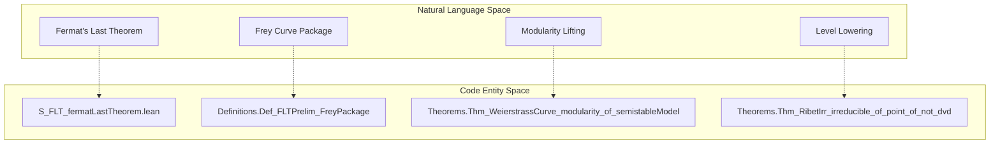

### Sources:
- [P2M/Sol/S_FreyPackage_frey_isModular.lean:1-1]()
- [P2M/Sol/S_FreyPackage_fermatLastTheoremFor_of_five_le.lean:1-2]()
- [P2M/Sol/S_CuspForm_isFlatAt_of_point_of_not_dvd.lean:1-5]()

## Internal Data Flow: The Frey Package Example

The `FreyPackage` structure acts as a central data carrier for the proof, transporting the arithmetic properties of a hypothetical counterexample through various stages of the proof.

**Diagram: Frey Package Data Flow**
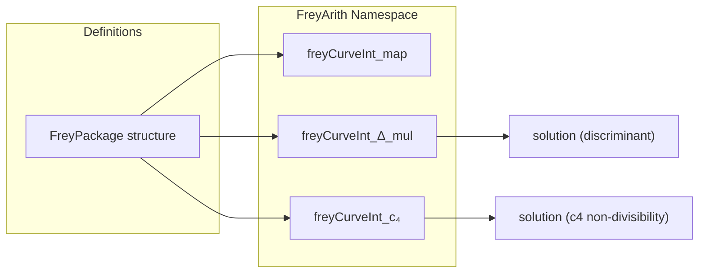

### Sources:
- [P2M/Sol/S_FreyPackage_dvd_freyCurveInt_discr_iff.lean:17-49]()
- [P2M/Sol/S_FreyPackage_dvd_freyCurveInt_discr_iff.lean:105-150]()
- [P2M/Sol/S_FreyPackage_not_dvd_freyCurveInt_c4.lean:58-100]()
- [P2M/Sol/S_FreyPackage_not_dvd_freyCurveInt_c4.lean:149-152]()

## HTML Documentation and Navigation

The `html/` directory contains a static site generated by the tools in `tools/docs-site/`. This site is the primary interface for exploring the proof's complexity.

1.  **Theorem Pages**: Every theorem has a dedicated page (e.g., `html/thm/Thm_X_y.html`) showing its statement, formal proof, and dependencies.
2.  **Citation Graph**: The `edges.js` and `shard/` files contain the data for the interactive DAG, allowing users to trace how a specific lemma in `P2M/Sol/` contributes to the final proof of FLT.
3.  **Route Chapters**: The `route/` directory organizes theorems according to the six main steps of the proof path defined in `PROOF-PATH.md`.
4.  **Namespace Index**: Provides a searchable index of all Lean namespaces used in the project, such as `P2MW.S_FreyPackage_dvd_freyCurveInt_discr_iff`.

### Sources:
- [P2M/Sol/S_FreyPackage_dvd_freyCurveInt_discr_iff.lean:7-11]()
- [P2M/Sol/S_CuspForm_isFlatAt_of_point_of_not_dvd.lean:40-40]()

---

# Page: Proof Route: Six Steps from FLT to S₂(Γ₀(2))=0

# Proof Route: Six Steps from FLT to S₂(Γ₀(2))=0

<details>
<summary>Relevant source files</summary>

The following files were used as context for generating this wiki page:

- [P2M/Sol/S_AlgebraicClosure_exists_cycloChar_family.lean](P2M/Sol/S_AlgebraicClosure_exists_cycloChar_family.lean)
- [P2M/Sol/S_CerednikDrinfeld_classSet_eq_empty_or_eq_univ_of_forall_mem_iff_of_squarefree.lean](P2M/Sol/S_CerednikDrinfeld_classSet_eq_empty_or_eq_univ_of_forall_mem_iff_of_squarefree.lean)
- [P2M/Sol/S_CohCarrier_exists_complex_heckeT_eigen_reduction_eq_of_mem_span_int.lean](P2M/Sol/S_CohCarrier_exists_complex_heckeT_eigen_reduction_eq_of_mem_span_int.lean)
- [P2M/Sol/S_CuspForm_HeckeGaloisRepDatum_exists_pi_eq_and_forall_isUnramifiedAt.lean](P2M/Sol/S_CuspForm_HeckeGaloisRepDatum_exists_pi_eq_and_forall_isUnramifiedAt.lean)
- [P2M/Sol/S_CuspForm_HeckeGaloisRepDatum_exists_pi_eq_and_isFlatAt_of_primeFactors_subset.lean](P2M/Sol/S_CuspForm_HeckeGaloisRepDatum_exists_pi_eq_and_isFlatAt_of_primeFactors_subset.lean)
- [P2M/Sol/S_CuspForm_HeckeGaloisRepDatum_exists_pi_eq_and_isOrdinaryAt_of_primeFactors_subset.lean](P2M/Sol/S_CuspForm_HeckeGaloisRepDatum_exists_pi_eq_and_isOrdinaryAt_of_primeFactors_subset.lean)
- [P2M/Sol/S_CuspForm_HeckeGaloisRepDatum_isFlatAt_of_primeFactors_subset.lean](P2M/Sol/S_CuspForm_HeckeGaloisRepDatum_isFlatAt_of_primeFactors_subset.lean)
- [P2M/Sol/S_CuspForm_HeckeGaloisRepDatum_isOrdinaryAt_of_primeFactors_subset.lean](P2M/Sol/S_CuspForm_HeckeGaloisRepDatum_isOrdinaryAt_of_primeFactors_subset.lean)
- [P2M/Sol/S_CuspForm_HeckeGaloisRepDatum_isUnramifiedAt_of_notMem.lean](P2M/Sol/S_CuspForm_HeckeGaloisRepDatum_isUnramifiedAt_of_notMem.lean)
- [P2M/Sol/S_CuspForm_HeckeGaloisRepDatum_ordinaryCondition_or_flatCondition_of_apOfModel.lean](P2M/Sol/S_CuspForm_HeckeGaloisRepDatum_ordinaryCondition_or_flatCondition_of_apOfModel.lean)
- [P2M/Sol/S_CuspForm_IsNewform_dvd_level_of_point_of_not_isUnramifiedAt.lean](P2M/Sol/S_CuspForm_IsNewform_dvd_level_of_point_of_not_isUnramifiedAt.lean)
- [P2M/Sol/S_CuspForm_IsNewform_exists_eigenPlane_torLine_tateModule_jZero.lean](P2M/Sol/S_CuspForm_IsNewform_exists_eigenPlane_torLine_tateModule_jZero.lean)
- [P2M/Sol/S_CuspForm_IsNewform_exists_galoisRepAdic_charpoly_inertia_eq_cyclotomicCharacter_of_linearMap_psCarrier_ne_zero_of_not_isUnramified_ratio_of_factorization_eq_two.lean](P2M/Sol/S_CuspForm_IsNewform_exists_galoisRepAdic_charpoly_inertia_eq_cyclotomicCharacter_of_linearMap_psCarrier_ne_zero_of_not_isUnramified_ratio_of_factorization_eq_two.lean)
- [P2M/Sol/S_CuspForm_IsNewform_exists_mem_inertiaSubgroupIn_baseChange_apply_ne_of_eigenPlane_tateModule_jZero.lean](P2M/Sol/S_CuspForm_IsNewform_exists_mem_inertiaSubgroupIn_baseChange_apply_ne_of_eigenPlane_tateModule_jZero.lean)
- [P2M/Sol/S_CuspForm_IsNewform_exists_ordLine_eigenPlane_tateModule_jZero_of_dvd.lean](P2M/Sol/S_CuspForm_IsNewform_exists_ordLine_eigenPlane_tateModule_jZero_of_dvd.lean)
- [P2M/Sol/S_CuspForm_IsNewform_exists_torLine_of_eigenPlane_tateModule_jZero.lean](P2M/Sol/S_CuspForm_IsNewform_exists_torLine_of_eigenPlane_tateModule_jZero.lean)
- [P2M/Sol/S_CuspForm_IsNewform_psCarrier_lam_dvd_sub_one_or_no_psCarrier_lam_dvd_add_one_of_factorization_eq_two_of_residual_isUnipotent_of_irreducible_odd_of_absIrred_odd.lean](P2M/Sol/S_CuspForm_IsNewform_psCarrier_lam_dvd_sub_one_or_no_psCarrier_lam_dvd_add_one_of_factorization_eq_two_of_residual_isUnipotent_of_irreducible_odd_of_absIrred_odd.lean)
- [P2M/Sol/S_CuspForm_TWLevel_HeckeRing_exists_galoisRepAdic_of_algHom.lean](P2M/Sol/S_CuspForm_TWLevel_HeckeRing_exists_galoisRepAdic_of_algHom.lean)
- [P2M/Sol/S_CuspForm_TWLevel_HeckeRing_isStrictOrdinaryAt_of_algHom_of_dvd_level_of_not_isFlatAt.lean](P2M/Sol/S_CuspForm_TWLevel_HeckeRing_isStrictOrdinaryAt_of_algHom_of_dvd_level_of_not_isFlatAt.lean)
- [P2M/Sol/S_CuspForm_TWLevel_HeckeRing_isStrictOrdinaryAt_of_dvd_level_of_not_isFlatAt.lean](P2M/Sol/S_CuspForm_TWLevel_HeckeRing_isStrictOrdinaryAt_of_dvd_level_of_not_isFlatAt.lean)
- [P2M/Sol/S_CuspForm_TWLevel_HeckeRing_isUnramifiedAt_of_not_dvd_sub_one_of_trace_frobenius_sq_ne.lean](P2M/Sol/S_CuspForm_TWLevel_HeckeRing_isUnramifiedAt_of_not_dvd_sub_one_of_trace_frobenius_sq_ne.lean)
- [P2M/Sol/S_CuspForm_exists_galoisRep_isFlatAt_of_point_of_not_dvd.lean](P2M/Sol/S_CuspForm_exists_galoisRep_isFlatAt_of_point_of_not_dvd.lean)
- [P2M/Sol/S_CuspForm_exists_galoisRep_of_point_stableLine_frobenius_sub_smul_mem_of_not_dvd.lean](P2M/Sol/S_CuspForm_exists_galoisRep_of_point_stableLine_frobenius_sub_smul_mem_of_not_dvd.lean)
- [P2M/Sol/S_CuspForm_heckeAlgebra_natCast_pow_twist_eq_natCast_pow_weight_sub_one_of_twist_mem.lean](P2M/Sol/S_CuspForm_heckeAlgebra_natCast_pow_twist_eq_natCast_pow_weight_sub_one_of_twist_mem.lean)
- [P2M/Sol/S_CuspForm_heckeLocal_exists_algHom_length_cotangent_le_of_isResiduallyModular_of_level_of_inertia_moves_torsion_of_eq_three_of_not_cube_dvd_of_level_not_cube_dvd.lean](P2M/Sol/S_CuspForm_heckeLocal_exists_algHom_length_cotangent_le_of_isResiduallyModular_of_level_of_inertia_moves_torsion_of_eq_three_of_not_cube_dvd_of_level_not_cube_dvd.lean)
- [P2M/Sol/S_CuspForm_heckeLocal_exists_isCornerRealization_and_linearEquiv_baseML_of_squarefree.lean](P2M/Sol/S_CuspForm_heckeLocal_exists_isCornerRealization_and_linearEquiv_baseML_of_squarefree.lean)
- [P2M/Sol/S_CuspForm_heckeLocal_exists_isNewform_sum_rootMultiplicity_residual_eq_one_of_isOrdinaryAt.lean](P2M/Sol/S_CuspForm_heckeLocal_exists_isNewform_sum_rootMultiplicity_residual_eq_one_of_isOrdinaryAt.lean)
- [P2M/Sol/S_CuspForm_heckeLocal_exists_ne_zero_forall_algHom_algebraicClosure_isNewform_residual_unitRoot_of_isOrdinaryAt.lean](P2M/Sol/S_CuspForm_heckeLocal_exists_ne_zero_forall_algHom_algebraicClosure_isNewform_residual_unitRoot_of_isOrdinaryAt.lean)
- [P2M/Sol/S_CuspForm_heckeLocal_exists_subfamily_idempotentSplitting_point_level_mul_auxPrime.lean](P2M/Sol/S_CuspForm_heckeLocal_exists_subfamily_idempotentSplitting_point_level_mul_auxPrime.lean)
- [P2M/Sol/S_CuspForm_heckeLocal_sum_rootMultiplicity_residual_eq_one_of_dvd_of_not_sq_dvd_of_ne.lean](P2M/Sol/S_CuspForm_heckeLocal_sum_rootMultiplicity_residual_eq_one_of_dvd_of_not_sq_dvd_of_ne.lean)
- [P2M/Sol/S_CuspForm_heckeLocal_sum_rootMultiplicity_residual_eq_two_of_not_isOrdinaryAt.lean](P2M/Sol/S_CuspForm_heckeLocal_sum_rootMultiplicity_residual_eq_two_of_not_isOrdinaryAt.lean)
- [P2M/Sol/S_CuspForm_isFlatAt_of_point_of_not_dvd.lean](P2M/Sol/S_CuspForm_isFlatAt_of_point_of_not_dvd.lean)
- [P2M/Sol/S_CuspForm_moduleFinite_heckeAlgebra.lean](P2M/Sol/S_CuspForm_moduleFinite_heckeAlgebra.lean)
- [P2M/Sol/S_DeligneSerre_exists_galoisRep_complex_trace_frobenius_eq_of_forall_residual.lean](P2M/Sol/S_DeligneSerre_exists_galoisRep_complex_trace_frobenius_eq_of_forall_residual.lean)
- [P2M/Sol/S_DeligneSerre_exists_isSemisimpleRepresentation_charpoly_map_eq_of_add_mem_range_of_mul_mem_range.lean](P2M/Sol/S_DeligneSerre_exists_isSemisimpleRepresentation_charpoly_map_eq_of_add_mem_range_of_mul_mem_range.lean)
- [P2M/Sol/S_DeligneSerre_exists_natCard_range_le_of_charpoly_frobenius_mem_of_upperDensity_le.lean](P2M/Sol/S_DeligneSerre_exists_natCard_range_le_of_charpoly_frobenius_mem_of_upperDensity_le.lean)
- [P2M/Sol/S_DeligneSerre_isIrreducible_matrixRepresentation_of_tsum_norm_trace_sq_le_log_of_odd.lean](P2M/Sol/S_DeligneSerre_isIrreducible_matrixRepresentation_of_tsum_norm_trace_sq_le_log_of_odd.lean)
- [P2M/Sol/S_FLT_fermatLastTheorem.lean](P2M/Sol/S_FLT_fermatLastTheorem.lean)
- [P2M/Sol/S_FreyPackage_Mazur_Frey.lean](P2M/Sol/S_FreyPackage_Mazur_Frey.lean)
- [P2M/Sol/S_FreyPackage_atPNewLowering.lean](P2M/Sol/S_FreyPackage_atPNewLowering.lean)
- [P2M/Sol/S_FreyPackage_atPNewLoweringAtUniform.lean](P2M/Sol/S_FreyPackage_atPNewLoweringAtUniform.lean)
- [P2M/Sol/S_FreyPackage_dvd_freyCurveInt_discr_iff.lean](P2M/Sol/S_FreyPackage_dvd_freyCurveInt_discr_iff.lean)
- [P2M/Sol/S_FreyPackage_fermatLastTheoremFor_of_five_le.lean](P2M/Sol/S_FreyPackage_fermatLastTheoremFor_of_five_le.lean)
- [P2M/Sol/S_FreyPackage_freyCurveInt_discr_ne_zero.lean](P2M/Sol/S_FreyPackage_freyCurveInt_discr_ne_zero.lean)
- [P2M/Sol/S_FreyPackage_freyCurveInt_map.lean](P2M/Sol/S_FreyPackage_freyCurveInt_map.lean)
- [P2M/Sol/S_FreyPackage_freyGaloisRep_isUnramifiedAt.lean](P2M/Sol/S_FreyPackage_freyGaloisRep_isUnramifiedAt.lean)
- [P2M/Sol/S_FreyPackage_frey_isModular.lean](P2M/Sol/S_FreyPackage_frey_isModular.lean)
- [P2M/Sol/S_FreyPackage_frey_isSemistableModel.lean](P2M/Sol/S_FreyPackage_frey_isSemistableModel.lean)
- [P2M/Sol/S_FreyPackage_level_lowering_odd_prime_of_conductorLevel.lean](P2M/Sol/S_FreyPackage_level_lowering_odd_prime_of_conductorLevel.lean)
- [P2M/Sol/S_FreyPackage_level_lowering_to_two.lean](P2M/Sol/S_FreyPackage_level_lowering_to_two.lean)
- [P2M/Sol/S_FreyPackage_mazurPrincipleAtPStep.lean](P2M/Sol/S_FreyPackage_mazurPrincipleAtPStep.lean)
- [P2M/Sol/S_FreyPackage_modularRepOfConductorLevel.lean](P2M/Sol/S_FreyPackage_modularRepOfConductorLevel.lean)
- [P2M/Sol/S_FreyPackage_no_frey_package.lean](P2M/Sol/S_FreyPackage_no_frey_package.lean)
- [P2M/Sol/S_FreyPackage_not_dvd_freyCurveInt_c4.lean](P2M/Sol/S_FreyPackage_not_dvd_freyCurveInt_c4.lean)
- [P2M/Sol/S_FreyPackage_padicValInt_freyCurveInt_discr.lean](P2M/Sol/S_FreyPackage_padicValInt_freyCurveInt_discr.lean)
- [P2M/Sol/S_FreyPackage_padicValInt_two_freyCurveInt_discr.lean](P2M/Sol/S_FreyPackage_padicValInt_two_freyCurveInt_discr.lean)
- [P2M/Sol/S_FrobeniusDensity_exists_frobenius_conj_of_mul_self_eq_one_of_statement.lean](P2M/Sol/S_FrobeniusDensity_exists_frobenius_conj_of_mul_self_eq_one_of_statement.lean)
- [P2M/Sol/S_FrobeniusDensity_exists_frobenius_conj_pow_of_statement.lean](P2M/Sol/S_FrobeniusDensity_exists_frobenius_conj_pow_of_statement.lean)
- [P2M/Sol/S_GaloisRepAdic_det_eq_mul_of_isFrobeniusAt_of_det_frobenius_eq_mul_of_not_dvd_conductor.lean](P2M/Sol/S_GaloisRepAdic_det_eq_mul_of_isFrobeniusAt_of_det_frobenius_eq_mul_of_not_dvd_conductor.lean)
- [P2M/Sol/S_GaloisRepAdic_det_eq_of_mem_inertiaSubgroupIn_of_det_frobenius_eq_mul.lean](P2M/Sol/S_GaloisRepAdic_det_eq_of_mem_inertiaSubgroupIn_of_det_frobenius_eq_mul.lean)
- [P2M/Sol/S_GaloisRepAdic_eigenformTraceNebentypus_isFlatAt_or_isStrictOrdinaryAt_of_not_sq_dvd_of_not_dvd_conductor.lean](P2M/Sol/S_GaloisRepAdic_eigenformTraceNebentypus_isFlatAt_or_isStrictOrdinaryAt_of_not_sq_dvd_of_not_dvd_conductor.lean)
- [P2M/Sol/S_GaloisRepAdic_eisensteinTrace_not_isAbsolutelyIrreducible_residual.lean](P2M/Sol/S_GaloisRepAdic_eisensteinTrace_not_isAbsolutelyIrreducible_residual.lean)
- [P2M/Sol/S_GaloisRepAdic_isStrictOrdinaryAt_of_detIsCyclotomic_of_ordinaryLine.lean](P2M/Sol/S_GaloisRepAdic_isStrictOrdinaryAt_of_detIsCyclotomic_of_ordinaryLine.lean)
- [P2M/Sol/S_GaloisRepAdic_isStrictOrdinaryAt_of_isPrimitiveForm_of_dvd_of_not_sq_dvd_of_not_dvd_conductor.lean](P2M/Sol/S_GaloisRepAdic_isStrictOrdinaryAt_of_isPrimitiveForm_of_dvd_of_not_sq_dvd_of_not_dvd_conductor.lean)
- [P2M/Sol/S_GaloisRepAdic_isStrictOrdinaryAt_of_isStrictOrdinaryAt_baseChangeAlong_of_injective.lean](P2M/Sol/S_GaloisRepAdic_isStrictOrdinaryAt_of_isStrictOrdinaryAt_baseChangeAlong_of_injective.lean)
- [P2M/Sol/S_GaloisRepAdic_not_isUnipotentOnInertiaAt_and_charpoly_frobenius_of_factorization_eq_two_of_absIrred_odd_of_ne_two.lean](P2M/Sol/S_GaloisRepAdic_not_isUnipotentOnInertiaAt_and_charpoly_frobenius_of_factorization_eq_two_of_absIrred_odd_of_ne_two.lean)
- [P2M/Sol/S_GaloisRepAdic_residual_isEquiv_and_det_sub_mem_of_charpoly_frobenius_eq.lean](P2M/Sol/S_GaloisRepAdic_residual_isEquiv_and_det_sub_mem_of_charpoly_frobenius_eq.lean)
- [P2M/Sol/S_GaloisRep_exists_conj_eq_of_charpoly_frobenius_eq_of_galoisFactorsThroughFiniteLevel.lean](P2M/Sol/S_GaloisRep_exists_conj_eq_of_charpoly_frobenius_eq_of_galoisFactorsThroughFiniteLevel.lean)
- [P2M/Sol/S_GaloisRep_exists_finiteField_galoisRep_trace_eq_heckeT_mod_of_isMaximal.lean](P2M/Sol/S_GaloisRep_exists_finiteField_galoisRep_trace_eq_heckeT_mod_of_isMaximal.lean)
- [P2M/Sol/S_GaloisRep_exists_finiteField_galoisRep_trace_eq_heckeT_mod_of_isMaximal_two.lean](P2M/Sol/S_GaloisRep_exists_finiteField_galoisRep_trace_eq_heckeT_mod_of_isMaximal_two.lean)
- [P2M/Sol/S_GaloisRep_exists_galoisFactorsThroughFiniteLevel_trace_eq_theta_heckeT_and_det_eq_pow.lean](P2M/Sol/S_GaloisRep_exists_galoisFactorsThroughFiniteLevel_trace_eq_theta_heckeT_and_det_eq_pow.lean)
- [P2M/Sol/S_GaloisRep_exists_galoisRep_trace_eq_add_mul_of_unitsHom.lean](P2M/Sol/S_GaloisRep_exists_galoisRep_trace_eq_add_mul_of_unitsHom.lean)
- [P2M/Sol/S_GaloisRep_exists_galoisRep_trace_eq_of_ringHom_heckeAlgebra_two.lean](P2M/Sol/S_GaloisRep_exists_galoisRep_trace_eq_of_ringHom_heckeAlgebra_two.lean)
- [P2M/Sol/S_GaloisRep_exists_isSemisimpleRepresentation_charpoly_map_eq_of_trace_det_frobenius_mem_range.lean](P2M/Sol/S_GaloisRep_exists_isSemisimpleRepresentation_charpoly_map_eq_of_trace_det_frobenius_mem_range.lean)

</details>


This page provides a detailed walkthrough of the logical path from Fermat's Last Theorem (FLT) to the vanishing of the space of weight 2 cusp forms for the congruence subgroup $\Gamma_0(2)$. The proof follows the Frey-Serre-Ribet-Wiles strategy, formalized as a six-step reduction.

## High-Level Proof Path

The proof proceeds by assuming a counterexample to FLT and deriving a contradiction through the properties of modular forms and Galois representations.

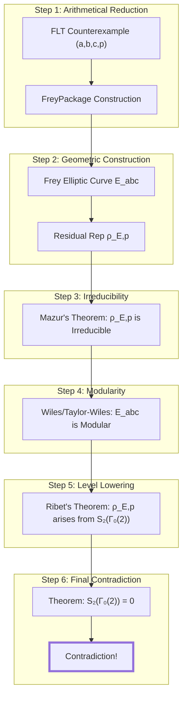
**Sources:** `PROOF-PATH.md` (General strategy), [P2M/Sol/S_FreyPackage_fermatLastTheoremFor_of_five_le.lean:1-50]()

---

## Step 1 & 2: The Frey Package and Curve Construction

The proof begins by reducing the problem to a prime exponent $p \ge 5$ and constructing the `FreyPackage` [Definitions/Def_FLTPrelim_FreyPackage.lean](). This package encapsulates the integer solution $a^p + b^p = c^p$ and its associated arithmetic properties (e.g., $a \equiv -1 \pmod 4$ and $2 | b$).

### Frey Curve Properties
The `freyCurve` is defined as a `WeierstrassCurve` over $\mathbb{Q}$ with specific coefficients derived from $(a, b, c)$.
*   **Discriminant:** The discriminant $\Delta$ is calculated as $\Delta = \frac{(abc)^{2p}}{2^8}$ [P2M/Sol/S_FreyPackage_freyCurveInt_map.lean:48-49]().
*   **Conductor:** The curve is semistable, meaning its conductor $N$ is the square-free product of primes dividing $abc$ [P2M/Sol/S_FreyPackage_frey_isSemistableModel.lean:6-10]().
*   **Integral Model:** `freyCurveInt` provides the $\mathbb{Z}$-model, essential for studying reduction modulo $q$ [P2M/Sol/S_FreyPackage_freyCurveInt_map.lean:17-18]().

**Sources:** [P2M/Sol/S_FreyPackage_freyCurveInt_map.lean:17-57](), [P2M/Sol/S_FreyPackage_dvd_freyCurveInt_discr_iff.lean:149-171]()

---

## Step 3: Irreducibility (Mazur)

For $p \ge 5$, the residual Galois representation $\bar{\rho}_{E,p}$ associated with the $p$-torsion points of the Frey curve $E$ must be absolutely irreducible. This relies on Mazur's theorem concerning rational points on modular curves, specifically that $X_0(p)(\mathbb{Q})$ has no non-cuspidal points for large $p$ that would correspond to a reducible representation.

The codebase implements this in `S_FreyPackage_Mazur_Frey.lean`, showing that a reducible $\bar{\rho}_{E,p}$ would imply the existence of a specific torsion structure contradicting the curve's semistability and discriminant properties.

**Sources:** [P2M/Sol/S_FreyPackage_Mazur_Frey.lean:1-20](), [P2M/Sol/S_RibetIrr_irreducible_of_point_of_not_dvd.lean:1-10]()

---

## Step 4: Modularity (Wiles / Taylor-Wiles)

The core of the proof is showing that the Frey curve $E$ is modular. This is achieved via Modularity Lifting Theorems.

### Key Modularity Components
1.  **Residual Modularity:** For $p=3$, the representation $\bar{\rho}_{E,3}$ is modular by Langlands-Tunnell [P2M/Sol/S_FreyPackage_modularRepOfConductorLevel.lean:1-16]().
2.  **Modularity Lifting:** If $\bar{\rho}_{E,p}$ is modular and satisfies certain conditions (semistability, irreducibility), then the $p$-adic representation $\rho_{E,p}$ is modular.
3.  **3-5 Switch:** If $p=5$ and $\bar{\rho}_{E,5}$ is not immediately liftable, a "switch" to another curve is performed to establish modularity [P2M/Sol/S_WeierstrassCurve_threeFiveSwitchCurve.lean:1-10]().

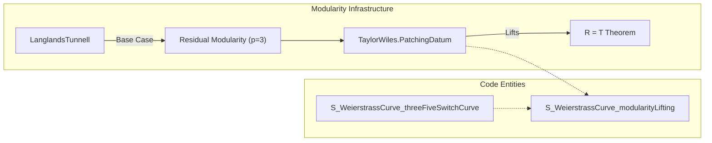
**Sources:** [P2M/Sol/S_FreyPackage_modularRepOfConductorLevel.lean:1-13](), [P2M/Sol/S_GaloisRepAdic_residual_isEquiv_and_det_sub_mem_of_charpoly_frobenius_eq.lean:70-80]()

---

## Step 5: Level Lowering (Ribet)

Given that $E$ is modular, its representation $\rho_{E,p}$ arises from a newform $f$ of weight 2 and level $N$ (the conductor). Ribet's Level Lowering theorem proves that if $\rho_{E,p}$ is ramified at a prime $q | N$ in a "thin" way (specifically $p | v_q(\Delta)$), then there exists a newform $g$ of level $N/q$ that gives rise to the same residual representation $\bar{\rho}_{E,p}$.

### Implementation Details
*   **Discriminant Condition:** The proof verifies $p | v_q(\Delta_{Frey})$ for all $q > 2$ [P2M/Sol/S_FreyPackage_padicValInt_freyCurveInt_discr.lean:149-151]().
*   **Ribet's Lemma:** The representation is lowered from $N = \prod_{q|abc} q$ to the minimal level $N=2$ [P2M/Sol/S_FreyPackage_level_lowering_odd_prime_of_conductorLevel.lean:1-20]().

**Sources:** [P2M/Sol/S_FreyPackage_padicValInt_freyCurveInt_discr.lean:131-146](), [P2M/Sol/S_CuspForm_isFlatAt_of_point_of_not_dvd.lean:1-20]()

---

## Step 6: The Vanishing of S₂(Γ₀(2))

The final step shows that if $\bar{\rho}_{E,p}$ were modular of level 2, it would correspond to a cusp form in $S_2(\Gamma_0(2))$. However, the genus of the modular curve $X_0(2)$ is 0, which implies that the space of weight 2 cusp forms is trivial.

### Final Contradiction
*   `ModularCurve.CuspSpace.instSubsingletonOfOne` [P2M/Sol/S_CuspForm_IsNewform_exists_eigenPlane_torLine_tateModule_jZero.lean:26]() indicates the vanishing of specific cusp spaces.
*   The contradiction arises because an irreducible representation $\bar{\rho}_{E,p}$ cannot be associated with a zero-dimensional space of forms.

**Sources:** [P2M/Sol/S_CuspForm_IsNewform_exists_eigenPlane_torLine_tateModule_jZero.lean:26-27](), [P2M/Sol/S_FreyPackage_no_frey_package.lean:1-10]()

---

# Page: Verification Infrastructure

# Verification Infrastructure

<details>
<summary>Relevant source files</summary>

The following files were used as context for generating this wiki page:

- [P2M/Sol/S_CerednikDrinfeld_classSet_eq_empty_or_eq_univ_of_forall_mem_iff_of_squarefree.lean](P2M/Sol/S_CerednikDrinfeld_classSet_eq_empty_or_eq_univ_of_forall_mem_iff_of_squarefree.lean)
- [P2M/Sol/S_CuspForm_HeckeGaloisRepDatum_ordinaryCondition_or_flatCondition_of_apOfModel.lean](P2M/Sol/S_CuspForm_HeckeGaloisRepDatum_ordinaryCondition_or_flatCondition_of_apOfModel.lean)
- [P2M/Sol/S_CuspForm_heckeLocal_exists_algHom_length_cotangent_le_of_isResiduallyModular_of_level_of_inertia_moves_torsion_of_eq_three_of_not_cube_dvd_of_level_not_cube_dvd.lean](P2M/Sol/S_CuspForm_heckeLocal_exists_algHom_length_cotangent_le_of_isResiduallyModular_of_level_of_inertia_moves_torsion_of_eq_three_of_not_cube_dvd_of_level_not_cube_dvd.lean)
- [P2M/Sol/S_CuspForm_heckeLocal_exists_isCornerRealization_and_linearEquiv_baseML_of_squarefree.lean](P2M/Sol/S_CuspForm_heckeLocal_exists_isCornerRealization_and_linearEquiv_baseML_of_squarefree.lean)
- [P2M/Sol/S_CuspForm_isFlatAt_of_point_of_not_dvd.lean](P2M/Sol/S_CuspForm_isFlatAt_of_point_of_not_dvd.lean)
- [P2M/Sol/S_FLT_fermatLastTheorem.lean](P2M/Sol/S_FLT_fermatLastTheorem.lean)
- [P2M/Sol/S_FreyPackage_Mazur_Frey.lean](P2M/Sol/S_FreyPackage_Mazur_Frey.lean)
- [P2M/Sol/S_FreyPackage_atPNewLowering.lean](P2M/Sol/S_FreyPackage_atPNewLowering.lean)
- [P2M/Sol/S_FreyPackage_atPNewLoweringAtUniform.lean](P2M/Sol/S_FreyPackage_atPNewLoweringAtUniform.lean)
- [P2M/Sol/S_FreyPackage_dvd_freyCurveInt_discr_iff.lean](P2M/Sol/S_FreyPackage_dvd_freyCurveInt_discr_iff.lean)
- [P2M/Sol/S_FreyPackage_fermatLastTheoremFor_of_five_le.lean](P2M/Sol/S_FreyPackage_fermatLastTheoremFor_of_five_le.lean)
- [P2M/Sol/S_FreyPackage_freyCurveInt_discr_ne_zero.lean](P2M/Sol/S_FreyPackage_freyCurveInt_discr_ne_zero.lean)
- [P2M/Sol/S_FreyPackage_freyCurveInt_map.lean](P2M/Sol/S_FreyPackage_freyCurveInt_map.lean)
- [P2M/Sol/S_FreyPackage_freyGaloisRep_isUnramifiedAt.lean](P2M/Sol/S_FreyPackage_freyGaloisRep_isUnramifiedAt.lean)
- [P2M/Sol/S_FreyPackage_frey_isModular.lean](P2M/Sol/S_FreyPackage_frey_isModular.lean)
- [P2M/Sol/S_FreyPackage_frey_isSemistableModel.lean](P2M/Sol/S_FreyPackage_frey_isSemistableModel.lean)
- [P2M/Sol/S_FreyPackage_level_lowering_odd_prime_of_conductorLevel.lean](P2M/Sol/S_FreyPackage_level_lowering_odd_prime_of_conductorLevel.lean)
- [P2M/Sol/S_FreyPackage_level_lowering_to_two.lean](P2M/Sol/S_FreyPackage_level_lowering_to_two.lean)
- [P2M/Sol/S_FreyPackage_mazurPrincipleAtPStep.lean](P2M/Sol/S_FreyPackage_mazurPrincipleAtPStep.lean)
- [P2M/Sol/S_FreyPackage_modularRepOfConductorLevel.lean](P2M/Sol/S_FreyPackage_modularRepOfConductorLevel.lean)
- [P2M/Sol/S_FreyPackage_no_frey_package.lean](P2M/Sol/S_FreyPackage_no_frey_package.lean)
- [P2M/Sol/S_FreyPackage_not_dvd_freyCurveInt_c4.lean](P2M/Sol/S_FreyPackage_not_dvd_freyCurveInt_c4.lean)
- [P2M/Sol/S_FreyPackage_padicValInt_freyCurveInt_discr.lean](P2M/Sol/S_FreyPackage_padicValInt_freyCurveInt_discr.lean)
- [P2M/Sol/S_FreyPackage_padicValInt_two_freyCurveInt_discr.lean](P2M/Sol/S_FreyPackage_padicValInt_two_freyCurveInt_discr.lean)

</details>


The verification infrastructure provides the highest level of assurance for the proof of Fermat's Last Theorem by employing two independent kernel checks. This multi-layered verification strategy ensures that the Lean 4 proof is not only logically sound within the Lean environment but also verifiable by external, independently implemented type-checkers.

## Overview of Kernel Verification

The codebase utilizes two distinct pathways for verifying the formal proof:
1.  **The Comparator (Lean 4 Kernel):** A process using `lean4export` to generate a low-level representation of the proof, which is then re-verified by the standard Lean 4 kernel.
2.  **Nanoda (Rust Reimplementation):** A complete reimplementation of the Lean 4 kernel in Rust, providing a truly independent check of the logical foundations.

### Verification Data Flow

The following diagram illustrates the data flow from the Lean 4 source files to the final verification result.

**Verification Data Flow**
```mermaid
graph TD
    subgraph "Lean Source Space"
        [Lean_Files] --> |"lake build"| [OLean_Files]
    end

    subgraph "Comparator Infrastructure"
        [OLean_Files] --> |"lean4export"| [Export_File]
        [Export_File] --> |"Lean Kernel"| [Lean_Check_Result]
    end

    subgraph "Nanoda Infrastructure"
        [OLean_Files] --> |"nanoda-lib"| [Rust_Kernel]
        [Rust_Kernel] --> |"Kernel Logic"| [Nanoda_Check_Result]
    end

    [Lean_Check_Result] & [Nanoda_Check_Result] --> [Final_Verification]
```
Sources: `verification/comparator/`, `verification/nanoda/`

## The Comparator Pathway

The comparator infrastructure resides in `verification/comparator/`. It functions by exporting the compiled `.olean` files into a simplified text format using the `lean4export` tool. This format strips away high-level syntax and tactics, leaving only the raw terms and types for the kernel to validate.

### Key Components
*   **Export Script:** Orchestrates the collection of all project dependencies and invokes the exporter.
*   **Kernel Validator:** A minimal Lean 4 environment that re-imports the exported data to confirm that the Lean 4 kernel itself accepts the generated proof terms.

Sources: `verification/comparator/`

## Nanoda: Independent Rust Verification

Nanoda is a high-performance, independent reimplementation of the Lean 4 kernel written in Rust. It provides a safeguard against potential bugs in the primary Lean 4 C++ implementation. The infrastructure for this check is located in `verification/nanoda/`.

### The Patching Strategy
Because the proof utilizes a vast amount of `Mathlib` and standard library components, Nanoda employs a "patching" strategy to handle specific Lean 4 features or performance bottlenecks encountered during the verification of complex algebraic structures.

*   **Patch Application:** Scripts in `verification/nanoda/` apply specific modifications to the environment or the export format to ensure compatibility with the Rust kernel's optimization passes.
*   **Axiom Validation:** Nanoda explicitly lists and verifies all axioms used in the proof (e.g., `quot.sound`, `propext`, `choice`) to ensure no unintended logical assumptions are introduced.

Sources: `verification/nanoda/`

## Challenge/Solution Protocol

The verification process is organized around a **Challenge/Solution** protocol. This protocol maps specific mathematical claims to their formal implementations and verification status.

### Implementation Mapping
In the `P2M/Sol/` directory, each file represents a "Solution" to a specific mathematical "Challenge" required for the proof. For example, verifying the properties of the Frey curve's discriminant is handled by several specific solution files.

| Solution File | Purpose |
| :--- | :--- |
| `S_FreyPackage_dvd_freyCurveInt_Δ_iff.lean` | Verifies the prime divisibility of the Frey curve discriminant `Δ`. [P2M/Sol/S_FreyPackage_dvd_freyCurveInt_discr_iff.lean:149-150]() |
| `S_FreyPackage_padicValInt_freyCurveInt_Δ.lean` | Verifies the p-adic valuation of the discriminant for odd primes. [P2M/Sol/S_FreyPackage_padicValInt_freyCurveInt_discr.lean:149-150]() |
| `S_FreyPackage_not_dvd_freyCurveInt_c4.lean` | Verifies that the `c₄` invariant is not divisible by primes dividing the discriminant. [P2M/Sol/S_FreyPackage_not_dvd_freyCurveInt_c4.lean:149-150]() |

### Code Entity Association
The following diagram bridges the mathematical concept of the "Frey Package" to the specific verification entities in the code.

**Frey Package Verification Entities**
```mermaid
graph LR
    subgraph "Mathematical Concept"
        [Frey_Package]
        [Discriminant_Δ]
        [Invariant_c4]
    end

    subgraph "Code Entities (P2M/Sol/)"
        [Frey_Package] --> |"Defines"| [Def_FLTPrelim_FreyPackage]
        [Discriminant_Δ] --> |"Verified by"| [freyCurveInt_Δ_mul]
        [Invariant_c4] --> |"Verified by"| [freyCurveInt_c4]
    end

    [freyCurveInt_Δ_mul] --> |"In file"| [S_FreyPackage_dvd_freyCurveInt_discr_iff.lean:105-106]()
    [freyCurveInt_c4] --> |"In file"| [S_FreyPackage_not_dvd_freyCurveInt_c4.lean:99-100]()
```
Sources: [P2M/Sol/S_FreyPackage_dvd_freyCurveInt_discr_iff.lean:105-106](), [P2M/Sol/S_FreyPackage_not_dvd_freyCurveInt_c4.lean:99-100]()

## Verification Logic in Solutions

The solution files often contain internal `FreyArith` namespaces to encapsulate the arithmetic verification of the Frey curve properties before exposing the final `solution` theorem.

### Discriminant Verification Example
In `S_FreyPackage_dvd_freyCurveInt_discr_iff.lean`, the `FreyArith` namespace contains the core logic for the discriminant:
*   `freyCurveInt_map`: Relates the integer model to the rational curve. [P2M/Sol/S_FreyPackage_dvd_freyCurveInt_discr_iff.lean:17-18]()
*   `freyCurve_Δ`: Defines the discriminant in terms of the FLT variables `a, b, c`. [P2M/Sol/S_FreyPackage_dvd_freyCurveInt_discr_iff.lean:48-49]()
*   `freyCurveInt_Δ_mul`: Establishes the identity `(freyCurveInt P).Δ * 2^8 = (a * b * c)^(2 * p)`. [P2M/Sol/S_FreyPackage_dvd_freyCurveInt_discr_iff.lean:105-106]()

This identity is critical for the level-lowering step of the proof, as it relates the conductor of the Frey curve to the product of the variables in the Fermat equation.

Sources: [P2M/Sol/S_FreyPackage_dvd_freyCurveInt_discr_iff.lean:17-106](), [P2M/Sol/S_FreyPackage_padicValInt_freyCurveInt_discr.lean:131-132]()

---

# Page: Algebraic Curves and Function Fields

# Algebraic Curves and Function Fields

<details>
<summary>Relevant source files</summary>

The following files were used as context for generating this wiki page:

- [P2M/Sol/S_AlgebraicCurve_Differential_correspondence_mem_regularDifferentials.lean](P2M/Sol/S_AlgebraicCurve_Differential_correspondence_mem_regularDifferentials.lean)
- [P2M/Sol/S_AlgebraicCurve_Divisor_pushforwardNormFormula.lean](P2M/Sol/S_AlgebraicCurve_Divisor_pushforwardNormFormula.lean)
- [P2M/Sol/S_AlgebraicCurve_Divisor_pushforwardNormFormula_of_finiteDimensional.lean](P2M/Sol/S_AlgebraicCurve_Divisor_pushforwardNormFormula_of_finiteDimensional.lean)
- [P2M/Sol/S_AlgebraicCurve_Divisor_pushforwardNormFormula_of_isSeparable.lean](P2M/Sol/S_AlgebraicCurve_Divisor_pushforwardNormFormula_of_isSeparable.lean)
- [P2M/Sol/S_AlgebraicCurve_Place_exists_toValuationSubring_eq_comap.lean](P2M/Sol/S_AlgebraicCurve_Place_exists_toValuationSubring_eq_comap.lean)
- [P2M/Sol/S_AlgebraicCurve_Place_inertiaDeg_eq_inertiaDeg_fiberCenter.lean](P2M/Sol/S_AlgebraicCurve_Place_inertiaDeg_eq_inertiaDeg_fiberCenter.lean)
- [P2M/Sol/S_AlgebraicCurve_Place_inertiaDeg_pos.lean](P2M/Sol/S_AlgebraicCurve_Place_inertiaDeg_pos.lean)
- [P2M/Sol/S_AlgebraicCurve_Place_mk_mem_maximalIdeal_iff.lean](P2M/Sol/S_AlgebraicCurve_Place_mk_mem_maximalIdeal_iff.lean)
- [P2M/Sol/S_AlgebraicCurve_Place_neg_le_ord_trace_of_forall_le_ord_sub_pred.lean](P2M/Sol/S_AlgebraicCurve_Place_neg_le_ord_trace_of_forall_le_ord_sub_pred.lean)
- [P2M/Sol/S_AlgebraicCurve_Place_ord_norm_eq_sum_fiberOver.lean](P2M/Sol/S_AlgebraicCurve_Place_ord_norm_eq_sum_fiberOver.lean)
- [P2M/Sol/S_AlgebraicCurve_Place_ord_norm_eq_sum_fiberOver_of_isSeparable.lean](P2M/Sol/S_AlgebraicCurve_Place_ord_norm_eq_sum_fiberOver_of_isSeparable.lean)
- [P2M/Sol/S_AlgebraicCurve_Place_ramificationIndex_eq_ramificationIdx_fiberCenter.lean](P2M/Sol/S_AlgebraicCurve_Place_ramificationIndex_eq_ramificationIdx_fiberCenter.lean)
- [P2M/Sol/S_AlgebraicCurve_Place_sum_ramificationIndex_mul_inertiaDeg.lean](P2M/Sol/S_AlgebraicCurve_Place_sum_ramificationIndex_mul_inertiaDeg.lean)
- [P2M/Sol/S_AlgebraicCurve_Place_sum_ramificationIndex_mul_inertiaDeg_fiberOver.lean](P2M/Sol/S_AlgebraicCurve_Place_sum_ramificationIndex_mul_inertiaDeg_fiberOver.lean)
- [P2M/Sol/S_AlgebraicCurve_Place_sum_ramificationIndex_mul_inertiaDeg_le_finrank.lean](P2M/Sol/S_AlgebraicCurve_Place_sum_ramificationIndex_mul_inertiaDeg_le_finrank.lean)
- [P2M/Sol/S_AlgebraicCurve_RationalFunctionField_trace_localResidue_finitePlace_add_trace_localResidue_placeInfty_eq_zero.lean](P2M/Sol/S_AlgebraicCurve_RationalFunctionField_trace_localResidue_finitePlace_add_trace_localResidue_placeInfty_eq_zero.lean)
- [P2M/Sol/S_AlgebraicCurve_RationalFunctionField_trace_localResidue_finitePlace_div_pow_eq_zero.lean](P2M/Sol/S_AlgebraicCurve_RationalFunctionField_trace_localResidue_finitePlace_div_pow_eq_zero.lean)
- [P2M/Sol/S_AlgebraicCurve_RationalFunctionField_trace_localResidue_placeInfty_X_pow_eq_zero.lean](P2M/Sol/S_AlgebraicCurve_RationalFunctionField_trace_localResidue_placeInfty_X_pow_eq_zero.lean)
- [P2M/Sol/S_AlgebraicCurve_RiemannGenusReachedAt_eq_of_ge.lean](P2M/Sol/S_AlgebraicCurve_RiemannGenusReachedAt_eq_of_ge.lean)
- [P2M/Sol/S_AlgebraicCurve_adeleSpace_eq_of_genusReached.lean](P2M/Sol/S_AlgebraicCurve_adeleSpace_eq_of_genusReached.lean)
- [P2M/Sol/S_AlgebraicCurve_completionTraceSum_of_isSeparable.lean](P2M/Sol/S_AlgebraicCurve_completionTraceSum_of_isSeparable.lean)
- [P2M/Sol/S_AlgebraicCurve_ell_le_degree_add_ellZero.lean](P2M/Sol/S_AlgebraicCurve_ell_le_degree_add_ellZero.lean)
- [P2M/Sol/S_AlgebraicCurve_ell_le_ell_sub_single_add_deg.lean](P2M/Sol/S_AlgebraicCurve_ell_le_ell_sub_single_add_deg.lean)
- [P2M/Sol/S_AlgebraicCurve_ell_sub_ell_le_degree_sub_degree.lean](P2M/Sol/S_AlgebraicCurve_ell_sub_ell_le_degree_sub_degree.lean)
- [P2M/Sol/S_AlgebraicCurve_exists_genus_riemannIndex_of_stichtenothGenusExists.lean](P2M/Sol/S_AlgebraicCurve_exists_genus_riemannIndex_of_stichtenothGenusExists.lean)
- [P2M/Sol/S_AlgebraicCurve_exists_riemannGenusReachedAt_of_bounded.lean](P2M/Sol/S_AlgebraicCurve_exists_riemannGenusReachedAt_of_bounded.lean)
- [P2M/Sol/S_AlgebraicCurve_fibreResidueIdentityAlong_of_separableAlong_of_dCoordGenerates.lean](P2M/Sol/S_AlgebraicCurve_fibreResidueIdentityAlong_of_separableAlong_of_dCoordGenerates.lean)
- [P2M/Sol/S_AlgebraicCurve_finiteDimensional_lSpace.lean](P2M/Sol/S_AlgebraicCurve_finiteDimensional_lSpace.lean)
- [P2M/Sol/S_AlgebraicCurve_genus_ratFunc_eq_zero_of_perfectField.lean](P2M/Sol/S_AlgebraicCurve_genus_ratFunc_eq_zero_of_perfectField.lean)
- [P2M/Sol/S_AlgebraicCurve_hasPrincipalDivisors_of_finiteDimensional_ratFunc.lean](P2M/Sol/S_AlgebraicCurve_hasPrincipalDivisors_of_finiteDimensional_ratFunc.lean)
- [P2M/Sol/S_AlgebraicCurve_hasPrincipalDivisors_of_finiteDimensional_ratFunc_of_isSeparable.lean](P2M/Sol/S_AlgebraicCurve_hasPrincipalDivisors_of_finiteDimensional_ratFunc_of_isSeparable.lean)
- [P2M/Sol/S_AlgebraicCurve_hasPrincipalDivisors_of_transcendental.lean](P2M/Sol/S_AlgebraicCurve_hasPrincipalDivisors_of_transcendental.lean)
- [P2M/Sol/S_AlgebraicCurve_indexOfSpecialty_eq_ell_sub_of_rankOne_max.lean](P2M/Sol/S_AlgebraicCurve_indexOfSpecialty_eq_ell_sub_of_rankOne_max.lean)
- [P2M/Sol/S_AlgebraicCurve_indexOfSpecialty_eq_of_genusReached.lean](P2M/Sol/S_AlgebraicCurve_indexOfSpecialty_eq_of_genusReached.lean)
- [P2M/Sol/S_AlgebraicCurve_indexOfSpecialty_eq_zero_of_genusReached.lean](P2M/Sol/S_AlgebraicCurve_indexOfSpecialty_eq_zero_of_genusReached.lean)
- [P2M/Sol/S_AlgebraicCurve_instHasCanonicalDivisorRatFuncPerfectField.lean](P2M/Sol/S_AlgebraicCurve_instHasCanonicalDivisorRatFuncPerfectField.lean)
- [P2M/Sol/S_AlgebraicCurve_isCurveOver_ratFunc.lean](P2M/Sol/S_AlgebraicCurve_isCurveOver_ratFunc.lean)
- [P2M/Sol/S_AlgebraicCurve_omegaSpace_finite_of_genusReached.lean](P2M/Sol/S_AlgebraicCurve_omegaSpace_finite_of_genusReached.lean)
- [P2M/Sol/S_AlgebraicCurve_one_le_deg.lean](P2M/Sol/S_AlgebraicCurve_one_le_deg.lean)
- [P2M/Sol/S_AlgebraicCurve_residueTheoremK_of_isAlgClosed.lean](P2M/Sol/S_AlgebraicCurve_residueTheoremK_of_isAlgClosed.lean)
- [P2M/Sol/S_AlgebraicCurve_residueTheoremK_ratFunc_of_isAlgClosed.lean](P2M/Sol/S_AlgebraicCurve_residueTheoremK_ratFunc_of_isAlgClosed.lean)
- [P2M/Sol/S_AlgebraicCurve_residueTheorem_of_residueTheorem_ratFunc_of_residueTraceCompletionCommute.lean](P2M/Sol/S_AlgebraicCurve_residueTheorem_of_residueTheorem_ratFunc_of_residueTraceCompletionCommute.lean)
- [P2M/Sol/S_AlgebraicCurve_residueTheorem_ratFunc_of_perfectField.lean](P2M/Sol/S_AlgebraicCurve_residueTheorem_ratFunc_of_perfectField.lean)
- [P2M/Sol/S_AlgebraicCurve_tateCommFinite.lean](P2M/Sol/S_AlgebraicCurve_tateCommFinite.lean)
- [P2M/Sol/S_AlgebraicCurve_tateTraceCompat_of_isSeparable.lean](P2M/Sol/S_AlgebraicCurve_tateTraceCompat_of_isSeparable.lean)
- [P2M/Sol/S_AlgebraicCurve_weilDifferentialRankOne_of_stichtenothGenusExists.lean](P2M/Sol/S_AlgebraicCurve_weilDifferentialRankOne_of_stichtenothGenusExists.lean)
- [P2M/Sol/S_IsLocalRing_hensel_lift_unique.lean](P2M/Sol/S_IsLocalRing_hensel_lift_unique.lean)

</details>


This section provides an overview of the algebraic curve theory and function field arithmetic used in the proof of Fermat's Last Theorem. The codebase formalizes the theory of smooth proper curves over a field $K$ by focusing on their function fields $F/K$. Key components include the theory of valuations (places), formal sums of places (divisors), the Riemann-Roch theorem, and the residue theorem for Kähler differentials.

### Core Concepts and Hierarchy

The theory is built on the correspondence between algebraic curves and their function fields. A curve is represented by the `IsCurveOver K F` predicate [P2M/Sol/S_AlgebraicCurve_residueTheoremK_of_isAlgClosed.lean:35]().

*   **Places and Valuations**: The fundamental units of the curve, representing points or discrete valuation rings within the function field.
*   **Divisors**: Formal sums of places used to track zeros and poles of functions and differentials.
*   **Differentials**: Kähler differentials $\Omega_{F/K}$, which are used to define residues and the canonical divisor.
*   **Jacobians**: The group of degree-zero divisors modulo principal divisors, forming the `Pic0` group.

### System Architecture: Curve Theory to Code

The following diagram maps the mathematical components of algebraic curve theory to their corresponding definitions and theorems in the Lean 4 codebase.

**Curve Theory to Code Mapping**
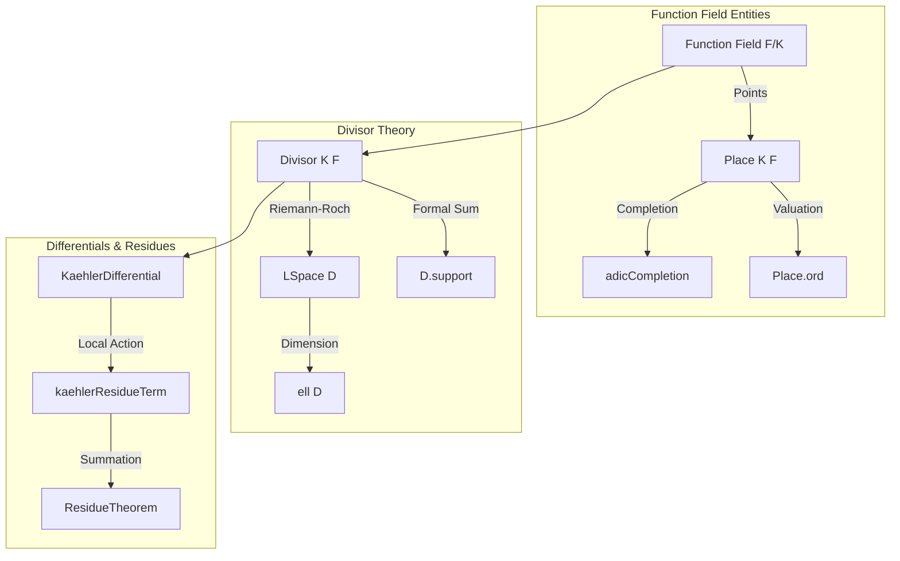
Sources: [P2M/Sol/S_AlgebraicCurve_residueTheoremK_of_isAlgClosed.lean:34-45](), [P2M/Sol/S_AlgebraicCurve_indexOfSpecialty_eq_of_genusReached.lean:12-14]()

---

### 2.1 Places, Valuations, and Completions
A `Place` in the function field $F/K$ corresponds to a discrete valuation ring (DVR). The codebase defines `Place.ord` as the valuation associated with a place [P2M/Sol/S_AlgebraicCurve_residueTheoremK_of_isAlgClosed.lean:35](). For extensions of function fields $E/F$, the theory handles the `ramificationIndex` and `inertiaDeg` [P2M/Sol/S_AlgebraicCurve_Place_sum_ramificationIndex_mul_inertiaDeg_fiberOver.lean:21](), proving the fundamental identity $\sum e_i f_i = [E:F]$ in `Place.sum_ramificationIndex_mul_inertiaDeg` [P2M/Sol/S_AlgebraicCurve_Place_sum_ramificationIndex_mul_inertiaDeg.lean]().

For details, see [Places, Valuations, and Completions](#2.1).

### 2.2 Divisors, Riemann-Roch, and Genus
`Divisor K F` is implemented as a formal sum of places with integer coefficients [P2M/Sol/S_AlgebraicCurve_residueTheoremK_of_isAlgClosed.lean:35](). The Riemann-Roch space `LSpace D` consists of functions whose valuations are bounded by $D$ [P2M/Sol/S_AlgebraicCurve_indexOfSpecialty_eq_of_genusReached.lean:13](). The `RiemannGenusReached` predicate and `StichtenothGenusExists` construction establish the existence of the genus $g$ such that $\ell(D) = \deg(D) + 1 - g$ for sufficiently large $\deg(D)$ [P2M/Sol/S_AlgebraicCurve_indexOfSpecialty_eq_of_genusReached.lean:13]().

For details, see [Divisors, Riemann-Roch, and Genus](#2.2).

### 2.3 Kähler Differentials and the Residue Theorem
The theory of differentials is centered around `KaehlerDifferential` and the `kaehlerResidueTerm` [P2M/Sol/S_AlgebraicCurve_residueTheoremK_of_isAlgClosed.lean:35](). A central result is the `ResidueTheorem`, which states that the sum of residues of a differential across all places is zero [P2M/Sol/S_AlgebraicCurve_residueTheorem_of_residueTheorem_ratFunc_of_residueTraceCompletionCommute.lean:34](). This is proved by reducing to the rational function field case `residueTheoremK_ratFunc_of_isAlgClosed` [P2M/Sol/S_AlgebraicCurve_residueTheoremK_of_isAlgClosed.lean:35]() and using trace-compatibility results like `residueTraceCompletionCommute` [P2M/Sol/S_AlgebraicCurve_residueTheoremK_of_isAlgClosed.lean:35]().

For details, see [Kähler Differentials and the Residue Theorem](#2.3).

### 2.4 Jacobians, Pic⁰, and the Abel-Jacobi Map
The Jacobian of a curve is represented by `Pic0`, the group of divisors of degree zero modulo principal divisors [P2M/Sol/S_AlgebraicCurve_residueTheoremK_of_isAlgClosed.lean:35](). The codebase includes structures for the `AbelJacobiMap` and uniformization of Jacobians, particularly in the context of modular curves and their semistable models.

For details, see [Jacobians, Pic⁰, and the Abel-Jacobi Map](#2.4).

### 2.5 Curve Models and Integral Structures
To study curves over non-algebraically closed fields or rings (like $\mathbb{Z}_p$), the codebase utilizes `CurveModel` and `TwoChartIntegralModel` [Definitions.Def_AlgebraicCurve_IsCurveOver](). This includes the study of `node rings` and `ordinary double points` occurring in the reduction of modular curves.

For details, see [Curve Models and Integral Structures](#2.5).

---

### Function Field Arithmetic Relationships

The following table summarizes the key numerical invariants and their relationships as defined in the codebase.

| Entity | Code Symbol | Definition / Property |
| :--- | :--- | :--- |
| **Valuation** | `Place.ord` | Integer valuation at a place [P2M/Sol/S_AlgebraicCurve_residueTheoremK_of_isAlgClosed.lean:35]() |
| **Dimension** | `ell D` | $\dim_K L(D)$ [P2M/Sol/S_AlgebraicCurve_indexOfSpecialty_eq_of_genusReached.lean:13]() |
| **Genus** | `RiemannGenusReached` | The $g$ in Riemann-Roch [P2M/Sol/S_AlgebraicCurve_indexOfSpecialty_eq_of_genusReached.lean:13]() |
| **Specialty** | `indexOfSpecialty` | $i(D) = \ell(K-D)$ [P2M/Sol/S_AlgebraicCurve_indexOfSpecialty_eq_of_genusReached.lean:13]() |
| **Residue** | `kaehlerResidueTerm` | Local residue of a differential [P2M/Sol/S_AlgebraicCurve_residueTheoremK_of_isAlgClosed.lean:35]() |

**Trace and Norm Interaction**
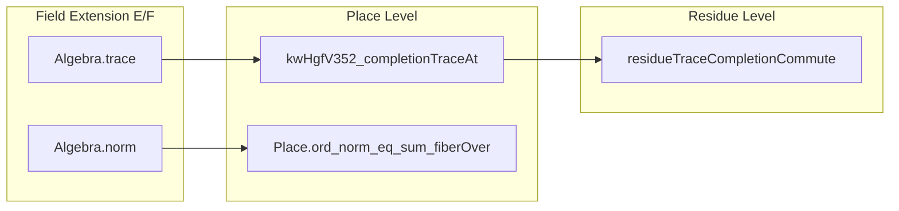
Sources: [P2M/Sol/S_AlgebraicCurve_residueTheoremK_of_isAlgClosed.lean:35](), [P2M/Sol/S_AlgebraicCurve_tateTraceCompat_of_isSeparable.lean:35](), [P2M/Sol/S_AlgebraicCurve_Place_ord_norm_eq_sum_fiberOver.lean]()

---

# Page: Places, Valuations, and Completions

# Places, Valuations, and Completions

<details>
<summary>Relevant source files</summary>

The following files were used as context for generating this wiki page:

- [Definitions/Def_AdicCompletionLocalRing.lean](Definitions/Def_AdicCompletionLocalRing.lean)
- [Definitions/Def_AlgebraicCurve_DivisorPushPull.lean](Definitions/Def_AlgebraicCurve_DivisorPushPull.lean)
- [Definitions/Def_ModularCurve_CharLFrobeniusGeomLevel.lean](Definitions/Def_ModularCurve_CharLFrobeniusGeomLevel.lean)
- [Definitions/Def_ModularCurve_KwNo6HspecCartierDlogCampaignFrame.lean](Definitions/Def_ModularCurve_KwNo6HspecCartierDlogCampaignFrame.lean)
- [Definitions/Def_PolynomialCompletion.lean](Definitions/Def_PolynomialCompletion.lean)
- [P2M/Sol/S_AdicCompletion_exists_moduleFinite_etale_adicCompletion_tensorProduct_of_flat_of_map_maximalIdeal_eq.lean](P2M/Sol/S_AdicCompletion_exists_moduleFinite_etale_adicCompletion_tensorProduct_of_flat_of_map_maximalIdeal_eq.lean)
- [P2M/Sol/S_AdicCompletion_exists_ringEquiv_mvPowerSeries_quotient_map_of_tensorProduct_of_flat.lean](P2M/Sol/S_AdicCompletion_exists_ringEquiv_mvPowerSeries_quotient_map_of_tensorProduct_of_flat.lean)
- [P2M/Sol/S_AdicCompletion_exists_ringEquiv_of_forall_quotient_mk_comp_surjective_of_forall_ker_eq_pow.lean](P2M/Sol/S_AdicCompletion_exists_ringEquiv_of_forall_quotient_mk_comp_surjective_of_forall_ker_eq_pow.lean)
- [P2M/Sol/S_AdicCompletion_isDomain_and_isIntegrallyClosed_of_isInvariant_of_isLocalization_atPrime_of_tame.lean](P2M/Sol/S_AdicCompletion_isDomain_and_isIntegrallyClosed_of_isInvariant_of_isLocalization_atPrime_of_tame.lean)
- [P2M/Sol/S_AdicCompletion_isField_localization_atPrime_of_not_isMaximal_of_isSeparable.lean](P2M/Sol/S_AdicCompletion_isField_localization_atPrime_of_not_isMaximal_of_isSeparable.lean)
- [P2M/Sol/S_AdicCompletion_isReduced_and_isSeparable_genericFibre_of_isInvariant.lean](P2M/Sol/S_AdicCompletion_isReduced_and_isSeparable_genericFibre_of_isInvariant.lean)
- [P2M/Sol/S_AdicCompletion_isRegularLocalRing_localization_atPrime_of_mem_of_not_isMaximal_of_tame.lean](P2M/Sol/S_AdicCompletion_isRegularLocalRing_localization_atPrime_of_mem_of_not_isMaximal_of_tame.lean)
- [P2M/Sol/S_AdicCompletion_nonempty_ringEquiv_adicCompletion_tensorProduct_of_flat_of_map_maximalIdeal_eq_of_card_eq.lean](P2M/Sol/S_AdicCompletion_nonempty_ringEquiv_adicCompletion_tensorProduct_of_flat_of_map_maximalIdeal_eq_of_card_eq.lean)
- [P2M/Sol/S_AdjoinRoot_exists_isLocalRing_etale_residueField_algEquiv_of_isAdicComplete.lean](P2M/Sol/S_AdjoinRoot_exists_isLocalRing_etale_residueField_algEquiv_of_isAdicComplete.lean)
- [P2M/Sol/S_AdjoinRoot_exists_isLocalRing_faithfullyFlat_residueField_algEquiv_of_irreducible_map.lean](P2M/Sol/S_AdjoinRoot_exists_isLocalRing_faithfullyFlat_residueField_algEquiv_of_irreducible_map.lean)
- [P2M/Sol/S_Algebra_Etale_nonempty_algEquiv_of_isLocalRing_of_finite_residueField_of_card_eq.lean](P2M/Sol/S_Algebra_Etale_nonempty_algEquiv_of_isLocalRing_of_finite_residueField_of_card_eq.lean)
- [P2M/Sol/S_Algebra_Etale_of_formallyUnramified_residueField_baseChange.lean](P2M/Sol/S_Algebra_Etale_of_formallyUnramified_residueField_baseChange.lean)
- [P2M/Sol/S_Algebra_FormallyUnramified_of_residueField_baseChange_of_finite.lean](P2M/Sol/S_Algebra_FormallyUnramified_of_residueField_baseChange_of_finite.lean)
- [P2M/Sol/S_Algebra_etale_of_moduleFinite_of_flat_of_forall_isUnramifiedAt.lean](P2M/Sol/S_Algebra_etale_of_moduleFinite_of_flat_of_forall_isUnramifiedAt.lean)
- [P2M/Sol/S_Algebra_finitePresentation_of_finite_of_flat_of_isLocalRing.lean](P2M/Sol/S_Algebra_finitePresentation_of_finite_of_flat_of_isLocalRing.lean)
- [P2M/Sol/S_AlgebraicCurve_Annulus_sum_eq_ord_add_ord_and_prod_valuation_evalAt_zpow_eq_of_regularProlongation.lean](P2M/Sol/S_AlgebraicCurve_Annulus_sum_eq_ord_add_ord_and_prod_valuation_evalAt_zpow_eq_of_regularProlongation.lean)
- [P2M/Sol/S_AlgebraicCurve_ComponentChart_forall_tubeBounded_mem_integers_and_exists_mul_eq_of_not_mem_dom.lean](P2M/Sol/S_AlgebraicCurve_ComponentChart_forall_tubeBounded_mem_integers_and_exists_mul_eq_of_not_mem_dom.lean)
- [P2M/Sol/S_AlgebraicCurve_Differential_correspondence_mem_regularDifferentials.lean](P2M/Sol/S_AlgebraicCurve_Differential_correspondence_mem_regularDifferentials.lean)
- [P2M/Sol/S_AlgebraicCurve_Differential_sum_ord_smul_pullbackAlong_eq_zero.lean](P2M/Sol/S_AlgebraicCurve_Differential_sum_ord_smul_pullbackAlong_eq_zero.lean)
- [P2M/Sol/S_AlgebraicCurve_Divisor_isPrincipal_of_constantFieldExtension.lean](P2M/Sol/S_AlgebraicCurve_Divisor_isPrincipal_of_constantFieldExtension.lean)
- [P2M/Sol/S_AlgebraicCurve_Divisor_pushforwardNormFormula.lean](P2M/Sol/S_AlgebraicCurve_Divisor_pushforwardNormFormula.lean)
- [P2M/Sol/S_AlgebraicCurve_Divisor_pushforwardNormFormula_of_finiteDimensional.lean](P2M/Sol/S_AlgebraicCurve_Divisor_pushforwardNormFormula_of_finiteDimensional.lean)
- [P2M/Sol/S_AlgebraicCurve_Divisor_pushforwardNormFormula_of_isSeparable.lean](P2M/Sol/S_AlgebraicCurve_Divisor_pushforwardNormFormula_of_isSeparable.lean)
- [P2M/Sol/S_AlgebraicCurve_Place_eq_of_comap_toValuationSubring_eq_of_isRational.lean](P2M/Sol/S_AlgebraicCurve_Place_eq_of_comap_toValuationSubring_eq_of_isRational.lean)
- [P2M/Sol/S_AlgebraicCurve_Place_exists_comap_algebraMap_eq_of_constantFieldExtension.lean](P2M/Sol/S_AlgebraicCurve_Place_exists_comap_algebraMap_eq_of_constantFieldExtension.lean)
- [P2M/Sol/S_AlgebraicCurve_Place_exists_comap_algebraMap_eq_of_constantFieldExtension_of_deg_eq_one_of_isAlgebraic.lean](P2M/Sol/S_AlgebraicCurve_Place_exists_comap_algebraMap_eq_of_constantFieldExtension_of_deg_eq_one_of_isAlgebraic.lean)
- [P2M/Sol/S_AlgebraicCurve_Place_exists_comap_algebraMap_eq_of_constantFieldExtension_of_isAlgClosed.lean](P2M/Sol/S_AlgebraicCurve_Place_exists_comap_algebraMap_eq_of_constantFieldExtension_of_isAlgClosed.lean)
- [P2M/Sol/S_AlgebraicCurve_Place_exists_eq_smul_dCoord_and_uniformizer_pow_mul_mem_of_cartierLaws.lean](P2M/Sol/S_AlgebraicCurve_Place_exists_eq_smul_dCoord_and_uniformizer_pow_mul_mem_of_cartierLaws.lean)
- [P2M/Sol/S_AlgebraicCurve_Place_exists_natCast_dvd_ord_sub_single_sub_single.lean](P2M/Sol/S_AlgebraicCurve_Place_exists_natCast_dvd_ord_sub_single_sub_single.lean)
- [P2M/Sol/S_AlgebraicCurve_Place_exists_ord_algebraMap_eq_mul_ord.lean](P2M/Sol/S_AlgebraicCurve_Place_exists_ord_algebraMap_eq_mul_ord.lean)
- [P2M/Sol/S_AlgebraicCurve_Place_exists_toValuationSubring_eq_comap.lean](P2M/Sol/S_AlgebraicCurve_Place_exists_toValuationSubring_eq_comap.lean)
- [P2M/Sol/S_AlgebraicCurve_Place_finite_setOf_not_mem_toValuationSubring_or_evalAt_mem.lean](P2M/Sol/S_AlgebraicCurve_Place_finite_setOf_not_mem_toValuationSubring_or_evalAt_mem.lean)
- [P2M/Sol/S_AlgebraicCurve_Place_hasValue_iff_mem_and_eq_or_ord_sub_pos.lean](P2M/Sol/S_AlgebraicCurve_Place_hasValue_iff_mem_and_eq_or_ord_sub_pos.lean)
- [P2M/Sol/S_AlgebraicCurve_Place_inertiaDeg_eq_inertiaDeg_fiberCenter.lean](P2M/Sol/S_AlgebraicCurve_Place_inertiaDeg_eq_inertiaDeg_fiberCenter.lean)
- [P2M/Sol/S_AlgebraicCurve_Place_inertiaDeg_pos.lean](P2M/Sol/S_AlgebraicCurve_Place_inertiaDeg_pos.lean)
- [P2M/Sol/S_AlgebraicCurve_Place_isDedekindDomain_iInf_toSubring_and_isMaximal_iff_of_finset_nonempty.lean](P2M/Sol/S_AlgebraicCurve_Place_isDedekindDomain_iInf_toSubring_and_isMaximal_iff_of_finset_nonempty.lean)
- [P2M/Sol/S_AlgebraicCurve_Place_isRegularAt_and_hasSimplePoleAt_and_hasSimpleResidue_mul_pullbackAlong_restrictAlong.lean](P2M/Sol/S_AlgebraicCurve_Place_isRegularAt_and_hasSimplePoleAt_and_hasSimpleResidue_mul_pullbackAlong_restrictAlong.lean)
- [P2M/Sol/S_AlgebraicCurve_Place_isRegularAt_and_hasSimplePoleAt_and_hasSimpleResidue_of_cartierLaws_of_finiteDimensional.lean](P2M/Sol/S_AlgebraicCurve_Place_isRegularAt_and_hasSimplePoleAt_and_hasSimpleResidue_of_cartierLaws_of_finiteDimensional.lean)
- [P2M/Sol/S_AlgebraicCurve_Place_isRegularAt_and_hasSimplePoleAt_and_hasSimpleResidue_smul_pullbackAlong_of_algEquiv.lean](P2M/Sol/S_AlgebraicCurve_Place_isRegularAt_and_hasSimplePoleAt_and_hasSimpleResidue_smul_pullbackAlong_of_algEquiv.lean)
- [P2M/Sol/S_AlgebraicCurve_Place_neg_le_ord_trace_of_forall_le_ord_sub_pred.lean](P2M/Sol/S_AlgebraicCurve_Place_neg_le_ord_trace_of_forall_le_ord_sub_pred.lean)
- [P2M/Sol/S_AlgebraicCurve_Place_ordDifferential_D_eq_zero_of_constantFieldExtension_of_forall_mem.lean](P2M/Sol/S_AlgebraicCurve_Place_ordDifferential_D_eq_zero_of_constantFieldExtension_of_forall_mem.lean)
- [P2M/Sol/S_AlgebraicCurve_Place_ord_norm_eq_sum_fiberOver.lean](P2M/Sol/S_AlgebraicCurve_Place_ord_norm_eq_sum_fiberOver.lean)
- [P2M/Sol/S_AlgebraicCurve_Place_ord_norm_eq_sum_fiberOver_of_isSeparable.lean](P2M/Sol/S_AlgebraicCurve_Place_ord_norm_eq_sum_fiberOver_of_isSeparable.lean)
- [P2M/Sol/S_AlgebraicCurve_Place_ramificationIndexAlong_eq_one_of_ord_eval_derivative_eq_zero.lean](P2M/Sol/S_AlgebraicCurve_Place_ramificationIndexAlong_eq_one_of_ord_eval_derivative_eq_zero.lean)
- [P2M/Sol/S_AlgebraicCurve_Place_ramificationIndex_eq_div_gcd_natAbs_ord_of_isSplittingField_X_pow_sub_C.lean](P2M/Sol/S_AlgebraicCurve_Place_ramificationIndex_eq_div_gcd_natAbs_ord_of_isSplittingField_X_pow_sub_C.lean)
- [P2M/Sol/S_AlgebraicCurve_Place_ramificationIndex_eq_one_of_forall_dvd_ord.lean](P2M/Sol/S_AlgebraicCurve_Place_ramificationIndex_eq_one_of_forall_dvd_ord.lean)
- [P2M/Sol/S_AlgebraicCurve_Place_ramificationIndex_eq_one_of_forall_dvd_ord_of_isSeparable.lean](P2M/Sol/S_AlgebraicCurve_Place_ramificationIndex_eq_one_of_forall_dvd_ord_of_isSeparable.lean)
- [P2M/Sol/S_AlgebraicCurve_Place_ramificationIndex_eq_ramificationIdx_fiberCenter.lean](P2M/Sol/S_AlgebraicCurve_Place_ramificationIndex_eq_ramificationIdx_fiberCenter.lean)
- [P2M/Sol/S_AlgebraicCurve_Place_sum_ramificationIndex_mul_inertiaDeg.lean](P2M/Sol/S_AlgebraicCurve_Place_sum_ramificationIndex_mul_inertiaDeg.lean)
- [P2M/Sol/S_AlgebraicCurve_Place_sum_ramificationIndex_mul_inertiaDeg_fiberOver.lean](P2M/Sol/S_AlgebraicCurve_Place_sum_ramificationIndex_mul_inertiaDeg_fiberOver.lean)
- [P2M/Sol/S_AlgebraicCurve_Place_sum_ramificationIndex_mul_inertiaDeg_le_finrank.lean](P2M/Sol/S_AlgebraicCurve_Place_sum_ramificationIndex_mul_inertiaDeg_le_finrank.lean)
- [P2M/Sol/S_AlgebraicCurve_Place_transcendental_of_ord_ne_zero.lean](P2M/Sol/S_AlgebraicCurve_Place_transcendental_of_ord_ne_zero.lean)
- [P2M/Sol/S_AlgebraicCurve_RationalFunctionField_algebraMap_polynomial_mem_of_ne_placeInfty.lean](P2M/Sol/S_AlgebraicCurve_RationalFunctionField_algebraMap_polynomial_mem_of_ne_placeInfty.lean)
- [P2M/Sol/S_AlgebraicCurve_RationalFunctionField_finiteDimensional_lSpace_zero_of_constantsAreBase.lean](P2M/Sol/S_AlgebraicCurve_RationalFunctionField_finiteDimensional_lSpace_zero_of_constantsAreBase.lean)
- [P2M/Sol/S_AlgebraicCurve_RationalFunctionField_indexOfSpecialtyFinite_of_ratFunc_tower.lean](P2M/Sol/S_AlgebraicCurve_RationalFunctionField_indexOfSpecialtyFinite_of_ratFunc_tower.lean)
- [P2M/Sol/S_AlgebraicCurve_RationalFunctionField_ord_X_nonneg_of_ne_placeInfty.lean](P2M/Sol/S_AlgebraicCurve_RationalFunctionField_ord_X_nonneg_of_ne_placeInfty.lean)
- [P2M/Sol/S_AlgebraicCurve_RationalFunctionField_ord_placeInfty_X.lean](P2M/Sol/S_AlgebraicCurve_RationalFunctionField_ord_placeInfty_X.lean)
- [P2M/Sol/S_AlgebraicCurve_RationalFunctionField_stichtenothGenusExists.lean](P2M/Sol/S_AlgebraicCurve_RationalFunctionField_stichtenothGenusExists.lean)
- [P2M/Sol/S_AlgebraicCurve_RationalFunctionField_stichtenothGenusExists_of_ratFunc_tower.lean](P2M/Sol/S_AlgebraicCurve_RationalFunctionField_stichtenothGenusExists_of_ratFunc_tower.lean)
- [P2M/Sol/S_AlgebraicCurve_RationalFunctionField_trace_localResidue_finitePlace_add_trace_localResidue_placeInfty_eq_zero.lean](P2M/Sol/S_AlgebraicCurve_RationalFunctionField_trace_localResidue_finitePlace_add_trace_localResidue_placeInfty_eq_zero.lean)
- [P2M/Sol/S_AlgebraicCurve_RationalFunctionField_trace_localResidue_finitePlace_div_pow_eq_zero.lean](P2M/Sol/S_AlgebraicCurve_RationalFunctionField_trace_localResidue_finitePlace_div_pow_eq_zero.lean)
- [P2M/Sol/S_AlgebraicCurve_RationalFunctionField_trace_localResidue_placeInfty_X_pow_eq_zero.lean](P2M/Sol/S_AlgebraicCurve_RationalFunctionField_trace_localResidue_placeInfty_X_pow_eq_zero.lean)
- [P2M/Sol/S_AlgebraicCurve_completionTraceSum_of_isSeparable.lean](P2M/Sol/S_AlgebraicCurve_completionTraceSum_of_isSeparable.lean)
- [P2M/Sol/S_AlgebraicCurve_constantsAreBase_of_apply_algebraMap_eq_pow_card.lean](P2M/Sol/S_AlgebraicCurve_constantsAreBase_of_apply_algebraMap_eq_pow_card.lean)
- [P2M/Sol/S_AlgebraicCurve_constantsAreBase_of_exists_isRational.lean](P2M/Sol/S_AlgebraicCurve_constantsAreBase_of_exists_isRational.lean)
- [P2M/Sol/S_AlgebraicCurve_eval_one_eq_natCard_pic0_of_natCard_fixedPoints_restrictAlong_eq.lean](P2M/Sol/S_AlgebraicCurve_eval_one_eq_natCard_pic0_of_natCard_fixedPoints_restrictAlong_eq.lean)
- [P2M/Sol/S_AlgebraicCurve_exists_derivation_constantFieldExtension_map_mem.lean](P2M/Sol/S_AlgebraicCurve_exists_derivation_constantFieldExtension_map_mem.lean)
- [P2M/Sol/S_AlgebraicCurve_exists_monic_natCard_fixedPoints_restrictAlong_eq_of_constantFieldExtension.lean](P2M/Sol/S_AlgebraicCurve_exists_monic_natCard_fixedPoints_restrictAlong_eq_of_constantFieldExtension.lean)
- [P2M/Sol/S_AlgebraicCurve_exists_trace_mul_eq_aeval_of_forall_exists_smul_D_eq_smul_dCoord.lean](P2M/Sol/S_AlgebraicCurve_exists_trace_mul_eq_aeval_of_forall_exists_smul_D_eq_smul_dCoord.lean)
- [P2M/Sol/S_AlgebraicCurve_fibreResidueIdentityAlong_of_separableAlong_of_dCoordGenerates.lean](P2M/Sol/S_AlgebraicCurve_fibreResidueIdentityAlong_of_separableAlong_of_dCoordGenerates.lean)
- [P2M/Sol/S_AlgebraicCurve_finite_fixedPoints_restrictAlong_iterate_and_natCard_eq_sum_divisors.lean](P2M/Sol/S_AlgebraicCurve_finite_fixedPoints_restrictAlong_iterate_and_natCard_eq_sum_divisors.lean)
- [P2M/Sol/S_AlgebraicCurve_genusFF_eq_of_constantFieldExtension_of_finite_of_isAlgClosed.lean](P2M/Sol/S_AlgebraicCurve_genusFF_eq_of_constantFieldExtension_of_finite_of_isAlgClosed.lean)
- [P2M/Sol/S_AlgebraicCurve_genus_eq_of_constantFieldExtension_of_isAlgClosed.lean](P2M/Sol/S_AlgebraicCurve_genus_eq_of_constantFieldExtension_of_isAlgClosed.lean)
- [P2M/Sol/S_AlgebraicCurve_genus_ratFunc_eq_zero_of_perfectField.lean](P2M/Sol/S_AlgebraicCurve_genus_ratFunc_eq_zero_of_perfectField.lean)
- [P2M/Sol/S_AlgebraicCurve_hasPrincipalDivisors_of_finiteDimensional_ratFunc.lean](P2M/Sol/S_AlgebraicCurve_hasPrincipalDivisors_of_finiteDimensional_ratFunc.lean)
- [P2M/Sol/S_AlgebraicCurve_hasPrincipalDivisors_of_finiteDimensional_ratFunc_of_isSeparable.lean](P2M/Sol/S_AlgebraicCurve_hasPrincipalDivisors_of_finiteDimensional_ratFunc_of_isSeparable.lean)
- [P2M/Sol/S_AlgebraicCurve_hasPrincipalDivisors_of_transcendental.lean](P2M/Sol/S_AlgebraicCurve_hasPrincipalDivisors_of_transcendental.lean)
- [P2M/Sol/S_AlgebraicCurve_instHasCanonicalDivisorRatFuncPerfectField.lean](P2M/Sol/S_AlgebraicCurve_instHasCanonicalDivisorRatFuncPerfectField.lean)
- [P2M/Sol/S_AlgebraicCurve_isCurveOver_ratFunc.lean](P2M/Sol/S_AlgebraicCurve_isCurveOver_ratFunc.lean)
- [P2M/Sol/S_AlgebraicCurve_linearIndependent_pow_of_transcendental.lean](P2M/Sol/S_AlgebraicCurve_linearIndependent_pow_of_transcendental.lean)
- [P2M/Sol/S_AlgebraicCurve_mem_span_range_algebraMap_of_constantFieldExtension.lean](P2M/Sol/S_AlgebraicCurve_mem_span_range_algebraMap_of_constantFieldExtension.lean)
- [P2M/Sol/S_AlgebraicCurve_residueTheoremK_of_isAlgClosed.lean](P2M/Sol/S_AlgebraicCurve_residueTheoremK_of_isAlgClosed.lean)
- [P2M/Sol/S_AlgebraicCurve_residueTheoremK_ratFunc_of_isAlgClosed.lean](P2M/Sol/S_AlgebraicCurve_residueTheoremK_ratFunc_of_isAlgClosed.lean)
- [P2M/Sol/S_AlgebraicCurve_residueTheorem_of_residueTheorem_ratFunc_of_residueTraceCompletionCommute.lean](P2M/Sol/S_AlgebraicCurve_residueTheorem_of_residueTheorem_ratFunc_of_residueTraceCompletionCommute.lean)
- [P2M/Sol/S_AlgebraicCurve_residueTheorem_ratFunc_of_perfectField.lean](P2M/Sol/S_AlgebraicCurve_residueTheorem_ratFunc_of_perfectField.lean)
- [P2M/Sol/S_AlgebraicCurve_tateCommFinite.lean](P2M/Sol/S_AlgebraicCurve_tateCommFinite.lean)
- [P2M/Sol/S_AlgebraicCurve_tateTraceCompat_of_isSeparable.lean](P2M/Sol/S_AlgebraicCurve_tateTraceCompat_of_isSeparable.lean)
- [P2M/Sol/S_FiniteField_nonempty_algEquiv_of_card_eq.lean](P2M/Sol/S_FiniteField_nonempty_algEquiv_of_card_eq.lean)
- [P2M/Sol/S_Ideal_IsMaximal_exists_adicCompletion_localization_ringEquiv.lean](P2M/Sol/S_Ideal_IsMaximal_exists_adicCompletion_localization_ringEquiv.lean)
- [P2M/Sol/S_Ideal_exists_ringEquiv_adicCompletion_quotient_of_mem_minimalPrimes_of_isDomain_adicCompletion.lean](P2M/Sol/S_Ideal_exists_ringEquiv_adicCompletion_quotient_of_mem_minimalPrimes_of_isDomain_adicCompletion.lean)
- [P2M/Sol/S_IsLocalRing_etale_adicCompletion_tensorProduct_of_finite_of_finrank_eq_finrank_residueField.lean](P2M/Sol/S_IsLocalRing_etale_adicCompletion_tensorProduct_of_finite_of_finrank_eq_finrank_residueField.lean)
- [P2M/Sol/S_IsLocalRing_etale_of_finite_of_finrank_eq_finrank_residueField.lean](P2M/Sol/S_IsLocalRing_etale_of_finite_of_finrank_eq_finrank_residueField.lean)
- [P2M/Sol/S_IsLocalRing_etale_of_finite_of_finrank_eq_finrank_residueField_of_isAdicComplete.lean](P2M/Sol/S_IsLocalRing_etale_of_finite_of_finrank_eq_finrank_residueField_of_isAdicComplete.lean)
- [P2M/Sol/S_IsLocalRing_exists_adicCompletion_ringHom_finite_of_moduleFinite.lean](P2M/Sol/S_IsLocalRing_exists_adicCompletion_ringHom_finite_of_moduleFinite.lean)
- [P2M/Sol/S_IsLocalRing_exists_isLocalRing_adicCompletion_isAdicComplete_map_maximalIdeal_eq.lean](P2M/Sol/S_IsLocalRing_exists_isLocalRing_adicCompletion_isAdicComplete_map_maximalIdeal_eq.lean)
- [P2M/Sol/S_IsLocalRing_exists_isLocalRing_adicCompletion_tensorProduct_residueField_equiv.lean](P2M/Sol/S_IsLocalRing_exists_isLocalRing_adicCompletion_tensorProduct_residueField_equiv.lean)
- [P2M/Sol/S_IsLocalRing_exists_isLocalRing_etale_free_residueField_algEquiv.lean](P2M/Sol/S_IsLocalRing_exists_isLocalRing_etale_free_residueField_algEquiv.lean)
- [P2M/Sol/S_IsLocalRing_exists_ringEquiv_adicCompletion_maximalIdeal_comp_algebraMap_of_ringEquiv.lean](P2M/Sol/S_IsLocalRing_exists_ringEquiv_adicCompletion_maximalIdeal_comp_algebraMap_of_ringEquiv.lean)
- [P2M/Sol/S_IsLocalRing_exists_ringHom_ringEquiv_adicCompletion_uvCrossingModel_of_ringEquiv.lean](P2M/Sol/S_IsLocalRing_exists_ringHom_ringEquiv_adicCompletion_uvCrossingModel_of_ringEquiv.lean)
- [P2M/Sol/S_IsLocalRing_hensel_lift_unique.lean](P2M/Sol/S_IsLocalRing_hensel_lift_unique.lean)
- [P2M/Sol/S_IsLocalization_AtPrime_exists_ringEquiv_adicCompletion_maximalIdeal.lean](P2M/Sol/S_IsLocalization_AtPrime_exists_ringEquiv_adicCompletion_maximalIdeal.lean)
- [P2M/Sol/S_IsRegularLocalRing_exists_algEquiv_tensorProduct_isGalois_isCyclic_of_etale_of_isUnramifiedAt_of_forall_sub_mem.lean](P2M/Sol/S_IsRegularLocalRing_exists_algEquiv_tensorProduct_isGalois_isCyclic_of_etale_of_isUnramifiedAt_of_forall_sub_mem.lean)
- [P2M/Sol/S_IsRegularLocalRing_exists_ringEquiv_adicCompletion_of_isInvariant_of_card_inertia_eq_of_isUnramifiedAt_off.lean](P2M/Sol/S_IsRegularLocalRing_exists_ringEquiv_adicCompletion_of_isInvariant_of_card_inertia_eq_of_isUnramifiedAt_off.lean)
- [P2M/Sol/S_IsRegularLocalRing_exists_ringEquiv_adicCompletion_of_isInvariant_of_isLocalization_atPrime_of_isUnramifiedAt_off.lean](P2M/Sol/S_IsRegularLocalRing_exists_ringEquiv_adicCompletion_of_isInvariant_of_isLocalization_atPrime_of_isUnramifiedAt_off.lean)
- [P2M/Sol/S_IsRegularLocalRing_of_isUnramifiedAt_of_flat_of_maximalIdeal_eq_span_pair.lean](P2M/Sol/S_IsRegularLocalRing_of_isUnramifiedAt_of_flat_of_maximalIdeal_eq_span_pair.lean)
- [P2M/Sol/S_KummerTheory_algEquiv_eq_one_of_forall_apply_eq_of_isSplittingField.lean](P2M/Sol/S_KummerTheory_algEquiv_eq_one_of_forall_apply_eq_of_isSplittingField.lean)
- [P2M/Sol/S_KummerTheory_isGalois_and_commute_and_pow_eq_one_of_isSplittingField_prod_X_pow_sub_C.lean](P2M/Sol/S_KummerTheory_isGalois_and_commute_and_pow_eq_one_of_isSplittingField_prod_X_pow_sub_C.lean)

</details>


This section covers the theory of places in algebraic function fields, their associated valuations, and the construction of adic completions. It establishes the local-to-global foundation required for the residue theorem and the study of modular curve models.

## The Place Typeclass

In this codebase, a `Place` of a function field $K$ is represented as a discrete valuation ring (DVR) contained within $K$. The `Place` typeclass provides the interface for evaluating the order of vanishing of functions and defining local parameters (uniformizers).

### Key Definitions and Structures

| Entity | Description | Citation |
| :--- | :--- | :--- |
| `Place` | The type of places of an algebraic curve/function field. | [P2M/Sol/S_AlgebraicCurve_residueTheoremK_of_isAlgClosed.lean:35-35]() |
| `Place.ord` | The discrete valuation $v_P: K \to \mathbb{Z} \cup \{\infty\}$. | [P2M/Sol/S_AlgebraicCurve_residueTheoremK_of_isAlgClosed.lean:35-35]() |
| `Place.uniformizer` | A local parameter $\pi$ such that $v_P(\pi) = 1$. | [P2M/Sol/S_AlgebraicCurve_tateTraceCompat_of_isSeparable.lean:35-35]() |
| `Place.FiniteResidue` | The residue field $\kappa(P) = \mathcal{O}_P / \mathfrak{m}_P$. | [P2M/Sol/S_AlgebraicCurve_residueTheoremK_of_isAlgClosed.lean:35-35]() |
| `Place.deg` | The degree of the place, defined as $[\kappa(P) : k]$. | [P2M/Sol/S_AlgebraicCurve_residueTheoremK_of_isAlgClosed.lean:35-35]() |

### Code Entity Relationship: Local Properties
The following diagram illustrates how the `Place` structure links algebraic field elements to local valuations and residue fields.

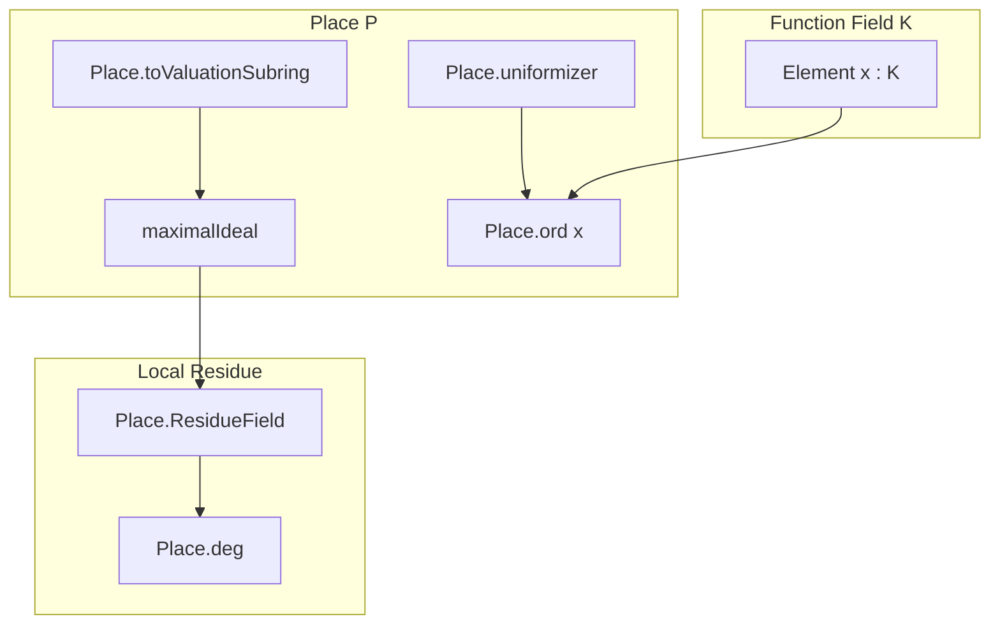
Sources: [P2M/Sol/S_AlgebraicCurve_residueTheoremK_of_isAlgClosed.lean:35-35](), [P2M/Sol/S_AlgebraicCurve_tateTraceCompat_of_isSeparable.lean:35-35](), [P2M/Sol/S_AlgebraicCurve_residueTheoremK_of_isAlgClosed.lean:27-27]()

## Adic Completions

For a place $P$, the completion $\hat{K}_P$ is constructed via the adic topology defined by the maximal ideal of the DVR. This is crucial for defining local residues and the Tate trace compatibility.

### Implementation Details
*   **Completion Construction**: The completion is handled by the `AdicCompletion` type, which takes an ideal $I$ (typically the maximal ideal of a place) and a ring $R$. [P2M/Sol/S_AdicCompletion_exists_ringEquiv_mvPowerSeries_quotient_map_of_tensorProduct_of_flat.lean:24-25]()
*   **Valuation Extension**: The valuation $v_P$ extends to the completion $\hat{K}_P$, and the completion of the valuation ring $\hat{\mathcal{O}}_P$ is a DVR. [P2M/Sol/S_AlgebraicCurve_tateTraceCompat_of_isSeparable.lean:35-35]()
*   **Trace Compatibility**: For a finite separable extension $L/K$, the trace $\text{Tr}_{L/K}$ is compatible with the sum of local traces across all places $Q$ lying over $P$. [P2M/Sol/S_AlgebraicCurve_tateTraceCompat_of_isSeparable.lean:85-85]()

### Code Flow: Completion and Lift
The following diagram depicts the process of lifting ring homomorphisms to adic completions, which is a frequent operation in the deformation theory sections.

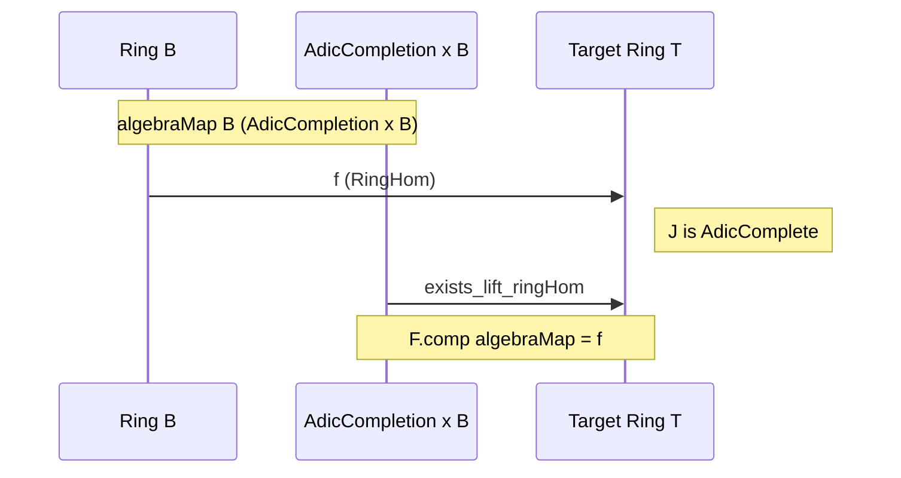
Sources: [P2M/Sol/S_AdicCompletion_exists_moduleFinite_etale_adicCompletion_tensorProduct_of_flat_of_map_maximalIdeal_eq.lean:55-57](), [P2M/Sol/S_AdicCompletion_exists_ringEquiv_mvPowerSeries_quotient_map_of_tensorProduct_of_flat.lean:70-72]()

## Ramification and the Fundamental Identity

The relationship between places in a field extension $L/K$ is governed by the ramification index $e(Q|P)$ and the inertia degree $f(Q|P)$.

### The Identity $\sum e_i f_i = n$
For a finite extension of function fields of degree $n$, the sum of the products of ramification indices and inertia degrees over all places $Q$ above $P$ equals $n$.

*   **Ramification Index**: `Place.ramificationIndex` is defined as the valuation of the uniformizer of the base field in the extension. [P2M/Sol/S_AlgebraicCurve_tateTraceCompat_of_isSeparable.lean:35-35]()
*   **Inertia Degree**: Defined via the dimension of the residue field extension. [P2M/Sol/S_AlgebraicCurve_RationalFunctionField_stichtenothGenusExists.lean:27-27]()
*   **Fundamental Identity**: Proved in `Place.sum_ramificationIndex_mul_inertiaDeg`. [P2M/Sol/S_AlgebraicCurve_RationalFunctionField_stichtenothGenusExists.lean:27-27]()

## Rational Function Field Places

The classification of places in the rational function field $k(X)$ is a base case for many theorems.

1.  **Finite Places**: Correspond to irreducible polynomials $p(X) \in k[X]$. These are constructed via `Place.ofHeightOneSpectrum`. [P2M/Sol/S_AlgebraicCurve_residueTheoremK_of_isAlgClosed.lean:35-35]()
2.  **Place at Infinity**: The place $P_\infty$ where $v_\infty(f/g) = \deg(g) - \deg(f)$.
    *   **Definition**: `RationalFunctionField.placeInfty`. [P2M/Sol/S_AlgebraicCurve_RationalFunctionField_trace_localResidue_placeInfty_X_pow_eq_zero.lean:58-58]()
    *   **Valuation of X**: $v_\infty(X) = -1$. [P2M/Sol/S_AlgebraicCurve_RationalFunctionField_ord_placeInfty_X.lean:27-27]()

### Summary of Rational Function Field Theorems
| Theorem | Description | Citation |
| :--- | :--- | :--- |
| `eq_ofHeightOneSpectrum_or_eq_placeInfty` | Classification of all places in $k(X)$. | [P2M/Sol/S_AlgebraicCurve_RationalFunctionField_stichtenothGenusExists.lean:14-14]() |
| `deg_placeInfty` | The degree of the place at infinity is 1. | [P2M/Sol/S_AlgebraicCurve_RationalFunctionField_stichtenothGenusExists.lean:12-12]() |
| `ord_placeInfty` | Calculates $v_\infty$ for any rational function. | [P2M/Sol/S_AlgebraicCurve_RationalFunctionField_stichtenothGenusExists.lean:11-11]() |

Sources: [P2M/Sol/S_AlgebraicCurve_RationalFunctionField_stichtenothGenusExists.lean:11-14](), [P2M/Sol/S_AlgebraicCurve_RationalFunctionField_ord_placeInfty_X.lean:27-27]()

---

# Page: Divisors, Riemann-Roch, and Genus

# Divisors, Riemann-Roch, and Genus

<details>
<summary>Relevant source files</summary>

The following files were used as context for generating this wiki page:

- [P2M/Sol/S_AlgebraicCurve_Differential_correspondence_mem_regularDifferentials.lean](P2M/Sol/S_AlgebraicCurve_Differential_correspondence_mem_regularDifferentials.lean)
- [P2M/Sol/S_AlgebraicCurve_Divisor_pushforwardNormFormula.lean](P2M/Sol/S_AlgebraicCurve_Divisor_pushforwardNormFormula.lean)
- [P2M/Sol/S_AlgebraicCurve_Divisor_pushforwardNormFormula_of_finiteDimensional.lean](P2M/Sol/S_AlgebraicCurve_Divisor_pushforwardNormFormula_of_finiteDimensional.lean)
- [P2M/Sol/S_AlgebraicCurve_Divisor_pushforwardNormFormula_of_isSeparable.lean](P2M/Sol/S_AlgebraicCurve_Divisor_pushforwardNormFormula_of_isSeparable.lean)
- [P2M/Sol/S_AlgebraicCurve_Place_exists_toValuationSubring_eq_comap.lean](P2M/Sol/S_AlgebraicCurve_Place_exists_toValuationSubring_eq_comap.lean)
- [P2M/Sol/S_AlgebraicCurve_Place_inertiaDeg_eq_inertiaDeg_fiberCenter.lean](P2M/Sol/S_AlgebraicCurve_Place_inertiaDeg_eq_inertiaDeg_fiberCenter.lean)
- [P2M/Sol/S_AlgebraicCurve_Place_inertiaDeg_pos.lean](P2M/Sol/S_AlgebraicCurve_Place_inertiaDeg_pos.lean)
- [P2M/Sol/S_AlgebraicCurve_Place_mk_mem_maximalIdeal_iff.lean](P2M/Sol/S_AlgebraicCurve_Place_mk_mem_maximalIdeal_iff.lean)
- [P2M/Sol/S_AlgebraicCurve_Place_neg_le_ord_trace_of_forall_le_ord_sub_pred.lean](P2M/Sol/S_AlgebraicCurve_Place_neg_le_ord_trace_of_forall_le_ord_sub_pred.lean)
- [P2M/Sol/S_AlgebraicCurve_Place_ord_norm_eq_sum_fiberOver.lean](P2M/Sol/S_AlgebraicCurve_Place_ord_norm_eq_sum_fiberOver.lean)
- [P2M/Sol/S_AlgebraicCurve_Place_ord_norm_eq_sum_fiberOver_of_isSeparable.lean](P2M/Sol/S_AlgebraicCurve_Place_ord_norm_eq_sum_fiberOver_of_isSeparable.lean)
- [P2M/Sol/S_AlgebraicCurve_Place_ramificationIndex_eq_ramificationIdx_fiberCenter.lean](P2M/Sol/S_AlgebraicCurve_Place_ramificationIndex_eq_ramificationIdx_fiberCenter.lean)
- [P2M/Sol/S_AlgebraicCurve_Place_sum_ramificationIndex_mul_inertiaDeg.lean](P2M/Sol/S_AlgebraicCurve_Place_sum_ramificationIndex_mul_inertiaDeg.lean)
- [P2M/Sol/S_AlgebraicCurve_Place_sum_ramificationIndex_mul_inertiaDeg_fiberOver.lean](P2M/Sol/S_AlgebraicCurve_Place_sum_ramificationIndex_mul_inertiaDeg_fiberOver.lean)
- [P2M/Sol/S_AlgebraicCurve_Place_sum_ramificationIndex_mul_inertiaDeg_le_finrank.lean](P2M/Sol/S_AlgebraicCurve_Place_sum_ramificationIndex_mul_inertiaDeg_le_finrank.lean)
- [P2M/Sol/S_AlgebraicCurve_RationalFunctionField_algebraMap_polynomial_mem_of_ne_placeInfty.lean](P2M/Sol/S_AlgebraicCurve_RationalFunctionField_algebraMap_polynomial_mem_of_ne_placeInfty.lean)
- [P2M/Sol/S_AlgebraicCurve_RationalFunctionField_finiteDimensional_lSpace_zero_of_constantsAreBase.lean](P2M/Sol/S_AlgebraicCurve_RationalFunctionField_finiteDimensional_lSpace_zero_of_constantsAreBase.lean)
- [P2M/Sol/S_AlgebraicCurve_RationalFunctionField_indexOfSpecialtyFinite_of_ratFunc_tower.lean](P2M/Sol/S_AlgebraicCurve_RationalFunctionField_indexOfSpecialtyFinite_of_ratFunc_tower.lean)
- [P2M/Sol/S_AlgebraicCurve_RationalFunctionField_ord_X_nonneg_of_ne_placeInfty.lean](P2M/Sol/S_AlgebraicCurve_RationalFunctionField_ord_X_nonneg_of_ne_placeInfty.lean)
- [P2M/Sol/S_AlgebraicCurve_RationalFunctionField_ord_placeInfty_X.lean](P2M/Sol/S_AlgebraicCurve_RationalFunctionField_ord_placeInfty_X.lean)
- [P2M/Sol/S_AlgebraicCurve_RationalFunctionField_stichtenothGenusExists.lean](P2M/Sol/S_AlgebraicCurve_RationalFunctionField_stichtenothGenusExists.lean)
- [P2M/Sol/S_AlgebraicCurve_RationalFunctionField_stichtenothGenusExists_of_ratFunc_tower.lean](P2M/Sol/S_AlgebraicCurve_RationalFunctionField_stichtenothGenusExists_of_ratFunc_tower.lean)
- [P2M/Sol/S_AlgebraicCurve_RationalFunctionField_trace_localResidue_finitePlace_add_trace_localResidue_placeInfty_eq_zero.lean](P2M/Sol/S_AlgebraicCurve_RationalFunctionField_trace_localResidue_finitePlace_add_trace_localResidue_placeInfty_eq_zero.lean)
- [P2M/Sol/S_AlgebraicCurve_RationalFunctionField_trace_localResidue_finitePlace_div_pow_eq_zero.lean](P2M/Sol/S_AlgebraicCurve_RationalFunctionField_trace_localResidue_finitePlace_div_pow_eq_zero.lean)
- [P2M/Sol/S_AlgebraicCurve_RationalFunctionField_trace_localResidue_placeInfty_X_pow_eq_zero.lean](P2M/Sol/S_AlgebraicCurve_RationalFunctionField_trace_localResidue_placeInfty_X_pow_eq_zero.lean)
- [P2M/Sol/S_AlgebraicCurve_RiemannGenusReachedAt_eq_of_ge.lean](P2M/Sol/S_AlgebraicCurve_RiemannGenusReachedAt_eq_of_ge.lean)
- [P2M/Sol/S_AlgebraicCurve_adeleSpace_eq_of_genusReached.lean](P2M/Sol/S_AlgebraicCurve_adeleSpace_eq_of_genusReached.lean)
- [P2M/Sol/S_AlgebraicCurve_completionTraceSum_of_isSeparable.lean](P2M/Sol/S_AlgebraicCurve_completionTraceSum_of_isSeparable.lean)
- [P2M/Sol/S_AlgebraicCurve_ell_le_degree_add_ellZero.lean](P2M/Sol/S_AlgebraicCurve_ell_le_degree_add_ellZero.lean)
- [P2M/Sol/S_AlgebraicCurve_ell_le_ell_sub_single_add_deg.lean](P2M/Sol/S_AlgebraicCurve_ell_le_ell_sub_single_add_deg.lean)
- [P2M/Sol/S_AlgebraicCurve_ell_sub_ell_le_degree_sub_degree.lean](P2M/Sol/S_AlgebraicCurve_ell_sub_ell_le_degree_sub_degree.lean)
- [P2M/Sol/S_AlgebraicCurve_exists_genus_riemannIndex_of_stichtenothGenusExists.lean](P2M/Sol/S_AlgebraicCurve_exists_genus_riemannIndex_of_stichtenothGenusExists.lean)
- [P2M/Sol/S_AlgebraicCurve_exists_riemannGenusReachedAt_of_bounded.lean](P2M/Sol/S_AlgebraicCurve_exists_riemannGenusReachedAt_of_bounded.lean)
- [P2M/Sol/S_AlgebraicCurve_fibreResidueIdentityAlong_of_separableAlong_of_dCoordGenerates.lean](P2M/Sol/S_AlgebraicCurve_fibreResidueIdentityAlong_of_separableAlong_of_dCoordGenerates.lean)
- [P2M/Sol/S_AlgebraicCurve_finiteDimensional_lSpace.lean](P2M/Sol/S_AlgebraicCurve_finiteDimensional_lSpace.lean)
- [P2M/Sol/S_AlgebraicCurve_genus_ratFunc_eq_zero_of_perfectField.lean](P2M/Sol/S_AlgebraicCurve_genus_ratFunc_eq_zero_of_perfectField.lean)
- [P2M/Sol/S_AlgebraicCurve_hasPrincipalDivisors_of_finiteDimensional_ratFunc.lean](P2M/Sol/S_AlgebraicCurve_hasPrincipalDivisors_of_finiteDimensional_ratFunc.lean)
- [P2M/Sol/S_AlgebraicCurve_hasPrincipalDivisors_of_finiteDimensional_ratFunc_of_isSeparable.lean](P2M/Sol/S_AlgebraicCurve_hasPrincipalDivisors_of_finiteDimensional_ratFunc_of_isSeparable.lean)
- [P2M/Sol/S_AlgebraicCurve_hasPrincipalDivisors_of_transcendental.lean](P2M/Sol/S_AlgebraicCurve_hasPrincipalDivisors_of_transcendental.lean)
- [P2M/Sol/S_AlgebraicCurve_indexOfSpecialty_eq_ell_sub_of_rankOne_max.lean](P2M/Sol/S_AlgebraicCurve_indexOfSpecialty_eq_ell_sub_of_rankOne_max.lean)
- [P2M/Sol/S_AlgebraicCurve_indexOfSpecialty_eq_of_genusReached.lean](P2M/Sol/S_AlgebraicCurve_indexOfSpecialty_eq_of_genusReached.lean)
- [P2M/Sol/S_AlgebraicCurve_indexOfSpecialty_eq_zero_of_genusReached.lean](P2M/Sol/S_AlgebraicCurve_indexOfSpecialty_eq_zero_of_genusReached.lean)
- [P2M/Sol/S_AlgebraicCurve_instHasCanonicalDivisorRatFuncPerfectField.lean](P2M/Sol/S_AlgebraicCurve_instHasCanonicalDivisorRatFuncPerfectField.lean)
- [P2M/Sol/S_AlgebraicCurve_isCurveOver_ratFunc.lean](P2M/Sol/S_AlgebraicCurve_isCurveOver_ratFunc.lean)
- [P2M/Sol/S_AlgebraicCurve_linearIndependent_pow_of_transcendental.lean](P2M/Sol/S_AlgebraicCurve_linearIndependent_pow_of_transcendental.lean)
- [P2M/Sol/S_AlgebraicCurve_omegaSpace_finite_of_genusReached.lean](P2M/Sol/S_AlgebraicCurve_omegaSpace_finite_of_genusReached.lean)
- [P2M/Sol/S_AlgebraicCurve_one_le_deg.lean](P2M/Sol/S_AlgebraicCurve_one_le_deg.lean)
- [P2M/Sol/S_AlgebraicCurve_residueTheoremK_of_isAlgClosed.lean](P2M/Sol/S_AlgebraicCurve_residueTheoremK_of_isAlgClosed.lean)
- [P2M/Sol/S_AlgebraicCurve_residueTheoremK_ratFunc_of_isAlgClosed.lean](P2M/Sol/S_AlgebraicCurve_residueTheoremK_ratFunc_of_isAlgClosed.lean)
- [P2M/Sol/S_AlgebraicCurve_residueTheorem_of_residueTheorem_ratFunc_of_residueTraceCompletionCommute.lean](P2M/Sol/S_AlgebraicCurve_residueTheorem_of_residueTheorem_ratFunc_of_residueTraceCompletionCommute.lean)
- [P2M/Sol/S_AlgebraicCurve_residueTheorem_ratFunc_of_perfectField.lean](P2M/Sol/S_AlgebraicCurve_residueTheorem_ratFunc_of_perfectField.lean)
- [P2M/Sol/S_AlgebraicCurve_tateCommFinite.lean](P2M/Sol/S_AlgebraicCurve_tateCommFinite.lean)
- [P2M/Sol/S_AlgebraicCurve_tateTraceCompat_of_isSeparable.lean](P2M/Sol/S_AlgebraicCurve_tateTraceCompat_of_isSeparable.lean)
- [P2M/Sol/S_AlgebraicCurve_weilDifferentialRankOne_of_stichtenothGenusExists.lean](P2M/Sol/S_AlgebraicCurve_weilDifferentialRankOne_of_stichtenothGenusExists.lean)
- [P2M/Sol/S_IsLocalRing_hensel_lift_unique.lean](P2M/Sol/S_IsLocalRing_hensel_lift_unique.lean)

</details>


This section covers the theory of formal divisors on algebraic curves, the construction of Riemann-Roch spaces ($L$-spaces), and the derivation of the genus through the Riemann-Roch theorem. The implementation follows the Stichtenoth approach to function fields, defining the genus via the stability of the index of specialty for large divisors.

## Divisors and Principal Divisors

A `Divisor` is implemented as a formal sum of `Place` objects with integer coefficients [P2M/Sol/S_AlgebraicCurve_residueTheoremK_of_isAlgClosed.lean:35-35](). The degree of a divisor is the sum of these coefficients weighted by the degree of the place [P2M/Sol/S_AlgebraicCurve_residueTheoremK_of_isAlgClosed.lean:35-35]().

The codebase defines `HasPrincipalDivisors` to denote curves where every principal divisor (the divisor $(f)$ associated to a rational function $f$) is defined [P2M/Sol/S_AlgebraicCurve_residueTheoremK_of_isAlgClosed.lean:35-35](). The map from the function field to the divisor group is handled via `Place.ord` [P2M/Sol/S_AlgebraicCurve_residueTheoremK_of_isAlgClosed.lean:35-35]().

### Mapping Natural Language to Code: Divisors

| Concept | Code Entity | File Reference |
| :--- | :--- | :--- |
| **Divisor** | `Divisor` | [P2M/Sol/S_AlgebraicCurve_residueTheoremK_of_isAlgClosed.lean:35-35]() |
| **Degree** | `Divisor.degree` | [P2M/Sol/S_AlgebraicCurve_residueTheoremK_of_isAlgClosed.lean:35-35]() |
| **Principal Divisor** | `HasPrincipalDivisors` | [P2M/Sol/S_AlgebraicCurve_residueTheoremK_of_isAlgClosed.lean:35-35]() |
| **Valuation at Place** | `Place.ord` | [P2M/Sol/S_AlgebraicCurve_residueTheoremK_of_isAlgClosed.lean:35-35]() |

**Sources:** [P2M/Sol/S_AlgebraicCurve_residueTheoremK_of_isAlgClosed.lean:35-45](), [P2M/Sol/S_AlgebraicCurve_RationalFunctionField_stichtenothGenusExists.lean:27-27]()

## Riemann-Roch Spaces (L-Spaces)

The $L$-space associated with a divisor $D$, denoted `LSpace D`, consists of all elements $x$ in the function field such that $ord_P(x) \geq -ord_P(D)$ for all places $P$ [P2M/Sol/S_AlgebraicCurve_RationalFunctionField_stichtenothGenusExists.lean:27-27](). The dimension of this space is denoted by `ell D` [P2M/Sol/S_AlgebraicCurve_RationalFunctionField_stichtenothGenusExists.lean:27-27]().

Key properties implemented include:
*   **Monotonicity**: `lSpace_mono` shows that $D_1 \leq D_2 \implies L(D_1) \subseteq L(D_2)$ [P2M/Sol/S_AlgebraicCurve_RationalFunctionField_stichtenothGenusExists.lean:27-27]().
*   **Base Field Constants**: If the curve satisfies `ConstantsAreBase`, then `ell 0 = 1` [P2M/Sol/S_AlgebraicCurve_RationalFunctionField_stichtenothGenusExists.lean:27-27]().
*   **Finite Dimensionality**: Proven in `finiteDimensional_lSpace` [P2M/Sol/S_AlgebraicCurve_RationalFunctionField_stichtenothGenusExists.lean:27-27]().

### Data Flow: Riemann-Roch Space Construction

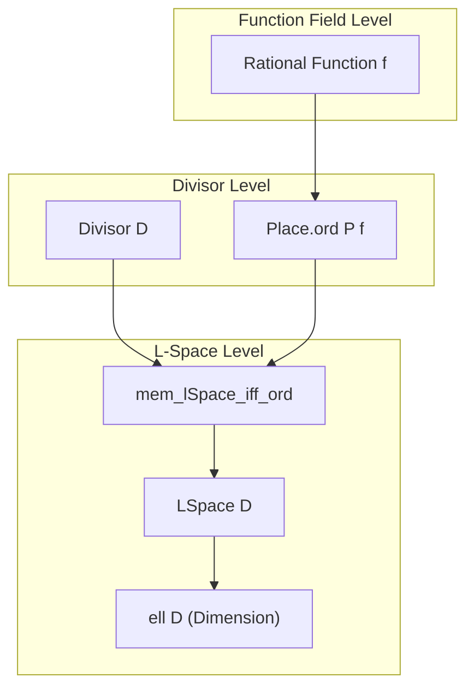
**Sources:** [P2M/Sol/S_AlgebraicCurve_RationalFunctionField_stichtenothGenusExists.lean:27-29]()

## Genus and Index of Specialty

The genus $g$ is defined via the `StichtenothGenusExists` construction, which identifies a constant such that for all divisors $D$ of sufficiently large degree, the **index of specialty** becomes stable [P2M/Sol/S_AlgebraicCurve_RationalFunctionField_stichtenothGenusExists.lean:27-27]().

The `indexOfSpecialty` of a divisor $D$ is defined as $deg(D) - ell(D) + 1$ [P2M/Sol/S_AlgebraicCurve_RationalFunctionField_stichtenothGenusExists.lean:27-27](). The Riemann-Roch theorem then relates this to the dimension of the space of differentials `omegaSpace` [P2M/Sol/S_AlgebraicCurve_RationalFunctionField_stichtenothGenusExists.lean:27-27]().

### Key Genus Theorems
*   **RiemannGenusReached**: Predicate indicating that the genus bound has been attained for a specific divisor [P2M/Sol/S_AlgebraicCurve_RationalFunctionField_stichtenothGenusExists.lean:27-27]().
*   **RiemannGenusBounded**: Proves that the set of indices of specialty is bounded above [P2M/Sol/S_AlgebraicCurve_RationalFunctionField_stichtenothGenusExists.lean:27-27]().
*   **StichtenothGenusExists**: The main existential proof for the genus of a function field [P2M/Sol/S_AlgebraicCurve_RationalFunctionField_stichtenothGenusExists.lean:27-27]().

### Mapping Natural Language to Code: Genus

| Concept | Code Entity | File Reference |
| :--- | :--- | :--- |
| **Index of Specialty** | `indexOfSpecialty` | [P2M/Sol/S_AlgebraicCurve_RationalFunctionField_stichtenothGenusExists.lean:27-27]() |
| **Genus Existence** | `StichtenothGenusExists` | [P2M/Sol/S_AlgebraicCurve_RationalFunctionField_stichtenothGenusExists.lean:27-27]() |
| **Space of Differentials** | `omegaSpace` | [P2M/Sol/S_AlgebraicCurve_RationalFunctionField_stichtenothGenusExists.lean:27-27]() |
| **Dimension of Omega** | `finrank_omegaSpace_eq_indexOfSpecialty` | [P2M/Sol/S_AlgebraicCurve_RationalFunctionField_stichtenothGenusExists.lean:27-27]() |

**Sources:** [P2M/Sol/S_AlgebraicCurve_RationalFunctionField_stichtenothGenusExists.lean:27-29](), [P2M/Sol/S_AlgebraicCurve_RationalFunctionField_stichtenothGenusExists_of_ratFunc_tower.lean:27-27]()

## Adeles and Duality

The proof of the Riemann-Roch theorem utilizes the `adeleSpace` (repartitions) [P2M/Sol/S_AlgebraicCurve_RationalFunctionField_stichtenothGenusExists.lean:27-27](). The `adeleBdd` space represents adeles whose components are bounded by a divisor $D$ [P2M/Sol/S_AlgebraicCurve_RationalFunctionField_stichtenothGenusExists.lean:27-27]().

The duality between $L$-spaces and the space of Weil differentials is established through the `residuePairing` [P2M/Sol/S_AlgebraicCurve_RationalFunctionField_stichtenothGenusExists.lean:27-27]().

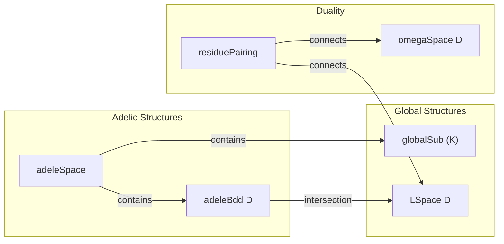
**Sources:** [P2M/Sol/S_AlgebraicCurve_RationalFunctionField_stichtenothGenusExists.lean:27-29](), [P2M/Sol/S_AlgebraicCurve_residueTheoremK_of_isAlgClosed.lean:35-35]()

## Rational Function Field Specialization

For the rational function field $K(X)$, specific constructions are provided:
*   **Place at Infinity**: `RationalFunctionField.placeInfty` [P2M/Sol/S_AlgebraicCurve_RationalFunctionField_stichtenothGenusExists.lean:27-27]().
*   **Valuation at Infinity**: `RationalFunctionField.ord_placeInfty` [P2M/Sol/S_AlgebraicCurve_RationalFunctionField_stichtenothGenusExists.lean:27-27]().
*   **Genus Zero**: The genus of the rational function field is proven to be zero in `S_AlgebraicCurve_genus_ratFunc_eq_zero_of_perfectField`.

**Sources:** [P2M/Sol/S_AlgebraicCurve_RationalFunctionField_stichtenothGenusExists.lean:27-29](), [P2M/Sol/S_AlgebraicCurve_RationalFunctionField_ord_placeInfty_X.lean:27-27]()

---

# Page: Kähler Differentials and the Residue Theorem

# Kähler Differentials and the Residue Theorem

<details>
<summary>Relevant source files</summary>

The following files were used as context for generating this wiki page:

- [Definitions/Def_AlgebraicCurve_Pic0BaseChange.lean](Definitions/Def_AlgebraicCurve_Pic0BaseChange.lean)
- [Definitions/Def_AlgebraicCurve_SerrePairing.lean](Definitions/Def_AlgebraicCurve_SerrePairing.lean)
- [P2M/Sol/S_AlgebraicCurve_AlgEquiv_eq_one_of_forall_smul_place_eq.lean](P2M/Sol/S_AlgebraicCurve_AlgEquiv_eq_one_of_forall_smul_place_eq.lean)
- [P2M/Sol/S_AlgebraicCurve_Differential_correspondence_mem_regularDifferentials.lean](P2M/Sol/S_AlgebraicCurve_Differential_correspondence_mem_regularDifferentials.lean)
- [P2M/Sol/S_AlgebraicCurve_Differential_map_correspondence_regularDifferentials_of_constantFieldExtension.lean](P2M/Sol/S_AlgebraicCurve_Differential_map_correspondence_regularDifferentials_of_constantFieldExtension.lean)
- [P2M/Sol/S_AlgebraicCurve_Divisor_isPrincipal_of_genus_eq_zero.lean](P2M/Sol/S_AlgebraicCurve_Divisor_isPrincipal_of_genus_eq_zero.lean)
- [P2M/Sol/S_AlgebraicCurve_Divisor_mapDomain_pullbackAlong_eq_and_restrictAlong_eq_of_degZero.lean](P2M/Sol/S_AlgebraicCurve_Divisor_mapDomain_pullbackAlong_eq_and_restrictAlong_eq_of_degZero.lean)
- [P2M/Sol/S_AlgebraicCurve_Divisor_pullbackAlong_pushforwardAlong_eq_add_of_adjoin_eq_top.lean](P2M/Sol/S_AlgebraicCurve_Divisor_pullbackAlong_pushforwardAlong_eq_add_of_adjoin_eq_top.lean)
- [P2M/Sol/S_AlgebraicCurve_Divisor_pullbackAlong_pushforwardAlong_eq_pushforwardAlong_pullbackAlong.lean](P2M/Sol/S_AlgebraicCurve_Divisor_pullbackAlong_pushforwardAlong_eq_pushforwardAlong_pullbackAlong.lean)
- [P2M/Sol/S_AlgebraicCurve_Divisor_pullbackAlong_pushforwardAlong_eq_sum_of_decomposition.lean](P2M/Sol/S_AlgebraicCurve_Divisor_pullbackAlong_pushforwardAlong_eq_sum_of_decomposition.lean)
- [P2M/Sol/S_AlgebraicCurve_Divisor_pushforwardNormFormula.lean](P2M/Sol/S_AlgebraicCurve_Divisor_pushforwardNormFormula.lean)
- [P2M/Sol/S_AlgebraicCurve_Divisor_pushforwardNormFormula_of_finiteDimensional.lean](P2M/Sol/S_AlgebraicCurve_Divisor_pushforwardNormFormula_of_finiteDimensional.lean)
- [P2M/Sol/S_AlgebraicCurve_Divisor_pushforwardNormFormula_of_isSeparable.lean](P2M/Sol/S_AlgebraicCurve_Divisor_pushforwardNormFormula_of_isSeparable.lean)
- [P2M/Sol/S_AlgebraicCurve_Pic0_exists_injective_linearMap_rationalTateModule_fixedField_range_eq_iInf_ker_and_comp_eq.lean](P2M/Sol/S_AlgebraicCurve_Pic0_exists_injective_linearMap_rationalTateModule_fixedField_range_eq_iInf_ker_and_comp_eq.lean)
- [P2M/Sol/S_AlgebraicCurve_Place_exists_toValuationSubring_eq_comap.lean](P2M/Sol/S_AlgebraicCurve_Place_exists_toValuationSubring_eq_comap.lean)
- [P2M/Sol/S_AlgebraicCurve_Place_inertiaDeg_eq_inertiaDeg_fiberCenter.lean](P2M/Sol/S_AlgebraicCurve_Place_inertiaDeg_eq_inertiaDeg_fiberCenter.lean)
- [P2M/Sol/S_AlgebraicCurve_Place_inertiaDeg_pos.lean](P2M/Sol/S_AlgebraicCurve_Place_inertiaDeg_pos.lean)
- [P2M/Sol/S_AlgebraicCurve_Place_neg_le_ord_trace_of_forall_le_ord_sub_pred.lean](P2M/Sol/S_AlgebraicCurve_Place_neg_le_ord_trace_of_forall_le_ord_sub_pred.lean)
- [P2M/Sol/S_AlgebraicCurve_Place_ord_norm_eq_sum_fiberOver.lean](P2M/Sol/S_AlgebraicCurve_Place_ord_norm_eq_sum_fiberOver.lean)
- [P2M/Sol/S_AlgebraicCurve_Place_ord_norm_eq_sum_fiberOver_of_isSeparable.lean](P2M/Sol/S_AlgebraicCurve_Place_ord_norm_eq_sum_fiberOver_of_isSeparable.lean)
- [P2M/Sol/S_AlgebraicCurve_Place_ramificationIndex_eq_ramificationIdx_fiberCenter.lean](P2M/Sol/S_AlgebraicCurve_Place_ramificationIndex_eq_ramificationIdx_fiberCenter.lean)
- [P2M/Sol/S_AlgebraicCurve_Place_sum_ramificationIndex_mul_inertiaDeg.lean](P2M/Sol/S_AlgebraicCurve_Place_sum_ramificationIndex_mul_inertiaDeg.lean)
- [P2M/Sol/S_AlgebraicCurve_Place_sum_ramificationIndex_mul_inertiaDeg_bifiber.lean](P2M/Sol/S_AlgebraicCurve_Place_sum_ramificationIndex_mul_inertiaDeg_bifiber.lean)
- [P2M/Sol/S_AlgebraicCurve_Place_sum_ramificationIndex_mul_inertiaDeg_bifiber_defect.lean](P2M/Sol/S_AlgebraicCurve_Place_sum_ramificationIndex_mul_inertiaDeg_bifiber_defect.lean)
- [P2M/Sol/S_AlgebraicCurve_Place_sum_ramificationIndex_mul_inertiaDeg_exchange.lean](P2M/Sol/S_AlgebraicCurve_Place_sum_ramificationIndex_mul_inertiaDeg_exchange.lean)
- [P2M/Sol/S_AlgebraicCurve_Place_sum_ramificationIndex_mul_inertiaDeg_exchange_add.lean](P2M/Sol/S_AlgebraicCurve_Place_sum_ramificationIndex_mul_inertiaDeg_exchange_add.lean)
- [P2M/Sol/S_AlgebraicCurve_Place_sum_ramificationIndex_mul_inertiaDeg_fiberOver.lean](P2M/Sol/S_AlgebraicCurve_Place_sum_ramificationIndex_mul_inertiaDeg_fiberOver.lean)
- [P2M/Sol/S_AlgebraicCurve_Place_sum_ramificationIndex_mul_inertiaDeg_le_finrank.lean](P2M/Sol/S_AlgebraicCurve_Place_sum_ramificationIndex_mul_inertiaDeg_le_finrank.lean)
- [P2M/Sol/S_AlgebraicCurve_RationalFunctionField_trace_localResidue_finitePlace_add_trace_localResidue_placeInfty_eq_zero.lean](P2M/Sol/S_AlgebraicCurve_RationalFunctionField_trace_localResidue_finitePlace_add_trace_localResidue_placeInfty_eq_zero.lean)
- [P2M/Sol/S_AlgebraicCurve_RationalFunctionField_trace_localResidue_finitePlace_div_pow_eq_zero.lean](P2M/Sol/S_AlgebraicCurve_RationalFunctionField_trace_localResidue_finitePlace_div_pow_eq_zero.lean)
- [P2M/Sol/S_AlgebraicCurve_RationalFunctionField_trace_localResidue_placeInfty_X_pow_eq_zero.lean](P2M/Sol/S_AlgebraicCurve_RationalFunctionField_trace_localResidue_placeInfty_X_pow_eq_zero.lean)
- [P2M/Sol/S_AlgebraicCurve_completionTraceSum_of_isSeparable.lean](P2M/Sol/S_AlgebraicCurve_completionTraceSum_of_isSeparable.lean)
- [P2M/Sol/S_AlgebraicCurve_ell_mapDomain_eq_of_constantFieldExtension_of_isAlgClosed.lean](P2M/Sol/S_AlgebraicCurve_ell_mapDomain_eq_of_constantFieldExtension_of_isAlgClosed.lean)
- [P2M/Sol/S_AlgebraicCurve_exists_int_matrix_forall_toMatrix_tateModule_rep_correspondence_eq_map.lean](P2M/Sol/S_AlgebraicCurve_exists_int_matrix_forall_toMatrix_tateModule_rep_correspondence_eq_map.lean)
- [P2M/Sol/S_AlgebraicCurve_exists_ordDifferential_ge_neg_one_and_evalAt_eq_of_degree_eq_zero.lean](P2M/Sol/S_AlgebraicCurve_exists_ordDifferential_ge_neg_one_and_evalAt_eq_of_degree_eq_zero.lean)
- [P2M/Sol/S_AlgebraicCurve_exists_transcendental_reduced_poleDivisor.lean](P2M/Sol/S_AlgebraicCurve_exists_transcendental_reduced_poleDivisor.lean)
- [P2M/Sol/S_AlgebraicCurve_fibreResidueIdentityAlong_of_separableAlong_of_dCoordGenerates.lean](P2M/Sol/S_AlgebraicCurve_fibreResidueIdentityAlong_of_separableAlong_of_dCoordGenerates.lean)
- [P2M/Sol/S_AlgebraicCurve_finite_and_finrank_polarDifferentials_eq.lean](P2M/Sol/S_AlgebraicCurve_finite_and_finrank_polarDifferentials_eq.lean)
- [P2M/Sol/S_AlgebraicCurve_finite_and_finrank_regularDifferentials_eq_genus.lean](P2M/Sol/S_AlgebraicCurve_finite_and_finrank_regularDifferentials_eq_genus.lean)
- [P2M/Sol/S_AlgebraicCurve_finite_and_finrank_regularDiffs_eq_genusFF_of_isAlgClosed.lean](P2M/Sol/S_AlgebraicCurve_finite_and_finrank_regularDiffs_eq_genusFF_of_isAlgClosed.lean)
- [P2M/Sol/S_AlgebraicCurve_genus_ratFunc_eq_zero_of_perfectField.lean](P2M/Sol/S_AlgebraicCurve_genus_ratFunc_eq_zero_of_perfectField.lean)
- [P2M/Sol/S_AlgebraicCurve_hasPrincipalDivisors_of_finiteDimensional_ratFunc.lean](P2M/Sol/S_AlgebraicCurve_hasPrincipalDivisors_of_finiteDimensional_ratFunc.lean)
- [P2M/Sol/S_AlgebraicCurve_hasPrincipalDivisors_of_finiteDimensional_ratFunc_of_isSeparable.lean](P2M/Sol/S_AlgebraicCurve_hasPrincipalDivisors_of_finiteDimensional_ratFunc_of_isSeparable.lean)
- [P2M/Sol/S_AlgebraicCurve_hasPrincipalDivisors_of_transcendental.lean](P2M/Sol/S_AlgebraicCurve_hasPrincipalDivisors_of_transcendental.lean)
- [P2M/Sol/S_AlgebraicCurve_instHasCanonicalDivisorRatFuncPerfectField.lean](P2M/Sol/S_AlgebraicCurve_instHasCanonicalDivisorRatFuncPerfectField.lean)
- [P2M/Sol/S_AlgebraicCurve_isCurveOver_ratFunc.lean](P2M/Sol/S_AlgebraicCurve_isCurveOver_ratFunc.lean)
- [P2M/Sol/S_AlgebraicCurve_mem_span_image_polarDifferentials_of_constantFieldExtension_of_isAlgClosed.lean](P2M/Sol/S_AlgebraicCurve_mem_span_image_polarDifferentials_of_constantFieldExtension_of_isAlgClosed.lean)
- [P2M/Sol/S_AlgebraicCurve_pullbackAlong_mem_regularDifferentials_of_isIntegral.lean](P2M/Sol/S_AlgebraicCurve_pullbackAlong_mem_regularDifferentials_of_isIntegral.lean)
- [P2M/Sol/S_AlgebraicCurve_pullbackAlong_mem_regularDifferentials_of_mem_of_algEquiv.lean](P2M/Sol/S_AlgebraicCurve_pullbackAlong_mem_regularDifferentials_of_mem_of_algEquiv.lean)
- [P2M/Sol/S_AlgebraicCurve_pullbackAlong_mem_regularDifferentials_of_mem_of_isCurveOver.lean](P2M/Sol/S_AlgebraicCurve_pullbackAlong_mem_regularDifferentials_of_mem_of_isCurveOver.lean)
- [P2M/Sol/S_AlgebraicCurve_regularDiffs_eq_regularDifferentials.lean](P2M/Sol/S_AlgebraicCurve_regularDiffs_eq_regularDifferentials.lean)
- [P2M/Sol/S_AlgebraicCurve_regularDiffs_eq_regularDifferentials_of_perfectField.lean](P2M/Sol/S_AlgebraicCurve_regularDiffs_eq_regularDifferentials_of_perfectField.lean)
- [P2M/Sol/S_AlgebraicCurve_residueTheoremK_of_isAlgClosed.lean](P2M/Sol/S_AlgebraicCurve_residueTheoremK_of_isAlgClosed.lean)
- [P2M/Sol/S_AlgebraicCurve_residueTheoremK_ratFunc_of_isAlgClosed.lean](P2M/Sol/S_AlgebraicCurve_residueTheoremK_ratFunc_of_isAlgClosed.lean)
- [P2M/Sol/S_AlgebraicCurve_residueTheorem_of_residueTheorem_ratFunc_of_residueTraceCompletionCommute.lean](P2M/Sol/S_AlgebraicCurve_residueTheorem_of_residueTheorem_ratFunc_of_residueTraceCompletionCommute.lean)
- [P2M/Sol/S_AlgebraicCurve_residueTheorem_ratFunc_of_perfectField.lean](P2M/Sol/S_AlgebraicCurve_residueTheorem_ratFunc_of_perfectField.lean)
- [P2M/Sol/S_AlgebraicCurve_tateCommFinite.lean](P2M/Sol/S_AlgebraicCurve_tateCommFinite.lean)
- [P2M/Sol/S_AlgebraicCurve_tateTraceCompat_of_isSeparable.lean](P2M/Sol/S_AlgebraicCurve_tateTraceCompat_of_isSeparable.lean)
- [P2M/Sol/S_IsLocalRing_hensel_lift_unique.lean](P2M/Sol/S_IsLocalRing_hensel_lift_unique.lean)

</details>


This section details the theory of differentials on algebraic curves and the proof of the Global Residue Theorem. The repository implements Kähler differentials as the module of relative differentials $\Omega_{F/K}$, defines local residues at places of the function field, and establishes that the sum of residues of any differential across all places is zero.

## Kähler Differentials and Regularity

In the function field $F$ of a curve over a field $K$, Kähler differentials are constructed via the `KaehlerDifferential` module [P2M/Sol/S_AlgebraicCurve_RationalFunctionField_trace_localResidue_finitePlace_add_trace_localResidue_placeInfty_eq_zero.lean:102-102](). For a differential $\omega \in \Omega_{F/K}$, the valuation at a place $w$ is defined via `Place.ordDifferential` [P2M/Sol/S_AlgebraicCurve_residueTheoremK_of_isAlgClosed.lean:35-35]().

A differential is **regular** if its valuation is non-negative at all places. The space of regular differentials is proven to have dimension equal to the genus of the function field when $K$ is algebraically closed [P2M/Sol/S_AlgebraicCurve_exists_int_matrix_forall_toMatrix_tateModule_rep_correspondence_eq_map.lean:18-18]().

### Key Entities: Differentials
| Code Entity | Description |
|:---|:---|
| `KaehlerDifferential.D` | The derivation $d: F \to \Omega_{F/K}$ [P2M/Sol/S_AlgebraicCurve_tateTraceCompat_of_isSeparable.lean:60-60](). |
| `Place.ordDifferential` | The order of a differential at a specific place $w$ [P2M/Sol/S_AlgebraicCurve_residueTheoremK_of_isAlgClosed.lean:35-35](). |
| `HasCanonicalDivisor` | Typeclass indicating the existence of a divisor $K_X$ such that $\mathcal{L}(K_X) \cong \Omega_{F/K}$ [P2M/Sol/S_AlgebraicCurve_residueTheoremK_of_isAlgClosed.lean:35-35](). |
| `regularDifferentials` | The submodule of differentials with no poles [P2M/Sol/S_AlgebraicCurve_exists_int_matrix_forall_toMatrix_tateModule_rep_correspondence_eq_map.lean:7-7](). |

**Sources:** [P2M/Sol/S_AlgebraicCurve_residueTheoremK_of_isAlgClosed.lean:34-36](), [P2M/Sol/S_AlgebraicCurve_exists_int_matrix_forall_toMatrix_tateModule_rep_correspondence_eq_map.lean:7-18](), [P2M/Sol/S_AlgebraicCurve_tateTraceCompat_of_isSeparable.lean:59-62]().

## Local Residues

The local residue of a differential at a place $w$, denoted `kaehlerResidueTerm`, is defined using the Tate residue trace or through the completion of the function field at $w$ [P2M/Sol/S_AlgebraicCurve_residueTheoremK_of_isAlgClosed.lean:35-35]().

For a differential $\omega = f \, dg$, the residue at $w$ is calculated by:
1. Mapping $f$ and $g$ to the adic completion $\hat{F}_w$ [P2M/Sol/S_AlgebraicCurve_tateTraceCompat_of_isSeparable.lean:35-35]().
2. Using the `kaehlerResidueTermKFam` which provides the residue values across a family of places [P2M/Sol/S_AlgebraicCurve_residueTheoremK_of_isAlgClosed.lean:35-35]().

### Data Flow: Local Residue Calculation
The following diagram illustrates how a global differential is processed into a local residue at a place $w$.

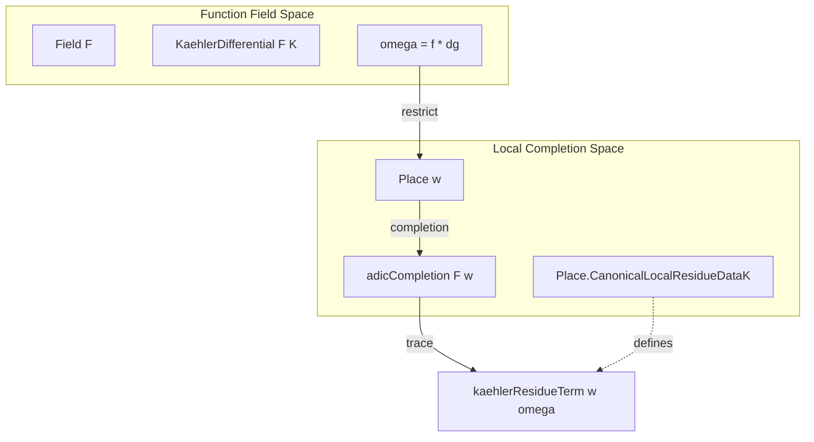
**Sources:** [P2M/Sol/S_AlgebraicCurve_residueTheoremK_of_isAlgClosed.lean:35-45](), [P2M/Sol/S_AlgebraicCurve_tateTraceCompat_of_isSeparable.lean:35-37](), [P2M/Sol/S_AlgebraicCurve_RationalFunctionField_trace_localResidue_finitePlace_add_trace_localResidue_placeInfty_eq_zero.lean:57-57]().

## The Global Residue Theorem

The central result of this section is `ResidueTheorem`, which states that for any differential $\omega \in \Omega_{F/K}$, the sum of residues over all places $w$ of $F$ is zero:
$$\sum_{w \in \text{Pl}(F)} \text{res}_w(\omega) = 0$$

The proof strategy involves three main steps:
1.  **Rational Function Field Case**: Proving the theorem for $K(X)$ by checking residues at finite places and the place at infinity [P2M/Sol/S_AlgebraicCurve_residueTheoremK_ratFunc_of_isAlgClosed.lean:51-51]().
2.  **Trace Compatibility**: Showing that for a finite separable extension $L/F$, the residue of the cotrace of a differential $\omega$ in $F$ is related to the residue in $L$ via the trace [P2M/Sol/S_AlgebraicCurve_tateTraceCompat_of_isSeparable.lean:68-68]().
3.  **Reduction**: Reducing the general curve case to the rational function field using a transcendental element and the `kaehlerCotrace` / `kaehlerPullback` machinery [P2M/Sol/S_AlgebraicCurve_residueTheoremK_of_isAlgClosed.lean:35-35]().

### Trace and Cotrace Mapping
This diagram maps the algebraic operations used in the reduction step to their Lean implementations.

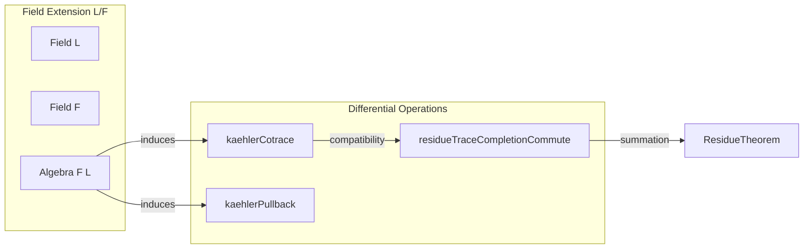
**Sources:** [P2M/Sol/S_AlgebraicCurve_residueTheoremK_of_isAlgClosed.lean:17-18](), [P2M/Sol/S_AlgebraicCurve_residueTheorem_of_residueTheorem_ratFunc_of_residueTraceCompletionCommute.lean:34-34](), [P2M/Sol/S_AlgebraicCurve_tateTraceCompat_of_isSeparable.lean:24-24]().

## Implementation Details

### Rational Function Field Base Case
The base case for $K(X)$ is handled by `residueTheoremK_ratFunc_of_isAlgClosed` [P2M/Sol/S_AlgebraicCurve_residueTheoremK_of_isAlgClosed.lean:35-35](). It verifies:
*   Residues at finite places (corresponding to irreducible polynomials) [P2M/Sol/S_AlgebraicCurve_RationalFunctionField_trace_localResidue_finitePlace_add_trace_localResidue_placeInfty_eq_zero.lean:57-57]().
*   The residue at the infinite place `placeInfty` [P2M/Sol/S_AlgebraicCurve_RationalFunctionField_trace_localResidue_placeInfty_X_pow_eq_zero.lean:58-58]().
*   Specific vanishing results for $X^n \, dX$ [P2M/Sol/S_AlgebraicCurve_RationalFunctionField_trace_localResidue_placeInfty_X_pow_eq_zero.lean:58-58]().

### Trace Compatibility
The theorem `residueTraceCompletionCommute` [P2M/Sol/S_AlgebraicCurve_residueTheoremK_of_isAlgClosed.lean:35-35]() is critical for the reduction. It ensures that the sum of residues over the fiber of a place $w$ in an extension equals the residue of the trace:
`KwHgfV352_completionTraceSum` [P2M/Sol/S_AlgebraicCurve_residueTheoremK_of_isAlgClosed.lean:35-35]().

### Summary of Key Functions
| Function | File Reference |
|:---|:---|
| `kaehlerResidueTerm` | [P2M/Sol/S_AlgebraicCurve_residueTheoremK_of_isAlgClosed.lean:35-35]() |
| `residueTheoremK` | [P2M/Sol/S_AlgebraicCurve_residueTheoremK_of_isAlgClosed.lean:35-35]() |
| `kaehlerCotrace` | [P2M/Sol/S_AlgebraicCurve_residueTheoremK_of_isAlgClosed.lean:35-35]() |
| `residueTraceCompletionCommute` | [P2M/Sol/S_AlgebraicCurve_residueTheoremK_of_isAlgClosed.lean:17-17]() |
| `sum_ramificationIndex_mul_inertiaDeg` | [P2M/Sol/S_AlgebraicCurve_Place_sum_ramificationIndex_mul_inertiaDeg_le_finrank.lean:21-21]() |

**Sources:** [P2M/Sol/S_AlgebraicCurve_residueTheoremK_of_isAlgClosed.lean:1-45](), [P2M/Sol/S_AlgebraicCurve_tateTraceCompat_of_isSeparable.lean:1-40](), [P2M/Sol/S_AlgebraicCurve_RationalFunctionField_trace_localResidue_placeInfty_X_pow_eq_zero.lean:1-60]().

---

# Page: Jacobians, Pic⁰, and the Abel-Jacobi Map

# Jacobians, Pic⁰, and the Abel-Jacobi Map

<details>
<summary>Relevant source files</summary>

The following files were used as context for generating this wiki page:

- [Definitions/Def_CerednikDrinfeld_DrinfeldHolomorphic.lean](Definitions/Def_CerednikDrinfeld_DrinfeldHolomorphic.lean)
- [P2M/Sol/S_AlgebraicCurve_DivisorialWeilPairingData_pair_semilinearSmul.lean](P2M/Sol/S_AlgebraicCurve_DivisorialWeilPairingData_pair_semilinearSmul.lean)
- [P2M/Sol/S_AlgebraicCurve_Pic0_exists_periodDatum_Q_mul_period_eq_one_of_mumfordQuotient.lean](P2M/Sol/S_AlgebraicCurve_Pic0_exists_periodDatum_Q_mul_period_eq_one_of_mumfordQuotient.lean)
- [P2M/Sol/S_AlgebraicCurve_Pic0_exists_torusPoints_uniformization_of_periodDatum_of_mumfordQuotient_of_v_card_stabilizer_eq_one.lean](P2M/Sol/S_AlgebraicCurve_Pic0_exists_torusPoints_uniformization_of_periodDatum_of_mumfordQuotient_of_v_card_stabilizer_eq_one.lean)
- [P2M/Sol/S_AlgebraicCurve_Pic0_exists_weilPairing.lean](P2M/Sol/S_AlgebraicCurve_Pic0_exists_weilPairing.lean)
- [P2M/Sol/S_AlgebraicCurve_Pic0_periodPairing_pullback_eq_periodPairing_pushforward_of_mumfordQuotient_theta.lean](P2M/Sol/S_AlgebraicCurve_Pic0_periodPairing_pullback_eq_periodPairing_pushforward_of_mumfordQuotient_theta.lean)
- [P2M/Sol/S_AlgebraicCurve_Place_analyticAt_evalAt_extChartAt_symm_of_mem.lean](P2M/Sol/S_AlgebraicCurve_Place_analyticAt_evalAt_extChartAt_symm_of_mem.lean)
- [P2M/Sol/S_AlgebraicCurve_Place_continuous_restrictAlong.lean](P2M/Sol/S_AlgebraicCurve_Place_continuous_restrictAlong.lean)
- [P2M/Sol/S_AlgebraicCurve_Place_ord_sub_algebraMap_eq_analyticOrderNatAt_chartRead.lean](P2M/Sol/S_AlgebraicCurve_Place_ord_sub_algebraMap_eq_analyticOrderNatAt_chartRead.lean)
- [P2M/Sol/S_AlgebraicCurve_Place_readDifferential_smul_D_eventuallyEq_chartRead_mul_deriv.lean](P2M/Sol/S_AlgebraicCurve_Place_readDifferential_smul_D_eventuallyEq_chartRead_mul_deriv.lean)
- [P2M/Sol/S_AlgebraicCurve_RegularProlongation_residue_integralClosure_surjective_of_genusFF_eq.lean](P2M/Sol/S_AlgebraicCurve_RegularProlongation_residue_integralClosure_surjective_of_genusFF_eq.lean)
- [P2M/Sol/S_AlgebraicCurve_SemilinearAut_mem_iff_smul_mem_of_forall_mem_iff_sections.lean](P2M/Sol/S_AlgebraicCurve_SemilinearAut_mem_iff_smul_mem_of_forall_mem_iff_sections.lean)
- [P2M/Sol/S_AlgebraicCurve_SemistableCovering_exists_circleCharts_and_bands_width_one_of_discFibres_of_rankOne.lean](P2M/Sol/S_AlgebraicCurve_SemistableCovering_exists_circleCharts_and_bands_width_one_of_discFibres_of_rankOne.lean)
- [P2M/Sol/S_AlgebraicCurve_SemistableCovering_exists_mem_riemannRochSpace_forall_residue_eq_of_glued_of_rankOne.lean](P2M/Sol/S_AlgebraicCurve_SemistableCovering_exists_mem_riemannRochSpace_forall_residue_eq_of_glued_of_rankOne.lean)
- [P2M/Sol/S_AlgebraicCurve_SemistableCovering_exists_ne_zero_ord_eq_single_sub_single_mapDomain_placeMap_mem_principal_of_valuation_eq_of_rankOne.lean](P2M/Sol/S_AlgebraicCurve_SemistableCovering_exists_ne_zero_ord_eq_single_sub_single_mapDomain_placeMap_mem_principal_of_valuation_eq_of_rankOne.lean)
- [P2M/Sol/S_AlgebraicCurve_SemistableCovering_exists_ne_zero_ord_eq_single_sub_single_of_depth_eq_of_rankOne.lean](P2M/Sol/S_AlgebraicCurve_SemistableCovering_exists_ne_zero_ord_eq_single_sub_single_of_depth_eq_of_rankOne.lean)
- [P2M/Sol/S_AlgebraicCurve_SemistableCovering_exists_widthOne_covering_equiv_of_discFibres_of_rankOne.lean](P2M/Sol/S_AlgebraicCurve_SemistableCovering_exists_widthOne_covering_equiv_of_discFibres_of_rankOne.lean)
- [P2M/Sol/S_AlgebraicCurve_SemistableCovering_finiteDimensional_and_finrank_graded_glued_riemannRochSpace_eq_finrank_of_width_one.lean](P2M/Sol/S_AlgebraicCurve_SemistableCovering_finiteDimensional_and_finrank_graded_glued_riemannRochSpace_eq_finrank_of_width_one.lean)
- [P2M/Sol/S_AlgebraicCurve_SemistableCovering_forall_ord_eq_zero_and_sum_eq_lap_of_ord_residue_smul_eq_of_width_one.lean](P2M/Sol/S_AlgebraicCurve_SemistableCovering_forall_ord_eq_zero_and_sum_eq_lap_of_ord_residue_smul_eq_of_width_one.lean)
- [P2M/Sol/S_AlgebraicCurve_SemistableCovering_residue_mem_riemannRochSpace_and_evalAt_eq_of_forall_mem_integers_of_rankOne.lean](P2M/Sol/S_AlgebraicCurve_SemistableCovering_residue_mem_riemannRochSpace_and_evalAt_eq_of_forall_mem_integers_of_rankOne.lean)
- [P2M/Sol/S_AlgebraicCurve_abelJacobiDiv_correspondence_sub_vecMul_mem_pathPeriodLattice.lean](P2M/Sol/S_AlgebraicCurve_abelJacobiDiv_correspondence_sub_vecMul_mem_pathPeriodLattice.lean)
- [P2M/Sol/S_AlgebraicCurve_abelJacobiDiv_mem_pathPeriodLattice_of_isPrincipal.lean](P2M/Sol/S_AlgebraicCurve_abelJacobiDiv_mem_pathPeriodLattice_of_isPrincipal.lean)
- [P2M/Sol/S_AlgebraicCurve_eventually_abelJacobiDiv_fibre_sub_mem_pathPeriodLattice.lean](P2M/Sol/S_AlgebraicCurve_eventually_abelJacobiDiv_fibre_sub_mem_pathPeriodLattice.lean)
- [P2M/Sol/S_AlgebraicCurve_exists_abelJacobiDiv_sub_mem_pathPeriodLattice_and_image_mem_nhds.lean](P2M/Sol/S_AlgebraicCurve_exists_abelJacobiDiv_sub_mem_pathPeriodLattice_and_image_mem_nhds.lean)
- [P2M/Sol/S_AlgebraicCurve_exists_add_sum_sub_sum_mem_principal_of_degree_add_sum_eq_zero_of_valuation_mul_prod_eq_of_lattice_of_semistableCovering_of_discFibres_of_rankOne.lean](P2M/Sol/S_AlgebraicCurve_exists_add_sum_sub_sum_mem_principal_of_degree_add_sum_eq_zero_of_valuation_mul_prod_eq_of_lattice_of_semistableCovering_of_discFibres_of_rankOne.lean)
- [P2M/Sol/S_AlgebraicCurve_exists_ball_abelJacobiDiv_correspondence_sub_sub_mem_pathPeriodLattice.lean](P2M/Sol/S_AlgebraicCurve_exists_ball_abelJacobiDiv_correspondence_sub_sub_mem_pathPeriodLattice.lean)
- [P2M/Sol/S_AlgebraicCurve_exists_ball_abelJacobiVec_restrictAlong_sub_sub_mem_pathPeriodLattice.lean](P2M/Sol/S_AlgebraicCurve_exists_ball_abelJacobiVec_restrictAlong_sub_sub_mem_pathPeriodLattice.lean)
- [P2M/Sol/S_AlgebraicCurve_exists_ball_abelJacobiVec_sub_sub_mem_pathPeriodLattice.lean](P2M/Sol/S_AlgebraicCurve_exists_ball_abelJacobiVec_sub_sub_mem_pathPeriodLattice.lean)
- [P2M/Sol/S_AlgebraicCurve_exists_cartierData_eq_ord_and_pt_mem_iff_of_forall_mapDomain_placeMap_eq_zero_of_balanced_of_semistableModel.lean](P2M/Sol/S_AlgebraicCurve_exists_cartierData_eq_ord_and_pt_mem_iff_of_forall_mapDomain_placeMap_eq_zero_of_balanced_of_semistableModel.lean)
- [P2M/Sol/S_AlgebraicCurve_exists_cartierData_eq_ord_and_pt_mem_iff_of_forall_mapDomain_placeMap_eq_zero_of_prod_evalAt_param_zpow_eq_one_add_of_semistableModel.lean](P2M/Sol/S_AlgebraicCurve_exists_cartierData_eq_ord_and_pt_mem_iff_of_forall_mapDomain_placeMap_eq_zero_of_prod_evalAt_param_zpow_eq_one_add_of_semistableModel.lean)
- [P2M/Sol/S_AlgebraicCurve_exists_cartierData_kummer_finiteLevel_of_cartierData_of_balanced_of_semistableModel_of_descent.lean](P2M/Sol/S_AlgebraicCurve_exists_cartierData_kummer_finiteLevel_of_cartierData_of_balanced_of_semistableModel_of_descent.lean)
- [P2M/Sol/S_AlgebraicCurve_exists_cartierData_kummer_finiteLevel_of_cartierData_of_divisor_of_semistableModel_of_descent.lean](P2M/Sol/S_AlgebraicCurve_exists_cartierData_kummer_finiteLevel_of_cartierData_of_divisor_of_semistableModel_of_descent.lean)
- [P2M/Sol/S_AlgebraicCurve_exists_degree_eq_zero_and_abelJacobiDiv_sub_mem_pathPeriodLattice.lean](P2M/Sol/S_AlgebraicCurve_exists_degree_eq_zero_and_abelJacobiDiv_sub_mem_pathPeriodLattice.lean)
- [P2M/Sol/S_AlgebraicCurve_exists_eventuallyEq_evalAt_of_meromorphicAt.lean](P2M/Sol/S_AlgebraicCurve_exists_eventuallyEq_evalAt_of_meromorphicAt.lean)
- [P2M/Sol/S_AlgebraicCurve_exists_forall_smul_div_pow_mem_integers_of_cartierData_of_balanced_of_semistableModel.lean](P2M/Sol/S_AlgebraicCurve_exists_forall_smul_div_pow_mem_integers_of_cartierData_of_balanced_of_semistableModel.lean)
- [P2M/Sol/S_AlgebraicCurve_exists_forall_smul_div_pow_mem_integers_of_cartierData_of_divisor_of_semistableModel.lean](P2M/Sol/S_AlgebraicCurve_exists_forall_smul_div_pow_mem_integers_of_cartierData_of_divisor_of_semistableModel.lean)
- [P2M/Sol/S_AlgebraicCurve_exists_isPrimitiveAlong_of_forall_ordDifferential_nonneg.lean](P2M/Sol/S_AlgebraicCurve_exists_isPrimitiveAlong_of_forall_ordDifferential_nonneg.lean)
- [P2M/Sol/S_AlgebraicCurve_exists_isPrimitiveAlong_of_mem_regularDifferentials.lean](P2M/Sol/S_AlgebraicCurve_exists_isPrimitiveAlong_of_mem_regularDifferentials.lean)
- [P2M/Sol/S_AlgebraicCurve_exists_isUnit_det_evalAt_differentialCoeff.lean](P2M/Sol/S_AlgebraicCurve_exists_isUnit_det_evalAt_differentialCoeff.lean)
- [P2M/Sol/S_AlgebraicCurve_exists_linearMap_forall_sub_one_eq_smul_of_semistableCovering_of_discFibres_of_rankOne_of_lifts_of_charZero_of_semistableModel.lean](P2M/Sol/S_AlgebraicCurve_exists_linearMap_forall_sub_one_eq_smul_of_semistableCovering_of_discFibres_of_rankOne_of_lifts_of_charZero_of_semistableModel.lean)
- [P2M/Sol/S_AlgebraicCurve_exists_linearMap_rationalTateModule_reduction_of_semistableCovering_of_discFibres_of_rankOne_of_lifts_of_charZero_of_semistableModel.lean](P2M/Sol/S_AlgebraicCurve_exists_linearMap_rationalTateModule_reduction_of_semistableCovering_of_discFibres_of_rankOne_of_lifts_of_charZero_of_semistableModel.lean)
- [P2M/Sol/S_AlgebraicCurve_exists_mem_iInf_ker_red_eq_zero_of_forall_proj_eq_mk_single_sub_single_quadruples_annulus_of_semistableCovering_of_discFibres_of_rankOne_of_lifts_of_charZero_of_semistableModel.lean](P2M/Sol/S_AlgebraicCurve_exists_mem_iInf_ker_red_eq_zero_of_forall_proj_eq_mk_single_sub_single_quadruples_annulus_of_semistableCovering_of_discFibres_of_rankOne_of_lifts_of_charZero_of_semistableModel.lean)
- [P2M/Sol/S_AlgebraicCurve_exists_meromorphicOrderAt_eq_of_forall_pathIntegral_eq_two_pi_I_mul.lean](P2M/Sol/S_AlgebraicCurve_exists_meromorphicOrderAt_eq_of_forall_pathIntegral_eq_two_pi_I_mul.lean)
- [P2M/Sol/S_AlgebraicCurve_exists_ne_zero_apply_ord_eq_sum_lap_of_semistableCovering_of_discFibres_of_rankOne_of_width_one.lean](P2M/Sol/S_AlgebraicCurve_exists_ne_zero_apply_ord_eq_sum_lap_of_semistableCovering_of_discFibres_of_rankOne_of_width_one.lean)
- [P2M/Sol/S_AlgebraicCurve_exists_ne_zero_ord_eq_of_depthMass_eq_zero_of_semistableCovering_of_rankOne.lean](P2M/Sol/S_AlgebraicCurve_exists_ne_zero_ord_eq_of_depthMass_eq_zero_of_semistableCovering_of_rankOne.lean)
- [P2M/Sol/S_AlgebraicCurve_exists_ne_zero_ord_eq_of_forall_eq_zero_of_semistableCovering_of_discFibres_of_rankOne.lean](P2M/Sol/S_AlgebraicCurve_exists_ne_zero_ord_eq_of_forall_eq_zero_of_semistableCovering_of_discFibres_of_rankOne.lean)
- [P2M/Sol/S_AlgebraicCurve_exists_ne_zero_ord_eq_of_sum_eq_zero_of_semistableCovering_of_discFibres_of_rankOne.lean](P2M/Sol/S_AlgebraicCurve_exists_ne_zero_ord_eq_of_sum_eq_zero_of_semistableCovering_of_discFibres_of_rankOne.lean)
- [P2M/Sol/S_AlgebraicCurve_exists_residue_pow_mul_eq_of_sum_smul_single_sub_single_sub_sum_sub_sum_smul_quadruple_mem_principal_of_semistableCovering_of_discFibres_of_rankOne_of_lifts_of_charZero_of_semistableModel.lean](P2M/Sol/S_AlgebraicCurve_exists_residue_pow_mul_eq_of_sum_smul_single_sub_single_sub_sum_sub_sum_smul_quadruple_mem_principal_of_semistableCovering_of_discFibres_of_rankOne_of_lifts_of_charZero_of_semistableModel.lean)
- [P2M/Sol/S_AlgebraicCurve_exists_residue_prod_zpow_eq_one_of_forall_mapDomain_placeMap_eq_zero_of_forall_annulus_sum_eq_zero_of_prod_valuation_evalAt_zpow_eq_one_of_semistableCovering_of_discFibres_of_rankOne.lean](P2M/Sol/S_AlgebraicCurve_exists_residue_prod_zpow_eq_one_of_forall_mapDomain_placeMap_eq_zero_of_forall_annulus_sum_eq_zero_of_prod_valuation_evalAt_zpow_eq_one_of_semistableCovering_of_discFibres_of_rankOne.lean)
- [P2M/Sol/S_AlgebraicCurve_exists_slopes_degree_add_sum_eq_zero_and_valuation_mul_prod_eq_of_ord_of_semistableCovering_of_discFibres_of_rankOne.lean](P2M/Sol/S_AlgebraicCurve_exists_slopes_degree_add_sum_eq_zero_and_valuation_mul_prod_eq_of_ord_of_semistableCovering_of_discFibres_of_rankOne.lean)
- [P2M/Sol/S_AlgebraicCurve_exists_smul_D_eq_smul_dCoord_of_forall_isIntegral_trace_mul_eq_aeval.lean](P2M/Sol/S_AlgebraicCurve_exists_smul_D_eq_smul_dCoord_of_forall_isIntegral_trace_mul_eq_aeval.lean)
- [P2M/Sol/S_AlgebraicCurve_exists_tateModule_forall_proj_eq_mk_single_sub_single_quadruples_annulus_of_semistableCovering_of_discFibres_of_rankOne_of_lifts_of_charZero_of_semistableModel_of_forall_pow_eq_self.lean](P2M/Sol/S_AlgebraicCurve_exists_tateModule_forall_proj_eq_mk_single_sub_single_quadruples_annulus_of_semistableCovering_of_discFibres_of_rankOne_of_lifts_of_charZero_of_semistableModel_of_forall_pow_eq_self.lean)
- [P2M/Sol/S_AlgebraicCurve_exists_vanishingCycles_ker_reduction_le_span_of_semistableCovering_of_discFibres_of_rankOne_of_lifts_of_src_ne_tgt_of_charZero_of_semistableModel_of_forall_pow_eq_self_of_algEquiv.lean](P2M/Sol/S_AlgebraicCurve_exists_vanishingCycles_ker_reduction_le_span_of_semistableCovering_of_discFibres_of_rankOne_of_lifts_of_src_ne_tgt_of_charZero_of_semistableModel_of_forall_pow_eq_self_of_algEquiv.lean)
- [P2M/Sol/S_AlgebraicCurve_exists_vanishingCycles_red_eq_zero_and_add_le_finrank_span_of_semistableCovering_of_discFibres_of_rankOne_of_lifts_of_src_ne_tgt_of_charZero_of_semistableModel_of_forall_pow_eq_self_of_algEquiv.lean](P2M/Sol/S_AlgebraicCurve_exists_vanishingCycles_red_eq_zero_and_add_le_finrank_span_of_semistableCovering_of_discFibres_of_rankOne_of_lifts_of_src_ne_tgt_of_charZero_of_semistableModel_of_forall_pow_eq_self_of_algEquiv.lean)
- [P2M/Sol/S_AlgebraicCurve_exists_vanishingCycles_smul_sub_mem_span_of_semistableCovering_of_discFibres_of_rankOne_of_lifts_of_src_ne_tgt_of_charZero_of_semistableModel_of_forall_pow_eq_self_of_algEquiv.lean](P2M/Sol/S_AlgebraicCurve_exists_vanishingCycles_smul_sub_mem_span_of_semistableCovering_of_discFibres_of_rankOne_of_lifts_of_src_ne_tgt_of_charZero_of_semistableModel_of_forall_pow_eq_self_of_algEquiv.lean)
- [P2M/Sol/S_AlgebraicCurve_finrank_ker_reduction_add_le_of_semistableCovering_of_discFibres_of_rankOne_of_lifts_of_charZero_of_semistableModel.lean](P2M/Sol/S_AlgebraicCurve_finrank_ker_reduction_add_le_of_semistableCovering_of_discFibres_of_rankOne_of_lifts_of_charZero_of_semistableModel.lean)
- [P2M/Sol/S_AlgebraicCurve_isNodalPrincipal_mapDomain_placeMap_of_forall_ord_eq_zero_of_semistableCovering_of_rankOne.lean](P2M/Sol/S_AlgebraicCurve_isNodalPrincipal_mapDomain_placeMap_of_forall_ord_eq_zero_of_semistableCovering_of_rankOne.lean)
- [P2M/Sol/S_AlgebraicCurve_isPrimitiveAlong_comp_extChartAt_of_hasDerivAt_readDifferential.lean](P2M/Sol/S_AlgebraicCurve_isPrimitiveAlong_comp_extChartAt_of_hasDerivAt_readDifferential.lean)
- [P2M/Sol/S_AlgebraicCurve_ker_sub_one_eq_iInf_ker_of_pow_eq_of_baseAut_ne_of_semistableCovering_of_discFibres_of_rankOne_of_lifts_of_charZero_of_semistableModel.lean](P2M/Sol/S_AlgebraicCurve_ker_sub_one_eq_iInf_ker_of_pow_eq_of_baseAut_ne_of_semistableCovering_of_discFibres_of_rankOne_of_lifts_of_charZero_of_semistableModel.lean)
- [P2M/Sol/S_AlgebraicCurve_le_add_one_and_exists_finset_card_le_pow_of_chartSupported_principal_of_semistableCovering_of_discFibres_of_rankOne_of_charZero_of_semistableModel.lean](P2M/Sol/S_AlgebraicCurve_le_add_one_and_exists_finset_card_le_pow_of_chartSupported_principal_of_semistableCovering_of_discFibres_of_rankOne_of_charZero_of_semistableModel.lean)
- [P2M/Sol/S_AlgebraicCurve_mapDomain_placeMap_mem_principal_of_degree_eq_zero_of_forall_annulus_sum_eq_zero_of_prod_valuation_evalAt_zpow_eq_one.lean](P2M/Sol/S_AlgebraicCurve_mapDomain_placeMap_mem_principal_of_degree_eq_zero_of_forall_annulus_sum_eq_zero_of_prod_valuation_evalAt_zpow_eq_one.lean)
- [P2M/Sol/S_AlgebraicCurve_mapDomain_placeMap_mem_principal_of_forall_support_subset_dom_of_degree_eq_zero.lean](P2M/Sol/S_AlgebraicCurve_mapDomain_placeMap_mem_principal_of_forall_support_subset_dom_of_degree_eq_zero.lean)
- [P2M/Sol/S_AlgebraicCurve_mem_span_smul_sub_of_red_eq_zero_of_forall_smul_eq_of_semistableCovering_of_discFibres_of_rankOne_of_lifts_of_charZero_of_semistableModel.lean](P2M/Sol/S_AlgebraicCurve_mem_span_smul_sub_of_red_eq_zero_of_forall_smul_eq_of_semistableCovering_of_discFibres_of_rankOne_of_lifts_of_charZero_of_semistableModel.lean)
- [P2M/Sol/S_AlgebraicCurve_natCard_fixedPoints_restrictAlong_lt_of_isFrobeniusEndo_sq.lean](P2M/Sol/S_AlgebraicCurve_natCard_fixedPoints_restrictAlong_lt_of_isFrobeniusEndo_sq.lean)
- [P2M/Sol/S_AlgebraicCurve_natCard_torsion_tropicalPositionZero_mul_pow_le_of_semistableCovering_of_discFibres_of_rankOne_of_charZero_of_semistableModel.lean](P2M/Sol/S_AlgebraicCurve_natCard_torsion_tropicalPositionZero_mul_pow_le_of_semistableCovering_of_discFibres_of_rankOne_of_charZero_of_semistableModel.lean)
- [P2M/Sol/S_AlgebraicCurve_rationalGaloisRep_tmul_eq_tmul_perm_of_forall_proj_eq_mk_single_sub_single_quadruples_annulus_of_semistableCovering_of_discFibres_of_rankOne_of_lifts_of_src_ne_tgt_of_charZero_of_semistableModel_of_algEquiv.lean](P2M/Sol/S_AlgebraicCurve_rationalGaloisRep_tmul_eq_tmul_perm_of_forall_proj_eq_mk_single_sub_single_quadruples_annulus_of_semistableCovering_of_discFibres_of_rankOne_of_lifts_of_src_ne_tgt_of_charZero_of_semistableModel_of_algEquiv.lean)
- [P2M/Sol/S_AlgebraicCurve_red_eq_zero_of_mem_span_smul_sub_of_forall_smul_eq_of_semistableCovering_of_discFibres_of_rankOne_of_lifts_of_charZero_of_semistableModel.lean](P2M/Sol/S_AlgebraicCurve_red_eq_zero_of_mem_span_smul_sub_of_forall_smul_eq_of_semistableCovering_of_discFibres_of_rankOne_of_lifts_of_charZero_of_semistableModel.lean)
- [P2M/Sol/S_AlgebraicCurve_smul_smul_sub_eq_smul_sub_of_isUnit_natCast_of_nsmul_eq_zero_of_genusFF_of_semistableCovering_of_charZero_of_semistableModel.lean](P2M/Sol/S_AlgebraicCurve_smul_smul_sub_eq_smul_sub_of_isUnit_natCast_of_nsmul_eq_zero_of_genusFF_of_semistableCovering_of_charZero_of_semistableModel.lean)
- [P2M/Sol/S_AlgebraicCurve_span_real_pathPeriodLattice_eq_top.lean](P2M/Sol/S_AlgebraicCurve_span_real_pathPeriodLattice_eq_top.lean)
- [P2M/Sol/S_AlgebraicCurve_sum_mem_principal_of_zsmul_mem_principal_of_isNodalPrincipal_mapDomain_placeMap_of_semistableModel_of_descent.lean](P2M/Sol/S_AlgebraicCurve_sum_mem_principal_of_zsmul_mem_principal_of_isNodalPrincipal_mapDomain_placeMap_of_semistableModel_of_descent.lean)
- [P2M/Sol/S_AlgebraicCurve_surjective_algebraMap_of_injective_restrict_place_of_isAlgClosed.lean](P2M/Sol/S_AlgebraicCurve_surjective_algebraMap_of_injective_restrict_place_of_isAlgClosed.lean)
- [P2M/Sol/S_CerednikDrinfeld_Omega_exists_eq_mul_prod_zpow_mul_one_add_of_isUnit.lean](P2M/Sol/S_CerednikDrinfeld_Omega_exists_eq_mul_prod_zpow_mul_one_add_of_isUnit.lean)
- [P2M/Sol/S_CerednikDrinfeld_Omega_exists_eq_sub_pow_mul_and_apply_ne_zero_of_mem_holOn_of_finite_setOf_eq_zero.lean](P2M/Sol/S_CerednikDrinfeld_Omega_exists_eq_sub_pow_mul_and_apply_ne_zero_of_mem_holOn_of_finite_setOf_eq_zero.lean)
- [P2M/Sol/S_CerednikDrinfeld_Omega_exists_finset_residueSystem_of_finite_quotient.lean](P2M/Sol/S_CerednikDrinfeld_Omega_exists_finset_residueSystem_of_finite_quotient.lean)
- [P2M/Sol/S_CerednikDrinfeld_Omega_exists_int_neighbours_sum_eq_zero_v_apply_smul_eq.lean](P2M/Sol/S_CerednikDrinfeld_Omega_exists_int_neighbours_sum_eq_zero_v_apply_smul_eq.lean)
- [P2M/Sol/S_CerednikDrinfeld_Omega_exists_isThetaPair_ordAt_eq_card.lean](P2M/Sol/S_CerednikDrinfeld_Omega_exists_isThetaPair_ordAt_eq_card.lean)
- [P2M/Sol/S_CerednikDrinfeld_Omega_exists_isUnit_coe_eq_thetaMer_apply_smul_eq_period_mul.lean](P2M/Sol/S_CerednikDrinfeld_Omega_exists_isUnit_coe_eq_thetaMer_apply_smul_eq_period_mul.lean)
- [P2M/Sol/S_CerednikDrinfeld_Omega_exists_mem_ribbonKernel_and_v_apply_smul_eq_mul_zpow_stabWidth_of_isUnit_of_forall_isOfFinOrder.lean](P2M/Sol/S_CerednikDrinfeld_Omega_exists_mem_ribbonKernel_and_v_apply_smul_eq_mul_zpow_stabWidth_of_isUnit_of_forall_isOfFinOrder.lean)
- [P2M/Sol/S_CerednikDrinfeld_Omega_exists_pair_v_theta_eq_one_and_v_theta_mul_zpow_sub_one_lt_forall_ne_pmoebius.lean](P2M/Sol/S_CerednikDrinfeld_Omega_exists_pair_v_theta_eq_one_and_v_theta_mul_zpow_sub_one_lt_forall_ne_pmoebius.lean)
- [P2M/Sol/S_CerednikDrinfeld_Omega_exists_pairs_v_prod_theta_div_sub_one_lt.lean](P2M/Sol/S_CerednikDrinfeld_Omega_exists_pairs_v_prod_theta_div_sub_one_lt.lean)
- [P2M/Sol/S_CerednikDrinfeld_Omega_exists_pairs_v_prod_theta_div_sub_one_lt_forall_ne_pmoebius.lean](P2M/Sol/S_CerednikDrinfeld_Omega_exists_pairs_v_prod_theta_div_sub_one_lt_forall_ne_pmoebius.lean)
- [P2M/Sol/S_CerednikDrinfeld_Omega_exists_pairs_v_prod_theta_eq_v_zpow_stabWidth_mul_pathCycle_forall_ne.lean](P2M/Sol/S_CerednikDrinfeld_Omega_exists_pairs_v_prod_theta_eq_v_zpow_stabWidth_mul_pathCycle_forall_ne.lean)
- [P2M/Sol/S_CerednikDrinfeld_Omega_exists_v_det_eq_one_of_isUnit_det_pathCycle_of_finite.lean](P2M/Sol/S_CerednikDrinfeld_Omega_exists_v_det_eq_one_of_isUnit_det_pathCycle_of_finite.lean)
- [P2M/Sol/S_CerednikDrinfeld_Omega_mem_holOn_of_forall_mem_holOn_halfDiscPiece_of_cover.lean](P2M/Sol/S_CerednikDrinfeld_Omega_mem_holOn_of_forall_mem_holOn_halfDiscPiece_of_cover.lean)
- [P2M/Sol/S_CerednikDrinfeld_Omega_mem_holOn_of_forall_mem_holOn_linearPiece_of_cover.lean](P2M/Sol/S_CerednikDrinfeld_Omega_mem_holOn_of_forall_mem_holOn_linearPiece_of_cover.lean)
- [P2M/Sol/S_CerednikDrinfeld_Omega_natCard_dvd_of_v_apply_smul_eq_mul_zpow_of_forall_smul_eq.lean](P2M/Sol/S_CerednikDrinfeld_Omega_natCard_dvd_of_v_apply_smul_eq_mul_zpow_of_forall_smul_eq.lean)
- [P2M/Sol/S_CerednikDrinfeld_Omega_sum_add_eq_zero_of_isUnit_of_forall_v_apply_eq_mul_zpow.lean](P2M/Sol/S_CerednikDrinfeld_Omega_sum_add_eq_zero_of_isUnit_of_forall_v_apply_eq_mul_zpow.lean)
- [P2M/Sol/S_CerednikDrinfeld_Omega_v_theta_pmoebius_mul_zpow_sum_stabWidth_mul_pathCycle_mul_walkCycle_eq.lean](P2M/Sol/S_CerednikDrinfeld_Omega_v_theta_pmoebius_mul_zpow_sum_stabWidth_mul_pathCycle_mul_walkCycle_eq.lean)

</details>


This section covers the theory of Jacobian varieties and the Picard group scheme for algebraic curves, focusing on the construction of the Abel-Jacobi map, period lattices, and uniformization. It details the relationship between algebraic divisors and analytic structures, specifically via Mumford quotients and $p$-adic/complex uniformization techniques required for the Čerednik-Drinfeld theory.

## The Picard Group and Jacobians

The Picard group $\text{Pic}^0(C)$ of a curve $C$ is implemented as the group of divisors of degree zero modulo principal divisors. The codebase provides infrastructure for verifying torsion properties and the existence of pairings on these groups.

### Divisorial Weil Pairing
The Weil pairing is constructed for the $n$-torsion of the Picard group, utilizing the reciprocity law for functions on curves. The implementation leverages `DivisorialWeilPairingData` to manage the relationship between divisors and the pairing values.

*   **Weil Reciprocity**: The proof relies on `AlgebraicCurve.weilReciprocity` to show that for functions $f, g$ with disjoint support, $f(\text{div}(g)) = g(\text{div}(f))$ [P2M/Sol/S_AlgebraicCurve_Pic0_exists_weilPairing.lean:9-9]().
*   **Torsion Points**: The existence of $n$-torsion points and their evaluation via the pairing is established in `Thm_AlgebraicCurve_Pic0_torsion_exists_addMonoidHom_eval_eq_pairing` [P2M/Sol/S_AlgebraicCurve_Pic0_exists_weilPairing.lean:7-7]().

Sources: [P2M/Sol/S_AlgebraicCurve_Pic0_exists_weilPairing.lean:1-22]()

## The Abel-Jacobi Map and Period Lattices

The Abel-Jacobi map $\Phi: \text{Div}^0(C) \to J(C)(\mathbb{C})$ bridges the algebraic and complex-analytic worlds. It is defined by integrating holomorphic differentials along paths.

### Path Integrals and Lattices
The map is realized through the `abelJacobiVec` function, which maps a divisor to a vector in the space of duals to regular differentials modulo the `pathPeriodLattice`.

| Entity | Code Symbol | Role |
| :--- | :--- | :--- |
| **Abel-Jacobi Vector** | `abelJacobiVec` | Integral of regular differentials against a divisor [P2M/Sol/S_AlgebraicCurve_exists_ball_abelJacobiVec_restrictAlong_sub_sub_mem_pathPeriodLattice.lean:30-30]() |
| **Period Lattice** | `pathPeriodLattice` | The subgroup of integrals over closed loops [P2M/Sol/S_AlgebraicCurve_exists_ball_abelJacobiVec_restrictAlong_sub_sub_mem_pathPeriodLattice.lean:30-30]() |
| **Regular Differentials** | `regularDifferentials` | The space $\Omega^1(C)$ of holomorphic 1-forms [P2M/Sol/S_AlgebraicCurve_exists_ball_abelJacobiDiv_correspondence_sub_sub_mem_pathPeriodLattice.lean:6-6]() |

### Local Analytic Behavior
The map's continuity and analytic properties are verified using `extChartAt` and `chartRead_apply` to perform calculations in local coordinates [P2M/Sol/S_AlgebraicCurve_exists_ball_abelJacobiVec_restrictAlong_sub_sub_mem_pathPeriodLattice.lean:30-30]().

Sources: [P2M/Sol/S_AlgebraicCurve_exists_ball_abelJacobiVec_restrictAlong_sub_sub_mem_pathPeriodLattice.lean:1-35](), [P2M/Sol/S_AlgebraicCurve_exists_ball_abelJacobiDiv_correspondence_sub_sub_mem_pathPeriodLattice.lean:1-28]()

## Mumford Quotients and Torus Uniformization

For curves with split multiplicative reduction (totally degenerate), the Jacobian can be described as a Mumford quotient. This involves the Schottky group $\Gamma$ acting on the Drinfeld upper half-plane $\Omega$.

### Period Data and Schottky Groups
The Schottky group action on the Bruhat-Tits tree $T$ is central to the uniformization. The `MumfordPeriod` and `ThetaMer` (theta meromorphic functions) are used to construct the period mapping.

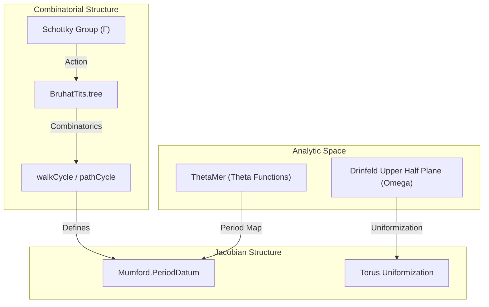
Sources: [P2M/Sol/S_AlgebraicCurve_Pic0_exists_periodDatum_Q_mul_period_eq_one_of_mumfordQuotient.lean:1-38](), [P2M/Sol/S_CerednikDrinfeld_Omega_exists_mem_ribbonKernel_and_v_apply_smul_eq_mul_zpow_stabWidth_of_isUnit_of_forall_isOfFinOrder.lean:113-115]()

### Key Uniformization Functions
*   **Equivariant Uniformization**: The map from the upper half-plane to the curve is established in `CerednikDrinfeld.EquivariantUniformization` [P2M/Sol/S_AlgebraicCurve_Pic0_exists_periodDatum_Q_mul_period_eq_one_of_mumfordQuotient.lean:8-8]().
*   **Theta Functions**: `ThetaMer` functions are used to define the analytic sections that descend to the Jacobian [P2M/Sol/S_CerednikDrinfeld_Omega_exists_pairs_v_prod_theta_eq_v_zpow_stabWidth_mul_pathCycle_forall_ne.lean:1-7]().
*   **Stabilizer Finiteness**: Finiteness of stabilizers in the Schottky group is a prerequisite for the discreteness of the period lattice, verified in `finite_stabilizer_of_finite_stabilizer_dart` [P2M/Sol/S_AlgebraicCurve_Pic0_exists_periodDatum_Q_mul_period_eq_one_of_mumfordQuotient.lean:58-60]().

Sources: [P2M/Sol/S_AlgebraicCurve_Pic0_exists_periodDatum_Q_mul_period_eq_one_of_mumfordQuotient.lean:50-100](), [P2M/Sol/S_CerednikDrinfeld_Omega_exists_pairs_v_prod_theta_eq_v_zpow_stabWidth_mul_pathCycle_forall_ne.lean:38-80]()

## Semistable Models and Cartier Data

The connection between the Jacobian over the fraction field and its reduction is handled via `SemistableModel`.

### Cartier Data and Local Rings
The theory relates divisors on the generic fiber to Cartier data on the semistable model.
*   **Semistable Charts**: Components are modeled using `ComponentChart` and `Annulus` structures [P2M/Sol/S_AlgebraicCurve_exists_cartierData_eq_ord_and_pt_mem_iff_of_forall_mapDomain_placeMap_eq_zero_of_balanced_of_semistableModel.lean:24-28]().
*   **Valuation Logic**: The `ord_pos_of_residue_eq_zero` theorem links the valuation (order) of a function at a place to its behavior in the residue field of the semistable model [P2M/Sol/S_AlgebraicCurve_exists_cartierData_eq_ord_and_pt_mem_iff_of_forall_mapDomain_placeMap_eq_zero_of_balanced_of_semistableModel.lean:64-66]().
*   **Descent**: Lifting Cartier data from the reduction to the generic fiber is performed in `S_AlgebraicCurve_exists_cartierData_kummer_finiteLevel_of_cartierData_of_balanced_of_semistableModel_of_descent` [P2M/Sol/S_AlgebraicCurve_exists_cartierData_kummer_finiteLevel_of_cartierData_of_balanced_of_semistableModel_of_descent.lean:20-20]().

### Data Flow for Nodal Reduction
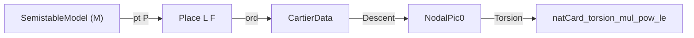
Sources: [P2M/Sol/S_AlgebraicCurve_exists_cartierData_eq_ord_and_pt_mem_iff_of_forall_mapDomain_placeMap_eq_zero_of_balanced_of_semistableModel.lean:30-66](), [P2M/Sol/S_AlgebraicCurve_natCard_torsion_tropicalPositionZero_mul_pow_le_of_semistableCovering_of_discFibres_of_rankOne_of_charZero_of_semistableModel.lean:1-12]()

---

# Page: Curve Models and Integral Structures

# Curve Models and Integral Structures

<details>
<summary>Relevant source files</summary>

The following files were used as context for generating this wiki page:

- [Definitions/Def_AlgebraicCurve_PlaceEvaluationAlgebra.lean](Definitions/Def_AlgebraicCurve_PlaceEvaluationAlgebra.lean)
- [P2M/Sol/S_Algebra_ringKrullDim_eq_toENat_trdeg_of_finiteType.lean](P2M/Sol/S_Algebra_ringKrullDim_eq_toENat_trdeg_of_finiteType.lean)
- [P2M/Sol/S_AlgebraicCurve_Annulus_exists_twoEnd_of_modulus_ne_zero.lean](P2M/Sol/S_AlgebraicCurve_Annulus_exists_twoEnd_of_modulus_ne_zero.lean)
- [P2M/Sol/S_AlgebraicCurve_Annulus_ord_residue_eq_neg_and_evalAt_residue_mul_zpow_eq_of_forall_ord_eq_zero_of_rankOne.lean](P2M/Sol/S_AlgebraicCurve_Annulus_ord_residue_eq_neg_and_evalAt_residue_mul_zpow_eq_of_forall_ord_eq_zero_of_rankOne.lean)
- [P2M/Sol/S_AlgebraicCurve_Annulus_residue_evalAt_eq_evalAt_residue_of_ord_residue_eq_zero_of_regularProlongation.lean](P2M/Sol/S_AlgebraicCurve_Annulus_residue_evalAt_eq_evalAt_residue_of_ord_residue_eq_zero_of_regularProlongation.lean)
- [P2M/Sol/S_AlgebraicCurve_Annulus_residue_evalAt_eq_evalAt_residue_of_ord_residue_eq_zero_of_regularProlongation_modulus_div_param.lean](P2M/Sol/S_AlgebraicCurve_Annulus_residue_evalAt_eq_evalAt_residue_of_ord_residue_eq_zero_of_regularProlongation_modulus_div_param.lean)
- [P2M/Sol/S_AlgebraicCurve_ComponentChart_exists_mem_dom_forall_isUnit_evalAt_of_forall_isUnit.lean](P2M/Sol/S_AlgebraicCurve_ComponentChart_exists_mem_dom_forall_isUnit_evalAt_of_forall_isUnit.lean)
- [P2M/Sol/S_AlgebraicCurve_ComponentChart_fibreParam_laws_of_ord_residue_sub_eq_one.lean](P2M/Sol/S_AlgebraicCurve_ComponentChart_fibreParam_laws_of_ord_residue_sub_eq_one.lean)
- [P2M/Sol/S_AlgebraicCurve_CurveModel_exists_finite_flat_hom_of_algHom.lean](P2M/Sol/S_AlgebraicCurve_CurveModel_exists_finite_flat_hom_of_algHom.lean)
- [P2M/Sol/S_AlgebraicCurve_CurveModel_exists_hom_of_algHom.lean](P2M/Sol/S_AlgebraicCurve_CurveModel_exists_hom_of_algHom.lean)
- [P2M/Sol/S_AlgebraicCurve_CurveModel_pointEquivPlace_eq_of_forall_sub_algebraMap_mem_nonunits_of_twoChartIntegralModel.lean](P2M/Sol/S_AlgebraicCurve_CurveModel_pointEquivPlace_eq_of_forall_sub_algebraMap_mem_nonunits_of_twoChartIntegralModel.lean)
- [P2M/Sol/S_AlgebraicCurve_NodeRingLayers_mem_of_isIntegral_and_exists_valuationSubring_localization_of_uvCrossingModel.lean](P2M/Sol/S_AlgebraicCurve_NodeRingLayers_mem_of_isIntegral_and_exists_valuationSubring_localization_of_uvCrossingModel.lean)
- [P2M/Sol/S_AlgebraicCurve_Place_analyticCoord_of_agree.lean](P2M/Sol/S_AlgebraicCurve_Place_analyticCoord_of_agree.lean)
- [P2M/Sol/S_AlgebraicCurve_Place_card_fiber_eq_finrank_adjoin_of_ord_eq_one.lean](P2M/Sol/S_AlgebraicCurve_Place_card_fiber_eq_finrank_adjoin_of_ord_eq_one.lean)
- [P2M/Sol/S_AlgebraicCurve_Place_connectedSpace_of_chartedSpace_of_meromorphicOrderAt_eq_ord_complex.lean](P2M/Sol/S_AlgebraicCurve_Place_connectedSpace_of_chartedSpace_of_meromorphicOrderAt_eq_ord_complex.lean)
- [P2M/Sol/S_AlgebraicCurve_Place_eq_of_comap_eq_of_forall_mem_nonunits_iff.lean](P2M/Sol/S_AlgebraicCurve_Place_eq_of_comap_eq_of_forall_mem_nonunits_iff.lean)
- [P2M/Sol/S_AlgebraicCurve_Place_evalAt_ne_zero.lean](P2M/Sol/S_AlgebraicCurve_Place_evalAt_ne_zero.lean)
- [P2M/Sol/S_AlgebraicCurve_Place_exists_chartedSpace_meromorphicOrderAt_evalAt_eq_ord_complex.lean](P2M/Sol/S_AlgebraicCurve_Place_exists_chartedSpace_meromorphicOrderAt_evalAt_eq_ord_complex.lean)
- [P2M/Sol/S_AlgebraicCurve_Place_exists_finset_forall_exists_localParam_eq_complex.lean](P2M/Sol/S_AlgebraicCurve_Place_exists_finset_forall_exists_localParam_eq_complex.lean)
- [P2M/Sol/S_AlgebraicCurve_Place_exists_forall_mem_hasValue.lean](P2M/Sol/S_AlgebraicCurve_Place_exists_forall_mem_hasValue.lean)
- [P2M/Sol/S_AlgebraicCurve_Place_exists_forall_mem_iff_adjoin_sup_of_linearDisjoint.lean](P2M/Sol/S_AlgebraicCurve_Place_exists_forall_mem_iff_adjoin_sup_of_linearDisjoint.lean)
- [P2M/Sol/S_AlgebraicCurve_Place_exists_forgetConstants_restrict_eq_of_isConstantFieldExtension.lean](P2M/Sol/S_AlgebraicCurve_Place_exists_forgetConstants_restrict_eq_of_isConstantFieldExtension.lean)
- [P2M/Sol/S_AlgebraicCurve_Place_exists_localParam_meromorphicOrderAt_evalAt_eq_ord_complex.lean](P2M/Sol/S_AlgebraicCurve_Place_exists_localParam_meromorphicOrderAt_evalAt_eq_ord_complex.lean)
- [P2M/Sol/S_AlgebraicCurve_Place_exists_of_valuationSubring_of_finiteDimensional.lean](P2M/Sol/S_AlgebraicCurve_Place_exists_of_valuationSubring_of_finiteDimensional.lean)
- [P2M/Sol/S_AlgebraicCurve_Place_localParam_eventually_eq_comp_evalAt_complex.lean](P2M/Sol/S_AlgebraicCurve_Place_localParam_eventually_eq_comp_evalAt_complex.lean)
- [P2M/Sol/S_AlgebraicCurve_Place_ramificationIndex_forgetConstants_eq_one_of_adjoin_range_eq_top.lean](P2M/Sol/S_AlgebraicCurve_Place_ramificationIndex_forgetConstants_eq_one_of_adjoin_range_eq_top.lean)
- [P2M/Sol/S_AlgebraicCurve_Place_ramificationIndex_forgetConstants_eq_one_of_isConstantFieldExtension.lean](P2M/Sol/S_AlgebraicCurve_Place_ramificationIndex_forgetConstants_eq_one_of_isConstantFieldExtension.lean)
- [P2M/Sol/S_AlgebraicCurve_Place_readDifferential_eventuallyEq_div_add_of_ordDifferential.lean](P2M/Sol/S_AlgebraicCurve_Place_readDifferential_eventuallyEq_div_add_of_ordDifferential.lean)
- [P2M/Sol/S_AlgebraicCurve_Place_sum_fiber_ord_eq_finrank.lean](P2M/Sol/S_AlgebraicCurve_Place_sum_fiber_ord_eq_finrank.lean)
- [P2M/Sol/S_AlgebraicCurve_Place_sum_ramification_evalAt_eq.lean](P2M/Sol/S_AlgebraicCurve_Place_sum_ramification_evalAt_eq.lean)
- [P2M/Sol/S_AlgebraicCurve_RegularProlongation_exists_placeMap_mapDomain_eq_ord_of_residue_integralClosure_surjective.lean](P2M/Sol/S_AlgebraicCurve_RegularProlongation_exists_placeMap_mapDomain_eq_ord_of_residue_integralClosure_surjective.lean)
- [P2M/Sol/S_AlgebraicCurve_RegularProlongation_integers_le_of_annulus_attached_of_forall_mem_of_param_mem_units.lean](P2M/Sol/S_AlgebraicCurve_RegularProlongation_integers_le_of_annulus_attached_of_forall_mem_of_param_mem_units.lean)
- [P2M/Sol/S_AlgebraicCurve_RegularProlongation_sum_ord_eq_ord_residue_of_residue_integralClosure_surjective.lean](P2M/Sol/S_AlgebraicCurve_RegularProlongation_sum_ord_eq_ord_residue_of_residue_integralClosure_surjective.lean)
- [P2M/Sol/S_AlgebraicCurve_RegularProlongation_sum_ord_eq_sum_ord_residue_of_isIntegral_adjoin.lean](P2M/Sol/S_AlgebraicCurve_RegularProlongation_sum_ord_eq_sum_ord_residue_of_isIntegral_adjoin.lean)
- [P2M/Sol/S_AlgebraicCurve_TwoChartIntegralModel_exists_hom_isFinite_surjective_chartMap_finite_of_algHom.lean](P2M/Sol/S_AlgebraicCurve_TwoChartIntegralModel_exists_hom_isFinite_surjective_chartMap_finite_of_algHom.lean)
- [P2M/Sol/S_AlgebraicCurve_TwoChartIntegralModel_exists_hom_isFinite_surjective_of_algHom.lean](P2M/Sol/S_AlgebraicCurve_TwoChartIntegralModel_exists_hom_isFinite_surjective_of_algHom.lean)
- [P2M/Sol/S_AlgebraicCurve_eq_of_specializes_of_specializes_of_ne_of_regularProlongation_of_isCurveOver.lean](P2M/Sol/S_AlgebraicCurve_eq_of_specializes_of_specializes_of_ne_of_regularProlongation_of_isCurveOver.lean)
- [P2M/Sol/S_AlgebraicCurve_existsUnique_point_localRing_eq_and_specializes_closedPoint_and_forall_eq_of_isProper_of_isIntegrallyClosed.lean](P2M/Sol/S_AlgebraicCurve_existsUnique_point_localRing_eq_and_specializes_closedPoint_and_forall_eq_of_isProper_of_isIntegrallyClosed.lean)
- [P2M/Sol/S_AlgebraicCurve_exists_finitePresentation_isLocalizationAtPrime_localRing_of_mem_smoothLocus.lean](P2M/Sol/S_AlgebraicCurve_exists_finitePresentation_isLocalizationAtPrime_localRing_of_mem_smoothLocus.lean)
- [P2M/Sol/S_AlgebraicCurve_exists_formallySmooth_isLocalizationAtPrime_localRing_of_mem_smoothLocus.lean](P2M/Sol/S_AlgebraicCurve_exists_formallySmooth_isLocalizationAtPrime_localRing_of_mem_smoothLocus.lean)
- [P2M/Sol/S_AlgebraicCurve_exists_maximalIdeal_localRing_eq_map_sup_span_of_ord_eq_one_of_mem_smoothLocus.lean](P2M/Sol/S_AlgebraicCurve_exists_maximalIdeal_localRing_eq_map_sup_span_of_ord_eq_one_of_mem_smoothLocus.lean)
- [P2M/Sol/S_AlgebraicCurve_exists_place_evalAt_eq_and_forall_evalAt_eq_zero_of_ord_eq_one_of_mem_smoothLocus.lean](P2M/Sol/S_AlgebraicCurve_exists_place_evalAt_eq_and_forall_evalAt_eq_zero_of_ord_eq_one_of_mem_smoothLocus.lean)
- [P2M/Sol/S_AlgebraicCurve_ker_productMap_eq_of_placeEquiv_restrictAlong.lean](P2M/Sol/S_AlgebraicCurve_ker_productMap_eq_of_placeEquiv_restrictAlong.lean)
- [P2M/Sol/S_AlgebraicCurve_mem_localRing_of_specializes_of_mem_integers_of_forall_mem_toValuationSubring_of_isIntegrallyClosed.lean](P2M/Sol/S_AlgebraicCurve_mem_localRing_of_specializes_of_mem_integers_of_forall_mem_toValuationSubring_of_isIntegrallyClosed.lean)
- [P2M/Sol/S_AlgebraicCurve_mem_span_range_algebraMap_of_constantFieldExtension_of_isAlgClosed.lean](P2M/Sol/S_AlgebraicCurve_mem_span_range_algebraMap_of_constantFieldExtension_of_isAlgClosed.lean)
- [P2M/Sol/S_AlgebraicGeometry_Flat_of_comp_of_flat_of_surjective.lean](P2M/Sol/S_AlgebraicGeometry_Flat_of_comp_of_flat_of_surjective.lean)
- [P2M/Sol/S_AlgebraicGeometry_Scheme_RationalMap_exists_specializes_ringKrullDim_le_one_of_not_mem_domain.lean](P2M/Sol/S_AlgebraicGeometry_Scheme_RationalMap_exists_specializes_ringKrullDim_le_one_of_not_mem_domain.lean)
- [P2M/Sol/S_AlgebraicGeometry_exists_isIrreducible_topologicalKrullDim_le_add_of_apply_eq_of_isClosed_singleton.lean](P2M/Sol/S_AlgebraicGeometry_exists_isIrreducible_topologicalKrullDim_le_add_of_apply_eq_of_isClosed_singleton.lean)
- [P2M/Sol/S_AlgebraicGeometry_exists_localRing_eq_localization_of_affineModel_of_map_maximalIdeal_le_of_isIntegrallyClosed_ofPrime.lean](P2M/Sol/S_AlgebraicGeometry_exists_localRing_eq_localization_of_affineModel_of_map_maximalIdeal_le_of_isIntegrallyClosed_ofPrime.lean)
- [P2M/Sol/S_AlgebraicGeometry_exists_localRing_eq_localization_of_normal_affineModel_of_map_maximalIdeal_le.lean](P2M/Sol/S_AlgebraicGeometry_exists_localRing_eq_localization_of_normal_affineModel_of_map_maximalIdeal_le.lean)
- [P2M/Sol/S_AlgebraicGeometry_exists_smoothProperCurve_hom_comp_eq_of_ringKrullDim_eq_one.lean](P2M/Sol/S_AlgebraicGeometry_exists_smoothProperCurve_hom_comp_eq_of_ringKrullDim_eq_one.lean)
- [P2M/Sol/S_AlgebraicGeometry_exists_smoothProperCurve_opens_hom_comp_eq_of_ringKrullDim_eq_one.lean](P2M/Sol/S_AlgebraicGeometry_exists_smoothProperCurve_opens_hom_comp_eq_of_ringKrullDim_eq_one.lean)
- [P2M/Sol/S_AlgebraicGeometry_exists_valuationSubring_eq_range_stalk_of_iso_pullback_of_mem_smoothLocus_of_isDiscreteValuationRing_of_specializes.lean](P2M/Sol/S_AlgebraicGeometry_exists_valuationSubring_eq_range_stalk_of_iso_pullback_of_mem_smoothLocus_of_isDiscreteValuationRing_of_specializes.lean)
- [P2M/Sol/S_AlgebraicGeometry_forall_mem_iff_not_exists_or_of_isPrime_of_ne_nodeIdeal_of_nodeChart.lean](P2M/Sol/S_AlgebraicGeometry_forall_mem_iff_not_exists_or_of_isPrime_of_ne_nodeIdeal_of_nodeChart.lean)
- [P2M/Sol/S_AlgebraicGeometry_isDiscreteValuationRing_stalk_of_mem_smoothLocus_of_forall_specializes_eq.lean](P2M/Sol/S_AlgebraicGeometry_isDiscreteValuationRing_stalk_of_mem_smoothLocus_of_forall_specializes_eq.lean)
- [P2M/Sol/S_AlgebraicGeometry_isFinite_and_flat_and_surjective_of_locallyQuasiFinite_of_smoothOfRelativeDimension.lean](P2M/Sol/S_AlgebraicGeometry_isFinite_and_flat_and_surjective_of_locallyQuasiFinite_of_smoothOfRelativeDimension.lean)
- [P2M/Sol/S_AlgebraicGeometry_isIntegrallyClosed_stalk_pullback_of_ordinaryDoublePoints_of_isDiscreteValuationRing_of_relDimOne.lean](P2M/Sol/S_AlgebraicGeometry_isIntegrallyClosed_stalk_pullback_of_ordinaryDoublePoints_of_isDiscreteValuationRing_of_relDimOne.lean)
- [P2M/Sol/S_AlgebraicGeometry_isIntegrallyClosed_stalk_pullback_of_ringEquiv_adicCompletion_stalk_of_isDiscreteValuationRing.lean](P2M/Sol/S_AlgebraicGeometry_isIntegrallyClosed_stalk_pullback_of_ringEquiv_adicCompletion_stalk_of_isDiscreteValuationRing.lean)
- [P2M/Sol/S_AlgebraicGeometry_mem_localRing_node_iff_exists_mul_eq_of_nodeChart_of_forall_not_dominates.lean](P2M/Sol/S_AlgebraicGeometry_mem_localRing_node_iff_exists_mul_eq_of_nodeChart_of_forall_not_dominates.lean)
- [P2M/Sol/S_AlgebraicGeometry_ringKrullDim_stalk_add_topologicalKrullDim_closure_of_isIntegral.lean](P2M/Sol/S_AlgebraicGeometry_ringKrullDim_stalk_add_topologicalKrullDim_closure_of_isIntegral.lean)
- [P2M/Sol/S_AlgebraicGeometry_ringKrullDim_stalk_eq_of_isFinite_endomorphism.lean](P2M/Sol/S_AlgebraicGeometry_ringKrullDim_stalk_eq_of_isFinite_endomorphism.lean)
- [P2M/Sol/S_AlgebraicGeometry_ringKrullDim_stalk_eq_of_locallyQuasiFinite_endomorphism.lean](P2M/Sol/S_AlgebraicGeometry_ringKrullDim_stalk_eq_of_locallyQuasiFinite_endomorphism.lean)
- [P2M/Sol/S_AlgebraicGeometry_toENat_trdeg_residueField_eq_topologicalKrullDim_closure.lean](P2M/Sol/S_AlgebraicGeometry_toENat_trdeg_residueField_eq_topologicalKrullDim_closure.lean)
- [P2M/Sol/S_AlgebraicGeometry_topologicalKrullDim_eq_ringKrullDim_of_isAffineOpen_of_isIntegral.lean](P2M/Sol/S_AlgebraicGeometry_topologicalKrullDim_eq_ringKrullDim_of_isAffineOpen_of_isIntegral.lean)
- [P2M/Sol/S_AlgebraicGeometry_topologicalKrullDim_preimage_eq_of_isFinite_of_surjective.lean](P2M/Sol/S_AlgebraicGeometry_topologicalKrullDim_preimage_eq_of_isFinite_of_surjective.lean)
- [P2M/Sol/S_GoodReductionJacobian_AbelianSchemePropertyBundle_flat_of_isFinite.lean](P2M/Sol/S_GoodReductionJacobian_AbelianSchemePropertyBundle_flat_of_isFinite.lean)
- [P2M/Sol/S_GoodReductionJacobian_RelativeGroupLaw_isFinite_and_flat_of_surjective_of_isFinite_pullback_snd.lean](P2M/Sol/S_GoodReductionJacobian_RelativeGroupLaw_isFinite_and_flat_of_surjective_of_isFinite_pullback_snd.lean)
- [P2M/Sol/S_Ideal_exists_isPrime_le_and_le_and_ringKrullDim_quotient_eq_one.lean](P2M/Sol/S_Ideal_exists_isPrime_le_and_le_and_ringKrullDim_quotient_eq_one.lean)
- [P2M/Sol/S_Ideal_height_add_ringKrullDim_quotient_eq_ringKrullDim_of_finiteType.lean](P2M/Sol/S_Ideal_height_add_ringKrullDim_quotient_eq_ringKrullDim_of_finiteType.lean)
- [P2M/Sol/S_Ideal_natCast_le_ringKrullDim_quotient_of_mem_minimalPrimes_map_of_algebraicIndependent.lean](P2M/Sol/S_Ideal_natCast_le_ringKrullDim_quotient_of_mem_minimalPrimes_map_of_algebraicIndependent.lean)

</details>


This page describes the implementation of integral models for algebraic curves, focusing on smooth proper curves over a base, the construction of two-chart models, and the characterization of local rings at smooth and singular (node) points.

## Overview of Curve Models

In this repository, a curve model is treated as a scheme morphism $X \to S$ satisfying specific properties like smoothness and properness. The codebase provides infrastructure for moving between the abstract category-theoretic definition of schemes and the concrete ring-theoretic data of their stalks and function fields.

### Key Definitions and Structures

*   **`CurveModel`**: Represents a smooth proper curve over a base scheme $S$ [Definitions/Def_AlgebraicCurve_CurveModel:7-9]().
*   **`TwoChartIntegralModel`**: A specific construction of an integral model using two affine charts, typically used for modular curves where one chart covers the finite part and another covers the neighborhood of infinity [Definitions/Def_AlgebraicCurve_TwoChartIntegralModel:2-3]().
*   **`SemistableModel`**: Extends the notion of models to include singular fibers, specifically those with ordinary double points (nodes) [Definitions/Def_AlgebraicCurve_SemistableModel:2-3]().

### Code Entity Space to Technical Concept Mapping

The following diagram bridges the abstract algebraic geometry concepts to the specific Lean 4 classes and functions used in the repository.

"Entity Mapping: Models and Stalks"
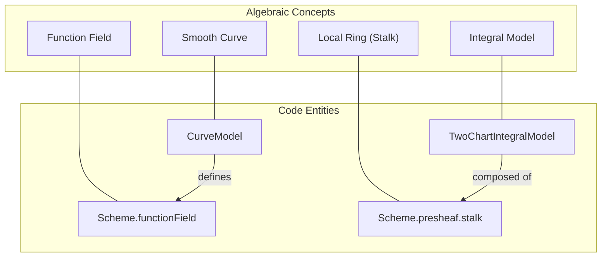
Sources: [Definitions/Def_AlgebraicCurve_CurveModel:7-9](), [Definitions/Def_AlgebraicCurve_TwoChartIntegralModel:2-3](), [P2M/Sol/S_AlgebraicCurve_CurveModel_exists_hom_of_algHom.lean:49-51]()

## Integral Structures and Valuations

The codebase extensively uses the relationship between the local rings of a curve and its function field. For an integral scheme $X$, the stalk at a point $x$, denoted `X.presheaf.stalk x`, is a subring of the function field `X.functionField` [P2M/Sol/S_AlgebraicCurve_CurveModel_exists_hom_of_algHom.lean:49-53]().

### Valuation Rings and Smoothness

A key result in the library is that for a curve $C$ smooth over a field $K$, the stalks at every point are valuation rings [P2M/Sol/S_AlgebraicCurve_CurveModel_exists_hom_of_algHom.lean:132-134](). This is proven by showing that standard smooth morphisms of relative dimension 1 locally look like polynomial rings, whose localizations at prime ideals are valuation rings [P2M/Sol/S_AlgebraicCurve_CurveModel_exists_hom_of_algHom.lean:110-126]().

### Lifting Rational Maps

The `ValuativeCriterion.Existence` property is used to extend rational maps to morphisms. If $Y \to S$ satisfies the valuative criterion and we have a rational map from $X$ to $Y$, the map extends to any point $x \in X$ where the stalk is a valuation ring [P2M/Sol/S_AlgebraicCurve_CurveModel_exists_hom_of_algHom.lean:55-86]().

"Data Flow: Rational Map Extension"
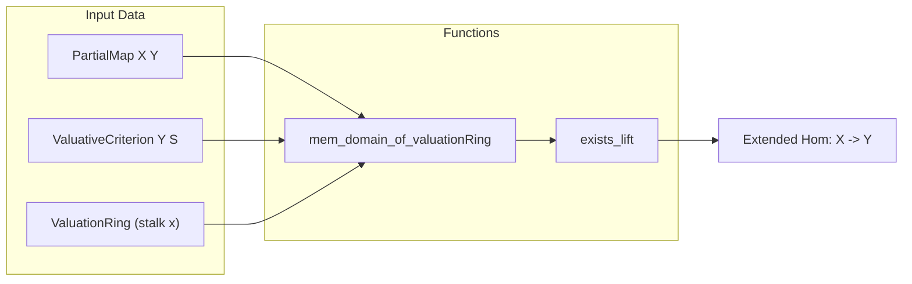
Sources: [P2M/Sol/S_AlgebraicCurve_CurveModel_exists_hom_of_algHom.lean:55-86]()

## Two-Chart Integral Models

The `TwoChartIntegralModel` is a concrete implementation of a curve over a base ring $R$. It is defined by two sub-algebras of the function field $F$:
1.  `chartAlg R F {j}`: The "finite" chart, often related to the $j$-invariant [P2M/Sol/S_AlgebraicCurve_TwoChartIntegralModel_exists_hom_isFinite_surjective_of_algHom.lean:51]().
2.  `chartAlg R F {j⁻¹}`: The "infinite" chart [P2M/Sol/S_AlgebraicCurve_TwoChartIntegralModel_exists_hom_isFinite_surjective_of_algHom.lean:52]().

These charts are glued along the overlap `chartAlg R F {j, j⁻¹}` [P2M/Sol/S_AlgebraicCurve_TwoChartIntegralModel_exists_hom_isFinite_surjective_of_algHom.lean:53]().

### Integral Closure and Normality

The model construction relies on the `chartAlg` being integrally closed in the function field. The function `isIntegrallyClosed_chartAlg` proves that if $S$ is a set of elements in $F$, then `chartAlg R F S` is integrally closed in $F$ [P2M/Sol/S_AlgebraicCurve_TwoChartIntegralModel_exists_hom_isFinite_surjective_of_algHom.lean:98-100]().

| Function/Theorem | Purpose | File Reference |
| :--- | :--- | :--- |
| `chartMap` | Defines a morphism between charts induced by a field map $\phi: F \to F'$ | [S_AlgebraicCurve_TwoChartIntegralModel_exists_hom_isFinite_surjective_of_algHom.lean:33-34]() |
| `inclFin` / `inclInf` | The inclusion maps from finite/infinite charts to the overlap | [S_AlgebraicCurve_TwoChartIntegralModel_exists_hom_isFinite_surjective_of_algHom.lean:70-74]() |
| `isIntegralElem_coe` | Relates integrality in the chart to integrality over the base | [S_AlgebraicCurve_TwoChartIntegralModel_exists_hom_isFinite_surjective_of_algHom.lean:104-106]() |

## Node Rings and Ordinary Double Points

Semistable models involve "nodes" or ordinary double points. The local structure of these points is captured by `node rings`.

### Local Ring Characterization

For a semistable model $X$, the local ring at a node $z$ is characterized by the existence of elements $u, v$ in the completion such that $uv = \pi$, where $\pi$ is a uniformizer of the base ring. The file `S_AlgebraicGeometry_mem_localRing_node_iff_exists_mul_eq_of_nodeChart_of_forall_not_dominates.lean` provides the machinery to identify elements of the local ring based on their behavior under valuations and specialized node charts [P2M/Sol/S_AlgebraicGeometry_mem_localRing_node_iff_exists_mul_eq_of_nodeChart_of_forall_not_dominates.lean:30-47]().

### Smooth Locus

The smooth locus of a model is the open subscheme where the morphism to the base is smooth. At points in the smooth locus, the stalks are regular local rings. For curves (relative dimension 1), these are Discrete Valuation Rings (DVRs) [P2M/Sol/S_AlgebraicGeometry_isIntegrallyClosed_stalk_pullback_of_ordinaryDoublePoints_of_isDiscreteValuationRing_of_relDimOne.lean:3-9]().

## Algebraic and Analytic Structures

Over $\mathbb{C}$, the algebraic structure of the curve corresponds to a Riemann surface. The library handles this via:
*   **`Place.evalAt`**: Evaluates a meromorphic function (element of the function field) at a place (point) of the curve [P2M/Sol/S_AlgebraicCurve_Place_exists_finset_forall_exists_localParam_eq_complex.lean:16-18]().
*   **`Place.ord`**: The valuation (order of vanishing/pole) of a function at a place [P2M/Sol/S_AlgebraicCurve_Place_exists_finset_forall_exists_localParam_eq_complex.lean:33-34]().
*   **Local Parameters**: For any place $v$, there exists a local parameter $t$ (a function with `ord v t = 1`) such that the evaluation of other functions can be expressed via power series in $t$ [P2M/Sol/S_AlgebraicCurve_Place_exists_finset_forall_exists_localParam_eq_complex.lean:133-142]().

### Sources
*   `Definitions/Def_AlgebraicCurve_CurveModel` [7-9]()
*   `Definitions/Def_AlgebraicCurve_TwoChartIntegralModel` [2-3]()
*   `P2M/Sol/S_AlgebraicCurve_CurveModel_exists_hom_of_algHom.lean` [49-86, 110-134]()
*   `P2M/Sol/S_AlgebraicCurve_TwoChartIntegralModel_exists_hom_isFinite_surjective_of_algHom.lean` [33-106]()
*   `P2M/Sol/S_AlgebraicCurve_Place_exists_finset_forall_exists_localParam_eq_complex.lean` [16-142]()
*   `P2M/Sol/S_AlgebraicGeometry_mem_localRing_node_iff_exists_mul_eq_of_nodeChart_of_forall_not_dominates.lean` [30-47]()

---

# Page: Algebraic Geometry Foundations

# Algebraic Geometry Foundations

<details>
<summary>Relevant source files</summary>

The following files were used as context for generating this wiki page:

- [P2M/Sol/S_AlgebraicGeometry_Polarisation_KernelIsTwoTorsion_of_forall_away_of_isInvertible.lean](P2M/Sol/S_AlgebraicGeometry_Polarisation_KernelIsTwoTorsion_of_forall_away_of_isInvertible.lean)
- [P2M/Sol/S_AlgebraicGeometry_Polarisation_KernelIsTwoTorsion_of_pullback_of_faithfullyFlat.lean](P2M/Sol/S_AlgebraicGeometry_Polarisation_KernelIsTwoTorsion_of_pullback_of_faithfullyFlat.lean)
- [P2M/Sol/S_AlgebraicGeometry_Polarisation_KernelIsTwoTorsion_pullback_of_isPullback_of_isInvertible.lean](P2M/Sol/S_AlgebraicGeometry_Polarisation_KernelIsTwoTorsion_pullback_of_isPullback_of_isInvertible.lean)
- [P2M/Sol/S_AlgebraicGeometry_Polarisation_KernelTrivial_of_forall_away_of_isInvertible.lean](P2M/Sol/S_AlgebraicGeometry_Polarisation_KernelTrivial_of_forall_away_of_isInvertible.lean)
- [P2M/Sol/S_AlgebraicGeometry_Polarisation_RosatiCompatible_of_forall_away_of_isInvertible.lean](P2M/Sol/S_AlgebraicGeometry_Polarisation_RosatiCompatible_of_forall_away_of_isInvertible.lean)
- [P2M/Sol/S_AlgebraicGeometry_Polarisation_RosatiCompatible_of_pullback_of_faithfullyFlat.lean](P2M/Sol/S_AlgebraicGeometry_Polarisation_RosatiCompatible_of_pullback_of_faithfullyFlat.lean)
- [P2M/Sol/S_AlgebraicGeometry_Polarisation_RosatiCompatible_pullback_of_isPullback.lean](P2M/Sol/S_AlgebraicGeometry_Polarisation_RosatiCompatible_pullback_of_isPullback.lean)
- [P2M/Sol/S_AlgebraicGeometry_Polarisation_exists_faithfullyFlat_principalSqrt_of_kernelTrivial_of_locIsoOnBase.lean](P2M/Sol/S_AlgebraicGeometry_Polarisation_exists_faithfullyFlat_principalSqrt_of_kernelTrivial_of_locIsoOnBase.lean)
- [P2M/Sol/S_AlgebraicGeometry_Polarisation_exists_isLocalRing_faithfullyFlat_kernelTrivial_locIsoOnBase_pair_of_isLocalRing.lean](P2M/Sol/S_AlgebraicGeometry_Polarisation_exists_isLocalRing_faithfullyFlat_kernelTrivial_locIsoOnBase_pair_of_isLocalRing.lean)
- [P2M/Sol/S_AlgebraicGeometry_Polarisation_kernelIsTwoTorsion_of_isPullback_of_kernelTrivial_of_locIsoOnBase_of_isAlgClosed.lean](P2M/Sol/S_AlgebraicGeometry_Polarisation_kernelIsTwoTorsion_of_isPullback_of_kernelTrivial_of_locIsoOnBase_of_isAlgClosed.lean)
- [P2M/Sol/S_AlgebraicGeometry_Polarisation_memKernel_iff_memKernel_comp_of_isPullback.lean](P2M/Sol/S_AlgebraicGeometry_Polarisation_memKernel_iff_memKernel_comp_of_isPullback.lean)
- [P2M/Sol/S_AlgebraicGeometry_Polarisation_principalSqrt_baseChange_of_principalSqrt_chart.lean](P2M/Sol/S_AlgebraicGeometry_Polarisation_principalSqrt_baseChange_of_principalSqrt_chart.lean)
- [P2M/Sol/S_AlgebraicGeometry_PolarisedAbelianScheme_hasPrincipalRoot_of_isPullback.lean](P2M/Sol/S_AlgebraicGeometry_PolarisedAbelianScheme_hasPrincipalRoot_of_isPullback.lean)
- [P2M/Sol/S_AlgebraicGeometry_PolarisedAbelianScheme_isOfType_of_isPullback.lean](P2M/Sol/S_AlgebraicGeometry_PolarisedAbelianScheme_isOfType_of_isPullback.lean)
- [P2M/Sol/S_AlgebraicGeometry_PolarisedAbelianScheme_isSymmetric_of_isPullback.lean](P2M/Sol/S_AlgebraicGeometry_PolarisedAbelianScheme_isSymmetric_of_isPullback.lean)
- [P2M/Sol/S_AlgebraicGeometry_RelEffCartierDiv_eq_of_isAlgEquivZero_of_nonempty_tensor_lineBundle_iso_lineBundle.lean](P2M/Sol/S_AlgebraicGeometry_RelEffCartierDiv_eq_of_isAlgEquivZero_of_nonempty_tensor_lineBundle_iso_lineBundle.lean)
- [P2M/Sol/S_AlgebraicGeometry_RelEffCartierDiv_eq_of_isAlgEquivZero_pullback_mapOnProdOver_of_nonempty_tensor_lineBundle_iso_lineBundle.lean](P2M/Sol/S_AlgebraicGeometry_RelEffCartierDiv_eq_of_isAlgEquivZero_pullback_mapOnProdOver_of_nonempty_tensor_lineBundle_iso_lineBundle.lean)
- [P2M/Sol/S_AlgebraicGeometry_RelEffCartierDiv_exists_nonempty_tensor_lineBundle_iso_lineBundle.lean](P2M/Sol/S_AlgebraicGeometry_RelEffCartierDiv_exists_nonempty_tensor_lineBundle_iso_lineBundle.lean)
- [P2M/Sol/S_AlgebraicGeometry_RelPicard_IsAlgEquivZero_nonempty_pullback_iso_pullback_unit_and_eulerChar_eq_one_of_curveModel_ratFunc.lean](P2M/Sol/S_AlgebraicGeometry_RelPicard_IsAlgEquivZero_nonempty_pullback_iso_pullback_unit_and_eulerChar_eq_one_of_curveModel_ratFunc.lean)
- [P2M/Sol/S_AlgebraicGeometry_RelPicard_exists_chart_subsingleton_H1_and_support_subset_fibre_of_twoSidedBlocks_of_injective.lean](P2M/Sol/S_AlgebraicGeometry_RelPicard_exists_chart_subsingleton_H1_and_support_subset_fibre_of_twoSidedBlocks_of_injective.lean)
- [P2M/Sol/S_AlgebraicGeometry_RelPicard_exists_chart_subsingleton_H1_fibre_of_blocks_of_injective.lean](P2M/Sol/S_AlgebraicGeometry_RelPicard_exists_chart_subsingleton_H1_fibre_of_blocks_of_injective.lean)
- [P2M/Sol/S_AlgebraicGeometry_RelPicard_exists_chart_subsingleton_H1_fibre_of_blocks_of_not_smooth.lean](P2M/Sol/S_AlgebraicGeometry_RelPicard_exists_chart_subsingleton_H1_fibre_of_blocks_of_not_smooth.lean)
- [P2M/Sol/S_AlgebraicGeometry_RelPicard_exists_injective_forall_finrank_H0_eq_zero_and_subsingleton_H1_restrict_fst_of_nearBlocks_of_twoGluedSmoothCurveDegeneration.lean](P2M/Sol/S_AlgebraicGeometry_RelPicard_exists_injective_forall_finrank_H0_eq_zero_and_subsingleton_H1_restrict_fst_of_nearBlocks_of_twoGluedSmoothCurveDegeneration.lean)
- [P2M/Sol/S_AlgebraicGeometry_RelPicard_exists_injective_forall_subsingleton_H1_and_finrank_H0_restrict_snd_of_farBlocks_of_twoGluedSmoothCurveDegeneration.lean](P2M/Sol/S_AlgebraicGeometry_RelPicard_exists_injective_forall_subsingleton_H1_and_finrank_H0_restrict_snd_of_farBlocks_of_twoGluedSmoothCurveDegeneration.lean)
- [P2M/Sol/S_AlgebraicGeometry_RelPicard_exists_injective_forall_subsingleton_H1_of_blocks_of_pool_of_bijective_sections.lean](P2M/Sol/S_AlgebraicGeometry_RelPicard_exists_injective_forall_subsingleton_H1_of_blocks_of_pool_of_bijective_sections.lean)
- [P2M/Sol/S_AlgebraicGeometry_RelPicard_exists_injective_forall_subsingleton_H1_of_blocks_of_twoLineDegeneration_of_sectionInSmoothLocus.lean](P2M/Sol/S_AlgebraicGeometry_RelPicard_exists_injective_forall_subsingleton_H1_of_blocks_of_twoLineDegeneration_of_sectionInSmoothLocus.lean)
- [P2M/Sol/S_AlgebraicGeometry_RelPicard_exists_opens_range_subset_iff_isAlgEquivZero_rigidify_lineBundle_baseChange_of_twoGluedSmoothCurveDegenerations.lean](P2M/Sol/S_AlgebraicGeometry_RelPicard_exists_opens_range_subset_iff_isAlgEquivZero_rigidify_lineBundle_baseChange_of_twoGluedSmoothCurveDegenerations.lean)
- [P2M/Sol/S_AlgebraicGeometry_RelPicard_exists_opens_range_subset_iff_isAlgEquivZero_twistModule_baseChange_of_twoLineDegenerations.lean](P2M/Sol/S_AlgebraicGeometry_RelPicard_exists_opens_range_subset_iff_isAlgEquivZero_twistModule_baseChange_of_twoLineDegenerations.lean)
- [P2M/Sol/S_AlgebraicGeometry_RelPicard_exists_relEffCartierDiv_I_eq_zeroSchemeIdeal_chartModule_fibre_of_not_smooth_of_isReduced.lean](P2M/Sol/S_AlgebraicGeometry_RelPicard_exists_relEffCartierDiv_I_eq_zeroSchemeIdeal_chartModule_fibre_of_not_smooth_of_isReduced.lean)
- [P2M/Sol/S_AlgebraicGeometry_RelPicard_exists_relEffCartierDiv_I_eq_zeroSchemeIdeal_chartModule_fibre_of_smooth.lean](P2M/Sol/S_AlgebraicGeometry_RelPicard_exists_relEffCartierDiv_I_eq_zeroSchemeIdeal_chartModule_fibre_of_smooth.lean)
- [P2M/Sol/S_AlgebraicGeometry_RelPicard_exists_relEffCartierDiv_I_eq_zeroSchemeIdeal_polarisedChartModule_fibre_of_support_subset_of_twoGluedSmoothCurveDegenerations_of_not_smooth.lean](P2M/Sol/S_AlgebraicGeometry_RelPicard_exists_relEffCartierDiv_I_eq_zeroSchemeIdeal_polarisedChartModule_fibre_of_support_subset_of_twoGluedSmoothCurveDegenerations_of_not_smooth.lean)
- [P2M/Sol/S_AlgebraicGeometry_RelPicard_exists_relEffCartierDiv_I_eq_zeroSchemeIdeal_polarisedChartModule_fibre_of_support_subset_of_twoGluedSmoothCurveDegenerations_of_smooth.lean](P2M/Sol/S_AlgebraicGeometry_RelPicard_exists_relEffCartierDiv_I_eq_zeroSchemeIdeal_polarisedChartModule_fibre_of_support_subset_of_twoGluedSmoothCurveDegenerations_of_smooth.lean)
- [P2M/Sol/S_AlgebraicGeometry_RelPicard_exists_relEffCartierDiv_lineBundle_iso_of_forall_fibre.lean](P2M/Sol/S_AlgebraicGeometry_RelPicard_exists_relEffCartierDiv_lineBundle_iso_of_forall_fibre.lean)
- [P2M/Sol/S_AlgebraicGeometry_RelPicard_exists_relEffCartierDiv_lineBundle_iso_of_forall_fibre_of_supportedIn.lean](P2M/Sol/S_AlgebraicGeometry_RelPicard_exists_relEffCartierDiv_lineBundle_iso_of_forall_fibre_of_supportedIn.lean)
- [P2M/Sol/S_AlgebraicGeometry_RelPicard_exists_relEffCartierDiv_supportedIn_rigidify_iso_of_subsingleton_H1_of_support_subset.lean](P2M/Sol/S_AlgebraicGeometry_RelPicard_exists_relEffCartierDiv_supportedIn_rigidify_iso_of_subsingleton_H1_of_support_subset.lean)
- [P2M/Sol/S_AlgebraicGeometry_RelPicard_exists_split_injective_forall_subsingleton_H1_and_support_subset_of_twoSidedBlocks_of_bijective_sections.lean](P2M/Sol/S_AlgebraicGeometry_RelPicard_exists_split_injective_forall_subsingleton_H1_and_support_subset_of_twoSidedBlocks_of_bijective_sections.lean)
- [P2M/Sol/S_AlgebraicGeometry_RelPicard_exists_split_injective_forall_subsingleton_H1_and_support_subset_of_twoSidedBlocks_of_twoGluedSmoothCurveDegeneration.lean](P2M/Sol/S_AlgebraicGeometry_RelPicard_exists_split_injective_forall_subsingleton_H1_and_support_subset_of_twoSidedBlocks_of_twoGluedSmoothCurveDegeneration.lean)
- [P2M/Sol/S_AlgebraicGeometry_RelPicard_exists_split_injective_forall_subsingleton_H1_lineBundle_and_support_subset_of_twoSidedBlocks_of_bijective_sections.lean](P2M/Sol/S_AlgebraicGeometry_RelPicard_exists_split_injective_forall_subsingleton_H1_lineBundle_and_support_subset_of_twoSidedBlocks_of_bijective_sections.lean)
- [P2M/Sol/S_AlgebraicGeometry_RelPicard_finrank_H1_le_finrank_H1_unit_add_one_of_isAlgEquivZero_of_twoGluedSmoothCurves.lean](P2M/Sol/S_AlgebraicGeometry_RelPicard_finrank_H1_le_finrank_H1_unit_add_one_of_isAlgEquivZero_of_twoGluedSmoothCurves.lean)
- [P2M/Sol/S_AlgebraicGeometry_RelPicard_forall_prime_exists_representsRelSubPic_algEquivZeroCut_baseChange_away_of_smoothLocus_of_twoGluedSmoothCurveDegenerations.lean](P2M/Sol/S_AlgebraicGeometry_RelPicard_forall_prime_exists_representsRelSubPic_algEquivZeroCut_baseChange_away_of_smoothLocus_of_twoGluedSmoothCurveDegenerations.lean)
- [P2M/Sol/S_AlgebraicGeometry_RelPicard_forall_prime_exists_representsRelSubPic_algEquivZeroCut_baseChange_away_of_smoothLocus_of_twoLineDegenerations.lean](P2M/Sol/S_AlgebraicGeometry_RelPicard_forall_prime_exists_representsRelSubPic_algEquivZeroCut_baseChange_away_of_smoothLocus_of_twoLineDegenerations.lean)
- [P2M/Sol/S_AlgebraicGeometry_RelPicard_isAlgEquivZero_of_eulerChar_sectionsOf_pullback_eq_of_twoGluedSmoothCurves.lean](P2M/Sol/S_AlgebraicGeometry_RelPicard_isAlgEquivZero_of_eulerChar_sectionsOf_pullback_eq_of_twoGluedSmoothCurves.lean)
- [P2M/Sol/S_AlgebraicGeometry_RelPicard_isAlgEquivZero_of_finrank_H1_tensorPow_add_two_le_of_twoGluedSmoothCurves.lean](P2M/Sol/S_AlgebraicGeometry_RelPicard_isAlgEquivZero_of_finrank_H1_tensorPow_add_two_le_of_twoGluedSmoothCurves.lean)
- [P2M/Sol/S_AlgebraicGeometry_RelPicard_isAlgEquivZero_of_pullback_curveChange_iso_unit_of_twoGluedSmoothCurves.lean](P2M/Sol/S_AlgebraicGeometry_RelPicard_isAlgEquivZero_of_pullback_curveChange_iso_unit_of_twoGluedSmoothCurves.lean)
- [P2M/Sol/S_AlgebraicGeometry_RelPicard_isLFPSurj_relSubPicPresheaf_algEquivZeroCut_baseChange_of_twoGluedSmoothCurveDegenerations.lean](P2M/Sol/S_AlgebraicGeometry_RelPicard_isLFPSurj_relSubPicPresheaf_algEquivZeroCut_baseChange_of_twoGluedSmoothCurveDegenerations.lean)
- [P2M/Sol/S_AlgebraicGeometry_RelPicard_isLFPSurj_relSubPicPresheaf_algEquivZeroCut_baseChange_of_twoLineDegenerations.lean](P2M/Sol/S_AlgebraicGeometry_RelPicard_isLFPSurj_relSubPicPresheaf_algEquivZeroCut_baseChange_of_twoLineDegenerations.lean)
- [P2M/Sol/S_AlgebraicGeometry_RelPicard_support_zeroSchemeIdeal_fibre_subset_of_support_zeroSchemeIdeal_fibre_subset_extension.lean](P2M/Sol/S_AlgebraicGeometry_RelPicard_support_zeroSchemeIdeal_fibre_subset_of_support_zeroSchemeIdeal_fibre_subset_extension.lean)
- [P2M/Sol/S_AlgebraicGeometry_TwoGluedCurves_isAlgEquivZero_fibre_of_isAlgEquivZero_fibre_of_preconnectedSpace.lean](P2M/Sol/S_AlgebraicGeometry_TwoGluedCurves_isAlgEquivZero_fibre_of_isAlgEquivZero_fibre_of_preconnectedSpace.lean)
- [P2M/Sol/S_AlgebraicGeometry_TwoGluedProjectiveLines_nonempty_iso_unit_of_isAlgEquivZero_of_ne_zero.lean](P2M/Sol/S_AlgebraicGeometry_TwoGluedProjectiveLines_nonempty_iso_unit_of_isAlgEquivZero_of_ne_zero.lean)
- [P2M/Sol/S_CerednikDrinfeld_QM_FakeEllipticCurve_exists_fg_subalgebra_extension_kernelIsTwoTorsion_pullback.lean](P2M/Sol/S_CerednikDrinfeld_QM_FakeEllipticCurve_exists_fg_subalgebra_extension_kernelIsTwoTorsion_pullback.lean)
- [P2M/Sol/S_CerednikDrinfeld_QM_FakeEllipticCurve_exists_fg_subalgebra_extension_kernelTrivial_pullback.lean](P2M/Sol/S_CerednikDrinfeld_QM_FakeEllipticCurve_exists_fg_subalgebra_extension_kernelTrivial_pullback.lean)
- [P2M/Sol/S_CerednikDrinfeld_QM_FakeEllipticCurve_isCanonicalPolData_localizationAtPrime_of_locIsoOnBase_of_isCanonicalPolData_of_faithfullyFlat.lean](P2M/Sol/S_CerednikDrinfeld_QM_FakeEllipticCurve_isCanonicalPolData_localizationAtPrime_of_locIsoOnBase_of_isCanonicalPolData_of_faithfullyFlat.lean)
- [P2M/Sol/S_CerednikDrinfeld_QM_FakeEllipticCurve_isCanonicalPol_of_isCanonicalPol_pullback_of_injective_of_isLocalHom.lean](P2M/Sol/S_CerednikDrinfeld_QM_FakeEllipticCurve_isCanonicalPol_of_isCanonicalPol_pullback_of_injective_of_isLocalHom.lean)
- [P2M/Sol/S_CerednikDrinfeld_QM_IsCanonicalPolData_pullback_of_isPullback.lean](P2M/Sol/S_CerednikDrinfeld_QM_IsCanonicalPolData_pullback_of_isPullback.lean)
- [P2M/Sol/S_GoodReductionJacobian_AbelianSchemePropertyBundle_nonempty_iso_of_pullback_iso_of_sliceAt_one_of_isPullback_of_ker_mul_self_of_isNoetherianRing.lean](P2M/Sol/S_GoodReductionJacobian_AbelianSchemePropertyBundle_nonempty_iso_of_pullback_iso_of_sliceAt_one_of_isPullback_of_ker_mul_self_of_isNoetherianRing.lean)
- [P2M/Sol/S_GoodReductionJacobian_AbelianSchemePropertyBundle_nonempty_iso_unit_of_pullback_iso_unit_of_isSymmetric_of_ker_mul_maximalIdeal_of_isUnit_two_of_isNoetherianRing.lean](P2M/Sol/S_GoodReductionJacobian_AbelianSchemePropertyBundle_nonempty_iso_unit_of_pullback_iso_unit_of_isSymmetric_of_ker_mul_maximalIdeal_of_isUnit_two_of_isNoetherianRing.lean)
- [P2M/Sol/S_GoodReductionJacobian_RelativeGroupLaw_rosatiCompatible_of_rosatiCompatible_generic_of_isDiscreteValuationRing.lean](P2M/Sol/S_GoodReductionJacobian_RelativeGroupLaw_rosatiCompatible_of_rosatiCompatible_generic_of_isDiscreteValuationRing.lean)

</details>


This section provides an overview of the scheme-theoretic and cohomological machinery required for the proof of Fermat's Last Theorem. The codebase leverages advanced concepts from algebraic geometry, including the theory of abelian schemes, the representability of the Picard functor, and deformation theory for group schemes. These foundations are critical for constructing the Frey curve Jacobians and analyzing their reduction properties.

### System Overview

The following diagram illustrates the relationship between the core algebraic geometry entities defined in the codebase.

**Scheme-Theoretic Machinery Overview**
```mermaid
graph TD
    subgraph "Group Schemes & Abelian Varieties"
        AS["AbelianScheme"]
        RGL["RelativeGroupLaw"]
        PAS["PolarisedAbelianScheme"]
        QM["QM (Quaternion Mult)"]
    end

    subgraph "Picard Theory"
        RPF["RelativePicardFunctor"]
        RECD["RelEffCartierDiv"]
        LB["Line Bundles / Modules"]
    end

    subgraph "Cohomology & Deformations"
        DT["Deformation Theory"]
        SE["SmallExtension"]
        CC["Cech Cohomology"]
    end

    AS --> RGL
    PAS --> AS
    PAS --> RGL
    QM --> PAS
    
    RPF --> LB
    RECD --> LB
    
    DT --> SE
    CC --> LB
    SE --> AS
```
**Sources:** [Definitions/Def_AlgebraicGeometry_PolarisedAbelianScheme.lean:1-20](), [Definitions/Def_AlgebraicGeometry_RelativePicardFunctor.lean:1-20](), [Definitions/Def_GoodReductionJacobian_RelativeGroupLawBaseChange.lean:1-20]()

---

### 3.1 Abelian Schemes and Polarizations
Abelian schemes are smooth proper group schemes whose fibers are abelian varieties. The codebase defines `PolarisedAbelianScheme` to represent these objects equipped with a polarization, which is an isogeny to the dual abelian scheme [Definitions/Def_AlgebraicGeometry_PolarisedAbelianScheme:9-10](). Key operations include the Rosati involution and checks for `RosatiCompatible` polarizations [Definitions/Def_AlgebraicGeometry_PolarisationRosati:4-10](). The theory includes specialization to abelian surfaces with quaternion multiplication (QM), which is central to the Shimura curve uniformization.

For details, see [Abelian Schemes and Polarizations](#3.1).

### 3.2 Relative Picard Functor and Line Bundles
The `RelativePicardFunctor` represents the sheaf of isomorphism classes of line bundles on a scheme relative to a base [Definitions/Def_AlgebraicGeometry_RelativePicardFunctor:3-10](). The codebase implements a representability pipeline for this functor, particularly for curves that degenerate into two lines or two glued smooth curves [P2M/Sol/S_AlgebraicGeometry_RelPicard_isLFPSurj_relSubPicPresheaf_algEquivZeroCut_baseChange_of_twoLineDegenerations.lean:26-30](). It utilizes `RelEffCartierDiv` (Relative Effective Cartier Divisors) and rigidified line bundles to construct the representable object [Definitions/Def_AlgebraicGeometry_RelEffCartierDiv:11-13]().

For details, see [Relative Picard Functor and Line Bundles](#3.2).

### 3.3 Deformation Theory and Small Extensions
Deformation theory is used to lift abelian schemes and their morphisms across `SmallExtension` maps (surjections with square-zero kernels) [Theorems/Thm_AlgebraicGeometry_SmallExtension_exists_isPicDeformationCocycle_of_cechTrivialisation:9-10](). The codebase defines `BareDeformation` and uses Čech cohomology (`CechPicardObstruction`) to classify these lifts [Definitions/Def_AlgebraicGeometry_CechPicardObstruction:8-9]().

For details, see [Deformation Theory and Small Extensions](#3.3).

### 3.4 Hopf Algebras and p-Divisible Groups
Finite flat group schemes are treated via their coordinate rings as `HopfAlgebra` objects. The proof relies on `PDivisibleGroup` structures and their associated Dieudonné modules to analyze the p-adic Galois representations attached to the Frey curve. This includes the implementation of Frobenius and Verschiebung endomorphisms.

For details, see [Hopf Algebras, p-Divisible Groups, and Dieudonné Modules](#3.4).

### 3.5 Good Reduction Jacobians
The `RelativeGroupLaw` structure provides the group operations (multiplication, inversion, identity) for abelian schemes over a general base ring $S$ [P2M/Sol/S_AlgebraicGeometry_Polarisation_RosatiCompatible_pullback_of_isPullback.lean:34-37](). The codebase handles the transition of these laws under base change and specializes them to the case of Jacobians with good reduction [P2M/Sol/S_GoodReductionJacobian_AbelianSchemePropertyBundle_nonempty_iso_unit_of_pullback_iso_unit_of_isSymmetric_of_ker_mul_maximalIdeal_of_isUnit_two_of_isNoetherianRing.lean:18-21]().

For details, see [Good Reduction Jacobians and RelativeGroupLaw](#3.5).

### 3.6 Tower Quotient Data and Scheme Morphisms
The `TowerQuotientDatum` infrastructure manages the construction of quotient schemes by group actions, which is essential for modular curve construction. It includes machinery for `Hilbert` functors and verifying the representability of proper flat morphisms [P2M/Sol/S_AlgebraicGeometry_RelPicard_forall_prime_exists_representsRelSubPic_algEquivZeroCut_baseChange_away_of_smoothLocus_of_twoLineDegenerations.lean:5-8]().

For details, see [Tower Quotient Data and Scheme Morphisms](#3.6).

### Summary of Core Classes

| Class/Type | File Path | Purpose |
| :--- | :--- | :--- |
| `PolarisedAbelianScheme` | [Definitions/Def_AlgebraicGeometry_PolarisedAbelianScheme.lean]() | Represents an abelian scheme with a polarization. |
| `RelativeGroupLaw` | [Definitions/Def_GoodReductionJacobian_RelativeGroupLawBaseChange.lean]() | Defines the group scheme structure over a base ring. |
| `RelativePicardFunctor`| [Definitions/Def_AlgebraicGeometry_RelativePicardFunctor.lean]() | The functor $T \mapsto \text{Pic}(X_T/T)$. |
| `SmallExtension` | [Theorems/Thm_AlgebraicGeometry_SmallExtension_exists_isPicDeformationCocycle_of_cechTrivialisation.lean]() | Encapsulates square-zero thickenings for deformation theory. |
| `RelEffCartierDiv` | [Definitions/Def_AlgebraicGeometry_RelEffCartierDiv.lean]() | Relative Effective Cartier Divisors used in Picard representability. |

**Sources:** [P2M/Sol/S_AlgebraicGeometry_RelPicard_isLFPSurj_relSubPicPresheaf_algEquivZeroCut_baseChange_of_twoLineDegenerations.lean:3-15](), [P2M/Sol/S_AlgebraicGeometry_Polarisation_RosatiCompatible_pullback_of_isPullback.lean:9-10](), [P2M/Sol/S_AlgebraicGeometry_RelPicard_forall_prime_exists_representsRelSubPic_algEquivZeroCut_baseChange_away_of_smoothLocus_of_twoLineDegenerations.lean:52-57]()

---

# Page: Abelian Schemes and Polarizations

# Abelian Schemes and Polarizations

<details>
<summary>Relevant source files</summary>

The following files were used as context for generating this wiki page:

- [P2M/Sol/S_AlgebraicCurve_CurveModel_nonempty_iso_unit_of_eulerChar_sectionsOf_eq_of_ratFunc.lean](P2M/Sol/S_AlgebraicCurve_CurveModel_nonempty_iso_unit_of_eulerChar_sectionsOf_eq_of_ratFunc.lean)
- [P2M/Sol/S_AlgebraicCurve_finite_H0_H1_structureSheaf_of_isAlgClosed.lean](P2M/Sol/S_AlgebraicCurve_finite_H0_H1_structureSheaf_of_isAlgClosed.lean)
- [P2M/Sol/S_AlgebraicCurve_finite_H0_H1_structureSheaf_of_smoothProperCurve.lean](P2M/Sol/S_AlgebraicCurve_finite_H0_H1_structureSheaf_of_smoothProperCurve.lean)
- [P2M/Sol/S_AlgebraicCurve_finrank_H0_H1_sectionsOf_of_range_eq_lSpaceOn.lean](P2M/Sol/S_AlgebraicCurve_finrank_H0_H1_sectionsOf_of_range_eq_lSpaceOn.lean)
- [P2M/Sol/S_AlgebraicGeometry_Polarisation_KernelIsTwoTorsion_of_forall_away_of_isInvertible.lean](P2M/Sol/S_AlgebraicGeometry_Polarisation_KernelIsTwoTorsion_of_forall_away_of_isInvertible.lean)
- [P2M/Sol/S_AlgebraicGeometry_Polarisation_KernelIsTwoTorsion_of_pullback_of_faithfullyFlat.lean](P2M/Sol/S_AlgebraicGeometry_Polarisation_KernelIsTwoTorsion_of_pullback_of_faithfullyFlat.lean)
- [P2M/Sol/S_AlgebraicGeometry_Polarisation_KernelIsTwoTorsion_pullback_of_isPullback_of_isInvertible.lean](P2M/Sol/S_AlgebraicGeometry_Polarisation_KernelIsTwoTorsion_pullback_of_isPullback_of_isInvertible.lean)
- [P2M/Sol/S_AlgebraicGeometry_Polarisation_KernelTrivial_of_forall_away_of_isInvertible.lean](P2M/Sol/S_AlgebraicGeometry_Polarisation_KernelTrivial_of_forall_away_of_isInvertible.lean)
- [P2M/Sol/S_AlgebraicGeometry_Polarisation_KernelTrivial_pullback_of_isPullback.lean](P2M/Sol/S_AlgebraicGeometry_Polarisation_KernelTrivial_pullback_of_isPullback.lean)
- [P2M/Sol/S_AlgebraicGeometry_Polarisation_LocIsoOnBase_pullback_of_comp_eq.lean](P2M/Sol/S_AlgebraicGeometry_Polarisation_LocIsoOnBase_pullback_of_comp_eq.lean)
- [P2M/Sol/S_AlgebraicGeometry_Polarisation_LocIsoOnBase_pullback_of_isPullback.lean](P2M/Sol/S_AlgebraicGeometry_Polarisation_LocIsoOnBase_pullback_of_isPullback.lean)
- [P2M/Sol/S_AlgebraicGeometry_Polarisation_RosatiCompatible_of_forall_away_of_isInvertible.lean](P2M/Sol/S_AlgebraicGeometry_Polarisation_RosatiCompatible_of_forall_away_of_isInvertible.lean)
- [P2M/Sol/S_AlgebraicGeometry_Polarisation_RosatiCompatible_of_pullback_of_faithfullyFlat.lean](P2M/Sol/S_AlgebraicGeometry_Polarisation_RosatiCompatible_of_pullback_of_faithfullyFlat.lean)
- [P2M/Sol/S_AlgebraicGeometry_Polarisation_RosatiCompatible_pullback_of_isPullback.lean](P2M/Sol/S_AlgebraicGeometry_Polarisation_RosatiCompatible_pullback_of_isPullback.lean)
- [P2M/Sol/S_AlgebraicGeometry_Polarisation_eq_one_of_locIsoOnBase_sliceAt_mumfordBundle_of_kernelTrivial_pullback_of_isPullback.lean](P2M/Sol/S_AlgebraicGeometry_Polarisation_eq_one_of_locIsoOnBase_sliceAt_mumfordBundle_of_kernelTrivial_pullback_of_isPullback.lean)
- [P2M/Sol/S_AlgebraicGeometry_Polarisation_exists_faithfullyFlat_kernelTrivial_locIsoOnBase_pullback_inv_of_iso.lean](P2M/Sol/S_AlgebraicGeometry_Polarisation_exists_faithfullyFlat_kernelTrivial_locIsoOnBase_pullback_inv_of_iso.lean)
- [P2M/Sol/S_AlgebraicGeometry_Polarisation_exists_faithfullyFlat_kernelTrivial_locIsoOnBase_tensor_pullback_negMor.lean](P2M/Sol/S_AlgebraicGeometry_Polarisation_exists_faithfullyFlat_kernelTrivial_locIsoOnBase_tensor_pullback_negMor.lean)
- [P2M/Sol/S_AlgebraicGeometry_Polarisation_exists_faithfullyFlat_kernelTrivial_locIsoOnBase_tensor_pullback_negMor_of_commRing.lean](P2M/Sol/S_AlgebraicGeometry_Polarisation_exists_faithfullyFlat_kernelTrivial_locIsoOnBase_tensor_pullback_negMor_of_commRing.lean)
- [P2M/Sol/S_AlgebraicGeometry_Polarisation_exists_faithfullyFlat_principalSqrt_of_exists_pullback_of_faithfullyFlat.lean](P2M/Sol/S_AlgebraicGeometry_Polarisation_exists_faithfullyFlat_principalSqrt_of_exists_pullback_of_faithfullyFlat.lean)
- [P2M/Sol/S_AlgebraicGeometry_Polarisation_exists_faithfullyFlat_principalSqrt_of_kernelTrivial_of_locIsoOnBase.lean](P2M/Sol/S_AlgebraicGeometry_Polarisation_exists_faithfullyFlat_principalSqrt_of_kernelTrivial_of_locIsoOnBase.lean)
- [P2M/Sol/S_AlgebraicGeometry_Polarisation_exists_field_isInvertible_nonempty_iso_tensor_pullback_negMor_of_exists_faithfullyFlat.lean](P2M/Sol/S_AlgebraicGeometry_Polarisation_exists_field_isInvertible_nonempty_iso_tensor_pullback_negMor_of_exists_faithfullyFlat.lean)
- [P2M/Sol/S_AlgebraicGeometry_Polarisation_exists_isFrameOn_iSup_eq_top_of_iso_tensor_tensor_of_finrank_pos.lean](P2M/Sol/S_AlgebraicGeometry_Polarisation_exists_isFrameOn_iSup_eq_top_of_iso_tensor_tensor_of_finrank_pos.lean)
- [P2M/Sol/S_AlgebraicGeometry_Polarisation_exists_isLocalRing_faithfullyFlat_kernelTrivial_locIsoOnBase_pair_of_isLocalRing.lean](P2M/Sol/S_AlgebraicGeometry_Polarisation_exists_isLocalRing_faithfullyFlat_kernelTrivial_locIsoOnBase_pair_of_isLocalRing.lean)
- [P2M/Sol/S_AlgebraicGeometry_Polarisation_exists_nonempty_iso_mumfordBundle_of_mumfordBundle_iso_tensor_self_of_two_ne_zero.lean](P2M/Sol/S_AlgebraicGeometry_Polarisation_exists_nonempty_iso_mumfordBundle_of_mumfordBundle_iso_tensor_self_of_two_ne_zero.lean)
- [P2M/Sol/S_AlgebraicGeometry_Polarisation_exists_nonempty_tensor_iso_pullback_translate_of_inPicZero_of_kernelPts_finite.lean](P2M/Sol/S_AlgebraicGeometry_Polarisation_exists_nonempty_tensor_iso_pullback_translate_of_inPicZero_of_kernelPts_finite.lean)
- [P2M/Sol/S_AlgebraicGeometry_Polarisation_exists_rigidifiedLineBundle_iso_thetaCube_and_locIsoOnBase_faces_of_rigidified.lean](P2M/Sol/S_AlgebraicGeometry_Polarisation_exists_rigidifiedLineBundle_iso_thetaCube_and_locIsoOnBase_faces_of_rigidified.lean)
- [P2M/Sol/S_AlgebraicGeometry_Polarisation_finiteBySections_of_iso_tensorPow_three_of_finite_kernelPts_of_finrank_pos.lean](P2M/Sol/S_AlgebraicGeometry_Polarisation_finiteBySections_of_iso_tensorPow_three_of_finite_kernelPts_of_finrank_pos.lean)
- [P2M/Sol/S_AlgebraicGeometry_Polarisation_finrank_H0_baseChange_residue_sliceAt_stalk_eq_one.lean](P2M/Sol/S_AlgebraicGeometry_Polarisation_finrank_H0_baseChange_residue_sliceAt_stalk_eq_one.lean)
- [P2M/Sol/S_AlgebraicGeometry_Polarisation_forall_exists_pullbackSection_eq_iff_exists_comp_eq_of_mem_range.lean](P2M/Sol/S_AlgebraicGeometry_Polarisation_forall_exists_pullbackSection_eq_iff_exists_comp_eq_of_mem_range.lean)
- [P2M/Sol/S_AlgebraicGeometry_Polarisation_isInStabilizer_iff_locIsoOnBase_pullback_sliceAt_mumfordBundle_unit.lean](P2M/Sol/S_AlgebraicGeometry_Polarisation_isInStabilizer_iff_locIsoOnBase_pullback_sliceAt_mumfordBundle_unit.lean)
- [P2M/Sol/S_AlgebraicGeometry_Polarisation_isInStabilizer_iff_locIsoOnBase_pullback_sliceAt_mumfordBundle_unit_of_commRing.lean](P2M/Sol/S_AlgebraicGeometry_Polarisation_isInStabilizer_iff_locIsoOnBase_pullback_sliceAt_mumfordBundle_unit_of_commRing.lean)
- [P2M/Sol/S_AlgebraicGeometry_Polarisation_kernelIsTwoTorsion_baseChange_of_isInvertible.lean](P2M/Sol/S_AlgebraicGeometry_Polarisation_kernelIsTwoTorsion_baseChange_of_isInvertible.lean)
- [P2M/Sol/S_AlgebraicGeometry_Polarisation_kernelIsTwoTorsion_iff_and_kernelTrivial_iff_of_iso.lean](P2M/Sol/S_AlgebraicGeometry_Polarisation_kernelIsTwoTorsion_iff_and_kernelTrivial_iff_of_iso.lean)
- [P2M/Sol/S_AlgebraicGeometry_Polarisation_kernelIsTwoTorsion_of_isPullback_of_kernelTrivial_of_locIsoOnBase_of_isAlgClosed.lean](P2M/Sol/S_AlgebraicGeometry_Polarisation_kernelIsTwoTorsion_of_isPullback_of_kernelTrivial_of_locIsoOnBase_of_isAlgClosed.lean)
- [P2M/Sol/S_AlgebraicGeometry_Polarisation_kernelPts_eq_singleton_one_of_kernelTrivial.lean](P2M/Sol/S_AlgebraicGeometry_Polarisation_kernelPts_eq_singleton_one_of_kernelTrivial.lean)
- [P2M/Sol/S_AlgebraicGeometry_Polarisation_kernelTrivial_of_isIso_of_forall_iff_isInStabilizer.lean](P2M/Sol/S_AlgebraicGeometry_Polarisation_kernelTrivial_of_isIso_of_forall_iff_isInStabilizer.lean)
- [P2M/Sol/S_AlgebraicGeometry_Polarisation_kernelTrivial_of_iso.lean](P2M/Sol/S_AlgebraicGeometry_Polarisation_kernelTrivial_of_iso.lean)
- [P2M/Sol/S_AlgebraicGeometry_Polarisation_kernelTrivial_of_kernelTrivial_pullback_of_isPullback_of_field.lean](P2M/Sol/S_AlgebraicGeometry_Polarisation_kernelTrivial_of_kernelTrivial_pullback_of_isPullback_of_field.lean)
- [P2M/Sol/S_AlgebraicGeometry_Polarisation_locIsoOnBase_faces_pullback_cube_iff_of_isPullback.lean](P2M/Sol/S_AlgebraicGeometry_Polarisation_locIsoOnBase_faces_pullback_cube_iff_of_isPullback.lean)
- [P2M/Sol/S_AlgebraicGeometry_Polarisation_locIsoOnBase_pullback_negMor_prod_sliceAt_mumfordBundle_dual.lean](P2M/Sol/S_AlgebraicGeometry_Polarisation_locIsoOnBase_pullback_negMor_prod_sliceAt_mumfordBundle_dual.lean)
- [P2M/Sol/S_AlgebraicGeometry_Polarisation_locIsoOnBase_pullback_negMor_prod_sliceAt_mumfordBundle_dual_of_commRing.lean](P2M/Sol/S_AlgebraicGeometry_Polarisation_locIsoOnBase_pullback_negMor_prod_sliceAt_mumfordBundle_dual_of_commRing.lean)
- [P2M/Sol/S_AlgebraicGeometry_Polarisation_locIsoOnBase_pullback_sliceAt_mumfordBundle_one_unit.lean](P2M/Sol/S_AlgebraicGeometry_Polarisation_locIsoOnBase_pullback_sliceAt_mumfordBundle_one_unit.lean)
- [P2M/Sol/S_AlgebraicGeometry_Polarisation_locIsoOnBase_pullback_sliceAt_mumfordBundle_one_unit_of_commRing.lean](P2M/Sol/S_AlgebraicGeometry_Polarisation_locIsoOnBase_pullback_sliceAt_mumfordBundle_one_unit_of_commRing.lean)
- [P2M/Sol/S_AlgebraicGeometry_Polarisation_locIsoOnBase_sliceAt_mumfordBundle_inv_dual.lean](P2M/Sol/S_AlgebraicGeometry_Polarisation_locIsoOnBase_sliceAt_mumfordBundle_inv_dual.lean)
- [P2M/Sol/S_AlgebraicGeometry_Polarisation_locIsoOnBase_sliceAt_mumfordBundle_inv_dual_of_commRing.lean](P2M/Sol/S_AlgebraicGeometry_Polarisation_locIsoOnBase_sliceAt_mumfordBundle_inv_dual_of_commRing.lean)
- [P2M/Sol/S_AlgebraicGeometry_Polarisation_memKernel_iff_memKernel_comp_of_isPullback.lean](P2M/Sol/S_AlgebraicGeometry_Polarisation_memKernel_iff_memKernel_comp_of_isPullback.lean)
- [P2M/Sol/S_AlgebraicGeometry_Polarisation_nonempty_mumfordBundle_iso_of_iso.lean](P2M/Sol/S_AlgebraicGeometry_Polarisation_nonempty_mumfordBundle_iso_of_iso.lean)
- [P2M/Sol/S_AlgebraicGeometry_Polarisation_nonempty_mumfordBundle_pullback_schemeNsmul_two_iso_tensor.lean](P2M/Sol/S_AlgebraicGeometry_Polarisation_nonempty_mumfordBundle_pullback_schemeNsmul_two_iso_tensor.lean)
- [P2M/Sol/S_AlgebraicGeometry_Polarisation_nonempty_mumfordBundle_tensor_iso_tensor.lean](P2M/Sol/S_AlgebraicGeometry_Polarisation_nonempty_mumfordBundle_tensor_iso_tensor.lean)
- [P2M/Sol/S_AlgebraicGeometry_Polarisation_nonempty_pullback_schemeNsmul_two_iso_unit_of_locIsoOnBase_negMor_of_locIsoOnBase_tensor_self.lean](P2M/Sol/S_AlgebraicGeometry_Polarisation_nonempty_pullback_schemeNsmul_two_iso_unit_of_locIsoOnBase_negMor_of_locIsoOnBase_tensor_self.lean)
- [P2M/Sol/S_AlgebraicGeometry_Polarisation_principalSqrt_baseChange_of_principalSqrt_chart.lean](P2M/Sol/S_AlgebraicGeometry_Polarisation_principalSqrt_baseChange_of_principalSqrt_chart.lean)
- [P2M/Sol/S_AlgebraicGeometry_Polarisation_rosatiCompatible_of_iso_tensorPow_tensor_of_inPicZero_of_rosatiCompatible.lean](P2M/Sol/S_AlgebraicGeometry_Polarisation_rosatiCompatible_of_iso_tensorPow_tensor_of_inPicZero_of_rosatiCompatible.lean)
- [P2M/Sol/S_AlgebraicGeometry_Polarisation_rosatiCompatible_of_rosatiCompatible_pullback_of_isPullback_of_field.lean](P2M/Sol/S_AlgebraicGeometry_Polarisation_rosatiCompatible_of_rosatiCompatible_pullback_of_isPullback_of_field.lean)
- [P2M/Sol/S_AlgebraicGeometry_Polarisation_rosatiCompatible_of_rosatiCompatible_tensor_pullback_negMor_of_topologicalKrullDim_eq.lean](P2M/Sol/S_AlgebraicGeometry_Polarisation_rosatiCompatible_of_rosatiCompatible_tensor_pullback_negMor_of_topologicalKrullDim_eq.lean)
- [P2M/Sol/S_AlgebraicGeometry_PolarisedAbelianScheme_exists_fg_subalgebra_abelianScheme_closedImmersionBySections_comp_eq_comp_of_isIso_of_pullback_pol_iso.lean](P2M/Sol/S_AlgebraicGeometry_PolarisedAbelianScheme_exists_fg_subalgebra_abelianScheme_closedImmersionBySections_comp_eq_comp_of_isIso_of_pullback_pol_iso.lean)
- [P2M/Sol/S_AlgebraicGeometry_PolarisedAbelianScheme_exists_fg_subalgebra_abelianScheme_comp_eq_comp_of_isIso.lean](P2M/Sol/S_AlgebraicGeometry_PolarisedAbelianScheme_exists_fg_subalgebra_abelianScheme_comp_eq_comp_of_isIso.lean)
- [P2M/Sol/S_AlgebraicGeometry_PolarisedAbelianScheme_exists_fg_subalgebra_abelianScheme_projPresentation_pullback_isClosedImmersion_of_pullback_pol_iso.lean](P2M/Sol/S_AlgebraicGeometry_PolarisedAbelianScheme_exists_fg_subalgebra_abelianScheme_projPresentation_pullback_isClosedImmersion_of_pullback_pol_iso.lean)
- [P2M/Sol/S_AlgebraicGeometry_PolarisedAbelianScheme_exists_fg_subalgebra_abelianScheme_pullback_iso_comp_eq_comp_of_isIso.lean](P2M/Sol/S_AlgebraicGeometry_PolarisedAbelianScheme_exists_fg_subalgebra_abelianScheme_pullback_iso_comp_eq_comp_of_isIso.lean)
- [P2M/Sol/S_AlgebraicGeometry_PolarisedAbelianScheme_exists_fg_subalgebra_abelianScheme_pullback_iso_comp_eq_comp_of_isIso_of_pullback_pol_iso.lean](P2M/Sol/S_AlgebraicGeometry_PolarisedAbelianScheme_exists_fg_subalgebra_abelianScheme_pullback_iso_comp_eq_comp_of_isIso_of_pullback_pol_iso.lean)
- [P2M/Sol/S_AlgebraicGeometry_PolarisedAbelianScheme_exists_nerve_of_iso_pullbacks_of_three_le_of_rigidified.lean](P2M/Sol/S_AlgebraicGeometry_PolarisedAbelianScheme_exists_nerve_of_iso_pullbacks_of_three_le_of_rigidified.lean)
- [P2M/Sol/S_AlgebraicGeometry_PolarisedAbelianScheme_hasPrincipalRoot_of_isPullback.lean](P2M/Sol/S_AlgebraicGeometry_PolarisedAbelianScheme_hasPrincipalRoot_of_isPullback.lean)
- [P2M/Sol/S_AlgebraicGeometry_PolarisedAbelianScheme_isOfType_of_isPullback.lean](P2M/Sol/S_AlgebraicGeometry_PolarisedAbelianScheme_isOfType_of_isPullback.lean)
- [P2M/Sol/S_AlgebraicGeometry_PolarisedAbelianScheme_isSymmetric_of_isPullback.lean](P2M/Sol/S_AlgebraicGeometry_PolarisedAbelianScheme_isSymmetric_of_isPullback.lean)
- [P2M/Sol/S_AlgebraicGeometry_PolarisedAbelianScheme_iso_of_iso_of_isPullback_of_faithfullyFlat_of_three_le_of_rigidified.lean](P2M/Sol/S_AlgebraicGeometry_PolarisedAbelianScheme_iso_of_iso_of_isPullback_of_faithfullyFlat_of_three_le_of_rigidified.lean)
- [P2M/Sol/S_AlgebraicGeometry_PolarisedAbelianScheme_iso_of_iso_of_isPullback_pi_localizationAway_of_three_le.lean](P2M/Sol/S_AlgebraicGeometry_PolarisedAbelianScheme_iso_of_iso_of_isPullback_pi_localizationAway_of_three_le.lean)
- [P2M/Sol/S_AlgebraicGeometry_RiemannForm_isConstScalar_tensorHom.lean](P2M/Sol/S_AlgebraicGeometry_RiemannForm_isConstScalar_tensorHom.lean)
- [P2M/Sol/S_AlgebraicGeometry_RiemannForm_nonempty_pullback_oneProdTranslation_mumfordBundle_iso_of_nonempty_pullback_translation_iso.lean](P2M/Sol/S_AlgebraicGeometry_RiemannForm_nonempty_pullback_oneProdTranslation_mumfordBundle_iso_of_nonempty_pullback_translation_iso.lean)
- [P2M/Sol/S_AlgebraicGeometry_RiemannForm_nonempty_pullback_pullbackSymmetry_iso_of_pullback_oneProdNsmul_iso_mumfordBundle.lean](P2M/Sol/S_AlgebraicGeometry_RiemannForm_nonempty_pullback_pullbackSymmetry_iso_of_pullback_oneProdNsmul_iso_mumfordBundle.lean)
- [P2M/Sol/S_AlgebraicGeometry_Scheme_Modules_IsInvertible_exists_forall_app_unit_eq_of_isDirectLimit.lean](P2M/Sol/S_AlgebraicGeometry_Scheme_Modules_IsInvertible_exists_forall_app_unit_eq_of_isDirectLimit.lean)
- [P2M/Sol/S_AlgebraicGeometry_Scheme_Modules_IsInvertible_nontrivial_H0_sectionsOf_of_le_eulerChar_sub.lean](P2M/Sol/S_AlgebraicGeometry_Scheme_Modules_IsInvertible_nontrivial_H0_sectionsOf_of_le_eulerChar_sub.lean)
- [P2M/Sol/S_AlgebraicGeometry_Scheme_Modules_IsInvertible_subsingleton_H1_sectionsOf_of_le_eulerChar_sub.lean](P2M/Sol/S_AlgebraicGeometry_Scheme_Modules_IsInvertible_subsingleton_H1_sectionsOf_of_le_eulerChar_sub.lean)
- [P2M/Sol/S_AlgebraicGeometry_Scheme_Modules_exists_hom_tensor_app_tensorSections_eq_of_bilinear.lean](P2M/Sol/S_AlgebraicGeometry_Scheme_Modules_exists_hom_tensor_app_tensorSections_eq_of_bilinear.lean)
- [P2M/Sol/S_AlgebraicGeometry_Scheme_Modules_exists_linearEquiv_tensorProduct_sections_pullback_of_forall_isPullback_of_iso.lean](P2M/Sol/S_AlgebraicGeometry_Scheme_Modules_exists_linearEquiv_tensorProduct_sections_pullback_of_forall_isPullback_of_iso.lean)
- [P2M/Sol/S_AlgebraicGeometry_Scheme_Modules_exists_linearEquiv_tensorProduct_sections_pullback_of_isPullback.lean](P2M/Sol/S_AlgebraicGeometry_Scheme_Modules_exists_linearEquiv_tensorProduct_sections_pullback_of_isPullback.lean)
- [P2M/Sol/S_AlgebraicGeometry_Scheme_Modules_leftUnitor_hom_app_tensorSections.lean](P2M/Sol/S_AlgebraicGeometry_Scheme_Modules_leftUnitor_hom_app_tensorSections.lean)
- [P2M/Sol/S_AlgebraicGeometry_Scheme_Modules_leftUnitor_hom_app_tensorSections_monoidalV2.lean](P2M/Sol/S_AlgebraicGeometry_Scheme_Modules_leftUnitor_hom_app_tensorSections_monoidalV2.lean)
- [P2M/Sol/S_AlgebraicGeometry_Scheme_Modules_pullbackComp_app_tensorObj.lean](P2M/Sol/S_AlgebraicGeometry_Scheme_Modules_pullbackComp_app_tensorObj.lean)
- [P2M/Sol/S_AlgebraicGeometry_Scheme_Modules_rightUnitor_hom_app_tensorSections.lean](P2M/Sol/S_AlgebraicGeometry_Scheme_Modules_rightUnitor_hom_app_tensorSections.lean)
- [P2M/Sol/S_AlgebraicGeometry_Scheme_Modules_rightUnitor_hom_app_tensorSections_monoidalV2.lean](P2M/Sol/S_AlgebraicGeometry_Scheme_Modules_rightUnitor_hom_app_tensorSections_monoidalV2.lean)
- [P2M/Sol/S_AlgebraicGeometry_Scheme_Modules_tensorHom_app_tensorSections_monoidalV2.lean](P2M/Sol/S_AlgebraicGeometry_Scheme_Modules_tensorHom_app_tensorSections_monoidalV2.lean)
- [P2M/Sol/S_AlgebraicGeometry_Scheme_Modules_tensor_hom_ext_monoidalV2.lean](P2M/Sol/S_AlgebraicGeometry_Scheme_Modules_tensor_hom_ext_monoidalV2.lean)
- [P2M/Sol/S_CerednikDrinfeld_QM_FakeEllipticCurve_ExtraLevel_factorsThrough_levK_iff_nsmulPt_eq_one_and_mapPt_eq_one_of_forall_point.lean](P2M/Sol/S_CerednikDrinfeld_QM_FakeEllipticCurve_ExtraLevel_factorsThrough_levK_iff_nsmulPt_eq_one_and_mapPt_eq_one_of_forall_point.lean)
- [P2M/Sol/S_CerednikDrinfeld_QM_FakeEllipticCurve_ExtraLevel_factorsThrough_levK_symm_iff_exists_qmPeriodMap_mul_eq_of_forall_geomPoint.lean](P2M/Sol/S_CerednikDrinfeld_QM_FakeEllipticCurve_ExtraLevel_factorsThrough_levK_symm_iff_exists_qmPeriodMap_mul_eq_of_forall_geomPoint.lean)
- [P2M/Sol/S_CerednikDrinfeld_QM_FakeEllipticCurve_FullLevel_exists_P_eq_mapPt_of_isIsogenyPair_pow_of_coprime_of_intCast_mem.lean](P2M/Sol/S_CerednikDrinfeld_QM_FakeEllipticCurve_FullLevel_exists_P_eq_mapPt_of_isIsogenyPair_pow_of_coprime_of_intCast_mem.lean)
- [P2M/Sol/S_CerednikDrinfeld_QM_FakeEllipticCurve_Rigidification_forall_factorsThrough_levK_iff_of_comp_eq_comp_of_forall_geomPoint_iff.lean](P2M/Sol/S_CerednikDrinfeld_QM_FakeEllipticCurve_Rigidification_forall_factorsThrough_levK_iff_of_comp_eq_comp_of_forall_geomPoint_iff.lean)
- [P2M/Sol/S_CerednikDrinfeld_QM_FakeEllipticCurve_WithExtraLevel_exists_isAtkinLehnerQuotient.lean](P2M/Sol/S_CerednikDrinfeld_QM_FakeEllipticCurve_WithExtraLevel_exists_isAtkinLehnerQuotient.lean)
- [P2M/Sol/S_CerednikDrinfeld_QM_FakeEllipticCurve_WithExtraLevel_exists_isClosedImmersion_factorsThrough_iff_nsmulPt.lean](P2M/Sol/S_CerednikDrinfeld_QM_FakeEllipticCurve_WithExtraLevel_exists_isClosedImmersion_factorsThrough_iff_nsmulPt.lean)
- [P2M/Sol/S_CerednikDrinfeld_QM_FakeEllipticCurve_WithFullLevel_exists_fg_subalgebra_stdIsoPackage_extraLevel_of_stdIsoPackage.lean](P2M/Sol/S_CerednikDrinfeld_QM_FakeEllipticCurve_WithFullLevel_exists_fg_subalgebra_stdIsoPackage_extraLevel_of_stdIsoPackage.lean)
- [P2M/Sol/S_CerednikDrinfeld_QM_FakeEllipticCurve_WithFullLevel_exists_fg_subalgebra_stdIsoPackage_of_stdIsoPackage.lean](P2M/Sol/S_CerednikDrinfeld_QM_FakeEllipticCurve_WithFullLevel_exists_fg_subalgebra_stdIsoPackage_of_stdIsoPackage.lean)
- [P2M/Sol/S_CerednikDrinfeld_QM_FakeEllipticCurve_eq_of_nsmulPt_eq_one_of_comp_eq_of_isNilpotent_ker.lean](P2M/Sol/S_CerednikDrinfeld_QM_FakeEllipticCurve_eq_of_nsmulPt_eq_one_of_comp_eq_of_isNilpotent_ker.lean)
- [P2M/Sol/S_CerednikDrinfeld_QM_FakeEllipticCurve_eq_one_of_forall_nsmulPt_eq_one_imp_mapPt_eq_of_three_le.lean](P2M/Sol/S_CerednikDrinfeld_QM_FakeEllipticCurve_eq_one_of_forall_nsmulPt_eq_one_imp_mapPt_eq_of_three_le.lean)
- [P2M/Sol/S_CerednikDrinfeld_QM_FakeEllipticCurve_eq_one_of_nsmulPt_pow_eq_one_of_field_of_one_mem.lean](P2M/Sol/S_CerednikDrinfeld_QM_FakeEllipticCurve_eq_one_of_nsmulPt_pow_eq_one_of_field_of_one_mem.lean)
- [P2M/Sol/S_CerednikDrinfeld_QM_FakeEllipticCurve_existsUnique_hom_lift_of_isFormalModuleVia_of_one_mem.lean](P2M/Sol/S_CerednikDrinfeld_QM_FakeEllipticCurve_existsUnique_hom_lift_of_isFormalModuleVia_of_one_mem.lean)
- [P2M/Sol/S_CerednikDrinfeld_QM_FakeEllipticCurve_existsUnique_lev_lift.lean](P2M/Sol/S_CerednikDrinfeld_QM_FakeEllipticCurve_existsUnique_lev_lift.lean)
- [P2M/Sol/S_CerednikDrinfeld_QM_FakeEllipticCurve_exists_eq_act_comp_of_forall_nsmulPt_eq_one_imp_mapPt_eq_one.lean](P2M/Sol/S_CerednikDrinfeld_QM_FakeEllipticCurve_exists_eq_act_comp_of_forall_nsmulPt_eq_one_imp_mapPt_eq_one.lean)
- [P2M/Sol/S_CerednikDrinfeld_QM_FakeEllipticCurve_exists_eq_act_comp_of_forall_nsmulPt_eq_one_imp_mapPt_eq_one_of_hom.lean](P2M/Sol/S_CerednikDrinfeld_QM_FakeEllipticCurve_exists_eq_act_comp_of_forall_nsmulPt_eq_one_imp_mapPt_eq_one_of_hom.lean)
- [P2M/Sol/S_CerednikDrinfeld_QM_FakeEllipticCurve_exists_extraLevel_forall_factorsThrough_iff_of_comp_eq_act_of_not_isIsogenyPair.lean](P2M/Sol/S_CerednikDrinfeld_QM_FakeEllipticCurve_exists_extraLevel_forall_factorsThrough_iff_of_comp_eq_act_of_not_isIsogenyPair.lean)
- [P2M/Sol/S_CerednikDrinfeld_QM_FakeEllipticCurve_exists_fg_subalgebra_abelianScheme_act_isPullback.lean](P2M/Sol/S_CerednikDrinfeld_QM_FakeEllipticCurve_exists_fg_subalgebra_abelianScheme_act_isPullback.lean)
- [P2M/Sol/S_CerednikDrinfeld_QM_FakeEllipticCurve_exists_fg_subalgebra_abelianScheme_act_levelData_isPullback.lean](P2M/Sol/S_CerednikDrinfeld_QM_FakeEllipticCurve_exists_fg_subalgebra_abelianScheme_act_levelData_isPullback.lean)
- [P2M/Sol/S_CerednikDrinfeld_QM_FakeEllipticCurve_exists_fg_subalgebra_abelianScheme_act_level_isPullback.lean](P2M/Sol/S_CerednikDrinfeld_QM_FakeEllipticCurve_exists_fg_subalgebra_abelianScheme_act_level_isPullback.lean)
- [P2M/Sol/S_CerednikDrinfeld_QM_FakeEllipticCurve_exists_fg_subalgebra_extension_kernelIsTwoTorsion_pullback.lean](P2M/Sol/S_CerednikDrinfeld_QM_FakeEllipticCurve_exists_fg_subalgebra_extension_kernelIsTwoTorsion_pullback.lean)
- [P2M/Sol/S_CerednikDrinfeld_QM_FakeEllipticCurve_exists_fg_subalgebra_extension_kernelTrivial_pullback.lean](P2M/Sol/S_CerednikDrinfeld_QM_FakeEllipticCurve_exists_fg_subalgebra_extension_kernelTrivial_pullback.lean)
- [P2M/Sol/S_CerednikDrinfeld_QM_FakeEllipticCurve_exists_fg_subalgebra_rawData_isPullback_sections.lean](P2M/Sol/S_CerednikDrinfeld_QM_FakeEllipticCurve_exists_fg_subalgebra_rawData_isPullback_sections.lean)
- [P2M/Sol/S_CerednikDrinfeld_QM_FakeEllipticCurve_exists_isAffineOpen_forall_action_mem_of_nsmulPt_eq_one.lean](P2M/Sol/S_CerednikDrinfeld_QM_FakeEllipticCurve_exists_isAffineOpen_forall_action_mem_of_nsmulPt_eq_one.lean)
- [P2M/Sol/S_CerednikDrinfeld_QM_FakeEllipticCurve_exists_isAtkinLehnerQuotient.lean](P2M/Sol/S_CerednikDrinfeld_QM_FakeEllipticCurve_exists_isAtkinLehnerQuotient.lean)
- [P2M/Sol/S_CerednikDrinfeld_QM_FakeEllipticCurve_exists_isAtkinLehnerQuotientVia_epi_and_forall_existsUnique_comp_eq.lean](P2M/Sol/S_CerednikDrinfeld_QM_FakeEllipticCurve_exists_isAtkinLehnerQuotientVia_epi_and_forall_existsUnique_comp_eq.lean)
- [P2M/Sol/S_CerednikDrinfeld_QM_FakeEllipticCurve_exists_isIsogenyPair_preservesLevel_comp_act_eq_of_schemeNsmul_comp_eq_of_forall_ker.lean](P2M/Sol/S_CerednikDrinfeld_QM_FakeEllipticCurve_exists_isIsogenyPair_preservesLevel_comp_act_eq_of_schemeNsmul_comp_eq_of_forall_ker.lean)
- [P2M/Sol/S_CerednikDrinfeld_QM_FakeEllipticCurve_exists_mapPt_mapPt_mul_zpow_eq_zpow_sub_of_mapPt_mapPt_mul_zpow_eq_zpow.lean](P2M/Sol/S_CerednikDrinfeld_QM_FakeEllipticCurve_exists_mapPt_mapPt_mul_zpow_eq_zpow_sub_of_mapPt_mapPt_mul_zpow_eq_zpow.lean)
- [P2M/Sol/S_CerednikDrinfeld_QM_FakeEllipticCurve_exists_nsmulPt_eq_one_and_specMap_comp_eq_of_isNilpotent_ker.lean](P2M/Sol/S_CerednikDrinfeld_QM_FakeEllipticCurve_exists_nsmulPt_eq_one_and_specMap_comp_eq_of_isNilpotent_ker.lean)
- [P2M/Sol/S_CerednikDrinfeld_QM_FakeEllipticCurve_exists_opens_mem_and_comp_eq_comp_of_nsmulPt_eq_one_of_isAlgClosed.lean](P2M/Sol/S_CerednikDrinfeld_QM_FakeEllipticCurve_exists_opens_mem_and_comp_eq_comp_of_nsmulPt_eq_one_of_isAlgClosed.lean)
- [P2M/Sol/S_CerednikDrinfeld_QM_FakeEllipticCurve_exists_withExtraLevel_isLevelIsogeny_of_levelLift.lean](P2M/Sol/S_CerednikDrinfeld_QM_FakeEllipticCurve_exists_withExtraLevel_isLevelIsogeny_of_levelLift.lean)
- [P2M/Sol/S_CerednikDrinfeld_QM_FakeEllipticCurve_finite_and_natCard_mapPt_eq_one_of_mapPt_mapPt_mul_zpow_eq_zpow.lean](P2M/Sol/S_CerednikDrinfeld_QM_FakeEllipticCurve_finite_and_natCard_mapPt_eq_one_of_mapPt_mapPt_mul_zpow_eq_zpow.lean)
- [P2M/Sol/S_CerednikDrinfeld_QM_FakeEllipticCurve_finite_and_natCard_torsion_eq_pow_four_of_isUnit.lean](P2M/Sol/S_CerednikDrinfeld_QM_FakeEllipticCurve_finite_and_natCard_torsion_eq_pow_four_of_isUnit.lean)
- [P2M/Sol/S_CerednikDrinfeld_QM_FakeEllipticCurve_forall_preservesExtraLevel_iff_mem_inf_map_conj_of_heckeDictionary_star_of_comp_eq.lean](P2M/Sol/S_CerednikDrinfeld_QM_FakeEllipticCurve_forall_preservesExtraLevel_iff_mem_inf_map_conj_of_heckeDictionary_star_of_comp_eq.lean)
- [P2M/Sol/S_CerednikDrinfeld_QM_FakeEllipticCurve_hasFrobeniusVerschiebung_of_relFrobenius_of_flat.lean](P2M/Sol/S_CerednikDrinfeld_QM_FakeEllipticCurve_hasFrobeniusVerschiebung_of_relFrobenius_of_flat.lean)
- [P2M/Sol/S_CerednikDrinfeld_QM_FakeEllipticCurve_isAtkinLehnerQuotient_of_quotients_of_card_eq_mul_sq.lean](P2M/Sol/S_CerednikDrinfeld_QM_FakeEllipticCurve_isAtkinLehnerQuotient_of_quotients_of_card_eq_mul_sq.lean)
- [P2M/Sol/S_CerednikDrinfeld_QM_FakeEllipticCurve_isCanonicalPolData_localizationAtPrime_of_locIsoOnBase_of_isCanonicalPolData_of_faithfullyFlat.lean](P2M/Sol/S_CerednikDrinfeld_QM_FakeEllipticCurve_isCanonicalPolData_localizationAtPrime_of_locIsoOnBase_of_isCanonicalPolData_of_faithfullyFlat.lean)
- [P2M/Sol/S_CerednikDrinfeld_QM_FakeEllipticCurve_isCanonicalPol_of_isCanonicalPol_pullback_of_injective_of_isLocalHom.lean](P2M/Sol/S_CerednikDrinfeld_QM_FakeEllipticCurve_isCanonicalPol_of_isCanonicalPol_pullback_of_injective_of_isLocalHom.lean)
- [P2M/Sol/S_CerednikDrinfeld_QM_FakeEllipticCurve_isFinite_and_finrank_kernel_eq_of_comp_eq_nsmulPt_of_finrank_eq.lean](P2M/Sol/S_CerednikDrinfeld_QM_FakeEllipticCurve_isFinite_and_finrank_kernel_eq_of_comp_eq_nsmulPt_of_finrank_eq.lean)
- [P2M/Sol/S_CerednikDrinfeld_QM_FakeEllipticCurve_isFinite_flat_schemeKerStr_and_finrank_eq_pow_four.lean](P2M/Sol/S_CerednikDrinfeld_QM_FakeEllipticCurve_isFinite_flat_schemeKerStr_and_finrank_eq_pow_four.lean)
- [P2M/Sol/S_CerednikDrinfeld_QM_FakeEllipticCurve_levelStructure_lev_comp_of_disjoint.lean](P2M/Sol/S_CerednikDrinfeld_QM_FakeEllipticCurve_levelStructure_lev_comp_of_disjoint.lean)
- [P2M/Sol/S_CerednikDrinfeld_QM_FakeEllipticCurve_natCard_torsionPoints_eq_pow_four.lean](P2M/Sol/S_CerednikDrinfeld_QM_FakeEllipticCurve_natCard_torsionPoints_eq_pow_four.lean)
- [P2M/Sol/S_CerednikDrinfeld_QM_FakeEllipticCurve_one_lt_finrank_act_pow_of_isFinite_of_flat.lean](P2M/Sol/S_CerednikDrinfeld_QM_FakeEllipticCurve_one_lt_finrank_act_pow_of_isFinite_of_flat.lean)
- [P2M/Sol/S_CerednikDrinfeld_QM_IsCanonicalPolData_exists_isAlgClosed_forall_isPullback_exists_kernelTrivial_locIsoOnBase_pair.lean](P2M/Sol/S_CerednikDrinfeld_QM_IsCanonicalPolData_exists_isAlgClosed_forall_isPullback_exists_kernelTrivial_locIsoOnBase_pair.lean)
- [P2M/Sol/S_CerednikDrinfeld_QM_IsCanonicalPolData_pullback_of_isPullback.lean](P2M/Sol/S_CerednikDrinfeld_QM_IsCanonicalPolData_pullback_of_isPullback.lean)
- [P2M/Sol/S_GoodReductionJacobian_AbelianSchemePropertyBundle_exists_fg_subalgebra_abelianScheme_closedImmersionBySections_pullback_iso.lean](P2M/Sol/S_GoodReductionJacobian_AbelianSchemePropertyBundle_exists_fg_subalgebra_abelianScheme_closedImmersionBySections_pullback_iso.lean)
- [P2M/Sol/S_GoodReductionJacobian_AbelianSchemePropertyBundle_exists_isClosedImmersion_forall_iff_locIsoOnBase_sliceAt_mumfordBundle_of_isNoetherianRing.lean](P2M/Sol/S_GoodReductionJacobian_AbelianSchemePropertyBundle_exists_isClosedImmersion_forall_iff_locIsoOnBase_sliceAt_mumfordBundle_of_isNoetherianRing.lean)
- [P2M/Sol/S_GoodReductionJacobian_AbelianSchemePropertyBundle_exists_isClosedImmersion_relativeGroupLaw_forall_iff_locIsoOnBase_sliceAt_mumfordBundle_of_isAlgClosed.lean](P2M/Sol/S_GoodReductionJacobian_AbelianSchemePropertyBundle_exists_isClosedImmersion_relativeGroupLaw_forall_iff_locIsoOnBase_sliceAt_mumfordBundle_of_isAlgClosed.lean)
- [P2M/Sol/S_GoodReductionJacobian_AbelianSchemePropertyBundle_nonempty_iso_of_pullback_iso_of_sliceAt_one_of_isPullback_of_ker_mul_self_of_isNoetherianRing.lean](P2M/Sol/S_GoodReductionJacobian_AbelianSchemePropertyBundle_nonempty_iso_of_pullback_iso_of_sliceAt_one_of_isPullback_of_ker_mul_self_of_isNoetherianRing.lean)
- [P2M/Sol/S_GoodReductionJacobian_AbelianSchemePropertyBundle_nonempty_iso_unit_of_pullback_iso_unit_of_isSymmetric_of_ker_mul_maximalIdeal_of_isUnit_two_of_isNoetherianRing.lean](P2M/Sol/S_GoodReductionJacobian_AbelianSchemePropertyBundle_nonempty_iso_unit_of_pullback_iso_unit_of_isSymmetric_of_ker_mul_maximalIdeal_of_isUnit_two_of_isNoetherianRing.lean)
- [P2M/Sol/S_GoodReductionJacobian_BareDeformation_exists_isFormalCoordinates_liftsCoordinates_of_ker_mul_maximalIdeal_eq_bot.lean](P2M/Sol/S_GoodReductionJacobian_BareDeformation_exists_isFormalCoordinates_liftsCoordinates_of_ker_mul_maximalIdeal_eq_bot.lean)
- [P2M/Sol/S_GoodReductionJacobian_RelativeGroupLaw_exists_hom_comp_eq_comp_schemeNsmul_comp_of_natCast_eq_zero.lean](P2M/Sol/S_GoodReductionJacobian_RelativeGroupLaw_exists_hom_comp_eq_comp_schemeNsmul_comp_of_natCast_eq_zero.lean)
- [P2M/Sol/S_GoodReductionJacobian_RelativeGroupLaw_exists_isClosedImmersion_forall_iff_isInStabilizer.lean](P2M/Sol/S_GoodReductionJacobian_RelativeGroupLaw_exists_isClosedImmersion_forall_iff_isInStabilizer.lean)
- [P2M/Sol/S_GoodReductionJacobian_RelativeGroupLaw_exists_natural_forall_eq_nsmul_pow_of_isFormalCoordinates.lean](P2M/Sol/S_GoodReductionJacobian_RelativeGroupLaw_exists_natural_forall_eq_nsmul_pow_of_isFormalCoordinates.lean)
- [P2M/Sol/S_GoodReductionJacobian_RelativeGroupLaw_principalSqrt_pi_of_forall.lean](P2M/Sol/S_GoodReductionJacobian_RelativeGroupLaw_principalSqrt_pi_of_forall.lean)
- [P2M/Sol/S_GoodReductionJacobian_RelativeGroupLaw_rosatiCompatible_of_rosatiCompatible_generic_of_isDiscreteValuationRing.lean](P2M/Sol/S_GoodReductionJacobian_RelativeGroupLaw_rosatiCompatible_of_rosatiCompatible_generic_of_isDiscreteValuationRing.lean)

</details>


This section covers the formalization of abelian schemes and their polarizations within the repository. It details the algebraic structures representing group laws on schemes, the construction of Mumford bundles, the Rosati involution, and the specialization to abelian surfaces with quaternion multiplication (QM).

## Overview of Abelian Schemes

An abelian scheme is represented as a smooth proper group scheme over a base $S$. The codebase encapsulates these properties through the `RelativeGroupLaw` structure, which defines the group operations (identity, multiplication, inversion) and their compatibility with the base scheme.

### Relative Group Laws and Morphisms

The `RelativeGroupLaw` structure provides the identity section `one`, the multiplication morphism `mul`, and the inversion morphism `inv`. These are required to satisfy the standard group axioms relative to the base $S$.

| Entity | Description |
| :--- | :--- |
| `RelativeGroupLaw` | Defines the group scheme structure on a morphism $f: A \to S$. |
| `SchemeHomOver` | A morphism $T \to A$ that factors through a given $T \to S$. |
| `addMor` / `negMor` | The global multiplication and negation morphisms of the abelian scheme. |

**Sources:** [P2M/Sol/S_AlgebraicGeometry_Polarisation_RosatiCompatible_pullback_of_isPullback.lean:34-65](), [P2M/Sol/S_AlgebraicGeometry_Polarisation_RosatiCompatible_pullback_of_isPullback.lean:87-138]()

### Naturality and Base Change

Group operations are stable under base change. If $A \to S$ is an abelian scheme and $S' \to S$ is a morphism, the pullback $A \times_S S'$ inherits a canonical `RelativeGroupLaw`. The function `pushAlong` and the theorem `pushAlong_mul` demonstrate how points (sections) are transported across these base changes while preserving the group structure.

**Sources:** [P2M/Sol/S_AlgebraicGeometry_Polarisation_RosatiCompatible_pullback_of_isPullback.lean:69-112](), [P2M/Sol/S_AlgebraicGeometry_Polarisation_principalSqrt_baseChange_of_principalSqrt_chart.lean:68-111]()

## Polarizations and the Rosati Involution

Polarizations are defined via line bundles and their associated morphisms to the dual abelian scheme. A key component is the `MumfordBundle`, which relates the polarization to the geometry of the Picard functor.

### Polarization Structures

The `PolarisedAbelianScheme` class bundles an abelian scheme with a polarization $\lambda: A \to A^\vee$.

```mermaid
graph TD
    subgraph "Group Structure"
        RGL["RelativeGroupLaw"]
        AM["addMor"]
        NM["negMor"]
    end
    
    subgraph "Polarization"
        PAS["PolarisedAbelianScheme"]
        MB["MumfordBundle"]
        RI["Rosati involution"]
    end

    RGL --> PAS
    MB --> PAS
    PAS --> RI
    AM --> MB
    NM --> MB
```
**Sources:** [P2M/Sol/S_AlgebraicGeometry_Polarisation_RosatiCompatible_pullback_of_isPullback.lean:9-15](), [P2M/Sol/S_AlgebraicGeometry_PolarisedAbelianScheme_iso_of_iso_of_isPullback_pi_localizationAway_of_three_le.lean:1-3]()

### Rosati Compatibility

The Rosati involution is an involution on the endomorphism ring of the abelian scheme induced by the polarization. The predicate `RosatiCompatible` ensures that endomorphisms behave correctly with respect to the polarization.

*   **Kernel Properties**: The kernel of a polarization is often related to two-torsion. The codebase includes proofs for `KernelIsTwoTorsion` under specific conditions, such as pullback stability and behavior over faithfully flat extensions.
*   **Stability**: The `RosatiCompatible_pullback_of_isPullback` theorem ensures that if an endomorphism is compatible with a polarization, its pullback remains compatible.

**Sources:** [P2M/Sol/S_AlgebraicGeometry_Polarisation_RosatiCompatible_pullback_of_isPullback.lean:122-138](), [P2M/Sol/S_AlgebraicGeometry_Polarisation_RosatiCompatible_of_pullback_of_faithfullyFlat.lean]()

## The principalSqrt Construction

The `principalSqrt` construction is used to handle square roots of polarizations in the context of the Picard group. This is essential for defining the "canonical" polarization on Jacobians and Shimura curves.

*   **Base Change**: The theorem `principalSqrt_baseChange_of_principalSqrt_chart` proves that the existence of a principal square root is stable under base change.
*   **LocIsoOnBase**: The property `LocIsoOnBase` is used to track isomorphisms of line bundles that only hold locally on the base scheme $S$.

**Sources:** [P2M/Sol/S_AlgebraicGeometry_Polarisation_principalSqrt_baseChange_of_principalSqrt_chart.lean:34-65](), [P2M/Sol/S_AlgebraicGeometry_Polarisation_LocIsoOnBase_pullback_of_comp_eq.lean]()

## QM Specialization (Fake Elliptic Curves)

In the context of the Čerednik-Drinfeld uniformization, the codebase focuses on **Fake Elliptic Curves** (FECs). These are abelian surfaces $A$ equipped with an action of a maximal order $\mathcal{O}_D$ in a quaternion algebra $D$.

### Data Flow for QM Polarizations

The diagram below shows how the QM action interacts with the polarization machinery to define a `FakeEllipticCurve`.

```mermaid
graph LR
    subgraph "Definitions.Def_CerednikDrinfeld_QM"
        FEC["FakeEllipticCurve"]
        QMA["QM Action (O_D)"]
        CP["IsCanonicalPol"]
    end

    subgraph "Definitions.Def_AlgebraicGeometry"
        PAS["PolarisedAbelianScheme"]
        RGL["RelativeGroupLaw"]
    end

    FEC --> PAS
    FEC --> QMA
    QMA --> CP
    CP --> PAS
    PAS --> RGL
```

**Sources:** [P2M/Sol/S_CerednikDrinfeld_QM_IsCanonicalPolData_pullback_of_isPullback.lean:1-9](), [P2M/Sol/S_CerednikDrinfeld_QM_FakeEllipticCurve_isCanonicalPol_of_isCanonicalPol_pullback_of_injective_of_isLocalHom.lean:1-15]()

### Key QM Theorems
1.  **IsCanonicalPol Pullback**: `IsCanonicalPolData_pullback_of_isPullback` establishes that the canonical polarization property is preserved under pullback along scheme morphisms.
2.  **Level Structures**: `FakeEllipticCurve_exists_extraLevel` handles the existence of level structures (e.g., $N$-torsion markings) compatible with the QM action.
3.  **Endomorphism Lifting**: `RelativeGroupLaw_exists_hom_comp_eq_comp_schemeNsmul` handles the lifting of $n$-multiplication maps, which is critical for defining $p$-divisible groups associated with these schemes.

**Sources:** [P2M/Sol/S_CerednikDrinfeld_QM_IsCanonicalPolData_pullback_of_isPullback.lean:23-31](), [P2M/Sol/S_CerednikDrinfeld_QM_FakeEllipticCurve_exists_extraLevel_forall_factorsThrough_iff_of_comp_eq_act_of_not_isIsogenyPair.lean:7-10](), [P2M/Sol/S_GoodReductionJacobian_RelativeGroupLaw_exists_hom_comp_eq_comp_schemeNsmul_comp_of_natCast_eq_zero.lean:5-7]()

## Descent and Faithfully Flat Extensions

The repository contains extensive machinery for descending abelian schemes and polarizations from faithfully flat extensions.

*   **Rigidification**: Polarizations are often rigidified at the identity section to eliminate automorphism ambiguities. The theorem `iso_of_iso_of_isPullback_of_faithfullyFlat_of_three_le_of_rigidified` provides conditions under which an isomorphism of polarized abelian schemes descends.
*   **Finite Presentation**: Several lemmas (e.g., `exists_fg_subalgebra_abelianScheme_act_isPullback`) use the property that abelian schemes are locally of finite presentation to reduce problems to sub-algebras of finite type.

**Sources:** [P2M/Sol/S_AlgebraicGeometry_PolarisedAbelianScheme_iso_of_iso_of_isPullback_of_faithfullyFlat_of_three_le_of_rigidified.lean:1-6](), [P2M/Sol/S_CerednikDrinfeld_QM_FakeEllipticCurve_exists_fg_subalgebra_abelianScheme_act_isPullback.lean]()

---

# Page: Relative Picard Functor and Line Bundles

# Relative Picard Functor and Line Bundles

<details>
<summary>Relevant source files</summary>

The following files were used as context for generating this wiki page:

- [Definitions/Def_AlgebraicGeometry_RelPicardAlgEquivZeroCut.lean](Definitions/Def_AlgebraicGeometry_RelPicardAlgEquivZeroCut.lean)
- [P2M/Sol/S_AlgebraicCurve_CurveModel_smoothOfRelativeDimension_genusFF_of_representsRelSubPic.lean](P2M/Sol/S_AlgebraicCurve_CurveModel_smoothOfRelativeDimension_genusFF_of_representsRelSubPic.lean)
- [P2M/Sol/S_AlgebraicCurve_Pic0_map_maximalIdeal_le_sq_of_pushforwardAlong_frobenius_of_representsRelSubPic.lean](P2M/Sol/S_AlgebraicCurve_Pic0_map_maximalIdeal_le_sq_of_pushforwardAlong_frobenius_of_representsRelSubPic.lean)
- [P2M/Sol/S_AlgebraicGeometry_RelEffCartierDiv_eq_of_isAlgEquivZero_of_nonempty_tensor_lineBundle_iso_lineBundle.lean](P2M/Sol/S_AlgebraicGeometry_RelEffCartierDiv_eq_of_isAlgEquivZero_of_nonempty_tensor_lineBundle_iso_lineBundle.lean)
- [P2M/Sol/S_AlgebraicGeometry_RelEffCartierDiv_eq_of_isAlgEquivZero_pullback_mapOnProdOver_of_nonempty_tensor_lineBundle_iso_lineBundle.lean](P2M/Sol/S_AlgebraicGeometry_RelEffCartierDiv_eq_of_isAlgEquivZero_pullback_mapOnProdOver_of_nonempty_tensor_lineBundle_iso_lineBundle.lean)
- [P2M/Sol/S_AlgebraicGeometry_RelEffCartierDiv_existsUnique_pullbackAlong_eq_of_isPullback_of_isAffine.lean](P2M/Sol/S_AlgebraicGeometry_RelEffCartierDiv_existsUnique_pullbackAlong_eq_of_isPullback_of_isAffine.lean)
- [P2M/Sol/S_AlgebraicGeometry_RelEffCartierDiv_exists_I_eq_zeroSchemeIdeal.lean](P2M/Sol/S_AlgebraicGeometry_RelEffCartierDiv_exists_I_eq_zeroSchemeIdeal.lean)
- [P2M/Sol/S_AlgebraicGeometry_RelEffCartierDiv_exists_I_eq_zeroSchemeIdeal_of_supportedIn.lean](P2M/Sol/S_AlgebraicGeometry_RelEffCartierDiv_exists_I_eq_zeroSchemeIdeal_of_supportedIn.lean)
- [P2M/Sol/S_AlgebraicGeometry_RelEffCartierDiv_exists_nonempty_tensor_lineBundle_iso_lineBundle.lean](P2M/Sol/S_AlgebraicGeometry_RelEffCartierDiv_exists_nonempty_tensor_lineBundle_iso_lineBundle.lean)
- [P2M/Sol/S_AlgebraicGeometry_RelEffCartierDiv_nonempty_pullback_curveChange_ofPoint_comp_lineBundle_iso_and_idealModule_iso_of_isInvertible.lean](P2M/Sol/S_AlgebraicGeometry_RelEffCartierDiv_nonempty_pullback_curveChange_ofPoint_comp_lineBundle_iso_and_idealModule_iso_of_isInvertible.lean)
- [P2M/Sol/S_AlgebraicGeometry_RelEffCartierDiv_nonempty_pullback_lineBundle_pullbackAlong_iso_of_supportedIn.lean](P2M/Sol/S_AlgebraicGeometry_RelEffCartierDiv_nonempty_pullback_lineBundle_pullbackAlong_iso_of_supportedIn.lean)
- [P2M/Sol/S_AlgebraicGeometry_RelEffCartierDiv_nonempty_pullback_ofPoint_lineBundle_iso_and_idealModule_iso_of_range_subset.lean](P2M/Sol/S_AlgebraicGeometry_RelEffCartierDiv_nonempty_pullback_ofPoint_lineBundle_iso_and_idealModule_iso_of_range_subset.lean)
- [P2M/Sol/S_AlgebraicGeometry_RelPicard_FibrewiseAlgEquivZero_ofInvertible_normModule_curveChange.lean](P2M/Sol/S_AlgebraicGeometry_RelPicard_FibrewiseAlgEquivZero_ofInvertible_normModule_curveChange.lean)
- [P2M/Sol/S_AlgebraicGeometry_RelPicard_IsAlgEquivZero_nonempty_pullback_iso_pullback_unit_and_eulerChar_eq_one_of_curveModel_ratFunc.lean](P2M/Sol/S_AlgebraicGeometry_RelPicard_IsAlgEquivZero_nonempty_pullback_iso_pullback_unit_and_eulerChar_eq_one_of_curveModel_ratFunc.lean)
- [P2M/Sol/S_AlgebraicGeometry_RelPicard_IsAlgEquivZero_pullback_ofInvertible_of_iso_normModule_morphismRestrict.lean](P2M/Sol/S_AlgebraicGeometry_RelPicard_IsAlgEquivZero_pullback_ofInvertible_of_iso_normModule_morphismRestrict.lean)
- [P2M/Sol/S_AlgebraicGeometry_RelPicard_IsDeformationClassMap_cechH1ToH1_germ_eq_of_two_covers.lean](P2M/Sol/S_AlgebraicGeometry_RelPicard_IsDeformationClassMap_cechH1ToH1_germ_eq_of_two_covers.lean)
- [P2M/Sol/S_AlgebraicGeometry_RelPicard_IsDeformationClassMap_exists_cechH1ToH1_germ_eq_traceAlong_of_classifies_normModule_pullback_of_field.lean](P2M/Sol/S_AlgebraicGeometry_RelPicard_IsDeformationClassMap_exists_cechH1ToH1_germ_eq_traceAlong_of_classifies_normModule_pullback_of_field.lean)
- [P2M/Sol/S_AlgebraicGeometry_RelPicard_IsDeformationClassMap_exists_cechH1ToH1_germ_eq_traceAlong_of_classifies_normModule_pullback_of_mono.lean](P2M/Sol/S_AlgebraicGeometry_RelPicard_IsDeformationClassMap_exists_cechH1ToH1_germ_eq_traceAlong_of_classifies_normModule_pullback_of_mono.lean)
- [P2M/Sol/S_AlgebraicGeometry_RelPicard_RepresentsRelSubPic_comp_mul_eq_mul_comp_of_classifies_rigidify_normModule.lean](P2M/Sol/S_AlgebraicGeometry_RelPicard_RepresentsRelSubPic_comp_mul_eq_mul_comp_of_classifies_rigidify_normModule.lean)
- [P2M/Sol/S_AlgebraicGeometry_RelPicard_RepresentsRelSubPic_exists_hom_classifies_normModule_pullback_and_schemeHomOverComp_eq_of_comp_eq.lean](P2M/Sol/S_AlgebraicGeometry_RelPicard_RepresentsRelSubPic_exists_hom_classifies_normModule_pullback_and_schemeHomOverComp_eq_of_comp_eq.lean)
- [P2M/Sol/S_AlgebraicGeometry_RelPicard_RepresentsRelSubPic_exists_hom_classifies_norm_pullback_poincare_of_twoGluedCurves_of_mem_of_ringKrullDim_le_one.lean](P2M/Sol/S_AlgebraicGeometry_RelPicard_RepresentsRelSubPic_exists_hom_classifies_norm_pullback_poincare_of_twoGluedCurves_of_mem_of_ringKrullDim_le_one.lean)
- [P2M/Sol/S_AlgebraicGeometry_RelPicard_RepresentsRelSubPic_exists_hom_classifies_rigidify_normModule_pullback_curveChange.lean](P2M/Sol/S_AlgebraicGeometry_RelPicard_RepresentsRelSubPic_exists_hom_classifies_rigidify_normModule_pullback_curveChange.lean)
- [P2M/Sol/S_AlgebraicGeometry_RelPicard_RepresentsRelSubPic_exists_hom_classifies_rigidify_pullback_curveChange.lean](P2M/Sol/S_AlgebraicGeometry_RelPicard_RepresentsRelSubPic_exists_hom_classifies_rigidify_pullback_curveChange.lean)
- [P2M/Sol/S_AlgebraicGeometry_RelPicard_RepresentsRelSubPic_exists_hom_classifies_rigidify_pullback_map_of_comp_eq_comp.lean](P2M/Sol/S_AlgebraicGeometry_RelPicard_RepresentsRelSubPic_exists_hom_classifies_rigidify_pullback_map_of_comp_eq_comp.lean)
- [P2M/Sol/S_AlgebraicGeometry_RelPicard_RepresentsRelSubPic_exists_normHom_abelJacobi.lean](P2M/Sol/S_AlgebraicGeometry_RelPicard_RepresentsRelSubPic_exists_normHom_abelJacobi.lean)
- [P2M/Sol/S_AlgebraicGeometry_RelPicard_RepresentsRelSubPic_fibrewiseAlgEquivZero_ofInvertible_norm_pullback_poincare_of_twoGluedCurves_of_mem_of_ringKrullDim_le_one.lean](P2M/Sol/S_AlgebraicGeometry_RelPicard_RepresentsRelSubPic_fibrewiseAlgEquivZero_ofInvertible_norm_pullback_poincare_of_twoGluedCurves_of_mem_of_ringKrullDim_le_one.lean)
- [P2M/Sol/S_AlgebraicGeometry_RelPicard_RepresentsRelSubPic_mul_comp_eq_of_classifies_rigidify_normModule_of_ofPoint.lean](P2M/Sol/S_AlgebraicGeometry_RelPicard_RepresentsRelSubPic_mul_comp_eq_of_classifies_rigidify_normModule_of_ofPoint.lean)
- [P2M/Sol/S_AlgebraicGeometry_RelPicard_RepresentsRelSubPic_nonempty_poincare_pullbackAlong_comp_iso_rigidify_normModule_of_range_subset.lean](P2M/Sol/S_AlgebraicGeometry_RelPicard_RepresentsRelSubPic_nonempty_poincare_pullbackAlong_comp_iso_rigidify_normModule_of_range_subset.lean)
- [P2M/Sol/S_AlgebraicGeometry_RelPicard_RepresentsRelSubPic_nonempty_poincare_pullbackAlong_iso_rigidify_normModule_baseChange.lean](P2M/Sol/S_AlgebraicGeometry_RelPicard_RepresentsRelSubPic_nonempty_poincare_pullbackAlong_iso_rigidify_normModule_baseChange.lean)
- [P2M/Sol/S_AlgebraicGeometry_RelPicard_RepresentsRelSubPic_nonempty_poincare_pullbackAlong_iso_rigidify_normModule_baseChange_of_forall.lean](P2M/Sol/S_AlgebraicGeometry_RelPicard_RepresentsRelSubPic_nonempty_poincare_pullbackAlong_iso_rigidify_normModule_baseChange_of_forall.lean)
- [P2M/Sol/S_AlgebraicGeometry_RelPicard_RepresentsRelSubPic_nonempty_pullbackAlong_mul_iso_tensor_ofInvertible_norm_pullback_poincare.lean](P2M/Sol/S_AlgebraicGeometry_RelPicard_RepresentsRelSubPic_nonempty_pullbackAlong_mul_iso_tensor_ofInvertible_norm_pullback_poincare.lean)
- [P2M/Sol/S_AlgebraicGeometry_RelPicard_RepresentsRelSubPic_nonempty_pullback_zeroSection_norm_pullback_poincare_iso_unit_of_mem_of_ringKrullDim_le_one.lean](P2M/Sol/S_AlgebraicGeometry_RelPicard_RepresentsRelSubPic_nonempty_pullback_zeroSection_norm_pullback_poincare_iso_unit_of_mem_of_ringKrullDim_le_one.lean)
- [P2M/Sol/S_AlgebraicGeometry_RelPicard_RepresentsRelSubPic_relativeGroupLaw_mul_eq_baseChange_mul_of_nonempty_poincare_iso_ofR.lean](P2M/Sol/S_AlgebraicGeometry_RelPicard_RepresentsRelSubPic_relativeGroupLaw_mul_eq_baseChange_mul_of_nonempty_poincare_iso_ofR.lean)
- [P2M/Sol/S_AlgebraicGeometry_RelPicard_RepresentsRelSubPic_schemeHomOverComp_mul_eq_mul_and_zeroSection_comp_of_classifies_normModule_pullback.lean](P2M/Sol/S_AlgebraicGeometry_RelPicard_RepresentsRelSubPic_schemeHomOverComp_mul_eq_mul_and_zeroSection_comp_of_classifies_normModule_pullback.lean)
- [P2M/Sol/S_AlgebraicGeometry_RelPicard_RigidifiedLineBundle_nonempty_pullbackAlong_iso_unit_of_smallExtension_of_locIsoOnBase_faces.lean](P2M/Sol/S_AlgebraicGeometry_RelPicard_RigidifiedLineBundle_nonempty_pullbackAlong_iso_unit_of_smallExtension_of_locIsoOnBase_faces.lean)
- [P2M/Sol/S_AlgebraicGeometry_RelPicard_RigidifiedLineBundle_nonempty_pullbackAlong_one_iso_unit_of_locIsoOnBase_face.lean](P2M/Sol/S_AlgebraicGeometry_RelPicard_RigidifiedLineBundle_nonempty_pullbackAlong_one_iso_unit_of_locIsoOnBase_face.lean)
- [P2M/Sol/S_AlgebraicGeometry_RelPicard_eulerChar_fibre_lineBundle_tensor_idealModule_eq_one_of_supportedIn.lean](P2M/Sol/S_AlgebraicGeometry_RelPicard_eulerChar_fibre_lineBundle_tensor_idealModule_eq_one_of_supportedIn.lean)
- [P2M/Sol/S_AlgebraicGeometry_RelPicard_eulerChar_fibre_sectionTwist_tensor_idealModule_eq_one.lean](P2M/Sol/S_AlgebraicGeometry_RelPicard_eulerChar_fibre_sectionTwist_tensor_idealModule_eq_one.lean)
- [P2M/Sol/S_AlgebraicGeometry_RelPicard_eulerChar_fibre_sectionTwist_tensor_idealModule_eq_one_of_supportedIn.lean](P2M/Sol/S_AlgebraicGeometry_RelPicard_eulerChar_fibre_sectionTwist_tensor_idealModule_eq_one_of_supportedIn.lean)
- [P2M/Sol/S_AlgebraicGeometry_RelPicard_eulerChar_pullback_fibreModule_tensor_sectionTwist_tensor_idealModule_eq.lean](P2M/Sol/S_AlgebraicGeometry_RelPicard_eulerChar_pullback_fibreModule_tensor_sectionTwist_tensor_idealModule_eq.lean)
- [P2M/Sol/S_AlgebraicGeometry_RelPicard_eulerChar_pullback_firstLine_sectionTwist_tensor_idealModule_eq.lean](P2M/Sol/S_AlgebraicGeometry_RelPicard_eulerChar_pullback_firstLine_sectionTwist_tensor_idealModule_eq.lean)
- [P2M/Sol/S_AlgebraicGeometry_RelPicard_eulerChar_pullback_tensor_invModule_pow_ker_tensor_module_prod_ker_eq_of_twoLineDegeneration.lean](P2M/Sol/S_AlgebraicGeometry_RelPicard_eulerChar_pullback_tensor_invModule_pow_ker_tensor_module_prod_ker_eq_of_twoLineDegeneration.lean)
- [P2M/Sol/S_AlgebraicGeometry_RelPicard_exists_abelJacobi_of_representsRelSubPic.lean](P2M/Sol/S_AlgebraicGeometry_RelPicard_exists_abelJacobi_of_representsRelSubPic.lean)
- [P2M/Sol/S_AlgebraicGeometry_RelPicard_exists_chart_subsingleton_H1_and_support_subset_fibre_of_twoSidedBlocks_of_injective.lean](P2M/Sol/S_AlgebraicGeometry_RelPicard_exists_chart_subsingleton_H1_and_support_subset_fibre_of_twoSidedBlocks_of_injective.lean)
- [P2M/Sol/S_AlgebraicGeometry_RelPicard_exists_chart_subsingleton_H1_fibre.lean](P2M/Sol/S_AlgebraicGeometry_RelPicard_exists_chart_subsingleton_H1_fibre.lean)
- [P2M/Sol/S_AlgebraicGeometry_RelPicard_exists_chart_subsingleton_H1_fibre_of_blocks_of_injective.lean](P2M/Sol/S_AlgebraicGeometry_RelPicard_exists_chart_subsingleton_H1_fibre_of_blocks_of_injective.lean)
- [P2M/Sol/S_AlgebraicGeometry_RelPicard_exists_chart_subsingleton_H1_fibre_of_blocks_of_not_smooth.lean](P2M/Sol/S_AlgebraicGeometry_RelPicard_exists_chart_subsingleton_H1_fibre_of_blocks_of_not_smooth.lean)
- [P2M/Sol/S_AlgebraicGeometry_RelPicard_exists_forall_subsingleton_H1_sectionsOf_fibreModule_chartModule_of_smooth.lean](P2M/Sol/S_AlgebraicGeometry_RelPicard_exists_forall_subsingleton_H1_sectionsOf_fibreModule_chartModule_of_smooth.lean)
- [P2M/Sol/S_AlgebraicGeometry_RelPicard_exists_injective_forall_finrank_H0_add_eq_and_subsingleton_H1_of_blocks_of_isAlgEquivZero_of_lt_card.lean](P2M/Sol/S_AlgebraicGeometry_RelPicard_exists_injective_forall_finrank_H0_add_eq_and_subsingleton_H1_of_blocks_of_isAlgEquivZero_of_lt_card.lean)
- [P2M/Sol/S_AlgebraicGeometry_RelPicard_exists_injective_forall_finrank_H0_eq_zero_and_subsingleton_H1_restrict_fst_of_nearBlocks_of_twoGluedSmoothCurveDegeneration.lean](P2M/Sol/S_AlgebraicGeometry_RelPicard_exists_injective_forall_finrank_H0_eq_zero_and_subsingleton_H1_restrict_fst_of_nearBlocks_of_twoGluedSmoothCurveDegeneration.lean)
- [P2M/Sol/S_AlgebraicGeometry_RelPicard_exists_injective_forall_subsingleton_H1_and_finrank_H0_restrict_snd_of_farBlocks_of_twoGluedSmoothCurveDegeneration.lean](P2M/Sol/S_AlgebraicGeometry_RelPicard_exists_injective_forall_subsingleton_H1_and_finrank_H0_restrict_snd_of_farBlocks_of_twoGluedSmoothCurveDegeneration.lean)
- [P2M/Sol/S_AlgebraicGeometry_RelPicard_exists_injective_forall_subsingleton_H1_of_blocks_of_pool_of_bijective_sections.lean](P2M/Sol/S_AlgebraicGeometry_RelPicard_exists_injective_forall_subsingleton_H1_of_blocks_of_pool_of_bijective_sections.lean)
- [P2M/Sol/S_AlgebraicGeometry_RelPicard_exists_injective_forall_subsingleton_H1_of_blocks_of_smooth_fibre.lean](P2M/Sol/S_AlgebraicGeometry_RelPicard_exists_injective_forall_subsingleton_H1_of_blocks_of_smooth_fibre.lean)
- [P2M/Sol/S_AlgebraicGeometry_RelPicard_exists_injective_forall_subsingleton_H1_of_blocks_of_twoLineDegeneration_of_sectionInSmoothLocus.lean](P2M/Sol/S_AlgebraicGeometry_RelPicard_exists_injective_forall_subsingleton_H1_of_blocks_of_twoLineDegeneration_of_sectionInSmoothLocus.lean)
- [P2M/Sol/S_AlgebraicGeometry_RelPicard_exists_injective_forall_subsingleton_H1_sectionsOf_tensor_of_isAlgEquivZero_of_lt_card.lean](P2M/Sol/S_AlgebraicGeometry_RelPicard_exists_injective_forall_subsingleton_H1_sectionsOf_tensor_of_isAlgEquivZero_of_lt_card.lean)
- [P2M/Sol/S_AlgebraicGeometry_RelPicard_exists_isAlgEquivZero_pullback_curveChange_iso_of_isAlgEquivZero_of_twoGluedSmoothCurves.lean](P2M/Sol/S_AlgebraicGeometry_RelPicard_exists_isAlgEquivZero_pullback_curveChange_iso_of_isAlgEquivZero_of_twoGluedSmoothCurves.lean)
- [P2M/Sol/S_AlgebraicGeometry_RelPicard_exists_isOpen_inter_preimage_eq_setOf_isAlgEquivZero_fibre_of_smoothLocus_of_twoGluedSmoothCurveDegenerations.lean](P2M/Sol/S_AlgebraicGeometry_RelPicard_exists_isOpen_inter_preimage_eq_setOf_isAlgEquivZero_fibre_of_smoothLocus_of_twoGluedSmoothCurveDegenerations.lean)
- [P2M/Sol/S_AlgebraicGeometry_RelPicard_exists_isOpen_inter_preimage_eq_setOf_isAlgEquivZero_fibre_of_smoothLocus_of_twoLineDegenerations.lean](P2M/Sol/S_AlgebraicGeometry_RelPicard_exists_isOpen_inter_preimage_eq_setOf_isAlgEquivZero_fibre_of_smoothLocus_of_twoLineDegenerations.lean)
- [P2M/Sol/S_AlgebraicGeometry_RelPicard_exists_openChart_openImmersion_relSubPicPresheaf_algEquivZeroCut_of_fibrewise_zeroScheme.lean](P2M/Sol/S_AlgebraicGeometry_RelPicard_exists_openChart_openImmersion_relSubPicPresheaf_algEquivZeroCut_of_fibrewise_zeroScheme.lean)
- [P2M/Sol/S_AlgebraicGeometry_RelPicard_exists_openChart_openImmersion_relSubPicPresheaf_algEquivZeroCut_of_polarisation_of_fibrewise_zeroScheme.lean](P2M/Sol/S_AlgebraicGeometry_RelPicard_exists_openChart_openImmersion_relSubPicPresheaf_algEquivZeroCut_of_polarisation_of_fibrewise_zeroScheme.lean)
- [P2M/Sol/S_AlgebraicGeometry_RelPicard_exists_openChart_relSubPicPresheaf_algEquivZeroCut_of_relEffCartierDiv.lean](P2M/Sol/S_AlgebraicGeometry_RelPicard_exists_openChart_relSubPicPresheaf_algEquivZeroCut_of_relEffCartierDiv.lean)
- [P2M/Sol/S_AlgebraicGeometry_RelPicard_exists_openCharts_relSubPicPresheaf_algEquivZeroCut_of_finiteMapData_of_isReduced.lean](P2M/Sol/S_AlgebraicGeometry_RelPicard_exists_openCharts_relSubPicPresheaf_algEquivZeroCut_of_finiteMapData_of_isReduced.lean)
- [P2M/Sol/S_AlgebraicGeometry_RelPicard_exists_openCharts_relSubPicPresheaf_algEquivZeroCut_of_polarisation_supportedIn_of_fibrewise_zeroScheme.lean](P2M/Sol/S_AlgebraicGeometry_RelPicard_exists_openCharts_relSubPicPresheaf_algEquivZeroCut_of_polarisation_supportedIn_of_fibrewise_zeroScheme.lean)
- [P2M/Sol/S_AlgebraicGeometry_RelPicard_exists_openCharts_relSubPicPresheaf_algEquivZeroCut_of_relEffCartierDiv_supportedIn_of_fibrewise_zeroScheme.lean](P2M/Sol/S_AlgebraicGeometry_RelPicard_exists_openCharts_relSubPicPresheaf_algEquivZeroCut_of_relEffCartierDiv_supportedIn_of_fibrewise_zeroScheme.lean)
- [P2M/Sol/S_AlgebraicGeometry_RelPicard_exists_opens_range_subset_iff_forall_subsingleton_H1_fibre.lean](P2M/Sol/S_AlgebraicGeometry_RelPicard_exists_opens_range_subset_iff_forall_subsingleton_H1_fibre.lean)
- [P2M/Sol/S_AlgebraicGeometry_RelPicard_exists_opens_range_subset_iff_forall_subsingleton_H1_fibre_of_twoAffineOpenCover.lean](P2M/Sol/S_AlgebraicGeometry_RelPicard_exists_opens_range_subset_iff_forall_subsingleton_H1_fibre_of_twoAffineOpenCover.lean)
- [P2M/Sol/S_AlgebraicGeometry_RelPicard_exists_opens_range_subset_iff_forall_support_zeroSchemeIdeal_subset_of_forall_fibre.lean](P2M/Sol/S_AlgebraicGeometry_RelPicard_exists_opens_range_subset_iff_forall_support_zeroSchemeIdeal_subset_of_forall_fibre.lean)
- [P2M/Sol/S_AlgebraicGeometry_RelPicard_exists_opens_range_subset_iff_isAlgEquivZero_rigidify_lineBundle_baseChange_of_twoGluedSmoothCurveDegenerations.lean](P2M/Sol/S_AlgebraicGeometry_RelPicard_exists_opens_range_subset_iff_isAlgEquivZero_rigidify_lineBundle_baseChange_of_twoGluedSmoothCurveDegenerations.lean)
- [P2M/Sol/S_AlgebraicGeometry_RelPicard_exists_opens_range_subset_iff_isAlgEquivZero_twistModule_baseChange_of_twoLineDegenerations.lean](P2M/Sol/S_AlgebraicGeometry_RelPicard_exists_opens_range_subset_iff_isAlgEquivZero_twistModule_baseChange_of_twoLineDegenerations.lean)
- [P2M/Sol/S_AlgebraicGeometry_RelPicard_exists_pic0_equiv_points_of_representsRelSubPic_of_abelJacobi.lean](P2M/Sol/S_AlgebraicGeometry_RelPicard_exists_pic0_equiv_points_of_representsRelSubPic_of_abelJacobi.lean)
- [P2M/Sol/S_AlgebraicGeometry_RelPicard_exists_relEffCartierDiv_I_eq_zeroSchemeIdeal_chartModule_fibre.lean](P2M/Sol/S_AlgebraicGeometry_RelPicard_exists_relEffCartierDiv_I_eq_zeroSchemeIdeal_chartModule_fibre.lean)
- [P2M/Sol/S_AlgebraicGeometry_RelPicard_exists_relEffCartierDiv_I_eq_zeroSchemeIdeal_chartModule_fibre_of_not_smooth_of_isReduced.lean](P2M/Sol/S_AlgebraicGeometry_RelPicard_exists_relEffCartierDiv_I_eq_zeroSchemeIdeal_chartModule_fibre_of_not_smooth_of_isReduced.lean)
- [P2M/Sol/S_AlgebraicGeometry_RelPicard_exists_relEffCartierDiv_I_eq_zeroSchemeIdeal_chartModule_fibre_of_smooth.lean](P2M/Sol/S_AlgebraicGeometry_RelPicard_exists_relEffCartierDiv_I_eq_zeroSchemeIdeal_chartModule_fibre_of_smooth.lean)
- [P2M/Sol/S_AlgebraicGeometry_RelPicard_exists_relEffCartierDiv_I_eq_zeroSchemeIdeal_polarisedChartModule_fibre_of_support_subset_of_twoGluedSmoothCurveDegenerations.lean](P2M/Sol/S_AlgebraicGeometry_RelPicard_exists_relEffCartierDiv_I_eq_zeroSchemeIdeal_polarisedChartModule_fibre_of_support_subset_of_twoGluedSmoothCurveDegenerations.lean)
- [P2M/Sol/S_AlgebraicGeometry_RelPicard_exists_relEffCartierDiv_I_eq_zeroSchemeIdeal_polarisedChartModule_fibre_of_support_subset_of_twoGluedSmoothCurveDegenerations_of_not_smooth.lean](P2M/Sol/S_AlgebraicGeometry_RelPicard_exists_relEffCartierDiv_I_eq_zeroSchemeIdeal_polarisedChartModule_fibre_of_support_subset_of_twoGluedSmoothCurveDegenerations_of_not_smooth.lean)
- [P2M/Sol/S_AlgebraicGeometry_RelPicard_exists_relEffCartierDiv_I_eq_zeroSchemeIdeal_polarisedChartModule_fibre_of_support_subset_of_twoGluedSmoothCurveDegenerations_of_smooth.lean](P2M/Sol/S_AlgebraicGeometry_RelPicard_exists_relEffCartierDiv_I_eq_zeroSchemeIdeal_polarisedChartModule_fibre_of_support_subset_of_twoGluedSmoothCurveDegenerations_of_smooth.lean)
- [P2M/Sol/S_AlgebraicGeometry_RelPicard_exists_relEffCartierDiv_lineBundle_iso_of_forall_fibre.lean](P2M/Sol/S_AlgebraicGeometry_RelPicard_exists_relEffCartierDiv_lineBundle_iso_of_forall_fibre.lean)
- [P2M/Sol/S_AlgebraicGeometry_RelPicard_exists_relEffCartierDiv_lineBundle_iso_of_forall_fibre_of_supportedIn.lean](P2M/Sol/S_AlgebraicGeometry_RelPicard_exists_relEffCartierDiv_lineBundle_iso_of_forall_fibre_of_supportedIn.lean)
- [P2M/Sol/S_AlgebraicGeometry_RelPicard_exists_relEffCartierDiv_supportedIn_rigidify_iso_of_subsingleton_H1_of_support_subset.lean](P2M/Sol/S_AlgebraicGeometry_RelPicard_exists_relEffCartierDiv_supportedIn_rigidify_iso_of_subsingleton_H1_of_support_subset.lean)
- [P2M/Sol/S_AlgebraicGeometry_RelPicard_exists_relEffCartierDiv_twistModule_iso_of_subsingleton_H1.lean](P2M/Sol/S_AlgebraicGeometry_RelPicard_exists_relEffCartierDiv_twistModule_iso_of_subsingleton_H1.lean)
- [P2M/Sol/S_AlgebraicGeometry_RelPicard_exists_relativeGroupLaw_abelJacobi_of_representsRelSubPic.lean](P2M/Sol/S_AlgebraicGeometry_RelPicard_exists_relativeGroupLaw_abelJacobi_of_representsRelSubPic.lean)
- [P2M/Sol/S_AlgebraicGeometry_RelPicard_exists_representsRelSubPic_algEquivZeroCut_of_chartData.lean](P2M/Sol/S_AlgebraicGeometry_RelPicard_exists_representsRelSubPic_algEquivZeroCut_of_chartData.lean)
- [P2M/Sol/S_AlgebraicGeometry_RelPicard_exists_representsRelSubPic_algEquivZeroCut_of_smoothLocus_of_twoGluedSmoothCurveDegenerations.lean](P2M/Sol/S_AlgebraicGeometry_RelPicard_exists_representsRelSubPic_algEquivZeroCut_of_smoothLocus_of_twoGluedSmoothCurveDegenerations.lean)
- [P2M/Sol/S_AlgebraicGeometry_RelPicard_exists_representsRelSubPic_algEquivZeroCut_of_smoothLocus_of_twoLineDegenerations.lean](P2M/Sol/S_AlgebraicGeometry_RelPicard_exists_representsRelSubPic_algEquivZeroCut_of_smoothLocus_of_twoLineDegenerations.lean)
- [P2M/Sol/S_AlgebraicGeometry_RelPicard_exists_restrictHom_pair_of_twoGluedSmoothCurves.lean](P2M/Sol/S_AlgebraicGeometry_RelPicard_exists_restrictHom_pair_of_twoGluedSmoothCurves.lean)
- [P2M/Sol/S_AlgebraicGeometry_RelPicard_exists_shortExact_pushforward_tensor_idealOfSection_of_forall_fibre.lean](P2M/Sol/S_AlgebraicGeometry_RelPicard_exists_shortExact_pushforward_tensor_idealOfSection_of_forall_fibre.lean)
- [P2M/Sol/S_AlgebraicGeometry_RelPicard_exists_split_injective_forall_subsingleton_H1_and_support_subset_of_twoSidedBlocks_of_bijective_sections.lean](P2M/Sol/S_AlgebraicGeometry_RelPicard_exists_split_injective_forall_subsingleton_H1_and_support_subset_of_twoSidedBlocks_of_bijective_sections.lean)
- [P2M/Sol/S_AlgebraicGeometry_RelPicard_exists_split_injective_forall_subsingleton_H1_and_support_subset_of_twoSidedBlocks_of_twoGluedSmoothCurveDegeneration.lean](P2M/Sol/S_AlgebraicGeometry_RelPicard_exists_split_injective_forall_subsingleton_H1_and_support_subset_of_twoSidedBlocks_of_twoGluedSmoothCurveDegeneration.lean)
- [P2M/Sol/S_AlgebraicGeometry_RelPicard_exists_split_injective_forall_subsingleton_H1_lineBundle_and_support_subset_of_twoSidedBlocks_of_bijective_sections.lean](P2M/Sol/S_AlgebraicGeometry_RelPicard_exists_split_injective_forall_subsingleton_H1_lineBundle_and_support_subset_of_twoSidedBlocks_of_bijective_sections.lean)
- [P2M/Sol/S_AlgebraicGeometry_RelPicard_fibrewiseAlgEquivZero_of_isAlgEquivZero_pullback_closedFibre_of_pullbackAlong_iso_tensorPow_poincare.lean](P2M/Sol/S_AlgebraicGeometry_RelPicard_fibrewiseAlgEquivZero_of_isAlgEquivZero_pullback_closedFibre_of_pullbackAlong_iso_tensorPow_poincare.lean)
- [P2M/Sol/S_AlgebraicGeometry_RelPicard_finrank_H0_fibre_eq_one_of_subsingleton_H1.lean](P2M/Sol/S_AlgebraicGeometry_RelPicard_finrank_H0_fibre_eq_one_of_subsingleton_H1.lean)
- [P2M/Sol/S_AlgebraicGeometry_RelPicard_finrank_H0_fibre_eq_one_of_subsingleton_H1_of_supportedIn.lean](P2M/Sol/S_AlgebraicGeometry_RelPicard_finrank_H0_fibre_eq_one_of_subsingleton_H1_of_supportedIn.lean)
- [P2M/Sol/S_AlgebraicGeometry_RelPicard_finrank_H0_fibre_eq_one_of_subsingleton_H1_of_supportedIn_lineBundle.lean](P2M/Sol/S_AlgebraicGeometry_RelPicard_finrank_H0_fibre_eq_one_of_subsingleton_H1_of_supportedIn_lineBundle.lean)
- [P2M/Sol/S_AlgebraicGeometry_RelPicard_finrank_H1_le_finrank_H1_unit_add_one_of_isAlgEquivZero_of_twoGluedSmoothCurves.lean](P2M/Sol/S_AlgebraicGeometry_RelPicard_finrank_H1_le_finrank_H1_unit_add_one_of_isAlgEquivZero_of_twoGluedSmoothCurves.lean)
- [P2M/Sol/S_AlgebraicGeometry_RelPicard_finrank_H1_unit_fibre_eq_of_eulerChar_chart.lean](P2M/Sol/S_AlgebraicGeometry_RelPicard_finrank_H1_unit_fibre_eq_of_eulerChar_chart.lean)
- [P2M/Sol/S_AlgebraicGeometry_RelPicard_forall_exists_isAffineOpen_forall_act_mem_of_blocks_of_isInvertible.lean](P2M/Sol/S_AlgebraicGeometry_RelPicard_forall_exists_isAffineOpen_forall_act_mem_of_blocks_of_isInvertible.lean)
- [P2M/Sol/S_AlgebraicGeometry_RelPicard_forall_exists_isAffineOpen_forall_act_mem_of_twoSidedBlocks_of_isInvertible.lean](P2M/Sol/S_AlgebraicGeometry_RelPicard_forall_exists_isAffineOpen_forall_act_mem_of_twoSidedBlocks_of_isInvertible.lean)
- [P2M/Sol/S_AlgebraicGeometry_RelPicard_forall_prime_exists_representsRelSubPic_algEquivZeroCut_baseChange_away_of_smoothLocus_of_twoGluedSmoothCurveDegenerations.lean](P2M/Sol/S_AlgebraicGeometry_RelPicard_forall_prime_exists_representsRelSubPic_algEquivZeroCut_baseChange_away_of_smoothLocus_of_twoGluedSmoothCurveDegenerations.lean)
- [P2M/Sol/S_AlgebraicGeometry_RelPicard_forall_prime_exists_representsRelSubPic_algEquivZeroCut_baseChange_away_of_smoothLocus_of_twoLineDegenerations.lean](P2M/Sol/S_AlgebraicGeometry_RelPicard_forall_prime_exists_representsRelSubPic_algEquivZeroCut_baseChange_away_of_smoothLocus_of_twoLineDegenerations.lean)
- [P2M/Sol/S_AlgebraicGeometry_RelPicard_isAlgEquivZero_fibre_of_range_subset_singleton_of_twoGluedSmoothCurveDegenerations.lean](P2M/Sol/S_AlgebraicGeometry_RelPicard_isAlgEquivZero_fibre_of_range_subset_singleton_of_twoGluedSmoothCurveDegenerations.lean)
- [P2M/Sol/S_AlgebraicGeometry_RelPicard_isAlgEquivZero_fibre_of_range_subset_singleton_of_twoLineDegenerations.lean](P2M/Sol/S_AlgebraicGeometry_RelPicard_isAlgEquivZero_fibre_of_range_subset_singleton_of_twoLineDegenerations.lean)
- [P2M/Sol/S_AlgebraicGeometry_RelPicard_isAlgEquivZero_of_eulerChar_sectionsOf_pullback_eq_of_twoGluedSmoothCurves.lean](P2M/Sol/S_AlgebraicGeometry_RelPicard_isAlgEquivZero_of_eulerChar_sectionsOf_pullback_eq_of_twoGluedSmoothCurves.lean)
- [P2M/Sol/S_AlgebraicGeometry_RelPicard_isAlgEquivZero_of_finrank_H1_tensorPow_add_two_le_of_twoGluedSmoothCurves.lean](P2M/Sol/S_AlgebraicGeometry_RelPicard_isAlgEquivZero_of_finrank_H1_tensorPow_add_two_le_of_twoGluedSmoothCurves.lean)
- [P2M/Sol/S_AlgebraicGeometry_RelPicard_isAlgEquivZero_of_pullback_curveChange_iso_unit_of_twoGluedSmoothCurves.lean](P2M/Sol/S_AlgebraicGeometry_RelPicard_isAlgEquivZero_of_pullback_curveChange_iso_unit_of_twoGluedSmoothCurves.lean)
- [P2M/Sol/S_AlgebraicGeometry_RelPicard_isClosed_setOf_exists_fibreModule_iso_unit.lean](P2M/Sol/S_AlgebraicGeometry_RelPicard_isClosed_setOf_exists_fibreModule_iso_unit.lean)
- [P2M/Sol/S_AlgebraicGeometry_RelPicard_isLFPSurj_relSubPicPresheaf_algEquivZeroCut.lean](P2M/Sol/S_AlgebraicGeometry_RelPicard_isLFPSurj_relSubPicPresheaf_algEquivZeroCut.lean)
- [P2M/Sol/S_AlgebraicGeometry_RelPicard_isLFPSurj_relSubPicPresheaf_algEquivZeroCut_baseChange_of_twoGluedSmoothCurveDegenerations.lean](P2M/Sol/S_AlgebraicGeometry_RelPicard_isLFPSurj_relSubPicPresheaf_algEquivZeroCut_baseChange_of_twoGluedSmoothCurveDegenerations.lean)
- [P2M/Sol/S_AlgebraicGeometry_RelPicard_isLFPSurj_relSubPicPresheaf_algEquivZeroCut_baseChange_of_twoLineDegenerations.lean](P2M/Sol/S_AlgebraicGeometry_RelPicard_isLFPSurj_relSubPicPresheaf_algEquivZeroCut_baseChange_of_twoLineDegenerations.lean)
- [P2M/Sol/S_AlgebraicGeometry_RelPicard_isLFPSurj_relSubPicPresheaf_algEquivZeroCut_of_isOpen_setOf_isAlgEquivZero.lean](P2M/Sol/S_AlgebraicGeometry_RelPicard_isLFPSurj_relSubPicPresheaf_algEquivZeroCut_of_isOpen_setOf_isAlgEquivZero.lean)
- [P2M/Sol/S_AlgebraicGeometry_RelPicard_isOpen_setOf_forall_fibre_subsingleton_H1.lean](P2M/Sol/S_AlgebraicGeometry_RelPicard_isOpen_setOf_forall_fibre_subsingleton_H1.lean)
- [P2M/Sol/S_AlgebraicGeometry_RelPicard_isOpen_setOf_forall_fibre_subsingleton_H1_of_twoAffineOpenCover.lean](P2M/Sol/S_AlgebraicGeometry_RelPicard_isOpen_setOf_forall_fibre_subsingleton_H1_of_twoAffineOpenCover.lean)
- [P2M/Sol/S_AlgebraicGeometry_RelPicard_isOpen_setOf_isAlgEquivZero_fibre.lean](P2M/Sol/S_AlgebraicGeometry_RelPicard_isOpen_setOf_isAlgEquivZero_fibre.lean)
- [P2M/Sol/S_AlgebraicGeometry_RelPicard_isOpen_setOf_isAlgEquivZero_fibre_of_twoStrata.lean](P2M/Sol/S_AlgebraicGeometry_RelPicard_isOpen_setOf_isAlgEquivZero_fibre_of_twoStrata.lean)
- [P2M/Sol/S_AlgebraicGeometry_RelPicard_nonempty_normModule_curveChange_dualNumber_iso_unit_of_finrank_eq_char_of_forall_isClosed_eq.lean](P2M/Sol/S_AlgebraicGeometry_RelPicard_nonempty_normModule_curveChange_dualNumber_iso_unit_of_finrank_eq_char_of_forall_isClosed_eq.lean)
- [P2M/Sol/S_AlgebraicGeometry_RelPicard_relEffCartierDiv_eq_pullbackAlong_of_rigidify_iso_of_supportedIn_of_support_subset.lean](P2M/Sol/S_AlgebraicGeometry_RelPicard_relEffCartierDiv_eq_pullbackAlong_of_rigidify_iso_of_supportedIn_of_support_subset.lean)
- [P2M/Sol/S_AlgebraicGeometry_RelPicard_relEffCartierDiv_eq_pullbackAlong_of_twistModule_iso.lean](P2M/Sol/S_AlgebraicGeometry_RelPicard_relEffCartierDiv_eq_pullbackAlong_of_twistModule_iso.lean)
- [P2M/Sol/S_AlgebraicGeometry_RelPicard_relEffCartierDiv_eq_pullbackAlong_of_twistModule_iso_of_supportedIn_of_zeroScheme.lean](P2M/Sol/S_AlgebraicGeometry_RelPicard_relEffCartierDiv_eq_pullbackAlong_of_twistModule_iso_of_supportedIn_of_zeroScheme.lean)
- [P2M/Sol/S_AlgebraicGeometry_RelPicard_subsingleton_H1_and_finrank_H0_fibre_of_twoGluedProjectiveLines.lean](P2M/Sol/S_AlgebraicGeometry_RelPicard_subsingleton_H1_and_finrank_H0_fibre_of_twoGluedProjectiveLines.lean)
- [P2M/Sol/S_AlgebraicGeometry_RelPicard_subsingleton_H1_and_finrank_H0_fibre_poincare_tensor_sectionTwist.lean](P2M/Sol/S_AlgebraicGeometry_RelPicard_subsingleton_H1_and_finrank_H0_fibre_poincare_tensor_sectionTwist.lean)
- [P2M/Sol/S_AlgebraicGeometry_RelPicard_subsingleton_H1_and_finrank_H0_fibre_poincare_tensor_sectionTwist_of_isAlgClosed.lean](P2M/Sol/S_AlgebraicGeometry_RelPicard_subsingleton_H1_and_finrank_H0_fibre_poincare_tensor_sectionTwist_of_isAlgClosed.lean)
- [P2M/Sol/S_AlgebraicGeometry_RelPicard_subsingleton_H1_and_finrank_H0_fibre_tensor_sectionTwist_of_fibrewiseAlgEquivZero.lean](P2M/Sol/S_AlgebraicGeometry_RelPicard_subsingleton_H1_and_finrank_H0_fibre_tensor_sectionTwist_of_fibrewiseAlgEquivZero.lean)
- [P2M/Sol/S_AlgebraicGeometry_RelPicard_subsingleton_H1_and_finrank_H0_fibre_tensor_sectionTwist_of_fibrewiseAlgEquivZero_of_isAlgClosed.lean](P2M/Sol/S_AlgebraicGeometry_RelPicard_subsingleton_H1_and_finrank_H0_fibre_tensor_sectionTwist_of_fibrewiseAlgEquivZero_of_isAlgClosed.lean)
- [P2M/Sol/S_AlgebraicGeometry_RelPicard_subsingleton_H1_fibre_of_subsingleton_H1_residueField_chart.lean](P2M/Sol/S_AlgebraicGeometry_RelPicard_subsingleton_H1_fibre_of_subsingleton_H1_residueField_chart.lean)
- [P2M/Sol/S_AlgebraicGeometry_RelPicard_support_zeroSchemeIdeal_fibre_subset_of_support_zeroSchemeIdeal_fibre_subset_extension.lean](P2M/Sol/S_AlgebraicGeometry_RelPicard_support_zeroSchemeIdeal_fibre_subset_of_support_zeroSchemeIdeal_fibre_subset_extension.lean)
- [P2M/Sol/S_AlgebraicGeometry_Scheme_IdealSheafData_comap_injective_of_flat_of_surjective.lean](P2M/Sol/S_AlgebraicGeometry_Scheme_IdealSheafData_comap_injective_of_flat_of_surjective.lean)
- [P2M/Sol/S_AlgebraicGeometry_Scheme_IdealSheafData_comap_mul.lean](P2M/Sol/S_AlgebraicGeometry_Scheme_IdealSheafData_comap_mul.lean)
- [P2M/Sol/S_AlgebraicGeometry_Scheme_IdealSheafData_ideal_comap_of_le.lean](P2M/Sol/S_AlgebraicGeometry_Scheme_IdealSheafData_ideal_comap_of_le.lean)
- [P2M/Sol/S_AlgebraicGeometry_Scheme_IdealSheafData_isInvertible_of_isInvertible_comap.lean](P2M/Sol/S_AlgebraicGeometry_Scheme_IdealSheafData_isInvertible_of_isInvertible_comap.lean)
- [P2M/Sol/S_AlgebraicGeometry_Scheme_IdealSheafData_pullbackModuleComparison_locallySurjective.lean](P2M/Sol/S_AlgebraicGeometry_Scheme_IdealSheafData_pullbackModuleComparison_locallySurjective.lean)
- [P2M/Sol/S_AlgebraicGeometry_Scheme_Modules_IsInvertible_isInvertible_zeroSchemeIdeal_and_flat.lean](P2M/Sol/S_AlgebraicGeometry_Scheme_Modules_IsInvertible_isInvertible_zeroSchemeIdeal_and_flat.lean)
- [P2M/Sol/S_AlgebraicGeometry_Scheme_TwoAffineOpenCover_eulerChar_sectionsOf_invModule_pow_ker_tensor_module_prod_ker_eq.lean](P2M/Sol/S_AlgebraicGeometry_Scheme_TwoAffineOpenCover_eulerChar_sectionsOf_invModule_pow_ker_tensor_module_prod_ker_eq.lean)
- [P2M/Sol/S_AlgebraicGeometry_Scheme_TwoAffineOpenCover_exists_linearEquiv_sectionsOf_of_iso.lean](P2M/Sol/S_AlgebraicGeometry_Scheme_TwoAffineOpenCover_exists_linearEquiv_sectionsOf_of_iso.lean)
- [P2M/Sol/S_AlgebraicGeometry_Scheme_TwoAffineOpenCover_finrank_H1_sectionsOf_unit_eq_and_finrank_H0_eq_one.lean](P2M/Sol/S_AlgebraicGeometry_Scheme_TwoAffineOpenCover_finrank_H1_sectionsOf_unit_eq_and_finrank_H0_eq_one.lean)
- [P2M/Sol/S_AlgebraicGeometry_Scheme_TwoAffineOpenCover_finrank_H1_sectionsOf_unit_eq_genusFF_of_curveModel.lean](P2M/Sol/S_AlgebraicGeometry_Scheme_TwoAffineOpenCover_finrank_H1_sectionsOf_unit_eq_genusFF_of_curveModel.lean)
- [P2M/Sol/S_AlgebraicGeometry_SmoothProperCurve_exists_section_pullback_invModule_pow_ker_notMem_support_of_twoAffineOpenCover.lean](P2M/Sol/S_AlgebraicGeometry_SmoothProperCurve_exists_section_pullback_invModule_pow_ker_notMem_support_of_twoAffineOpenCover.lean)
- [P2M/Sol/S_AlgebraicGeometry_SmoothProperCurve_subsingleton_H1_and_finrank_H0_sectionsOf_pullback_invModule_pow_ker.lean](P2M/Sol/S_AlgebraicGeometry_SmoothProperCurve_subsingleton_H1_and_finrank_H0_sectionsOf_pullback_invModule_pow_ker.lean)
- [P2M/Sol/S_AlgebraicGeometry_SmoothProperCurve_surjective_unit_app_top_invModule_pow_ker.lean](P2M/Sol/S_AlgebraicGeometry_SmoothProperCurve_surjective_unit_app_top_invModule_pow_ker.lean)
- [P2M/Sol/S_AlgebraicGeometry_TowerQuotientDatum_exists_baseChange_of_flat_of_isPullback.lean](P2M/Sol/S_AlgebraicGeometry_TowerQuotientDatum_exists_baseChange_of_flat_of_isPullback.lean)
- [P2M/Sol/S_AlgebraicGeometry_TwoGluedCurves_finrank_H1_add_finrank_H1_add_eq_of_finrank_H1_unit_eq.lean](P2M/Sol/S_AlgebraicGeometry_TwoGluedCurves_finrank_H1_add_finrank_H1_add_eq_of_finrank_H1_unit_eq.lean)
- [P2M/Sol/S_AlgebraicGeometry_TwoGluedCurves_isAlgEquivZero_fibre_of_isAlgEquivZero_fibre_of_preconnectedSpace.lean](P2M/Sol/S_AlgebraicGeometry_TwoGluedCurves_isAlgEquivZero_fibre_of_isAlgEquivZero_fibre_of_preconnectedSpace.lean)
- [P2M/Sol/S_AlgebraicGeometry_TwoGluedProjectiveLines_nonempty_iso_unit_of_isAlgEquivZero_of_ne_zero.lean](P2M/Sol/S_AlgebraicGeometry_TwoGluedProjectiveLines_nonempty_iso_unit_of_isAlgEquivZero_of_ne_zero.lean)
- [P2M/Sol/S_ModularCurve_DRLevel_isReduced_pullback_comp.lean](P2M/Sol/S_ModularCurve_DRLevel_isReduced_pullback_comp.lean)
- [P2M/Sol/S_ModularCurve_DRModelPackageLevel_exists_degeneracyHom_classifies_normModule.lean](P2M/Sol/S_ModularCurve_DRModelPackageLevel_exists_degeneracyHom_classifies_normModule.lean)
- [P2M/Sol/S_ModularCurve_DRModelPackageLevel_exists_frobHom_classifies_normModule_baseChange.lean](P2M/Sol/S_ModularCurve_DRModelPackageLevel_exists_frobHom_classifies_normModule_baseChange.lean)
- [P2M/Sol/S_ModularCurve_DRModelPackageLevel_exists_heckeHom_classifies_norm_pullback_poincare_of_flat.lean](P2M/Sol/S_ModularCurve_DRModelPackageLevel_exists_heckeHom_classifies_norm_pullback_poincare_of_flat.lean)
- [P2M/Sol/S_ModularCurve_DRModelPackageLevel_fibrewiseAlgEquivZero_ofInvertible_norm_pullback_poincare.lean](P2M/Sol/S_ModularCurve_DRModelPackageLevel_fibrewiseAlgEquivZero_ofInvertible_norm_pullback_poincare.lean)
- [P2M/Sol/S_ModularCurve_DRModelPackageLevel_isAlgEquivZero_fibre_ofInvertible_of_pullback_zeroSection_iso_unit_of_charP.lean](P2M/Sol/S_ModularCurve_DRModelPackageLevel_isAlgEquivZero_fibre_ofInvertible_of_pullback_zeroSection_iso_unit_of_charP.lean)
- [P2M/Sol/S_ModularCurve_DRModelPackageLevel_nonempty_pullbackAlong_mul_iso_tensor_ofInvertible_norm_pullback_poincare.lean](P2M/Sol/S_ModularCurve_DRModelPackageLevel_nonempty_pullbackAlong_mul_iso_tensor_ofInvertible_norm_pullback_poincare.lean)
- [P2M/Sol/S_ModularCurve_DRModelPackageLevel_nonempty_pullbackAlong_zeroSection_ofInvertible_norm_pullback_poincare_iso_unit.lean](P2M/Sol/S_ModularCurve_DRModelPackageLevel_nonempty_pullbackAlong_zeroSection_ofInvertible_norm_pullback_poincare_iso_unit.lean)

</details>


The **Relative Picard Functor** and its representability pipeline form the backbone of the geometric construction of Jacobians and their degenerations in the Fermat's Last Theorem proof. This module manages the transition from line bundles and Cartier divisors to representable group schemes over a base $S$, specifically handling the complexities of curve degenerations such as two-line and two-glued-smooth-curve configurations.

## The Relative Picard Functor

The relative Picard functor $Pic_{X/S}$ classifies line bundles on $X$ relative to a base $S$, rigidified along a section. In this codebase, it is implemented through several layers of presheaves and representability cuts.

### Key Definitions
*   **RelativePicardFunctor**: The core functor $(Over S)^{op} \to Type$ classifying isomorphism classes of invertible sheaves [Definitions/Def_AlgebraicGeometry_RelativePicardFunctor:2-3]().
*   **RelSubPicPresheaf**: A sub-functor used in the representability pipeline, often restricted by algebraic equivalence to zero [Definitions/Def_AlgebraicGeometry_RelSubPicPresheaf:30-30]().
*   **AlgEquivZero**: A predicate identifying line bundles that are algebraically equivalent to zero in every fiber [Definitions/Def_AlgebraicGeometry_RelPicardAlgEquivZeroCut:4-5]().
*   **RepresentsRelSubPic**: A typeclass indicating that a scheme represents the relative Picard presheaf (or a specified sub-functor) [Definitions/Def_AlgebraicGeometry_RepresentsRelSubPic:29-29]().

### Data Flow: Representability Pipeline
The pipeline for proving representability of the Picard scheme, especially in degenerate cases, involves constructing local charts via effective Cartier divisors.

```mermaid
graph TD
    subgraph "Functorial Space"
        A["RelativePicardFunctor"] --> B["RelSubPicPresheaf"]
        B --> C["RelPicardAlgEquivZeroCut"]
    end

    subgraph "Representability Pipeline"
        C --> D["LocalRepresentabilityULift"]
        D --> E["AffineLimit"]
        E --> F["RepresentsRelSubPic"]
    end

    subgraph "Geometric Input"
        G["RelEffCartierDiv"] --> H["RelEffCartierDivFunctor"]
        H --> D
    end

    style A stroke-width:2px
    style F stroke-width:4px
```
Sources: [Definitions/Def_AlgebraicGeometry_RelativePicardFunctor:2-3](), [Definitions/Def_AlgebraicGeometry_RelSubPicPresheaf:30-30](), [Definitions/Def_AlgebraicGeometry_RelPicardAlgEquivZeroCut:4-5](), [Definitions/Def_AlgebraicGeometry_LocalRepresentabilityULift:32-32](), [Definitions/Def_AlgebraicGeometry_RelEffCartierDivFunctor:34-34]().

## Relative Effective Cartier Divisors

Representability of $Pic_{X/S}$ is often approached by identifying line bundles with the image of the map from the Hilbert scheme of points (relative effective Cartier divisors).

*   **RelEffCartierDiv**: Represents a relative effective Cartier divisor $D \subset X$, flat over $S$ [Definitions/Def_AlgebraicGeometry_RelEffCartierDiv:22-22]().
*   **RelEffCartierDivSupportedIn**: A predicate restricting the support of a divisor to a specific open subscheme, used to ensure regularity in degenerate fibers [Definitions/Def_AlgebraicGeometry_RelEffCartierDivSupportedIn:12-12]().
*   **IdealSheafModule**: Maps a divisor to its corresponding ideal sheaf $\mathcal{I}(D)$, which is an invertible sheaf [Definitions/Def_AlgebraicGeometry_IdealSheafModule:21-21]().

### Implementation Logic: Divisor to Ideal
The function `ker_algebraMap_eq_map_ker` and `ker_eq_map_ker_of_isPushout` are used to verify the local structure of ideal sheaves under base change and pushouts, which is critical for defining the divisor functor on non-smooth curves [P2M/Sol/S_AlgebraicGeometry_RelEffCartierDiv_exists_I_eq_zeroSchemeIdeal:44-92]().

## Curve Degenerations and Representability

A significant portion of the logic handles curves that are not smooth, specifically "two-line degenerations" (two projective lines glued at a point) and "two-glued-smooth-curves".

### Representability Pipeline Entities
| Entity | Role | File |
| :--- | :--- | :--- |
| `twoLineDegenerations` | Models a curve degenerating into two intersecting lines. | [P2M/Sol/S_AlgebraicGeometry_RelPicard_isLFPSurj_relSubPicPresheaf_algEquivZeroCut_baseChange_of_twoLineDegenerations:27-28]() |
| `twoGluedSmoothCurve` | Models a curve formed by gluing two smooth curves at a point. | [P2M/Sol/S_AlgebraicGeometry_RelPicard_exists_restrictHom_pair_of_twoGluedSmoothCurves:1-5]() |
| `isLFPSurj` | Proves the relative Picard functor is locally of finite presentation and surjective. | [P2M/Sol/S_AlgebraicGeometry_RelPicard_isLFPSurj_relSubPicPresheaf_algEquivZeroCut_of_isOpen_setOf_isAlgEquivZero:38-38]() |

### Representability Logic Diagram
This diagram bridges the natural language concept of "Representing a Functor" to the Lean implementation using `homEquiv`.

```mermaid
graph LR
    subgraph "Lean Code Entities"
        E["e : G.RepresentableBy (Over.mk p)"]
        HE["e.homEquiv"]
        OTF["toOverTotalFun"]
        OOTF["ofOverTotalFun"]
    end

    subgraph "Natural Language Concepts"
        Represent["Representing Object"]
        Iso["Natural Isomorphism"]
        MapIn["Map into Functor"]
        MapOut["Map out of Functor"]
    end

    E --- Represent
    HE --- Iso
    OTF --- MapIn
    OOTF --- MapOut

    OTF --> HE
    OOTF --> HE
```
Sources: [P2M/Sol/S_AlgebraicGeometry_RelPicard_forall_exists_isAffineOpen_forall_act_mem_of_twoSidedBlocks_of_isInvertible:51-109]().

## Cech Cohomology and Euler Characteristics

To prove representability and identify the component of the identity ($Pic^0$), the codebase calculates cohomology groups using Cech covers.

*   **TwoAffineOpenCover**: A structure providing a cover of $X$ by two affine opens, sufficient for calculating $H^0$ and $H^1$ on curves [Definitions/Def_AlgebraicGeometry_TwoAffineOpenCover:6-6]().
*   **TwoChartCechSectionsOf**: Calculates the sections of a sheaf relative to the two-chart cover [Definitions/Def_AlgebraicGeometry_TwoChartCechSectionsOf:7-7]().
*   **eulerChar**: The Euler characteristic $\chi(\mathcal{L}) = h^0(\mathcal{L}) - h^1(\mathcal{L})$. The codebase proves that for $\mathcal{L} \in Pic^0$, $\chi(\mathcal{L})$ is constant [Theorems/Thm_AlgebraicGeometry_RelPicard_IsAlgEquivZero_eulerChar_sectionsOf_tensor_eq:24-24]().

### Vanishing and Rank Results
*   **finrank_H1_sectionsOf_unit_eq_zero**: Proves $H^1(X, \mathcal{O}_X) = 0$ for certain rational curves [Theorems/Thm_AlgebraicCurve_CurveModel_finrank_H1_sectionsOf_unit_eq_zero_and_finrank_H0_eq_one_of_ratFunc:29-29]().
*   **subsingleton_H1**: A condition used to identify when the Picard functor is smooth, based on the vanishing of higher cohomology [Theorems/Thm_AlgebraicGeometry_RelPicard_exists_chart_subsingleton_H1_fibre_of_blocks_of_injective:18-18]().

Sources: [P2M/Sol/S_AlgebraicGeometry_RelPicard_isLFPSurj_relSubPicPresheaf_algEquivZeroCut_baseChange_of_twoLineDegenerations:41-42](), [P2M/Sol/S_AlgebraicGeometry_RelPicard_exists_isOpen_inter_preimage_eq_setOf_isAlgEquivZero_fibre_of_smoothLocus_of_twoLineDegenerations:10-12](), [P2M/Sol/S_AlgebraicGeometry_Scheme_TwoAffineOpenCover_finrank_H1_sectionsOf_unit_eq_genusFF_of_curveModel:18-20]().

## Rigidification and Norm Modules

Rigidification anchors line bundles to a fixed isomorphism at a section, ensuring the Picard functor is representable by a scheme rather than just a stack.

*   **ModulesRigidify**: The process of rigidifying a line bundle along a section [Definitions/Def_AlgebraicGeometry_ModulesRigidify:40-40]().
*   **ModulesNormModule**: Used in the construction of the Abel-Jacobi map and the identification of the Picard scheme of a glued curve with the product of Picard schemes of its components [Definitions/Def_AlgebraicGeometry_ModulesNormModule:15-15]().
*   **RigidifiedLineBundleOfInvertible**: A structure pairing an invertible sheaf with its rigidification data [Definitions/Def_AlgebraicGeometry_RigidifiedLineBundleOfInvertible:14-14]().

Sources: [P2M/Sol/S_AlgebraicGeometry_RelPicard_exists_opens_range_subset_iff_isAlgEquivZero_rigidify_lineBundle_baseChange_of_twoGluedSmoothCurveDegenerations:39-40](), [P2M/Sol/S_AlgebraicGeometry_RelPicard_RepresentsRelSubPic_fibrewiseAlgEquivZero_ofInvertible_norm_pullback_poincare_of_twoGluedCurves_of_mem_of_ringKrullDim_le_one:13-15]().

---

# Page: Deformation Theory and Small Extensions

# Deformation Theory and Small Extensions

<details>
<summary>Relevant source files</summary>

The following files were used as context for generating this wiki page:

- [Definitions/Def_GoodReductionJacobian_RelativeGroupLawKernel.lean](Definitions/Def_GoodReductionJacobian_RelativeGroupLawKernel.lean)
- [Definitions/Def_WeierstrassCurve_ProjModel.lean](Definitions/Def_WeierstrassCurve_ProjModel.lean)
- [P2M/Sol/S_AlgebraicGeometry_DescentCharacter_existsUnique_iso_mapIso_eq_of_hasValue_one.lean](P2M/Sol/S_AlgebraicGeometry_DescentCharacter_existsUnique_iso_mapIso_eq_of_hasValue_one.lean)
- [P2M/Sol/S_AlgebraicGeometry_DescentCharacter_exists_isInvertible_iso_comp_eq_of_cocycle.lean](P2M/Sol/S_AlgebraicGeometry_DescentCharacter_exists_isInvertible_iso_comp_eq_of_cocycle.lean)
- [P2M/Sol/S_AlgebraicGeometry_DescentCharacter_hasValue_comp_of_comp_eq.lean](P2M/Sol/S_AlgebraicGeometry_DescentCharacter_hasValue_comp_of_comp_eq.lean)
- [P2M/Sol/S_AlgebraicGeometry_DescentCharacter_hasValue_map_pullback_of_comm_sq.lean](P2M/Sol/S_AlgebraicGeometry_DescentCharacter_hasValue_map_pullback_of_comm_sq.lean)
- [P2M/Sol/S_AlgebraicGeometry_DescentCharacter_hasValue_one_of_isBaseScalar.lean](P2M/Sol/S_AlgebraicGeometry_DescentCharacter_hasValue_one_of_isBaseScalar.lean)
- [P2M/Sol/S_AlgebraicGeometry_DescentCharacter_hasValue_pullback_mapIso_one.lean](P2M/Sol/S_AlgebraicGeometry_DescentCharacter_hasValue_pullback_mapIso_one.lean)
- [P2M/Sol/S_AlgebraicGeometry_DescentCharacter_hasValue_symm_of_mul_eq_one.lean](P2M/Sol/S_AlgebraicGeometry_DescentCharacter_hasValue_symm_of_mul_eq_one.lean)
- [P2M/Sol/S_AlgebraicGeometry_DescentCharacter_hasValue_tensor.lean](P2M/Sol/S_AlgebraicGeometry_DescentCharacter_hasValue_tensor.lean)
- [P2M/Sol/S_AlgebraicGeometry_DescentCharacter_hasValue_trans.lean](P2M/Sol/S_AlgebraicGeometry_DescentCharacter_hasValue_trans.lean)
- [P2M/Sol/S_AlgebraicGeometry_DescentCharacter_hasValue_transport_of_pullback_map_comp_sectionScalar_eq_of_appTop_eq.lean](P2M/Sol/S_AlgebraicGeometry_DescentCharacter_hasValue_transport_of_pullback_map_comp_sectionScalar_eq_of_appTop_eq.lean)
- [P2M/Sol/S_AlgebraicGeometry_DescentCharacter_isBaseScalar_pullback_map.lean](P2M/Sol/S_AlgebraicGeometry_DescentCharacter_isBaseScalar_pullback_map.lean)
- [P2M/Sol/S_AlgebraicGeometry_DescentCharacter_pullback_map_sectionScalar_comp_canonical_unit_and_cocycle.lean](P2M/Sol/S_AlgebraicGeometry_DescentCharacter_pullback_map_sectionScalar_comp_canonical_unit_and_cocycle.lean)
- [P2M/Sol/S_AlgebraicGeometry_OModulePresheaf_d_eq_zero_of_forall_eq_comp_sub_of_chartData.lean](P2M/Sol/S_AlgebraicGeometry_OModulePresheaf_d_eq_zero_of_forall_eq_comp_sub_of_chartData.lean)
- [P2M/Sol/S_AlgebraicGeometry_OModulePresheaf_existsUnique_affHom_comp_eq_of_isAdicComplete_of_isProper.lean](P2M/Sol/S_AlgebraicGeometry_OModulePresheaf_existsUnique_affHom_comp_eq_of_isAdicComplete_of_isProper.lean)
- [P2M/Sol/S_AlgebraicGeometry_OModulePresheaf_exists_adicSystem_range_eq_range_of_forall_pow_smul_top_inf_range_le.lean](P2M/Sol/S_AlgebraicGeometry_OModulePresheaf_exists_adicSystem_range_eq_range_of_forall_pow_smul_top_inf_range_le.lean)
- [P2M/Sol/S_AlgebraicGeometry_OModulePresheaf_exists_affHom_apply_eq_smul_comm_iSup_range_eq_top_of_forall_ker_eq_pow_smul_top.lean](P2M/Sol/S_AlgebraicGeometry_OModulePresheaf_exists_affHom_apply_eq_smul_comm_iSup_range_eq_top_of_forall_ker_eq_pow_smul_top.lean)
- [P2M/Sol/S_AlgebraicGeometry_OModulePresheaf_exists_affHom_cechPushforward_comp_eq_of_forall_ker_eq_pow_smul_top_of_isProper.lean](P2M/Sol/S_AlgebraicGeometry_OModulePresheaf_exists_affHom_cechPushforward_comp_eq_of_forall_ker_eq_pow_smul_top_of_isProper.lean)
- [P2M/Sol/S_AlgebraicGeometry_OModulePresheaf_exists_app_strip_eq_sum_of_box_zigzag_of_d_comap_slice_eq.lean](P2M/Sol/S_AlgebraicGeometry_OModulePresheaf_exists_app_strip_eq_sum_of_box_zigzag_of_d_comap_slice_eq.lean)
- [P2M/Sol/S_AlgebraicGeometry_OModulePresheaf_exists_basisData_of_chartData_of_cocycle_of_comp_eq.lean](P2M/Sol/S_AlgebraicGeometry_OModulePresheaf_exists_basisData_of_chartData_of_cocycle_of_comp_eq.lean)
- [P2M/Sol/S_AlgebraicGeometry_OModulePresheaf_exists_basisData_of_chartData_of_isProper_of_isAdicComplete.lean](P2M/Sol/S_AlgebraicGeometry_OModulePresheaf_exists_basisData_of_chartData_of_isProper_of_isAdicComplete.lean)
- [P2M/Sol/S_AlgebraicGeometry_OModulePresheaf_exists_basisData_range_eq_ker_comp_eq_of_surjective_of_range_eq_ker_of_isProper_of_isAdicComplete.lean](P2M/Sol/S_AlgebraicGeometry_OModulePresheaf_exists_basisData_range_eq_ker_comp_eq_of_surjective_of_range_eq_ker_of_isProper_of_isAdicComplete.lean)
- [P2M/Sol/S_AlgebraicGeometry_OModulePresheaf_exists_chartData_of_surjective_of_range_eq_ker_of_isProper_of_isAdicComplete.lean](P2M/Sol/S_AlgebraicGeometry_OModulePresheaf_exists_chartData_of_surjective_of_range_eq_ker_of_isProper_of_isAdicComplete.lean)
- [P2M/Sol/S_AlgebraicGeometry_OModulePresheaf_exists_chartModel_extPushout_of_surjective.lean](P2M/Sol/S_AlgebraicGeometry_OModulePresheaf_exists_chartModel_extPushout_of_surjective.lean)
- [P2M/Sol/S_AlgebraicGeometry_OModulePresheaf_exists_chartModels_extPushout_of_forall_res_symm_mk_eq.lean](P2M/Sol/S_AlgebraicGeometry_OModulePresheaf_exists_chartModels_extPushout_of_forall_res_symm_mk_eq.lean)
- [P2M/Sol/S_AlgebraicGeometry_OModulePresheaf_exists_cochain_internalHom_forall_eq_comp_sub_of_chartData.lean](P2M/Sol/S_AlgebraicGeometry_OModulePresheaf_exists_cochain_internalHom_forall_eq_comp_sub_of_chartData.lean)
- [P2M/Sol/S_AlgebraicGeometry_OModulePresheaf_exists_cocycle_comp_eq_of_chartData_of_components.lean](P2M/Sol/S_AlgebraicGeometry_OModulePresheaf_exists_cocycle_comp_eq_of_chartData_of_components.lean)
- [P2M/Sol/S_AlgebraicGeometry_OModulePresheaf_exists_cocycle_comp_eq_of_chartData_of_internalHom_cocycle.lean](P2M/Sol/S_AlgebraicGeometry_OModulePresheaf_exists_cocycle_comp_eq_of_chartData_of_internalHom_cocycle.lean)
- [P2M/Sol/S_AlgebraicGeometry_OModulePresheaf_exists_cocycle_comp_eq_of_chartData_of_isProper_of_isAdicComplete.lean](P2M/Sol/S_AlgebraicGeometry_OModulePresheaf_exists_cocycle_comp_eq_of_chartData_of_isProper_of_isAdicComplete.lean)
- [P2M/Sol/S_AlgebraicGeometry_OModulePresheaf_exists_coimage_adicSystem_of_forall_ker_le_range_sup_pow_smul_top.lean](P2M/Sol/S_AlgebraicGeometry_OModulePresheaf_exists_coimage_adicSystem_of_forall_ker_le_range_sup_pow_smul_top.lean)
- [P2M/Sol/S_AlgebraicGeometry_OModulePresheaf_exists_cokernel_adicSystem_of_affHom_of_forall_ker_eq_pow_smul_top.lean](P2M/Sol/S_AlgebraicGeometry_OModulePresheaf_exists_cokernel_adicSystem_of_affHom_of_forall_ker_eq_pow_smul_top.lean)
- [P2M/Sol/S_AlgebraicGeometry_OModulePresheaf_exists_d_eq_of_d_comap_slice_eq_of_bijective_algebraMap.lean](P2M/Sol/S_AlgebraicGeometry_OModulePresheaf_exists_d_eq_of_d_comap_slice_eq_of_bijective_algebraMap.lean)
- [P2M/Sol/S_AlgebraicGeometry_OModulePresheaf_exists_forall_affineOpens_thread_smul_of_forall_exists_forall_le_of_isProper.lean](P2M/Sol/S_AlgebraicGeometry_OModulePresheaf_exists_forall_affineOpens_thread_smul_of_forall_exists_forall_le_of_isProper.lean)
- [P2M/Sol/S_AlgebraicGeometry_OModulePresheaf_exists_forall_eq_thread_and_eq_zero_of_forall_eq_zero_of_isAdicComplete_of_isProper.lean](P2M/Sol/S_AlgebraicGeometry_OModulePresheaf_exists_forall_eq_thread_and_eq_zero_of_forall_eq_zero_of_isAdicComplete_of_isProper.lean)
- [P2M/Sol/S_AlgebraicGeometry_OModulePresheaf_exists_forall_range_eq_ker_of_forall_ker_eq_pow_smul_top.lean](P2M/Sol/S_AlgebraicGeometry_OModulePresheaf_exists_forall_range_eq_ker_of_forall_ker_eq_pow_smul_top.lean)
- [P2M/Sol/S_AlgebraicGeometry_OModulePresheaf_exists_forall_smul_mem_range_of_cechPushforward_of_isIso_pullback_snd_of_isProper.lean](P2M/Sol/S_AlgebraicGeometry_OModulePresheaf_exists_forall_smul_mem_range_of_cechPushforward_of_isIso_pullback_snd_of_isProper.lean)
- [P2M/Sol/S_AlgebraicGeometry_OModulePresheaf_exists_forall_smul_mem_range_of_forall_thread_of_cechPushforward.lean](P2M/Sol/S_AlgebraicGeometry_OModulePresheaf_exists_forall_smul_mem_range_of_forall_thread_of_cechPushforward.lean)
- [P2M/Sol/S_AlgebraicGeometry_OModulePresheaf_exists_forall_thread_smul_eq_apply_and_smul_eq_zero_of_isIso_pullback_snd_of_isProper.lean](P2M/Sol/S_AlgebraicGeometry_OModulePresheaf_exists_forall_thread_smul_eq_apply_and_smul_eq_zero_of_isIso_pullback_snd_of_isProper.lean)
- [P2M/Sol/S_AlgebraicGeometry_OModulePresheaf_exists_internalHom_cochain_lam_comp_eval_comp_eq_sub_of_chartData.lean](P2M/Sol/S_AlgebraicGeometry_OModulePresheaf_exists_internalHom_cochain_lam_comp_eval_comp_eq_sub_of_chartData.lean)
- [P2M/Sol/S_AlgebraicGeometry_OModulePresheaf_exists_internalHom_cochain_lam_comp_eval_comp_eq_sub_of_chartData_of_cocycle.lean](P2M/Sol/S_AlgebraicGeometry_OModulePresheaf_exists_internalHom_cochain_lam_comp_eval_comp_eq_sub_of_chartData_of_cocycle.lean)
- [P2M/Sol/S_AlgebraicGeometry_OModulePresheaf_exists_isCoherent_forall_ker_eq_pow_smul_top_of_extension_of_comp_eq.lean](P2M/Sol/S_AlgebraicGeometry_OModulePresheaf_exists_isCoherent_forall_ker_eq_pow_smul_top_of_extension_of_comp_eq.lean)
- [P2M/Sol/S_AlgebraicGeometry_OModulePresheaf_exists_isCoherent_forall_ker_eq_pow_smul_top_of_isClosedImmersion_proj_of_isAdicComplete.lean](P2M/Sol/S_AlgebraicGeometry_OModulePresheaf_exists_isCoherent_forall_ker_eq_pow_smul_top_of_isClosedImmersion_proj_of_isAdicComplete.lean)
- [P2M/Sol/S_AlgebraicGeometry_OModulePresheaf_exists_isCoherent_forall_ker_eq_pow_smul_top_of_range_eq_ker_of_isProper_of_isAdicComplete.lean](P2M/Sol/S_AlgebraicGeometry_OModulePresheaf_exists_isCoherent_forall_ker_eq_pow_smul_top_of_range_eq_ker_of_isProper_of_isAdicComplete.lean)
- [P2M/Sol/S_AlgebraicGeometry_OModulePresheaf_exists_isPullback_isProper_and_exists_forall_surjective_ker_eq_pow_smul_top_of_forall_ker_eq_pow_smul_top.lean](P2M/Sol/S_AlgebraicGeometry_OModulePresheaf_exists_isPullback_isProper_and_exists_forall_surjective_ker_eq_pow_smul_top_of_forall_ker_eq_pow_smul_top.lean)
- [P2M/Sol/S_AlgebraicGeometry_OModulePresheaf_exists_kernel_cokernel_adicSystem_of_affHom_of_forall_ker_eq_pow_smul_top.lean](P2M/Sol/S_AlgebraicGeometry_OModulePresheaf_exists_kernel_cokernel_adicSystem_of_affHom_of_forall_ker_eq_pow_smul_top.lean)
- [P2M/Sol/S_AlgebraicGeometry_OModulePresheaf_exists_pow_smul_eq_zero_and_exists_eq_pow_smul_of_forall_isAffineOpen_basicOpen.lean](P2M/Sol/S_AlgebraicGeometry_OModulePresheaf_exists_pow_smul_eq_zero_and_exists_eq_pow_smul_of_forall_isAffineOpen_basicOpen.lean)
- [P2M/Sol/S_AlgebraicGeometry_OModulePresheaf_exists_pow_smul_eq_zero_and_exists_eq_pow_smul_of_mem_vanishingIdeal_of_isIso_pullback_snd.lean](P2M/Sol/S_AlgebraicGeometry_OModulePresheaf_exists_pow_smul_eq_zero_and_exists_eq_pow_smul_of_mem_vanishingIdeal_of_isIso_pullback_snd.lean)
- [P2M/Sol/S_AlgebraicGeometry_OModulePresheaf_exists_res_eq_sum_of_box_zigzag_of_exists_strip_eq_sum.lean](P2M/Sol/S_AlgebraicGeometry_OModulePresheaf_exists_res_eq_sum_of_box_zigzag_of_exists_strip_eq_sum.lean)
- [P2M/Sol/S_AlgebraicGeometry_OModulePresheaf_exists_res_eq_sum_of_d_comap_slice_eq_of_isAffineOpen.lean](P2M/Sol/S_AlgebraicGeometry_OModulePresheaf_exists_res_eq_sum_of_d_comap_slice_eq_of_isAffineOpen.lean)
- [P2M/Sol/S_AlgebraicGeometry_OModulePresheaf_exists_strip_res_sub_eq_sum_of_box_zigzag_of_le.lean](P2M/Sol/S_AlgebraicGeometry_OModulePresheaf_exists_strip_res_sub_eq_sum_of_box_zigzag_of_le.lean)
- [P2M/Sol/S_AlgebraicGeometry_OModulePresheaf_exists_subsystem_ker_le_range_sup_pow_smul_top_of_affHom_of_forall_ker_eq_pow_smul_top.lean](P2M/Sol/S_AlgebraicGeometry_OModulePresheaf_exists_subsystem_ker_le_range_sup_pow_smul_top_of_affHom_of_forall_ker_eq_pow_smul_top.lean)
- [P2M/Sol/S_AlgebraicGeometry_OModulePresheaf_forall_of_forall_idealAnnihilates.lean](P2M/Sol/S_AlgebraicGeometry_OModulePresheaf_forall_of_forall_idealAnnihilates.lean)
- [P2M/Sol/S_AlgebraicGeometry_OModulePresheaf_forall_smul_eq_zero_and_exists_eq_smul_of_le_of_flat_of_bijective.lean](P2M/Sol/S_AlgebraicGeometry_OModulePresheaf_forall_smul_eq_zero_and_exists_eq_smul_of_le_of_flat_of_bijective.lean)
- [P2M/Sol/S_AlgebraicGeometry_OModulePresheaf_isAffineOpen_basicOpen_and_exists_pow_smul_eq_zero_and_exists_eq_pow_smul_of_mem_vanishingIdeal.lean](P2M/Sol/S_AlgebraicGeometry_OModulePresheaf_isAffineOpen_basicOpen_and_exists_pow_smul_eq_zero_and_exists_eq_pow_smul_of_mem_vanishingIdeal.lean)
- [P2M/Sol/S_AlgebraicGeometry_OModulePresheaf_mem_pow_smul_sup_range_d_of_forall_eq_comp_sub_of_chartData.lean](P2M/Sol/S_AlgebraicGeometry_OModulePresheaf_mem_pow_smul_sup_range_d_of_forall_eq_comp_sub_of_chartData.lean)
- [P2M/Sol/S_AlgebraicGeometry_Polarisation_exists_rigidifiedLineBundle_pullback_schemeNsmul_two_trivial_hasValue_translate.lean](P2M/Sol/S_AlgebraicGeometry_Polarisation_exists_rigidifiedLineBundle_pullback_schemeNsmul_two_trivial_hasValue_translate.lean)
- [P2M/Sol/S_AlgebraicGeometry_Polarisation_locIsoOnBase_negMor_and_locIsoOnBase_tensor_self_of_nonempty_pullback_schemeNsmul_two_iso_unit.lean](P2M/Sol/S_AlgebraicGeometry_Polarisation_locIsoOnBase_negMor_and_locIsoOnBase_tensor_self_of_nonempty_pullback_schemeNsmul_two_iso_unit.lean)
- [P2M/Sol/S_AlgebraicGeometry_PolarisedAbelianScheme_one_comp_eq_specMap_comp_one_of_mul.lean](P2M/Sol/S_AlgebraicGeometry_PolarisedAbelianScheme_one_comp_eq_specMap_comp_one_of_mul.lean)
- [P2M/Sol/S_AlgebraicGeometry_RiemannForm_exists_cocycle_oneProdTranslation_of_rigidified_of_forall_torsion_nonempty_iso.lean](P2M/Sol/S_AlgebraicGeometry_RiemannForm_exists_cocycle_oneProdTranslation_of_rigidified_of_forall_torsion_nonempty_iso.lean)
- [P2M/Sol/S_AlgebraicGeometry_RiemannForm_isLevelPairingValue_mul_of_isLevelPairingValue_nsmul.lean](P2M/Sol/S_AlgebraicGeometry_RiemannForm_isLevelPairingValue_mul_of_isLevelPairingValue_nsmul.lean)
- [P2M/Sol/S_AlgebraicGeometry_RiemannForm_thetaGroup_isLevelPairingValue_of_isScalarElt_commutatorElement_levelLift.lean](P2M/Sol/S_AlgebraicGeometry_RiemannForm_thetaGroup_isLevelPairingValue_of_isScalarElt_commutatorElement_levelLift.lean)
- [P2M/Sol/S_AlgebraicGeometry_Scheme_Modules_CechTrivialisation_comap_transition.lean](P2M/Sol/S_AlgebraicGeometry_Scheme_Modules_CechTrivialisation_comap_transition.lean)
- [P2M/Sol/S_AlgebraicGeometry_Scheme_Modules_CechTrivialisation_exists_refinement_transition_eq.lean](P2M/Sol/S_AlgebraicGeometry_Scheme_Modules_CechTrivialisation_exists_refinement_transition_eq.lean)
- [P2M/Sol/S_AlgebraicGeometry_Scheme_Modules_CechTrivialisation_isUnit_transition_and_transition_face_mul_eq.lean](P2M/Sol/S_AlgebraicGeometry_Scheme_Modules_CechTrivialisation_isUnit_transition_and_transition_face_mul_eq.lean)
- [P2M/Sol/S_AlgebraicGeometry_Scheme_Modules_IsInvertible_exists_pullback_iso_cocycle_of_charts_of_rigidified_of_surjective_appTop.lean](P2M/Sol/S_AlgebraicGeometry_Scheme_Modules_IsInvertible_exists_pullback_iso_cocycle_of_charts_of_rigidified_of_surjective_appTop.lean)
- [P2M/Sol/S_AlgebraicGeometry_Scheme_Modules_cocycle_of_forall_mapIso_eq_of_split.lean](P2M/Sol/S_AlgebraicGeometry_Scheme_Modules_cocycle_of_forall_mapIso_eq_of_split.lean)
- [P2M/Sol/S_AlgebraicGeometry_Scheme_Modules_exists_forall_pullback_iso_of_cocycle.lean](P2M/Sol/S_AlgebraicGeometry_Scheme_Modules_exists_forall_pullback_iso_of_cocycle.lean)
- [P2M/Sol/S_AlgebraicGeometry_Scheme_Modules_exists_iso_pullback_forall_mapIso_eq_of_free_of_split.lean](P2M/Sol/S_AlgebraicGeometry_Scheme_Modules_exists_iso_pullback_forall_mapIso_eq_of_free_of_split.lean)
- [P2M/Sol/S_AlgebraicGeometry_Scheme_Modules_forall_pullback_cocycle_of_cocycle_pullback_snd_fst.lean](P2M/Sol/S_AlgebraicGeometry_Scheme_Modules_forall_pullback_cocycle_of_cocycle_pullback_snd_fst.lean)
- [P2M/Sol/S_AlgebraicGeometry_Scheme_Modules_pullback_mapIso_pullbackComp_app_trans_eq.lean](P2M/Sol/S_AlgebraicGeometry_Scheme_Modules_pullback_mapIso_pullbackComp_app_trans_eq.lean)
- [P2M/Sol/S_AlgebraicGeometry_Scheme_Modules_pullback_map_conj_eq_trivialization_of_pullback_map_eq_trivialization.lean](P2M/Sol/S_AlgebraicGeometry_Scheme_Modules_pullback_map_conj_eq_trivialization_of_pullback_map_eq_trivialization.lean)
- [P2M/Sol/S_AlgebraicGeometry_Scheme_Modules_pullback_map_conj_eq_trivialization_pair_of_pullback_map_eq.lean](P2M/Sol/S_AlgebraicGeometry_Scheme_Modules_pullback_map_conj_eq_trivialization_pair_of_pullback_map_eq.lean)
- [P2M/Sol/S_AlgebraicGeometry_Scheme_Modules_unitAutSection_comap_refinement_eq_appLE.lean](P2M/Sol/S_AlgebraicGeometry_Scheme_Modules_unitAutSection_comap_refinement_eq_appLE.lean)
- [P2M/Sol/S_AlgebraicGeometry_Scheme_Modules_unitAutSection_trans_and_unitAutSection_refl.lean](P2M/Sol/S_AlgebraicGeometry_Scheme_Modules_unitAutSection_trans_and_unitAutSection_refl.lean)
- [P2M/Sol/S_AlgebraicGeometry_Scheme_OrderedAffineCover_exists_comp_eq_of_forall_idx_agree.lean](P2M/Sol/S_AlgebraicGeometry_Scheme_OrderedAffineCover_exists_comp_eq_of_forall_idx_agree.lean)
- [P2M/Sol/S_AlgebraicGeometry_Scheme_OrderedAffineCover_exists_isPullback_opens_local_lift.lean](P2M/Sol/S_AlgebraicGeometry_Scheme_OrderedAffineCover_exists_isPullback_opens_local_lift.lean)
- [P2M/Sol/S_AlgebraicGeometry_Scheme_OrderedAffineCover_exists_opens_local_lifts_preimage_eq.lean](P2M/Sol/S_AlgebraicGeometry_Scheme_OrderedAffineCover_exists_opens_local_lifts_preimage_eq.lean)
- [P2M/Sol/S_AlgebraicGeometry_Scheme_OrderedAffineCover_preimage_opens_local_lift_eq_of_iso_comp_eq.lean](P2M/Sol/S_AlgebraicGeometry_Scheme_OrderedAffineCover_preimage_opens_local_lift_eq_of_iso_comp_eq.lean)
- [P2M/Sol/S_AlgebraicGeometry_SmallExtension_d_two_cochain_eq_zero_of_isTangentCoordsOfPairAtVia_pin.lean](P2M/Sol/S_AlgebraicGeometry_SmallExtension_d_two_cochain_eq_zero_of_isTangentCoordsOfPairAtVia_pin.lean)
- [P2M/Sol/S_AlgebraicGeometry_SmallExtension_exists_d_eq_unitPullback_obstruction_two_cocycle_sub_of_local_lifts_hom.lean](P2M/Sol/S_AlgebraicGeometry_SmallExtension_exists_d_eq_unitPullback_obstruction_two_cocycle_sub_of_local_lifts_hom.lean)
- [P2M/Sol/S_AlgebraicGeometry_SmallExtension_exists_isPicDeformationCocycle_of_cechTrivialisation.lean](P2M/Sol/S_AlgebraicGeometry_SmallExtension_exists_isPicDeformationCocycle_of_cechTrivialisation.lean)
- [P2M/Sol/S_AlgebraicGeometry_SmallExtension_exists_isPicDeformationCocycle_tensor_add.lean](P2M/Sol/S_AlgebraicGeometry_SmallExtension_exists_isPicDeformationCocycle_tensor_add.lean)
- [P2M/Sol/S_AlgebraicGeometry_SmallExtension_exists_one_cochain_isTangentCoordsOfPairAtVia_pin_of_local_lifts_hom.lean](P2M/Sol/S_AlgebraicGeometry_SmallExtension_exists_one_cochain_isTangentCoordsOfPairAtVia_pin_of_local_lifts_hom.lean)
- [P2M/Sol/S_AlgebraicGeometry_SmallExtension_exists_overlap_isos_cocycle_of_pointDerivations_two_coboundary.lean](P2M/Sol/S_AlgebraicGeometry_SmallExtension_exists_overlap_isos_cocycle_of_pointDerivations_two_coboundary.lean)
- [P2M/Sol/S_AlgebraicGeometry_SmallExtension_isTangentCoordsOfPairAtVia_defect_eq_sign_smul_of_pin.lean](P2M/Sol/S_AlgebraicGeometry_SmallExtension_isTangentCoordsOfPairAtVia_defect_eq_sign_smul_of_pin.lean)
- [P2M/Sol/S_AlgebraicGeometry_SmallExtension_naturality_pair_comp_eq_and_quotient_comp_eq_of_local_lifts_hom.lean](P2M/Sol/S_AlgebraicGeometry_SmallExtension_naturality_pair_comp_eq_and_quotient_comp_eq_of_local_lifts_hom.lean)
- [P2M/Sol/S_AlgebraicGeometry_SmallExtension_unitPullback_obstruction_two_cocycle_sub_eq_d_of_one_cochain_pin.lean](P2M/Sol/S_AlgebraicGeometry_SmallExtension_unitPullback_obstruction_two_cocycle_sub_eq_d_of_one_cochain_pin.lean)
- [P2M/Sol/S_AlgebraicGeometry_Smooth_exists_affine_smooth_local_lift_opens_pullback.lean](P2M/Sol/S_AlgebraicGeometry_Smooth_exists_affine_smooth_local_lift_opens_pullback.lean)
- [P2M/Sol/S_AlgebraicGeometry_Smooth_exists_overlap_isos_local_lifts.lean](P2M/Sol/S_AlgebraicGeometry_Smooth_exists_overlap_isos_local_lifts.lean)
- [P2M/Sol/S_AlgebraicGeometry_Smooth_exists_section_comp_eq_of_isPullback_of_isNilpotent_ker.lean](P2M/Sol/S_AlgebraicGeometry_Smooth_exists_section_comp_eq_of_isPullback_of_isNilpotent_ker.lean)
- [P2M/Sol/S_AlgebraicGeometry_exists_isPullback_homOfLE_morphismRestrict_comp_openCover_lift.lean](P2M/Sol/S_AlgebraicGeometry_exists_isPullback_homOfLE_morphismRestrict_comp_openCover_lift.lean)
- [P2M/Sol/S_AlgebraicGeometry_exists_iso_comp_isoSpec_hom_eq_of_algEquiv_of_sub_mem.lean](P2M/Sol/S_AlgebraicGeometry_exists_iso_comp_isoSpec_hom_eq_of_algEquiv_of_sub_mem.lean)
- [P2M/Sol/S_AlgebraicGeometry_exists_iso_isoSpec_inv_comp_eq_of_specMap_comp_eq.lean](P2M/Sol/S_AlgebraicGeometry_exists_iso_isoSpec_inv_comp_eq_of_specMap_comp_eq.lean)
- [P2M/Sol/S_CerednikDrinfeld_QM_FakeEllipticCurve_IsFormalModuleOf_map_of_isPullback.lean](P2M/Sol/S_CerednikDrinfeld_QM_FakeEllipticCurve_IsFormalModuleOf_map_of_isPullback.lean)
- [P2M/Sol/S_CerednikDrinfeld_QM_FakeEllipticCurve_exists_act_of_forall_exists_comp_eq_comp_of_bareDeformation_of_isArtinianRing.lean](P2M/Sol/S_CerednikDrinfeld_QM_FakeEllipticCurve_exists_act_of_forall_exists_comp_eq_comp_of_bareDeformation_of_isArtinianRing.lean)
- [P2M/Sol/S_GoodReductionJacobian_AbelianSchemePropertyBundle_exists_d_eq_unitPullback_mul_sub_fst_sub_snd_obstruction_two_cocycle.lean](P2M/Sol/S_GoodReductionJacobian_AbelianSchemePropertyBundle_exists_d_eq_unitPullback_mul_sub_fst_sub_snd_obstruction_two_cocycle.lean)
- [P2M/Sol/S_GoodReductionJacobian_AbelianSchemePropertyBundle_exists_isPullback_forall_comp_act_eq_of_separabilityElement_of_ker_mul_maximalIdeal_eq_bot_of_isAlgClosed.lean](P2M/Sol/S_GoodReductionJacobian_AbelianSchemePropertyBundle_exists_isPullback_forall_comp_act_eq_of_separabilityElement_of_ker_mul_maximalIdeal_eq_bot_of_isAlgClosed.lean)
- [P2M/Sol/S_GoodReductionJacobian_AbelianSchemePropertyBundle_exists_orderedAffineCover_card_eq.lean](P2M/Sol/S_GoodReductionJacobian_AbelianSchemePropertyBundle_exists_orderedAffineCover_card_eq.lean)
- [P2M/Sol/S_GoodReductionJacobian_AbelianSchemePropertyBundle_exists_pointDerivations_d_eq_obstruction_two_cocycle.lean](P2M/Sol/S_GoodReductionJacobian_AbelianSchemePropertyBundle_exists_pointDerivations_d_eq_obstruction_two_cocycle.lean)
- [P2M/Sol/S_GoodReductionJacobian_AbelianSchemePropertyBundle_exists_smooth_isPullback_of_ker_mul_maximalIdeal_eq_bot_of_le_cechFinrank.lean](P2M/Sol/S_GoodReductionJacobian_AbelianSchemePropertyBundle_exists_smooth_isPullback_of_ker_mul_maximalIdeal_eq_bot_of_le_cechFinrank.lean)
- [P2M/Sol/S_GoodReductionJacobian_BareDeformation_base_eq_of_morphismRestrict_comp_eq.lean](P2M/Sol/S_GoodReductionJacobian_BareDeformation_base_eq_of_morphismRestrict_comp_eq.lean)
- [P2M/Sol/S_GoodReductionJacobian_BareDeformation_d_twisted_hom_obstruction_cochain_eq_zero_of_isRegluingBy_bare.lean](P2M/Sol/S_GoodReductionJacobian_BareDeformation_d_twisted_hom_obstruction_cochain_eq_zero_of_isRegluingBy_bare.lean)
- [P2M/Sol/S_GoodReductionJacobian_BareDeformation_exists_algHom_isTangentCoordsOfPairAt_regluing_of_local_lift_factor_bare.lean](P2M/Sol/S_GoodReductionJacobian_BareDeformation_exists_algHom_isTangentCoordsOfPairAt_regluing_of_local_lift_factor_bare.lean)
- [P2M/Sol/S_GoodReductionJacobian_BareDeformation_exists_chartIso_comp_eq_of_isRegluingBy_of_exists_d_eq_sub.lean](P2M/Sol/S_GoodReductionJacobian_BareDeformation_exists_chartIso_comp_eq_of_isRegluingBy_of_exists_d_eq_sub.lean)
- [P2M/Sol/S_GoodReductionJacobian_BareDeformation_exists_chart_lift_comp_eq_of_isRegluingBy_bare.lean](P2M/Sol/S_GoodReductionJacobian_BareDeformation_exists_chart_lift_comp_eq_of_isRegluingBy_bare.lean)
- [P2M/Sol/S_GoodReductionJacobian_BareDeformation_exists_comp_eq_comp_iff_add_map_tmul_sub_eq_zero_of_isRegluingBy_of_local_lifts_bare.lean](P2M/Sol/S_GoodReductionJacobian_BareDeformation_exists_comp_eq_comp_iff_add_map_tmul_sub_eq_zero_of_isRegluingBy_of_local_lifts_bare.lean)
- [P2M/Sol/S_GoodReductionJacobian_BareDeformation_exists_comp_eq_comp_iff_forall_mem_range_d_of_isRegluingBy_of_twisted_local_lifts_bare.lean](P2M/Sol/S_GoodReductionJacobian_BareDeformation_exists_comp_eq_comp_iff_forall_mem_range_d_of_isRegluingBy_of_twisted_local_lifts_bare.lean)
- [P2M/Sol/S_GoodReductionJacobian_BareDeformation_exists_comp_eq_comp_iff_map_tmul_sub_eq_zero_of_isRegluingBy_of_hom_bare.lean](P2M/Sol/S_GoodReductionJacobian_BareDeformation_exists_comp_eq_comp_iff_map_tmul_sub_eq_zero_of_isRegluingBy_of_hom_bare.lean)
- [P2M/Sol/S_GoodReductionJacobian_BareDeformation_exists_d_eq_sub_of_chartIso_comp_eq_of_isTangentCoordsOfPairAt.lean](P2M/Sol/S_GoodReductionJacobian_BareDeformation_exists_d_eq_sub_of_chartIso_comp_eq_of_isTangentCoordsOfPairAt.lean)
- [P2M/Sol/S_GoodReductionJacobian_BareDeformation_exists_d_eq_sub_of_isIso_of_isTangentCoordsOfPairAt.lean](P2M/Sol/S_GoodReductionJacobian_BareDeformation_exists_d_eq_sub_of_isIso_of_isTangentCoordsOfPairAt.lean)
- [P2M/Sol/S_GoodReductionJacobian_BareDeformation_exists_d_eq_sub_of_isIso_of_isTangentCoordsOfPairAt_bare.lean](P2M/Sol/S_GoodReductionJacobian_BareDeformation_exists_d_eq_sub_of_isIso_of_isTangentCoordsOfPairAt_bare.lean)
- [P2M/Sol/S_GoodReductionJacobian_BareDeformation_exists_d_eq_unitPullback_hom_obstruction_cocycle_comp_sub_map_tmul_sub_baseChange_of_local_lifts_factor_bare.lean](P2M/Sol/S_GoodReductionJacobian_BareDeformation_exists_d_eq_unitPullback_hom_obstruction_cocycle_comp_sub_map_tmul_sub_baseChange_of_local_lifts_factor_bare.lean)
- [P2M/Sol/S_GoodReductionJacobian_BareDeformation_exists_d_eq_unitPullback_hom_obstruction_cocycle_sub_baseChange_of_local_lifts_factor_bare.lean](P2M/Sol/S_GoodReductionJacobian_BareDeformation_exists_d_eq_unitPullback_hom_obstruction_cocycle_sub_baseChange_of_local_lifts_factor_bare.lean)
- [P2M/Sol/S_GoodReductionJacobian_BareDeformation_exists_factor_inf_of_local_lifts_factor_bare.lean](P2M/Sol/S_GoodReductionJacobian_BareDeformation_exists_factor_inf_of_local_lifts_factor_bare.lean)
- [P2M/Sol/S_GoodReductionJacobian_BareDeformation_exists_forall_exists_comp_eq_comp_of_separabilityElement_of_ker_mul_maximalIdeal_eq_bot.lean](P2M/Sol/S_GoodReductionJacobian_BareDeformation_exists_forall_exists_comp_eq_comp_of_separabilityElement_of_ker_mul_maximalIdeal_eq_bot.lean)
- [P2M/Sol/S_GoodReductionJacobian_BareDeformation_exists_isPullback_isFormalCoordinates_map_of_ringHom_comp_eq.lean](P2M/Sol/S_GoodReductionJacobian_BareDeformation_exists_isPullback_isFormalCoordinates_map_of_ringHom_comp_eq.lean)
- [P2M/Sol/S_GoodReductionJacobian_BareDeformation_exists_isRegluingBy_exists_isTangentCoordsOfPairAt_of_bareDeformation_bare.lean](P2M/Sol/S_GoodReductionJacobian_BareDeformation_exists_isRegluingBy_exists_isTangentCoordsOfPairAt_of_bareDeformation_bare.lean)
- [P2M/Sol/S_GoodReductionJacobian_BareDeformation_exists_isRegluingBy_isTangentCoordsOfPairAt.lean](P2M/Sol/S_GoodReductionJacobian_BareDeformation_exists_isRegluingBy_isTangentCoordsOfPairAt.lean)
- [P2M/Sol/S_GoodReductionJacobian_BareDeformation_exists_isRegluingBy_isTangentCoordsOfPairAt_bare.lean](P2M/Sol/S_GoodReductionJacobian_BareDeformation_exists_isRegluingBy_isTangentCoordsOfPairAt_bare.lean)
- [P2M/Sol/S_GoodReductionJacobian_BareDeformation_exists_isRegluingBy_isTangentCoordsOfPairAt_comp_of_isPullback_ringHom_bare.lean](P2M/Sol/S_GoodReductionJacobian_BareDeformation_exists_isRegluingBy_isTangentCoordsOfPairAt_comp_of_isPullback_ringHom_bare.lean)
- [P2M/Sol/S_GoodReductionJacobian_BareDeformation_exists_isRegluingBy_of_bareDeformation_bare.lean](P2M/Sol/S_GoodReductionJacobian_BareDeformation_exists_isRegluingBy_of_bareDeformation_bare.lean)
- [P2M/Sol/S_GoodReductionJacobian_BareDeformation_exists_isTangentCoordsOfPairAt_comp_local_lifts_factor_bare.lean](P2M/Sol/S_GoodReductionJacobian_BareDeformation_exists_isTangentCoordsOfPairAt_comp_local_lifts_factor_bare.lean)
- [P2M/Sol/S_GoodReductionJacobian_BareDeformation_exists_isTangentCoordsOfPairAt_comp_of_isPullback_ringHom_of_comp_eq_of_over_over_bare.lean](P2M/Sol/S_GoodReductionJacobian_BareDeformation_exists_isTangentCoordsOfPairAt_comp_of_isPullback_ringHom_of_comp_eq_of_over_over_bare.lean)
- [P2M/Sol/S_GoodReductionJacobian_BareDeformation_exists_isTangentCoordsOfPairAt_local_lifts_factor_bare.lean](P2M/Sol/S_GoodReductionJacobian_BareDeformation_exists_isTangentCoordsOfPairAt_local_lifts_factor_bare.lean)
- [P2M/Sol/S_GoodReductionJacobian_BareDeformation_exists_isTangentCoordsOfPairAt_local_lifts_untwist_bare.lean](P2M/Sol/S_GoodReductionJacobian_BareDeformation_exists_isTangentCoordsOfPairAt_local_lifts_untwist_bare.lean)
- [P2M/Sol/S_GoodReductionJacobian_BareDeformation_exists_linearMap_pointDerivations_forall_isShiftBy.lean](P2M/Sol/S_GoodReductionJacobian_BareDeformation_exists_linearMap_pointDerivations_forall_isShiftBy.lean)
- [P2M/Sol/S_GoodReductionJacobian_BareDeformation_exists_orderedAffineCover_d_eq_unitPullback_hom_obstruction_cocycle_sub_of_isRegluingBy_bare.lean](P2M/Sol/S_GoodReductionJacobian_BareDeformation_exists_orderedAffineCover_d_eq_unitPullback_hom_obstruction_cocycle_sub_of_isRegluingBy_bare.lean)
- [P2M/Sol/S_GoodReductionJacobian_BareDeformation_exists_orderedAffineCover_local_lifts_factor_bare.lean](P2M/Sol/S_GoodReductionJacobian_BareDeformation_exists_orderedAffineCover_local_lifts_factor_bare.lean)
- [P2M/Sol/S_GoodReductionJacobian_BareDeformation_exists_orderedAffineCover_unit_chart_frame_bare.lean](P2M/Sol/S_GoodReductionJacobian_BareDeformation_exists_orderedAffineCover_unit_chart_frame_bare.lean)
- [P2M/Sol/S_GoodReductionJacobian_BareDeformation_exists_overlap_iso_isTangentCoordsOfPairAt.lean](P2M/Sol/S_GoodReductionJacobian_BareDeformation_exists_overlap_iso_isTangentCoordsOfPairAt.lean)
- [P2M/Sol/S_GoodReductionJacobian_BareDeformation_exists_overlap_iso_isTangentCoordsOfPairAt_bare.lean](P2M/Sol/S_GoodReductionJacobian_BareDeformation_exists_overlap_iso_isTangentCoordsOfPairAt_bare.lean)
- [P2M/Sol/S_GoodReductionJacobian_BareDeformation_exists_pointDerivations_forall_map_hom_obstruction_cocycle_add_sub_eq_zero_of_separabilityElement_bare.lean](P2M/Sol/S_GoodReductionJacobian_BareDeformation_exists_pointDerivations_forall_map_hom_obstruction_cocycle_add_sub_eq_zero_of_separabilityElement_bare.lean)
- [P2M/Sol/S_GoodReductionJacobian_BareDeformation_isIso_of_isRegluingBy_of_exists_d_eq_sub.lean](P2M/Sol/S_GoodReductionJacobian_BareDeformation_isIso_of_isRegluingBy_of_exists_d_eq_sub.lean)
- [P2M/Sol/S_GoodReductionJacobian_BareDeformation_isIso_of_isRegluingBy_of_exists_d_eq_sub_bare.lean](P2M/Sol/S_GoodReductionJacobian_BareDeformation_isIso_of_isRegluingBy_of_exists_d_eq_sub_bare.lean)
- [P2M/Sol/S_GoodReductionJacobian_BareDeformation_isIso_of_isRegluingBy_of_forall_comp_hom_eq.lean](P2M/Sol/S_GoodReductionJacobian_BareDeformation_isIso_of_isRegluingBy_of_forall_comp_hom_eq.lean)
- [P2M/Sol/S_GoodReductionJacobian_BareDeformation_isShiftBy_add_smul_of_isRegluingBy_of_isTangentCoordsOfPairAt_add_smul.lean](P2M/Sol/S_GoodReductionJacobian_BareDeformation_isShiftBy_add_smul_of_isRegluingBy_of_isTangentCoordsOfPairAt_add_smul.lean)
- [P2M/Sol/S_GoodReductionJacobian_BareDeformation_isShiftBy_of_isShiftBy_of_isRegluingBy_of_exists_d_eq_sub.lean](P2M/Sol/S_GoodReductionJacobian_BareDeformation_isShiftBy_of_isShiftBy_of_isRegluingBy_of_exists_d_eq_sub.lean)
- [P2M/Sol/S_GoodReductionJacobian_BareDeformation_isTangentOfPair_specMap_comp_of_isPullback_ringHom_of_comp_eq_bare.lean](P2M/Sol/S_GoodReductionJacobian_BareDeformation_isTangentOfPair_specMap_comp_of_isPullback_ringHom_of_comp_eq_bare.lean)
- [P2M/Sol/S_GoodReductionJacobian_BareDeformation_map_app_app_eq_map_app_of_specMap_comp_eq_of_local_lift_factor_bare.lean](P2M/Sol/S_GoodReductionJacobian_BareDeformation_map_app_app_eq_map_app_of_specMap_comp_eq_of_local_lift_factor_bare.lean)
- [P2M/Sol/S_GoodReductionJacobian_BareDeformation_map_hom_obstruction_cocycle_comp_eq_add_map_tmul_of_local_lifts_bare.lean](P2M/Sol/S_GoodReductionJacobian_BareDeformation_map_hom_obstruction_cocycle_comp_eq_add_map_tmul_of_local_lifts_bare.lean)
- [P2M/Sol/S_GoodReductionJacobian_BareDeformation_map_hom_obstruction_cocycle_eq_add_of_local_lifts_mul_bare.lean](P2M/Sol/S_GoodReductionJacobian_BareDeformation_map_hom_obstruction_cocycle_eq_add_of_local_lifts_mul_bare.lean)
- [P2M/Sol/S_GoodReductionJacobian_RelativeGroupLaw_existsUnique_comp_eq_of_isTorsionPoint_of_torsion_points_equiv.lean](P2M/Sol/S_GoodReductionJacobian_RelativeGroupLaw_existsUnique_comp_eq_of_isTorsionPoint_of_torsion_points_equiv.lean)
- [P2M/Sol/S_GoodReductionJacobian_RelativeGroupLaw_exists_action_isIso_shear_of_existsUnique_isTorsionPoint.lean](P2M/Sol/S_GoodReductionJacobian_RelativeGroupLaw_exists_action_isIso_shear_of_existsUnique_isTorsionPoint.lean)
- [P2M/Sol/S_GoodReductionJacobian_RelativeGroupLaw_exists_action_isIso_shear_of_existsUnique_isTorsionPoint_of_commRing.lean](P2M/Sol/S_GoodReductionJacobian_RelativeGroupLaw_exists_action_isIso_shear_of_existsUnique_isTorsionPoint_of_commRing.lean)
- [P2M/Sol/S_GoodReductionJacobian_RelativeGroupLaw_exists_action_isIso_shear_of_torsion_points_equiv.lean](P2M/Sol/S_GoodReductionJacobian_RelativeGroupLaw_exists_action_isIso_shear_of_torsion_points_equiv.lean)
- [P2M/Sol/S_GoodReductionJacobian_RelativeGroupLaw_exists_algEquiv_forall_coe_equiv_eq_specMap_comp_of_torsion_points_equiv.lean](P2M/Sol/S_GoodReductionJacobian_RelativeGroupLaw_exists_algEquiv_forall_coe_equiv_eq_specMap_comp_of_torsion_points_equiv.lean)
- [P2M/Sol/S_GoodReductionJacobian_RelativeGroupLaw_exists_isFormalCoordinates_baseChange.lean](P2M/Sol/S_GoodReductionJacobian_RelativeGroupLaw_exists_isFormalCoordinates_baseChange.lean)
- [P2M/Sol/S_GoodReductionJacobian_RelativeGroupLaw_exists_isGalois_forall_isTorsionPoint_exists_specMap_comp_eq_and_forall_eq_one.lean](P2M/Sol/S_GoodReductionJacobian_RelativeGroupLaw_exists_isGalois_forall_isTorsionPoint_exists_specMap_comp_eq_and_forall_eq_one.lean)
- [P2M/Sol/S_GoodReductionJacobian_RelativeGroupLaw_exists_isOpenImmersion_preimage_range_eq_connectedComponent_of_isClosedImmersion.lean](P2M/Sol/S_GoodReductionJacobian_RelativeGroupLaw_exists_isOpenImmersion_preimage_range_eq_connectedComponent_of_isClosedImmersion.lean)
- [P2M/Sol/S_GoodReductionJacobian_RelativeGroupLaw_exists_iso_spec_schemeKer_of_forall_equiv_torsionSubset.lean](P2M/Sol/S_GoodReductionJacobian_RelativeGroupLaw_exists_iso_spec_schemeKer_of_forall_equiv_torsionSubset.lean)
- [P2M/Sol/S_GoodReductionJacobian_RelativeGroupLaw_exists_orderedAffineCover_exists_comp_eq_one.lean](P2M/Sol/S_GoodReductionJacobian_RelativeGroupLaw_exists_orderedAffineCover_exists_comp_eq_one.lean)
- [P2M/Sol/S_GoodReductionJacobian_RelativeGroupLaw_exists_pDivisibleGroup_closedImmersion_finitePart_of_henselianLocalRing.lean](P2M/Sol/S_GoodReductionJacobian_RelativeGroupLaw_exists_pDivisibleGroup_closedImmersion_finitePart_of_henselianLocalRing.lean)
- [P2M/Sol/S_GoodReductionJacobian_RelativeGroupLaw_exists_pDivisibleGroup_closedImmersion_isIso_torsion_of_smoothOfRelativeDimension.lean](P2M/Sol/S_GoodReductionJacobian_RelativeGroupLaw_exists_pDivisibleGroup_closedImmersion_isIso_torsion_of_smoothOfRelativeDimension.lean)
- [P2M/Sol/S_GoodReductionJacobian_RelativeGroupLaw_exists_pDivisibleGroup_point_equiv_torsionSubset_of_isFinite_of_flat.lean](P2M/Sol/S_GoodReductionJacobian_RelativeGroupLaw_exists_pDivisibleGroup_point_equiv_torsionSubset_of_isFinite_of_flat.lean)
- [P2M/Sol/S_GoodReductionJacobian_RelativeGroupLaw_exists_product_local_lifts_of_local_lifts.lean](P2M/Sol/S_GoodReductionJacobian_RelativeGroupLaw_exists_product_local_lifts_of_local_lifts.lean)
- [P2M/Sol/S_GoodReductionJacobian_RelativeGroupLaw_isTorsionPoint_fst_schemeKer_and_existsUnique_comp_eq.lean](P2M/Sol/S_GoodReductionJacobian_RelativeGroupLaw_isTorsionPoint_fst_schemeKer_and_existsUnique_comp_eq.lean)
- [P2M/Sol/S_GoodReductionJacobian_RelativeGroupLaw_nsmul_eq_one_of_factor_of_flat_of_genericFibre_iso.lean](P2M/Sol/S_GoodReductionJacobian_RelativeGroupLaw_nsmul_eq_one_of_factor_of_flat_of_genericFibre_iso.lean)
- [P2M/Sol/S_LinearMap_exists_isBaseChange_extQuot_of_flat_of_surjective.lean](P2M/Sol/S_LinearMap_exists_isBaseChange_extQuot_of_flat_of_surjective.lean)
- [P2M/Sol/S_LinearMap_exists_isBaseChange_ker_span_range_eq_top_of_flat.lean](P2M/Sol/S_LinearMap_exists_isBaseChange_ker_span_range_eq_top_of_flat.lean)

</details>


This section covers the formal deformation theory of schemes and abelian schemes, specifically focusing on lifting structures across **small extensions** of rings. The codebase implements the infinitesimal machinery required to study the deformation space of Jacobians and their reductions, using Cech cohomology, obstruction theory, and coherent sheaf presheaves.

## Small Extensions and Square-Zero Deformations

A **small extension** is defined by a surjective ring homomorphism $T' \to B$ whose kernel $I$ satisfies $I \cdot \mathfrak{m}_{T'} = 0$, where $\mathfrak{m}_{T'}$ is the maximal ideal of the local ring $T'$. This infinitesimal step is the building block for lifting morphisms and group laws.

The structure `IsTangentCoordsOfPairAtVia` represents the data of a deformation between two morphisms $u, v: \text{Spec}(C) \to Y$ that agree when restricted to the fiber [P2M/Sol/S_AlgebraicGeometry_SmallExtension_unitPullback_obstruction_two_cocycle_sub_eq_d_of_one_cochain_pin.lean:56-58]().

### Key Definitions and Operations
*   **Tangent Coordinates**: `TangentCoordsOfPair` and `TangentCoordsOfPairAt` quantify the difference between two lifts of a morphism.
*   **Square-Zero Deformations**: The type `SquareZeroDeformation` [P2M/Sol/S_GoodReductionJacobian_BareDeformation_exists_overlap_iso_isTangentCoordsOfPairAt.lean:10-10]() handles cases where the kernel $I$ satisfies $I^2 = 0$.
*   **Obstruction Cocycle**: When attempting to glue local lifts, the failure to satisfy the cocycle condition is captured by a 2-cocycle in the Cech complex of the tangent bundle [P2M/Sol/S_GoodReductionJacobian_BareDeformation_exists_orderedAffineCover_d_eq_unitPullback_hom_obstruction_cocycle_sub_of_isRegluingBy_bare.lean:60-64]().

### Data Flow for Morphism Lifting
The following diagram illustrates how local lifts are compared and measured using tangent coordinates.

```mermaid
graph TD
    subgraph "Small Extension Data"
        T_prime["T' (Local Ring)"]
        I["I (Ideal s.t. I * m = 0)"]
        V["V (Residue Field Module)"]
        iota["ι : V → I (Injective)"]
    end

    subgraph "Deformation Space"
        u["u : Spec C → Y"]
        v["v : Spec C → Y"]
        Agree["Agreement on Spec(C/I)"]
    end

    subgraph "Code Entities"
        ITCP["IsTangentCoordsOfPairAtVia"]
        TCPP["TangentCoordsOfPair"]
    end

    u -- "compared to" --> v
    Agree -- "verified by" --> N2GAux.specMap_mk_comp_eq_of_isTangentCoordsOfPairAtVia
    T_prime --> ITCP
    I --> ITCP
    V --> ITCP
    iota --> ITCP
    ITCP -- "calculates" --> TCPP
```
**Sources:** [P2M/Sol/S_AlgebraicGeometry_SmallExtension_unitPullback_obstruction_two_cocycle_sub_eq_d_of_one_cochain_pin.lean:47-65](), [P2M/Sol/S_GoodReductionJacobian_BareDeformation_exists_d_eq_unitPullback_hom_obstruction_cocycle_sub_baseChange_of_local_lifts_factor_bare.lean:101-107]()

## BareDeformation and Abelian Schemes

The `BareDeformation` structure [P2M/Sol/S_GoodReductionJacobian_BareDeformation_exists_overlap_iso_isTangentCoordsOfPairAt.lean:4-4]() bundles a scheme $A$ over a base $B$ with a relative group law $L$. It is used to represent an infinitesimal lift of an abelian scheme $A_1$ from $B_1$ to $B$.

### Regluing and Obstructions
Lifting a global object often involves choosing local lifts on an `OrderedAffineCover` and regluing them. The predicate `IsRegluingBy` [P2M/Sol/S_GoodReductionJacobian_BareDeformation_exists_orderedAffineCover_d_eq_unitPullback_hom_obstruction_cocycle_sub_of_isRegluingBy_bare.lean:67-67]() describes how one deformation is obtained from another by twisting the gluing isomorphisms $\tau_s$ on overlaps.

*   **Chart Isomorphisms**: The theorem `exists_chartIso_comp_eq_of_isRegluingBy` [P2M/Sol/S_GoodReductionJacobian_BareDeformation_exists_chartIso_comp_eq_of_isRegluingBy_of_exists_d_eq_sub.lean:22-22]() constructs the necessary isomorphisms between affine charts of the deformed schemes.
*   **Cech Coboundary**: If the difference between local lifts is a Cech coboundary ($d=0$), the global deformation exists and is unique [P2M/Sol/S_AlgebraicGeometry_SmallExtension_exists_overlap_isos_cocycle_of_pointDerivations_two_coboundary.lean:28-28]().

**Sources:** [P2M/Sol/S_GoodReductionJacobian_BareDeformation_exists_orderedAffineCover_d_eq_unitPullback_hom_obstruction_cocycle_sub_of_isRegluingBy_bare.lean:41-77](), [P2M/Sol/S_GoodReductionJacobian_BareDeformation_exists_chartIso_comp_eq_of_isRegluingBy_of_exists_d_eq_sub.lean:67-73]()

## OModulePresheaf and Coherent Sheaves

The `OModulePresheaf` machinery provides the categorical framework for handling sheaves of modules over schemes during deformation. This is critical for the Taylor-Wiles patching method and the study of $p$-adic completions.

### Coherence and Quasicoherence
The system tracks coherence (`IsCoherent`) and quasicoherence (`IsQuasicoherent`) across extensions [P2M/Sol/S_AlgebraicGeometry_OModulePresheaf_exists_isCoherent_forall_ker_eq_pow_smul_top_of_extension_of_comp_eq.lean:15-15]().

### Adic Completion of Modules
For a proper morphism $q: P \to \text{Spec}(A)$ and an $I$-adic complete ring $A$, the system proves the existence of coherent sheaves $G$ that lift a sequence of sheaves $F_k$ defined over $A/I^{k+1}$.
*   **Kernel Conditions**: The kernels of transition maps $\phi_k: F_{k+1} \to F_k$ must satisfy $ker(\phi_k) = I^{k+1} \cdot F_{k+1}$ [P2M/Sol/S_AlgebraicGeometry_OModulePresheaf_exists_isCoherent_forall_ker_eq_pow_smul_top_of_extension_of_comp_eq.lean:18-19]().
*   **Properness**: The properness of $q$ is invoked via `IsProper` to ensure the global sections of these sheaves behave well under completion [P2M/Sol/S_AlgebraicGeometry_OModulePresheaf_exists_forall_thread_smul_eq_apply_and_smul_eq_zero_of_isIso_pullback_snd_of_isProper.lean:80-80]().

### Cech Picard Obstruction
For line bundles (invertible sheaves), the deformation is tracked via `CechPicardObstruction` [P2M/Sol/S_AlgebraicGeometry_SmallExtension_exists_isPicDeformationCocycle_of_cechTrivialisation.lean:6-6](). The function `unitAutSection` [P2M/Sol/S_AlgebraicGeometry_SmallExtension_exists_isPicDeformationCocycle_of_cechTrivialisation.lean:39-41]() maps automorphisms of the structure sheaf to sections of the unit group, which are then used to define the 1-cocycle for the Picard group.

```mermaid
graph LR
    subgraph "Sheaf Theory"
        OMP["OModulePresheaf"]
        AffHom["OModulePresheaf.AffHom"]
        IsCoherent["IsCoherent"]
    end

    subgraph "Lifting Pipeline"
        Fk["F k (Sheaf over A/I^k)"]
        PhiK["φ k (Transition)"]
        GE["GE (Limit Sheaf)"]
    end

    subgraph "Completion Logic"
        Adic["IsAdicComplete I A"]
        Prop["IsProper q"]
    end

    OMP --> IsCoherent
    Fk --> PhiK
    PhiK -- "Limit exists if" --> Adic
    PhiK -- "Limit exists if" --> Prop
    GE -- "Lift of" --> Fk
```
**Sources:** [P2M/Sol/S_AlgebraicGeometry_OModulePresheaf_exists_isCoherent_forall_ker_eq_pow_smul_top_of_extension_of_comp_eq.lean:12-55](), [P2M/Sol/S_AlgebraicGeometry_SmallExtension_exists_isPicDeformationCocycle_of_cechTrivialisation.lean:25-30]()

## Picard Functor and Pullbacks

The relative Picard functor and the machinery for pulling back modules are defined in `AlgebraicGeometry.Scheme.Modules`.

### Pseudofunctorial Pullback
The pullback of modules is not strictly functorial but pseudofunctorial. The code uses `pullbackComp` [P2M/Sol/S_AlgebraicGeometry_Scheme_Modules_cocycle_of_forall_mapIso_eq_of_split.lean:27-31]() and `pullbackCongr` [P2M/Sol/S_AlgebraicGeometry_Scheme_Modules_cocycle_of_forall_mapIso_eq_of_split.lean:17-20]() to handle the natural isomorphisms $f^*(g^* M) \cong (g \circ f)^* M$.

### Cech Trivialization
Line bundles are often handled via `CechTrivialisation` [P2M/Sol/S_AlgebraicGeometry_SmallExtension_exists_isPicDeformationCocycle_of_cechTrivialisation.lean:25-25](). The transition functions of these trivializations satisfy the cocycle condition, and the theorem `exists_isPicDeformationCocycle_of_cechTrivialisation` [P2M/Sol/S_AlgebraicGeometry_SmallExtension_exists_isPicDeformationCocycle_of_cechTrivialisation.lean:16-16]() links these to the deformation of the Picard group.

**Sources:** [P2M/Sol/S_AlgebraicGeometry_Scheme_Modules_cocycle_of_forall_mapIso_eq_of_split.lean:54-58](), [P2M/Sol/S_AlgebraicGeometry_SmallExtension_exists_isPicDeformationCocycle_of_cechTrivialisation.lean:58-62](), [P2M/Sol/S_AlgebraicGeometry_Scheme_Modules_pullback_map_conj_eq_trivialization_pair_of_pullback_map_eq.lean:29-32]()

---

# Page: Hopf Algebras, p-Divisible Groups, and Dieudonné Modules

# Hopf Algebras, p-Divisible Groups, and Dieudonné Modules

<details>
<summary>Relevant source files</summary>

The following files were used as context for generating this wiki page:

- [Definitions/Def_HopfAlgebra_HopfIdealQuotient.lean](Definitions/Def_HopfAlgebra_HopfIdealQuotient.lean)
- [Definitions/Def_PDivisibleGroup_Points.lean](Definitions/Def_PDivisibleGroup_Points.lean)
- [P2M/Sol/S_Deformation_DieudonneModule_exists_finrank_eq_pow_and_natCard_eq_pow_of_isLocalRing_cartierDual.lean](P2M/Sol/S_Deformation_DieudonneModule_exists_finrank_eq_pow_and_natCard_eq_pow_of_isLocalRing_cartierDual.lean)
- [P2M/Sol/S_Deformation_DieudonneModule_exists_finrank_eq_pow_and_natCard_le_pow_of_isLocalRing_cartierDual.lean](P2M/Sol/S_Deformation_DieudonneModule_exists_finrank_eq_pow_and_natCard_le_pow_of_isLocalRing_cartierDual.lean)
- [P2M/Sol/S_Deformation_adjoin_coeff_wittHom_eq_top_of_isLocalRing_cartierDual.lean](P2M/Sol/S_Deformation_adjoin_coeff_wittHom_eq_top_of_isLocalRing_cartierDual.lean)
- [P2M/Sol/S_HopfAlgebra_bijective_of_bijective_baseChange_of_pow_eq_one.lean](P2M/Sol/S_HopfAlgebra_bijective_of_bijective_baseChange_of_pow_eq_one.lean)
- [P2M/Sol/S_HopfAlgebra_exists_finiteFlat_model_bialgHom_surjective_baseChange_of_algEquiv_baseChange.lean](P2M/Sol/S_HopfAlgebra_exists_finiteFlat_model_bialgHom_surjective_baseChange_of_algEquiv_baseChange.lean)
- [P2M/Sol/S_HopfAlgebra_exists_finiteFlat_quotient_of_forall_fixing_smul_mem.lean](P2M/Sol/S_HopfAlgebra_exists_finiteFlat_quotient_of_forall_fixing_smul_mem.lean)
- [P2M/Sol/S_HopfAlgebra_exists_quotientFlag_of_galoisStableChain.lean](P2M/Sol/S_HopfAlgebra_exists_quotientFlag_of_galoisStableChain.lean)
- [P2M/Sol/S_HopfAlgebra_exists_quotientFlag_of_galoisStableChain_of_fixedPoints.lean](P2M/Sol/S_HopfAlgebra_exists_quotientFlag_of_galoisStableChain_of_fixedPoints.lean)
- [P2M/Sol/S_HopfAlgebra_finrank_quotient_span_pow_mul_finrank_cartierDual_quotient_eq.lean](P2M/Sol/S_HopfAlgebra_finrank_quotient_span_pow_mul_finrank_cartierDual_quotient_eq.lean)
- [P2M/Sol/S_HopfAlgebra_finrank_quotient_span_pow_prime_eq_pow_finrank_cotangent.lean](P2M/Sol/S_HopfAlgebra_finrank_quotient_span_pow_prime_eq_pow_finrank_cotangent.lean)
- [P2M/Sol/S_HopfAlgebra_formallyUnramified_of_isIdempotentElem_ker_counit.lean](P2M/Sol/S_HopfAlgebra_formallyUnramified_of_isIdempotentElem_ker_counit.lean)
- [P2M/Sol/S_HopfAlgebra_mem_ker_counit_sq_of_map_mem_sq_of_injective_of_forall_pow_prime_eq_zero.lean](P2M/Sol/S_HopfAlgebra_mem_ker_counit_sq_of_map_mem_sq_of_injective_of_forall_pow_prime_eq_zero.lean)
- [P2M/Sol/S_HopfAlgebra_wittHomMap_surjective_of_surjective_of_forall_convPow_eq_zero.lean](P2M/Sol/S_HopfAlgebra_wittHomMap_surjective_of_surjective_of_forall_convPow_eq_zero.lean)

</details>


This section covers the theory of finite flat group schemes, represented via their coordinate rings as Hopf algebras, and their extension to $p$-divisible groups. It details the Cartier duality, the construction of Dieudonné modules via Witt vector hom-sets, and the specific structural results (like the Raynaud normal form) required for the Čerednik-Drinfeld uniformization and level-lowering steps in the proof of Fermat's Last Theorem.

## Hopf Algebras and Finite Flat Group Schemes

In the codebase, finite flat group schemes are handled by studying their coordinate rings $H$ over a base ring $R$. The class `HopfAlgebra` encapsulates the structure of the comultiplication ($\Delta$), counit ($\epsilon$), and antipode ($S$).

### Hopf Ideals and Quotients
A central technique in the codebase is the construction of quotient group schemes. This is implemented via `IsHopfIdeal'`, a property of an ideal $I \subseteq H$ that ensures the Hopf structure descends to the quotient $H/I$.

| Entity | Role | Definition |
| :--- | :--- | :--- |
| `IsHopfIdeal'` | Prop-class defining ideals compatible with $\Delta, \epsilon, S$ | [Definitions/Def_HopfAlgebra_HopfIdealQuotient.lean:79-84]() |
| `HopfIdealQuotient.comul` | The descended comultiplication $\bar{\Delta}: H/I \to H/I \otimes H/I$ | [Definitions/Def_HopfAlgebra_HopfIdealQuotient.lean:100-104]() |
| `HopfIdealQuotient.counit` | The descended counit $\bar{\epsilon}: H/I \to R$ | [Definitions/Def_HopfAlgebra_HopfIdealQuotient.lean:117-118]() |
| `HopfIdealQuotient.antipode` | The descended antipode $\bar{S}: H/I \to H/I$ | [Definitions/Def_HopfAlgebra_HopfIdealQuotient.lean:126-130]() |

The antipode is often treated as an algebra homomorphism `antipodeAlgHom` to facilitate calculations involving the convolution product [P2M/Sol/S_HopfAlgebra_bijective_of_bijective_baseChange_of_pow_eq_one.lean:28-31]().

### Key Structural Theorems
*   **Surjectivity and Bijectivity**: Criteria for morphisms of Hopf algebras to be surjective or bijective, often involving base change and properties of the `hopfKer` [P2M/Sol/S_HopfAlgebra_bijective_of_bijective_baseChange_of_pow_eq_one.lean:18-18]().
*   **Rank and Dimensions**: The relation between the rank of a Hopf algebra and its cotangent space, specifically for $p$-groups where $x^p=0$ for elements in the augmentation ideal [P2M/Sol/S_HopfAlgebra_finrank_quotient_span_pow_prime_eq_pow_finrank_cotangent.lean:124-124]().

**Sources:** [Definitions/Def_HopfAlgebra_HopfIdealQuotient.lean:1-165](), [P2M/Sol/S_HopfAlgebra_bijective_of_bijective_baseChange_of_pow_eq_one.lean:1-53](), [P2M/Sol/S_HopfAlgebra_finrank_quotient_span_pow_prime_eq_pow_finrank_cotangent.lean:1-152]().

## Cartier Duality

Cartier duality relates a finite flat group scheme to its dual. In the codebase, this is represented by `CartierDual`, which transforms a Hopf algebra into its dual coalgebra/algebra structure.

### Code Entity Mapping: Hopf Structure to Dual
The following diagram illustrates how the codebase maps standard Hopf operations to their Cartier duals.

```mermaid
graph TD
    subgraph "HopfAlgebra (H)"
        H_MUL["mul (Ring)"]
        H_COMUL["comul (Coalgebra)"]
        H_UNIT["one (Ring)"]
        H_COUNIT["counit (Coalgebra)"]
    end

    subgraph "CartierDual (H*)"
        D_MUL["Dual Mul"]
        D_COMUL["Dual Comul"]
    end

    H_COMUL -- "Dualizes to" --> D_MUL
    H_MUL -- "Dualizes to" --> D_COMUL
    
    style H_MUL stroke-dasharray: 5 5
    style D_MUL stroke-dasharray: 5 5
```
**Sources:** [Definitions/Def_HopfAlgebra_CartierDual.lean](), [P2M/Sol/S_HopfAlgebra_finrank_quotient_span_pow_mul_finrank_cartierDual_quotient_eq.lean:1-11]().

## Dieudonne Modules and Witt Vectors

Dieudonne theory provides a linear-algebraic classification of $p$-divisible groups over a perfect field. The codebase implements this by studying the hom-sets from a Hopf algebra to the ring of Witt vectors $W(R)$.

### Witt Vector Hom-Sets
The class `WittVectorHom` (and its colimit version `WittHomColimit`) represents the elements of the Dieudonne module.

*   **Primitive Elements**: Elements $x$ such that $\Delta(x) = x \otimes 1 + 1 \otimes x$. These correspond to the first coordinate of a Witt vector hom [P2M/Sol/S_Deformation_adjoin_coeff_wittHom_eq_top_of_isLocalRing_cartierDual.lean:10-10]().
*   **Surjectivity of Witt Maps**: The theorem `wittHomMap_surjective_of_surjective_of_forall_convPow_eq_zero` establishes when a map of Hopf algebras induces a surjective map on their associated Dieudonne modules [P2M/Sol/S_HopfAlgebra_wittHomMap_surjective_of_surjective_of_forall_convPow_eq_zero.lean:35-35]().

### Data Flow: From Hopf Algebra to Dieudonne Module
```mermaid
flowchart LR
    H["HopfAlgebra H"] -- "Hom(H, W(R))" --> WH["WittVectorHom"]
    WH -- "Colimit" --> D_MOD["Dieudonne Module M(H)"]
    D_MOD -- "Frobenius (F)" --> D_MOD
    D_MOD -- "Verschiebung (V)" --> D_MOD

    subgraph "Internal Structure"
        WH -- "coeff 0" --> PRIM["Primitives"]
        WH -- "Shift" --> WH
    end
```

**Sources:** [P2M/Sol/S_Deformation_adjoin_coeff_wittHom_eq_top_of_isLocalRing_cartierDual.lean:1-59](), [P2M/Sol/S_Deformation_DieudonneModule_exists_finrank_eq_pow_and_natCard_eq_pow_of_isLocalRing_cartierDual.lean:1-64](), [P2M/Sol/S_HopfAlgebra_wittHomMap_surjective_of_surjective_of_forall_convPow_eq_zero.lean:1-129]().

## p-Divisible Groups and Raynaud Normal Form

A $p$-divisible group (or Barsotti-Tate group) is an inductive system of finite flat group schemes $G[p^n]$.

### Key Entities
*   **PDivisibleGroup**: Defined as a tower of `HopfAlgebra` instances with specific transition maps.
*   **Raynaud Conservative**: A sub-theory used to handle the "Raynaud normal form" for group schemes of type $(p, \dots, p)$, crucial for calculating the action of inertia in the Frey representation [P2M/Sol/S_HopfAlgebra_bijective_of_bijective_baseChange_of_pow_eq_one.lean:19-20]().

### Galois Stability and Flags
The proof requires the existence of flags of sub-group-schemes that are stable under the Galois action. This is implemented in `S_HopfAlgebra_exists_quotientFlag_of_galoisStableChain`, which proves that a Galois-stable chain of sub-Hopf-algebras allows for a composition series of the group scheme [P2M/Sol/S_HopfAlgebra_exists_quotientFlag_of_galoisStableChain.lean:13-162]().

**Sources:** [P2M/Sol/S_HopfAlgebra_exists_quotientFlag_of_galoisStableChain.lean:1-162](), [P2M/Sol/S_HopfAlgebra_exists_quotientFlag_of_galoisStableChain_of_fixedPoints.lean:1-162](), [P2M/Sol/S_HopfAlgebra_exists_finiteFlat_quotient_of_forall_fixing_smul_mem.lean:79-179]().

## Implementation Details: Convolution Product

The `WithConv` namespace handles the convolution algebra structure on $\text{Hom}_R(H, A)$. This is used to define the antipode as the inverse of the identity map under convolution.

*   `toConv`: Wraps an algebra homomorphism into the convolution monoid [P2M/Sol/S_HopfAlgebra_bijective_of_bijective_baseChange_of_pow_eq_one.lean:22-22]().
*   `convMul_comp_antipodeAlgHom`: Proves that $\text{id} * S = \epsilon$ (the unit in the convolution algebra) [P2M/Sol/S_HopfAlgebra_finrank_quotient_span_pow_mul_finrank_cartierDual_quotient_eq.lean:62-68]().

**Sources:** [P2M/Sol/S_HopfAlgebra_bijective_of_bijective_baseChange_of_pow_eq_one.lean:22-53](), [P2M/Sol/S_HopfAlgebra_finrank_quotient_span_pow_mul_finrank_cartierDual_quotient_eq.lean:31-79]().

---

# Page: Good Reduction Jacobians and RelativeGroupLaw

# Good Reduction Jacobians and RelativeGroupLaw

<details>
<summary>Relevant source files</summary>

The following files were used as context for generating this wiki page:

- [Definitions/Def_GoodReductionJacobian_RelativeGroupLawKerPair.lean](Definitions/Def_GoodReductionJacobian_RelativeGroupLawKerPair.lean)
- [P2M/Sol/S_AddCommGroup_natCard_primaryComponent_ker_aeval_of_forall_natCard_ker_aeval_eq_natAbs_resultant.lean](P2M/Sol/S_AddCommGroup_natCard_primaryComponent_ker_aeval_of_forall_natCard_ker_aeval_eq_natAbs_resultant.lean)
- [P2M/Sol/S_AlgebraicCurve_Pic0_eq_map_of_natCard_ker_aeval_eq_abs_resultant_of_natCard_fixedPoints_restrictAlong_eq_of_isAlgebraic.lean](P2M/Sol/S_AlgebraicCurve_Pic0_eq_map_of_natCard_ker_aeval_eq_abs_resultant_of_natCard_fixedPoints_restrictAlong_eq_of_isAlgebraic.lean)
- [P2M/Sol/S_AlgebraicCurve_Pic0_eq_of_natCard_ker_aeval_eq_natAbs_resultant_of_natCard_fixedPoints_restrictAlong_eq_of_isAlgebraic.lean](P2M/Sol/S_AlgebraicCurve_Pic0_eq_of_natCard_ker_aeval_eq_natAbs_resultant_of_natCard_fixedPoints_restrictAlong_eq_of_isAlgebraic.lean)
- [P2M/Sol/S_AlgebraicCurve_Pic0_exists_monic_natCard_fixedPoints_iterate_eq_resultant_of_pushforwardAlong_frobenius.lean](P2M/Sol/S_AlgebraicCurve_Pic0_exists_monic_natCard_fixedPoints_iterate_eq_resultant_of_pushforwardAlong_frobenius.lean)
- [P2M/Sol/S_AlgebraicCurve_Pic0_exists_monic_natCard_ker_aeval_eq_resultant_map_of_pushforwardAlong_frobenius.lean](P2M/Sol/S_AlgebraicCurve_Pic0_exists_monic_natCard_ker_aeval_eq_resultant_map_of_pushforwardAlong_frobenius.lean)
- [P2M/Sol/S_AlgebraicCurve_Pic0_exists_monic_natCard_primaryComponent_ker_aeval_of_pushforwardAlong_frobenius.lean](P2M/Sol/S_AlgebraicCurve_Pic0_exists_monic_natCard_primaryComponent_ker_aeval_of_pushforwardAlong_frobenius.lean)
- [P2M/Sol/S_AlgebraicCurve_Pic0_surjective_aeval_of_finite_ker_of_pushforwardAlong_frobenius.lean](P2M/Sol/S_AlgebraicCurve_Pic0_surjective_aeval_of_finite_ker_of_pushforwardAlong_frobenius.lean)
- [P2M/Sol/S_AlgebraicGeometry_OModulePresheaf_cechFinite_preimage_of_ih.lean](P2M/Sol/S_AlgebraicGeometry_OModulePresheaf_cechFinite_preimage_of_ih.lean)
- [P2M/Sol/S_AlgebraicGeometry_OModulePresheaf_exists_affHom_pushforward_ofModules_adicThickening_surjective_ker_eq_pow_smul_top.lean](P2M/Sol/S_AlgebraicGeometry_OModulePresheaf_exists_affHom_pushforward_ofModules_adicThickening_surjective_ker_eq_pow_smul_top.lean)
- [P2M/Sol/S_AlgebraicGeometry_OModulePresheaf_exists_basicOpen_bijective_smul_res_of_affHom_pushforward_adicThickening_of_le_asIdeal.lean](P2M/Sol/S_AlgebraicGeometry_OModulePresheaf_exists_basicOpen_bijective_smul_res_of_affHom_pushforward_adicThickening_of_le_asIdeal.lean)
- [P2M/Sol/S_AlgebraicGeometry_OModulePresheaf_exists_polynomial_forall_eulerChar_tensor_tensorPow_eq.lean](P2M/Sol/S_AlgebraicGeometry_OModulePresheaf_exists_polynomial_forall_eulerChar_tensor_tensorPow_eq.lean)
- [P2M/Sol/S_AlgebraicGeometry_OModulePresheaf_exists_polynomial_forall_eulerChar_tensor_tensorPow_eq_monoidalV2.lean](P2M/Sol/S_AlgebraicGeometry_OModulePresheaf_exists_polynomial_forall_eulerChar_tensor_tensorPow_eq_monoidalV2.lean)
- [P2M/Sol/S_AlgebraicGeometry_OModulePresheaf_isCoherent_isQuasicoherent_supportedIn_pushforwardUnit.lean](P2M/Sol/S_AlgebraicGeometry_OModulePresheaf_isCoherent_isQuasicoherent_supportedIn_pushforwardUnit.lean)
- [P2M/Sol/S_AlgebraicGeometry_OModulePresheaf_isCoherent_pushforwardUnit_and_exists_affHom_of_forall_isFinite_isPullback.lean](P2M/Sol/S_AlgebraicGeometry_OModulePresheaf_isCoherent_pushforwardUnit_and_exists_affHom_of_forall_isFinite_isPullback.lean)
- [P2M/Sol/S_AlgebraicGeometry_RelPicard_RepresentsRelSubPic_flat_mul_fst_snd.lean](P2M/Sol/S_AlgebraicGeometry_RelPicard_RepresentsRelSubPic_flat_mul_fst_snd.lean)
- [P2M/Sol/S_AlgebraicGeometry_RelPicard_RepresentsRelSubPic_kerPoints_mul_mem_and_comp_mem.lean](P2M/Sol/S_AlgebraicGeometry_RelPicard_RepresentsRelSubPic_kerPoints_mul_mem_and_comp_mem.lean)
- [P2M/Sol/S_AlgebraicGeometry_Scheme_Modules_IsInvertible_bijective_lift_tensorSectionsBilin.lean](P2M/Sol/S_AlgebraicGeometry_Scheme_Modules_IsInvertible_bijective_lift_tensorSectionsBilin.lean)
- [P2M/Sol/S_AlgebraicGeometry_Scheme_Modules_IsInvertible_bijective_lift_tensorSectionsBilin_monoidalV2.lean](P2M/Sol/S_AlgebraicGeometry_Scheme_Modules_IsInvertible_bijective_lift_tensorSectionsBilin_monoidalV2.lean)
- [P2M/Sol/S_AlgebraicGeometry_Scheme_Modules_IsInvertible_zeroSchemeIdeal_tensorHom.lean](P2M/Sol/S_AlgebraicGeometry_Scheme_Modules_IsInvertible_zeroSchemeIdeal_tensorHom.lean)
- [P2M/Sol/S_AlgebraicGeometry_Scheme_Modules_IsInvertible_zeroSchemeIdeal_tensorHom_monoidalV2.lean](P2M/Sol/S_AlgebraicGeometry_Scheme_Modules_IsInvertible_zeroSchemeIdeal_tensorHom_monoidalV2.lean)
- [P2M/Sol/S_AlgebraicGeometry_bijective_appTop_of_isProper_of_flat_of_isAdicComplete.lean](P2M/Sol/S_AlgebraicGeometry_bijective_appTop_of_isProper_of_flat_of_isAdicComplete.lean)
- [P2M/Sol/S_AlgebraicGeometry_exists_appTop_pullback_map_eq_appTop_pullback_fst_of_isProper.lean](P2M/Sol/S_AlgebraicGeometry_exists_appTop_pullback_map_eq_appTop_pullback_fst_of_isProper.lean)
- [P2M/Sol/S_AlgebraicGeometry_finite_appTop_of_isProper_of_isNoetherianRing.lean](P2M/Sol/S_AlgebraicGeometry_finite_appTop_of_isProper_of_isNoetherianRing.lean)
- [P2M/Sol/S_AlgebraicGeometry_formallyUnramified_of_forall_etale_pullback_snd.lean](P2M/Sol/S_AlgebraicGeometry_formallyUnramified_of_forall_etale_pullback_snd.lean)
- [P2M/Sol/S_AlgebraicGeometry_isIso_of_forall_isIso_adicThickening_of_isAdicComplete_of_isClosedImmersion_proj.lean](P2M/Sol/S_AlgebraicGeometry_isIso_of_forall_isIso_adicThickening_of_isAdicComplete_of_isClosedImmersion_proj.lean)
- [P2M/Sol/S_CerednikDrinfeld_QM_FakeEllipticCurve_WithFullLevel_iso_of_comp_hom_eq_of_isPullbackVia_fstHom.lean](P2M/Sol/S_CerednikDrinfeld_QM_FakeEllipticCurve_WithFullLevel_iso_of_comp_hom_eq_of_isPullbackVia_fstHom.lean)
- [P2M/Sol/S_CerednikDrinfeld_QM_FakeEllipticCurve_endDegree_eq_natAbs_sq_of_mapPt_mapPt_mul_zpow_eq_zpow.lean](P2M/Sol/S_CerednikDrinfeld_QM_FakeEllipticCurve_endDegree_eq_natAbs_sq_of_mapPt_mapPt_mul_zpow_eq_zpow.lean)
- [P2M/Sol/S_CerednikDrinfeld_QM_FakeEllipticCurve_endDegree_ne_zero_of_forall_act_comp_eq_of_ne_one.lean](P2M/Sol/S_CerednikDrinfeld_QM_FakeEllipticCurve_endDegree_ne_zero_of_forall_act_comp_eq_of_ne_one.lean)
- [P2M/Sol/S_CerednikDrinfeld_QM_FakeEllipticCurve_exists_forall_mapPt_mapPt_mul_zpow_eq_zpow_of_forall_act_comp_eq.lean](P2M/Sol/S_CerednikDrinfeld_QM_FakeEllipticCurve_exists_forall_mapPt_mapPt_mul_zpow_eq_zpow_of_forall_act_comp_eq.lean)
- [P2M/Sol/S_CerednikDrinfeld_QM_FakeEllipticCurve_exists_inv_act_forall_comp_eq_of_tower_of_forall_isPullback.lean](P2M/Sol/S_CerednikDrinfeld_QM_FakeEllipticCurve_exists_inv_act_forall_comp_eq_of_tower_of_forall_isPullback.lean)
- [P2M/Sol/S_CerednikDrinfeld_QM_FakeEllipticCurve_exists_isPullbackVia_id_of_iso_comp_eq.lean](P2M/Sol/S_CerednikDrinfeld_QM_FakeEllipticCurve_exists_isPullbackVia_id_of_iso_comp_eq.lean)
- [P2M/Sol/S_CerednikDrinfeld_QM_FakeEllipticCurve_exists_mul_forall_coe_mul_comp_eq_lift_comp_of_tower_of_forall_isPullback.lean](P2M/Sol/S_CerednikDrinfeld_QM_FakeEllipticCurve_exists_mul_forall_coe_mul_comp_eq_lift_comp_of_tower_of_forall_isPullback.lean)
- [P2M/Sol/S_CerednikDrinfeld_QM_FakeEllipticCurve_exists_section_forall_coe_one_comp_eq_of_tower_of_forall_isPullback.lean](P2M/Sol/S_CerednikDrinfeld_QM_FakeEllipticCurve_exists_section_forall_coe_one_comp_eq_of_tower_of_forall_isPullback.lean)
- [P2M/Sol/S_CerednikDrinfeld_QM_FakeEllipticCurve_kernelTrivial_isSymmetric_isCanonicalPolData_of_forall_thickening.lean](P2M/Sol/S_CerednikDrinfeld_QM_FakeEllipticCurve_kernelTrivial_isSymmetric_isCanonicalPolData_of_forall_thickening.lean)
- [P2M/Sol/S_CerednikDrinfeld_QM_FakeEllipticCurve_natCard_factorsThrough_nsmulPt_eq_one_eq_sq_of_isPullback_of_fg_of_isCommutative.lean](P2M/Sol/S_CerednikDrinfeld_QM_FakeEllipticCurve_natCard_factorsThrough_nsmulPt_eq_one_eq_sq_of_isPullback_of_fg_of_isCommutative.lean)
- [P2M/Sol/S_GoodReductionJacobian_AbelianSchemePropertyBundle_exists_eq_comp_of_hom_spec_polynomial.lean](P2M/Sol/S_GoodReductionJacobian_AbelianSchemePropertyBundle_exists_eq_comp_of_hom_spec_polynomial.lean)
- [P2M/Sol/S_GoodReductionJacobian_BareDeformation_exists_act_of_forall_exists_comp_eq_comp_of_isArtinianRing.lean](P2M/Sol/S_GoodReductionJacobian_BareDeformation_exists_act_of_forall_exists_comp_eq_comp_of_isArtinianRing.lean)
- [P2M/Sol/S_GoodReductionJacobian_PartialAction_exists_compatible_stable_defined_one_of_not_isProper.lean](P2M/Sol/S_GoodReductionJacobian_PartialAction_exists_compatible_stable_defined_one_of_not_isProper.lean)
- [P2M/Sol/S_GoodReductionJacobian_PartialAction_exists_isClosedImmersion_range_ne_univ_of_act_ne.lean](P2M/Sol/S_GoodReductionJacobian_PartialAction_exists_isClosedImmersion_range_ne_univ_of_act_ne.lean)
- [P2M/Sol/S_GoodReductionJacobian_PartialAction_exists_stable_defined_one_of_closure_image_eq_closure_singleton.lean](P2M/Sol/S_GoodReductionJacobian_PartialAction_exists_stable_defined_one_of_closure_image_eq_closure_singleton.lean)
- [P2M/Sol/S_GoodReductionJacobian_PartialAction_isAffine_of_forall_act_eq.lean](P2M/Sol/S_GoodReductionJacobian_PartialAction_isAffine_of_forall_act_eq.lean)
- [P2M/Sol/S_GoodReductionJacobian_PartialAction_unitActs_and_assoc_of_compatible_of_maximal.lean](P2M/Sol/S_GoodReductionJacobian_PartialAction_unitActs_and_assoc_of_compatible_of_maximal.lean)
- [P2M/Sol/S_GoodReductionJacobian_RelativeGroupLaw_coeff_eq_endDegree_mul_coeff_of_forall_eulerChar_tensorPow_eq.lean](P2M/Sol/S_GoodReductionJacobian_RelativeGroupLaw_coeff_eq_endDegree_mul_coeff_of_forall_eulerChar_tensorPow_eq.lean)
- [P2M/Sol/S_GoodReductionJacobian_RelativeGroupLaw_coeff_eq_zero_of_not_isFinite_endKerStr_of_forall_eulerChar_tensorPow_eq.lean](P2M/Sol/S_GoodReductionJacobian_RelativeGroupLaw_coeff_eq_zero_of_not_isFinite_endKerStr_of_forall_eulerChar_tensorPow_eq.lean)
- [P2M/Sol/S_GoodReductionJacobian_RelativeGroupLaw_dualNumber_eq_comp_of_ker_ribetMatrix.lean](P2M/Sol/S_GoodReductionJacobian_RelativeGroupLaw_dualNumber_eq_comp_of_ker_ribetMatrix.lean)
- [P2M/Sol/S_GoodReductionJacobian_RelativeGroupLaw_endDegree_nsmul_idPoint_eq_pow_of_natCast_ne_zero.lean](P2M/Sol/S_GoodReductionJacobian_RelativeGroupLaw_endDegree_nsmul_idPoint_eq_pow_of_natCast_ne_zero.lean)
- [P2M/Sol/S_GoodReductionJacobian_RelativeGroupLaw_eq_of_forall_isTorsionPoint_pow_schemeHomOverComp_eq.lean](P2M/Sol/S_GoodReductionJacobian_RelativeGroupLaw_eq_of_forall_isTorsionPoint_pow_schemeHomOverComp_eq.lean)
- [P2M/Sol/S_GoodReductionJacobian_RelativeGroupLaw_eq_of_mem_irreducibleComponents_of_apply_closedPoint_mem.lean](P2M/Sol/S_GoodReductionJacobian_RelativeGroupLaw_eq_of_mem_irreducibleComponents_of_apply_closedPoint_mem.lean)
- [P2M/Sol/S_GoodReductionJacobian_RelativeGroupLaw_eq_schemeHomOverId_of_schemeHomOverNpow_eq_of_forall_isTorsionPoint_of_three_le.lean](P2M/Sol/S_GoodReductionJacobian_RelativeGroupLaw_eq_schemeHomOverId_of_schemeHomOverNpow_eq_of_forall_isTorsionPoint_of_three_le.lean)
- [P2M/Sol/S_GoodReductionJacobian_RelativeGroupLaw_existsUnique_schemeKer_comp_fst_eq_fst_comp_of_hom.lean](P2M/Sol/S_GoodReductionJacobian_RelativeGroupLaw_existsUnique_schemeKer_comp_fst_eq_fst_comp_of_hom.lean)
- [P2M/Sol/S_GoodReductionJacobian_RelativeGroupLaw_exists_abelianSchemePropertyBundle_isClosedImmersion_finiteIndex_of_isProper.lean](P2M/Sol/S_GoodReductionJacobian_RelativeGroupLaw_exists_abelianSchemePropertyBundle_isClosedImmersion_finiteIndex_of_isProper.lean)
- [P2M/Sol/S_GoodReductionJacobian_RelativeGroupLaw_exists_abelianSchemePropertyBundle_isPullback_inf_toSubring_of_directed_iUnion_of_isIso.lean](P2M/Sol/S_GoodReductionJacobian_RelativeGroupLaw_exists_abelianSchemePropertyBundle_isPullback_inf_toSubring_of_directed_iUnion_of_isIso.lean)
- [P2M/Sol/S_GoodReductionJacobian_RelativeGroupLaw_exists_existsUnique_eq_prod_zpow_of_forall_comm_of_forall_endDegree_ne_zero.lean](P2M/Sol/S_GoodReductionJacobian_RelativeGroupLaw_exists_existsUnique_eq_prod_zpow_of_forall_comm_of_forall_endDegree_ne_zero.lean)
- [P2M/Sol/S_GoodReductionJacobian_RelativeGroupLaw_exists_fg_subalgebra_abelianSchemePropertyBundle_isPullback_of_isNoetherianRing.lean](P2M/Sol/S_GoodReductionJacobian_RelativeGroupLaw_exists_fg_subalgebra_abelianSchemePropertyBundle_isPullback_of_isNoetherianRing.lean)
- [P2M/Sol/S_GoodReductionJacobian_RelativeGroupLaw_exists_forall_nsmul_eq_one_of_isFinite_pullback_snd.lean](P2M/Sol/S_GoodReductionJacobian_RelativeGroupLaw_exists_forall_nsmul_eq_one_of_isFinite_pullback_snd.lean)
- [P2M/Sol/S_GoodReductionJacobian_RelativeGroupLaw_exists_grpObj_schemeKer_eq.lean](P2M/Sol/S_GoodReductionJacobian_RelativeGroupLaw_exists_grpObj_schemeKer_eq.lean)
- [P2M/Sol/S_GoodReductionJacobian_RelativeGroupLaw_exists_isAffine_isClosedImmersion_abelianSchemePropertyBundle_of_not_isProper.lean](P2M/Sol/S_GoodReductionJacobian_RelativeGroupLaw_exists_isAffine_isClosedImmersion_abelianSchemePropertyBundle_of_not_isProper.lean)
- [P2M/Sol/S_GoodReductionJacobian_RelativeGroupLaw_exists_isClosedImmersion_isReduced_range_eq_of_isClosed_of_mul_mem.lean](P2M/Sol/S_GoodReductionJacobian_RelativeGroupLaw_exists_isClosedImmersion_isReduced_range_eq_of_isClosed_of_mul_mem.lean)
- [P2M/Sol/S_GoodReductionJacobian_RelativeGroupLaw_exists_isClosedImmersion_range_eq_closure_endomorphisms_of_field.lean](P2M/Sol/S_GoodReductionJacobian_RelativeGroupLaw_exists_isClosedImmersion_range_eq_closure_endomorphisms_of_field.lean)
- [P2M/Sol/S_GoodReductionJacobian_RelativeGroupLaw_exists_isClosedImmersion_surjective_mul_of_isProper_of_isCommutative.lean](P2M/Sol/S_GoodReductionJacobian_RelativeGroupLaw_exists_isClosedImmersion_surjective_mul_of_isProper_of_isCommutative.lean)
- [P2M/Sol/S_GoodReductionJacobian_RelativeGroupLaw_exists_isGreatest_opens_difference_extension.lean](P2M/Sol/S_GoodReductionJacobian_RelativeGroupLaw_exists_isGreatest_opens_difference_extension.lean)
- [P2M/Sol/S_GoodReductionJacobian_RelativeGroupLaw_exists_isGreatest_opens_difference_extension_of_dense.lean](P2M/Sol/S_GoodReductionJacobian_RelativeGroupLaw_exists_isGreatest_opens_difference_extension_of_dense.lean)
- [P2M/Sol/S_GoodReductionJacobian_RelativeGroupLaw_exists_isOpenImmersion_geometricallyConnected_range_eq_connectedComponent.lean](P2M/Sol/S_GoodReductionJacobian_RelativeGroupLaw_exists_isOpenImmersion_geometricallyConnected_range_eq_connectedComponent.lean)
- [P2M/Sol/S_GoodReductionJacobian_RelativeGroupLaw_exists_isOpenImmersion_irreducibleSpace_range_eq_connectedComponent_finiteIndex.lean](P2M/Sol/S_GoodReductionJacobian_RelativeGroupLaw_exists_isOpenImmersion_irreducibleSpace_range_eq_connectedComponent_finiteIndex.lean)
- [P2M/Sol/S_GoodReductionJacobian_RelativeGroupLaw_exists_isTorsionPoint_pow_and_reduction_eq_of_mem_closure_endomorphisms_of_forall_isTorsionPoint.lean](P2M/Sol/S_GoodReductionJacobian_RelativeGroupLaw_exists_isTorsionPoint_pow_and_reduction_eq_of_mem_closure_endomorphisms_of_forall_isTorsionPoint.lean)
- [P2M/Sol/S_GoodReductionJacobian_RelativeGroupLaw_exists_opens_etale_preimage_snd_action_of_etale_nhds.lean](P2M/Sol/S_GoodReductionJacobian_RelativeGroupLaw_exists_opens_etale_preimage_snd_action_of_etale_nhds.lean)
- [P2M/Sol/S_GoodReductionJacobian_RelativeGroupLaw_exists_partialAction_compatible_maximal_of_isProper.lean](P2M/Sol/S_GoodReductionJacobian_RelativeGroupLaw_exists_partialAction_compatible_maximal_of_isProper.lean)
- [P2M/Sol/S_GoodReductionJacobian_RelativeGroupLaw_exists_polynomial_eval_eq_endDegree_zpow_mul_of_abelianSchemePropertyBundle.lean](P2M/Sol/S_GoodReductionJacobian_RelativeGroupLaw_exists_polynomial_eval_eq_endDegree_zpow_mul_of_abelianSchemePropertyBundle.lean)
- [P2M/Sol/S_GoodReductionJacobian_RelativeGroupLaw_exists_relativeGroupLaw_comp_eq_mul_of_isPullback_of_faithfullyFlat.lean](P2M/Sol/S_GoodReductionJacobian_RelativeGroupLaw_exists_relativeGroupLaw_comp_eq_mul_of_isPullback_of_faithfullyFlat.lean)
- [P2M/Sol/S_GoodReductionJacobian_RelativeGroupLaw_exists_relativeGroupLaw_glued_charts_mul_eq.lean](P2M/Sol/S_GoodReductionJacobian_RelativeGroupLaw_exists_relativeGroupLaw_glued_charts_mul_eq.lean)
- [P2M/Sol/S_GoodReductionJacobian_RelativeGroupLaw_exists_relativeGroupLaw_image_of_homomorphism.lean](P2M/Sol/S_GoodReductionJacobian_RelativeGroupLaw_exists_relativeGroupLaw_image_of_homomorphism.lean)
- [P2M/Sol/S_GoodReductionJacobian_RelativeGroupLaw_exists_relativeGroupLaw_image_of_homomorphism_baseChange.lean](P2M/Sol/S_GoodReductionJacobian_RelativeGroupLaw_exists_relativeGroupLaw_image_of_homomorphism_baseChange.lean)
- [P2M/Sol/S_GoodReductionJacobian_RelativeGroupLaw_exists_relativeGroupLaw_image_of_homomorphism_of_flat.lean](P2M/Sol/S_GoodReductionJacobian_RelativeGroupLaw_exists_relativeGroupLaw_image_of_homomorphism_of_flat.lean)
- [P2M/Sol/S_GoodReductionJacobian_RelativeGroupLaw_exists_relativeGroupLaw_quotient_of_isColimit.lean](P2M/Sol/S_GoodReductionJacobian_RelativeGroupLaw_exists_relativeGroupLaw_quotient_of_isColimit.lean)
- [P2M/Sol/S_GoodReductionJacobian_RelativeGroupLaw_exists_relativeGroupLaw_quotient_of_isPullback_action_of_surjective.lean](P2M/Sol/S_GoodReductionJacobian_RelativeGroupLaw_exists_relativeGroupLaw_quotient_of_isPullback_action_of_surjective.lean)
- [P2M/Sol/S_GoodReductionJacobian_RelativeGroupLaw_exists_relativeGroupLaw_schemeKer_forall_mem_torsionSubset_iff.lean](P2M/Sol/S_GoodReductionJacobian_RelativeGroupLaw_exists_relativeGroupLaw_schemeKer_forall_mem_torsionSubset_iff.lean)
- [P2M/Sol/S_GoodReductionJacobian_RelativeGroupLaw_exists_residueField_point_solutionScheme_of_cocycle.lean](P2M/Sol/S_GoodReductionJacobian_RelativeGroupLaw_exists_residueField_point_solutionScheme_of_cocycle.lean)
- [P2M/Sol/S_GoodReductionJacobian_RelativeGroupLaw_exists_schemeHomOverComp_schemeHomOverComp_eq_nsmul_of_isProper_of_isCommutative_of_isAlgClosed.lean](P2M/Sol/S_GoodReductionJacobian_RelativeGroupLaw_exists_schemeHomOverComp_schemeHomOverComp_eq_nsmul_of_isProper_of_isCommutative_of_isAlgClosed.lean)
- [P2M/Sol/S_GoodReductionJacobian_RelativeGroupLaw_exists_solutionScheme_existsUnique.lean](P2M/Sol/S_GoodReductionJacobian_RelativeGroupLaw_exists_solutionScheme_existsUnique.lean)
- [P2M/Sol/S_GoodReductionJacobian_RelativeGroupLaw_finiteLocallyFree_equivalenceRelation_action.lean](P2M/Sol/S_GoodReductionJacobian_RelativeGroupLaw_finiteLocallyFree_equivalenceRelation_action.lean)
- [P2M/Sol/S_GoodReductionJacobian_RelativeGroupLaw_finiteLocallyFree_mono_equivalence_actionGroupoid.lean](P2M/Sol/S_GoodReductionJacobian_RelativeGroupLaw_finiteLocallyFree_mono_equivalence_actionGroupoid.lean)
- [P2M/Sol/S_GoodReductionJacobian_RelativeGroupLaw_finite_setOf_schemeHomOverComp_eq_one_of_isProper_of_forall_isTorsionPoint.lean](P2M/Sol/S_GoodReductionJacobian_RelativeGroupLaw_finite_setOf_schemeHomOverComp_eq_one_of_isProper_of_forall_isTorsionPoint.lean)
- [P2M/Sol/S_GoodReductionJacobian_RelativeGroupLaw_forall_mvPolynomial_exists_hom_mul_and_pts_smul_eq_comp_of_forall_X.lean](P2M/Sol/S_GoodReductionJacobian_RelativeGroupLaw_forall_mvPolynomial_exists_hom_mul_and_pts_smul_eq_comp_of_forall_X.lean)
- [P2M/Sol/S_GoodReductionJacobian_RelativeGroupLaw_isAffine_of_smooth_of_forall_generalLinearGroup_eq_one_imp_eq_one.lean](P2M/Sol/S_GoodReductionJacobian_RelativeGroupLaw_isAffine_of_smooth_of_forall_generalLinearGroup_eq_one_imp_eq_one.lean)
- [P2M/Sol/S_GoodReductionJacobian_RelativeGroupLaw_isClopen_setOf_forall_finComb_injective_of_isUnit.lean](P2M/Sol/S_GoodReductionJacobian_RelativeGroupLaw_isClopen_setOf_forall_finComb_injective_of_isUnit.lean)
- [P2M/Sol/S_GoodReductionJacobian_RelativeGroupLaw_isClopen_setOf_forall_torsion_exists_finComb_eq_of_isUnit.lean](P2M/Sol/S_GoodReductionJacobian_RelativeGroupLaw_isClopen_setOf_forall_torsion_exists_finComb_eq_of_isUnit.lean)
- [P2M/Sol/S_GoodReductionJacobian_RelativeGroupLaw_isClosedImmersion_of_mono_of_forall_schemeHomOverComp_mul_eq_of_isAlgClosed.lean](P2M/Sol/S_GoodReductionJacobian_RelativeGroupLaw_isClosedImmersion_of_mono_of_forall_schemeHomOverComp_mul_eq_of_isAlgClosed.lean)
- [P2M/Sol/S_GoodReductionJacobian_RelativeGroupLaw_isClosed_range_of_forall_schemeHomOverComp_mul_eq_of_isAlgClosed.lean](P2M/Sol/S_GoodReductionJacobian_RelativeGroupLaw_isClosed_range_of_forall_schemeHomOverComp_mul_eq_of_isAlgClosed.lean)
- [P2M/Sol/S_GoodReductionJacobian_RelativeGroupLaw_isFinite_endKerStr_of_surjective.lean](P2M/Sol/S_GoodReductionJacobian_RelativeGroupLaw_isFinite_endKerStr_of_surjective.lean)
- [P2M/Sol/S_GoodReductionJacobian_RelativeGroupLaw_isFinite_schemeKerStr_and_finrank_eq_pow_and_finrank_schemeNsmul_eq_pow.lean](P2M/Sol/S_GoodReductionJacobian_RelativeGroupLaw_isFinite_schemeKerStr_and_finrank_eq_pow_and_finrank_schemeNsmul_eq_pow.lean)
- [P2M/Sol/S_GoodReductionJacobian_RelativeGroupLaw_isProper_of_forall_isAffine_isClosedImmersion_eq_zero.lean](P2M/Sol/S_GoodReductionJacobian_RelativeGroupLaw_isProper_of_forall_isAffine_isClosedImmersion_eq_zero.lean)
- [P2M/Sol/S_GoodReductionJacobian_RelativeGroupLaw_isProper_or_natCard_isTorsionPoint_le_pow_sub_one.lean](P2M/Sol/S_GoodReductionJacobian_RelativeGroupLaw_isProper_or_natCard_isTorsionPoint_le_pow_sub_one.lean)
- [P2M/Sol/S_GoodReductionJacobian_RelativeGroupLaw_locallyQuasiFinite_of_finite_setOf_schemeHomOverComp_eq_one.lean](P2M/Sol/S_GoodReductionJacobian_RelativeGroupLaw_locallyQuasiFinite_of_finite_setOf_schemeHomOverComp_eq_one.lean)
- [P2M/Sol/S_GoodReductionJacobian_RelativeGroupLaw_natCard_torsionBy_algPoints_eq_pow_of_topologicalKrullDim_eq.lean](P2M/Sol/S_GoodReductionJacobian_RelativeGroupLaw_natCard_torsionBy_algPoints_eq_pow_of_topologicalKrullDim_eq.lean)
- [P2M/Sol/S_GoodReductionJacobian_RelativeGroupLaw_nonempty_pullback_schemeNsmul_iso_tensorPow_tensor_pullback_inv_tensorPow_monoidalV2.lean](P2M/Sol/S_GoodReductionJacobian_RelativeGroupLaw_nonempty_pullback_schemeNsmul_iso_tensorPow_tensor_pullback_inv_tensorPow_monoidalV2.lean)
- [P2M/Sol/S_GoodReductionJacobian_RelativeGroupLaw_smooth_of_solutionScheme_of_cocycle.lean](P2M/Sol/S_GoodReductionJacobian_RelativeGroupLaw_smooth_of_solutionScheme_of_cocycle.lean)
- [P2M/Sol/S_GoodReductionJacobian_exists_away_relativeGroupLaw_baseChange_one_eq_of_isNoetherianRing_of_isClopen.lean](P2M/Sol/S_GoodReductionJacobian_exists_away_relativeGroupLaw_baseChange_one_eq_of_isNoetherianRing_of_isClopen.lean)
- [P2M/Sol/S_GoodReductionJacobian_exists_forall_relativeGroupLaw_adicThickening_one_eq_of_isNoetherianRing_of_isClopen.lean](P2M/Sol/S_GoodReductionJacobian_exists_forall_relativeGroupLaw_adicThickening_one_eq_of_isNoetherianRing_of_isClopen.lean)
- [P2M/Sol/S_GoodReductionJacobian_exists_not_mem_forall_nonempty_relativeGroupLaw_geometricFibre_of_not_mem.lean](P2M/Sol/S_GoodReductionJacobian_exists_not_mem_forall_nonempty_relativeGroupLaw_geometricFibre_of_not_mem.lean)
- [P2M/Sol/S_GoodReductionJacobian_nonempty_relativeGroupLaw_geometricFibre_of_nonempty_of_ker_eq.lean](P2M/Sol/S_GoodReductionJacobian_nonempty_relativeGroupLaw_geometricFibre_of_nonempty_of_ker_eq.lean)
- [P2M/Sol/S_ModularCurve_DRModelPackageLevel_exists_hom_mul_and_pts_heckeOperatorBar_self_eq_comp.lean](P2M/Sol/S_ModularCurve_DRModelPackageLevel_exists_hom_mul_and_pts_heckeOperatorBar_self_eq_comp.lean)

</details>


This section covers the formalization of abelian schemes and their group law structures over general base schemes, specifically focusing on the theory of Jacobians with good reduction. The core of this machinery is the `RelativeGroupLaw` structure, which provides the axiomatic framework for group operations on schemes over a base, and the `AbelianSchemePropertyBundle`, which aggregates the geometric properties required for an abelian scheme (properness, smoothness, and connected fibers).

## RelativeGroupLaw and Group Operations

The `RelativeGroupLaw` structure defines the group operations (multiplication, inversion, and identity) for a scheme $G$ over a base $S$ as morphisms in the category of schemes, satisfying the group axioms relative to $S$ [P2M/Sol/S_GoodReductionJacobian_RelativeGroupLaw_exists_relativeGroupLaw_quotient_of_isColimit.lean:15-17]().

### Key Structures and Operations

| Entity | Description |
| :--- | :--- |
| `RelativeGroupLaw k gN` | Defines the group law on scheme `N` over base `Spec k` [P2M/Sol/S_GoodReductionJacobian_RelativeGroupLaw_exists_abelianSchemePropertyBundle_isClosedImmersion_finiteIndex_of_isProper.lean:28-29](). |
| `SchemeHomOver t gN` | Represents a section or point of the scheme `N` over a base morphism `t` [P2M/Sol/S_GoodReductionJacobian_RelativeGroupLaw_exists_abelianSchemePropertyBundle_isClosedImmersion_finiteIndex_of_isProper.lean:33-34](). |
| `transl LN s` | The translation automorphism on the scheme $N$ induced by a point $s$ [P2M/Sol/S_GoodReductionJacobian_RelativeGroupLaw_exists_abelianSchemePropertyBundle_isClosedImmersion_finiteIndex_of_isProper.lean:74-75](). |
| `pointGroup` | An instance providing a standard `Group` structure on the set of sections `SchemeHomOver t gN` [P2M/Sol/S_GoodReductionJacobian_RelativeGroupLaw_exists_relativeGroupLaw_quotient_of_isColimit.lean:17-17](). |

### Data Flow: Translation and Naturality
The group law is compatible with base change (naturality). For any morphism of base schemes $\psi: T' \to T$, the group operations commute with the pullback of sections [P2M/Sol/S_GoodReductionJacobian_RelativeGroupLaw_exists_relativeGroupLaw_quotient_of_isColimit.lean:25-41]().

```mermaid
graph TD
    subgraph "RelativeGroupLaw Operations"
        LN["RelativeGroupLaw LN"]
        MUL["LN.mul"]
        INV["LN.inv"]
        ONE["LN.one"]
    end

    subgraph "Point Mapping [P2M/Sol/S_GoodReductionJacobian_RelativeGroupLaw_exists_abelianSchemePropertyBundle_isClosedImmersion_finiteIndex_of_isProper.lean]"
        S1["SchemeHomOver pt gN (Point s)"]
        S2["SchemeHomOver pt gN (Point x)"]
        TRANS["transl LN s"]
        CLPT["clpt (Closed Point)"]
    end

    S1 --> TRANS
    S2 --> TRANS
    TRANS --> |"transl LN s (clpt x)"| RESULT["clpt (LN.mul pt s x)"]
    
    MUL --> RESULT
    INV --> |"const_inv"| LN
    ONE --> |"const_one"| LN
```
Sources: [P2M/Sol/S_GoodReductionJacobian_RelativeGroupLaw_exists_abelianSchemePropertyBundle_isClosedImmersion_finiteIndex_of_isProper.lean:74-128](), [P2M/Sol/S_GoodReductionJacobian_RelativeGroupLaw_exists_relativeGroupLaw_quotient_of_isColimit.lean:25-52]().

## AbelianSchemePropertyBundle

The `AbelianSchemePropertyBundle` encapsulates the requirement that a `RelativeGroupLaw` resides on a scheme that is proper and smooth over the base, with geometrically integral fibers.

*   **Properness:** Essential for the existence of the Néron model and the valuative criterion applications [P2M/Sol/S_GoodReductionJacobian_RelativeGroupLaw_exists_abelianSchemePropertyBundle_isClosedImmersion_finiteIndex_of_isProper.lean:13-18]().
*   **Geometric Integrality:** Over a field, this ensures the scheme is a variety in the classical sense [P2M/Sol/S_GoodReductionJacobian_RelativeGroupLaw_isFinite_endKerStr_of_surjective.lean:6-6]().
*   **Commutativity:** While not assumed in the raw `RelativeGroupLaw`, abelian schemes are proved to be commutative using the rigidity lemma [P2M/Sol/S_GoodReductionJacobian_RelativeGroupLaw_exists_abelianSchemePropertyBundle_isClosedImmersion_finiteIndex_of_isProper.lean:10-10]().

Sources: [P2M/Sol/S_GoodReductionJacobian_RelativeGroupLaw_exists_abelianSchemePropertyBundle_isClosedImmersion_finiteIndex_of_isProper.lean:10-13](), [P2M/Sol/S_GoodReductionJacobian_RelativeGroupLaw_isFinite_endKerStr_of_surjective.lean:6-6]().

## The Néron Model and Extension Properties

A Jacobian $J$ of a curve $X$ over a local field $K$ has good reduction if its Néron model $\mathcal{J}$ over the ring of integers $\mathcal{O}_K$ is an abelian scheme. The implementation handles the extension of endomorphisms from the generic fiber to the Néron model [P2M/Sol/S_GoodReductionJacobian_RelativeGroupLaw_exists_abelianSchemePropertyBundle_isClosedImmersion_finiteIndex_of_isProper.lean:4-4]().

### Group Scheme Quotients and Kernels
The codebase constructs quotient group schemes via the `ActionGroupoid` machinery.
1.  **Shear Morphism:** A key tool in constructing quotients, defined as $\text{shear}(e, x) = (e, e \cdot x)$ [P2M/Sol/S_GoodReductionJacobian_RelativeGroupLaw_exists_relativeGroupLaw_quotient_of_isColimit.lean:78-82]().
2.  **Unshear Morphism:** The inverse $\text{unshear}(e, x) = (e, e^{-1} \cdot x)$ [P2M/Sol/S_GoodReductionJacobian_RelativeGroupLaw_exists_relativeGroupLaw_quotient_of_isColimit.lean:96-103]().
3.  **Kernel Schemes:** The kernel of an isogeny (like $[n]$) is represented as a finite flat group scheme `schemeKerStr` [P2M/Sol/S_GoodReductionJacobian_RelativeGroupLaw_exists_isClosedImmersion_surjective_mul_of_isProper_of_isCommutative.lean:10-10]().

Sources: [P2M/Sol/S_GoodReductionJacobian_RelativeGroupLaw_exists_relativeGroupLaw_quotient_of_isColimit.lean:78-126](), [P2M/Sol/S_GoodReductionJacobian_RelativeGroupLaw_exists_isClosedImmersion_surjective_mul_of_isProper_of_isCommutative.lean:3-10]().

## Degree and p-Divisible Groups

For an endomorphism $\phi$ of an abelian scheme (typically the multiplication-by-$n$ map $[n]$), the codebase defines the `RelativeGroupLawEndDegree` [P2M/Sol/S_GoodReductionJacobian_RelativeGroupLaw_isFinite_endKerStr_of_surjective.lean:5-5]().

### Key Results on Isogenies
*   **Degree of $[n]$:** The degree of the multiplication-by-$n$ map on an abelian scheme of dimension $g$ is $n^{2g}$ [P2M/Sol/S_GoodReductionJacobian_RelativeGroupLaw_endDegree_nsmul_idPoint_eq_pow_of_natCast_ne_zero.lean:1-7]().
*   **Finite Kernels:** If the kernel of an endomorphism is finite, the endomorphism is an isogeny [P2M/Sol/S_GoodReductionJacobian_RelativeGroupLaw_isFinite_of_isFinite_endKerStr.lean:22-22]().
*   **p-Divisible Group:** The system of kernels $J[p^n]$ forms a $p$-divisible group, crucial for the Galois representations attached to the Jacobian.

### System Mapping: Theory to Code
```mermaid
graph LR
    subgraph "Mathematical Concept"
        AS["Abelian Scheme"]
        ISO["Isogeny"]
        KER["Kernel of [n]"]
        DEG["Degree"]
    end

    subgraph "Lean 4 Implementation"
        AB_BUNDLE["AbelianSchemePropertyBundle"]
        NSMUL["nsmul_idPoint"]
        SCH_KER["schemeKerStr"]
        END_DEG["RelativeGroupLawEndDegree"]
    end

    AS --> AB_BUNDLE
    ISO --> NSMUL
    KER --> SCH_KER
    DEG --> END_DEG
```
Sources: [P2M/Sol/S_GoodReductionJacobian_RelativeGroupLaw_endDegree_nsmul_idPoint_eq_pow_of_natCast_ne_zero.lean:1-7](), [P2M/Sol/S_GoodReductionJacobian_RelativeGroupLaw_isFinite_endKerStr_of_surjective.lean:5-8]().

## Smoothness and Deformation Theory

The smoothness of the Jacobian is verified via the lifting property of `RelativeGroupLaw`.
*   **Cocycle Condition:** Smoothness is related to the existence of sections for `solutionScheme_of_cocycle` [P2M/Sol/S_GoodReductionJacobian_RelativeGroupLaw_smooth_of_solutionScheme_of_cocycle.lean:61-92]().
*   **Adic Thickening:** The `RelativeGroupLaw` is extended through adic thickenings, verifying that the group structure persists under infinitesimal deformations [P2M/Sol/S_GoodReductionJacobian_exists_forall_relativeGroupLaw_adicThickening_one_eq_of_isNoetherianRing_of_isClopen.lean:5-10]().

Sources: [P2M/Sol/S_GoodReductionJacobian_RelativeGroupLaw_smooth_of_solutionScheme_of_cocycle.lean:61-102](), [P2M/Sol/S_GoodReductionJacobian_exists_forall_relativeGroupLaw_adicThickening_one_eq_of_isNoetherianRing_of_isClopen.lean:5-10]().

---

# Page: Tower Quotient Data and Scheme Morphisms

# Tower Quotient Data and Scheme Morphisms

<details>
<summary>Relevant source files</summary>

The following files were used as context for generating this wiki page:

- [Definitions/Def_CerednikDrinfeld_FormalQuotientDatum.lean](Definitions/Def_CerednikDrinfeld_FormalQuotientDatum.lean)
- [P2M/Sol/S_Algebra_Smooth_fg_and_isIntegral_mem_and_minimalPrimes_and_formallySmooth_localizationAtPrime.lean](P2M/Sol/S_Algebra_Smooth_fg_and_isIntegral_mem_and_minimalPrimes_and_formallySmooth_localizationAtPrime.lean)
- [P2M/Sol/S_Algebra_exists_forall_dual_quotient_eq_trace_of_mem_comap_one_div_traceDual.lean](P2M/Sol/S_Algebra_exists_forall_dual_quotient_eq_trace_of_mem_comap_one_div_traceDual.lean)
- [P2M/Sol/S_Algebra_exists_le_height_eq_one_of_comap_one_div_traceDual_le_of_free_of_isIntegrallyClosed.lean](P2M/Sol/S_Algebra_exists_le_height_eq_one_of_comap_one_div_traceDual_le_of_free_of_isIntegrallyClosed.lean)
- [P2M/Sol/S_Algebra_isPrincipal_map_comap_one_div_traceDual_of_uniqueFactorizationMonoid.lean](P2M/Sol/S_Algebra_isPrincipal_map_comap_one_div_traceDual_of_uniqueFactorizationMonoid.lean)
- [P2M/Sol/S_Algebra_not_comap_one_div_traceDual_le_iff_exists_notMem_forall_dual_eq_trace.lean](P2M/Sol/S_Algebra_not_comap_one_div_traceDual_le_iff_exists_notMem_forall_dual_eq_trace.lean)
- [P2M/Sol/S_AlgebraicCurve_CurveModel_existsUnique_point_and_ord_eq_and_ord_eq_zero_of_iso_pullback_of_ffEquiv_symm_germToFunctionField_eq.lean](P2M/Sol/S_AlgebraicCurve_CurveModel_existsUnique_point_and_ord_eq_and_ord_eq_zero_of_iso_pullback_of_ffEquiv_symm_germToFunctionField_eq.lean)
- [P2M/Sol/S_AlgebraicCurve_CurveModel_exists_differentiableOn_lift_pointEquiv_comp_of_differentiableOn_appLE_of_isSeparated.lean](P2M/Sol/S_AlgebraicCurve_CurveModel_exists_differentiableOn_lift_pointEquiv_comp_of_differentiableOn_appLE_of_isSeparated.lean)
- [P2M/Sol/S_AlgebraicGeometry_AdmissibleAlgebra_exists_forall_sub_tmul_mem_span_pow_of_flat.lean](P2M/Sol/S_AlgebraicGeometry_AdmissibleAlgebra_exists_forall_sub_tmul_mem_span_pow_of_flat.lean)
- [P2M/Sol/S_AlgebraicGeometry_AdmissibleAlgebra_fixedPoints_isAdicComplete_and_finite_and_finiteType.lean](P2M/Sol/S_AlgebraicGeometry_AdmissibleAlgebra_fixedPoints_isAdicComplete_and_finite_and_finiteType.lean)
- [P2M/Sol/S_AlgebraicGeometry_AdmissibleAlgebra_isAdicComplete_fixedPoints_and_exists_ringEquiv_quotient_of_ringEquiv_tensorProduct_quotient.lean](P2M/Sol/S_AlgebraicGeometry_AdmissibleAlgebra_isAdicComplete_fixedPoints_and_exists_ringEquiv_quotient_of_ringEquiv_tensorProduct_quotient.lean)
- [P2M/Sol/S_AlgebraicGeometry_IdealSheafData_comap_pullbackMap_eq_ker_of_forall_affineOpens_comap_eq_ker_of_forall_spec_point.lean](P2M/Sol/S_AlgebraicGeometry_IdealSheafData_comap_pullbackMap_eq_ker_of_forall_affineOpens_comap_eq_ker_of_forall_spec_point.lean)
- [P2M/Sol/S_AlgebraicGeometry_IsAffineOpen_eq_of_appLE_eq_and_exists_appLE_eq_of_ringHom.lean](P2M/Sol/S_AlgebraicGeometry_IsAffineOpen_eq_of_appLE_eq_and_exists_appLE_eq_of_ringHom.lean)
- [P2M/Sol/S_AlgebraicGeometry_OModulePresheaf_isPushout_app_of_affHom_pushforwardUnit_of_ker_eq_pow_smul_top.lean](P2M/Sol/S_AlgebraicGeometry_OModulePresheaf_isPushout_app_of_affHom_pushforwardUnit_of_ker_eq_pow_smul_top.lean)
- [P2M/Sol/S_AlgebraicGeometry_Polarisation_subsingleton_HSucc_of_closedImmersionBySections_of_isAlgClosed.lean](P2M/Sol/S_AlgebraicGeometry_Polarisation_subsingleton_HSucc_of_closedImmersionBySections_of_isAlgClosed.lean)
- [P2M/Sol/S_AlgebraicGeometry_RelPicard_exists_algEquiv_sections_stage_baseChange_of_isAffineOpen.lean](P2M/Sol/S_AlgebraicGeometry_RelPicard_exists_algEquiv_sections_stage_baseChange_of_isAffineOpen.lean)
- [P2M/Sol/S_AlgebraicGeometry_RelTangentPoints_const_bijective_of_bijective_of_compactSpace.lean](P2M/Sol/S_AlgebraicGeometry_RelTangentPoints_const_bijective_of_bijective_of_compactSpace.lean)
- [P2M/Sol/S_AlgebraicGeometry_Scheme_Hom_bijective_app_of_isPullback_of_bijective_of_isAffineOpen.lean](P2M/Sol/S_AlgebraicGeometry_Scheme_Hom_bijective_app_of_isPullback_of_bijective_of_isAffineOpen.lean)
- [P2M/Sol/S_AlgebraicGeometry_Scheme_Hom_fiberInclusion_mem_smoothLocus_of_mem_smoothLocus_fiberToSpecResidueField.lean](P2M/Sol/S_AlgebraicGeometry_Scheme_Hom_fiberInclusion_mem_smoothLocus_of_mem_smoothLocus_fiberToSpecResidueField.lean)
- [P2M/Sol/S_AlgebraicGeometry_Scheme_Hom_topFormMap_eq_topFormMap_of_specMap_comp_fromSpec_eq.lean](P2M/Sol/S_AlgebraicGeometry_Scheme_Hom_topFormMap_eq_topFormMap_of_specMap_comp_fromSpec_eq.lean)
- [P2M/Sol/S_AlgebraicGeometry_Scheme_Modules_exists_linearEquiv_sections_baseChange_of_locallyTrivial.lean](P2M/Sol/S_AlgebraicGeometry_Scheme_Modules_exists_linearEquiv_sections_baseChange_of_locallyTrivial.lean)
- [P2M/Sol/S_AlgebraicGeometry_Scheme_Modules_exists_linearEquiv_sections_pullback_of_isClosedImmersion_of_locallyTrivial.lean](P2M/Sol/S_AlgebraicGeometry_Scheme_Modules_exists_linearEquiv_sections_pullback_of_isClosedImmersion_of_locallyTrivial.lean)
- [P2M/Sol/S_AlgebraicGeometry_Scheme_TwoAffineOpenCover_exists_baseChangeIsos_structureSheaf.lean](P2M/Sol/S_AlgebraicGeometry_Scheme_TwoAffineOpenCover_exists_baseChangeIsos_structureSheaf.lean)
- [P2M/Sol/S_AlgebraicGeometry_Scheme_exists_algEquiv_tensor_sections_pullback_fst_preimage_of_isAffineOpen.lean](P2M/Sol/S_AlgebraicGeometry_Scheme_exists_algEquiv_tensor_sections_pullback_fst_preimage_of_isAffineOpen.lean)
- [P2M/Sol/S_AlgebraicGeometry_SmallExtension_exists_injective_isTangentOfPair_of_flat.lean](P2M/Sol/S_AlgebraicGeometry_SmallExtension_exists_injective_isTangentOfPair_of_flat.lean)
- [P2M/Sol/S_AlgebraicGeometry_SmoothOfRelativeDimension_exists_relChart_differentiableOn_appLE_of_analyticChart.lean](P2M/Sol/S_AlgebraicGeometry_SmoothOfRelativeDimension_exists_relChart_differentiableOn_appLE_of_analyticChart.lean)
- [P2M/Sol/S_AlgebraicGeometry_TowerQuotientDatum_existsUnique_forall_p_comp_eq.lean](P2M/Sol/S_AlgebraicGeometry_TowerQuotientDatum_existsUnique_forall_p_comp_eq.lean)
- [P2M/Sol/S_AlgebraicGeometry_TowerQuotientDatum_exists_flat_ringEquiv_tensorProduct_quotient_and_sections_basicOpen.lean](P2M/Sol/S_AlgebraicGeometry_TowerQuotientDatum_exists_flat_ringEquiv_tensorProduct_quotient_and_sections_basicOpen.lean)
- [P2M/Sol/S_AlgebraicGeometry_TowerQuotientDatum_exists_ringEquiv_fixedPoints_quotient_basicOpen_of_isPullback_of_flat.lean](P2M/Sol/S_AlgebraicGeometry_TowerQuotientDatum_exists_ringEquiv_fixedPoints_quotient_basicOpen_of_isPullback_of_flat.lean)
- [P2M/Sol/S_AlgebraicGeometry_TowerQuotientDatum_exists_ringEquiv_fixedPoints_quotient_of_isAffineOpen.lean](P2M/Sol/S_AlgebraicGeometry_TowerQuotientDatum_exists_ringEquiv_fixedPoints_quotient_of_isAffineOpen.lean)
- [P2M/Sol/S_AlgebraicGeometry_TowerQuotientDatum_exists_ringEquiv_quotient_sections_preimage_and_basicOpen.lean](P2M/Sol/S_AlgebraicGeometry_TowerQuotientDatum_exists_ringEquiv_quotient_sections_preimage_and_basicOpen.lean)
- [P2M/Sol/S_AlgebraicGeometry_TowerQuotientDatum_exists_ringEquiv_tensorProduct_quotient_of_ringEquiv_sections_basicOpen.lean](P2M/Sol/S_AlgebraicGeometry_TowerQuotientDatum_exists_ringEquiv_tensorProduct_quotient_of_ringEquiv_sections_basicOpen.lean)
- [P2M/Sol/S_AlgebraicGeometry_TowerQuotientDatum_exists_sections_eq_of_forall_specMap_comp_eq.lean](P2M/Sol/S_AlgebraicGeometry_TowerQuotientDatum_exists_sections_eq_of_forall_specMap_comp_eq.lean)
- [P2M/Sol/S_AlgebraicGeometry_TowerQuotientDatum_isAdicComplete_fixedPoints_and_exists_ringEquiv_quotient_basicOpen.lean](P2M/Sol/S_AlgebraicGeometry_TowerQuotientDatum_isAdicComplete_fixedPoints_and_exists_ringEquiv_quotient_basicOpen.lean)
- [P2M/Sol/S_AlgebraicGeometry_TowerQuotientDatum_univ_loc_of_isPullback_of_flat.lean](P2M/Sol/S_AlgebraicGeometry_TowerQuotientDatum_univ_loc_of_isPullback_of_flat.lean)
- [P2M/Sol/S_AlgebraicGeometry_TowerQuotientDatum_univ_loc_of_isPullback_of_flat_of_forall_exists_chart.lean](P2M/Sol/S_AlgebraicGeometry_TowerQuotientDatum_univ_loc_of_isPullback_of_flat_of_forall_exists_chart.lean)
- [P2M/Sol/S_AlgebraicGeometry_appLE_surjective_of_isAffineOpen_preimage_of_isPullback_of_flat.lean](P2M/Sol/S_AlgebraicGeometry_appLE_surjective_of_isAffineOpen_preimage_of_isPullback_of_flat.lean)
- [P2M/Sol/S_AlgebraicGeometry_bijective_appTop_of_isProper_of_flat_of_locallyOfFinitePresentation_of_isLocalRing.lean](P2M/Sol/S_AlgebraicGeometry_bijective_appTop_of_isProper_of_flat_of_locallyOfFinitePresentation_of_isLocalRing.lean)
- [P2M/Sol/S_AlgebraicGeometry_bijective_appTop_pullback_snd_of_forall_bijective_algebraMap_sections.lean](P2M/Sol/S_AlgebraicGeometry_bijective_appTop_pullback_snd_of_forall_bijective_algebraMap_sections.lean)
- [P2M/Sol/S_AlgebraicGeometry_bijective_app_of_isProper_of_flat_of_forall_bijective_appTop_fiberToSpecResidueField.lean](P2M/Sol/S_AlgebraicGeometry_bijective_app_of_isProper_of_flat_of_forall_bijective_appTop_fiberToSpecResidueField.lean)
- [P2M/Sol/S_AlgebraicGeometry_bijective_app_of_isProper_of_flat_of_forall_bijective_appTop_fiberToSpecResidueField_of_isLocallyNoetherian.lean](P2M/Sol/S_AlgebraicGeometry_bijective_app_of_isProper_of_flat_of_forall_bijective_appTop_fiberToSpecResidueField_of_isLocallyNoetherian.lean)
- [P2M/Sol/S_AlgebraicGeometry_differentiableOn_appLE_pullback_pair_of_relChart.lean](P2M/Sol/S_AlgebraicGeometry_differentiableOn_appLE_pullback_pair_of_relChart.lean)
- [P2M/Sol/S_AlgebraicGeometry_exists_addMonoidHom_tmul_sections_preimage_of_isPullback.lean](P2M/Sol/S_AlgebraicGeometry_exists_addMonoidHom_tmul_sections_preimage_of_isPullback.lean)
- [P2M/Sol/S_AlgebraicGeometry_exists_algEquiv_tensorProduct_functionField_pullback_of_isAlgebraic.lean](P2M/Sol/S_AlgebraicGeometry_exists_algEquiv_tensorProduct_functionField_pullback_of_isAlgebraic.lean)
- [P2M/Sol/S_AlgebraicGeometry_exists_algHom_tensorProduct_functionField_pullback_injective_isFractionRing.lean](P2M/Sol/S_AlgebraicGeometry_exists_algHom_tensorProduct_functionField_pullback_injective_isFractionRing.lean)
- [P2M/Sol/S_AlgebraicGeometry_exists_closedSubscheme_pullback_flat_forall_isPullback_of_forall_spec_point.lean](P2M/Sol/S_AlgebraicGeometry_exists_closedSubscheme_pullback_flat_forall_isPullback_of_forall_spec_point.lean)
- [P2M/Sol/S_AlgebraicGeometry_exists_closedSubscheme_pullback_flat_of_idealSheafData_comap_ker_eq.lean](P2M/Sol/S_AlgebraicGeometry_exists_closedSubscheme_pullback_flat_of_idealSheafData_comap_ker_eq.lean)
- [P2M/Sol/S_AlgebraicGeometry_exists_eq_smul_chart_of_mapOfRingHom_germ_eq_smul_of_isIntegral_fibre_of_smoothOfRelativeDimension_one.lean](P2M/Sol/S_AlgebraicGeometry_exists_eq_smul_chart_of_mapOfRingHom_germ_eq_smul_of_isIntegral_fibre_of_smoothOfRelativeDimension_one.lean)
- [P2M/Sol/S_AlgebraicGeometry_exists_forall_affineOpens_closedSubscheme_ker_comap_eq_of_forall_spec_point.lean](P2M/Sol/S_AlgebraicGeometry_exists_forall_affineOpens_closedSubscheme_ker_comap_eq_of_forall_spec_point.lean)
- [P2M/Sol/S_AlgebraicGeometry_exists_hom_pullback_comp_eq_and_forall_pullbackMap_comp_eq_of_forall_spec_point.lean](P2M/Sol/S_AlgebraicGeometry_exists_hom_pullback_comp_eq_and_forall_pullbackMap_comp_eq_of_forall_spec_point.lean)
- [P2M/Sol/S_AlgebraicGeometry_exists_ideal_residueField_pullback_algEquiv_fractionRing_tensorProduct_stalk_quotient.lean](P2M/Sol/S_AlgebraicGeometry_exists_ideal_residueField_pullback_algEquiv_fractionRing_tensorProduct_stalk_quotient.lean)
- [P2M/Sol/S_AlgebraicGeometry_exists_mem_and_smoothOfRelativeDimension_one_of_smoothOfRelativeDimension_pullback_snd.lean](P2M/Sol/S_AlgebraicGeometry_exists_mem_and_smoothOfRelativeDimension_one_of_smoothOfRelativeDimension_pullback_snd.lean)
- [P2M/Sol/S_AlgebraicGeometry_exists_pt_sigma_nat_and_eq_comp_sigmaInj_of_forall_represents_hilbertPolynomial_eq.lean](P2M/Sol/S_AlgebraicGeometry_exists_pt_sigma_nat_and_eq_comp_sigmaInj_of_forall_represents_hilbertPolynomial_eq.lean)
- [P2M/Sol/S_AlgebraicGeometry_exists_ringEquiv_quotient_sections_of_isPullback_of_flat.lean](P2M/Sol/S_AlgebraicGeometry_exists_ringEquiv_quotient_sections_of_isPullback_of_flat.lean)
- [P2M/Sol/S_AlgebraicGeometry_exists_scheme_represents_flat_lfp_closedSubscheme_hilbertPieces_of_closedImmersionBySections.lean](P2M/Sol/S_AlgebraicGeometry_exists_scheme_represents_flat_lfp_closedSubscheme_hilbertPieces_of_closedImmersionBySections.lean)
- [P2M/Sol/S_AlgebraicGeometry_exists_scheme_represents_flat_lfp_closedSubscheme_hilbertPolynomial_eq_of_closedImmersionBySections.lean](P2M/Sol/S_AlgebraicGeometry_exists_scheme_represents_flat_lfp_closedSubscheme_hilbertPolynomial_eq_of_closedImmersionBySections.lean)
- [P2M/Sol/S_AlgebraicGeometry_exists_scheme_represents_schemeHomOver_hilbertPieces_of_isProper_of_flat.lean](P2M/Sol/S_AlgebraicGeometry_exists_scheme_represents_schemeHomOver_hilbertPieces_of_isProper_of_flat.lean)
- [P2M/Sol/S_AlgebraicGeometry_exists_tendsto_forall_eq_of_injOn_of_differentiableOn_appLE_of_tendsto_appLE.lean](P2M/Sol/S_AlgebraicGeometry_exists_tendsto_forall_eq_of_injOn_of_differentiableOn_appLE_of_tendsto_appLE.lean)
- [P2M/Sol/S_AlgebraicGeometry_isAffineOpen_of_isAffineOpen_preimage_of_isPullback_of_flat.lean](P2M/Sol/S_AlgebraicGeometry_isAffineOpen_of_isAffineOpen_preimage_of_isPullback_of_flat.lean)
- [P2M/Sol/S_AlgebraicGeometry_isIso_pullbackMap_opens_of_forall_exists_le_isIso_pullbackMap_opens.lean](P2M/Sol/S_AlgebraicGeometry_isIso_pullbackMap_opens_of_forall_exists_le_isIso_pullbackMap_opens.lean)
- [P2M/Sol/S_AlgebraicGeometry_isPrime_span_germ_and_ne_zero_of_isIntegral_fibre_of_smoothOfRelativeDimension_one.lean](P2M/Sol/S_AlgebraicGeometry_isPrime_span_germ_and_ne_zero_of_isIntegral_fibre_of_smoothOfRelativeDimension_one.lean)
- [P2M/Sol/S_AlgebraicGeometry_locallyOfFinitePresentation_of_forall_directed_colimit.lean](P2M/Sol/S_AlgebraicGeometry_locallyOfFinitePresentation_of_forall_directed_colimit.lean)
- [P2M/Sol/S_AlgebraicGeometry_nonempty_towerQuotientDatum_of_isProper_of_flat.lean](P2M/Sol/S_AlgebraicGeometry_nonempty_towerQuotientDatum_of_isProper_of_flat.lean)
- [P2M/Sol/S_AlgebraicGeometry_nonempty_towerQuotientDatum_of_isProper_of_flat_of_forall_exists_isAffineOpen.lean](P2M/Sol/S_AlgebraicGeometry_nonempty_towerQuotientDatum_of_isProper_of_flat_of_forall_exists_isAffineOpen.lean)
- [P2M/Sol/S_AlgebraicGeometry_surj_inj_isSeparated_pieces_sigmaDesc_of_forall_represents_hilbertPolynomial_eq_of_nat_of_eq_comp_sigmaInj.lean](P2M/Sol/S_AlgebraicGeometry_surj_inj_isSeparated_pieces_sigmaDesc_of_forall_represents_hilbertPolynomial_eq_of_nat_of_eq_comp_sigmaInj.lean)
- [P2M/Sol/S_AlgebraicGeometry_surjective_app_and_ker_eq_map_of_isPullback_specMap_of_surjective.lean](P2M/Sol/S_AlgebraicGeometry_surjective_app_and_ker_eq_map_of_isPullback_specMap_of_surjective.lean)
- [P2M/Sol/S_CerednikDrinfeld_FormalOmega_MumfordGlueCore_exists_finite_cover_isPullback_of_zeta_comp_eq.lean](P2M/Sol/S_CerednikDrinfeld_FormalOmega_MumfordGlueCore_exists_finite_cover_isPullback_of_zeta_comp_eq.lean)
- [P2M/Sol/S_CerednikDrinfeld_FormalOmega_MumfordGlueCore_exists_isPullback_of_zeta_comp_eq_of_isUnit_eta.lean](P2M/Sol/S_CerednikDrinfeld_FormalOmega_MumfordGlueCore_exists_isPullback_of_zeta_comp_eq_of_isUnit_eta.lean)
- [P2M/Sol/S_CerednikDrinfeld_FormalOmega_MumfordGlueCore_exists_isPullback_of_zeta_comp_eq_of_isUnit_xi.lean](P2M/Sol/S_CerednikDrinfeld_FormalOmega_MumfordGlueCore_exists_isPullback_of_zeta_comp_eq_of_isUnit_xi.lean)
- [P2M/Sol/S_CerednikDrinfeld_FormalOmega_MumfordGlueCore_zeta_comp_eq_of_exists_isPullback.lean](P2M/Sol/S_CerednikDrinfeld_FormalOmega_MumfordGlueCore_zeta_comp_eq_of_exists_isPullback.lean)
- [P2M/Sol/S_CerednikDrinfeld_FormalOmega_MumfordGlueCore_zeta_univ_law.lean](P2M/Sol/S_CerednikDrinfeld_FormalOmega_MumfordGlueCore_zeta_univ_law.lean)
- [P2M/Sol/S_CerednikDrinfeld_FormalOmega_MumfordGlue_existsUnique_quotientFamily_of_chartLaw.lean](P2M/Sol/S_CerednikDrinfeld_FormalOmega_MumfordGlue_existsUnique_quotientFamily_of_chartLaw.lean)
- [P2M/Sol/S_CerednikDrinfeld_FormalOmega_MumfordGlue_exists_quotientMap.lean](P2M/Sol/S_CerednikDrinfeld_FormalOmega_MumfordGlue_exists_quotientMap.lean)
- [P2M/Sol/S_CerednikDrinfeld_FormalOmega_MumfordTower_eq_of_q_eq_of_natural_of_invariant.lean](P2M/Sol/S_CerednikDrinfeld_FormalOmega_MumfordTower_eq_of_q_eq_of_natural_of_invariant.lean)
- [P2M/Sol/S_CerednikDrinfeld_FormalOmega_MumfordTower_existsUnique_hom_pullback_of_natural_of_invariant.lean](P2M/Sol/S_CerednikDrinfeld_FormalOmega_MumfordTower_existsUnique_hom_pullback_of_natural_of_invariant.lean)
- [P2M/Sol/S_CerednikDrinfeld_FormalOmega_MumfordTower_exists_hom_pullback_of_natural_of_invariant.lean](P2M/Sol/S_CerednikDrinfeld_FormalOmega_MumfordTower_exists_hom_pullback_of_natural_of_invariant.lean)
- [P2M/Sol/S_CerednikDrinfeld_FormalOmega_MumfordTower_exists_monoidHom_aut_forall_q_eq_q_comp_of_le.lean](P2M/Sol/S_CerednikDrinfeld_FormalOmega_MumfordTower_exists_monoidHom_aut_forall_q_eq_q_comp_of_le.lean)
- [P2M/Sol/S_CerednikDrinfeld_FormalOmega_MumfordTower_hom_ext_of_comp_eq_of_q.lean](P2M/Sol/S_CerednikDrinfeld_FormalOmega_MumfordTower_hom_ext_of_comp_eq_of_q.lean)
- [P2M/Sol/S_CerednikDrinfeld_FormalOmega_descendedFamily_comp_frobenius_zpow_eq_of_isPullback.lean](P2M/Sol/S_CerednikDrinfeld_FormalOmega_descendedFamily_comp_frobenius_zpow_eq_of_isPullback.lean)
- [P2M/Sol/S_CerednikDrinfeld_QM_FakeEllipticCurve_WithFullLevel_exists_const_generator_frameCoords_of_uniformization_family_of_smooth.lean](P2M/Sol/S_CerednikDrinfeld_QM_FakeEllipticCurve_WithFullLevel_exists_const_generator_frameCoords_of_uniformization_family_of_smooth.lean)
- [P2M/Sol/S_CerednikDrinfeld_QM_FakeEllipticCurve_bijective_algebraMap_sections_pullback.lean](P2M/Sol/S_CerednikDrinfeld_QM_FakeEllipticCurve_bijective_algebraMap_sections_pullback.lean)
- [P2M/Sol/S_GoodReductionJacobian_AbelianSchemePropertyBundle_bijective_algebraMap_sections_pullback.lean](P2M/Sol/S_GoodReductionJacobian_AbelianSchemePropertyBundle_bijective_algebraMap_sections_pullback.lean)
- [P2M/Sol/S_GoodReductionJacobian_AbelianSchemePropertyBundle_exists_forall_subsingleton_HSucc_pullback_fst_of_closedImmersionBySections.lean](P2M/Sol/S_GoodReductionJacobian_AbelianSchemePropertyBundle_exists_forall_subsingleton_HSucc_pullback_fst_of_closedImmersionBySections.lean)
- [P2M/Sol/S_GoodReductionJacobian_AbelianSchemePropertyBundle_exists_hom_curve_mapPt_eq_pointEquiv_symm_quotientMap_mapPt.lean](P2M/Sol/S_GoodReductionJacobian_AbelianSchemePropertyBundle_exists_hom_curve_mapPt_eq_pointEquiv_symm_quotientMap_mapPt.lean)
- [P2M/Sol/S_GoodReductionJacobian_AbelianSchemePropertyBundle_exists_hom_mapPt_eq_pointEquiv_symm_quotientMap_of_le_comap.lean](P2M/Sol/S_GoodReductionJacobian_AbelianSchemePropertyBundle_exists_hom_mapPt_eq_pointEquiv_symm_quotientMap_of_le_comap.lean)
- [P2M/Sol/S_GoodReductionJacobian_AbelianSchemePropertyBundle_exists_isOpen_forall_isSectionBasisOn_pullback_iff.lean](P2M/Sol/S_GoodReductionJacobian_AbelianSchemePropertyBundle_exists_isOpen_forall_isSectionBasisOn_pullback_iff.lean)
- [P2M/Sol/S_GoodReductionJacobian_AbelianSchemePropertyBundle_exists_linearMap_primitives_HSucc_unit_injective_of_isIso_shear.lean](P2M/Sol/S_GoodReductionJacobian_AbelianSchemePropertyBundle_exists_linearMap_primitives_HSucc_unit_injective_of_isIso_shear.lean)
- [P2M/Sol/S_GoodReductionJacobian_AbelianSchemePropertyBundle_exists_linearMap_primitives_HSucc_unit_injective_of_torsion_points_equiv.lean](P2M/Sol/S_GoodReductionJacobian_AbelianSchemePropertyBundle_exists_linearMap_primitives_HSucc_unit_injective_of_torsion_points_equiv.lean)
- [P2M/Sol/S_GoodReductionJacobian_AbelianSchemePropertyBundle_exists_relativeGroupLaw_pullbackSnd_specMap_and_closedImmersionBySections.lean](P2M/Sol/S_GoodReductionJacobian_AbelianSchemePropertyBundle_exists_relativeGroupLaw_pullbackSnd_specMap_and_closedImmersionBySections.lean)
- [P2M/Sol/S_GoodReductionJacobian_AbelianSchemePropertyBundle_subsingleton_HSucc_unit_of_le.lean](P2M/Sol/S_GoodReductionJacobian_AbelianSchemePropertyBundle_subsingleton_HSucc_unit_of_le.lean)
- [P2M/Sol/S_GoodReductionJacobian_RelativeGroupLaw_existsUnique_linearMap_forall_pointEquiv_mapPt_eq_of_differentiableOn_appLE.lean](P2M/Sol/S_GoodReductionJacobian_RelativeGroupLaw_existsUnique_linearMap_forall_pointEquiv_mapPt_eq_of_differentiableOn_appLE.lean)
- [P2M/Sol/S_GoodReductionJacobian_RelativeGroupLaw_exists_chart_differentiableOn_mul_of_smoothOfRelativeDimension.lean](P2M/Sol/S_GoodReductionJacobian_RelativeGroupLaw_exists_chart_differentiableOn_mul_of_smoothOfRelativeDimension.lean)
- [P2M/Sol/S_GoodReductionJacobian_RelativeGroupLaw_exists_differentiableOn_appLE_one_of_analyticChart.lean](P2M/Sol/S_GoodReductionJacobian_RelativeGroupLaw_exists_differentiableOn_appLE_one_of_analyticChart.lean)
- [P2M/Sol/S_GoodReductionJacobian_RelativeGroupLaw_relAn_relCov_of_isLocalHom_family_of_differentiableOn_near_zero.lean](P2M/Sol/S_GoodReductionJacobian_RelativeGroupLaw_relAn_relCov_of_isLocalHom_family_of_differentiableOn_near_zero.lean)
- [P2M/Sol/S_GoodReductionJacobian_RelativeGroupLaw_topFormMap_mul_eq_of_forall_topFormMap_appLE_mul_eq.lean](P2M/Sol/S_GoodReductionJacobian_RelativeGroupLaw_topFormMap_mul_eq_of_forall_topFormMap_appLE_mul_eq.lean)
- [P2M/Sol/S_Ideal_IsMaximal_of_isPrime_of_ne_bot_of_isIntegral_adjoin_singleton.lean](P2M/Sol/S_Ideal_IsMaximal_of_isPrime_of_ne_bot_of_isIntegral_adjoin_singleton.lean)
- [P2M/Sol/S_Ideal_comap_adjoin_singleton_eq_bot_of_mem_minimalPrimes_of_flat_of_isIntegral.lean](P2M/Sol/S_Ideal_comap_adjoin_singleton_eq_bot_of_mem_minimalPrimes_of_flat_of_isIntegral.lean)
- [P2M/Sol/S_Ideal_isPrime_span_algebraMap_of_isDomain_tensor.lean](P2M/Sol/S_Ideal_isPrime_span_algebraMap_of_isDomain_tensor.lean)
- [P2M/Sol/S_Ideal_minimalPrimes_tensorProduct_fractionRing_dictionary.lean](P2M/Sol/S_Ideal_minimalPrimes_tensorProduct_fractionRing_dictionary.lean)

</details>


This section describes the algebraic geometry infrastructure used to manage towers of schemes, flat pullbacks, and the construction of quotient schemes. The primary focus is the `TowerQuotientDatum` and the associated representability machinery for Hilbert functors and group scheme quotients.

## TowerQuotientDatum and Chain Structures

The `TowerQuotientDatum` represents a formal tower of schemes $X_n$ over a base valuation ring $\mathcal{O}$, equipped with a group action $G$ and compatibility morphisms. This structure is essential for constructing $p$-adic formal schemes as limits of schemes over $\mathcal{O}/\pi^{n+1}$.

### GChain and ChartRing
To analyze these towers locally, the codebase defines `GChain` and `ChartRing` to manage affine open covers that are stable under the group action and compatible with the tower transitions.

*   **`GChain`**: A collection of open sets $W_n \subseteq X_n$ that are affine, $G$-stable, and satisfy $(xt_n)^{-1}(W_{n+1}) = W_n$ [P2M/Sol/S_AlgebraicGeometry_nonempty_towerQuotientDatum_of_isProper_of_flat_of_forall_exists_isAffineOpen.lean:24-33]().
*   **`ChartRing`**: An algebra $R$ over $\mathcal{O}$ that represents the limit of the sections $\Gamma(X_n, W_n)$, providing the local integral structure for the tower [P2M/Sol/S_AlgebraicGeometry_nonempty_towerQuotientDatum_of_isProper_of_flat_of_forall_exists_isAffineOpen.lean:34-59]().

### Tower Data Flow
The following diagram illustrates the relationship between the tower components and the local ring structures.

**Tower to Ring Mapping**
```mermaid
graph TD
    subgraph "Scheme Tower (Code Entities)"
        Xn["X n"] -- "xt n" --> Xn1["X (n+1)"]
        Xn -- "xb n" --> SpecOn["Spec (O/πⁿ⁺¹)"]
        Gn["a n g"] -- "action" --> Xn
    end

    subgraph "Local Infrastructure"
        Wn["GChain.W n"] -- "affine open" --> Xn
        Rn["ChartRing.lvl n"] -- "ring equiv" --> GammaWn["Γ(X n, W n)"]
    end

    subgraph "Algebraic Limit"
        R["ChartRing.R"] -- "Ideal.Quotient.mk" --> R_mod_n["R / (πⁿ⁺¹)"]
        R_mod_n -- "lvl n" --> GammaWn
        FixedR["FixedPoints.subalgebra O R G"] -- "quotient" --> Yn["TowerQuotientDatum.Y n"]
    end

    Xn1 -- "xt n preimage" --> Wn
```
Sources: [P2M/Sol/S_AlgebraicGeometry_nonempty_towerQuotientDatum_of_isProper_of_flat_of_forall_exists_isAffineOpen.lean:18-59](), [P2M/Sol/S_AlgebraicGeometry_TowerQuotientDatum_exists_ringEquiv_tensorProduct_quotient_of_ringEquiv_sections_basicOpen.lean:96-113]()

## Flat Pullbacks and Scheme Morphisms

The infrastructure provides rigorous verification of properties under base change, specifically for flat and proper morphisms.

### Pullback Property Verification
Key lemmas verify that properties like `IsAffineOpen` and `Surjective` are preserved or reflected under flat pullbacks:
*   **`isAffineOpen_of_isAffineOpen_preimage_of_isPullback_of_flat`**: Ensures that if a preimage is affine under a flat pullback, the original open set was affine [P2M/Sol/S_AlgebraicGeometry_TowerQuotientDatum_univ_loc_of_isPullback_of_flat_of_forall_exists_chart.lean:3-3]().
*   **`isPushout_appLE_of_isPullback`**: Converts a scheme-theoretic pullback into a pushout of ring sections for affine opens [P2M/Sol/S_AlgebraicGeometry_exists_addMonoidHom_tmul_sections_preimage_of_isPullback.lean:25-31]().
*   **`level_surjective_and_ker`**: Specifically handles the transition morphisms $xt_n$ in the tower, proving surjectivity and identifying the kernel in terms of the uniformizer $\pi$ [P2M/Sol/S_AlgebraicGeometry_appLE_surjective_of_isAffineOpen_preimage_of_isPullback_of_flat.lean:111-123]().

### Morphism Section Infrastructure
The file `P2M/Sol/S_AlgebraicGeometry_TowerQuotientDatum_univ_loc_of_isPullback_of_flat_of_forall_exists_chart.lean` defines utilities for handling morphisms to affine schemes:
*   `homSpecOf`: Constructs a morphism $S \to \text{Spec } B$ from a ring homomorphism $B \to \Gamma(S, \top)$ [P2M/Sol/S_AlgebraicGeometry_TowerQuotientDatum_univ_loc_of_isPullback_of_flat_of_forall_exists_chart.lean:15-16]().
*   `secOf`: Extracts the ring homomorphism from a morphism into a Spec [P2M/Sol/S_AlgebraicGeometry_TowerQuotientDatum_univ_loc_of_isPullback_of_flat_of_forall_exists_chart.lean:32-34]().

## Hilbert Functor and Representability

The representability of the Hilbert functor and Picard functor is constructed through a pipeline that verifies representability via closed immersions and Hilbert polynomials.

### Representability Pipeline
1.  **Closed Subschemes**: Proving representability for flat, locally of finite presentation (lfp) closed subschemes [P2M/Sol/S_AlgebraicGeometry_exists_scheme_represents_flat_lfp_closedSubscheme_hilbertPolynomial_eq_of_closedImmersionBySections.lean:1-18]().
2.  **Hilbert Pieces**: Constructing the scheme that represents morphisms over a base that satisfy specific Hilbert polynomial conditions [P2M/Sol/S_AlgebraicGeometry_exists_scheme_represents_schemeHomOver_hilbertPieces_of_isProper_of_flat.lean:1-16]().
3.  **Universal Morphisms**: `UnivMor.solution` provides the logic for constructing a universal morphism $\Phi$ from a family of morphisms over arbitrary base rings $S'$, effectively showing representability for certain functors [P2M/Sol/S_AlgebraicGeometry_exists_hom_pullback_comp_eq_and_forall_pullbackMap_comp_eq_of_forall_spec_point.lean:49-75]().

**Representability Data Flow**
```mermaid
graph LR
    subgraph "Functor Specification"
        HF["HilbertFunctor"]
        RPF["RelativePicardFunctor"]
    end

    subgraph "Representing Objects"
        HS["Hilbert Scheme"]
        PS["Picard Scheme"]
    end

    subgraph "Verification Functions"
        V1["exists_scheme_represents_flat_lfp"]
        V2["exists_scheme_represents_schemeHomOver"]
        V3["solution (Universal Mor)"]
    end

    HF --> V1
    V1 --> HS
    RPF --> V2
    V2 --> PS
    V3 -- "proves" --> HS
    V3 -- "proves" --> PS
```
Sources: [P2M/Sol/S_AlgebraicGeometry_exists_scheme_represents_flat_lfp_closedSubscheme_hilbertPolynomial_eq_of_closedImmersionBySections.lean:8-17](), [P2M/Sol/S_AlgebraicGeometry_exists_scheme_represents_schemeHomOver_hilbertPieces_of_isProper_of_flat.lean:1-18](), [P2M/Sol/S_AlgebraicGeometry_exists_hom_pullback_comp_eq_and_forall_pullbackMap_comp_eq_of_forall_spec_point.lean:49-75]()

## Module Sections and Base Change

The codebase implements a sophisticated "Unit Calculus" for sheaves of modules, particularly for handling pullbacks under closed immersions and locally trivial sheaves.

*   **`UnitCalculus.unit_app_comp`**: Proves compatibility of the adjunction unit for a composition of morphisms $g \circ f$ [P2M/Sol/S_AlgebraicGeometry_Scheme_Modules_exists_linearEquiv_sections_pullback_of_isClosedImmersion_of_locallyTrivial.lean:70-82]().
*   **`sigma`**: A core ring isomorphism $( \Gamma(X, U) \otimes_R A ) \cong \Gamma(X_A, fst^{-1}(U))$ that anchors the affine base change theory [P2M/Sol/S_AlgebraicGeometry_exists_mem_and_smoothOfRelativeDimension_one_of_smoothOfRelativeDimension_pullback_snd.lean:62-68]().
*   **`surjective_of_forall_tmul`**: A technical lemma used to prove surjectivity of maps from tensor products to scheme sections, critical for showing that base-changed sections are generated by original sections [P2M/Sol/S_AlgebraicGeometry_exists_addMonoidHom_tmul_sections_preimage_of_isPullback.lean:52-76]().

Sources: [P2M/Sol/S_AlgebraicGeometry_Scheme_Modules_exists_linearEquiv_sections_pullback_of_isClosedImmersion_of_locallyTrivial.lean:70-94](), [P2M/Sol/S_AlgebraicGeometry_exists_mem_and_smoothOfRelativeDimension_one_of_smoothOfRelativeDimension_pullback_snd.lean:62-117](), [P2M/Sol/S_AlgebraicGeometry_exists_addMonoidHom_tmul_sections_preimage_of_isPullback.lean:52-111]()

---

# Page: Modular Curves and the Čerednik-Drinfeld Uniformization

# Modular Curves and the Čerednik-Drinfeld Uniformization

<details>
<summary>Relevant source files</summary>

The following files were used as context for generating this wiki page:

- [Definitions/Def_ModularCurve_SpecializationMap.lean](Definitions/Def_ModularCurve_SpecializationMap.lean)
- [P2M/Sol/S_AlgebraicCurve_Place_exists_of_isPrime_over_valuationSubring.lean](P2M/Sol/S_AlgebraicCurve_Place_exists_of_isPrime_over_valuationSubring.lean)
- [P2M/Sol/S_CerednikDrinfeld_QM_FakeEllipticCurve_ExtraLevel_exists_isClosed_range_subset_iff_forall_factorsThrough_iff.lean](P2M/Sol/S_CerednikDrinfeld_QM_FakeEllipticCurve_ExtraLevel_exists_isClosed_range_subset_iff_forall_factorsThrough_iff.lean)
- [P2M/Sol/S_CerednikDrinfeld_QM_FakeEllipticCurve_ExtraLevel_exists_submodule_relIndex_eq_forall_factorsThrough_iff.lean](P2M/Sol/S_CerednikDrinfeld_QM_FakeEllipticCurve_ExtraLevel_exists_submodule_relIndex_eq_forall_factorsThrough_iff.lean)
- [P2M/Sol/S_CerednikDrinfeld_QM_FakeEllipticCurve_FullLevel_exists_extraLevel_forall_factorsThrough_iff.lean](P2M/Sol/S_CerednikDrinfeld_QM_FakeEllipticCurve_FullLevel_exists_extraLevel_forall_factorsThrough_iff.lean)
- [P2M/Sol/S_CerednikDrinfeld_QM_FakeEllipticCurve_FullLevel_exists_forall_factorsThrough_iff_of_mul_mem.lean](P2M/Sol/S_CerednikDrinfeld_QM_FakeEllipticCurve_FullLevel_exists_forall_factorsThrough_iff_of_mul_mem.lean)
- [P2M/Sol/S_CerednikDrinfeld_QM_FakeEllipticCurve_FullLevel_exists_isClosed_range_subset_iff_forall_factorsThrough_lev_imp_eq_one.lean](P2M/Sol/S_CerednikDrinfeld_QM_FakeEllipticCurve_FullLevel_exists_isClosed_range_subset_iff_forall_factorsThrough_lev_imp_eq_one.lean)
- [P2M/Sol/S_CerednikDrinfeld_QM_FakeEllipticCurve_FullLevel_forall_factorsThrough_iff_of_mul_mem_of_sectionAt_eq.lean](P2M/Sol/S_CerednikDrinfeld_QM_FakeEllipticCurve_FullLevel_forall_factorsThrough_iff_of_mul_mem_of_sectionAt_eq.lean)
- [P2M/Sol/S_CerednikDrinfeld_QM_FakeEllipticCurve_WithExtraLevel_exists_fin_forall_isLevelIsogeny_iso.lean](P2M/Sol/S_CerednikDrinfeld_QM_FakeEllipticCurve_WithExtraLevel_exists_fin_forall_isLevelIsogeny_iso.lean)
- [P2M/Sol/S_CerednikDrinfeld_QM_FakeEllipticCurve_WithExtraLevel_iso_of_forall_mapPt_eq_one_iff_of_forall_factorsThrough_mapPt_iff.lean](P2M/Sol/S_CerednikDrinfeld_QM_FakeEllipticCurve_WithExtraLevel_iso_of_forall_mapPt_eq_one_iff_of_forall_factorsThrough_mapPt_iff.lean)
- [P2M/Sol/S_CerednikDrinfeld_QM_FakeEllipticCurve_WithExtraLevel_iso_of_iso_of_forall_factorsThrough_iff_mul.lean](P2M/Sol/S_CerednikDrinfeld_QM_FakeEllipticCurve_WithExtraLevel_iso_of_iso_of_forall_factorsThrough_iff_mul.lean)
- [P2M/Sol/S_CerednikDrinfeld_QM_FakeEllipticCurve_annihilator_ne_of_not_isIso_of_nsmulPt_eq_one.lean](P2M/Sol/S_CerednikDrinfeld_QM_FakeEllipticCurve_annihilator_ne_of_not_isIso_of_nsmulPt_eq_one.lean)
- [P2M/Sol/S_CerednikDrinfeld_QM_FakeEllipticCurve_existsUnique_sectionAt_eq_of_nsmulPt_eq_one.lean](P2M/Sol/S_CerednikDrinfeld_QM_FakeEllipticCurve_existsUnique_sectionAt_eq_of_nsmulPt_eq_one.lean)
- [P2M/Sol/S_CerednikDrinfeld_QM_FakeEllipticCurve_exists_extraLevel_forall_factorsThrough_mapPt_iff.lean](P2M/Sol/S_CerednikDrinfeld_QM_FakeEllipticCurve_exists_extraLevel_forall_factorsThrough_mapPt_iff.lean)
- [P2M/Sol/S_CerednikDrinfeld_QM_FakeEllipticCurve_exists_fin_forall_factorsThrough_iff_of_iso_of_isLevelIsogeny.lean](P2M/Sol/S_CerednikDrinfeld_QM_FakeEllipticCurve_exists_fin_forall_factorsThrough_iff_of_iso_of_isLevelIsogeny.lean)
- [P2M/Sol/S_CerednikDrinfeld_QM_FakeEllipticCurve_exists_fin_forall_not_iso_not_exists_mapPt_mapPt_mul_zpow_eq_zpow_of_level_one.lean](P2M/Sol/S_CerednikDrinfeld_QM_FakeEllipticCurve_exists_fin_forall_not_iso_not_exists_mapPt_mapPt_mul_zpow_eq_zpow_of_level_one.lean)
- [P2M/Sol/S_CerednikDrinfeld_QM_FakeEllipticCurve_exists_isClopen_genLocus_schemeKer.lean](P2M/Sol/S_CerednikDrinfeld_QM_FakeEllipticCurve_exists_isClopen_genLocus_schemeKer.lean)
- [P2M/Sol/S_CerednikDrinfeld_QM_FakeEllipticCurve_exists_zmod_prod_equiv_factorsThrough_kernel_dual_of_not_dvd.lean](P2M/Sol/S_CerednikDrinfeld_QM_FakeEllipticCurve_exists_zmod_prod_equiv_factorsThrough_kernel_dual_of_not_dvd.lean)
- [P2M/Sol/S_CerednikDrinfeld_QM_FakeEllipticCurve_heckeNeighbour_iff_exists_isLevelIsogeny.lean](P2M/Sol/S_CerednikDrinfeld_QM_FakeEllipticCurve_heckeNeighbour_iff_exists_isLevelIsogeny.lean)
- [P2M/Sol/S_CerednikDrinfeld_QM_FakeEllipticCurve_isOpen_setOf_forall_factorsThrough_lev_imp_eq_one_smul_fullLevel.lean](P2M/Sol/S_CerednikDrinfeld_QM_FakeEllipticCurve_isOpen_setOf_forall_factorsThrough_lev_imp_eq_one_smul_fullLevel.lean)
- [P2M/Sol/S_CerednikDrinfeld_QM_IsFineModuli_mem_of_ptF_comp_eq_of_rigid.lean](P2M/Sol/S_CerednikDrinfeld_QM_IsFineModuli_mem_of_ptF_comp_eq_of_rigid.lean)
- [P2M/Sol/S_IsLocalRing_length_quotient_map_maximalIdeal_eq_finsum_ramificationIdx_mul_inertiaDeg.lean](P2M/Sol/S_IsLocalRing_length_quotient_map_maximalIdeal_eq_finsum_ramificationIdx_mul_inertiaDeg.lean)
- [P2M/Sol/S_ModularCurve_CharPModel_FibreModel_place_eq_of_forall_finChart_mem_nonunits_iff.lean](P2M/Sol/S_ModularCurve_CharPModel_FibreModel_place_eq_of_forall_finChart_mem_nonunits_iff.lean)
- [P2M/Sol/S_ModularCurve_CharPModel_FibreModel_place_eq_of_forall_infChart_mem_nonunits_iff.lean](P2M/Sol/S_ModularCurve_CharPModel_FibreModel_place_eq_of_forall_infChart_mem_nonunits_iff.lean)
- [P2M/Sol/S_ModularCurve_CharPModel_FibreModel_spPlace_d0_j.lean](P2M/Sol/S_ModularCurve_CharPModel_FibreModel_spPlace_d0_j.lean)
- [P2M/Sol/S_ModularCurve_CharPModel_FibreModel_spPlace_d0_jN.lean](P2M/Sol/S_ModularCurve_CharPModel_FibreModel_spPlace_d0_jN.lean)
- [P2M/Sol/S_ModularCurve_CharPModel_FibreModel_spPlace_d0_jN_pole.lean](P2M/Sol/S_ModularCurve_CharPModel_FibreModel_spPlace_d0_jN_pole.lean)
- [P2M/Sol/S_ModularCurve_CharPModel_FibreModel_spPlace_d0_j_pole.lean](P2M/Sol/S_ModularCurve_CharPModel_FibreModel_spPlace_d0_j_pole.lean)
- [P2M/Sol/S_ModularCurve_CharPModel_FibreModel_spPlace_d7_dictInfty.lean](P2M/Sol/S_ModularCurve_CharPModel_FibreModel_spPlace_d7_dictInfty.lean)
- [P2M/Sol/S_ModularCurve_CharPModel_FibreModel_spPlace_d7_dictInfty_of_level.lean](P2M/Sol/S_ModularCurve_CharPModel_FibreModel_spPlace_d7_dictInfty_of_level.lean)
- [P2M/Sol/S_ModularCurve_CharPModel_FibreModel_spPlace_d7_dictZero.lean](P2M/Sol/S_ModularCurve_CharPModel_FibreModel_spPlace_d7_dictZero.lean)
- [P2M/Sol/S_ModularCurve_CharPModel_FibreModel_spPlace_d7_dictZero_of_prime.lean](P2M/Sol/S_ModularCurve_CharPModel_FibreModel_spPlace_d7_dictZero_of_prime.lean)
- [P2M/Sol/S_ModularCurve_CharPModel_FibreModel_spPlace_surjective.lean](P2M/Sol/S_ModularCurve_CharPModel_FibreModel_spPlace_surjective.lean)
- [P2M/Sol/S_ModularCurve_CharPModel_chart_dichotomy_jBar.lean](P2M/Sol/S_ModularCurve_CharPModel_chart_dichotomy_jBar.lean)
- [P2M/Sol/S_ModularCurve_CharPModel_exists_unique_valueHom.lean](P2M/Sol/S_ModularCurve_CharPModel_exists_unique_valueHom.lean)
- [P2M/Sol/S_ModularCurve_CharPModel_finiteDimensional_adjoin_jBar.lean](P2M/Sol/S_ModularCurve_CharPModel_finiteDimensional_adjoin_jBar.lean)
- [P2M/Sol/S_ModularCurve_CharPModel_finiteDimensional_adjoin_jLine.lean](P2M/Sol/S_ModularCurve_CharPModel_finiteDimensional_adjoin_jLine.lean)

</details>


This section describes the theory of modular curves and their integral models, specifically focusing on the transition from the classical modular curves $X_0(N)$ to the p-adic uniformization of Shimura curves via the Čerednik-Drinfeld theorem. The codebase implements the geometric structures required to relate modular forms, Galois representations, and the arithmetic of abelian surfaces with quaternion multiplication.

## High-Level Architecture

The modular curve theory in this repository bridges the gap between the complex-analytic theory and the characteristic-$p$ geometry. This is achieved through three primary pillars:
1.  **Integral Models**: The `DRModelPackage` provides the Deligne-Rapoport model of $X_0(N)$, handling the reduction modulo $p$.
2.  **Moduli Spaces**: The theory of **Fake Elliptic Curves** (abelian surfaces with QM) defines the moduli schemes used in the Shimura curve construction.
3.  **p-adic Uniformization**: The Čerednik-Drinfeld theorem provides a formal-scheme-theoretic description of the special fiber using the Drinfeld upper half-plane.

### Code Entity Mapping

The following diagram maps the high-level modular curve concepts to their specific Lean 4 implementations within the `ModularCurve` and `CerednikDrinfeld` namespaces.

**Diagram: Modular Curve Entity Mapping**
```mermaid
graph TD
    subgraph "Moduli Spaces & Curves"
        X0N["X₀(N) Model"] -- "represented by" --> DRModel["DRModelPackage"]
        CharP["Special Fiber"] -- "represented by" --> CPM["CharPModel"]
        FEC["Fake Elliptic Curve"] -- "moduli of" --> QMS["QMModuliSpace"]
    end

    subgraph "Uniformization & Formal Geometry"
        Drinfeld["Drinfeld Upper Half-Plane"] -- "Lean Type" --> FO["FormalOmega"]
        Uniform["Uniformization"] -- "Map" --> CDMap["CerednikDrinfeldMap"]
        FormalGrp["Formal OD-Module"] -- "Structure" --> FOD["FormalODModule"]
    end

    DRModel --> CPM
    QMS --> FEC
    CDMap --> FO
    CDMap --> FOD
```
Sources: [Definitions/Def_ModularCurve_FibreModel.lean:25-29](), [Definitions/Def_CerednikDrinfeld_QMModuli.lean:1-5](), [Definitions/Def_CerednikDrinfeld_QMFineModuli.lean:1-5]()

## Modular Curves: Integral Models and Specialization

The integral structure of modular curves is managed via the `DRModelPackage`. This package encapsulates the Deligne-Rapoport model of $X_0(N)$, which is essential for studying the curve's behavior at primes dividing the level $N$. A key component is the `CharPModel` [P2M/Sol/S_ModularCurve_CharPModel_FibreModel_spPlace_surjective.lean:42-52](), which defines the fiber in characteristic $p$.

The `spPlace` specialization map [P2M/Sol/S_ModularCurve_CharPModel_FibreModel_spPlace_surjective.lean:29-31]() connects places on the generic fiber to places on the `FibreModel`. This map is shown to be surjective, facilitating the study of how modular points specialize to the boundary of the moduli space.

For details, see [Modular Curves: DRModelPackage and Specialization](#4.1).

## Fake Elliptic Curves and QM Moduli Spaces

Shimura curves are constructed as moduli spaces of abelian surfaces with **Quaternion Multiplication (QM)**, referred to in the code as `FakeEllipticCurve` [P2M/Sol/S_CerednikDrinfeld_QM_FakeEllipticCurve_FullLevel_exists_extraLevel_forall_factorsThrough_iff.lean:74-76](). Unlike standard elliptic curves, these are surfaces $A$ where an order $\mathcal{O}_D$ in a quaternion algebra $D$ acts on $A$.

The codebase defines several level structures:
*   `FullLevel`: A complete level-N structure.
*   `ExtraLevel`: Additional structures used to ensure the moduli scheme `IsFineModuli` [P2M/Sol/S_CerednikDrinfeld_QM_FakeEllipticCurve_FullLevel_exists_extraLevel_forall_factorsThrough_iff.lean:3-3]().

The `FactorsThrough` predicate [P2M/Sol/S_CerednikDrinfeld_QM_FakeEllipticCurve_FullLevel_exists_extraLevel_forall_factorsThrough_iff.lean:11-11]() is used to determine if a morphism of schemes factors through specific torsion points, which is critical for defining Hecke neighbors via level isogenies.

For details, see [Fake Elliptic Curves and QM Moduli Spaces](#4.2).

## Čerednik-Drinfeld Uniformization

The Čerednik-Drinfeld theorem describes the $p$-adic completion of a Shimura curve at a prime $p$ where the quaternion algebra $D$ is ramified. The uniformization is implemented via the `Rigidification` structure [Definitions/Def_CerednikDrinfeld_QMFineModuli.lean:1-5](), which anchors `FakeEllipticCurves` to formal modules.

**Diagram: Čerednik-Drinfeld Data Flow**
```mermaid
graph LR
    Omega["FormalOmega (Drinfeld Plane)"] -- "Quotient by Γ" --> Moduli["QM Moduli Space"]
    FEC["FakeEllipticCurve"] -- "Rigidification" --> FOD["FormalODModule"]
    FOD -- "Periods" --> Omega
```
Sources: [P2M/Sol/S_CerednikDrinfeld_QM_FakeEllipticCurve_FullLevel_exists_extraLevel_forall_factorsThrough_iff.lean:16-16](), [Definitions/Def_CerednikDrinfeld_QMFineModuli.lean:1-5]()

For details, see [Rigidification and the Čerednik-Drinfeld Uniformization](#4.3).

## Formal OD-Modules and the Drinfeld Upper Half-Plane

The local geometry of the uniformization is governed by `FormalODModule`, which are formal groups equipped with an action by the quaternion order $\mathcal{O}_D$. The construction uses the **Drinfeld Upper Half-Plane** (`FormalOmega`), a rigid analytic space whose formal model has a combinatorial structure related to the Bruhat-Tits tree.

Key operations include the `Mumford glue` construction for forming quotients and the `isCanonicalLMap` for identifying the period map.

For details, see [Formal OD-Modules and the Drinfeld Upper Half-Plane](#4.4).

## Coset Graphs and the Hecke Tower

The combinatorial skeleton of the uniformization is the `CosetGraph`, which represents the quotient of the Bruhat-Tits tree by a discrete subgroup $\Gamma \subset PGL_2(\mathbb{Q}_p)$. The `CSTower` (Čerednik-Drinfeld-Shimura tower) organizes these graphs as the level $N$ varies, allowing for the definition of the Hecke correspondence at the level of graphs.

For details, see [Coset Graphs and the Hecke Tower](#4.5).

Sources:
- [P2M/Sol/S_CerednikDrinfeld_QM_FakeEllipticCurve_FullLevel_exists_extraLevel_forall_factorsThrough_iff.lean:1-102]()
- [P2M/Sol/S_ModularCurve_CharPModel_FibreModel_spPlace_surjective.lean:1-138]()
- [Definitions/Def_ModularCurve_SpecializationMap.lean:1-176]()
- [P2M/Sol/S_CerednikDrinfeld_QM_FakeEllipticCurve_heckeNeighbour_iff_exists_isLevelIsogeny.lean:1-17]()
- [P2M/Sol/S_ModularCurve_CharPModel_exists_unique_valueHom.lean:1-152]()

---

# Page: Modular Curves: DRModelPackage and Specialization

# Modular Curves: DRModelPackage and Specialization

<details>
<summary>Relevant source files</summary>

The following files were used as context for generating this wiki page:

- [Definitions/Def_ModularCurve_SpecializationMap.lean](Definitions/Def_ModularCurve_SpecializationMap.lean)
- [P2M/Sol/S_Algebra_exists_etale_localizationAway_of_forall_isEtaleAt.lean](P2M/Sol/S_Algebra_exists_etale_localizationAway_of_forall_isEtaleAt.lean)
- [P2M/Sol/S_AlgebraicCurve_CurveModel_ffEquiv_symm_germToFunctionField_mem_and_sub_algebraMap_appLE_mem_nonunits_pointEquivPlace.lean](P2M/Sol/S_AlgebraicCurve_CurveModel_ffEquiv_symm_germToFunctionField_mem_and_sub_algebraMap_appLE_mem_nonunits_pointEquivPlace.lean)
- [P2M/Sol/S_AlgebraicCurve_CurveModel_ffEquiv_symm_mem_and_evalAt_pointEquivPlace_eq_stalkClosedPointTo.lean](P2M/Sol/S_AlgebraicCurve_CurveModel_ffEquiv_symm_mem_and_evalAt_pointEquivPlace_eq_stalkClosedPointTo.lean)
- [P2M/Sol/S_AlgebraicCurve_CurveModel_finrank_H0_sectionsOf_invModule_prod_ker_tensor_module_prod_ker_eq_ell.lean](P2M/Sol/S_AlgebraicCurve_CurveModel_finrank_H0_sectionsOf_invModule_prod_ker_tensor_module_prod_ker_eq_ell.lean)
- [P2M/Sol/S_AlgebraicCurve_Place_exists_of_isPrime_over_valuationSubring.lean](P2M/Sol/S_AlgebraicCurve_Place_exists_of_isPrime_over_valuationSubring.lean)
- [P2M/Sol/S_AlgebraicCurve_Place_isRational_of_range_stalk_section_eq.lean](P2M/Sol/S_AlgebraicCurve_Place_isRational_of_range_stalk_section_eq.lean)
- [P2M/Sol/S_AlgebraicCurve_exists_closedPoint_specializes_reads_and_unique_of_isProper.lean](P2M/Sol/S_AlgebraicCurve_exists_closedPoint_specializes_reads_and_unique_of_isProper.lean)
- [P2M/Sol/S_AlgebraicCurve_exists_forall_specializes_of_isResidueDisc_of_reads_smooth.lean](P2M/Sol/S_AlgebraicCurve_exists_forall_specializes_of_isResidueDisc_of_reads_smooth.lean)
- [P2M/Sol/S_AlgebraicCurve_exists_kaehlerToFunctionField_eq_smul_dCoord_of_mem_placesOf.lean](P2M/Sol/S_AlgebraicCurve_exists_kaehlerToFunctionField_eq_smul_dCoord_of_mem_placesOf.lean)
- [P2M/Sol/S_AlgebraicCurve_exists_place_range_stalk_eq.lean](P2M/Sol/S_AlgebraicCurve_exists_place_range_stalk_eq.lean)
- [P2M/Sol/S_AlgebraicCurve_exists_smoothCentre_of_isResidueDisc_of_reads_smooth.lean](P2M/Sol/S_AlgebraicCurve_exists_smoothCentre_of_isResidueDisc_of_reads_smooth.lean)
- [P2M/Sol/S_AlgebraicGeometry_Polarisation_exists_isFrameOn_iSup_eq_top_of_iso_tensor_self_of_finrank_pos.lean](P2M/Sol/S_AlgebraicGeometry_Polarisation_exists_isFrameOn_iSup_eq_top_of_iso_tensor_self_of_finrank_pos.lean)
- [P2M/Sol/S_AlgebraicGeometry_Polarisation_exists_isInvertible_nonempty_iso_tensor_pullback_negMor_geomFibre_of_field.lean](P2M/Sol/S_AlgebraicGeometry_Polarisation_exists_isInvertible_nonempty_iso_tensor_pullback_negMor_geomFibre_of_field.lean)
- [P2M/Sol/S_AlgebraicGeometry_Polarisation_exists_locIsoOnBase_pullback_unit_stage_of_locIsoOnBase_pullback_unit_of_isDirectLimit.lean](P2M/Sol/S_AlgebraicGeometry_Polarisation_exists_locIsoOnBase_pullback_unit_stage_of_locIsoOnBase_pullback_unit_of_isDirectLimit.lean)
- [P2M/Sol/S_AlgebraicGeometry_RelPicard_exists_representsRelSubPic_algEquivZeroCut_of_isAlgClosed.lean](P2M/Sol/S_AlgebraicGeometry_RelPicard_exists_representsRelSubPic_algEquivZeroCut_of_isAlgClosed.lean)
- [P2M/Sol/S_AlgebraicGeometry_RelPicard_preimage_support_prodKerGraph_subset_connectedComponentIn_of_blocks.lean](P2M/Sol/S_AlgebraicGeometry_RelPicard_preimage_support_prodKerGraph_subset_connectedComponentIn_of_blocks.lean)
- [P2M/Sol/S_AlgebraicGeometry_Scheme_Modules_IsInvertible_nonempty_iso_tensorUnit_of_nonempty_pullback_iso_tensorUnit.lean](P2M/Sol/S_AlgebraicGeometry_Scheme_Modules_IsInvertible_nonempty_iso_tensorUnit_of_nonempty_pullback_iso_tensorUnit.lean)
- [P2M/Sol/S_AlgebraicGeometry_Scheme_Modules_ProjPresentation_isFinite_toProj_of_finite_setOf_forall_pullbackSection_eq_zero_iff.lean](P2M/Sol/S_AlgebraicGeometry_Scheme_Modules_ProjPresentation_isFinite_toProj_of_finite_setOf_forall_pullbackSection_eq_zero_iff.lean)
- [P2M/Sol/S_AlgebraicGeometry_Scheme_Modules_ProjPresentation_isFinite_toProj_of_finite_setOf_forall_pullbackSection_eq_zero_iff_monoidalV2.lean](P2M/Sol/S_AlgebraicGeometry_Scheme_Modules_ProjPresentation_isFinite_toProj_of_finite_setOf_forall_pullbackSection_eq_zero_iff_monoidalV2.lean)
- [P2M/Sol/S_AlgebraicGeometry_Scheme_Modules_ProjPresentation_isFinite_toProj_of_forall_pullbackSection_eq_zero_iff.lean](P2M/Sol/S_AlgebraicGeometry_Scheme_Modules_ProjPresentation_isFinite_toProj_of_forall_pullbackSection_eq_zero_iff.lean)
- [P2M/Sol/S_AlgebraicGeometry_Scheme_Modules_exists_forall_nonempty_pullback_iso_of_nonempty_pullback_iso_of_isDirectLimit_of_comp_eq.lean](P2M/Sol/S_AlgebraicGeometry_Scheme_Modules_exists_forall_nonempty_pullback_iso_of_nonempty_pullback_iso_of_isDirectLimit_of_comp_eq.lean)
- [P2M/Sol/S_AlgebraicGeometry_Scheme_Modules_exists_isFrameOn_tensorPow_three_of_forall_nonempty_pullback_tensor_iso.lean](P2M/Sol/S_AlgebraicGeometry_Scheme_Modules_exists_isFrameOn_tensorPow_three_of_forall_nonempty_pullback_tensor_iso.lean)
- [P2M/Sol/S_AlgebraicGeometry_Scheme_Modules_exists_isFrameOn_tensorPow_three_of_forall_nonempty_pullback_tensor_iso_monoidalV2.lean](P2M/Sol/S_AlgebraicGeometry_Scheme_Modules_exists_isFrameOn_tensorPow_three_of_forall_nonempty_pullback_tensor_iso_monoidalV2.lean)
- [P2M/Sol/S_AlgebraicGeometry_Scheme_Modules_exists_isInvertible_forall_nonempty_pullback_iso_of_isDirectLimit_of_comp_eq.lean](P2M/Sol/S_AlgebraicGeometry_Scheme_Modules_exists_isInvertible_forall_nonempty_pullback_iso_of_isDirectLimit_of_comp_eq.lean)
- [P2M/Sol/S_AlgebraicGeometry_Scheme_Modules_exists_isInvertible_pullback_map_iso_unit_nonempty_pullback_iso_of_isDirectLimit.lean](P2M/Sol/S_AlgebraicGeometry_Scheme_Modules_exists_isInvertible_pullback_map_iso_unit_nonempty_pullback_iso_of_isDirectLimit.lean)
- [P2M/Sol/S_AlgebraicGeometry_Scheme_Modules_exists_unit_hom_pullback_ne_zero_of_isIso_and_tensor.lean](P2M/Sol/S_AlgebraicGeometry_Scheme_Modules_exists_unit_hom_pullback_ne_zero_of_isIso_and_tensor.lean)
- [P2M/Sol/S_AlgebraicGeometry_Scheme_exists_eq_closedPoint_and_forall_mem_of_valuationSubring.lean](P2M/Sol/S_AlgebraicGeometry_Scheme_exists_eq_closedPoint_and_forall_mem_of_valuationSubring.lean)
- [P2M/Sol/S_AlgebraicGeometry_Scheme_ker_stalkMap_eq_branchIdeal_and_branchIdeal_sup_branchIdeal_eq_maximalIdeal_of_isReduced_pullback.lean](P2M/Sol/S_AlgebraicGeometry_Scheme_ker_stalkMap_eq_branchIdeal_and_branchIdeal_sup_branchIdeal_eq_maximalIdeal_of_isReduced_pullback.lean)
- [P2M/Sol/S_AlgebraicGeometry_TwoGluedCurves_nonempty_pullback_chartModule_iso_snd.lean](P2M/Sol/S_AlgebraicGeometry_TwoGluedCurves_nonempty_pullback_chartModule_iso_snd.lean)
- [P2M/Sol/S_AlgebraicGeometry_TwoGluedCurves_nonempty_pullback_chartModule_tensor_module_ker_fst_iso_of_isInvertible.lean](P2M/Sol/S_AlgebraicGeometry_TwoGluedCurves_nonempty_pullback_chartModule_tensor_module_ker_fst_iso_of_isInvertible.lean)
- [P2M/Sol/S_AlgebraicGeometry_existsUnique_comp_eq_of_etale_of_isLocalRing_of_surjective_of_isNilpotent.lean](P2M/Sol/S_AlgebraicGeometry_existsUnique_comp_eq_of_etale_of_isLocalRing_of_surjective_of_isNilpotent.lean)
- [P2M/Sol/S_IsLocalRing_length_quotient_map_maximalIdeal_eq_finsum_ramificationIdx_mul_inertiaDeg.lean](P2M/Sol/S_IsLocalRing_length_quotient_map_maximalIdeal_eq_finsum_ramificationIdx_mul_inertiaDeg.lean)
- [P2M/Sol/S_KaehlerDifferential_exists_eq_smul_D_of_retraction_of_ker_le_span_sup_sq.lean](P2M/Sol/S_KaehlerDifferential_exists_eq_smul_D_of_retraction_of_ker_le_span_sup_sq.lean)
- [P2M/Sol/S_ModularCurve_CharPModel_FibreModel_place_eq_of_forall_finChart_mem_nonunits_iff.lean](P2M/Sol/S_ModularCurve_CharPModel_FibreModel_place_eq_of_forall_finChart_mem_nonunits_iff.lean)
- [P2M/Sol/S_ModularCurve_CharPModel_FibreModel_place_eq_of_forall_infChart_mem_nonunits_iff.lean](P2M/Sol/S_ModularCurve_CharPModel_FibreModel_place_eq_of_forall_infChart_mem_nonunits_iff.lean)
- [P2M/Sol/S_ModularCurve_CharPModel_FibreModel_spPlace_d0_j.lean](P2M/Sol/S_ModularCurve_CharPModel_FibreModel_spPlace_d0_j.lean)
- [P2M/Sol/S_ModularCurve_CharPModel_FibreModel_spPlace_d0_jN.lean](P2M/Sol/S_ModularCurve_CharPModel_FibreModel_spPlace_d0_jN.lean)
- [P2M/Sol/S_ModularCurve_CharPModel_FibreModel_spPlace_d0_jN_pole.lean](P2M/Sol/S_ModularCurve_CharPModel_FibreModel_spPlace_d0_jN_pole.lean)
- [P2M/Sol/S_ModularCurve_CharPModel_FibreModel_spPlace_d0_j_pole.lean](P2M/Sol/S_ModularCurve_CharPModel_FibreModel_spPlace_d0_j_pole.lean)
- [P2M/Sol/S_ModularCurve_CharPModel_FibreModel_spPlace_d7_dictInfty.lean](P2M/Sol/S_ModularCurve_CharPModel_FibreModel_spPlace_d7_dictInfty.lean)
- [P2M/Sol/S_ModularCurve_CharPModel_FibreModel_spPlace_d7_dictInfty_of_level.lean](P2M/Sol/S_ModularCurve_CharPModel_FibreModel_spPlace_d7_dictInfty_of_level.lean)
- [P2M/Sol/S_ModularCurve_CharPModel_FibreModel_spPlace_d7_dictZero.lean](P2M/Sol/S_ModularCurve_CharPModel_FibreModel_spPlace_d7_dictZero.lean)
- [P2M/Sol/S_ModularCurve_CharPModel_FibreModel_spPlace_d7_dictZero_of_prime.lean](P2M/Sol/S_ModularCurve_CharPModel_FibreModel_spPlace_d7_dictZero_of_prime.lean)
- [P2M/Sol/S_ModularCurve_CharPModel_FibreModel_spPlace_surjective.lean](P2M/Sol/S_ModularCurve_CharPModel_FibreModel_spPlace_surjective.lean)
- [P2M/Sol/S_ModularCurve_CharPModel_chart_dichotomy_jBar.lean](P2M/Sol/S_ModularCurve_CharPModel_chart_dichotomy_jBar.lean)
- [P2M/Sol/S_ModularCurve_CharPModel_exists_unique_valueHom.lean](P2M/Sol/S_ModularCurve_CharPModel_exists_unique_valueHom.lean)
- [P2M/Sol/S_ModularCurve_CharPModel_finiteDimensional_adjoin_jBar.lean](P2M/Sol/S_ModularCurve_CharPModel_finiteDimensional_adjoin_jBar.lean)
- [P2M/Sol/S_ModularCurve_CharPModel_finiteDimensional_adjoin_jLine.lean](P2M/Sol/S_ModularCurve_CharPModel_finiteDimensional_adjoin_jLine.lean)
- [P2M/Sol/S_ModularCurve_DRLevel_isClosed_singleton_bcMap_residue_apply.lean](P2M/Sol/S_ModularCurve_DRLevel_isClosed_singleton_bcMap_residue_apply.lean)
- [P2M/Sol/S_ModularCurve_DRModelPackageLevel_abq_reduction_eq_one_of_toPic0Pair_glueData_eq_zero_residueField.lean](P2M/Sol/S_ModularCurve_DRModelPackageLevel_abq_reduction_eq_one_of_toPic0Pair_glueData_eq_zero_residueField.lean)
- [P2M/Sol/S_ModularCurve_DRModelPackageLevel_base_closedPoint_eq_crossing_of_reduceFst_eq_of_sp_eq_spPlace.lean](P2M/Sol/S_ModularCurve_DRModelPackageLevel_base_closedPoint_eq_crossing_of_reduceFst_eq_of_sp_eq_spPlace.lean)
- [P2M/Sol/S_ModularCurve_DRModelPackageLevel_branchIdeal_xiInf_inf_branchIdeal_xiZero_eq_span_baseGerm.lean](P2M/Sol/S_ModularCurve_DRModelPackageLevel_branchIdeal_xiInf_inf_branchIdeal_xiZero_eq_span_baseGerm.lean)
- [P2M/Sol/S_ModularCurve_DRModelPackageLevel_branchIdeal_xiInf_sup_branchIdeal_xiZero_eq_maximalIdeal.lean](P2M/Sol/S_ModularCurve_DRModelPackageLevel_branchIdeal_xiInf_sup_branchIdeal_xiZero_eq_maximalIdeal.lean)
- [P2M/Sol/S_ModularCurve_DRModelPackageLevel_comp_eq_zero_of_exists_schemeHomOver_of_depthCompLaw_of_abelJacobiPin_of_surjective_red_of_sp_eq_spPlace.lean](P2M/Sol/S_ModularCurve_DRModelPackageLevel_comp_eq_zero_of_exists_schemeHomOver_of_depthCompLaw_of_abelJacobiPin_of_surjective_red_of_sp_eq_spPlace.lean)
- [P2M/Sol/S_ModularCurve_DRModelPackageLevel_compat_reduceFst_reduceSnd_of_sp_eq_spPlace.lean](P2M/Sol/S_ModularCurve_DRModelPackageLevel_compat_reduceFst_reduceSnd_of_sp_eq_spPlace.lean)
- [P2M/Sol/S_ModularCurve_DRModelPackageLevel_eq_xi_of_specializes.lean](P2M/Sol/S_ModularCurve_DRModelPackageLevel_eq_xi_of_specializes.lean)
- [P2M/Sol/S_ModularCurve_DRModelPackageLevel_exists_dRResolvedModelPackageLevel_nodeEquiv_swap_nodeCoordinates_of_surjective_of_sp_eq_spPlace.lean](P2M/Sol/S_ModularCurve_DRModelPackageLevel_exists_dRResolvedModelPackageLevel_nodeEquiv_swap_nodeCoordinates_of_surjective_of_sp_eq_spPlace.lean)
- [P2M/Sol/S_ModularCurve_DRModelPackageLevel_exists_eq_crossingPt_of_mem_closure_of_mem_closure.lean](P2M/Sol/S_ModularCurve_DRModelPackageLevel_exists_eq_crossingPt_of_mem_closure_of_mem_closure.lean)
- [P2M/Sol/S_ModularCurve_DRModelPackageLevel_exists_finite_etale_quotient_span_aeval.lean](P2M/Sol/S_ModularCurve_DRModelPackageLevel_exists_finite_etale_quotient_span_aeval.lean)
- [P2M/Sol/S_ModularCurve_DRModelPackageLevel_exists_fst_comp_genericPoint_eq_iotaFin_and_eq_iotaInf.lean](P2M/Sol/S_ModularCurve_DRModelPackageLevel_exists_fst_comp_genericPoint_eq_iotaFin_and_eq_iotaInf.lean)
- [P2M/Sol/S_ModularCurve_DRModelPackageLevel_exists_germ_jq_sub_pow_and_stalkSpecializes_mem_maximalIdeal_comp_zero.lean](P2M/Sol/S_ModularCurve_DRModelPackageLevel_exists_germ_jq_sub_pow_and_stalkSpecializes_mem_maximalIdeal_comp_zero.lean)
- [P2M/Sol/S_ModularCurve_DRModelPackageLevel_exists_hom_mul_and_pts_heckeOperatorBar_eq_comp_of_ne.lean](P2M/Sol/S_ModularCurve_DRModelPackageLevel_exists_hom_mul_and_pts_heckeOperatorBar_eq_comp_of_ne.lean)
- [P2M/Sol/S_ModularCurve_DRModelPackageLevel_exists_jZeroNeronObjectAtP_and_bridge_representsRelSubPic_abqFibre_of_levelModel.lean](P2M/Sol/S_ModularCurve_DRModelPackageLevel_exists_jZeroNeronObjectAtP_and_bridge_representsRelSubPic_abqFibre_of_levelModel.lean)
- [P2M/Sol/S_ModularCurve_DRModelPackageLevel_exists_nodeCoordinates_and_forall_mem_support_iff_chainPos_of_chartPresentation.lean](P2M/Sol/S_ModularCurve_DRModelPackageLevel_exists_nodeCoordinates_and_forall_mem_support_iff_chainPos_of_chartPresentation.lean)
- [P2M/Sol/S_ModularCurve_DRModelPackageLevel_exists_nodeCoordinates_and_forall_mem_support_iff_chainPos_of_charts_of_sp_eq_spPlace.lean](P2M/Sol/S_ModularCurve_DRModelPackageLevel_exists_nodeCoordinates_and_forall_mem_support_iff_chainPos_of_charts_of_sp_eq_spPlace.lean)
- [P2M/Sol/S_ModularCurve_DRModelPackageLevel_exists_placeOfPoint_eq_reduceFst_of_isStrictFst.lean](P2M/Sol/S_ModularCurve_DRModelPackageLevel_exists_placeOfPoint_eq_reduceFst_of_isStrictFst.lean)
- [P2M/Sol/S_ModularCurve_DRModelPackageLevel_exists_placeOfPoint_eq_reduceSnd_of_isStrictSnd.lean](P2M/Sol/S_ModularCurve_DRModelPackageLevel_exists_placeOfPoint_eq_reduceSnd_of_isStrictSnd.lean)
- [P2M/Sol/S_ModularCurve_DRModelPackageLevel_exists_swap_forall_isStrict_range_subset_range_comp.lean](P2M/Sol/S_ModularCurve_DRModelPackageLevel_exists_swap_forall_isStrict_range_subset_range_comp.lean)
- [P2M/Sol/S_ModularCurve_DRModelPackageLevel_exists_swap_forall_isStrict_section_mem_range_comp_of_sp_eq_spPlace.lean](P2M/Sol/S_ModularCurve_DRModelPackageLevel_exists_swap_forall_isStrict_section_mem_range_comp_of_sp_eq_spPlace.lean)
- [P2M/Sol/S_ModularCurve_DRModelPackageLevel_exists_torusFibre_abqFibre_degeneracy_specialFibre_pins_of_levelModel.lean](P2M/Sol/S_ModularCurve_DRModelPackageLevel_exists_torusFibre_abqFibre_degeneracy_specialFibre_pins_of_levelModel.lean)
- [P2M/Sol/S_ModularCurve_DRModelPackageLevel_extendsToPlace_pts_mk_smul_single_sub_single_of_not_mem_range_comp_inter.lean](P2M/Sol/S_ModularCurve_DRModelPackageLevel_extendsToPlace_pts_mk_smul_single_sub_single_of_not_mem_range_comp_inter.lean)
- [P2M/Sol/S_ModularCurve_DRModelPackageLevel_extendsToPlace_pts_neg.lean](P2M/Sol/S_ModularCurve_DRModelPackageLevel_extendsToPlace_pts_neg.lean)
- [P2M/Sol/S_ModularCurve_DRModelPackageLevel_extendsToPlace_pts_of_isGoodClass.lean](P2M/Sol/S_ModularCurve_DRModelPackageLevel_extendsToPlace_pts_of_isGoodClass.lean)
- [P2M/Sol/S_ModularCurve_DRModelPackageLevel_extendsToPlace_pts_smul_sub.lean](P2M/Sol/S_ModularCurve_DRModelPackageLevel_extendsToPlace_pts_smul_sub.lean)
- [P2M/Sol/S_ModularCurve_DRModelPackageLevel_ffEquiv_symm_stalkMap_genericPoint_eq_residue_phi.lean](P2M/Sol/S_ModularCurve_DRModelPackageLevel_ffEquiv_symm_stalkMap_genericPoint_eq_residue_phi.lean)
- [P2M/Sol/S_ModularCurve_DRModelPackageLevel_forall_heckeAlg_exists_hom_mul_and_pts_smul_eq_comp.lean](P2M/Sol/S_ModularCurve_DRModelPackageLevel_forall_heckeAlg_exists_hom_mul_and_pts_smul_eq_comp.lean)
- [P2M/Sol/S_ModularCurve_DRModelPackageLevel_forall_isStrict_section_mem_range_comp_zero_comp_one_of_sp_eq_spPlace.lean](P2M/Sol/S_ModularCurve_DRModelPackageLevel_forall_isStrict_section_mem_range_comp_zero_comp_one_of_sp_eq_spPlace.lean)
- [P2M/Sol/S_ModularCurve_DRModelPackageLevel_forall_width_eq_of_charts_of_sp_eq_spPlace.lean](P2M/Sol/S_ModularCurve_DRModelPackageLevel_forall_width_eq_of_charts_of_sp_eq_spPlace.lean)
- [P2M/Sol/S_ModularCurve_DRModelPackageLevel_isGoodClass_of_extendsToPlace_pts.lean](P2M/Sol/S_ModularCurve_DRModelPackageLevel_isGoodClass_of_extendsToPlace_pts.lean)
- [P2M/Sol/S_ModularCurve_DRModelPackageLevel_isIntegral_pullback_toBase_specMap.lean](P2M/Sol/S_ModularCurve_DRModelPackageLevel_isIntegral_pullback_toBase_specMap.lean)
- [P2M/Sol/S_ModularCurve_DRModelPackageLevel_isRadical_span_natCast_sections_XO.lean](P2M/Sol/S_ModularCurve_DRModelPackageLevel_isRadical_span_natCast_sections_XO.lean)
- [P2M/Sol/S_ModularCurve_DRModelPackageLevel_mem_nodeIntegers_of_stalk_of_specializes_of_nodeEquiv_eq.lean](P2M/Sol/S_ModularCurve_DRModelPackageLevel_mem_nodeIntegers_of_stalk_of_specializes_of_nodeEquiv_eq.lean)
- [P2M/Sol/S_ModularCurve_DRModelPackageLevel_mem_preimage_basicOpen_or_mem_preimage_smoothLocus_or_exists_eq_crossingPt.lean](P2M/Sol/S_ModularCurve_DRModelPackageLevel_mem_preimage_basicOpen_or_mem_preimage_smoothLocus_or_exists_eq_crossingPt.lean)
- [P2M/Sol/S_ModularCurve_DRModelPackageLevel_not_isStrict_and_reduceFst_mem_of_range_subset_range_comp_inter.lean](P2M/Sol/S_ModularCurve_DRModelPackageLevel_not_isStrict_and_reduceFst_mem_of_range_subset_range_comp_inter.lean)
- [P2M/Sol/S_ModularCurve_DRModelPackageLevel_placeOfPoint_eq_reduce_of_isModel_of_orderLawFixed.lean](P2M/Sol/S_ModularCurve_DRModelPackageLevel_placeOfPoint_eq_reduce_of_isModel_of_orderLawFixed.lean)
- [P2M/Sol/S_ModularCurve_DRModelPackageLevel_pts_atkinLehner_smul_eq_comp_atkinLehnerHom.lean](P2M/Sol/S_ModularCurve_DRModelPackageLevel_pts_atkinLehner_smul_eq_comp_atkinLehnerHom.lean)
- [P2M/Sol/S_ModularCurve_DRModelPackageLevel_pts_degeneracyPullbackPair_one_eq_comp_degeneracyPullbackHom.lean](P2M/Sol/S_ModularCurve_DRModelPackageLevel_pts_degeneracyPullbackPair_one_eq_comp_degeneracyPullbackHom.lean)
- [P2M/Sol/S_ModularCurve_DRModelPackageLevel_pts_degeneracyPullbackPair_one_mk_eq_abelJacobi_comp_degeneracyPullbackHom.lean](P2M/Sol/S_ModularCurve_DRModelPackageLevel_pts_degeneracyPullbackPair_one_mk_eq_abelJacobi_comp_degeneracyPullbackHom.lean)
- [P2M/Sol/S_ModularCurve_DRModelPackageLevel_pts_degeneracyPushforwardPair_eq_comp_degeneracyHom.lean](P2M/Sol/S_ModularCurve_DRModelPackageLevel_pts_degeneracyPushforwardPair_eq_comp_degeneracyHom.lean)
- [P2M/Sol/S_ModularCurve_DRModelPackageLevel_pts_mk_pullbackAlong_heckeBetaBar_single_sub_eq_abelJacobi_comp_degeneracyPullbackHom.lean](P2M/Sol/S_ModularCurve_DRModelPackageLevel_pts_mk_pullbackAlong_heckeBetaBar_single_sub_eq_abelJacobi_comp_degeneracyPullbackHom.lean)
- [P2M/Sol/S_ModularCurve_DRModelPackageLevel_range_comp_bcMap_eq_closure_and_isClosed.lean](P2M/Sol/S_ModularCurve_DRModelPackageLevel_range_comp_bcMap_eq_closure_and_isClosed.lean)
- [P2M/Sol/S_ModularCurve_DRModelPackageLevel_residue_baseGerm_surjective_and_isClosed_crossingPt.lean](P2M/Sol/S_ModularCurve_DRModelPackageLevel_residue_baseGerm_surjective_and_isClosed_crossingPt.lean)
- [P2M/Sol/S_ModularCurve_DRModelPackageLevel_section_base_closedPoint_eq_crossing_of_reduceFst_mem_of_sp_eq_spPlace.lean](P2M/Sol/S_ModularCurve_DRModelPackageLevel_section_base_closedPoint_eq_crossing_of_reduceFst_mem_of_sp_eq_spPlace.lean)
- [P2M/Sol/S_ModularCurve_DRModelPackageLevel_xi_mem_preimage_smoothLocus.lean](P2M/Sol/S_ModularCurve_DRModelPackageLevel_xi_mem_preimage_smoothLocus.lean)
- [P2M/Sol/S_ModularCurve_DRModelPackage_baseChangeMap_compInf_genericPoint_ne_baseChangeMap_compZero_genericPoint.lean](P2M/Sol/S_ModularCurve_DRModelPackage_baseChangeMap_compInf_genericPoint_ne_baseChangeMap_compZero_genericPoint.lean)
- [P2M/Sol/S_ModularCurve_DRModelPackage_baseChangeMap_genericPoint_mem_preimage_smoothLocus.lean](P2M/Sol/S_ModularCurve_DRModelPackage_baseChangeMap_genericPoint_mem_preimage_smoothLocus.lean)
- [P2M/Sol/S_ModularCurve_DRModelPackage_baseChangeMap_genericPoint_specializes_or.lean](P2M/Sol/S_ModularCurve_DRModelPackage_baseChangeMap_genericPoint_specializes_or.lean)
- [P2M/Sol/S_ModularCurve_DRModelPackage_branchIdeal_xiInf_inf_branchIdeal_xiZero_eq_span_baseGerm.lean](P2M/Sol/S_ModularCurve_DRModelPackage_branchIdeal_xiInf_inf_branchIdeal_xiZero_eq_span_baseGerm.lean)
- [P2M/Sol/S_ModularCurve_DRModelPackage_branchIdeal_xiInf_sup_branchIdeal_xiZero_eq_maximalIdeal.lean](P2M/Sol/S_ModularCurve_DRModelPackage_branchIdeal_xiInf_sup_branchIdeal_xiZero_eq_maximalIdeal.lean)
- [P2M/Sol/S_ModularCurve_DRModelPackage_eq_baseChangeMap_genericPoint_of_specializes.lean](P2M/Sol/S_ModularCurve_DRModelPackage_eq_baseChangeMap_genericPoint_of_specializes.lean)
- [P2M/Sol/S_ModularCurve_DRModelPackage_exists_eq_baseChangeMap_crossing_of_ne_of_mem_closure_of_mem_closure.lean](P2M/Sol/S_ModularCurve_DRModelPackage_exists_eq_baseChangeMap_crossing_of_ne_of_mem_closure_of_mem_closure.lean)
- [P2M/Sol/S_ModularCurve_DRModelPackage_exists_equiv_pullback_compInf_compZero_ssJSet_germ_jCoordBC_sub_constSection_mem.lean](P2M/Sol/S_ModularCurve_DRModelPackage_exists_equiv_pullback_compInf_compZero_ssJSet_germ_jCoordBC_sub_constSection_mem.lean)
- [P2M/Sol/S_ModularCurve_DRModelPackage_exists_germ_jq_sub_pow_and_stalkSpecializes_mem_maximalIdeal_of_swap.lean](P2M/Sol/S_ModularCurve_DRModelPackage_exists_germ_jq_sub_pow_and_stalkSpecializes_mem_maximalIdeal_of_swap.lean)
- [P2M/Sol/S_ModularCurve_DRModelPackage_exists_nodeCoordinates_and_forall_mem_support_iff_chainPos_of_chartPresentation_of_branch_of_jPin.lean](P2M/Sol/S_ModularCurve_DRModelPackage_exists_nodeCoordinates_and_forall_mem_support_iff_chainPos_of_chartPresentation_of_branch_of_jPin.lean)
- [P2M/Sol/S_ModularCurve_DRModelPackage_exists_residueField_point_baseChangeMap_eq_of_isAlgClosed_residueField.lean](P2M/Sol/S_ModularCurve_DRModelPackage_exists_residueField_point_baseChangeMap_eq_of_isAlgClosed_residueField.lean)
- [P2M/Sol/S_ModularCurve_DRModelPackage_exists_schemeHomOver_of_comp_eq_zero_of_abelJacobiPin_of_surjective.lean](P2M/Sol/S_ModularCurve_DRModelPackage_exists_schemeHomOver_of_comp_eq_zero_of_abelJacobiPin_of_surjective.lean)
- [P2M/Sol/S_ModularCurve_DRModelPackage_exists_swap_forall_isStrict_section_mem_range_comp_of_reading.lean](P2M/Sol/S_ModularCurve_DRModelPackage_exists_swap_forall_isStrict_section_mem_range_comp_of_reading.lean)
- [P2M/Sol/S_ModularCurve_DRModelPackage_injective_baseChangeMap_compInf_of_exists_section.lean](P2M/Sol/S_ModularCurve_DRModelPackage_injective_baseChangeMap_compInf_of_exists_section.lean)
- [P2M/Sol/S_ModularCurve_DRModelPackage_mem_nodeIntegers_of_stalk_of_specializes_of_exists_sub_mem.lean](P2M/Sol/S_ModularCurve_DRModelPackage_mem_nodeIntegers_of_stalk_of_specializes_of_exists_sub_mem.lean)
- [P2M/Sol/S_ModularCurve_DRModelPackage_nodeResidue_eq_zero_iff_and_ord_eq_of_specializes_of_mem_maximalIdeal.lean](P2M/Sol/S_ModularCurve_DRModelPackage_nodeResidue_eq_zero_iff_and_ord_eq_of_specializes_of_mem_maximalIdeal.lean)
- [P2M/Sol/S_ModularCurve_DRModelPackage_nodeResidue_eq_zero_iff_and_ord_eq_of_specializes_of_mem_maximalIdeal_swap.lean](P2M/Sol/S_ModularCurve_DRModelPackage_nodeResidue_eq_zero_iff_and_ord_eq_of_specializes_of_mem_maximalIdeal_swap.lean)
- [P2M/Sol/S_ModularCurve_DRModelPackage_range_compInf_comp_baseChangeMap_eq_closure_and_isClosed.lean](P2M/Sol/S_ModularCurve_DRModelPackage_range_compInf_comp_baseChangeMap_eq_closure_and_isClosed.lean)
- [P2M/Sol/S_ModularCurve_DRModelPackage_range_compZero_comp_baseChangeMap_eq_closure_and_isClosed.lean](P2M/Sol/S_ModularCurve_DRModelPackage_range_compZero_comp_baseChangeMap_eq_closure_and_isClosed.lean)
- [P2M/Sol/S_ModularCurve_DRModelPackage_residue_baseGerm_surjective_and_isClosed_crossingPt.lean](P2M/Sol/S_ModularCurve_DRModelPackage_residue_baseGerm_surjective_and_isClosed_crossingPt.lean)
- [P2M/Sol/S_ModularCurve_DRModelPackage_section_base_closedPoint_eq_crossing_of_reduceFst_mem.lean](P2M/Sol/S_ModularCurve_DRModelPackage_section_base_closedPoint_eq_crossing_of_reduceFst_mem.lean)
- [P2M/Sol/S_ModularCurve_DRModel_isClosed_singleton_baseChangeMap_residue_apply.lean](P2M/Sol/S_ModularCurve_DRModel_isClosed_singleton_baseChangeMap_residue_apply.lean)
- [P2M/Sol/S_ModularCurve_DRModel_isIntegral_pullback_toBase.lean](P2M/Sol/S_ModularCurve_DRModel_isIntegral_pullback_toBase.lean)
- [P2M/Sol/S_ModularCurve_DRResolvedModelPackageLevel_eulerChar_sectionsOf_pullback_foldr_ker_tensor_prod_comp_eq_add_sum_single_add_intersectionAlpha.lean](P2M/Sol/S_ModularCurve_DRResolvedModelPackageLevel_eulerChar_sectionsOf_pullback_foldr_ker_tensor_prod_comp_eq_add_sum_single_add_intersectionAlpha.lean)
- [P2M/Sol/S_ModularCurve_DRResolvedModelPackageLevel_eulerChar_sectionsOf_pullback_pow_comp_invModule_tensor_and_module_tensor_self.lean](P2M/Sol/S_ModularCurve_DRResolvedModelPackageLevel_eulerChar_sectionsOf_pullback_pow_comp_invModule_tensor_and_module_tensor_self.lean)
- [P2M/Sol/S_ModularCurve_DRResolvedModelPackageLevel_exists_pullback_toDR_iso_foldr_ker_tensor_invModule_prod_comp.lean](P2M/Sol/S_ModularCurve_DRResolvedModelPackageLevel_exists_pullback_toDR_iso_foldr_ker_tensor_invModule_prod_comp.lean)
- [P2M/Sol/S_ModularCurve_DRResolvedModelPackage_eEta_comp_pullbackMap_eq_comp_toDR_of_comp_fst_eq.lean](P2M/Sol/S_ModularCurve_DRResolvedModelPackage_eEta_comp_pullbackMap_eq_comp_toDR_of_comp_fst_eq.lean)
- [P2M/Sol/S_ModularCurve_DRResolvedModelPackage_eulerChar_sectionsOf_pullback_strictTransform_eq_of_multidegree_eq_zero_of_surjective.lean](P2M/Sol/S_ModularCurve_DRResolvedModelPackage_eulerChar_sectionsOf_pullback_strictTransform_eq_of_multidegree_eq_zero_of_surjective.lean)
- [P2M/Sol/S_ModularCurve_DRResolvedModelPackage_exists_nodeEquiv_swap_forall_comp_eq_dict_of_sections_of_charts.lean](P2M/Sol/S_ModularCurve_DRResolvedModelPackage_exists_nodeEquiv_swap_forall_comp_eq_dict_of_sections_of_charts.lean)
- [P2M/Sol/S_ModularCurve_DRResolvedModelPackage_exists_verticalTwist_multidegree_eq_zero_and_generic_iso_sectionTwist.lean](P2M/Sol/S_ModularCurve_DRResolvedModelPackage_exists_verticalTwist_multidegree_eq_zero_and_generic_iso_sectionTwist.lean)
- [P2M/Sol/S_ModularCurve_DRResolvedModelPackage_multidegree_mem_range_intersectionAlpha_of_comp_eq_zero.lean](P2M/Sol/S_ModularCurve_DRResolvedModelPackage_multidegree_mem_range_intersectionAlpha_of_comp_eq_zero.lean)
- [P2M/Sol/S_ModularCurve_DRResolvedModelPackage_nonempty_pullback_comp_toDR_iso_sectionTwist_of_iso_divisorial.lean](P2M/Sol/S_ModularCurve_DRResolvedModelPackage_nonempty_pullback_comp_toDR_iso_sectionTwist_of_iso_divisorial.lean)
- [P2M/Sol/S_ModularCurve_DRResolvedModelPackage_width_eq_jWidth_of_exists_jFun_sub_mem_maximalIdeal_of_prolongationTuple.lean](P2M/Sol/S_ModularCurve_DRResolvedModelPackage_width_eq_jWidth_of_exists_jFun_sub_mem_maximalIdeal_of_prolongationTuple.lean)
- [P2M/Sol/S_ModularCurve_FullLevel_AuxLevelOne_blowupChart_centre_levelAut_stable_of_eq_adjoin_of_drinfeldChartWitness_of_dvd.lean](P2M/Sol/S_ModularCurve_FullLevel_AuxLevelOne_blowupChart_centre_levelAut_stable_of_eq_adjoin_of_drinfeldChartWitness_of_dvd.lean)
- [P2M/Sol/S_ModularCurve_FullLevel_AuxLevelOne_blowupChart_drinfeldFibre_hAction_of_isLevelAutAt_of_fibrePackage_of_dvd.lean](P2M/Sol/S_ModularCurve_FullLevel_AuxLevelOne_blowupChart_drinfeldFibre_hAction_of_isLevelAutAt_of_fibrePackage_of_dvd.lean)
- [P2M/Sol/S_ModularCurve_FullLevel_AuxLevelOne_blowupChart_drinfeldFibre_levelAut_linkedScalars_inertia_of_decomposition_of_eq_adjoin_of_drinfeldChartWitness_of_stalk_drinfeldChart_inertia_of_dvd.lean](P2M/Sol/S_ModularCurve_FullLevel_AuxLevelOne_blowupChart_drinfeldFibre_levelAut_linkedScalars_inertia_of_decomposition_of_eq_adjoin_of_drinfeldChartWitness_of_stalk_drinfeldChart_inertia_of_dvd.lean)
- [P2M/Sol/S_ModularCurve_FullLevel_AuxLevelOne_blowupChart_primes_over_supersingular_exceptional_generic_or_end_on_unique_component_of_drinfeldChartWitness_linked_of_dvd.lean](P2M/Sol/S_ModularCurve_FullLevel_AuxLevelOne_blowupChart_primes_over_supersingular_exceptional_generic_or_end_on_unique_component_of_drinfeldChartWitness_linked_of_dvd.lean)
- [P2M/Sol/S_ModularCurve_FullLevel_AuxLevelOne_blowupChart_primes_transitive_reduced_of_levelAut_stable_of_exceptional_eq_span_of_dvd.lean](P2M/Sol/S_ModularCurve_FullLevel_AuxLevelOne_blowupChart_primes_transitive_reduced_of_levelAut_stable_of_exceptional_eq_span_of_dvd.lean)
- [P2M/Sol/S_ModularCurve_FullLevel_AuxLevelOne_comap_span_pow_eq_comap_span_pow_of_drinfeldChartWitness_linked_of_dvd.lean](P2M/Sol/S_ModularCurve_FullLevel_AuxLevelOne_comap_span_pow_eq_comap_span_pow_of_drinfeldChartWitness_linked_of_dvd.lean)
- [P2M/Sol/S_ModularCurve_FullLevel_AuxLevelOne_eq_of_forall_mem_of_isEnd_blowupChart_of_drinfeldChartWitness_linked_of_dvd.lean](P2M/Sol/S_ModularCurve_FullLevel_AuxLevelOne_eq_of_forall_mem_of_isEnd_blowupChart_of_drinfeldChartWitness_linked_of_dvd.lean)
- [P2M/Sol/S_ModularCurve_FullLevel_AuxLevelOne_exceptionalValuation_stable_of_end_le_translate_blowupChart_of_drinfeldChartWitness_linked_of_dvd.lean](P2M/Sol/S_ModularCurve_FullLevel_AuxLevelOne_exceptionalValuation_stable_of_end_le_translate_blowupChart_of_drinfeldChartWitness_linked_of_dvd.lean)
- [P2M/Sol/S_ModularCurve_FullLevel_AuxLevelOne_exists_apply_jqNModC_sub_eq_unit_mul_V_pow_of_end_blowupChart_of_moduliHasse_linked_of_dvd.lean](P2M/Sol/S_ModularCurve_FullLevel_AuxLevelOne_exists_apply_jqNModC_sub_eq_unit_mul_V_pow_of_end_blowupChart_of_moduliHasse_linked_of_dvd.lean)
- [P2M/Sol/S_ModularCurve_FullLevel_AuxLevelOne_exists_blowupChart_ringHom_away_eq_div_add_sum_of_eq_add_sum_of_drinfeldChartWitness_linked_of_dvd.lean](P2M/Sol/S_ModularCurve_FullLevel_AuxLevelOne_exists_blowupChart_ringHom_away_eq_div_add_sum_of_eq_add_sum_of_drinfeldChartWitness_linked_of_dvd.lean)
- [P2M/Sol/S_ModularCurve_FullLevel_AuxLevelOne_exists_commonChart_and_stabilizer_and_valuativeCover_ends_blowupChart_of_drinfeldChartWitness_linked_of_dvd.lean](P2M/Sol/S_ModularCurve_FullLevel_AuxLevelOne_exists_commonChart_and_stabilizer_and_valuativeCover_ends_blowupChart_of_drinfeldChartWitness_linked_of_dvd.lean)
- [P2M/Sol/S_ModularCurve_FullLevel_AuxLevelOne_exists_crossingPresentation_apply_jqNModC_sub_eq_unit_mul_V_pow_of_end_blowupChart_of_moduliHasse_linked_of_dvd.lean](P2M/Sol/S_ModularCurve_FullLevel_AuxLevelOne_exists_crossingPresentation_apply_jqNModC_sub_eq_unit_mul_V_pow_of_end_blowupChart_of_moduliHasse_linked_of_dvd.lean)
- [P2M/Sol/S_ModularCurve_FullLevel_AuxLevelOne_exists_cyclicDecomposition_ends_moduliHasse_igusaSepTranslate_commonChart_cover_blowupChart_linked_of_eq_adjoin_of_drinfeldChartWitness_of_dvd.lean](P2M/Sol/S_ModularCurve_FullLevel_AuxLevelOne_exists_cyclicDecomposition_ends_moduliHasse_igusaSepTranslate_commonChart_cover_blowupChart_linked_of_eq_adjoin_of_drinfeldChartWitness_of_dvd.lean)
- [P2M/Sol/S_ModularCurve_FullLevel_AuxLevelOne_exists_endChart_finiteType_isLocalization_pole_of_end_blowupChart_of_drinfeldChartWitness_linked_of_dvd.lean](P2M/Sol/S_ModularCurve_FullLevel_AuxLevelOne_exists_endChart_finiteType_isLocalization_pole_of_end_blowupChart_of_drinfeldChartWitness_linked_of_dvd.lean)
- [P2M/Sol/S_ModularCurve_FullLevel_AuxLevelOne_exists_finset_ends_iff_isLocalization_blowupChart_card_eq_of_eq_adjoin_of_drinfeldChartWitness_linked_of_dvd.lean](P2M/Sol/S_ModularCurve_FullLevel_AuxLevelOne_exists_finset_ends_iff_isLocalization_blowupChart_card_eq_of_eq_adjoin_of_drinfeldChartWitness_linked_of_dvd.lean)
- [P2M/Sol/S_ModularCurve_FullLevel_AuxLevelOne_exists_finset_isPrime_lt_supersingular_card_eq_succ_of_drinfeldChartWitness_linked_of_dvd.lean](P2M/Sol/S_ModularCurve_FullLevel_AuxLevelOne_exists_finset_isPrime_lt_supersingular_card_eq_succ_of_drinfeldChartWitness_linked_of_dvd.lean)
- [P2M/Sol/S_ModularCurve_FullLevel_AuxLevelOne_exists_igusaBranch_valuationSubring_of_mem_ends_crossing_linked_of_dvd.lean](P2M/Sol/S_ModularCurve_FullLevel_AuxLevelOne_exists_igusaBranch_valuationSubring_of_mem_ends_crossing_linked_of_dvd.lean)
- [P2M/Sol/S_ModularCurve_FullLevel_AuxLevelOne_exists_igusaType_valuationSubring_not_le_end_of_end_blowupChart_of_dvd.lean](P2M/Sol/S_ModularCurve_FullLevel_AuxLevelOne_exists_igusaType_valuationSubring_not_le_end_of_end_blowupChart_of_dvd.lean)
- [P2M/Sol/S_ModularCurve_FullLevel_AuxLevelOne_exists_igusaValuationSubring_of_mem_ends_blowupChart_of_drinfeldChartWitness_linked_of_dvd.lean](P2M/Sol/S_ModularCurve_FullLevel_AuxLevelOne_exists_igusaValuationSubring_of_mem_ends_blowupChart_of_drinfeldChartWitness_linked_of_dvd.lean)
- [P2M/Sol/S_ModularCurve_FullLevel_AuxLevelOne_exists_igusaValuationSubring_translateSep_of_mem_ends_blowupChart_of_drinfeldChartWitness_linked_of_dvd.lean](P2M/Sol/S_ModularCurve_FullLevel_AuxLevelOne_exists_igusaValuationSubring_translateSep_of_mem_ends_blowupChart_of_drinfeldChartWitness_linked_of_dvd.lean)
- [P2M/Sol/S_ModularCurve_FullLevel_AuxLevelOne_exists_isEnd_blowupChart_map_of_isLevelAutAt_of_mem_valuationSubring_iff_of_drinfeldChartWitness_linked_of_dvd.lean](P2M/Sol/S_ModularCurve_FullLevel_AuxLevelOne_exists_isEnd_blowupChart_map_of_isLevelAutAt_of_mem_valuationSubring_iff_of_drinfeldChartWitness_linked_of_dvd.lean)
- [P2M/Sol/S_ModularCurve_FullLevel_AuxLevelOne_exists_isPrime_forall_igusaType_mem_maximalIdeal_iff_of_end_blowupChart_of_dvd.lean](P2M/Sol/S_ModularCurve_FullLevel_AuxLevelOne_exists_isPrime_forall_igusaType_mem_maximalIdeal_iff_of_end_blowupChart_of_dvd.lean)
- [P2M/Sol/S_ModularCurve_FullLevel_AuxLevelOne_exists_isPrime_forall_mem_iff_germ_mem_comap_of_le_of_ne_of_drinfeldChartWitness_of_dvd.lean](P2M/Sol/S_ModularCurve_FullLevel_AuxLevelOne_exists_isPrime_forall_mem_iff_germ_mem_comap_of_le_of_ne_of_drinfeldChartWitness_of_dvd.lean)
- [P2M/Sol/S_ModularCurve_FullLevel_AuxLevelOne_exists_isPrime_mem_iff_forall_coeff_mem_maximalIdeal_le_ne_of_drinfeldChartWitness_of_dvd.lean](P2M/Sol/S_ModularCurve_FullLevel_AuxLevelOne_exists_isPrime_mem_iff_forall_coeff_mem_maximalIdeal_le_ne_of_drinfeldChartWitness_of_dvd.lean)
- [P2M/Sol/S_ModularCurve_FullLevel_AuxLevelOne_exists_isUnit_iterate_apply_V_mul_sub_const_mem_sq_of_ringEquiv_compat_levelAut_of_isEnd_blowupChart_of_drinfeldChartWitness_linked_of_dvd.lean](P2M/Sol/S_ModularCurve_FullLevel_AuxLevelOne_exists_isUnit_iterate_apply_V_mul_sub_const_mem_sq_of_ringEquiv_compat_levelAut_of_isEnd_blowupChart_of_drinfeldChartWitness_linked_of_dvd.lean)
- [P2M/Sol/S_ModularCurve_FullLevel_AuxLevelOne_exists_labelUnit_chartAlgFin_of_end_blowupChart_of_dvd.lean](P2M/Sol/S_ModularCurve_FullLevel_AuxLevelOne_exists_labelUnit_chartAlgFin_of_end_blowupChart_of_dvd.lean)
- [P2M/Sol/S_ModularCurve_FullLevel_AuxLevelOne_exists_levelAut_pow_eq_and_forall_eq_pow_blowupChart_of_eq_adjoin_of_drinfeldChartWitness_linked_of_dvd.lean](P2M/Sol/S_ModularCurve_FullLevel_AuxLevelOne_exists_levelAut_pow_eq_and_forall_eq_pow_blowupChart_of_eq_adjoin_of_drinfeldChartWitness_linked_of_dvd.lean)
- [P2M/Sol/S_ModularCurve_FullLevel_AuxLevelOne_exists_mem_Gamma_isLevelAutAt_forall_mem_iff_coeff_mem_maximalIdeal_of_le_of_ne_of_drinfeldChartWitness_of_dvd.lean](P2M/Sol/S_ModularCurve_FullLevel_AuxLevelOne_exists_mem_Gamma_isLevelAutAt_forall_mem_iff_coeff_mem_maximalIdeal_of_le_of_ne_of_drinfeldChartWitness_of_dvd.lean)
- [P2M/Sol/S_ModularCurve_FullLevel_AuxLevelOne_exists_mem_blowupChart_not_mem_igusaValuation_of_eq_adjoin_of_drinfeldChartWitness_of_stalk_drinfeldChart_of_dvd.lean](P2M/Sol/S_ModularCurve_FullLevel_AuxLevelOne_exists_mem_blowupChart_not_mem_igusaValuation_of_eq_adjoin_of_drinfeldChartWitness_of_stalk_drinfeldChart_of_dvd.lean)
- [P2M/Sol/S_ModularCurve_FullLevel_AuxLevelOne_exists_mem_blowupChart_not_mem_igusaValuation_orbitPole_of_eq_adjoin_of_drinfeldChartWitness_of_stalk_drinfeldChart_of_dvd.lean](P2M/Sol/S_ModularCurve_FullLevel_AuxLevelOne_exists_mem_blowupChart_not_mem_igusaValuation_orbitPole_of_eq_adjoin_of_drinfeldChartWitness_of_stalk_drinfeldChart_of_dvd.lean)
- [P2M/Sol/S_ModularCurve_FullLevel_AuxLevelOne_exists_mem_centre_not_mem_maximalIdeal_of_igusaType_blowupChart_of_dvd.lean](P2M/Sol/S_ModularCurve_FullLevel_AuxLevelOne_exists_mem_centre_not_mem_maximalIdeal_of_igusaType_blowupChart_of_dvd.lean)
- [P2M/Sol/S_ModularCurve_FullLevel_AuxLevelOne_exists_mem_not_mem_span_U_const_of_mem_ends_crossing_linked_of_dvd.lean](P2M/Sol/S_ModularCurve_FullLevel_AuxLevelOne_exists_mem_not_mem_span_U_const_of_mem_ends_crossing_linked_of_dvd.lean)
- [P2M/Sol/S_ModularCurve_FullLevel_AuxLevelOne_exists_not_mem_forall_mem_of_oggProfile_of_drinfeldChartWitness_of_dvd.lean](P2M/Sol/S_ModularCurve_FullLevel_AuxLevelOne_exists_not_mem_forall_mem_of_oggProfile_of_drinfeldChartWitness_of_dvd.lean)
- [P2M/Sol/S_ModularCurve_FullLevel_AuxLevelOne_exists_not_mem_iff_mem_of_ne_of_mem_ends_igusaBranch_linked_of_dvd.lean](P2M/Sol/S_ModularCurve_FullLevel_AuxLevelOne_exists_not_mem_iff_mem_of_ne_of_mem_ends_igusaBranch_linked_of_dvd.lean)
- [P2M/Sol/S_ModularCurve_FullLevel_AuxLevelOne_exists_pow_mem_centre_pow_of_labelUnit_of_end_blowupChart_of_dvd.lean](P2M/Sol/S_ModularCurve_FullLevel_AuxLevelOne_exists_pow_mem_centre_pow_of_labelUnit_of_end_blowupChart_of_dvd.lean)
- [P2M/Sol/S_ModularCurve_FullLevel_AuxLevelOne_exists_pow_mem_invariant_generates_ends_blowupChart_of_drinfeldChartWitness_linked_of_dvd.lean](P2M/Sol/S_ModularCurve_FullLevel_AuxLevelOne_exists_pow_mem_invariant_generates_ends_blowupChart_of_drinfeldChartWitness_linked_of_dvd.lean)
- [P2M/Sol/S_ModularCurve_FullLevel_AuxLevelOne_exists_primes_exceptional_igusa_trichotomy_of_end_blowupChart_linked_of_dvd.lean](P2M/Sol/S_ModularCurve_FullLevel_AuxLevelOne_exists_primes_exceptional_igusa_trichotomy_of_end_blowupChart_linked_of_dvd.lean)
- [P2M/Sol/S_ModularCurve_FullLevel_AuxLevelOne_exists_ringEquiv_adicCompletion_stalk_drinfeldChart_levelAut_linearPart_inertia_of_mem_ssJSet_of_pow_eq_mul_of_isPrimitiveRoot_mul_of_dvd.lean](P2M/Sol/S_ModularCurve_FullLevel_AuxLevelOne_exists_ringEquiv_adicCompletion_stalk_drinfeldChart_levelAut_linearPart_inertia_of_mem_ssJSet_of_pow_eq_mul_of_isPrimitiveRoot_mul_of_dvd.lean)
- [P2M/Sol/S_ModularCurve_FullLevel_AuxLevelOne_exists_ringEquiv_adicCompletion_stalk_drinfeldChart_of_mem_ssJSet_of_pow_eq_mul_moduliHasse_of_isPrimitiveRoot_mul_of_dvd.lean](P2M/Sol/S_ModularCurve_FullLevel_AuxLevelOne_exists_ringEquiv_adicCompletion_stalk_drinfeldChart_of_mem_ssJSet_of_pow_eq_mul_moduliHasse_of_isPrimitiveRoot_mul_of_dvd.lean)
- [P2M/Sol/S_ModularCurve_FullLevel_AuxLevelOne_exists_ringEquiv_adicCompletion_uvCrossingModel_tangent_of_end_blowupChart_of_drinfeldChartWitness_linked_of_dvd.lean](P2M/Sol/S_ModularCurve_FullLevel_AuxLevelOne_exists_ringEquiv_adicCompletion_uvCrossingModel_tangent_of_end_blowupChart_of_drinfeldChartWitness_linked_of_dvd.lean)
- [P2M/Sol/S_ModularCurve_FullLevel_AuxLevelOne_exists_ringEquiv_adicCompletion_uvCrossingModel_tangent_of_isEnd_of_levelAut_mem_iff_blowupChart_of_drinfeldChartWitness_linked_of_dvd.lean](P2M/Sol/S_ModularCurve_FullLevel_AuxLevelOne_exists_ringEquiv_adicCompletion_uvCrossingModel_tangent_of_isEnd_of_levelAut_mem_iff_blowupChart_of_drinfeldChartWitness_linked_of_dvd.lean)
- [P2M/Sol/S_ModularCurve_FullLevel_AuxLevelOne_exists_ringHom_ringEquiv_adicCompletion_blowupChartAt_localChart_of_drinfeldChartWitness_linked_of_dvd.lean](P2M/Sol/S_ModularCurve_FullLevel_AuxLevelOne_exists_ringHom_ringEquiv_adicCompletion_blowupChartAt_localChart_of_drinfeldChartWitness_linked_of_dvd.lean)
- [P2M/Sol/S_ModularCurve_FullLevel_AuxLevelOne_exists_ringHom_ringEquiv_adicCompletion_uvCrossingModel_coeff_tangent_centre_of_end_blowupChart_of_drinfeldChartWitness_linked_of_dvd.lean](P2M/Sol/S_ModularCurve_FullLevel_AuxLevelOne_exists_ringHom_ringEquiv_adicCompletion_uvCrossingModel_coeff_tangent_centre_of_end_blowupChart_of_drinfeldChartWitness_linked_of_dvd.lean)
- [P2M/Sol/S_ModularCurve_FullLevel_AuxLevelOne_exists_sub_mul_mem_or_of_isPrime_lt_supersingular_of_drinfeldChartWitness_linked_of_dvd.lean](P2M/Sol/S_ModularCurve_FullLevel_AuxLevelOne_exists_sub_mul_mem_or_of_isPrime_lt_supersingular_of_drinfeldChartWitness_linked_of_dvd.lean)
- [P2M/Sol/S_ModularCurve_FullLevel_AuxLevelOne_exists_subalgebra_le_blowupChart_inf_end_finiteType_isLocalization_of_end_blowupChart_of_dvd.lean](P2M/Sol/S_ModularCurve_FullLevel_AuxLevelOne_exists_subalgebra_le_blowupChart_inf_end_finiteType_isLocalization_of_end_blowupChart_of_dvd.lean)
- [P2M/Sol/S_ModularCurve_FullLevel_AuxLevelOne_exists_supersingularAffineChart_ends_moduliHasse_commonChart_orbitPoles_chartAlgFin_igusaSep_deckSep_linkedScalars_linkedInertia_of_tame_of_dvd.lean](P2M/Sol/S_ModularCurve_FullLevel_AuxLevelOne_exists_supersingularAffineChart_ends_moduliHasse_commonChart_orbitPoles_chartAlgFin_igusaSep_deckSep_linkedScalars_linkedInertia_of_tame_of_dvd.lean)
- [P2M/Sol/S_ModularCurve_FullLevel_AuxLevelOne_exists_verticalUnit_chartAlgFin_mem_maximalIdeal_iff_of_end_blowupChart_of_dvd.lean](P2M/Sol/S_ModularCurve_FullLevel_AuxLevelOne_exists_verticalUnit_chartAlgFin_mem_maximalIdeal_iff_of_end_blowupChart_of_dvd.lean)
- [P2M/Sol/S_ModularCurve_FullLevel_AuxLevelOne_exists_verticalUnit_pow_centre_of_end_blowupChart_of_dvd.lean](P2M/Sol/S_ModularCurve_FullLevel_AuxLevelOne_exists_verticalUnit_pow_centre_of_end_blowupChart_of_dvd.lean)
- [P2M/Sol/S_ModularCurve_FullLevel_AuxLevelOne_forall_aeval_jqNModC_mem_maximalIdeal_of_igusaBranch_linked_of_dvd.lean](P2M/Sol/S_ModularCurve_FullLevel_AuxLevelOne_forall_aeval_jqNModC_mem_maximalIdeal_of_igusaBranch_linked_of_dvd.lean)
- [P2M/Sol/S_ModularCurve_FullLevel_AuxLevelOne_forall_coeff_mem_maximalIdeal_iff_of_isLevelAutAt_gamma_of_drinfeldChartWitness_of_dvd.lean](P2M/Sol/S_ModularCurve_FullLevel_AuxLevelOne_forall_coeff_mem_maximalIdeal_iff_of_isLevelAutAt_gamma_of_drinfeldChartWitness_of_dvd.lean)
- [P2M/Sol/S_ModularCurve_FullLevel_AuxLevelOne_forall_ends_exists_not_mem_igusaBranch_of_mem_ends_linked_of_dvd.lean](P2M/Sol/S_ModularCurve_FullLevel_AuxLevelOne_forall_ends_exists_not_mem_igusaBranch_of_mem_ends_linked_of_dvd.lean)
- [P2M/Sol/S_ModularCurve_FullLevel_AuxLevelOne_forall_mem_iff_map_mem_igusaValuation_of_isLevelAutAt_gamma_of_drinfeldChartWitness_of_dvd.lean](P2M/Sol/S_ModularCurve_FullLevel_AuxLevelOne_forall_mem_iff_map_mem_igusaValuation_of_isLevelAutAt_gamma_of_drinfeldChartWitness_of_dvd.lean)
- [P2M/Sol/S_ModularCurve_FullLevel_AuxLevelOne_formallySmooth_blowupChart_of_drinfeldChartWitness_of_dvd.lean](P2M/Sol/S_ModularCurve_FullLevel_AuxLevelOne_formallySmooth_blowupChart_of_drinfeldChartWitness_of_dvd.lean)
- [P2M/Sol/S_ModularCurve_FullLevel_AuxLevelOne_formallySmooth_fiber_bot_blowupChart_of_drinfeldChartWitness_of_dvd.lean](P2M/Sol/S_ModularCurve_FullLevel_AuxLevelOne_formallySmooth_fiber_bot_blowupChart_of_drinfeldChartWitness_of_dvd.lean)
- [P2M/Sol/S_ModularCurve_FullLevel_AuxLevelOne_formallySmooth_fiber_maximalIdeal_blowupChart_of_drinfeldChartWitness_of_dvd.lean](P2M/Sol/S_ModularCurve_FullLevel_AuxLevelOne_formallySmooth_fiber_maximalIdeal_blowupChart_of_drinfeldChartWitness_of_dvd.lean)
- [P2M/Sol/S_ModularCurve_FullLevel_AuxLevelOne_inertia_drinfeldChart_semilinear_linearPart_diagOneElem_of_linearPart_riders_twoChartIntegralModel_of_isPrimitiveRoot_mul_of_dvd.lean](P2M/Sol/S_ModularCurve_FullLevel_AuxLevelOne_inertia_drinfeldChart_semilinear_linearPart_diagOneElem_of_linearPart_riders_twoChartIntegralModel_of_isPrimitiveRoot_mul_of_dvd.lean)
- [P2M/Sol/S_ModularCurve_FullLevel_AuxLevelOne_inertia_drinfeldChart_semilinear_linearPart_transport_of_levelAut_linearPart_of_pow_eq_mul_of_isPrimitiveRoot_mul_of_dvd.lean](P2M/Sol/S_ModularCurve_FullLevel_AuxLevelOne_inertia_drinfeldChart_semilinear_linearPart_transport_of_levelAut_linearPart_of_pow_eq_mul_of_isPrimitiveRoot_mul_of_dvd.lean)
- [P2M/Sol/S_ModularCurve_FullLevel_AuxLevelOne_isMaximal_of_isPrime_of_supersingular_le_of_div_mem_blowupChart_of_drinfeldChartWitness_linked_of_dvd.lean](P2M/Sol/S_ModularCurve_FullLevel_AuxLevelOne_isMaximal_of_isPrime_of_supersingular_le_of_div_mem_blowupChart_of_drinfeldChartWitness_linked_of_dvd.lean)
- [P2M/Sol/S_ModularCurve_FullLevel_AuxLevelOne_isNoetherianRing_and_mem_iff_and_exists_sub_of_end_blowupChart_of_drinfeldChartWitness_linked_of_dvd.lean](P2M/Sol/S_ModularCurve_FullLevel_AuxLevelOne_isNoetherianRing_and_mem_iff_and_exists_sub_of_end_blowupChart_of_drinfeldChartWitness_linked_of_dvd.lean)
- [P2M/Sol/S_ModularCurve_FullLevel_AuxLevelOne_isUnit_of_notMem_maximalIdeal_exceptional_igusa_of_end_blowupChart_of_dvd.lean](P2M/Sol/S_ModularCurve_FullLevel_AuxLevelOne_isUnit_of_notMem_maximalIdeal_exceptional_igusa_of_end_blowupChart_of_dvd.lean)
- [P2M/Sol/S_ModularCurve_FullLevel_AuxLevelOne_linearPart_offDiag_mem_maximalIdeal_of_coeffMap_of_drinfeldChartWitness_linearPart_twoChartIntegralModel_of_isPrimitiveRoot_mul_of_dvd.lean](P2M/Sol/S_ModularCurve_FullLevel_AuxLevelOne_linearPart_offDiag_mem_maximalIdeal_of_coeffMap_of_drinfeldChartWitness_linearPart_twoChartIntegralModel_of_isPrimitiveRoot_mul_of_dvd.lean)
- [P2M/Sol/S_ModularCurve_FullLevel_AuxLevelOne_mem_exceptionalValuation_of_mem_end_of_ringEquiv_adicCompletion_uvCrossingModel_centre_of_end_blowupChart_linked_of_dvd.lean](P2M/Sol/S_ModularCurve_FullLevel_AuxLevelOne_mem_exceptionalValuation_of_mem_end_of_ringEquiv_adicCompletion_uvCrossingModel_centre_of_end_blowupChart_linked_of_dvd.lean)
- [P2M/Sol/S_ModularCurve_FullLevel_AuxLevelOne_mem_weightedCentre_pow_of_eq_pow_mul_mem_blowupChart_of_drinfeldChartWitness_linked_of_dvd.lean](P2M/Sol/S_ModularCurve_FullLevel_AuxLevelOne_mem_weightedCentre_pow_of_eq_pow_mul_mem_blowupChart_of_drinfeldChartWitness_linked_of_dvd.lean)
- [P2M/Sol/S_ModularCurve_FullLevel_AuxLevelOne_ord_nonneg_of_mem_blowupChart_of_ord_j_nonneg_of_eq_adjoin_of_drinfeldChartWitness_linked_of_dvd.lean](P2M/Sol/S_ModularCurve_FullLevel_AuxLevelOne_ord_nonneg_of_mem_blowupChart_of_ord_j_nonneg_of_eq_adjoin_of_drinfeldChartWitness_linked_of_dvd.lean)
- [P2M/Sol/S_ModularCurve_FullLevel_AuxLevelOne_valuativeCover_ends_blowupChart_of_drinfeldChartWitness_linked_of_dvd.lean](P2M/Sol/S_ModularCurve_FullLevel_AuxLevelOne_valuativeCover_ends_blowupChart_of_drinfeldChartWitness_linked_of_dvd.lean)
- [P2M/Sol/S_ModularCurve_FullLevel_AuxLevelOne_weightedCentre_pow_eq_sInf_comap_levelAut_comap_span_pow_of_drinfeldChartWitness_linked_of_dvd.lean](P2M/Sol/S_ModularCurve_FullLevel_AuxLevelOne_weightedCentre_pow_eq_sInf_comap_levelAut_comap_span_pow_of_drinfeldChartWitness_linked_of_dvd.lean)
- [P2M/Sol/S_ModularCurve_FullLevel_AuxLevel_blowupChart_centre_levelAut_stable_of_eq_adjoin_of_drinfeldChartWitness.lean](P2M/Sol/S_ModularCurve_FullLevel_AuxLevel_blowupChart_centre_levelAut_stable_of_eq_adjoin_of_drinfeldChartWitness.lean)
- [P2M/Sol/S_ModularCurve_FullLevel_AuxLevel_blowupChart_drinfeldFibre_hAction_of_isLevelAutAt_of_fibrePackage.lean](P2M/Sol/S_ModularCurve_FullLevel_AuxLevel_blowupChart_drinfeldFibre_hAction_of_isLevelAutAt_of_fibrePackage.lean)
- [P2M/Sol/S_ModularCurve_FullLevel_AuxLevel_blowupChart_drinfeldFibre_levelAut_linkedScalars_inertia_of_decomposition_of_eq_adjoin_of_drinfeldChartWitness_of_stalk_drinfeldChart_inertia.lean](P2M/Sol/S_ModularCurve_FullLevel_AuxLevel_blowupChart_drinfeldFibre_levelAut_linkedScalars_inertia_of_decomposition_of_eq_adjoin_of_drinfeldChartWitness_of_stalk_drinfeldChart_inertia.lean)
- [P2M/Sol/S_ModularCurve_FullLevel_AuxLevel_blowupChart_primes_over_supersingular_exceptional_generic_or_end_on_unique_component_of_drinfeldChartWitness_linked.lean](P2M/Sol/S_ModularCurve_FullLevel_AuxLevel_blowupChart_primes_over_supersingular_exceptional_generic_or_end_on_unique_component_of_drinfeldChartWitness_linked.lean)
- [P2M/Sol/S_ModularCurve_FullLevel_AuxLevel_blowupChart_primes_transitive_reduced_of_levelAut_stable_of_exceptional_eq_span.lean](P2M/Sol/S_ModularCurve_FullLevel_AuxLevel_blowupChart_primes_transitive_reduced_of_levelAut_stable_of_exceptional_eq_span.lean)
- [P2M/Sol/S_ModularCurve_FullLevel_AuxLevel_comap_span_pow_eq_comap_span_pow_of_drinfeldChartWitness_linked.lean](P2M/Sol/S_ModularCurve_FullLevel_AuxLevel_comap_span_pow_eq_comap_span_pow_of_drinfeldChartWitness_linked.lean)
- [P2M/Sol/S_ModularCurve_FullLevel_AuxLevel_eq_of_forall_mem_of_isEnd_blowupChart_of_drinfeldChartWitness_linked.lean](P2M/Sol/S_ModularCurve_FullLevel_AuxLevel_eq_of_forall_mem_of_isEnd_blowupChart_of_drinfeldChartWitness_linked.lean)
- [P2M/Sol/S_ModularCurve_FullLevel_AuxLevel_exists_apply_jqNModC_sub_eq_unit_mul_V_pow_of_end_blowupChart_of_moduliHasse_linked.lean](P2M/Sol/S_ModularCurve_FullLevel_AuxLevel_exists_apply_jqNModC_sub_eq_unit_mul_V_pow_of_end_blowupChart_of_moduliHasse_linked.lean)
- [P2M/Sol/S_ModularCurve_FullLevel_AuxLevel_exists_blowupChart_ringHom_away_eq_div_add_sum_of_eq_add_sum_of_drinfeldChartWitness_linked.lean](P2M/Sol/S_ModularCurve_FullLevel_AuxLevel_exists_blowupChart_ringHom_away_eq_div_add_sum_of_eq_add_sum_of_drinfeldChartWitness_linked.lean)
- [P2M/Sol/S_ModularCurve_FullLevel_AuxLevel_exists_commonChart_and_stabilizer_and_valuativeCover_ends_blowupChart_of_drinfeldChartWitness_linked.lean](P2M/Sol/S_ModularCurve_FullLevel_AuxLevel_exists_commonChart_and_stabilizer_and_valuativeCover_ends_blowupChart_of_drinfeldChartWitness_linked.lean)
- [P2M/Sol/S_ModularCurve_FullLevel_AuxLevel_exists_commonChart_ends_blowupChart_of_drinfeldChartWitness_linked.lean](P2M/Sol/S_ModularCurve_FullLevel_AuxLevel_exists_commonChart_ends_blowupChart_of_drinfeldChartWitness_linked.lean)
- [P2M/Sol/S_ModularCurve_FullLevel_AuxLevel_exists_crossingPresentation_apply_jqNModC_sub_eq_unit_mul_V_pow_of_end_blowupChart_of_moduliHasse_linked.lean](P2M/Sol/S_ModularCurve_FullLevel_AuxLevel_exists_crossingPresentation_apply_jqNModC_sub_eq_unit_mul_V_pow_of_end_blowupChart_of_moduliHasse_linked.lean)
- [P2M/Sol/S_ModularCurve_FullLevel_AuxLevel_exists_cyclicDecomposition_ends_moduliHasse_igusaSepTranslate_commonChart_cover_blowupChart_linked_of_eq_adjoin_of_drinfeldChartWitness.lean](P2M/Sol/S_ModularCurve_FullLevel_AuxLevel_exists_cyclicDecomposition_ends_moduliHasse_igusaSepTranslate_commonChart_cover_blowupChart_linked_of_eq_adjoin_of_drinfeldChartWitness.lean)
- [P2M/Sol/S_ModularCurve_FullLevel_AuxLevel_exists_endChart_finiteType_isLocalization_pole_of_end_blowupChart_of_drinfeldChartWitness_linked.lean](P2M/Sol/S_ModularCurve_FullLevel_AuxLevel_exists_endChart_finiteType_isLocalization_pole_of_end_blowupChart_of_drinfeldChartWitness_linked.lean)
- [P2M/Sol/S_ModularCurve_FullLevel_AuxLevel_exists_finset_ends_iff_isLocalization_blowupChart_card_eq_of_eq_adjoin_of_drinfeldChartWitness_linked.lean](P2M/Sol/S_ModularCurve_FullLevel_AuxLevel_exists_finset_ends_iff_isLocalization_blowupChart_card_eq_of_eq_adjoin_of_drinfeldChartWitness_linked.lean)
- [P2M/Sol/S_ModularCurve_FullLevel_AuxLevel_exists_finset_isPrime_lt_supersingular_card_eq_succ_of_drinfeldChartWitness_linked.lean](P2M/Sol/S_ModularCurve_FullLevel_AuxLevel_exists_finset_isPrime_lt_supersingular_card_eq_succ_of_drinfeldChartWitness_linked.lean)
- [P2M/Sol/S_ModularCurve_FullLevel_AuxLevel_exists_igusaBranch_valuationSubring_of_mem_ends_crossing_linked.lean](P2M/Sol/S_ModularCurve_FullLevel_AuxLevel_exists_igusaBranch_valuationSubring_of_mem_ends_crossing_linked.lean)
- [P2M/Sol/S_ModularCurve_FullLevel_AuxLevel_exists_igusaType_valuationSubring_not_le_end_of_end_blowupChart.lean](P2M/Sol/S_ModularCurve_FullLevel_AuxLevel_exists_igusaType_valuationSubring_not_le_end_of_end_blowupChart.lean)
- [P2M/Sol/S_ModularCurve_FullLevel_AuxLevel_exists_igusaValuationSubring_of_mem_ends_blowupChart_of_drinfeldChartWitness_linked.lean](P2M/Sol/S_ModularCurve_FullLevel_AuxLevel_exists_igusaValuationSubring_of_mem_ends_blowupChart_of_drinfeldChartWitness_linked.lean)
- [P2M/Sol/S_ModularCurve_FullLevel_AuxLevel_exists_igusaValuationSubring_translateSep_of_mem_ends_blowupChart_of_drinfeldChartWitness_linked.lean](P2M/Sol/S_ModularCurve_FullLevel_AuxLevel_exists_igusaValuationSubring_translateSep_of_mem_ends_blowupChart_of_drinfeldChartWitness_linked.lean)
- [P2M/Sol/S_ModularCurve_FullLevel_AuxLevel_exists_isEnd_blowupChart_map_of_isLevelAutAt_of_mem_valuationSubring_iff_of_drinfeldChartWitness_linked.lean](P2M/Sol/S_ModularCurve_FullLevel_AuxLevel_exists_isEnd_blowupChart_map_of_isLevelAutAt_of_mem_valuationSubring_iff_of_drinfeldChartWitness_linked.lean)
- [P2M/Sol/S_ModularCurve_FullLevel_AuxLevel_exists_isPrime_forall_mem_iff_germ_mem_comap_of_le_of_ne_of_drinfeldChartWitness.lean](P2M/Sol/S_ModularCurve_FullLevel_AuxLevel_exists_isPrime_forall_mem_iff_germ_mem_comap_of_le_of_ne_of_drinfeldChartWitness.lean)
- [P2M/Sol/S_ModularCurve_FullLevel_AuxLevel_exists_isPrime_mem_iff_forall_coeff_mem_maximalIdeal_le_ne_of_drinfeldChartWitness.lean](P2M/Sol/S_ModularCurve_FullLevel_AuxLevel_exists_isPrime_mem_iff_forall_coeff_mem_maximalIdeal_le_ne_of_drinfeldChartWitness.lean)
- [P2M/Sol/S_ModularCurve_FullLevel_AuxLevel_exists_isUnit_iterate_apply_V_mul_sub_const_mem_sq_of_ringEquiv_compat_levelAut_of_isEnd_blowupChart_of_drinfeldChartWitness_linked.lean](P2M/Sol/S_ModularCurve_FullLevel_AuxLevel_exists_isUnit_iterate_apply_V_mul_sub_const_mem_sq_of_ringEquiv_compat_levelAut_of_isEnd_blowupChart_of_drinfeldChartWitness_linked.lean)
- [P2M/Sol/S_ModularCurve_FullLevel_AuxLevel_exists_levelAut_pow_eq_and_forall_eq_pow_blowupChart_of_eq_adjoin_of_drinfeldChartWitness_linked.lean](P2M/Sol/S_ModularCurve_FullLevel_AuxLevel_exists_levelAut_pow_eq_and_forall_eq_pow_blowupChart_of_eq_adjoin_of_drinfeldChartWitness_linked.lean)
- [P2M/Sol/S_ModularCurve_FullLevel_AuxLevel_exists_mem_Gamma_isLevelAutAt_forall_mem_iff_coeff_mem_maximalIdeal_of_le_of_ne_of_drinfeldChartWitness.lean](P2M/Sol/S_ModularCurve_FullLevel_AuxLevel_exists_mem_Gamma_isLevelAutAt_forall_mem_iff_coeff_mem_maximalIdeal_of_le_of_ne_of_drinfeldChartWitness.lean)
- [P2M/Sol/S_ModularCurve_FullLevel_AuxLevel_exists_mem_blowupChart_mem_end_not_mem_igusaValuation_of_end_blowupChart.lean](P2M/Sol/S_ModularCurve_FullLevel_AuxLevel_exists_mem_blowupChart_mem_end_not_mem_igusaValuation_of_end_blowupChart.lean)
- [P2M/Sol/S_ModularCurve_FullLevel_AuxLevel_exists_mem_blowupChart_not_mem_igusaValuation_of_eq_adjoin_of_drinfeldChartWitness_of_stalk_drinfeldChart.lean](P2M/Sol/S_ModularCurve_FullLevel_AuxLevel_exists_mem_blowupChart_not_mem_igusaValuation_of_eq_adjoin_of_drinfeldChartWitness_of_stalk_drinfeldChart.lean)
- [P2M/Sol/S_ModularCurve_FullLevel_AuxLevel_exists_mem_blowupChart_not_mem_igusaValuation_orbitPole_of_eq_adjoin_of_drinfeldChartWitness_of_stalk_drinfeldChart.lean](P2M/Sol/S_ModularCurve_FullLevel_AuxLevel_exists_mem_blowupChart_not_mem_igusaValuation_orbitPole_of_eq_adjoin_of_drinfeldChartWitness_of_stalk_drinfeldChart.lean)
- [P2M/Sol/S_ModularCurve_FullLevel_AuxLevel_exists_mem_blowupChart_orbitPole_of_pow_mem_centre_of_eq_adjoin_of_drinfeldChartWitness_of_stalk_drinfeldChart.lean](P2M/Sol/S_ModularCurve_FullLevel_AuxLevel_exists_mem_blowupChart_orbitPole_of_pow_mem_centre_of_eq_adjoin_of_drinfeldChartWitness_of_stalk_drinfeldChart.lean)
- [P2M/Sol/S_ModularCurve_FullLevel_AuxLevel_exists_mem_centre_not_mem_maximalIdeal_of_igusaType_blowupChart.lean](P2M/Sol/S_ModularCurve_FullLevel_AuxLevel_exists_mem_centre_not_mem_maximalIdeal_of_igusaType_blowupChart.lean)
- [P2M/Sol/S_ModularCurve_FullLevel_AuxLevel_exists_mem_not_mem_span_U_const_of_mem_ends_crossing_linked.lean](P2M/Sol/S_ModularCurve_FullLevel_AuxLevel_exists_mem_not_mem_span_U_const_of_mem_ends_crossing_linked.lean)

</details>


This section details the integral models of modular curves $X_0(N)$ and $X_1(N)$ as implemented via the `DRModelPackage`. It covers the Deligne-Rapoport integral model, its fibers in characteristic $p$, the specialization map from the generic fiber to the special fiber, and the local structure at crossing points and supersingular points.

## 1. The DRModelPackage and Integral Models

The `DRModelPackage` provides a scheme-theoretic model of the modular curve over a base ring (typically $\mathbb{Z}$ or a $p$-adic ring). This model extends the smooth curve defined over $\mathbb{Q}$ to a proper flat model where the fiber over a prime $p$ may be singular.

### Key Components
*   **DRModelPackage**: The main structure containing the scheme, its structural properties (properness, flatness), and the smooth locus [P2M/Sol/S_ModularCurve_DRModelPackageLevel_ffEquiv_symm_stalkMap_genericPoint_eq_residue_phi.lean:41-41]().
*   **TwoChartIntegralModel**: A construction used to define the curve by gluing two affine charts, typically around the cusps $0$ and $\infty$ [P2M/Sol/S_ModularCurve_FullLevel_AuxLevelOne_blowupChart_primes_over_supersingular_exceptional_generic_or_end_on_unique_component_of_drinfeldChartWitness_linked_of_dvd.lean:2-2]().
*   **j-invariant**: Represented by `jq` (the $j$-invariant as a modular function) and its specialization `jBar` in characteristic $p$ [P2M/Sol/S_ModularCurve_CharPModel_FibreModel_spPlace_d7_dictZero.lean:24-27]().

### Diagram: Integral Model Structure
```mermaid
graph TD
    subgraph "Integral Model Entities"
        DR["DRModelPackage"]
        TCM["TwoChartIntegralModel"]
        CL["SmoothLocus"]
    end

    subgraph "Function Field Level"
        MFF["modularFunctionFieldFull"]
        JQ["jq (j-invariant)"]
        JQN["jqN (j(Nz))"]
    end

    DR -->|contains| TCM
    TCM -->|defined over| MFF
    JQ -->|element of| MFF
    JQN -->|element of| MFF
    DR -->|restricts to| CL
```
Sources: [P2M/Sol/S_ModularCurve_DRModelPackageLevel_ffEquiv_symm_stalkMap_genericPoint_eq_residue_phi.lean:41-41](), [P2M/Sol/S_ModularCurve_CharPModel_FibreModel_spPlace_d7_dictZero.lean:24-27](), [P2M/Sol/S_ModularCurve_FullLevel_AuxLevelOne_blowupChart_primes_over_supersingular_exceptional_generic_or_end_on_unique_component_of_drinfeldChartWitness_linked_of_dvd.lean:2-2]().

## 2. Characteristic-p Fiber: CharPModel and FibreModel

The `CharPModel` describes the geometry of the modular curve fiber $X_0(N) \otimes \mathbb{F}_p$. For $p \nmid N$, the fiber is smooth. For $p | N$, the fiber consists of two copies of $X_0(N/p)$ intersecting at supersingular points.

### FibreModel Construction
The `FibreModel` is constructed using the `ModularPolynomialData`, which encodes the relationship between $j(z)$ and $j(Nz)$ via the modular polynomial $\Phi_N(X, Y)$ [P2M/Sol/S_ModularCurve_CharPModel_FibreModel_spPlace_surjective.lean:128-136]().

*   **intEval_eq_zero**: Proves that $\Phi_N(j, j_N) = 0$ in the Laurent series ring over $\mathbb{Z}$ [P2M/Sol/S_ModularCurve_CharPModel_FibreModel_spPlace_surjective.lean:130-136]().
*   **fibreEval_eq_zero**: Extends this to the fiber over any commutative ring $k$, particularly $\mathbb{F}_p$ [P2M/Sol/S_ModularCurve_CharPModel_FibreModel_spPlace_surjective.lean:138-152]().
*   **KroneckerCongruence**: Relates the modular polynomial modulo $p$ to the Frobenius map: $\Phi_p(X, Y) \equiv (X^p - Y)(Y^p - X) \pmod{p}$ [P2M/Sol/S_ModularCurve_CharPModel_FibreModel_spPlace_d7_dictZero.lean:23-23]().

Sources: [P2M/Sol/S_ModularCurve_CharPModel_FibreModel_spPlace_surjective.lean:128-152](), [P2M/Sol/S_ModularCurve_CharPModel_FibreModel_spPlace_d7_dictZero.lean:23-23]().

## 3. Specialization Map (spPlace)

The specialization map `spPlace` connects a point (Place) on the generic fiber to a point on the special fiber.

### Specialization Mechanism
1.  **Valuation Subrings**: A place on the generic fiber is represented by a `ValuationSubring` of the algebraic closure of $\mathbb{Q}$ [P2M/Sol/S_ModularCurve_CharPModel_FibreModel_spPlace_surjective.lean:50-50]().
2.  **Specialization**: The map `spPlace` maps these generic places to places over the DVR (Discrete Valuation Ring) of the base [Definitions/Def_ModularCurve_SpecializationMap.lean:10-10]().
3.  **Surjectivity**: The map `spPlace` is shown to be surjective, ensuring every point on the characteristic $p$ fiber is the reduction of some point on the generic fiber [P2M/Sol/S_ModularCurve_CharPModel_FibreModel_spPlace_surjective.lean:31-31]().

### Local Properties
*   **Branch Ideals**: The local behavior at singular points is captured by the `branchIdeal` [P2M/Sol/S_ModularCurve_DRModelPackageLevel_branchIdeal_xiInf_sup_branchIdeal_xiZero_eq_maximalIdeal.lean:41-41]().
*   **Crossing Points**: Points where components of the special fiber intersect (e.g., $\xi_{Inf}$ and $\xi_{Zero}$) [P2M/Sol/S_ModularCurve_DRModelPackageLevel_branchIdeal_xiInf_sup_branchIdeal_xiZero_eq_maximalIdeal.lean:6-8]().

Sources: [P2M/Sol/S_ModularCurve_CharPModel_FibreModel_spPlace_surjective.lean:31-50](), [Definitions/Def_ModularCurve_SpecializationMap.lean:10-10](), [P2M/Sol/S_ModularCurve_DRModelPackageLevel_branchIdeal_xiInf_sup_branchIdeal_xiZero_eq_maximalIdeal.lean:6-41]().

## 4. Blowup Chart Construction and Full-Level Structures

For modular curves with full level structure ($X(N)$), the Deligne-Rapoport model requires blowups to resolve singularities at supersingular points.

### Drinfeld Charts and Blowups
The codebase uses `drinfeldChartWitness` and `blowupChart` to handle the local coordinates near supersingular points [P2M/Sol/S_ModularCurve_FullLevel_AuxLevelOne_blowupChart_primes_over_supersingular_exceptional_generic_or_end_on_unique_component_of_drinfeldChartWitness_linked_of_dvd.lean:12-16]().

*   **UVCrossingModel**: A local model for the intersection of two components, typically of the form $UV = p^k$ [P2M/Sol/S_ModularCurve_FullLevel_AuxLevelOne_blowupChart_primes_over_supersingular_exceptional_generic_or_end_on_unique_component_of_drinfeldChartWitness_linked_of_dvd.lean:9-9]().
*   **Exceptional Divisors**: The blowup introduces exceptional components that are tracked via `exceptionalValuation` [P2M/Sol/S_ModularCurve_FullLevel_AuxLevelOne_mem_exceptionalValuation_of_mem_end_of_ringEquiv_adicCompletion_uvCrossingModel_centre_of_end_blowupChart_linked_of_dvd.lean:21-21]().

### Diagram: Specialization and Blowup Flow
```mermaid
graph LR
    subgraph "Generic Fiber (Char 0)"
        PlaceQ["Place (ValuationSubring)"]
        JQ_Val["jq value"]
    end

    subgraph "Specialization Map (spPlace)"
        Map["spPlace"]
    end

    subgraph "Special Fiber (Char p)"
        Fibre["FibreModel"]
        Singular["Crossing Points / Nodes"]
        Blowup["blowupChart"]
    end

    PlaceQ --> Map
    Map --> Fibre
    Singular -->|resolved by| Blowup
    JQ_Val -->|reduces to| JBar["jBar"]
```
Sources: [P2M/Sol/S_ModularCurve_CharPModel_FibreModel_spPlace_surjective.lean:40-40](), [P2M/Sol/S_ModularCurve_FullLevel_AuxLevelOne_blowupChart_primes_over_supersingular_exceptional_generic_or_end_on_unique_component_of_drinfeldChartWitness_linked_of_dvd.lean:6-9](), [Definitions/Def_ModularCurve_SpecializationMap.lean:27-29]().

## 5. Summary of Key Functions and Classes

| Entity | Description | File Reference |
| :--- | :--- | :--- |
| `DRModelPackage` | Main structure for the Deligne-Rapoport integral model. | [P2M/Sol/S_ModularCurve_DRModelPackageLevel_ffEquiv_symm_stalkMap_genericPoint_eq_residue_phi.lean:41-41]() |
| `FibreModel` | The characteristic-$p$ fiber of the modular curve. | [P2M/Sol/S_ModularCurve_CharPModel_FibreModel_spPlace_surjective.lean:40-40]() |
| `spPlace` | The specialization map from generic places to the special fiber. | [Definitions/Def_ModularCurve_SpecializationMap.lean:29-29]() |
| `jq` / `jBar` | The $j$-invariant and its reduction modulo $p$. | [P2M/Sol/S_ModularCurve_CharPModel_FibreModel_spPlace_d7_dictZero.lean:23-27]() |
| `blowupChart` | Local affine chart resolving singularities at supersingular points. | [P2M/Sol/S_ModularCurve_FullLevel_AuxLevelOne_blowupChart_primes_over_supersingular_exceptional_generic_or_end_on_unique_component_of_drinfeldChartWitness_linked_of_dvd.lean:12-16]() |
| `UVCrossingModel` | Formal local model $UV = \pi$ for crossing points. | [P2M/Sol/S_ModularCurve_FullLevel_AuxLevelOne_blowupChart_primes_over_supersingular_exceptional_generic_or_end_on_unique_component_of_drinfeldChartWitness_linked_of_dvd.lean:9-9]() |

Sources: [P2M/Sol/S_ModularCurve_DRModelPackageLevel_ffEquiv_symm_stalkMap_genericPoint_eq_residue_phi.lean:41-41](), [P2M/Sol/S_ModularCurve_CharPModel_FibreModel_spPlace_surjective.lean:40-40](), [Definitions/Def_ModularCurve_SpecializationMap.lean:29-29](), [P2M/Sol/S_ModularCurve_FullLevel_AuxLevelOne_blowupChart_primes_over_supersingular_exceptional_generic_or_end_on_unique_component_of_drinfeldChartWitness_linked_of_dvd.lean:9-16]().

---

# Page: Fake Elliptic Curves and QM Moduli Spaces

# Fake Elliptic Curves and QM Moduli Spaces

<details>
<summary>Relevant source files</summary>

The following files were used as context for generating this wiki page:

- [P2M/Sol/S_CerednikDrinfeld_QM_FakeEllipticCurve_ExtraLevel_exists_isClosed_range_subset_iff_forall_factorsThrough_iff.lean](P2M/Sol/S_CerednikDrinfeld_QM_FakeEllipticCurve_ExtraLevel_exists_isClosed_range_subset_iff_forall_factorsThrough_iff.lean)
- [P2M/Sol/S_CerednikDrinfeld_QM_FakeEllipticCurve_ExtraLevel_exists_submodule_relIndex_eq_forall_factorsThrough_iff.lean](P2M/Sol/S_CerednikDrinfeld_QM_FakeEllipticCurve_ExtraLevel_exists_submodule_relIndex_eq_forall_factorsThrough_iff.lean)
- [P2M/Sol/S_CerednikDrinfeld_QM_FakeEllipticCurve_ExtraLevel_exists_transfer_forall_factorsThrough_iff.lean](P2M/Sol/S_CerednikDrinfeld_QM_FakeEllipticCurve_ExtraLevel_exists_transfer_forall_factorsThrough_iff.lean)
- [P2M/Sol/S_CerednikDrinfeld_QM_FakeEllipticCurve_FullLevel_exists_extraLevel_forall_factorsThrough_iff.lean](P2M/Sol/S_CerednikDrinfeld_QM_FakeEllipticCurve_FullLevel_exists_extraLevel_forall_factorsThrough_iff.lean)
- [P2M/Sol/S_CerednikDrinfeld_QM_FakeEllipticCurve_FullLevel_exists_forall_factorsThrough_iff_of_mul_mem.lean](P2M/Sol/S_CerednikDrinfeld_QM_FakeEllipticCurve_FullLevel_exists_forall_factorsThrough_iff_of_mul_mem.lean)
- [P2M/Sol/S_CerednikDrinfeld_QM_FakeEllipticCurve_FullLevel_exists_isClosed_range_subset_iff_forall_factorsThrough_lev_imp_eq_one.lean](P2M/Sol/S_CerednikDrinfeld_QM_FakeEllipticCurve_FullLevel_exists_isClosed_range_subset_iff_forall_factorsThrough_lev_imp_eq_one.lean)
- [P2M/Sol/S_CerednikDrinfeld_QM_FakeEllipticCurve_FullLevel_forall_factorsThrough_iff_of_mul_mem_of_sectionAt_eq.lean](P2M/Sol/S_CerednikDrinfeld_QM_FakeEllipticCurve_FullLevel_forall_factorsThrough_iff_of_mul_mem_of_sectionAt_eq.lean)
- [P2M/Sol/S_CerednikDrinfeld_QM_FakeEllipticCurve_WithExtraLevel_exists_fin_forall_factorsThrough_mapPt_iff_of_iso_of_dvd.lean](P2M/Sol/S_CerednikDrinfeld_QM_FakeEllipticCurve_WithExtraLevel_exists_fin_forall_factorsThrough_mapPt_iff_of_iso_of_dvd.lean)
- [P2M/Sol/S_CerednikDrinfeld_QM_FakeEllipticCurve_WithExtraLevel_exists_fin_forall_isLevelIsogeny_iso.lean](P2M/Sol/S_CerednikDrinfeld_QM_FakeEllipticCurve_WithExtraLevel_exists_fin_forall_isLevelIsogeny_iso.lean)
- [P2M/Sol/S_CerednikDrinfeld_QM_FakeEllipticCurve_WithExtraLevel_isPullback_of_isAtkinLehnerQuotient_of_isAtkinLehnerQuotient.lean](P2M/Sol/S_CerednikDrinfeld_QM_FakeEllipticCurve_WithExtraLevel_isPullback_of_isAtkinLehnerQuotient_of_isAtkinLehnerQuotient.lean)
- [P2M/Sol/S_CerednikDrinfeld_QM_FakeEllipticCurve_WithExtraLevel_iso_iff_exists_smul_latt_eq_and_smul_lattLev_eq_and_smul_lattK_eq_of_pointEquiv.lean](P2M/Sol/S_CerednikDrinfeld_QM_FakeEllipticCurve_WithExtraLevel_iso_iff_exists_smul_latt_eq_and_smul_lattLev_eq_and_smul_lattK_eq_of_pointEquiv.lean)
- [P2M/Sol/S_CerednikDrinfeld_QM_FakeEllipticCurve_WithExtraLevel_iso_of_forall_mapPt_eq_one_iff_of_forall_factorsThrough_mapPt_iff.lean](P2M/Sol/S_CerednikDrinfeld_QM_FakeEllipticCurve_WithExtraLevel_iso_of_forall_mapPt_eq_one_iff_of_forall_factorsThrough_mapPt_iff.lean)
- [P2M/Sol/S_CerednikDrinfeld_QM_FakeEllipticCurve_WithExtraLevel_iso_of_isAtkinLehnerQuotient_comp_of_commRing.lean](P2M/Sol/S_CerednikDrinfeld_QM_FakeEllipticCurve_WithExtraLevel_iso_of_isAtkinLehnerQuotient_comp_of_commRing.lean)
- [P2M/Sol/S_CerednikDrinfeld_QM_FakeEllipticCurve_WithExtraLevel_iso_of_iso_of_forall_factorsThrough_iff_mul.lean](P2M/Sol/S_CerednikDrinfeld_QM_FakeEllipticCurve_WithExtraLevel_iso_of_iso_of_forall_factorsThrough_iff_mul.lean)
- [P2M/Sol/S_CerednikDrinfeld_QM_FakeEllipticCurve_WithExtraLevel_iso_of_iso_of_isAtkinLehnerQuotient_of_isAtkinLehnerQuotient.lean](P2M/Sol/S_CerednikDrinfeld_QM_FakeEllipticCurve_WithExtraLevel_iso_of_iso_of_isAtkinLehnerQuotient_of_isAtkinLehnerQuotient.lean)
- [P2M/Sol/S_CerednikDrinfeld_QM_FakeEllipticCurve_WithExtraLevel_levelExt_setOf_factorsThrough_mapPt_of_dvd.lean](P2M/Sol/S_CerednikDrinfeld_QM_FakeEllipticCurve_WithExtraLevel_levelExt_setOf_factorsThrough_mapPt_of_dvd.lean)
- [P2M/Sol/S_CerednikDrinfeld_QM_FakeEllipticCurve_WithExtraLevel_mapPt_eq_one_iff_factorsThrough_lev_of_dvd.lean](P2M/Sol/S_CerednikDrinfeld_QM_FakeEllipticCurve_WithExtraLevel_mapPt_eq_one_iff_factorsThrough_lev_of_dvd.lean)
- [P2M/Sol/S_CerednikDrinfeld_QM_FakeEllipticCurve_annihilator_ne_of_not_isIso_of_nsmulPt_eq_one.lean](P2M/Sol/S_CerednikDrinfeld_QM_FakeEllipticCurve_annihilator_ne_of_not_isIso_of_nsmulPt_eq_one.lean)
- [P2M/Sol/S_CerednikDrinfeld_QM_FakeEllipticCurve_comp_act_eq_comp_act_of_isPullbackVia_of_isIsogenyPair_of_ker_pow_eq_bot.lean](P2M/Sol/S_CerednikDrinfeld_QM_FakeEllipticCurve_comp_act_eq_comp_act_of_isPullbackVia_of_isIsogenyPair_of_ker_pow_eq_bot.lean)
- [P2M/Sol/S_CerednikDrinfeld_QM_FakeEllipticCurve_existsUnique_or_forall_reducesToZero_of_extraLevels.lean](P2M/Sol/S_CerednikDrinfeld_QM_FakeEllipticCurve_existsUnique_or_forall_reducesToZero_of_extraLevels.lean)
- [P2M/Sol/S_CerednikDrinfeld_QM_FakeEllipticCurve_existsUnique_sectionAt_eq_of_nsmulPt_eq_one.lean](P2M/Sol/S_CerednikDrinfeld_QM_FakeEllipticCurve_existsUnique_sectionAt_eq_of_nsmulPt_eq_one.lean)
- [P2M/Sol/S_CerednikDrinfeld_QM_FakeEllipticCurve_exists_extraLevel_forall_factorsThrough_mapPt_iff.lean](P2M/Sol/S_CerednikDrinfeld_QM_FakeEllipticCurve_exists_extraLevel_forall_factorsThrough_mapPt_iff.lean)
- [P2M/Sol/S_CerednikDrinfeld_QM_FakeEllipticCurve_exists_extraLevel_of_isClosedImmersion_of_equiv_points.lean](P2M/Sol/S_CerednikDrinfeld_QM_FakeEllipticCurve_exists_extraLevel_of_isClosedImmersion_of_equiv_points.lean)
- [P2M/Sol/S_CerednikDrinfeld_QM_FakeEllipticCurve_exists_fin_forall_factorsThrough_iff_of_iso_of_isLevelIsogeny.lean](P2M/Sol/S_CerednikDrinfeld_QM_FakeEllipticCurve_exists_fin_forall_factorsThrough_iff_of_iso_of_isLevelIsogeny.lean)
- [P2M/Sol/S_CerednikDrinfeld_QM_FakeEllipticCurve_exists_fin_forall_not_iso_not_exists_mapPt_mapPt_mul_zpow_eq_zpow_of_level_one.lean](P2M/Sol/S_CerednikDrinfeld_QM_FakeEllipticCurve_exists_fin_forall_not_iso_not_exists_mapPt_mapPt_mul_zpow_eq_zpow_of_level_one.lean)
- [P2M/Sol/S_CerednikDrinfeld_QM_FakeEllipticCurve_exists_generator_torsionPoints_of_isMaximalOrder_of_isIndefiniteRamifiedExactlyAt.lean](P2M/Sol/S_CerednikDrinfeld_QM_FakeEllipticCurve_exists_generator_torsionPoints_of_isMaximalOrder_of_isIndefiniteRamifiedExactlyAt.lean)
- [P2M/Sol/S_CerednikDrinfeld_QM_FakeEllipticCurve_exists_generator_torsionPoints_of_isMaximalOrder_of_prime.lean](P2M/Sol/S_CerednikDrinfeld_QM_FakeEllipticCurve_exists_generator_torsionPoints_of_isMaximalOrder_of_prime.lean)
- [P2M/Sol/S_CerednikDrinfeld_QM_FakeEllipticCurve_exists_hom_comp_eq_nsmulPt_pow_comp_of_isNilpotent_ker.lean](P2M/Sol/S_CerednikDrinfeld_QM_FakeEllipticCurve_exists_hom_comp_eq_nsmulPt_pow_comp_of_isNilpotent_ker.lean)
- [P2M/Sol/S_CerednikDrinfeld_QM_FakeEllipticCurve_exists_hom_comp_eq_nsmulPt_pow_comp_of_squareZero.lean](P2M/Sol/S_CerednikDrinfeld_QM_FakeEllipticCurve_exists_hom_comp_eq_nsmulPt_pow_comp_of_squareZero.lean)
- [P2M/Sol/S_CerednikDrinfeld_QM_FakeEllipticCurve_exists_isClopen_genLocus_schemeKer.lean](P2M/Sol/S_CerednikDrinfeld_QM_FakeEllipticCurve_exists_isClopen_genLocus_schemeKer.lean)
- [P2M/Sol/S_CerednikDrinfeld_QM_FakeEllipticCurve_exists_isInvertible_pullback_iso_of_rosatiCompatible_of_ker_mul_maximalIdeal_of_isArtinianRing_of_isAlgClosed.lean](P2M/Sol/S_CerednikDrinfeld_QM_FakeEllipticCurve_exists_isInvertible_pullback_iso_of_rosatiCompatible_of_ker_mul_maximalIdeal_of_isArtinianRing_of_isAlgClosed.lean)
- [P2M/Sol/S_CerednikDrinfeld_QM_FakeEllipticCurve_exists_pushPt_act_ne_one_of_dvd_nrd_of_eq_or_eq.lean](P2M/Sol/S_CerednikDrinfeld_QM_FakeEllipticCurve_exists_pushPt_act_ne_one_of_dvd_nrd_of_eq_or_eq.lean)
- [P2M/Sol/S_CerednikDrinfeld_QM_FakeEllipticCurve_exists_quotient_core_of_isAlgClosed.lean](P2M/Sol/S_CerednikDrinfeld_QM_FakeEllipticCurve_exists_quotient_core_of_isAlgClosed.lean)
- [P2M/Sol/S_CerednikDrinfeld_QM_FakeEllipticCurve_exists_quotient_core_of_isAlgClosed_of_nsmulPt_eq_one.lean](P2M/Sol/S_CerednikDrinfeld_QM_FakeEllipticCurve_exists_quotient_core_of_isAlgClosed_of_nsmulPt_eq_one.lean)
- [P2M/Sol/S_CerednikDrinfeld_QM_FakeEllipticCurve_exists_quotient_of_finiteFlat_stable_subgroup.lean](P2M/Sol/S_CerednikDrinfeld_QM_FakeEllipticCurve_exists_quotient_of_finiteFlat_stable_subgroup.lean)
- [P2M/Sol/S_CerednikDrinfeld_QM_FakeEllipticCurve_exists_transverseLevelLift_of_dvd.lean](P2M/Sol/S_CerednikDrinfeld_QM_FakeEllipticCurve_exists_transverseLevelLift_of_dvd.lean)
- [P2M/Sol/S_CerednikDrinfeld_QM_FakeEllipticCurve_exists_zmod_prod_equiv_factorsThrough_kernel_dual_of_not_dvd.lean](P2M/Sol/S_CerednikDrinfeld_QM_FakeEllipticCurve_exists_zmod_prod_equiv_factorsThrough_kernel_dual_of_not_dvd.lean)
- [P2M/Sol/S_CerednikDrinfeld_QM_FakeEllipticCurve_forall_factorsThrough_levelPackage_of_isClosedImmersion_of_equiv_points.lean](P2M/Sol/S_CerednikDrinfeld_QM_FakeEllipticCurve_forall_factorsThrough_levelPackage_of_isClosedImmersion_of_equiv_points.lean)
- [P2M/Sol/S_CerednikDrinfeld_QM_FakeEllipticCurve_forall_mapPt_eq_one_of_isLevelIsogeny_of_exists_factorsThrough_ne_one.lean](P2M/Sol/S_CerednikDrinfeld_QM_FakeEllipticCurve_forall_mapPt_eq_one_of_isLevelIsogeny_of_exists_factorsThrough_ne_one.lean)
- [P2M/Sol/S_CerednikDrinfeld_QM_FakeEllipticCurve_hasFrobeniusVerschiebung_of_isLevelIsogeny_of_exists_factorsThrough_ne_one.lean](P2M/Sol/S_CerednikDrinfeld_QM_FakeEllipticCurve_hasFrobeniusVerschiebung_of_isLevelIsogeny_of_exists_factorsThrough_ne_one.lean)
- [P2M/Sol/S_CerednikDrinfeld_QM_FakeEllipticCurve_hasFrobeniusVerschiebung_of_iso.lean](P2M/Sol/S_CerednikDrinfeld_QM_FakeEllipticCurve_hasFrobeniusVerschiebung_of_iso.lean)
- [P2M/Sol/S_CerednikDrinfeld_QM_FakeEllipticCurve_heckeNeighbour_iff_exists_isLevelIsogeny.lean](P2M/Sol/S_CerednikDrinfeld_QM_FakeEllipticCurve_heckeNeighbour_iff_exists_isLevelIsogeny.lean)
- [P2M/Sol/S_CerednikDrinfeld_QM_FakeEllipticCurve_heckeNeighbour_of_isAtkinLehnerQuotient.lean](P2M/Sol/S_CerednikDrinfeld_QM_FakeEllipticCurve_heckeNeighbour_of_isAtkinLehnerQuotient.lean)
- [P2M/Sol/S_CerednikDrinfeld_QM_FakeEllipticCurve_isAtkinLehnerQuotient_of_iso_of_iso.lean](P2M/Sol/S_CerednikDrinfeld_QM_FakeEllipticCurve_isAtkinLehnerQuotient_of_iso_of_iso.lean)
- [P2M/Sol/S_CerednikDrinfeld_QM_FakeEllipticCurve_isOpen_setOf_forall_factorsThrough_lev_imp_eq_one_smul_fullLevel.lean](P2M/Sol/S_CerednikDrinfeld_QM_FakeEllipticCurve_isOpen_setOf_forall_factorsThrough_lev_imp_eq_one_smul_fullLevel.lean)
- [P2M/Sol/S_CerednikDrinfeld_QM_FakeEllipticCurve_isPullback_of_isAtkinLehnerQuotient_of_isAtkinLehnerQuotient.lean](P2M/Sol/S_CerednikDrinfeld_QM_FakeEllipticCurve_isPullback_of_isAtkinLehnerQuotient_of_isAtkinLehnerQuotient.lean)
- [P2M/Sol/S_CerednikDrinfeld_QM_FakeEllipticCurve_isReduced_pullback_one_of_natCast_ne_zero.lean](P2M/Sol/S_CerednikDrinfeld_QM_FakeEllipticCurve_isReduced_pullback_one_of_natCast_ne_zero.lean)
- [P2M/Sol/S_CerednikDrinfeld_QM_FakeEllipticCurve_iso_frobeniusTwist_of_isLevelIsogeny_of_forall_factorsThrough_eq_one.lean](P2M/Sol/S_CerednikDrinfeld_QM_FakeEllipticCurve_iso_frobeniusTwist_of_isLevelIsogeny_of_forall_factorsThrough_eq_one.lean)
- [P2M/Sol/S_CerednikDrinfeld_QM_FakeEllipticCurve_iso_iff_exists_smul_latt_eq_and_smul_lattLev_eq_of_pointEquiv.lean](P2M/Sol/S_CerednikDrinfeld_QM_FakeEllipticCurve_iso_iff_exists_smul_latt_eq_and_smul_lattLev_eq_of_pointEquiv.lean)
- [P2M/Sol/S_CerednikDrinfeld_QM_FakeEllipticCurve_iso_iff_exists_smul_latt_eq_of_pointEquiv.lean](P2M/Sol/S_CerednikDrinfeld_QM_FakeEllipticCurve_iso_iff_exists_smul_latt_eq_of_pointEquiv.lean)
- [P2M/Sol/S_CerednikDrinfeld_QM_FakeEllipticCurve_iso_of_isAtkinLehnerQuotient_comp.lean](P2M/Sol/S_CerednikDrinfeld_QM_FakeEllipticCurve_iso_of_isAtkinLehnerQuotient_comp.lean)
- [P2M/Sol/S_CerednikDrinfeld_QM_FakeEllipticCurve_iso_of_isLevelIsogeny_of_isFrobeniusKernel.lean](P2M/Sol/S_CerednikDrinfeld_QM_FakeEllipticCurve_iso_of_isLevelIsogeny_of_isFrobeniusKernel.lean)
- [P2M/Sol/S_CerednikDrinfeld_QM_FakeEllipticCurve_iso_of_isLevelIsogeny_of_isLevelIsogeny.lean](P2M/Sol/S_CerednikDrinfeld_QM_FakeEllipticCurve_iso_of_isLevelIsogeny_of_isLevelIsogeny.lean)
- [P2M/Sol/S_CerednikDrinfeld_QM_FakeEllipticCurve_iso_of_iso_of_isAtkinLehnerQuotient_of_isAtkinLehnerQuotient.lean](P2M/Sol/S_CerednikDrinfeld_QM_FakeEllipticCurve_iso_of_iso_of_isAtkinLehnerQuotient_of_isAtkinLehnerQuotient.lean)
- [P2M/Sol/S_CerednikDrinfeld_QM_FakeEllipticCurve_iso_of_quotient_ker_of_mapPt_mapPt_mul_zpow_eq_zpow.lean](P2M/Sol/S_CerednikDrinfeld_QM_FakeEllipticCurve_iso_of_quotient_ker_of_mapPt_mapPt_mul_zpow_eq_zpow.lean)
- [P2M/Sol/S_CerednikDrinfeld_QM_FakeEllipticCurve_natCard_properLine_image_subset_lev.lean](P2M/Sol/S_CerednikDrinfeld_QM_FakeEllipticCurve_natCard_properLine_image_subset_lev.lean)
- [P2M/Sol/S_CerednikDrinfeld_QM_IsCoarseModuli_exists_atkinLehner_involution.lean](P2M/Sol/S_CerednikDrinfeld_QM_IsCoarseModuli_exists_atkinLehner_involution.lean)
- [P2M/Sol/S_CerednikDrinfeld_QM_IsCoarseModuli_exists_atkinLehner_involution_of_isUnit.lean](P2M/Sol/S_CerednikDrinfeld_QM_IsCoarseModuli_exists_atkinLehner_involution_of_isUnit.lean)
- [P2M/Sol/S_CerednikDrinfeld_QM_IsFineModuli_exists_algFunctor_represents_rigidifiedCurve_strata_unramified.lean](P2M/Sol/S_CerednikDrinfeld_QM_IsFineModuli_exists_algFunctor_represents_rigidifiedCurve_strata_unramified.lean)
- [P2M/Sol/S_CerednikDrinfeld_QM_IsFineModuli_mem_of_ptF_comp_eq_of_rigid.lean](P2M/Sol/S_CerednikDrinfeld_QM_IsFineModuli_mem_of_ptF_comp_eq_of_rigid.lean)
- [P2M/Sol/S_CerednikDrinfeld_QM_ModuliTowerWitness_tower_laws_of_two_mul_dvd.lean](P2M/Sol/S_CerednikDrinfeld_QM_ModuliTowerWitness_tower_laws_of_two_mul_dvd.lean)
- [P2M/Sol/S_CerednikDrinfeld_QM_WithFullLevel_iso_of_smul_latt_subset_of_level_iff_of_generator.lean](P2M/Sol/S_CerednikDrinfeld_QM_WithFullLevel_iso_of_smul_latt_subset_of_level_iff_of_generator.lean)
- [P2M/Sol/S_GoodReductionJacobian_RelativeGroupLaw_exists_image_closedSubgroup_of_isFinite.lean](P2M/Sol/S_GoodReductionJacobian_RelativeGroupLaw_exists_image_closedSubgroup_of_isFinite.lean)
- [P2M/Sol/S_GoodReductionJacobian_RelativeGroupLaw_isReduced_pullback_schemeKerStr_residueField_of_isUnit.lean](P2M/Sol/S_GoodReductionJacobian_RelativeGroupLaw_isReduced_pullback_schemeKerStr_residueField_of_isUnit.lean)
- [P2M/Sol/S_GoodReductionJacobian_RelativeGroupLaw_isReduced_schemeKer_of_flat_schemeNsmul_of_isUnit.lean](P2M/Sol/S_GoodReductionJacobian_RelativeGroupLaw_isReduced_schemeKer_of_flat_schemeNsmul_of_isUnit.lean)
- [P2M/Sol/S_Matrix_exists_submodule_addEquiv_zmod_pow_succ_of_addEquiv_zmod_pow.lean](P2M/Sol/S_Matrix_exists_submodule_addEquiv_zmod_pow_succ_of_addEquiv_zmod_pow.lean)
- [P2M/Sol/S_Matrix_natCard_leftIdeal_ne_bot_ne_top_eq_and_inf_eq_bot.lean](P2M/Sol/S_Matrix_natCard_leftIdeal_ne_bot_ne_top_eq_and_inf_eq_bot.lean)

</details>


The theory of **Fake Elliptic Curves (FECs)** provides the geometric foundation for the Čerednik-Drinfeld p-adic uniformization of Shimura curves. In this codebase, a Fake Elliptic Curve is defined as an abelian surface equipped with an action by a maximal order in a quaternion algebra (Quaternion Multiplication, or QM). These objects serve as the points for the fine moduli schemes used to construct the integral models of modular curves.

## FakeEllipticCurve and QM Action

A `FakeEllipticCurve` is a structure that bundles an abelian scheme with a prescribed action by a quaternion order $\mathcal{O}_D$.

*   **Abelian Surface**: Represented by a `RelativeGroupLaw` $L$ over a base scheme $S$ [P2M/Sol/S_CerednikDrinfeld_QM_FakeEllipticCurve_FullLevel_exists_extraLevel_forall_factorsThrough_iff.lean:26-28]().
*   **QM Action**: The action of the quaternion order $\Lambda$ is defined via the `act` function, which maps elements of the lattice to endomorphisms of the abelian scheme [P2M/Sol/S_CerednikDrinfeld_QM_FakeEllipticCurve_FullLevel_exists_extraLevel_forall_factorsThrough_iff.lean:75-78]().
*   **Linearity**: The action is compatible with the group law, satisfying `pushPt (E.act x) ... (E.L.mul ...) = E.L.mul ...` [P2M/Sol/S_CerednikDrinfeld_QM_FakeEllipticCurve_FullLevel_exists_extraLevel_forall_factorsThrough_iff.lean:77-83]().

### Mapping Natural Language to Code Entities (QM Action)

| Mathematical Concept | Code Entity | File Reference |
| :--- | :--- | :--- |
| **Fake Elliptic Curve** | `FakeEllipticCurve` | [P2M/Sol/S_CerednikDrinfeld_QM_FakeEllipticCurve_FullLevel_exists_extraLevel_forall_factorsThrough_iff.lean:75]() |
| **Quaternion Order** | `Λ : Submodule ℤ ℍ[ℚ, a, b]` | [P2M/Sol/S_CerednikDrinfeld_QM_FakeEllipticCurve_FullLevel_exists_extraLevel_forall_factorsThrough_iff.lean:75]() |
| **Group Law** | `RelativeGroupLaw` | [P2M/Sol/S_CerednikDrinfeld_QM_FakeEllipticCurve_FullLevel_exists_extraLevel_forall_factorsThrough_iff.lean:26]() |
| **Endomorphism** | `E.act x` | [P2M/Sol/S_CerednikDrinfeld_QM_FakeEllipticCurve_FullLevel_exists_extraLevel_forall_factorsThrough_iff.lean:77]() |
| **Scalar Mult.** | `nsmulPt` | [P2M/Sol/S_CerednikDrinfeld_QM_FakeEllipticCurve_FullLevel_exists_extraLevel_forall_factorsThrough_iff.lean:46]() |

**Sources:** [P2M/Sol/S_CerednikDrinfeld_QM_FakeEllipticCurve_FullLevel_exists_extraLevel_forall_factorsThrough_iff.lean:23-91]().

## Level Structures and FactorsThrough

Level structures are encoded via the `lev` property and the `FactorsThrough` predicate. A point $P$ on the curve is said to factor through a level structure if it lies in the kernel of a specific isogeny or torsion subgroup.

*   **FactorsThrough**: A predicate determining if a `SchemeHomOver` factors through a specific level immersion [P2M/Sol/S_CerednikDrinfeld_QM_FakeEllipticCurve_iso_iff_exists_smul_latt_eq_and_smul_lattLev_eq_of_pointEquiv.lean:110-113]().
*   **FullLevel and ExtraLevel**: These represent different levels of torsion data (e.g., $\Gamma_0(N)$ vs $\Gamma(N)$). The existence of `ExtraLevel` structures is often proved via the existence of transverse lifts [P2M/Sol/S_CerednikDrinfeld_QM_FakeEllipticCurve_exists_transverseLevelLift_of_dvd.lean:1-20]().
*   **Scheme Kernel**: The kernel of the $m$-multiplication map is defined as a pullback `pullback.fst (E.L.schemeNsmul m) (E.L.one (𝟙 _)).1` [P2M/Sol/S_CerednikDrinfeld_QM_FakeEllipticCurve_FullLevel_exists_extraLevel_forall_factorsThrough_iff.lean:97-103]().

### Data Flow: Level Verification

```mermaid
graph TD
    subgraph "Level Predicates"
        P["SchemeHomOver t E.f"]
        FT["FactorsThrough E.lev P"]
        IK["isLevelIsogeny"]
    end

    subgraph "Operations"
        MP["mapPt g hg P"]
        PB["pullback.fst (E.L.schemeNsmul m)"]
    end

    P --> FT
    FT -- "Transfer via g" --> MP
    MP --> FT2["FactorsThrough E'.lev (mapPt g P)"]
    PB --> FT
```

**Sources:** [P2M/Sol/S_CerednikDrinfeld_QM_FakeEllipticCurve_FullLevel_exists_extraLevel_forall_factorsThrough_iff.lean:94-104](), [P2M/Sol/S_CerednikDrinfeld_QM_FakeEllipticCurve_iso_iff_exists_smul_latt_eq_and_smul_lattLev_eq_of_pointEquiv.lean:108-119]().

## Hecke Neighbors and Isogenies

Hecke operators on the moduli space are realized geometrically via Hecke neighbors—curves related by specific isogenies.

*   **HeckeNeighbor**: A relation between two FECs where the kernel of the connecting isogeny is a specific type of torsion subgroup [P2M/Sol/S_CerednikDrinfeld_QM_FakeEllipticCurve_heckeNeighbour_iff_exists_isLevelIsogeny.lean:1-15]().
*   **IsLevelIsogeny**: A morphism between FECs that respects the QM action and the level structures. The existence of such an isogeny is equivalent to the curves being Hecke neighbors [P2M/Sol/S_CerednikDrinfeld_QM_FakeEllipticCurve_heckeNeighbour_iff_exists_isLevelIsogeny.lean:15]().
*   **Kernel Structure**: For a prime $p$, the $p$-Hecke neighbors correspond to isogenies whose kernels are $\mathcal{O}_D$-invariant subgroups of the $p$-torsion [P2M/Sol/S_CerednikDrinfeld_QM_FakeEllipticCurve_heckeNeighbour_iff_exists_isLevelIsogeny.lean:10-13]().

**Sources:** [P2M/Sol/S_CerednikDrinfeld_QM_FakeEllipticCurve_heckeNeighbour_iff_exists_isLevelIsogeny.lean:1-17](), [P2M/Sol/S_CerednikDrinfeld_QM_ModuliTowerWitness_tower_laws_of_two_mul_dvd.lean:14-28]().

## Moduli Schemes and Fine Moduli

The codebase defines properties for the moduli spaces that parameterize FECs.

*   **IsFineModuli**: A predicate indicating that the moduli scheme $M$ represents the functor of FECs with level structures. This involves verifying that every point on $M$ corresponds to a unique (up to isomorphism) FEC [P2M/Sol/S_CerednikDrinfeld_QM_FakeEllipticCurve_FullLevel_exists_extraLevel_forall_factorsThrough_iff.lean:2-3]().
*   **Atkin-Lehner Involution**: An automorphism of the moduli space induced by a specific element of the quaternion algebra that swaps level structures or shifts the QM action [P2M/Sol/S_CerednikDrinfeld_QM_ModuliTowerWitness_tower_laws_of_two_mul_dvd.lean:14-21]().
*   **IsAtkinLehnerQuotient**: A predicate used to construct the quotient of the moduli space by the Atkin-Lehner action [P2M/Sol/S_CerednikDrinfeld_QM_ModuliTowerWitness_tower_laws_of_two_mul_dvd.lean:15-18]().

### Mapping Natural Language to Code Entities (Moduli)

| Mathematical Concept | Code Entity | File Reference |
| :--- | :--- | :--- |
| **Fine Moduli Scheme** | `IsFineModuli` | [P2M/Sol/S_CerednikDrinfeld_QM_FakeEllipticCurve_FullLevel_exists_extraLevel_forall_factorsThrough_iff.lean:3]() |
| **Atkin-Lehner** | `isAtkinLehnerQuotient` | [P2M/Sol/S_CerednikDrinfeld_QM_ModuliTowerWitness_tower_laws_of_two_mul_dvd.lean:15]() |
| **Isogeny** | `isLevelIsogeny` | [P2M/Sol/S_CerednikDrinfeld_QM_ModuliTowerWitness_tower_laws_of_two_mul_dvd.lean:24]() |
| **Reduced Locus** | `isReduced_C_of_natCast_ne_zero` | [P2M/Sol/S_CerednikDrinfeld_QM_FakeEllipticCurve_iso_iff_exists_smul_latt_eq_and_smul_lattLev_eq_of_pointEquiv.lean:10]() |

**Sources:** [P2M/Sol/S_CerednikDrinfeld_QM_ModuliTowerWitness_tower_laws_of_two_mul_dvd.lean:1-30](), [P2M/Sol/S_CerednikDrinfeld_QM_FakeEllipticCurve_iso_iff_exists_smul_latt_eq_and_smul_lattLev_eq_of_pointEquiv.lean:1-12]().

## Key Theorems and Proof Steps

1.  **Isomorphism Criteria**: Two FECs are isomorphic if and only if their period lattices and level structures are related by a scalar in the quaternion algebra [P2M/Sol/S_CerednikDrinfeld_QM_FakeEllipticCurve_iso_iff_exists_smul_latt_eq_and_smul_lattLev_eq_of_pointEquiv.lean:108-119]().
2.  **Etale Kernels**: The kernel of the $m$-multiplication map is finite and etale when $m$ is invertible in the base ring [P2M/Sol/S_CerednikDrinfeld_QM_FakeEllipticCurve_FullLevel_exists_extraLevel_forall_factorsThrough_iff.lean:5]().
3.  **Existence of Level Lifts**: Given a FEC with level $N$, one can construct a lift to level $M$ (where $N|M$) provided certain transversality conditions are met [P2M/Sol/S_CerednikDrinfeld_QM_FakeEllipticCurve_exists_transverseLevelLift_of_dvd.lean:21-23]().
4.  **Points over AlgClosed Fields**: Over an algebraically closed field $K$, the number of $m$-torsion points is exactly $m^4$ (for an abelian surface) [P2M/Sol/S_CerednikDrinfeld_QM_FakeEllipticCurve_ExtraLevel_exists_isClosed_range_subset_iff_forall_factorsThrough_iff.lean:11-12]().

**Sources:** [P2M/Sol/S_CerednikDrinfeld_QM_FakeEllipticCurve_FullLevel_exists_extraLevel_forall_factorsThrough_iff.lean:5-9](), [P2M/Sol/S_CerednikDrinfeld_QM_FakeEllipticCurve_exists_transverseLevelLift_of_dvd.lean:1-20](), [P2M/Sol/S_CerednikDrinfeld_QM_FakeEllipticCurve_forall_factorsThrough_levelPackage_of_isClosedImmersion_of_equiv_points.lean:82-129]().

---

# Page: Rigidification and the Čerednik-Drinfeld Uniformization

# Rigidification and the Čerednik-Drinfeld Uniformization

<details>
<summary>Relevant source files</summary>

The following files were used as context for generating this wiki page:

- [P2M/Sol/S_AlgebraicGeometry_Scheme_exists_opens_disjoint_forall_mem_iff_of_natural_nontrivial_of_connected.lean](P2M/Sol/S_AlgebraicGeometry_Scheme_exists_opens_disjoint_forall_mem_iff_of_natural_nontrivial_of_connected.lean)
- [P2M/Sol/S_AlgebraicGeometry_Scheme_nilpPoints_existsUnique_forall_isNoetherianRing_extension_of_forall_isIdempotentElem.lean](P2M/Sol/S_AlgebraicGeometry_Scheme_nilpPoints_existsUnique_forall_isNoetherianRing_extension_of_forall_isIdempotentElem.lean)
- [P2M/Sol/S_AlgebraicGeometry_Scheme_nilpPoints_forall_eq_of_forall_eq_of_isNoetherianRing_of_forall_isIdempotentElem.lean](P2M/Sol/S_AlgebraicGeometry_Scheme_nilpPoints_forall_eq_of_forall_eq_of_isNoetherianRing_of_forall_isIdempotentElem.lean)
- [P2M/Sol/S_AlgebraicGeometry_Scheme_nilpPoints_forall_isNoetherianRing_eq_of_forall_eq_of_forall_isIdempotentElem.lean](P2M/Sol/S_AlgebraicGeometry_Scheme_nilpPoints_forall_isNoetherianRing_eq_of_forall_eq_of_forall_isIdempotentElem.lean)
- [P2M/Sol/S_AlgebraicGeometry_exists_intermediateField_finiteDimensional_isPullback_of_isAlgebraic.lean](P2M/Sol/S_AlgebraicGeometry_exists_intermediateField_finiteDimensional_isPullback_of_isAlgebraic.lean)
- [P2M/Sol/S_AlgebraicGeometry_exists_intermediateField_forall_exists_hom_comp_eq_of_isPullback_of_isAlgebraic.lean](P2M/Sol/S_AlgebraicGeometry_exists_intermediateField_forall_exists_hom_comp_eq_of_isPullback_of_isAlgebraic.lean)
- [P2M/Sol/S_CerednikDrinfeld_FormalODModule_exists_hasKernelOfDegree_eq_four_mul_add_two_mul_vdet_of_centralizer_apply_eq_zpow_smul_heightNormalised_eq.lean](P2M/Sol/S_CerednikDrinfeld_FormalODModule_exists_hasKernelOfDegree_eq_four_mul_add_two_mul_vdet_of_centralizer_apply_eq_zpow_smul_heightNormalised_eq.lean)
- [P2M/Sol/S_CerednikDrinfeld_FormalOmega_DeligneDatum_edgeNondegAt_map_iff_edgeNondegAt_comap.lean](P2M/Sol/S_CerednikDrinfeld_FormalOmega_DeligneDatum_edgeNondegAt_map_iff_edgeNondegAt_comap.lean)
- [P2M/Sol/S_CerednikDrinfeld_FormalOmega_DeligneDatum_inEdgeChart_iff_of_isBaseChange_of_isLocalHom.lean](P2M/Sol/S_CerednikDrinfeld_FormalOmega_DeligneDatum_inEdgeChart_iff_of_isBaseChange_of_isLocalHom.lean)
- [P2M/Sol/S_CerednikDrinfeld_FormalOmega_DrinfeldDatum_IsQuadrupleOf_deligneDatum_unique.lean](P2M/Sol/S_CerednikDrinfeld_FormalOmega_DrinfeldDatum_IsQuadrupleOf_deligneDatum_unique.lean)
- [P2M/Sol/S_CerednikDrinfeld_FormalOmega_OmegaNr_forall_eq_of_isTwistedAct_of_forall_isNoetherianRing_of_forall_isIdempotentElem.lean](P2M/Sol/S_CerednikDrinfeld_FormalOmega_OmegaNr_forall_eq_of_isTwistedAct_of_forall_isNoetherianRing_of_forall_isIdempotentElem.lean)
- [P2M/Sol/S_CerednikDrinfeld_FormalOmega_Omega_exists_opens_forall_edgeNondegAt_iff_mem_of_natural.lean](P2M/Sol/S_CerednikDrinfeld_FormalOmega_Omega_exists_opens_forall_edgeNondegAt_iff_mem_of_natural.lean)
- [P2M/Sol/S_CerednikDrinfeld_QM_FakeEllipticCurve_ExtraLevel_exists_forall_factorsThrough_imp_of_isIsogenyPair_pow_of_ne_of_intCast_mem.lean](P2M/Sol/S_CerednikDrinfeld_QM_FakeEllipticCurve_ExtraLevel_exists_forall_factorsThrough_imp_of_isIsogenyPair_pow_of_ne_of_intCast_mem.lean)
- [P2M/Sol/S_CerednikDrinfeld_QM_FakeEllipticCurve_FullLevel_eq_of_isNormLevelTransport_of_isNormLevelTransport.lean](P2M/Sol/S_CerednikDrinfeld_QM_FakeEllipticCurve_FullLevel_eq_of_isNormLevelTransport_of_isNormLevelTransport.lean)
- [P2M/Sol/S_CerednikDrinfeld_QM_FakeEllipticCurve_Rigidification_IsPullbackVia_comp.lean](P2M/Sol/S_CerednikDrinfeld_QM_FakeEllipticCurve_Rigidification_IsPullbackVia_comp.lean)
- [P2M/Sol/S_CerednikDrinfeld_QM_FakeEllipticCurve_Rigidification_comp_phi_comp_eq_phi_of_comp_act_pow_eq.lean](P2M/Sol/S_CerednikDrinfeld_QM_FakeEllipticCurve_Rigidification_comp_phi_comp_eq_phi_of_comp_act_pow_eq.lean)
- [P2M/Sol/S_CerednikDrinfeld_QM_FakeEllipticCurve_Rigidification_equiv_of_equiv_of_isPullbackVia_of_ker_sq_eq_bot.lean](P2M/Sol/S_CerednikDrinfeld_QM_FakeEllipticCurve_Rigidification_equiv_of_equiv_of_isPullbackVia_of_ker_sq_eq_bot.lean)
- [P2M/Sol/S_CerednikDrinfeld_QM_FakeEllipticCurve_Rigidification_exists_comp_act_eq_comp_act_of_corr_of_isIsogenyPair.lean](P2M/Sol/S_CerednikDrinfeld_QM_FakeEllipticCurve_Rigidification_exists_comp_act_eq_comp_act_of_corr_of_isIsogenyPair.lean)
- [P2M/Sol/S_CerednikDrinfeld_QM_FakeEllipticCurve_Rigidification_exists_comp_act_eq_comp_act_of_corr_of_isIsogenyPair_explicit.lean](P2M/Sol/S_CerednikDrinfeld_QM_FakeEllipticCurve_Rigidification_exists_comp_act_eq_comp_act_of_corr_of_isIsogenyPair_explicit.lean)
- [P2M/Sol/S_CerednikDrinfeld_QM_FakeEllipticCurve_Rigidification_exists_comp_act_eq_comp_of_isTranslateBy.lean](P2M/Sol/S_CerednikDrinfeld_QM_FakeEllipticCurve_Rigidification_exists_comp_act_eq_comp_of_isTranslateBy.lean)
- [P2M/Sol/S_CerednikDrinfeld_QM_FakeEllipticCurve_Rigidification_exists_comp_of_isPullbackVia_residueLeg_of_isogenyPair.lean](P2M/Sol/S_CerednikDrinfeld_QM_FakeEllipticCurve_Rigidification_exists_comp_of_isPullbackVia_residueLeg_of_isogenyPair.lean)
- [P2M/Sol/S_CerednikDrinfeld_QM_FakeEllipticCurve_Rigidification_exists_corr_of_isPullbackVia_of_isPullbackVia.lean](P2M/Sol/S_CerednikDrinfeld_QM_FakeEllipticCurve_Rigidification_exists_corr_of_isPullbackVia_of_isPullbackVia.lean)
- [P2M/Sol/S_CerednikDrinfeld_QM_FakeEllipticCurve_Rigidification_exists_corr_of_isPullbackVia_of_isPullbackVia_of_comp_eq_of_comp_eq.lean](P2M/Sol/S_CerednikDrinfeld_QM_FakeEllipticCurve_Rigidification_exists_corr_of_isPullbackVia_of_isPullbackVia_of_comp_eq_of_comp_eq.lean)
- [P2M/Sol/S_CerednikDrinfeld_QM_FakeEllipticCurve_Rigidification_exists_corr_of_isPullbackVia_of_isPullbackVia_of_squareZero.lean](P2M/Sol/S_CerednikDrinfeld_QM_FakeEllipticCurve_Rigidification_exists_corr_of_isPullbackVia_of_isPullbackVia_of_squareZero.lean)
- [P2M/Sol/S_CerednikDrinfeld_QM_FakeEllipticCurve_Rigidification_exists_corr_of_isoVia.lean](P2M/Sol/S_CerednikDrinfeld_QM_FakeEllipticCurve_Rigidification_exists_corr_of_isoVia.lean)
- [P2M/Sol/S_CerednikDrinfeld_QM_FakeEllipticCurve_Rigidification_exists_frobTwist_one_corr_relFrobenius_of_isAtkinLehnerQuotientVia_of_not_dvd.lean](P2M/Sol/S_CerednikDrinfeld_QM_FakeEllipticCurve_Rigidification_exists_frobTwist_one_corr_relFrobenius_of_isAtkinLehnerQuotientVia_of_not_dvd.lean)
- [P2M/Sol/S_CerednikDrinfeld_QM_FakeEllipticCurve_Rigidification_exists_fullLevel_locally_isNormLevelTransport_of_connected_conn.lean](P2M/Sol/S_CerednikDrinfeld_QM_FakeEllipticCurve_Rigidification_exists_fullLevel_locally_isNormLevelTransport_of_connected_conn.lean)
- [P2M/Sol/S_CerednikDrinfeld_QM_FakeEllipticCurve_Rigidification_exists_isPullbackVia_corr_of_ker_le_span.lean](P2M/Sol/S_CerednikDrinfeld_QM_FakeEllipticCurve_Rigidification_exists_isPullbackVia_corr_of_ker_le_span.lean)
- [P2M/Sol/S_CerednikDrinfeld_QM_FakeEllipticCurve_Rigidification_exists_isPullbackVia_corr_of_rigidifiedToG_of_isNormLevelTransport_of_squareZero_conn.lean](P2M/Sol/S_CerednikDrinfeld_QM_FakeEllipticCurve_Rigidification_exists_isPullbackVia_corr_of_rigidifiedToG_of_isNormLevelTransport_of_squareZero_conn.lean)
- [P2M/Sol/S_CerednikDrinfeld_QM_FakeEllipticCurve_Rigidification_exists_isPullbackVia_of_isPullbackVia.lean](P2M/Sol/S_CerednikDrinfeld_QM_FakeEllipticCurve_Rigidification_exists_isPullbackVia_of_isPullbackVia.lean)
- [P2M/Sol/S_CerednikDrinfeld_QM_FakeEllipticCurve_Rigidification_exists_isPullbackVia_rebase_of_isPullbackVia.lean](P2M/Sol/S_CerednikDrinfeld_QM_FakeEllipticCurve_Rigidification_exists_isPullbackVia_rebase_of_isPullbackVia.lean)
- [P2M/Sol/S_CerednikDrinfeld_QM_FakeEllipticCurve_Rigidification_exists_isoVia_corr_of_isPullbackVia.lean](P2M/Sol/S_CerednikDrinfeld_QM_FakeEllipticCurve_Rigidification_exists_isoVia_corr_of_isPullbackVia.lean)
- [P2M/Sol/S_CerednikDrinfeld_QM_FakeEllipticCurve_Rigidification_exists_le_equiv_of_inEdgeChart_of_isArtinianRing.lean](P2M/Sol/S_CerednikDrinfeld_QM_FakeEllipticCurve_Rigidification_exists_le_equiv_of_inEdgeChart_of_isArtinianRing.lean)
- [P2M/Sol/S_CerednikDrinfeld_QM_FakeEllipticCurve_Rigidification_exists_le_equiv_of_inEdgeChart_of_isLocalRing.lean](P2M/Sol/S_CerednikDrinfeld_QM_FakeEllipticCurve_Rigidification_exists_le_equiv_of_inEdgeChart_of_isLocalRing.lean)
- [P2M/Sol/S_CerednikDrinfeld_QM_FakeEllipticCurve_Rigidification_exists_le_equiv_of_isAdmissible_of_n_le_of_isArtinianRing.lean](P2M/Sol/S_CerednikDrinfeld_QM_FakeEllipticCurve_Rigidification_exists_le_equiv_of_isAdmissible_of_n_le_of_isArtinianRing.lean)
- [P2M/Sol/S_CerednikDrinfeld_QM_FakeEllipticCurve_Rigidification_exists_le_equiv_of_isAdmissible_of_n_le_of_isLocalRing.lean](P2M/Sol/S_CerednikDrinfeld_QM_FakeEllipticCurve_Rigidification_exists_le_equiv_of_isAdmissible_of_n_le_of_isLocalRing.lean)
- [P2M/Sol/S_CerednikDrinfeld_QM_FakeEllipticCurve_Rigidification_exists_lift_corr_and_equiv_of_isPullbackVia_corr_of_ker_sq_eq_bot.lean](P2M/Sol/S_CerednikDrinfeld_QM_FakeEllipticCurve_Rigidification_exists_lift_corr_and_equiv_of_isPullbackVia_corr_of_ker_sq_eq_bot.lean)
- [P2M/Sol/S_CerednikDrinfeld_QM_FakeEllipticCurve_Rigidification_exists_mem_isPullback_of_isoVia_levelHom_of_translate_of_isAlgClosed_heightNormalised_eq_of_oneLeg_levelHomLaw.lean](P2M/Sol/S_CerednikDrinfeld_QM_FakeEllipticCurve_Rigidification_exists_mem_isPullback_of_isoVia_levelHom_of_translate_of_isAlgClosed_heightNormalised_eq_of_oneLeg_levelHomLaw.lean)
- [P2M/Sol/S_CerednikDrinfeld_QM_FakeEllipticCurve_Rigidification_exists_mem_isTwistedAct_isTranslateBy_corr_of_isoVia_of_isAlgClosed_heightNormalised_eq_oneLeg.lean](P2M/Sol/S_CerednikDrinfeld_QM_FakeEllipticCurve_Rigidification_exists_mem_isTwistedAct_isTranslateBy_corr_of_isoVia_of_isAlgClosed_heightNormalised_eq_oneLeg.lean)
- [P2M/Sol/S_CerednikDrinfeld_QM_FakeEllipticCurve_Rigidification_exists_series_isODHom_represents_of_isoVia_of_corr_of_isRigTransport.lean](P2M/Sol/S_CerednikDrinfeld_QM_FakeEllipticCurve_Rigidification_exists_series_isODHom_represents_of_isoVia_of_corr_of_isRigTransport.lean)
- [P2M/Sol/S_CerednikDrinfeld_QM_FakeEllipticCurve_Rigidification_exists_translate_level_eq_of_levelHom_of_character_of_isTwistedAct_heightNormalised_eq.lean](P2M/Sol/S_CerednikDrinfeld_QM_FakeEllipticCurve_Rigidification_exists_translate_level_eq_of_levelHom_of_character_of_isTwistedAct_heightNormalised_eq.lean)
- [P2M/Sol/S_CerednikDrinfeld_QM_FakeEllipticCurve_Rigidification_forall_factorsThrough_iff_and_stable_of_isTranslateBy_corr_of_isAlgClosed_heightNormalised_eq_oneLeg.lean](P2M/Sol/S_CerednikDrinfeld_QM_FakeEllipticCurve_Rigidification_forall_factorsThrough_iff_and_stable_of_isTranslateBy_corr_of_isAlgClosed_heightNormalised_eq_oneLeg.lean)
- [P2M/Sol/S_CerednikDrinfeld_QM_FakeEllipticCurve_Rigidification_forall_factorsThrough_iff_and_stable_of_isTranslateBy_corr_of_isAlgClosed_heightNormalised_eq_oneLeg_det.lean](P2M/Sol/S_CerednikDrinfeld_QM_FakeEllipticCurve_Rigidification_forall_factorsThrough_iff_and_stable_of_isTranslateBy_corr_of_isAlgClosed_heightNormalised_eq_oneLeg_det.lean)
- [P2M/Sol/S_CerednikDrinfeld_QM_FakeEllipticCurve_Rigidification_forall_factorsThrough_iff_and_stable_of_isTranslateBy_corr_of_isAlgClosed_heightNormalised_eq_oneLeg_det_descent.lean](P2M/Sol/S_CerednikDrinfeld_QM_FakeEllipticCurve_Rigidification_forall_factorsThrough_iff_and_stable_of_isTranslateBy_corr_of_isAlgClosed_heightNormalised_eq_oneLeg_det_descent.lean)
- [P2M/Sol/S_CerednikDrinfeld_QM_FakeEllipticCurve_Rigidification_forall_factorsThrough_iff_and_stable_of_isTranslateBy_corr_of_isAlgClosed_heightNormalised_eq_oneLeg_det_kbar.lean](P2M/Sol/S_CerednikDrinfeld_QM_FakeEllipticCurve_Rigidification_forall_factorsThrough_iff_and_stable_of_isTranslateBy_corr_of_isAlgClosed_heightNormalised_eq_oneLeg_det_kbar.lean)
- [P2M/Sol/S_CerednikDrinfeld_QM_FakeEllipticCurve_Rigidification_forall_factorsThrough_iff_and_stable_of_isTranslateBy_corr_of_isAlgClosed_heightNormalised_eq_oneLeg_ell.lean](P2M/Sol/S_CerednikDrinfeld_QM_FakeEllipticCurve_Rigidification_forall_factorsThrough_iff_and_stable_of_isTranslateBy_corr_of_isAlgClosed_heightNormalised_eq_oneLeg_ell.lean)
- [P2M/Sol/S_CerednikDrinfeld_QM_FakeEllipticCurve_Rigidification_forall_factorsThrough_iff_iff_of_translate_corr_of_isAlgClosed_heightNormalised_eq_oneLeg.lean](P2M/Sol/S_CerednikDrinfeld_QM_FakeEllipticCurve_Rigidification_forall_factorsThrough_iff_iff_of_translate_corr_of_isAlgClosed_heightNormalised_eq_oneLeg.lean)
- [P2M/Sol/S_CerednikDrinfeld_QM_FakeEllipticCurve_Rigidification_fullLevel_eq_of_isNormLevelTransport_of_isNormLevelTransport_frobTwist_neg_one_of_isActBy.lean](P2M/Sol/S_CerednikDrinfeld_QM_FakeEllipticCurve_Rigidification_fullLevel_eq_of_isNormLevelTransport_of_isNormLevelTransport_frobTwist_neg_one_of_isActBy.lean)
- [P2M/Sol/S_CerednikDrinfeld_QM_FakeEllipticCurve_Rigidification_fullLevel_eq_of_locally_isNormLevelTransport_conn.lean](P2M/Sol/S_CerednikDrinfeld_QM_FakeEllipticCurve_Rigidification_fullLevel_eq_of_locally_isNormLevelTransport_conn.lean)
- [P2M/Sol/S_CerednikDrinfeld_QM_FakeEllipticCurve_Rigidification_isRigTransport_map_of_isPullbackVia.lean](P2M/Sol/S_CerednikDrinfeld_QM_FakeEllipticCurve_Rigidification_isRigTransport_map_of_isPullbackVia.lean)
- [P2M/Sol/S_CerednikDrinfeld_QM_FakeEllipticCurve_Rigidification_isTranslateBy_of_isPullbackVia_of_isPullbackVia.lean](P2M/Sol/S_CerednikDrinfeld_QM_FakeEllipticCurve_Rigidification_isTranslateBy_of_isPullbackVia_of_isPullbackVia.lean)
- [P2M/Sol/S_CerednikDrinfeld_QM_FakeEllipticCurve_Rigidification_locally_isNormLevelTransport_of_isoVia_of_corr_conn.lean](P2M/Sol/S_CerednikDrinfeld_QM_FakeEllipticCurve_Rigidification_locally_isNormLevelTransport_of_isoVia_of_corr_conn.lean)
- [P2M/Sol/S_CerednikDrinfeld_QM_FakeEllipticCurve_Rigidification_mapPt_pushPt_eq_of_translate_corr_of_isNormLevelTransport_of_isAlgClosed_heightNormalised_eq_oneLeg_levelHomLaw.lean](P2M/Sol/S_CerednikDrinfeld_QM_FakeEllipticCurve_Rigidification_mapPt_pushPt_eq_of_translate_corr_of_isNormLevelTransport_of_isAlgClosed_heightNormalised_eq_oneLeg_levelHomLaw.lean)
- [P2M/Sol/S_CerednikDrinfeld_QM_FakeEllipticCurve_Rigidification_n_eq_n_add_sub_slackExponent_of_isRigTransport_of_isRigTransport_translate_of_isActBy.lean](P2M/Sol/S_CerednikDrinfeld_QM_FakeEllipticCurve_Rigidification_n_eq_n_add_sub_slackExponent_of_isRigTransport_of_isRigTransport_translate_of_isActBy.lean)
- [P2M/Sol/S_CerednikDrinfeld_QM_FakeEllipticCurve_Rigidification_normLevel_translate_eq_rpow_character_of_isTranslateBy_of_isActBy_heightNormalised_eq.lean](P2M/Sol/S_CerednikDrinfeld_QM_FakeEllipticCurve_Rigidification_normLevel_translate_eq_rpow_character_of_isTranslateBy_of_isActBy_heightNormalised_eq.lean)
- [P2M/Sol/S_CerednikDrinfeld_QM_FakeEllipticCurve_Rigidification_omega_eq_of_rigidifiedToG_of_isPullbackVia_corr_of_squareZero.lean](P2M/Sol/S_CerednikDrinfeld_QM_FakeEllipticCurve_Rigidification_omega_eq_of_rigidifiedToG_of_isPullbackVia_corr_of_squareZero.lean)
- [P2M/Sol/S_CerednikDrinfeld_QM_FakeEllipticCurve_Rigidification_pushPt_slack_nsmulPt_translate_section_eq_nsmulPt_pushPt_character_section_of_isTranslateBy.lean](P2M/Sol/S_CerednikDrinfeld_QM_FakeEllipticCurve_Rigidification_pushPt_slack_nsmulPt_translate_section_eq_nsmulPt_pushPt_character_section_of_isTranslateBy.lean)
- [P2M/Sol/S_CerednikDrinfeld_QM_FakeEllipticCurve_evenRigidifiedPair_exists_unique_pullback_lift_of_rigidifiedToG_conn_h2.lean](P2M/Sol/S_CerednikDrinfeld_QM_FakeEllipticCurve_evenRigidifiedPair_exists_unique_pullback_lift_of_rigidifiedToG_conn_h2.lean)
- [P2M/Sol/S_CerednikDrinfeld_QM_FakeEllipticCurve_evenRigidifiedPair_lift_of_rigidifiedToG.lean](P2M/Sol/S_CerednikDrinfeld_QM_FakeEllipticCurve_evenRigidifiedPair_lift_of_rigidifiedToG.lean)
- [P2M/Sol/S_CerednikDrinfeld_QM_FakeEllipticCurve_evenRigidifiedPair_pullback_of_rigidifiedToG.lean](P2M/Sol/S_CerednikDrinfeld_QM_FakeEllipticCurve_evenRigidifiedPair_pullback_of_rigidifiedToG.lean)
- [P2M/Sol/S_CerednikDrinfeld_QM_FakeEllipticCurve_evenRigidifiedPair_unique_of_rigidifiedToG_of_forall_isIdempotentElem_of_isUnit_two.lean](P2M/Sol/S_CerednikDrinfeld_QM_FakeEllipticCurve_evenRigidifiedPair_unique_of_rigidifiedToG_of_forall_isIdempotentElem_of_isUnit_two.lean)
- [P2M/Sol/S_CerednikDrinfeld_QM_FakeEllipticCurve_exists_away_map_eq_of_atPrime_map_eq_of_rigidifiedToG.lean](P2M/Sol/S_CerednikDrinfeld_QM_FakeEllipticCurve_exists_away_map_eq_of_atPrime_map_eq_of_rigidifiedToG.lean)
- [P2M/Sol/S_CerednikDrinfeld_QM_FakeEllipticCurve_exists_away_presentationLabel_of_isPrime_pr.lean](P2M/Sol/S_CerednikDrinfeld_QM_FakeEllipticCurve_exists_away_presentationLabel_of_isPrime_pr.lean)
- [P2M/Sol/S_CerednikDrinfeld_QM_FakeEllipticCurve_exists_even_rigidification_of_isActBy_of_isPiTranslate.lean](P2M/Sol/S_CerednikDrinfeld_QM_FakeEllipticCurve_exists_even_rigidification_of_isActBy_of_isPiTranslate.lean)
- [P2M/Sol/S_CerednikDrinfeld_QM_FakeEllipticCurve_exists_even_rigidification_of_isActBy_of_isPiTranslate_normLevel_rpow.lean](P2M/Sol/S_CerednikDrinfeld_QM_FakeEllipticCurve_exists_even_rigidification_of_isActBy_of_isPiTranslate_normLevel_rpow.lean)
- [P2M/Sol/S_CerednikDrinfeld_QM_FakeEllipticCurve_exists_extraLevel_transport_and_iff_of_rigidification_normLevelTransport_oneLegC5.lean](P2M/Sol/S_CerednikDrinfeld_QM_FakeEllipticCurve_exists_extraLevel_transport_and_iff_of_rigidification_normLevelTransport_oneLegC5.lean)
- [P2M/Sol/S_CerednikDrinfeld_QM_FakeEllipticCurve_exists_forall_isActBy_rigidifiedToG_star_of_isTranslateBy_of_isLevelIsogeny_of_isAtkinLehnerQuotient_of_endIsoFull.lean](P2M/Sol/S_CerednikDrinfeld_QM_FakeEllipticCurve_exists_forall_isActBy_rigidifiedToG_star_of_isTranslateBy_of_isLevelIsogeny_of_isAtkinLehnerQuotient_of_endIsoFull.lean)
- [P2M/Sol/S_CerednikDrinfeld_QM_FakeEllipticCurve_exists_fullLevel_transport_and_eq_of_rigidification.lean](P2M/Sol/S_CerednikDrinfeld_QM_FakeEllipticCurve_exists_fullLevel_transport_and_eq_of_rigidification.lean)
- [P2M/Sol/S_CerednikDrinfeld_QM_FakeEllipticCurve_exists_fullLevel_transport_and_eq_of_rigidification_normLevelTransport.lean](P2M/Sol/S_CerednikDrinfeld_QM_FakeEllipticCurve_exists_fullLevel_transport_and_eq_of_rigidification_normLevelTransport.lean)
- [P2M/Sol/S_CerednikDrinfeld_QM_FakeEllipticCurve_exists_hom_extension_of_isPullback_of_isDiscreteValuationRing.lean](P2M/Sol/S_CerednikDrinfeld_QM_FakeEllipticCurve_exists_hom_extension_of_isPullback_of_isDiscreteValuationRing.lean)
- [P2M/Sol/S_CerednikDrinfeld_QM_FakeEllipticCurve_exists_hom_extension_of_isPullback_valuationSubring_of_isPullback_inf.lean](P2M/Sol/S_CerednikDrinfeld_QM_FakeEllipticCurve_exists_hom_extension_of_isPullback_valuationSubring_of_isPullback_inf.lean)
- [P2M/Sol/S_CerednikDrinfeld_QM_FakeEllipticCurve_exists_intermediateField_forall_hom_of_isPullback_algebraMap.lean](P2M/Sol/S_CerednikDrinfeld_QM_FakeEllipticCurve_exists_intermediateField_forall_hom_of_isPullback_algebraMap.lean)
- [P2M/Sol/S_CerednikDrinfeld_QM_FakeEllipticCurve_exists_isAtkinLehnerQuotientVia_comp_eq_of_isPullbackVia.lean](P2M/Sol/S_CerednikDrinfeld_QM_FakeEllipticCurve_exists_isAtkinLehnerQuotientVia_comp_eq_of_isPullbackVia.lean)
- [P2M/Sol/S_CerednikDrinfeld_QM_FakeEllipticCurve_exists_isNormLevelTransport_and_eq_pushPt_act_and_leg_eq_frobTwist_of_isLocalRing_of_rigidifiedToG_pr.lean](P2M/Sol/S_CerednikDrinfeld_QM_FakeEllipticCurve_exists_isNormLevelTransport_and_eq_pushPt_act_and_leg_eq_frobTwist_of_isLocalRing_of_rigidifiedToG_pr.lean)
- [P2M/Sol/S_CerednikDrinfeld_QM_FakeEllipticCurve_exists_isOpenImmersion_stratum_window_of_rigidifiedToG_of_bdd_local.lean](P2M/Sol/S_CerednikDrinfeld_QM_FakeEllipticCurve_exists_isOpenImmersion_stratum_window_of_rigidifiedToG_of_bdd_local.lean)
- [P2M/Sol/S_CerednikDrinfeld_QM_FakeEllipticCurve_exists_label_natural_iff_exists_ptR_eq_of_rigidifiedToG_connInj_pr.lean](P2M/Sol/S_CerednikDrinfeld_QM_FakeEllipticCurve_exists_label_natural_iff_exists_ptR_eq_of_rigidifiedToG_connInj_pr.lean)
- [P2M/Sol/S_CerednikDrinfeld_QM_FakeEllipticCurve_exists_levelRaise_squares_of_isPullback_inf.lean](P2M/Sol/S_CerednikDrinfeld_QM_FakeEllipticCurve_exists_levelRaise_squares_of_isPullback_inf.lean)
- [P2M/Sol/S_CerednikDrinfeld_QM_FakeEllipticCurve_exists_omega_family_natural_apply_ptR_eq_of_rigidifiedToG_connInj_pr.lean](P2M/Sol/S_CerednikDrinfeld_QM_FakeEllipticCurve_exists_omega_family_natural_apply_ptR_eq_of_rigidifiedToG_connInj_pr.lean)
- [P2M/Sol/S_CerednikDrinfeld_QM_FakeEllipticCurve_exists_opens_ratioWindow_degree_laws_of_rigidifiedToG_of_bdd.lean](P2M/Sol/S_CerednikDrinfeld_QM_FakeEllipticCurve_exists_opens_ratioWindow_degree_laws_of_rigidifiedToG_of_bdd.lean)
- [P2M/Sol/S_CerednikDrinfeld_QM_FakeEllipticCurve_exists_pullback_presentation_ptR_eq_map_pr.lean](P2M/Sol/S_CerednikDrinfeld_QM_FakeEllipticCurve_exists_pullback_presentation_ptR_eq_map_pr.lean)
- [P2M/Sol/S_CerednikDrinfeld_QM_FakeEllipticCurve_exists_represents_inEdgeChart_of_rigidifiedToG_of_bdd.lean](P2M/Sol/S_CerednikDrinfeld_QM_FakeEllipticCurve_exists_represents_inEdgeChart_of_rigidifiedToG_of_bdd.lean)
- [P2M/Sol/S_CerednikDrinfeld_QM_FakeEllipticCurve_exists_rigidification_frobTwist_zpow_isActBy_scalar_extraLevel_normLevel_of_rigidifiedToG.lean](P2M/Sol/S_CerednikDrinfeld_QM_FakeEllipticCurve_exists_rigidification_frobTwist_zpow_isActBy_scalar_extraLevel_normLevel_of_rigidifiedToG.lean)
- [P2M/Sol/S_CerednikDrinfeld_QM_FakeEllipticCurve_exists_rigidification_frobTwist_zpow_isActBy_scalar_extraLevel_of_rigidifiedToG.lean](P2M/Sol/S_CerednikDrinfeld_QM_FakeEllipticCurve_exists_rigidification_frobTwist_zpow_isActBy_scalar_extraLevel_of_rigidifiedToG.lean)
- [P2M/Sol/S_CerednikDrinfeld_QM_FakeEllipticCurve_exists_rigidifiedCurve_lift_pullback_isoVia_of_label_of_isArtinianRing_of_rigidifiedToG_connInj_pr.lean](P2M/Sol/S_CerednikDrinfeld_QM_FakeEllipticCurve_exists_rigidifiedCurve_lift_pullback_isoVia_of_label_of_isArtinianRing_of_rigidifiedToG_connInj_pr.lean)
- [P2M/Sol/S_CerednikDrinfeld_QM_FakeEllipticCurve_exists_strata_point_specMap_comp_eq_of_atPrime_map_eq_of_rigidifiedToG.lean](P2M/Sol/S_CerednikDrinfeld_QM_FakeEllipticCurve_exists_strata_point_specMap_comp_eq_of_atPrime_map_eq_of_rigidifiedToG.lean)
- [P2M/Sol/S_CerednikDrinfeld_QM_FakeEllipticCurve_mapPt_mul_and_act_comp_of_comp_eq_of_isPullback_valuationSubring.lean](P2M/Sol/S_CerednikDrinfeld_QM_FakeEllipticCurve_mapPt_mul_and_act_comp_of_comp_eq_of_isPullback_valuationSubring.lean)
- [P2M/Sol/S_CerednikDrinfeld_QM_FakeEllipticCurve_omega_family_bijective_label_of_isAlgClosed_of_rigidifiedToG_connInj_pr.lean](P2M/Sol/S_CerednikDrinfeld_QM_FakeEllipticCurve_omega_family_bijective_label_of_isAlgClosed_of_rigidifiedToG_connInj_pr.lean)
- [P2M/Sol/S_CerednikDrinfeld_QM_FakeEllipticCurve_omega_family_eq_of_label_of_theta_eq_of_isArtinianRing_of_rigidifiedToG_connInj_pr.lean](P2M/Sol/S_CerednikDrinfeld_QM_FakeEllipticCurve_omega_family_eq_of_label_of_theta_eq_of_isArtinianRing_of_rigidifiedToG_connInj_pr.lean)
- [P2M/Sol/S_CerednikDrinfeld_QM_FakeEllipticCurve_omega_family_existsUnique_lift_label_of_isArtinianRing_of_rigidifiedToG_connInj_pr.lean](P2M/Sol/S_CerednikDrinfeld_QM_FakeEllipticCurve_omega_family_existsUnique_lift_label_of_isArtinianRing_of_rigidifiedToG_connInj_pr.lean)
- [P2M/Sol/S_CerednikDrinfeld_QM_FakeEllipticCurve_omega_family_exists_lift_label_of_isArtinianRing_of_rigidifiedToG_connInj_pr.lean](P2M/Sol/S_CerednikDrinfeld_QM_FakeEllipticCurve_omega_family_exists_lift_label_of_isArtinianRing_of_rigidifiedToG_connInj_pr.lean)
- [P2M/Sol/S_CerednikDrinfeld_QM_FakeEllipticCurve_presentationLabel_map_of_presentationLabel_pr.lean](P2M/Sol/S_CerednikDrinfeld_QM_FakeEllipticCurve_presentationLabel_map_of_presentationLabel_pr.lean)
- [P2M/Sol/S_CerednikDrinfeld_QM_FakeEllipticCurve_presentationLabel_twist_pr.lean](P2M/Sol/S_CerednikDrinfeld_QM_FakeEllipticCurve_presentationLabel_twist_pr.lean)
- [P2M/Sol/S_CerednikDrinfeld_QM_FakeEllipticCurve_presentationLabel_unique_and_leg_eq_of_ptR_eq_pr.lean](P2M/Sol/S_CerednikDrinfeld_QM_FakeEllipticCurve_presentationLabel_unique_and_leg_eq_of_ptR_eq_pr.lean)
- [P2M/Sol/S_CerednikDrinfeld_QM_FakeEllipticCurve_rigidifiedToG_surjective_injective_of_isArtinianRing_of_isAlgClosed_residueField.lean](P2M/Sol/S_CerednikDrinfeld_QM_FakeEllipticCurve_rigidifiedToG_surjective_injective_of_isArtinianRing_of_isAlgClosed_residueField.lean)
- [P2M/Sol/S_CerednikDrinfeld_QM_IsCoarseModuliT_exists_towerFamily_connected_of_evenRigidifiedPair_of_heckeDictionary_of_isNoetherianRing_heightNormalised_oneLegC5.lean](P2M/Sol/S_CerednikDrinfeld_QM_IsCoarseModuliT_exists_towerFamily_connected_of_evenRigidifiedPair_of_heckeDictionary_of_isNoetherianRing_heightNormalised_oneLegC5.lean)
- [P2M/Sol/S_CerednikDrinfeld_QM_IsCoarseModuliT_exists_towerFamily_of_towerFamily_connected_of_isNoetherianRing_heightNormalised_oneLegC5.lean](P2M/Sol/S_CerednikDrinfeld_QM_IsCoarseModuliT_exists_towerFamily_of_towerFamily_connected_of_isNoetherianRing_heightNormalised_oneLegC5.lean)
- [P2M/Sol/S_CerednikDrinfeld_QM_IsCoarseModuliT_towerFamily_comp_dZero_eq_fineFamily_comp_of_isNoetherianRing_heightNormalised_oneLegC5.lean](P2M/Sol/S_CerednikDrinfeld_QM_IsCoarseModuliT_towerFamily_comp_dZero_eq_fineFamily_comp_of_isNoetherianRing_heightNormalised_oneLegC5.lean)
- [P2M/Sol/S_CerednikDrinfeld_QM_IsCoarseModuliT_towerFamily_eq_iff_exists_isTwistedAct_of_isAlgClosed_heightNormalised_oneLegC5.lean](P2M/Sol/S_CerednikDrinfeld_QM_IsCoarseModuliT_towerFamily_eq_iff_exists_isTwistedAct_of_isAlgClosed_heightNormalised_oneLegC5.lean)
- [P2M/Sol/S_CerednikDrinfeld_QM_IsCoarseModuliT_towerFamily_eq_of_isTwistedAct_of_mem_of_isNoetherianRing_heightNormalised_oneLegC5.lean](P2M/Sol/S_CerednikDrinfeld_QM_IsCoarseModuliT_towerFamily_eq_of_isTwistedAct_of_mem_of_isNoetherianRing_heightNormalised_oneLegC5.lean)
- [P2M/Sol/S_CerednikDrinfeld_QM_IsFineModuliT_exists_fineFamilyT_connected_value_of_fineFamily_of_towerFamily_of_isNoetherianRing_oneLegC5.lean](P2M/Sol/S_CerednikDrinfeld_QM_IsFineModuliT_exists_fineFamilyT_connected_value_of_fineFamily_of_towerFamily_of_isNoetherianRing_oneLegC5.lean)
- [P2M/Sol/S_CerednikDrinfeld_QM_IsFineModuliT_exists_fineFamilyT_value_compat_of_fineFamily_of_towerFamily_of_isNoetherianRing_oneLegC5.lean](P2M/Sol/S_CerednikDrinfeld_QM_IsFineModuliT_exists_fineFamilyT_value_compat_of_fineFamily_of_towerFamily_of_isNoetherianRing_oneLegC5.lean)
- [P2M/Sol/S_CerednikDrinfeld_QM_IsFineModuliT_exists_fineFamilyT_value_of_fineFamilyT_connected_of_isNoetherianRing_oneLegC5.lean](P2M/Sol/S_CerednikDrinfeld_QM_IsFineModuliT_exists_fineFamilyT_value_of_fineFamilyT_connected_of_isNoetherianRing_oneLegC5.lean)
- [P2M/Sol/S_CerednikDrinfeld_QM_IsFineModuliT_fineFamilyT_apply_eq_apply_of_isPullback_of_frobTwist_eq_of_translate_of_isNoetherianRing_eq.lean](P2M/Sol/S_CerednikDrinfeld_QM_IsFineModuliT_fineFamilyT_apply_eq_apply_of_isPullback_of_frobTwist_eq_of_translate_of_isNoetherianRing_eq.lean)
- [P2M/Sol/S_CerednikDrinfeld_QM_IsFineModuliT_fineFamilyT_comp_forgetExtraLevel_eq_fineFamily_of_natural_equivariant_value_oneLegC5.lean](P2M/Sol/S_CerednikDrinfeld_QM_IsFineModuliT_fineFamilyT_comp_forgetExtraLevel_eq_fineFamily_of_natural_equivariant_value_oneLegC5.lean)
- [P2M/Sol/S_CerednikDrinfeld_QM_IsFineModuliT_fineFamilyT_comp_forgetFullLevel_eq_towerFamily_of_natural_value_oneLegC5.lean](P2M/Sol/S_CerednikDrinfeld_QM_IsFineModuliT_fineFamilyT_comp_forgetFullLevel_eq_towerFamily_of_natural_value_oneLegC5.lean)
- [P2M/Sol/S_CerednikDrinfeld_QM_IsFineModuliT_fineFamilyT_eq_iff_exists_isTwistedAct_of_translate_of_value_of_isAlgClosed_eq.lean](P2M/Sol/S_CerednikDrinfeld_QM_IsFineModuliT_fineFamilyT_eq_iff_exists_isTwistedAct_of_translate_of_value_of_isAlgClosed_eq.lean)
- [P2M/Sol/S_CerednikDrinfeld_QM_IsFineModuliT_fineFamilyT_fibre_of_oneLeg_of_legBlind_of_translate_of_value_of_isAlgClosed_eq.lean](P2M/Sol/S_CerednikDrinfeld_QM_IsFineModuliT_fineFamilyT_fibre_of_oneLeg_of_legBlind_of_translate_of_value_of_isAlgClosed_eq.lean)
- [P2M/Sol/S_CerednikDrinfeld_QM_IsFineModuliT_fineFamilyT_fibre_of_translate_of_value_of_isAlgClosed_eq_oneLegC5.lean](P2M/Sol/S_CerednikDrinfeld_QM_IsFineModuliT_fineFamilyT_fibre_of_translate_of_value_of_isAlgClosed_eq_oneLegC5.lean)
- [P2M/Sol/S_CerednikDrinfeld_QM_IsFineModuliT_fineFamilyT_translate_fibre_of_value_of_isNoetherianRing_eq_oneLegC5.lean](P2M/Sol/S_CerednikDrinfeld_QM_IsFineModuliT_fineFamilyT_translate_fibre_of_value_of_isNoetherianRing_eq_oneLegC5.lean)
- [P2M/Sol/S_CerednikDrinfeld_QM_IsFineModuliT_fineFamilyT_translate_of_value_of_isNoetherianRing_eq_oneLegC5.lean](P2M/Sol/S_CerednikDrinfeld_QM_IsFineModuliT_fineFamilyT_translate_of_value_of_isNoetherianRing_eq_oneLegC5.lean)
- [P2M/Sol/S_CerednikDrinfeld_QM_IsFineModuli_cerednikDrinfeld_fineFamily_atkinLehner_of_rigidifiedToG_heightNormalised_oneLegC5.lean](P2M/Sol/S_CerednikDrinfeld_QM_IsFineModuli_cerednikDrinfeld_fineFamily_atkinLehner_of_rigidifiedToG_heightNormalised_oneLegC5.lean)
- [P2M/Sol/S_CerednikDrinfeld_QM_IsFineModuli_cerednikDrinfeld_fineFamily_atkinLehner_of_rigidifiedToG_of_isNoetherianRing_heightNormalised_oneLegC5.lean](P2M/Sol/S_CerednikDrinfeld_QM_IsFineModuli_cerednikDrinfeld_fineFamily_atkinLehner_of_rigidifiedToG_of_isNoetherianRing_heightNormalised_oneLegC5.lean)
- [P2M/Sol/S_CerednikDrinfeld_QM_IsFineModuli_existsUnique_lift_of_sheaf_of_represents_rigidifiedCurve.lean](P2M/Sol/S_CerednikDrinfeld_QM_IsFineModuli_existsUnique_lift_of_sheaf_of_represents_rigidifiedCurve.lean)
- [P2M/Sol/S_CerednikDrinfeld_QM_IsFineModuli_exists_cerednikDrinfeld_fineFamily_of_rigidifiedToG_of_isNoetherianRing_heightNormalised_eq_oneLegC5_h2.lean](P2M/Sol/S_CerednikDrinfeld_QM_IsFineModuli_exists_cerednikDrinfeld_fineFamily_of_rigidifiedToG_of_isNoetherianRing_heightNormalised_eq_oneLegC5_h2.lean)
- [P2M/Sol/S_CerednikDrinfeld_QM_IsFineModuli_exists_cerednikDrinfeld_fineFamily_value_of_connected_of_isNoetherianRing_equivariant_heightNormalised_conn.lean](P2M/Sol/S_CerednikDrinfeld_QM_IsFineModuli_exists_cerednikDrinfeld_fineFamily_value_of_connected_of_isNoetherianRing_equivariant_heightNormalised_conn.lean)
- [P2M/Sol/S_CerednikDrinfeld_QM_IsFineModuli_exists_cerednikDrinfeld_fineFamily_value_of_value_of_connected_equivariant_heightNormalised_conn.lean](P2M/Sol/S_CerednikDrinfeld_QM_IsFineModuli_exists_cerednikDrinfeld_fineFamily_value_of_value_of_connected_equivariant_heightNormalised_conn.lean)
- [P2M/Sol/S_CerednikDrinfeld_QM_IsFineModuli_exists_cerednikDrinfeld_towerFamily_liftT_of_rigidifiedToG_heightNormalised_eq_oneLegC5.lean](P2M/Sol/S_CerednikDrinfeld_QM_IsFineModuli_exists_cerednikDrinfeld_towerFamily_liftT_of_rigidifiedToG_heightNormalised_eq_oneLegC5.lean)
- [P2M/Sol/S_CerednikDrinfeld_QM_IsFineModuli_exists_cerednikDrinfeld_towerFamily_liftT_of_rigidifiedToG_of_isNoetherianRing_heightNormalised_eq_oneLegC5.lean](P2M/Sol/S_CerednikDrinfeld_QM_IsFineModuli_exists_cerednikDrinfeld_towerFamily_liftT_of_rigidifiedToG_of_isNoetherianRing_heightNormalised_eq_oneLegC5.lean)
- [P2M/Sol/S_CerednikDrinfeld_QM_IsFineModuli_exists_cerednikDrinfeld_uniformization_fine_level_atkinLehner_minusT_liftT_of_squarefree_of_isUnit_two_of_pow_smul_mem.lean](P2M/Sol/S_CerednikDrinfeld_QM_IsFineModuli_exists_cerednikDrinfeld_uniformization_fine_level_atkinLehner_minusT_liftT_of_squarefree_of_isUnit_two_of_pow_smul_mem.lean)
- [P2M/Sol/S_CerednikDrinfeld_QM_IsFineModuli_exists_cerednikDrinfeld_uniformization_fine_level_atkinLehner_of_geometricallyConnected_of_squarefree_of_isUnit_two_of_geometricallyConnected_tower_of_isUnit_three.lean](P2M/Sol/S_CerednikDrinfeld_QM_IsFineModuli_exists_cerednikDrinfeld_uniformization_fine_level_atkinLehner_of_geometricallyConnected_of_squarefree_of_isUnit_two_of_geometricallyConnected_tower_of_isUnit_three.lean)
- [P2M/Sol/S_CerednikDrinfeld_QM_IsFineModuli_exists_fineFamilyT_lift_of_towerFamily_of_isNoetherianRing_heightNormalised_eq_oneLegC5.lean](P2M/Sol/S_CerednikDrinfeld_QM_IsFineModuli_exists_fineFamilyT_lift_of_towerFamily_of_isNoetherianRing_heightNormalised_eq_oneLegC5.lean)
- [P2M/Sol/S_CerednikDrinfeld_QM_IsFineModuli_exists_fineFamily_of_evenRigidifiedPair_of_isNoetherianRing_heightNormalised_conn.lean](P2M/Sol/S_CerednikDrinfeld_QM_IsFineModuli_exists_fineFamily_of_evenRigidifiedPair_of_isNoetherianRing_heightNormalised_conn.lean)
- [P2M/Sol/S_CerednikDrinfeld_QM_IsFineModuli_exists_isOpen_inter_eq_image_of_formallyEtale.lean](P2M/Sol/S_CerednikDrinfeld_QM_IsFineModuli_exists_isOpen_inter_eq_image_of_formallyEtale.lean)
- [P2M/Sol/S_CerednikDrinfeld_QM_IsFineModuli_exists_levelHom_translate_fibre_of_fineFamily_of_isNoetherianRing_heightNormalised_conn_eq_oneLegC5.lean](P2M/Sol/S_CerednikDrinfeld_QM_IsFineModuli_exists_levelHom_translate_fibre_of_fineFamily_of_isNoetherianRing_heightNormalised_conn_eq_oneLegC5.lean)
- [P2M/Sol/S_CerednikDrinfeld_QM_IsFineModuli_exists_towerFamily_of_evenRigidifiedPair_of_heckeDictionary_of_isNoetherianRing_heightNormalised_oneLegC5.lean](P2M/Sol/S_CerednikDrinfeld_QM_IsFineModuli_exists_towerFamily_of_evenRigidifiedPair_of_heckeDictionary_of_isNoetherianRing_heightNormalised_oneLegC5.lean)
- [P2M/Sol/S_CerednikDrinfeld_QM_IsFineModuli_fineFamily_apply_eq_apply_of_isPullback_of_frobTwist_eq_of_isNoetherianRing_heightNormalised_eq.lean](P2M/Sol/S_CerednikDrinfeld_QM_IsFineModuli_fineFamily_apply_eq_apply_of_isPullback_of_frobTwist_eq_of_isNoetherianRing_heightNormalised_eq.lean)
- [P2M/Sol/S_CerednikDrinfeld_QM_IsFineModuli_fineFamily_eq_iff_exists_mem_levelHom_isTwistedAct_of_isAlgClosed_heightNormalised_eq.lean](P2M/Sol/S_CerednikDrinfeld_QM_IsFineModuli_fineFamily_eq_iff_exists_mem_levelHom_isTwistedAct_of_isAlgClosed_heightNormalised_eq.lean)
- [P2M/Sol/S_CerednikDrinfeld_QM_IsFineModuli_fineFamily_eq_iff_exists_mem_levelHom_of_isAlgClosed_heightNormalised_eq_hC5oneLeg.lean](P2M/Sol/S_CerednikDrinfeld_QM_IsFineModuli_fineFamily_eq_iff_exists_mem_levelHom_of_isAlgClosed_heightNormalised_eq_hC5oneLeg.lean)
- [P2M/Sol/S_CerednikDrinfeld_QM_IsFineModuli_fineFamily_eq_iff_exists_mem_levelHom_of_oneLeg_of_legBlind_of_twistedAct_heightNormalised_eq.lean](P2M/Sol/S_CerednikDrinfeld_QM_IsFineModuli_fineFamily_eq_iff_exists_mem_levelHom_of_oneLeg_of_legBlind_of_twistedAct_heightNormalised_eq.lean)
- [P2M/Sol/S_CerednikDrinfeld_QM_IsFineModuli_fineFamily_exists_lift_locally_of_value_of_squareZero.lean](P2M/Sol/S_CerednikDrinfeld_QM_IsFineModuli_fineFamily_exists_lift_locally_of_value_of_squareZero.lean)
- [P2M/Sol/S_CerednikDrinfeld_QM_IsFineModuli_fineFamily_exists_lift_of_value_of_squareZero_heightNormalised_conn.lean](P2M/Sol/S_CerednikDrinfeld_QM_IsFineModuli_fineFamily_exists_lift_of_value_of_squareZero_heightNormalised_conn.lean)
- [P2M/Sol/S_CerednikDrinfeld_QM_IsFineModuli_fineFamily_lift_unique_locally_of_value_of_squareZero.lean](P2M/Sol/S_CerednikDrinfeld_QM_IsFineModuli_fineFamily_lift_unique_locally_of_value_of_squareZero.lean)
- [P2M/Sol/S_CerednikDrinfeld_QM_IsFineModuli_fineFamily_lift_unique_of_value_of_squareZero_heightNormalised_conn.lean](P2M/Sol/S_CerednikDrinfeld_QM_IsFineModuli_fineFamily_lift_unique_of_value_of_squareZero_heightNormalised_conn.lean)
- [P2M/Sol/S_CerednikDrinfeld_QM_IsFineModuli_fineFamily_twistedAct_levelHom_mul_eq_of_translate_heightNormalised_eq.lean](P2M/Sol/S_CerednikDrinfeld_QM_IsFineModuli_fineFamily_twistedAct_levelHom_mul_eq_of_translate_heightNormalised_eq.lean)
- [P2M/Sol/S_CerednikDrinfeld_QM_IsFineModuli_fineFamily_twistedAct_levelHom_mul_eq_of_translate_of_isFormalModuleVia_of_forall_isIdempotentElem_heightNormalised_eq.lean](P2M/Sol/S_CerednikDrinfeld_QM_IsFineModuli_fineFamily_twistedAct_levelHom_mul_eq_of_translate_of_isFormalModuleVia_of_forall_isIdempotentElem_heightNormalised_eq.lean)
- [P2M/Sol/S_CerednikDrinfeld_QM_IsFineModuli_towerFamily_heckeTranslate_of_evenRigidifiedPair_of_isNoetherianRing_heightNormalised_oneLegC5.lean](P2M/Sol/S_CerednikDrinfeld_QM_IsFineModuli_towerFamily_heckeTranslate_of_evenRigidifiedPair_of_isNoetherianRing_heightNormalised_oneLegC5.lean)
- [P2M/Sol/S_CerednikDrinfeld_QM_RigidifiedPairClass_exists_isoVia_corr_of_ptR_eq_of_forall_isIdempotentElem.lean](P2M/Sol/S_CerednikDrinfeld_QM_RigidifiedPairClass_exists_isoVia_corr_of_ptR_eq_of_forall_isIdempotentElem.lean)
- [P2M/Sol/S_CerednikDrinfeld_QM_RigidifiedPairClass_exists_ptR_eq.lean](P2M/Sol/S_CerednikDrinfeld_QM_RigidifiedPairClass_exists_ptR_eq.lean)
- [P2M/Sol/S_CerednikDrinfeld_QM_RigidifiedPairClass_map_ptR_eq_ptR_of_isPullbackVia.lean](P2M/Sol/S_CerednikDrinfeld_QM_RigidifiedPairClass_map_ptR_eq_ptR_of_isPullbackVia.lean)
- [P2M/Sol/S_CerednikDrinfeld_QM_RigidifiedPairClass_ptR_eq_of_isoVia_of_corr.lean](P2M/Sol/S_CerednikDrinfeld_QM_RigidifiedPairClass_ptR_eq_of_isoVia_of_corr.lean)
- [P2M/Sol/S_CerednikDrinfeld_QM_RigidifiedPairClass_rel_equivalence.lean](P2M/Sol/S_CerednikDrinfeld_QM_RigidifiedPairClass_rel_equivalence.lean)
- [P2M/Sol/S_IsNoetherianRing_exists_isIdempotentElem_notMem_and_forall_isIdempotentElem_away_eq_zero_or_eq_one.lean](P2M/Sol/S_IsNoetherianRing_exists_isIdempotentElem_notMem_and_forall_isIdempotentElem_away_eq_zero_or_eq_one.lean)

</details>


The Čerednik-Drinfeld uniformization provides a p-adic description of Shimura curves (or moduli spaces of fake elliptic curves) at a prime $p$ where the underlying quaternion algebra ramifies. This page details the **Rigidification** infrastructure, which anchors Fake Elliptic Curves (FECs) to formal $O_D$-modules, and the construction of fine moduli families over Noetherian rings using the Drinfeld upper half-plane.

## Rigidification and Transport

Rigidification is the process of fixing an isomorphism between the formal group of a Fake Elliptic Curve and a standard formal $O_D$-module (typically denoted $G$). This structure is essential for relating the algebraic geometry of the Shimura curve to the p-adic analytic geometry of the Drinfeld upper half-plane.

### Key Structures and Predicates

*   **Rigidification**: A structure that anchors a `FakeEllipticCurve` to a formal module, allowing for the comparison of deformations and level structures [Definitions/Def_CerednikDrinfeld_QMRigidification:1-12]().
*   **IsRigTransport**: Defines how rigidifications behave under isogenies or base changes. It tracks the transformation of the anchoring isomorphism [P2M/Sol/S_CerednikDrinfeld_QM_FakeEllipticCurve_Rigidification_n_eq_n_add_sub_slackExponent_of_isRigTransport_of_isRigTransport_translate_of_isActBy:1-20]().
*   **IsNormLevelTransport**: A predicate ensuring that the rigidification is compatible with the level structure, specifically regarding the normalization of the action by the local uniformizer $\pi$ [P2M/Sol/S_CerednikDrinfeld_QM_FakeEllipticCurve_omega_family_bijective_label_of_isAlgClosed_of_rigidifiedToG_connInj_pr:14-15]().
*   **SlackExponent**: A numerical invariant (often denoted $s$) that appears in the relation $n = n' + s$ when comparing rigidifications across an isogeny of a specific height [P2M/Sol/S_CerednikDrinfeld_QM_FakeEllipticCurve_Rigidification_n_eq_n_add_sub_slackExponent_of_isRigTransport_of_isRigTransport_translate_of_isActBy:52-70]().

### Data Flow: Rigidification to Moduli

The following diagram illustrates how `FakeEllipticCurve` data is rigidified and then mapped to the formal moduli space.

```mermaid
graph TD
    subgraph "Algebraic Space"
        FEC["FakeEllipticCurve (Λ, N, S)"]
        FLS["FullLevel / ExtraLevel"]
    end

    subgraph "Formal Space"
        FOM["FormalODModule (G)"]
        RIG["Rigidification Structure"]
        SLACK["SlackExponent (s)"]
    end

    subgraph "Moduli Mapping"
        RT["IsRigTransport"]
        NLT["IsNormLevelTransport"]
        SFG["SpecialFormalFunctorG"]
    end

    FEC --> RIG
    FOM --> RIG
    RIG --> RT
    FLS --> NLT
    RT --> SFG
    NLT --> SFG
    SLACK -.-> RT
```
**Sources:** [P2M/Sol/S_CerednikDrinfeld_QM_FakeEllipticCurve_Rigidification_n_eq_n_add_sub_slackExponent_of_isRigTransport_of_isRigTransport_translate_of_isActBy:52-98](), [P2M/Sol/S_CerednikDrinfeld_QM_FakeEllipticCurve_exists_le_equiv_of_isAdmissible_of_n_le_of_isLocalRing:1-30]()

## The Formal OD-Module and Drinfeld Half-Plane

The uniformization centers on the `FormalODModule`, which represents the formal completion of the Jacobian of a curve (or a fake elliptic curve) at a point of bad reduction.

### Formal Components
*   **SpecialFormalFunctorG**: A functor representing the formal group structure $G$ equipped with an action by the maximal order $O_D$ of the quaternion algebra [Definitions/Def_CerednikDrinfeld_SpecialFormalFunctorG:1-15]().
*   **FormalOmega (Drinfeld Upper Half-Plane)**: The formal scheme $\hat{\Omega}$ constructed by removing all $L$-rational points (for a local field $L$) from the projective line $\mathbb{P}^1$. In the codebase, this is handled via `FormalUpperHalfPlaneFunctor` and its associated points [Definitions/Def_CerednikDrinfeld_FormalUpperHalfPlaneFunctor:1-5](), [Definitions/Def_CerednikDrinfeld_FormalUpperHalfPlanePoints:1-6]().
*   **FormalODModule**: Defined as a formal group with $O_D$-multiplication, satisfying specific height and dimension requirements (typically height 4 for abelian surfaces with QM) [Theorems/Thm_CerednikDrinfeld_FormalODModule_exists_hasKernelOfDegree_eq_four_mul_add_two_mul_vdet_of_centralizer_apply_eq_zpow_smul_heightNormalised_eq:13-15]().

### Bridge: Code Entities to Uniformization Concepts

| Mathematical Concept | Code Entity | File Reference |
| :--- | :--- | :--- |
| Fake Elliptic Curve | `FakeEllipticCurve` | [P2M/Sol/S_CerednikDrinfeld_QM_FakeEllipticCurve_Rigidification_n_eq_n_add_sub_slackExponent_of_isRigTransport_of_isRigTransport_translate_of_isActBy:74-74]() |
| Formal $O_D$-module | `FormalODModule` | [P2M/Sol/S_CerednikDrinfeld_QM_FakeEllipticCurve_exists_le_equiv_of_isAdmissible_of_n_le_of_isLocalRing:16-16]() |
| Rigidification Map | `rigidifiedToG` | [P2M/Sol/S_CerednikDrinfeld_QM_FakeEllipticCurve_exists_isOpenImmersion_stratum_window_of_rigidifiedToG_of_bdd_local.lean:21-21]() |
| Uniformization Plane | `FormalOmega` | [Theorems/Thm_CerednikDrinfeld_FormalOmega_Omega_exists_opens_forall_edgeNondegAt_iff_mem_of_natural:16-16]() |
| Level Structure | `WithFullLevel` | [P2M/Sol/S_CerednikDrinfeld_QM_FakeEllipticCurve_Rigidification_n_eq_n_add_sub_slackExponent_of_isRigTransport_of_isRigTransport_translate_of_isActBy:80-80]() |

**Sources:** [P2M/Sol/S_CerednikDrinfeld_QM_FakeEllipticCurve_exists_le_equiv_of_isAdmissible_of_n_le_of_isLocalRing:1-20](), [P2M/Sol/S_CerednikDrinfeld_QM_FakeEllipticCurve_exists_isOpenImmersion_stratum_window_of_rigidifiedToG_of_bdd_local.lean:1-25]()

## Fine Moduli Families and Noetherian Lifting

The construction of the Shimura curve as a scheme requires lifting these formal structures to actual schemes over Noetherian rings, particularly discrete valuation rings (DVRs).

### Lifting Strategy
1.  **Local Existence**: Over a local ring or an Artinian ring, a rigidification exists and is unique up to isomorphism [P2M/Sol/S_CerednikDrinfeld_QM_FakeEllipticCurve_Rigidification_exists_le_equiv_of_isAdmissible_of_n_le_of_isArtinianRing:1-40]().
2.  **Square-Zero Extensions**: The `fineFamily` is shown to lift across square-zero infinitesimal extensions, a key step in showing the moduli space is smooth and representable [P2M/Sol/S_CerednikDrinfeld_QM_IsFineModuli_fineFamily_exists_lift_locally_of_value_of_squareZero:1-30]().
3.  **Representability**: The functor of rigidified FECs is representable by an open immersion into a "stratum window" of the formal moduli space [P2M/Sol/S_CerednikDrinfeld_QM_FakeEllipticCurve_exists_isOpenImmersion_stratum_window_of_rigidifiedToG_of_bdd_local.lean:20-25]().

### Theorem Hierarchy for Uniformization

```mermaid
graph BT
    subgraph "Lifting & Moduli"
        FINE["IsFineModuli"]
        LIFT["fineFamily_exists_lift"]
        IMM["isOpenImmersion_stratum"]
    end

    subgraph "Rigidification Properties"
        RT_EQ["Rigidification_n_eq_n_add_sub"]
        NLT_PRO["isNormLevelTransport"]
        ISO_VIA["IsoVia / Corr"]
    end

    subgraph "Formal Core"
        FODM["FormalODModule"]
        OMEGA["FormalOmega"]
    end

    FODM --> RT_EQ
    OMEGA --> IMM
    RT_EQ --> LIFT
    NLT_PRO --> FINE
    ISO_VIA --> LIFT
    LIFT --> FINE
```
**Sources:** [P2M/Sol/S_CerednikDrinfeld_QM_IsFineModuli_fineFamily_exists_lift_locally_of_value_of_squareZero:13-25](), [P2M/Sol/S_CerednikDrinfeld_QM_FakeEllipticCurve_Rigidification_n_eq_n_add_sub_slackExponent_of_isRigTransport_of_isRigTransport_translate_of_isActBy:13-26]()

### The Atkin-Lehner and Hecke Actions
The Čerednik-Drinfeld uniformization is equivariant with respect to the action of the p-adic group $PGL_2(\mathbb{Q}_p)$. In the codebase, this is reflected in the interaction between the `HeckeTower` and the `CosetGraph` (representing the Bruhat-Tits tree) [P2M/Sol/S_CerednikDrinfeld_QM_FakeEllipticCurve_exists_isOpenImmersion_stratum_window_of_rigidifiedToG_of_bdd_local.lean:8-10](). The action of $Fr$ (Frobenius) on the `Onr` (unramified extension of the DVR) is coupled with the rigidification to define the p-adic uniformization map [P2M/Sol/S_CerednikDrinfeld_QM_FakeEllipticCurve_Rigidification_n_eq_n_add_sub_slackExponent_of_isRigTransport_of_isRigTransport_translate_of_isActBy:61-66]().

**Sources:** [P2M/Sol/S_CerednikDrinfeld_QM_FakeEllipticCurve_Rigidification_n_eq_n_add_sub_slackExponent_of_isRigTransport_of_isRigTransport_translate_of_isActBy:52-98](), [P2M/Sol/S_CerednikDrinfeld_QM_RigidifiedPairClass_rel_equivalence:1-10]()

---

# Page: Formal OD-Modules and the Drinfeld Upper Half-Plane

# Formal OD-Modules and the Drinfeld Upper Half-Plane

<details>
<summary>Relevant source files</summary>

The following files were used as context for generating this wiki page:

- [Definitions/Def_CerednikDrinfeld_DrinfeldHolomorphic.lean](Definitions/Def_CerednikDrinfeld_DrinfeldHolomorphic.lean)
- [P2M/Sol/S_AlgebraicCurve_Pic0_exists_periodDatum_Q_mul_period_eq_one_of_mumfordQuotient.lean](P2M/Sol/S_AlgebraicCurve_Pic0_exists_periodDatum_Q_mul_period_eq_one_of_mumfordQuotient.lean)
- [P2M/Sol/S_AlgebraicCurve_Pic0_exists_torusPoints_uniformization_of_periodDatum_of_mumfordQuotient_of_v_card_stabilizer_eq_one.lean](P2M/Sol/S_AlgebraicCurve_Pic0_exists_torusPoints_uniformization_of_periodDatum_of_mumfordQuotient_of_v_card_stabilizer_eq_one.lean)
- [P2M/Sol/S_AlgebraicCurve_Pic0_periodPairing_pullback_eq_periodPairing_pushforward_of_mumfordQuotient_theta.lean](P2M/Sol/S_AlgebraicCurve_Pic0_periodPairing_pullback_eq_periodPairing_pushforward_of_mumfordQuotient_theta.lean)
- [P2M/Sol/S_AlgebraicGeometry_RelPicard_smooth_of_representsRelSubPic_algEquivZeroCut_of_finiteMapData.lean](P2M/Sol/S_AlgebraicGeometry_RelPicard_smooth_of_representsRelSubPic_algEquivZeroCut_of_finiteMapData.lean)
- [P2M/Sol/S_AlgebraicGeometry_RelPicard_smooth_of_representsRelSubPic_algEquivZeroCut_of_twoAffineOpenCover.lean](P2M/Sol/S_AlgebraicGeometry_RelPicard_smooth_of_representsRelSubPic_algEquivZeroCut_of_twoAffineOpenCover.lean)
- [P2M/Sol/S_AlgebraicGeometry_Scheme_existsUnique_nilpPoints_factor_of_quotient_of_isAffine_of_isAffine_of_isNoetherianRing.lean](P2M/Sol/S_AlgebraicGeometry_Scheme_existsUnique_nilpPoints_factor_of_quotient_of_isAffine_of_isAffine_of_isNoetherianRing.lean)
- [P2M/Sol/S_AlgebraicGeometry_exists_sum_appLE_mul_appLE_ne_zero_and_forall_eq_zero_of_ne_of_isSeparated.lean](P2M/Sol/S_AlgebraicGeometry_exists_sum_appLE_mul_appLE_ne_zero_and_forall_eq_zero_of_ne_of_isSeparated.lean)
- [P2M/Sol/S_CerednikDrinfeld_FormalODModule_bijOn_lambda_etaPiece_of_isCanonicalLMap_of_charP.lean](P2M/Sol/S_CerednikDrinfeld_FormalODModule_bijOn_lambda_etaPiece_of_isCanonicalLMap_of_charP.lean)
- [P2M/Sol/S_CerednikDrinfeld_FormalODModule_bijOn_lambda_etaPiece_of_isCanonicalLMap_of_forall_exists.lean](P2M/Sol/S_CerednikDrinfeld_FormalODModule_bijOn_lambda_etaPiece_of_isCanonicalLMap_of_forall_exists.lean)
- [P2M/Sol/S_CerednikDrinfeld_FormalODModule_bijOn_lambda_etaPiece_of_isCanonicalLMap_of_forall_exists_of_charP.lean](P2M/Sol/S_CerednikDrinfeld_FormalODModule_bijOn_lambda_etaPiece_of_isCanonicalLMap_of_forall_exists_of_charP.lean)
- [P2M/Sol/S_CerednikDrinfeld_FormalODModule_eq_zero_of_forall_nMap_baseChange_eq_zero.lean](P2M/Sol/S_CerednikDrinfeld_FormalODModule_eq_zero_of_forall_nMap_baseChange_eq_zero.lean)
- [P2M/Sol/S_CerednikDrinfeld_FormalODModule_eq_zero_of_nsmul_eq_zero_of_mem_eta.lean](P2M/Sol/S_CerednikDrinfeld_FormalODModule_eq_zero_of_nsmul_eq_zero_of_mem_eta.lean)
- [P2M/Sol/S_CerednikDrinfeld_FormalODModule_exists_isEtaSection_one_tangent_eq_neg_mul_of_edge_isogeny_of_apply_xi_eq_zero_of_apply_eta_ne_zero.lean](P2M/Sol/S_CerednikDrinfeld_FormalODModule_exists_isEtaSection_one_tangent_eq_neg_mul_of_edge_isogeny_of_apply_xi_eq_zero_of_apply_eta_ne_zero.lean)
- [P2M/Sol/S_CerednikDrinfeld_FormalODModule_exists_isEtaSection_one_tangent_eq_neg_mul_of_edge_isogeny_of_apply_xi_ne_zero.lean](P2M/Sol/S_CerednikDrinfeld_FormalODModule_exists_isEtaSection_one_tangent_eq_neg_mul_of_edge_isogeny_of_apply_xi_ne_zero.lean)
- [P2M/Sol/S_CerednikDrinfeld_FormalODModule_exists_isEtaSection_zero_tangent_eq_neg_mul_of_edge_isogeny_of_apply_xi_eq_zero_of_apply_eta_ne_zero.lean](P2M/Sol/S_CerednikDrinfeld_FormalODModule_exists_isEtaSection_zero_tangent_eq_neg_mul_of_edge_isogeny_of_apply_xi_eq_zero_of_apply_eta_ne_zero.lean)
- [P2M/Sol/S_CerednikDrinfeld_FormalODModule_exists_isEtaSection_zero_tangent_eq_neg_mul_of_edge_isogeny_of_apply_xi_ne_zero.lean](P2M/Sol/S_CerednikDrinfeld_FormalODModule_exists_isEtaSection_zero_tangent_eq_neg_mul_of_edge_isogeny_of_apply_xi_ne_zero.lean)
- [P2M/Sol/S_CerednikDrinfeld_FormalODModule_exists_nVarpi_eq_of_mem_etaPiece_one_of_toLieQuot_eq.lean](P2M/Sol/S_CerednikDrinfeld_FormalODModule_exists_nVarpi_eq_of_mem_etaPiece_one_of_toLieQuot_eq.lean)
- [P2M/Sol/S_CerednikDrinfeld_FormalODModule_exists_nVarpi_eq_of_mem_etaPiece_zero_of_toLieQuot_eq.lean](P2M/Sol/S_CerednikDrinfeld_FormalODModule_exists_nVarpi_eq_of_mem_etaPiece_zero_of_toLieQuot_eq.lean)
- [P2M/Sol/S_CerednikDrinfeld_FormalODModule_exists_nVarpi_eq_of_mem_etaPiece_zero_of_toLieQuot_eq_of_critical_one.lean](P2M/Sol/S_CerednikDrinfeld_FormalODModule_exists_nVarpi_eq_of_mem_etaPiece_zero_of_toLieQuot_eq_of_critical_one.lean)
- [P2M/Sol/S_CerednikDrinfeld_FormalODModule_isCanonicalLMap_apply_eq_nMk_of_charP.lean](P2M/Sol/S_CerednikDrinfeld_FormalODModule_isCanonicalLMap_apply_eq_nMk_of_charP.lean)
- [P2M/Sol/S_CerednikDrinfeld_FormalODModule_isCanonicalLMap_apply_eq_nMk_of_verschiebungInt_eq_endAct_varpiEnd.lean](P2M/Sol/S_CerednikDrinfeld_FormalODModule_isCanonicalLMap_apply_eq_nMk_of_verschiebungInt_eq_endAct_varpiEnd.lean)
- [P2M/Sol/S_CerednikDrinfeld_FormalODModule_lattice_eq_of_isCartierQuadruple_map_edge_of_apply_xi_eq_zero_of_apply_eta_ne_zero.lean](P2M/Sol/S_CerednikDrinfeld_FormalODModule_lattice_eq_of_isCartierQuadruple_map_edge_of_apply_xi_eq_zero_of_apply_eta_ne_zero.lean)
- [P2M/Sol/S_CerednikDrinfeld_FormalODModule_lattice_eq_of_isCartierQuadruple_map_edge_of_apply_xi_ne_zero.lean](P2M/Sol/S_CerednikDrinfeld_FormalODModule_lattice_eq_of_isCartierQuadruple_map_edge_of_apply_xi_ne_zero.lean)
- [P2M/Sol/S_CerednikDrinfeld_FormalODModule_mem_etaPiece_iff_of_isCanonicalLMap_apply_eq_nMk.lean](P2M/Sol/S_CerednikDrinfeld_FormalODModule_mem_etaPiece_iff_of_isCanonicalLMap_apply_eq_nMk.lean)
- [P2M/Sol/S_CerednikDrinfeld_FormalODModule_mem_etaPiece_iff_of_isCanonicalLMap_apply_eq_nMk_of_charP.lean](P2M/Sol/S_CerednikDrinfeld_FormalODModule_mem_etaPiece_iff_of_isCanonicalLMap_apply_eq_nMk_of_charP.lean)
- [P2M/Sol/S_CerednikDrinfeld_FormalODModule_nMap_bijOn_etaPiece_of_eq_baseChangeEq_of_surjective_of_mul_eq_zero.lean](P2M/Sol/S_CerednikDrinfeld_FormalODModule_nMap_bijOn_etaPiece_of_eq_baseChangeEq_of_surjective_of_mul_eq_zero.lean)
- [P2M/Sol/S_CerednikDrinfeld_FormalODModule_nMap_bijOn_eta_of_eq_baseChangeEq_mk.lean](P2M/Sol/S_CerednikDrinfeld_FormalODModule_nMap_bijOn_eta_of_eq_baseChangeEq_mk.lean)
- [P2M/Sol/S_CerednikDrinfeld_FormalOmega_AlgFunctor_fibre_descent_of_fixed_fst.lean](P2M/Sol/S_CerednikDrinfeld_FormalOmega_AlgFunctor_fibre_descent_of_fixed_fst.lean)
- [P2M/Sol/S_CerednikDrinfeld_FormalOmega_AlgFunctor_formalQuotient_descent.lean](P2M/Sol/S_CerednikDrinfeld_FormalOmega_AlgFunctor_formalQuotient_descent.lean)
- [P2M/Sol/S_CerednikDrinfeld_FormalOmega_MumfordTower_exists_twistedTower.lean](P2M/Sol/S_CerednikDrinfeld_FormalOmega_MumfordTower_exists_twistedTower.lean)
- [P2M/Sol/S_CerednikDrinfeld_FormalOmega_MumfordTower_nonempty_nrPresentation.lean](P2M/Sol/S_CerednikDrinfeld_FormalOmega_MumfordTower_nonempty_nrPresentation.lean)
- [P2M/Sol/S_CerednikDrinfeld_FormalOmega_descendedQuotientMap_adicFib.lean](P2M/Sol/S_CerednikDrinfeld_FormalOmega_descendedQuotientMap_adicFib.lean)
- [P2M/Sol/S_CerednikDrinfeld_FormalOmega_descendedQuotientMap_fib.lean](P2M/Sol/S_CerednikDrinfeld_FormalOmega_descendedQuotientMap_fib.lean)
- [P2M/Sol/S_CerednikDrinfeld_FormalOmega_descendedQuotientMap_fib_adicFib.lean](P2M/Sol/S_CerednikDrinfeld_FormalOmega_descendedQuotientMap_fib_adicFib.lean)
- [P2M/Sol/S_CerednikDrinfeld_FormalOmega_descendedQuotientMap_nrCharts.lean](P2M/Sol/S_CerednikDrinfeld_FormalOmega_descendedQuotientMap_nrCharts.lean)
- [P2M/Sol/S_CerednikDrinfeld_FormalOmega_descendedQuotientMap_nrCharts_comp_rY.lean](P2M/Sol/S_CerednikDrinfeld_FormalOmega_descendedQuotientMap_nrCharts_comp_rY.lean)
- [P2M/Sol/S_CerednikDrinfeld_FormalOmega_descendedQuotientMap_nrCharts_isOpen_and_cover.lean](P2M/Sol/S_CerednikDrinfeld_FormalOmega_descendedQuotientMap_nrCharts_isOpen_and_cover.lean)
- [P2M/Sol/S_CerednikDrinfeld_FormalOmega_descendedQuotientMap_nrCharts_kappa_transition.lean](P2M/Sol/S_CerednikDrinfeld_FormalOmega_descendedQuotientMap_nrCharts_kappa_transition.lean)
- [P2M/Sol/S_CerednikDrinfeld_FormalOmega_descendedQuotientMap_nrCharts_transition.lean](P2M/Sol/S_CerednikDrinfeld_FormalOmega_descendedQuotientMap_nrCharts_transition.lean)
- [P2M/Sol/S_CerednikDrinfeld_FormalOmega_descendedQuotientMap_nrFunctions.lean](P2M/Sol/S_CerednikDrinfeld_FormalOmega_descendedQuotientMap_nrFunctions.lean)
- [P2M/Sol/S_CerednikDrinfeld_FormalOmega_descendedQuotientMap_nrFunctions_inj.lean](P2M/Sol/S_CerednikDrinfeld_FormalOmega_descendedQuotientMap_nrFunctions_inj.lean)
- [P2M/Sol/S_CerednikDrinfeld_FormalOmega_descendedQuotientMap_nrFunctions_inv_of_sections.lean](P2M/Sol/S_CerednikDrinfeld_FormalOmega_descendedQuotientMap_nrFunctions_inv_of_sections.lean)
- [P2M/Sol/S_CerednikDrinfeld_FormalOmega_descendedQuotientMap_nrFunctions_overlap_agreement.lean](P2M/Sol/S_CerednikDrinfeld_FormalOmega_descendedQuotientMap_nrFunctions_overlap_agreement.lean)
- [P2M/Sol/S_CerednikDrinfeld_FormalOmega_descendedQuotientMap_nrFunctions_related_locally.lean](P2M/Sol/S_CerednikDrinfeld_FormalOmega_descendedQuotientMap_nrFunctions_related_locally.lean)
- [P2M/Sol/S_CerednikDrinfeld_FormalOmega_descendedQuotientMap_nrFunctions_sections_of_inv.lean](P2M/Sol/S_CerednikDrinfeld_FormalOmega_descendedQuotientMap_nrFunctions_sections_of_inv.lean)
- [P2M/Sol/S_CerednikDrinfeld_FormalOmega_descendedQuotientMap_univ.lean](P2M/Sol/S_CerednikDrinfeld_FormalOmega_descendedQuotientMap_univ.lean)
- [P2M/Sol/S_CerednikDrinfeld_FormalOmega_descendedQuotientMap_unramifiedLayer.lean](P2M/Sol/S_CerednikDrinfeld_FormalOmega_descendedQuotientMap_unramifiedLayer.lean)
- [P2M/Sol/S_CerednikDrinfeld_FormalOmega_exists_descendedQuotientMap.lean](P2M/Sol/S_CerednikDrinfeld_FormalOmega_exists_descendedQuotientMap.lean)
- [P2M/Sol/S_CerednikDrinfeld_FormalQuotientDatum_isIso_of_isPullback_of_cerednikDrinfeld_quotient.lean](P2M/Sol/S_CerednikDrinfeld_FormalQuotientDatum_isIso_of_isPullback_of_cerednikDrinfeld_quotient.lean)
- [P2M/Sol/S_CerednikDrinfeld_GradedCartierModuleData_IsCanonicalLMap_apply_mem_nPiece.lean](P2M/Sol/S_CerednikDrinfeld_GradedCartierModuleData_IsCanonicalLMap_apply_mem_nPiece.lean)
- [P2M/Sol/S_CerednikDrinfeld_Omega_exists_eq_mul_prod_zpow_mul_one_add_of_isUnit.lean](P2M/Sol/S_CerednikDrinfeld_Omega_exists_eq_mul_prod_zpow_mul_one_add_of_isUnit.lean)
- [P2M/Sol/S_CerednikDrinfeld_Omega_exists_eq_sub_pow_mul_and_apply_ne_zero_of_mem_holOn_of_finite_setOf_eq_zero.lean](P2M/Sol/S_CerednikDrinfeld_Omega_exists_eq_sub_pow_mul_and_apply_ne_zero_of_mem_holOn_of_finite_setOf_eq_zero.lean)
- [P2M/Sol/S_CerednikDrinfeld_Omega_exists_finset_residueSystem_of_finite_quotient.lean](P2M/Sol/S_CerednikDrinfeld_Omega_exists_finset_residueSystem_of_finite_quotient.lean)
- [P2M/Sol/S_CerednikDrinfeld_Omega_exists_int_neighbours_sum_eq_zero_v_apply_smul_eq.lean](P2M/Sol/S_CerednikDrinfeld_Omega_exists_int_neighbours_sum_eq_zero_v_apply_smul_eq.lean)
- [P2M/Sol/S_CerednikDrinfeld_Omega_exists_isThetaPair_ordAt_eq_card.lean](P2M/Sol/S_CerednikDrinfeld_Omega_exists_isThetaPair_ordAt_eq_card.lean)
- [P2M/Sol/S_CerednikDrinfeld_Omega_exists_isUnit_coe_eq_thetaMer_apply_smul_eq_period_mul.lean](P2M/Sol/S_CerednikDrinfeld_Omega_exists_isUnit_coe_eq_thetaMer_apply_smul_eq_period_mul.lean)
- [P2M/Sol/S_CerednikDrinfeld_Omega_exists_mem_ribbonKernel_and_v_apply_smul_eq_mul_zpow_stabWidth_of_isUnit_of_forall_isOfFinOrder.lean](P2M/Sol/S_CerednikDrinfeld_Omega_exists_mem_ribbonKernel_and_v_apply_smul_eq_mul_zpow_stabWidth_of_isUnit_of_forall_isOfFinOrder.lean)
- [P2M/Sol/S_CerednikDrinfeld_Omega_exists_pair_v_theta_eq_one_and_v_theta_mul_zpow_sub_one_lt_forall_ne_pmoebius.lean](P2M/Sol/S_CerednikDrinfeld_Omega_exists_pair_v_theta_eq_one_and_v_theta_mul_zpow_sub_one_lt_forall_ne_pmoebius.lean)
- [P2M/Sol/S_CerednikDrinfeld_Omega_exists_pairs_v_prod_theta_div_sub_one_lt.lean](P2M/Sol/S_CerednikDrinfeld_Omega_exists_pairs_v_prod_theta_div_sub_one_lt.lean)
- [P2M/Sol/S_CerednikDrinfeld_Omega_exists_pairs_v_prod_theta_div_sub_one_lt_forall_ne_pmoebius.lean](P2M/Sol/S_CerednikDrinfeld_Omega_exists_pairs_v_prod_theta_div_sub_one_lt_forall_ne_pmoebius.lean)
- [P2M/Sol/S_CerednikDrinfeld_Omega_exists_pairs_v_prod_theta_eq_v_zpow_stabWidth_mul_pathCycle_forall_ne.lean](P2M/Sol/S_CerednikDrinfeld_Omega_exists_pairs_v_prod_theta_eq_v_zpow_stabWidth_mul_pathCycle_forall_ne.lean)
- [P2M/Sol/S_CerednikDrinfeld_Omega_exists_v_det_eq_one_of_isUnit_det_pathCycle_of_finite.lean](P2M/Sol/S_CerednikDrinfeld_Omega_exists_v_det_eq_one_of_isUnit_det_pathCycle_of_finite.lean)
- [P2M/Sol/S_CerednikDrinfeld_Omega_mem_holOn_of_forall_mem_holOn_halfDiscPiece_of_cover.lean](P2M/Sol/S_CerednikDrinfeld_Omega_mem_holOn_of_forall_mem_holOn_halfDiscPiece_of_cover.lean)
- [P2M/Sol/S_CerednikDrinfeld_Omega_mem_holOn_of_forall_mem_holOn_linearPiece_of_cover.lean](P2M/Sol/S_CerednikDrinfeld_Omega_mem_holOn_of_forall_mem_holOn_linearPiece_of_cover.lean)
- [P2M/Sol/S_CerednikDrinfeld_Omega_natCard_dvd_of_v_apply_smul_eq_mul_zpow_of_forall_smul_eq.lean](P2M/Sol/S_CerednikDrinfeld_Omega_natCard_dvd_of_v_apply_smul_eq_mul_zpow_of_forall_smul_eq.lean)
- [P2M/Sol/S_CerednikDrinfeld_Omega_sum_add_eq_zero_of_isUnit_of_forall_v_apply_eq_mul_zpow.lean](P2M/Sol/S_CerednikDrinfeld_Omega_sum_add_eq_zero_of_isUnit_of_forall_v_apply_eq_mul_zpow.lean)
- [P2M/Sol/S_CerednikDrinfeld_Omega_v_theta_pmoebius_mul_zpow_sum_stabWidth_mul_pathCycle_mul_walkCycle_eq.lean](P2M/Sol/S_CerednikDrinfeld_Omega_v_theta_pmoebius_mul_zpow_sum_stabWidth_mul_pathCycle_mul_walkCycle_eq.lean)
- [P2M/Sol/S_CerednikDrinfeld_QM_IsFineModuli_existsUnique_factor_of_cerednikDrinfeld_uniformization_tower_of_isUnit_two.lean](P2M/Sol/S_CerednikDrinfeld_QM_IsFineModuli_existsUnique_factor_of_cerednikDrinfeld_uniformization_tower_of_isUnit_two.lean)
- [P2M/Sol/S_CerednikDrinfeld_SpecialFormal_Rigidified_IsCartierQuadrupleVia_exists_mem_etaPiece_tangent_eq_of_line_transport.lean](P2M/Sol/S_CerednikDrinfeld_SpecialFormal_Rigidified_IsCartierQuadrupleVia_exists_mem_etaPiece_tangent_eq_of_line_transport.lean)
- [P2M/Sol/S_CerednikDrinfeld_SpecialFormal_Rigidified_IsCartierQuadrupleVia_exists_uOne_eq_mk_and_awayHom_tauOne_eq_mul_tangent_of_isEtaSection_nMk_awayHom_one.lean](P2M/Sol/S_CerednikDrinfeld_SpecialFormal_Rigidified_IsCartierQuadrupleVia_exists_uOne_eq_mk_and_awayHom_tauOne_eq_mul_tangent_of_isEtaSection_nMk_awayHom_one.lean)
- [P2M/Sol/S_CerednikDrinfeld_SpecialFormal_Rigidified_IsCartierQuadrupleVia_exists_uZero_eq_mk_and_awayHom_tauZero_eq_mul_tangent_of_isEtaSection_nMk_awayHom_one.lean](P2M/Sol/S_CerednikDrinfeld_SpecialFormal_Rigidified_IsCartierQuadrupleVia_exists_uZero_eq_mk_and_awayHom_tauZero_eq_mul_tangent_of_isEtaSection_nMk_awayHom_one.lean)
- [P2M/Sol/S_CerednikDrinfeld_SpecialFormal_Rigidified_IsCartierQuadrupleVia_isIsomorphic_of_line_transport_of_not_node.lean](P2M/Sol/S_CerednikDrinfeld_SpecialFormal_Rigidified_IsCartierQuadrupleVia_isIsomorphic_of_line_transport_of_not_node.lean)
- [P2M/Sol/S_CerednikDrinfeld_SpecialFormal_Rigidified_awayToLoc_tangent_eq_of_isEtaSection_of_isEtaSection.lean](P2M/Sol/S_CerednikDrinfeld_SpecialFormal_Rigidified_awayToLoc_tangent_eq_of_isEtaSection_of_isEtaSection.lean)
- [P2M/Sol/S_CerednikDrinfeld_SpecialFormal_Rigidified_eq_of_isEtaSection_of_isEtaSection.lean](P2M/Sol/S_CerednikDrinfeld_SpecialFormal_Rigidified_eq_of_isEtaSection_of_isEtaSection.lean)
- [P2M/Sol/S_CerednikDrinfeld_SpecialFormal_Rigidified_eq_zero_of_nsmul_rigidNum_eq_zero_of_isAlgClosed.lean](P2M/Sol/S_CerednikDrinfeld_SpecialFormal_Rigidified_eq_zero_of_nsmul_rigidNum_eq_zero_of_isAlgClosed.lean)
- [P2M/Sol/S_CerednikDrinfeld_SpecialFormal_Rigidified_exists_eq_smul_of_isEtaSection_smul_of_isEtaSection_of_isAlgClosed_of_exists_isCanonicalLMap.lean](P2M/Sol/S_CerednikDrinfeld_SpecialFormal_Rigidified_exists_eq_smul_of_isEtaSection_smul_of_isEtaSection_of_isAlgClosed_of_exists_isCanonicalLMap.lean)
- [P2M/Sol/S_CerednikDrinfeld_SpecialFormal_Rigidified_exists_forall_isEtaSection_zero_pow_smul_coe_of_isAdmissible.lean](P2M/Sol/S_CerednikDrinfeld_SpecialFormal_Rigidified_exists_forall_isEtaSection_zero_pow_smul_coe_of_isAdmissible.lean)
- [P2M/Sol/S_CerednikDrinfeld_SpecialFormal_Rigidified_exists_forall_mem_iff_exists_isEtaSection_one_awayHom_one_of_isAlgClosed_wittVector.lean](P2M/Sol/S_CerednikDrinfeld_SpecialFormal_Rigidified_exists_forall_mem_iff_exists_isEtaSection_one_awayHom_one_of_isAlgClosed_wittVector.lean)
- [P2M/Sol/S_CerednikDrinfeld_SpecialFormal_Rigidified_exists_forall_mem_iff_exists_isEtaSection_zero_awayHom_one_of_isAlgClosed_wittVector.lean](P2M/Sol/S_CerednikDrinfeld_SpecialFormal_Rigidified_exists_forall_mem_iff_exists_isEtaSection_zero_awayHom_one_of_isAlgClosed_wittVector.lean)
- [P2M/Sol/S_CerednikDrinfeld_SpecialFormal_Rigidified_exists_isEtaSection_add_of_isAdmissible.lean](P2M/Sol/S_CerednikDrinfeld_SpecialFormal_Rigidified_exists_isEtaSection_add_of_isAdmissible.lean)
- [P2M/Sol/S_CerednikDrinfeld_SpecialFormal_Rigidified_exists_isEtaSection_map_and_eq_nMap_and_tangent_eq_of_isEtaSection_of_isUnit.lean](P2M/Sol/S_CerednikDrinfeld_SpecialFormal_Rigidified_exists_isEtaSection_map_and_eq_nMap_and_tangent_eq_of_isEtaSection_of_isUnit.lean)
- [P2M/Sol/S_CerednikDrinfeld_SpecialFormal_Rigidified_exists_isEtaSection_map_of_isEtaSection_of_isAlgClosed_of_ker_eq.lean](P2M/Sol/S_CerednikDrinfeld_SpecialFormal_Rigidified_exists_isEtaSection_map_of_isEtaSection_of_isAlgClosed_of_ker_eq.lean)
- [P2M/Sol/S_CerednikDrinfeld_SpecialFormal_Rigidified_exists_isEtaSection_map_of_mem_of_isAlgClosed_of_ker_eq.lean](P2M/Sol/S_CerednikDrinfeld_SpecialFormal_Rigidified_exists_isEtaSection_map_of_mem_of_isAlgClosed_of_ker_eq.lean)
- [P2M/Sol/S_CerednikDrinfeld_SpecialFormal_Rigidified_exists_isEtaSection_pow_smul_of_isAdmissible.lean](P2M/Sol/S_CerednikDrinfeld_SpecialFormal_Rigidified_exists_isEtaSection_pow_smul_of_isAdmissible.lean)
- [P2M/Sol/S_CerednikDrinfeld_SpecialFormal_Rigidified_exists_isOpen_forall_eq_of_forall_mem_iff_isEtaSection_one_of_lieZero_le_ker_wittVector.lean](P2M/Sol/S_CerednikDrinfeld_SpecialFormal_Rigidified_exists_isOpen_forall_eq_of_forall_mem_iff_isEtaSection_one_of_lieZero_le_ker_wittVector.lean)
- [P2M/Sol/S_CerednikDrinfeld_SpecialFormal_Rigidified_exists_isOpen_forall_eq_of_forall_mem_iff_isEtaSection_zero_of_lieZero_le_ker_wittVector.lean](P2M/Sol/S_CerednikDrinfeld_SpecialFormal_Rigidified_exists_isOpen_forall_eq_of_forall_mem_iff_isEtaSection_zero_of_lieZero_le_ker_wittVector.lean)
- [P2M/Sol/S_CerednikDrinfeld_SpecialFormal_Rigidified_exists_mem_etaPiece_nsmul_rigidNum_eq_etaRed_nVarpi_of_isAlgClosed.lean](P2M/Sol/S_CerednikDrinfeld_SpecialFormal_Rigidified_exists_mem_etaPiece_nsmul_rigidNum_eq_etaRed_nVarpi_of_isAlgClosed.lean)
- [P2M/Sol/S_CerednikDrinfeld_SpecialFormal_Rigidified_exists_mem_etaPiece_smul_eq_of_smul_eq_nMap_quotient_of_inf_eq_bot.lean](P2M/Sol/S_CerednikDrinfeld_SpecialFormal_Rigidified_exists_mem_etaPiece_smul_eq_of_smul_eq_nMap_quotient_of_inf_eq_bot.lean)
- [P2M/Sol/S_CerednikDrinfeld_SpecialFormal_Rigidified_exists_nsmul_etaRed_nVarpi_eq_nMap_rhoC_of_mem_etaPiece_of_isAlgClosed_uniform.lean](P2M/Sol/S_CerednikDrinfeld_SpecialFormal_Rigidified_exists_nsmul_etaRed_nVarpi_eq_nMap_rhoC_of_mem_etaPiece_of_isAlgClosed_uniform.lean)
- [P2M/Sol/S_CerednikDrinfeld_SpecialFormal_Rigidified_exists_pow_smul_eq_coe_of_isEtaSection_zero_of_isAdmissible_of_isAlgClosed_of_lieZero_le_ker_wittVector.lean](P2M/Sol/S_CerednikDrinfeld_SpecialFormal_Rigidified_exists_pow_smul_eq_coe_of_isEtaSection_zero_of_isAdmissible_of_isAlgClosed_of_lieZero_le_ker_wittVector.lean)
- [P2M/Sol/S_CerednikDrinfeld_SpecialFormal_Rigidified_exists_pow_smul_eq_coe_of_isEtaSection_zero_of_isAdmissible_of_lieZero_le_ker_wittVector.lean](P2M/Sol/S_CerednikDrinfeld_SpecialFormal_Rigidified_exists_pow_smul_eq_coe_of_isEtaSection_zero_of_isAdmissible_of_lieZero_le_ker_wittVector.lean)
- [P2M/Sol/S_CerednikDrinfeld_SpecialFormal_Rigidified_exists_pow_smul_mem_of_isAdmissible.lean](P2M/Sol/S_CerednikDrinfeld_SpecialFormal_Rigidified_exists_pow_smul_mem_of_isAdmissible.lean)
- [P2M/Sol/S_CerednikDrinfeld_SpecialFormal_Rigidified_exists_smul_eq_nMap_nMap_of_map_eq_zero_of_forall_mul_eq_zero_of_nMap_eq_smul.lean](P2M/Sol/S_CerednikDrinfeld_SpecialFormal_Rigidified_exists_smul_eq_nMap_nMap_of_map_eq_zero_of_forall_mul_eq_zero_of_nMap_eq_smul.lean)
- [P2M/Sol/S_CerednikDrinfeld_SpecialFormal_Rigidified_exists_smul_eq_nMap_nMap_of_map_eq_zero_of_nMap_eq_smul.lean](P2M/Sol/S_CerednikDrinfeld_SpecialFormal_Rigidified_exists_smul_eq_nMap_nMap_of_map_eq_zero_of_nMap_eq_smul.lean)
- [P2M/Sol/S_CerednikDrinfeld_SpecialFormal_Rigidified_exists_smul_eq_nMap_of_exists_smul_eq_nMap_nMap_of_surjective_of_isNilpotent_ker.lean](P2M/Sol/S_CerednikDrinfeld_SpecialFormal_Rigidified_exists_smul_eq_nMap_of_exists_smul_eq_nMap_nMap_of_surjective_of_isNilpotent_ker.lean)
- [P2M/Sol/S_CerednikDrinfeld_SpecialFormal_Rigidified_exists_smul_eq_nMap_of_nMap_eq_smul_of_isAlgClosed_of_ker_eq.lean](P2M/Sol/S_CerednikDrinfeld_SpecialFormal_Rigidified_exists_smul_eq_nMap_of_nMap_eq_smul_of_isAlgClosed_of_ker_eq.lean)
- [P2M/Sol/S_CerednikDrinfeld_SpecialFormal_Rigidified_exists_smul_eq_nMap_of_nMap_eq_smul_of_isReduced_of_varpi_eq_teichmuller_smul_add_verschiebung.lean](P2M/Sol/S_CerednikDrinfeld_SpecialFormal_Rigidified_exists_smul_eq_nMap_of_nMap_eq_smul_of_isReduced_of_varpi_eq_teichmuller_smul_add_verschiebung.lean)
- [P2M/Sol/S_CerednikDrinfeld_SpecialFormal_Rigidified_exists_smul_eq_nMap_of_nMap_eq_smul_of_isReduced_of_varpi_eq_verschiebung.lean](P2M/Sol/S_CerednikDrinfeld_SpecialFormal_Rigidified_exists_smul_eq_nMap_of_nMap_eq_smul_of_isReduced_of_varpi_eq_verschiebung.lean)
- [P2M/Sol/S_CerednikDrinfeld_SpecialFormal_Rigidified_exists_smul_eq_nMap_of_nsmul_eq_lambda_of_varpi_eq_teichmuller_smul_add_verschiebung.lean](P2M/Sol/S_CerednikDrinfeld_SpecialFormal_Rigidified_exists_smul_eq_nMap_of_nsmul_eq_lambda_of_varpi_eq_teichmuller_smul_add_verschiebung.lean)
- [P2M/Sol/S_CerednikDrinfeld_SpecialFormal_Rigidified_exists_smul_eq_nMap_of_smul_eq_nMap_nMap_localization_localization.lean](P2M/Sol/S_CerednikDrinfeld_SpecialFormal_Rigidified_exists_smul_eq_nMap_of_smul_eq_nMap_nMap_localization_localization.lean)
- [P2M/Sol/S_CerednikDrinfeld_SpecialFormal_Rigidified_exists_smul_eq_nMap_of_smul_eq_nMap_nMap_quotient_localization_of_inf_eq_bot.lean](P2M/Sol/S_CerednikDrinfeld_SpecialFormal_Rigidified_exists_smul_eq_nMap_of_smul_eq_nMap_nMap_quotient_localization_of_inf_eq_bot.lean)
- [P2M/Sol/S_CerednikDrinfeld_SpecialFormal_Rigidified_exists_stalkMap_tangent_germ.lean](P2M/Sol/S_CerednikDrinfeld_SpecialFormal_Rigidified_exists_stalkMap_tangent_germ.lean)
- [P2M/Sol/S_CerednikDrinfeld_SpecialFormal_Rigidified_exists_stalkMap_tangent_germ_of_forall_mem_iff_isEtaSection_of_lieZero_le_ker_wittVector.lean](P2M/Sol/S_CerednikDrinfeld_SpecialFormal_Rigidified_exists_stalkMap_tangent_germ_of_forall_mem_iff_isEtaSection_of_lieZero_le_ker_wittVector.lean)
- [P2M/Sol/S_CerednikDrinfeld_SpecialFormal_Rigidified_exists_submodule_forall_mem_iff_isEtaSection_of_isAdmissible_of_lieZero_le_ker_wittVector.lean](P2M/Sol/S_CerednikDrinfeld_SpecialFormal_Rigidified_exists_submodule_forall_mem_iff_isEtaSection_of_isAdmissible_of_lieZero_le_ker_wittVector.lean)
- [P2M/Sol/S_CerednikDrinfeld_SpecialFormal_Rigidified_exists_submodule_mem_iff_isEtaSection_and_isFullLattice_of_isAdmissible_of_lieZero_le_ker_wittVector.lean](P2M/Sol/S_CerednikDrinfeld_SpecialFormal_Rigidified_exists_submodule_mem_iff_isEtaSection_and_isFullLattice_of_isAdmissible_of_lieZero_le_ker_wittVector.lean)
- [P2M/Sol/S_CerednikDrinfeld_SpecialFormal_Rigidified_hasDetIndex_neg_one_of_forall_mem_iff_isEtaSection_one_of_lieZero_le_ker_of_isAlgClosed_wittVector.lean](P2M/Sol/S_CerednikDrinfeld_SpecialFormal_Rigidified_hasDetIndex_neg_one_of_forall_mem_iff_isEtaSection_one_of_lieZero_le_ker_of_isAlgClosed_wittVector.lean)
- [P2M/Sol/S_CerednikDrinfeld_SpecialFormal_Rigidified_hasDetIndex_zero_of_forall_mem_iff_isEtaSection_zero_of_lieZero_le_ker_of_isAlgClosed_wittVector.lean](P2M/Sol/S_CerednikDrinfeld_SpecialFormal_Rigidified_hasDetIndex_zero_of_forall_mem_iff_isEtaSection_zero_of_lieZero_le_ker_of_isAlgClosed_wittVector.lean)
- [P2M/Sol/S_CerednikDrinfeld_SpecialFormal_Rigidified_hasDetIndex_zero_of_forall_mem_iff_isEtaSection_zero_of_lieZero_le_ker_wittVector.lean](P2M/Sol/S_CerednikDrinfeld_SpecialFormal_Rigidified_hasDetIndex_zero_of_forall_mem_iff_isEtaSection_zero_of_lieZero_le_ker_wittVector.lean)
- [P2M/Sol/S_CerednikDrinfeld_SpecialFormal_Rigidified_isEtaSection_coordinates_of_isAlgClosed.lean](P2M/Sol/S_CerednikDrinfeld_SpecialFormal_Rigidified_isEtaSection_coordinates_of_isAlgClosed.lean)
- [P2M/Sol/S_CerednikDrinfeld_SpecialFormal_Rigidified_isFullLattice_of_forall_mem_iff_isEtaSection_zero_of_lieZero_le_ker_wittVector.lean](P2M/Sol/S_CerednikDrinfeld_SpecialFormal_Rigidified_isFullLattice_of_forall_mem_iff_isEtaSection_zero_of_lieZero_le_ker_wittVector.lean)
- [P2M/Sol/S_CerednikDrinfeld_SpecialFormal_Rigidified_le_and_smul_mem_of_forall_mem_iff_isEtaSection.lean](P2M/Sol/S_CerednikDrinfeld_SpecialFormal_Rigidified_le_and_smul_mem_of_forall_mem_iff_isEtaSection.lean)
- [P2M/Sol/S_CerednikDrinfeld_SpecialFormal_Rigidified_mem_iff_exists_isEtaSection_one_map_of_isAlgClosed_of_ker_eq.lean](P2M/Sol/S_CerednikDrinfeld_SpecialFormal_Rigidified_mem_iff_exists_isEtaSection_one_map_of_isAlgClosed_of_ker_eq.lean)
- [P2M/Sol/S_CerednikDrinfeld_SpecialFormal_Rigidified_mem_iff_exists_isEtaSection_zero_map_of_isAlgClosed_of_ker_eq.lean](P2M/Sol/S_CerednikDrinfeld_SpecialFormal_Rigidified_mem_iff_exists_isEtaSection_zero_map_of_isAlgClosed_of_ker_eq.lean)
- [P2M/Sol/S_CerednikDrinfeld_SpecialFormal_Rigidified_mem_of_exists_isEtaSection_map_of_isAlgClosed_of_ker_eq.lean](P2M/Sol/S_CerednikDrinfeld_SpecialFormal_Rigidified_mem_of_exists_isEtaSection_map_of_isAlgClosed_of_ker_eq.lean)
- [P2M/Sol/S_CerednikDrinfeld_SpecialFormal_Rigidified_mem_of_smul_mem_of_exists_isEtaSection_map_of_isAlgClosed_of_ker_eq.lean](P2M/Sol/S_CerednikDrinfeld_SpecialFormal_Rigidified_mem_of_smul_mem_of_exists_isEtaSection_map_of_isAlgClosed_of_ker_eq.lean)
- [P2M/Sol/S_CerednikDrinfeld_SpecialFormal_Rigidified_nMap_bcPhi_rPhi_injective_of_isAlgClosed.lean](P2M/Sol/S_CerednikDrinfeld_SpecialFormal_Rigidified_nMap_bcPhi_rPhi_injective_of_isAlgClosed.lean)
- [P2M/Sol/S_CerednikDrinfeld_basicOpen_le_preimage_chartMorphism_of_level_zero_of_cerednikDrinfeld_quotient.lean](P2M/Sol/S_CerednikDrinfeld_basicOpen_le_preimage_chartMorphism_of_level_zero_of_cerednikDrinfeld_quotient.lean)
- [P2M/Sol/S_CerednikDrinfeld_cerednikDrinfeld_apply_eq_of_forall_fr_fr_eq.lean](P2M/Sol/S_CerednikDrinfeld_cerednikDrinfeld_apply_eq_of_forall_fr_fr_eq.lean)
- [P2M/Sol/S_CerednikDrinfeld_exists_adicPoint_to_sections_of_cerednikDrinfeld_quotient.lean](P2M/Sol/S_CerednikDrinfeld_exists_adicPoint_to_sections_of_cerednikDrinfeld_quotient.lean)
- [P2M/Sol/S_CerednikDrinfeld_exists_cover_sections_ne_zero_mul_eq_sum_of_cerednikDrinfeld_quotient.lean](P2M/Sol/S_CerednikDrinfeld_exists_cover_sections_ne_zero_mul_eq_sum_of_cerednikDrinfeld_quotient.lean)
- [P2M/Sol/S_CerednikDrinfeld_exists_disc_holOn_mul_pullback_eq_of_cover_clearing_of_cerednikDrinfeld_quotient.lean](P2M/Sol/S_CerednikDrinfeld_exists_disc_holOn_mul_pullback_eq_of_cover_clearing_of_cerednikDrinfeld_quotient.lean)
- [P2M/Sol/S_CerednikDrinfeld_exists_formalQuotientDatum_coeff_adicFib.lean](P2M/Sol/S_CerednikDrinfeld_exists_formalQuotientDatum_coeff_adicFib.lean)
- [P2M/Sol/S_CerednikDrinfeld_exists_formalQuotientDatum_coeff_adicFib_of_mumfordTower_of_towerQuotientDatum.lean](P2M/Sol/S_CerednikDrinfeld_exists_formalQuotientDatum_coeff_adicFib_of_mumfordTower_of_towerQuotientDatum.lean)
- [P2M/Sol/S_CerednikDrinfeld_exists_functionField_ne_const_of_cerednikDrinfeld_quotient.lean](P2M/Sol/S_CerednikDrinfeld_exists_functionField_ne_const_of_cerednikDrinfeld_quotient.lean)
- [P2M/Sol/S_CerednikDrinfeld_exists_holOn_affinoid_mul_pullback_eq_of_cover_clearing_of_cerednikDrinfeld_quotient.lean](P2M/Sol/S_CerednikDrinfeld_exists_holOn_affinoid_mul_pullback_eq_of_cover_clearing_of_cerednikDrinfeld_quotient.lean)
- [P2M/Sol/S_CerednikDrinfeld_exists_invariant_chartwiseMeromorphic_pullback_of_cerednikDrinfeld_quotient_of_eval_of_smooth.lean](P2M/Sol/S_CerednikDrinfeld_exists_invariant_chartwiseMeromorphic_pullback_of_cerednikDrinfeld_quotient_of_eval_of_smooth.lean)
- [P2M/Sol/S_CerednikDrinfeld_exists_invariant_chartwiseMeromorphic_pullback_of_cover_clearing_of_cerednikDrinfeld_quotient.lean](P2M/Sol/S_CerednikDrinfeld_exists_invariant_chartwiseMeromorphic_pullback_of_cover_clearing_of_cerednikDrinfeld_quotient.lean)
- [P2M/Sol/S_CerednikDrinfeld_exists_invariant_pullback_apply_toOmega_eq_of_cerednikDrinfeld_quotient.lean](P2M/Sol/S_CerednikDrinfeld_exists_invariant_pullback_apply_toOmega_eq_of_cerednikDrinfeld_quotient.lean)
- [P2M/Sol/S_CerednikDrinfeld_exists_linearPieces_le_preimage_holOn_apply_toOmega_eq_of_cerednikDrinfeld_quotient.lean](P2M/Sol/S_CerednikDrinfeld_exists_linearPieces_le_preimage_holOn_apply_toOmega_eq_of_cerednikDrinfeld_quotient.lean)
- [P2M/Sol/S_CerednikDrinfeld_exists_ne_genericPoint_pullback_of_cerednikDrinfeld_quotient.lean](P2M/Sol/S_CerednikDrinfeld_exists_ne_genericPoint_pullback_of_cerednikDrinfeld_quotient.lean)
- [P2M/Sol/S_CerednikDrinfeld_exists_opens_chartMorphism_of_cerednikDrinfeld_quotient.lean](P2M/Sol/S_CerednikDrinfeld_exists_opens_chartMorphism_of_cerednikDrinfeld_quotient.lean)
- [P2M/Sol/S_CerednikDrinfeld_exists_polynomial_ne_zero_mul_pullback_mem_holOn_edgeRegion_of_cover_clearing_of_cerednikDrinfeld_quotient.lean](P2M/Sol/S_CerednikDrinfeld_exists_polynomial_ne_zero_mul_pullback_mem_holOn_edgeRegion_of_cover_clearing_of_cerednikDrinfeld_quotient.lean)
- [P2M/Sol/S_CerednikDrinfeld_exists_ringEquiv_functionField_pullback_invariantFieldOf_smul_level_of_cerednikDrinfeld_quotient_of_tame_of_virtuallyTorsionFree_of_smooth.lean](P2M/Sol/S_CerednikDrinfeld_exists_ringEquiv_functionField_pullback_invariantFieldOf_smul_level_of_cerednikDrinfeld_quotient_of_tame_of_virtuallyTorsionFree_of_smooth.lean)
- [P2M/Sol/S_CerednikDrinfeld_exists_ringHom_functionField_invariantFieldOf_eval_of_cerednikDrinfeld_quotient_of_smooth.lean](P2M/Sol/S_CerednikDrinfeld_exists_ringHom_functionField_invariantFieldOf_eval_of_cerednikDrinfeld_quotient_of_smooth.lean)
- [P2M/Sol/S_CerednikDrinfeld_exists_ringHom_functionField_invariantFieldOf_eval_of_chartwiseMeromorphic.lean](P2M/Sol/S_CerednikDrinfeld_exists_ringHom_functionField_invariantFieldOf_eval_of_chartwiseMeromorphic.lean)
- [P2M/Sol/S_CerednikDrinfeld_exists_sections_ne_zero_mul_eq_sum_of_cerednikDrinfeld_quotient.lean](P2M/Sol/S_CerednikDrinfeld_exists_sections_ne_zero_mul_eq_sum_of_cerednikDrinfeld_quotient.lean)
- [P2M/Sol/S_CerednikDrinfeld_finite_affinoid_toOmega_eval_eq_zero_of_ne_zero_of_cerednikDrinfeld_quotient.lean](P2M/Sol/S_CerednikDrinfeld_finite_affinoid_toOmega_eval_eq_zero_of_ne_zero_of_cerednikDrinfeld_quotient.lean)
- [P2M/Sol/S_CerednikDrinfeld_finite_affinoid_toOmega_fibre_of_cerednikDrinfeld_quotient.lean](P2M/Sol/S_CerednikDrinfeld_finite_affinoid_toOmega_fibre_of_cerednikDrinfeld_quotient.lean)
- [P2M/Sol/S_CerednikDrinfeld_finite_affinoid_toOmega_not_le_preimage_of_cerednikDrinfeld_quotient_of_smooth.lean](P2M/Sol/S_CerednikDrinfeld_finite_affinoid_toOmega_not_le_preimage_of_cerednikDrinfeld_quotient_of_smooth.lean)
- [P2M/Sol/S_CerednikDrinfeld_finite_affinoid_toOmega_of_not_le_preimage_of_cerednikDrinfeld_quotient_of_smooth.lean](P2M/Sol/S_CerednikDrinfeld_finite_affinoid_toOmega_of_not_le_preimage_of_cerednikDrinfeld_quotient_of_smooth.lean)
- [P2M/Sol/S_CerednikDrinfeld_forall_exists_adicPoint_and_theta_eq_iff_of_cerednikDrinfeld_quotient.lean](P2M/Sol/S_CerednikDrinfeld_forall_exists_adicPoint_and_theta_eq_iff_of_cerednikDrinfeld_quotient.lean)
- [P2M/Sol/S_CerednikDrinfeld_isIntegral_pullback_of_cerednikDrinfeld_quotient_of_smooth.lean](P2M/Sol/S_CerednikDrinfeld_isIntegral_pullback_of_cerednikDrinfeld_quotient_of_smooth.lean)
- [P2M/Sol/S_CerednikDrinfeld_nonempty_formalQuotientDatum.lean](P2M/Sol/S_CerednikDrinfeld_nonempty_formalQuotientDatum.lean)
- [P2M/Sol/S_CerednikDrinfeld_ringHom_functionField_germ_app_eq_inv_smul_of_eval_of_cerednikDrinfeld_quotient.lean](P2M/Sol/S_CerednikDrinfeld_ringHom_functionField_germ_app_eq_inv_smul_of_eval_of_cerednikDrinfeld_quotient.lean)
- [P2M/Sol/S_CerednikDrinfeld_ringHom_functionField_germ_app_eq_inv_smul_of_frobenius_of_eval_of_cerednikDrinfeld_quotient.lean](P2M/Sol/S_CerednikDrinfeld_ringHom_functionField_germ_app_eq_inv_smul_of_frobenius_of_eval_of_cerednikDrinfeld_quotient.lean)
- [P2M/Sol/S_CerednikDrinfeld_ringHom_functionField_germ_app_eq_zpow_smul_fracMap_of_isometricAut_of_eval_of_cerednikDrinfeld_quotient.lean](P2M/Sol/S_CerednikDrinfeld_ringHom_functionField_germ_app_eq_zpow_smul_fracMap_of_isometricAut_of_eval_of_cerednikDrinfeld_quotient.lean)
- [P2M/Sol/S_CerednikDrinfeld_specPoint_eq_specMap_comp_of_map_pt_eq_act_pt_of_cerednikDrinfeld_quotient.lean](P2M/Sol/S_CerednikDrinfeld_specPoint_eq_specMap_comp_of_map_pt_eq_act_pt_of_cerednikDrinfeld_quotient.lean)

</details>


The theory of formal $\mathcal{O}_D$-modules and the Drinfeld upper half-plane $\Omega$ provides the local p-adic uniformization machinery for Shimura curves. This section details the formal groups equipped with quaternion actions, their Dieudonné-Cartier theory, and the construction of the formal upper half-plane as a moduli space.

## Formal $\mathcal{O}_D$-Modules and Cartier Theory

A `FormalODModule` is a formal group scheme $Y$ over a base ring $R$ equipped with an action of $\mathcal{O}_D$, the maximal order in a quaternion algebra $D$ [P2M/Sol/S_CerednikDrinfeld_FormalODModule_exists_isEtaSection_zero_tangent_eq_neg_mul_of_edge_isogeny_of_apply_xi_eq_zero_of_apply_eta_ne_zero.lean:58-60](). The internal structure is managed via a `CartierModule`, which represents the formal group in terms of the Cartier ring [P2M/Sol/S_CerednikDrinfeld_FormalODModule_exists_isEtaSection_zero_tangent_eq_neg_mul_of_edge_isogeny_of_apply_xi_eq_zero_of_apply_eta_ne_zero.lean:50-52]().

### Graded Cartier Modules
To study the $\mathcal{O}_D$-action, the Cartier module is decomposed into graded pieces. The `GradedCartierModuleData` structure captures this decomposition, specifically the pieces $M_0$ and $M_1$ corresponding to the action of the quadratic extension $\mathcal{O}_L \subset \mathcal{O}_D$ [P2M/Sol/S_CerednikDrinfeld_SpecialFormal_Rigidified_exists_smul_eq_nMap_nMap_of_map_eq_zero_of_forall_mul_eq_zero_of_nMap_eq_smul.lean:31-35]().

Key components include:
*   **Verschiebung and Frobenius actions**: The `verschiebung` and `varpi` (Frobenius) operators acting on the graded pieces [P2M/Sol/S_CerednikDrinfeld_SpecialFormal_Rigidified_exists_smul_eq_nMap_nMap_of_map_eq_zero_of_forall_mul_eq_zero_of_nMap_eq_smul.lean:68-70]().
*   **Canonical L-Map**: Defined by `IsCanonicalLMap`, this map $L: M \to NMod$ relates the Cartier module to the Lie algebra of the formal group [P2M/Sol/S_CerednikDrinfeld_SpecialFormal_Rigidified_exists_mem_etaPiece_nsmul_rigidNum_eq_etaRed_nVarpi_of_isAlgClosed.lean:60-62]().
*   **$\eta$ and $\xi$ Sections**: These represent specific subspaces of the Cartier module pieces that characterize the "special" nature of the formal module [P2M/Sol/S_CerednikDrinfeld_SpecialFormal_Rigidified_exists_smul_eq_nMap_nMap_of_map_eq_zero_of_forall_mul_eq_zero_of_nMap_eq_smul.lean:72-74]().

### Data Flow: Formal OD-Module to Cartier Quadruple
The transition from geometric objects to algebraic invariants is summarized below:

| Code Entity | Role |
| :--- | :--- |
| `FormalODModule` | The geometric formal group with $\mathcal{O}_D$ action. |
| `CartierModule` | The Dieudonné-style module associated with the formal group. |
| `GradedCartierModuleData` | Decomposition of the module under the $\mathcal{O}_L$ action. |
| `CartierQuadruple` | A condensed representation of the structure constants $(V, \Pi, \eta, \xi)$. |

**Sources:** [P2M/Sol/S_CerednikDrinfeld_FormalODModule_exists_isEtaSection_zero_tangent_eq_neg_mul_of_edge_isogeny_of_apply_xi_eq_zero_of_apply_eta_ne_zero.lean:12-16](), [P2M/Sol/S_CerednikDrinfeld_SpecialFormal_Rigidified_exists_smul_eq_nMap_nMap_of_map_eq_zero_of_forall_mul_eq_zero_of_nMap_eq_smul.lean:5-9]().

## The Drinfeld Upper Half-Plane $\Omega$

The formal upper half-plane $\Omega$ is the p-adic analog of the complex upper half-plane. It is constructed by removing all $K$-rational points from $\mathbb{P}^1_K$ where $K$ is a p-adic field [P2M/Sol/S_CerednikDrinfeld_Omega_exists_pairs_v_prod_theta_eq_v_zpow_stabWidth_mul_pathCycle_forall_ne.lean:35-37]().

### Rigid Analytic Structure
The space $\Omega$ is realized as an increasing union of affinoids. The `affinoid` definition identifies subsets of $\Omega$ that correspond to vertices in the Bruhat-Tits tree [P2M/Sol/S_CerednikDrinfeld_Omega_exists_pairs_v_prod_theta_eq_v_zpow_stabWidth_mul_pathCycle_forall_ne.lean:35-37]().
*   **Holomorphic Functions**: Represented by `holRing`, these are functions that are analytic on the tubes of $\Omega$ [P2M/Sol/S_CerednikDrinfeld_Omega_exists_mem_ribbonKernel_and_v_apply_smul_eq_mul_zpow_stabWidth_of_isUnit_of_forall_isOfFinOrder.lean:37-41]().
*   **Period Map**: The `MumfordPeriod` relates the analytic structure of $\Omega$ to the discrete subgroup $\Gamma$ acting on it [P2M/Sol/S_CerednikDrinfeld_Omega_exists_pairs_v_prod_theta_eq_v_zpow_stabWidth_mul_pathCycle_forall_ne.lean:1-7]().

### Period Map and Uniformization
The uniformization of a curve $X$ is given by the quotient $\Gamma \backslash \Omega$.
*   **Theta Functions**: The `thetaMer` functions are meromorphic functions on $\Omega$ satisfying specific transformation properties under $\Gamma$ [P2M/Sol/S_CerednikDrinfeld_Omega_exists_pairs_v_prod_theta_eq_v_zpow_stabWidth_mul_pathCycle_forall_ne.lean:13-15]().
*   **Period Pairing**: The pairing between $\Gamma$ and the Jacobian is established via the `periodPairing` [P2M/Sol/S_AlgebraicCurve_Pic0_periodPairing_pullback_eq_periodPairing_pushforward_of_mumfordQuotient_theta.lean:34-41]().

**Sources:** [P2M/Sol/S_CerednikDrinfeld_Omega_exists_pairs_v_prod_theta_eq_v_zpow_stabWidth_mul_pathCycle_forall_ne.lean:1-8](), [P2M/Sol/S_AlgebraicCurve_Pic0_exists_torusPoints_uniformization_of_periodDatum_of_mumfordQuotient_of_v_card_stabilizer_eq_one.lean:1-8]().

## Mumford Glue Construction

The `MumfordTower` and `TowerQuotientDatum` facilitate the descent of the formal upper half-plane to a scheme over the base ring $\mathcal{O}$ [P2M/Sol/S_CerednikDrinfeld_FormalOmega_descendedQuotientMap_nrFunctions.lean:49-75]().

### System Architecture: Formal Uniformization
The following diagram maps the mathematical descent process to the Lean implementation:

```mermaid
graph TD
    subgraph "Rigid Analytic Space"
        Omega["Omega (Drinfeld Half-Plane)"]
        HolRing["holRing (Holomorphic Functions)"]
    end

    subgraph "Descent Machinery"
        MT["MumfordTower"]
        TQD["TowerQuotientDatum"]
        DQ["descendedQuotientMap"]
    end

    subgraph "Formal Schemes"
        Xn["X n (Formal Scheme Fibers)"]
        SpecO["Spec (O / pi^n)"]
    end

    Omega --> MT
    HolRing --> MT
    MT --> TQD
    TQD --> Xn
    Xn --> SpecO
    DQ --> Xn
```

**Sources:** [P2M/Sol/S_CerednikDrinfeld_FormalOmega_descendedQuotientMap_nrFunctions.lean:17-78](), [P2M/Sol/S_CerednikDrinfeld_FormalOmega_descendedQuotientMap_unramifiedLayer.lean:1-6]().

## The Bruhat-Tits Tree Connection

The geometry of $\Omega$ is combinatorialized using the `BruhatTits.tree`. Every vertex $v$ in the tree corresponds to a maximal compact subgroup of $PGL_2(K)$ and an affinoid subset in $\Omega$ [P2M/Sol/S_CerednikDrinfeld_Omega_exists_pairs_v_prod_theta_eq_v_zpow_stabWidth_mul_pathCycle_forall_ne.lean:22-25]().

### Tree-Analytic Correspondence
The correspondence between tree operations and analytic properties is verified through several theorems:
*   `adj_stdVertex_iff_eq_smul_of_uniformizer`: Relates adjacency in the tree to the action of the uniformizer $\pi$ [P2M/Sol/S_AlgebraicCurve_Pic0_exists_periodDatum_Q_mul_period_eq_one_of_mumfordQuotient.lean:130-131]().
*   `v_apply_eq_mul_zpow_of_isUnit`: Shows that the valuation of a holomorphic unit is constant on "tubes" around edges [P2M/Sol/S_CerednikDrinfeld_Omega_exists_pairs_v_prod_theta_eq_v_zpow_stabWidth_mul_pathCycle_forall_ne.lean:10-12]().
*   `exists_adj_min_le_v_apply_le_max`: Proves a maximum principle for holomorphic functions using the tree structure [P2M/Sol/S_CerednikDrinfeld_Omega_exists_mem_ribbonKernel_and_v_apply_smul_eq_mul_zpow_stabWidth_of_isUnit_of_forall_isOfFinOrder.lean:66-68]().

### Mapping Entities to Code
The relationship between tree combinatorics and formal modules is implemented as follows:

```mermaid
graph LR
    subgraph "Combinatorial Space"
        Vertex["LT.LatticeTree.Vertex"]
        Tree["BruhatTits.tree"]
        Walk["SimpleGraph.Walk"]
    end

    subgraph "Module Space"
        FOM["FormalODModule"]
        Rigid["Rigidification"]
        Isog["Edge Isogeny"]
    end

    Vertex -- "labels" --> FOM
    Tree -- "edge" --> Isog
    Walk -- "composition" --> Rigid
```

**Sources:** [P2M/Sol/S_AlgebraicCurve_Pic0_exists_periodDatum_Q_mul_period_eq_one_of_mumfordQuotient.lean:120-131](), [P2M/Sol/S_CerednikDrinfeld_FormalODModule_exists_isEtaSection_zero_tangent_eq_neg_mul_of_edge_isogeny_of_apply_xi_eq_zero_of_apply_eta_ne_zero.lean:22-24]().

## Key Functions and Theorems

### Descent and Quotients
*   `descendedQuotientMap`: The morphism from the formal upper half-plane to the quotient scheme [P2M/Sol/S_CerednikDrinfeld_FormalOmega_descendedQuotientMap_nrFunctions.lean:1-10]().
*   `MumfordNrPresentation`: The presentation of the Mumford quotient used for calculations in the unramified layer [P2M/Sol/S_CerednikDrinfeld_FormalOmega_descendedQuotientMap_nrFunctions.lean:6-8]().

### Module Admissibility
*   `isAdmissible`: A predicate on formal modules ensuring they can be glued to form the universal family over $\Omega$ [P2M/Sol/S_CerednikDrinfeld_FormalODModule_exists_isEtaSection_zero_tangent_eq_neg_mul_of_edge_isogeny_of_apply_xi_eq_zero_of_apply_eta_ne_zero.lean:32-33]().
*   `isCanonicalLMap`: Ensures the Lie algebra mapping is compatible with the $\mathcal{O}_D$-action [P2M/Sol/S_CerednikDrinfeld_SpecialFormal_Rigidified_exists_mem_etaPiece_nsmul_rigidNum_eq_etaRed_nVarpi_of_isAlgClosed.lean:60-64]().

**Sources:** [P2M/Sol/S_CerednikDrinfeld_FormalOmega_descendedQuotientMap_nrFunctions.lean:1-10](), [P2M/Sol/S_CerednikDrinfeld_SpecialFormal_Rigidified_exists_mem_etaPiece_nsmul_rigidNum_eq_etaRed_nVarpi_of_isAlgClosed.lean:1-10]().

---

# Page: Coset Graphs and the Hecke Tower

# Coset Graphs and the Hecke Tower

<details>
<summary>Relevant source files</summary>

The following files were used as context for generating this wiki page:

- [P2M/Sol/S_CerednikDrinfeld_CSTower_isEichlerOrder_meetOrder_and_exists_storey_of_mem_levelHeckeUSet_of_evalAt_eq_one.lean](P2M/Sol/S_CerednikDrinfeld_CSTower_isEichlerOrder_meetOrder_and_exists_storey_of_mem_levelHeckeUSet_of_evalAt_eq_one.lean)
- [P2M/Sol/S_CerednikDrinfeld_CSTower_isEichlerOrder_meetOrder_and_exists_storey_of_mem_primeHeckeSet_of_evalAt_eq_one.lean](P2M/Sol/S_CerednikDrinfeld_CSTower_isEichlerOrder_meetOrder_and_exists_storey_of_mem_primeHeckeSet_of_evalAt_eq_one.lean)
- [P2M/Sol/S_CerednikDrinfeld_CSTower_isEichlerOrder_meetOrder_of_finiteIdeleDiagonal_mul_inv_mem_primeHeckeSet_meetOrder.lean](P2M/Sol/S_CerednikDrinfeld_CSTower_isEichlerOrder_meetOrder_of_finiteIdeleDiagonal_mul_inv_mem_primeHeckeSet_meetOrder.lean)
- [P2M/Sol/S_CerednikDrinfeld_CosetGraph_awayUnits_meetOrder_eq_inf_map_conj_of_finiteAdeleEvalAt_eq.lean](P2M/Sol/S_CerednikDrinfeld_CosetGraph_awayUnits_meetOrder_eq_inf_map_conj_of_finiteAdeleEvalAt_eq.lean)
- [P2M/Sol/S_CerednikDrinfeld_CosetGraph_awayUnits_meetOrder_finiteIdeleDiagonal_eq_inf_map_conj.lean](P2M/Sol/S_CerednikDrinfeld_CosetGraph_awayUnits_meetOrder_finiteIdeleDiagonal_eq_inf_map_conj.lean)
- [P2M/Sol/S_CerednikDrinfeld_CosetGraph_exists_quotVert_equiv_classSet_and_quotEdge_equiv_classSet_of_isEichlerOrder.lean](P2M/Sol/S_CerednikDrinfeld_CosetGraph_exists_quotVert_equiv_classSet_and_quotEdge_equiv_classSet_of_isEichlerOrder.lean)
- [P2M/Sol/S_CerednikDrinfeld_CosetGraph_exists_quotVert_equiv_classSet_and_quotEdge_equiv_classSet_of_isEichlerOrder_of_level.lean](P2M/Sol/S_CerednikDrinfeld_CosetGraph_exists_quotVert_equiv_classSet_and_quotEdge_equiv_classSet_of_isEichlerOrder_of_level.lean)
- [P2M/Sol/S_CerednikDrinfeld_CosetGraph_exists_quot_equiv_classSet_shift_forget_of_mumfordSideFrame.lean](P2M/Sol/S_CerednikDrinfeld_CosetGraph_exists_quot_equiv_classSet_shift_forget_of_mumfordSideFrame.lean)
- [P2M/Sol/S_CerednikDrinfeld_CosetGraph_finite_stabilizer_and_finite_quot_and_exists_equiv_classSet_of_mumfordSideFrame.lean](P2M/Sol/S_CerednikDrinfeld_CosetGraph_finite_stabilizer_and_finite_quot_and_exists_equiv_classSet_of_mumfordSideFrame.lean)
- [P2M/Sol/S_CerednikDrinfeld_CosetGraph_quotEdge_symm_eq_classSetShift_of_forall_eq_classSet_mk.lean](P2M/Sol/S_CerednikDrinfeld_CosetGraph_quotEdge_symm_eq_classSetShift_of_forall_eq_classSet_mk.lean)
- [P2M/Sol/S_CerednikDrinfeld_CosetGraph_relIndex_inf_map_conj_eq_arrowDegree_of_hecke.lean](P2M/Sol/S_CerednikDrinfeld_CosetGraph_relIndex_inf_map_conj_eq_arrowDegree_of_hecke.lean)
- [P2M/Sol/S_CerednikDrinfeld_CosetGraph_relIndex_inf_map_conj_inv_eq_arrowDegree_of_hecke.lean](P2M/Sol/S_CerednikDrinfeld_CosetGraph_relIndex_inf_map_conj_inv_eq_arrowDegree_of_hecke.lean)
- [P2M/Sol/S_CerednikDrinfeld_LevelU_not_le_of_mem_levelHeckeUSet.lean](P2M/Sol/S_CerednikDrinfeld_LevelU_not_le_of_mem_levelHeckeUSet.lean)
- [P2M/Sol/S_CerednikDrinfeld_classSetHeckeLaws_of_isEichlerOrder_meetOrder.lean](P2M/Sol/S_CerednikDrinfeld_classSetHeckeLaws_of_isEichlerOrder_meetOrder.lean)
- [P2M/Sol/S_CerednikDrinfeld_classSetShift_mk_of_conjByFiniteIdele_eq.lean](P2M/Sol/S_CerednikDrinfeld_classSetShift_mk_of_conjByFiniteIdele_eq.lean)
- [P2M/Sol/S_CerednikDrinfeld_classSet_mk_eq_classSetShift_mk_of_finiteAdeleEvalAt_eq_mul_of_nrd_eq.lean](P2M/Sol/S_CerednikDrinfeld_classSet_mk_eq_classSetShift_mk_of_finiteAdeleEvalAt_eq_mul_of_nrd_eq.lean)
- [P2M/Sol/S_CerednikDrinfeld_classSet_mk_eq_mk_mul_of_finiteAdeleEvalAt_eq_inv_mul.lean](P2M/Sol/S_CerednikDrinfeld_classSet_mk_eq_mk_mul_of_finiteAdeleEvalAt_eq_inv_mul.lean)
- [P2M/Sol/S_CerednikDrinfeld_conj_mem_levelHeckeUSet_iff_of_mem_primeHeckeSet.lean](P2M/Sol/S_CerednikDrinfeld_conj_mem_levelHeckeUSet_iff_of_mem_primeHeckeSet.lean)
- [P2M/Sol/S_CerednikDrinfeld_exists_dualPair_image_kernelIdealSet_comp_eq_star_smul_ofFiniteIdele_mul_of_mem_finiteAdeleBox.lean](P2M/Sol/S_CerednikDrinfeld_exists_dualPair_image_kernelIdealSet_comp_eq_star_smul_ofFiniteIdele_mul_of_mem_finiteAdeleBox.lean)
- [P2M/Sol/S_CerednikDrinfeld_exists_finiteHom_classSetDegeneracyData_meetOrder_forget_and_shift_degTotal_eq_add_one.lean](P2M/Sol/S_CerednikDrinfeld_exists_finiteHom_classSetDegeneracyData_meetOrder_forget_and_shift_degTotal_eq_add_one.lean)
- [P2M/Sol/S_CerednikDrinfeld_exists_finiteHom_classSetDegeneracyData_meetOrder_forget_and_shift_degTotal_eq_of_dvd.lean](P2M/Sol/S_CerednikDrinfeld_exists_finiteHom_classSetDegeneracyData_meetOrder_forget_and_shift_degTotal_eq_of_dvd.lean)
- [P2M/Sol/S_CerednikDrinfeld_exists_forall_finiteAdeleEvalAt_eq_one_and_mem_primeHeckeSet_and_isEichlerOrder_meetOrder_of_not_dvd.lean](P2M/Sol/S_CerednikDrinfeld_exists_forall_finiteAdeleEvalAt_eq_one_and_mem_primeHeckeSet_and_isEichlerOrder_meetOrder_of_not_dvd.lean)
- [P2M/Sol/S_CerednikDrinfeld_exists_heckeFamily_map_orbit_eq_of_isEichlerOrder.lean](P2M/Sol/S_CerednikDrinfeld_exists_heckeFamily_map_orbit_eq_of_isEichlerOrder.lean)
- [P2M/Sol/S_CerednikDrinfeld_exists_mem_finiteAdeleBox_image_kernelIdealSet_comp_eq_star_smul_ofFiniteIdele_mul_of_dualPair.lean](P2M/Sol/S_CerednikDrinfeld_exists_mem_finiteAdeleBox_image_kernelIdealSet_comp_eq_star_smul_ofFiniteIdele_mul_of_dualPair.lean)
- [P2M/Sol/S_CerednikDrinfeld_exists_units_image_kernelIdealSet_pair_eq_image_mul_of_comp_eq_id_forall_mem_ker.lean](P2M/Sol/S_CerednikDrinfeld_exists_units_image_kernelIdealSet_pair_eq_image_mul_of_comp_eq_id_forall_mem_ker.lean)
- [P2M/Sol/S_CerednikDrinfeld_jointDelta_zero_classSetEdgeHecke_mulVecLin_eq_classSetVertexHecke_mulVecLin_sub_of_mem_primeHeckeSet.lean](P2M/Sol/S_CerednikDrinfeld_jointDelta_zero_classSetEdgeHecke_mulVecLin_eq_classSetVertexHecke_mulVecLin_sub_of_mem_primeHeckeSet.lean)
- [P2M/Sol/S_CerednikDrinfeld_localBox_meetOrder_eq_of_forall_finiteAdeleEvalAt_eq_one.lean](P2M/Sol/S_CerednikDrinfeld_localBox_meetOrder_eq_of_forall_finiteAdeleEvalAt_eq_one.lean)
- [P2M/Sol/S_CerednikDrinfeld_localBox_meetOrder_eq_of_map_finiteAdeleEvalAt_mem_localBoxUnits.lean](P2M/Sol/S_CerednikDrinfeld_localBox_meetOrder_eq_of_map_finiteAdeleEvalAt_mem_localBoxUnits.lean)
- [P2M/Sol/S_CerednikDrinfeld_mem_levelHeckeUSet_iff_mem_levelHeckeUSet_of_forall_localBox_eq.lean](P2M/Sol/S_CerednikDrinfeld_mem_levelHeckeUSet_iff_mem_levelHeckeUSet_of_forall_localBox_eq.lean)
- [P2M/Sol/S_CerednikDrinfeld_mul_mem_levelHeckeUSet_and_mul_mem_levelHeckeUSet_of_mem_finiteIdeleStabilizer.lean](P2M/Sol/S_CerednikDrinfeld_mul_mem_levelHeckeUSet_and_mul_mem_levelHeckeUSet_of_mem_finiteIdeleStabilizer.lean)
- [P2M/Sol/S_CerednikDrinfeld_mul_mem_uHeckeSet_and_mul_mem_uHeckeSet_of_mem_finiteIdeleStabilizer_meetOrder.lean](P2M/Sol/S_CerednikDrinfeld_mul_mem_uHeckeSet_and_mul_mem_uHeckeSet_of_mem_finiteIdeleStabilizer_meetOrder.lean)
- [P2M/Sol/S_CerednikDrinfeld_natCard_isUnitOf_conjByFiniteIdele_eq_natCard_rationalAut_map_ker_eq_of_image_kernelIdealSet_comp_eq.lean](P2M/Sol/S_CerednikDrinfeld_natCard_isUnitOf_conjByFiniteIdele_eq_natCard_rationalAut_map_ker_eq_of_image_kernelIdealSet_comp_eq.lean)
- [P2M/Sol/S_CerednikDrinfeld_natCard_ofFiniteIdele_levelHeckeUSet_eq_natCard_subgroup_dualPair_ker_of_dvd_of_inf_conjByFiniteIdele.lean](P2M/Sol/S_CerednikDrinfeld_natCard_ofFiniteIdele_levelHeckeUSet_eq_natCard_subgroup_dualPair_ker_of_dvd_of_inf_conjByFiniteIdele.lean)
- [P2M/Sol/S_CerednikDrinfeld_natCard_ofFiniteIdele_primeHeckeSet_eq_natCard_subgroup_dualPair_ker_of_inf_conjByFiniteIdele.lean](P2M/Sol/S_CerednikDrinfeld_natCard_ofFiniteIdele_primeHeckeSet_eq_natCard_subgroup_dualPair_ker_of_inf_conjByFiniteIdele.lean)
- [P2M/Sol/S_CerednikDrinfeld_natCard_setOf_exists_mem_primeHeckeSet_quotientMk_eq_eq_succ_of_prime.lean](P2M/Sol/S_CerednikDrinfeld_natCard_setOf_exists_mem_primeHeckeSet_quotientMk_eq_eq_succ_of_prime.lean)
- [P2M/Sol/S_CerednikDrinfeld_ncard_setOf_exists_mem_uHeckeSet_quotientMk_eq_of_mem_primeHeckeSet.lean](P2M/Sol/S_CerednikDrinfeld_ncard_setOf_exists_mem_uHeckeSet_quotientMk_eq_of_mem_primeHeckeSet.lean)
- [P2M/Sol/S_CerednikDrinfeld_pushforward_classSetHeckeMatrix_levelHeckeUSet_meetOrder_mulVecLin.lean](P2M/Sol/S_CerednikDrinfeld_pushforward_classSetHeckeMatrix_levelHeckeUSet_meetOrder_mulVecLin.lean)
- [P2M/Sol/S_CerednikDrinfeld_pushforward_classSetHeckeMatrix_primeHeckeSet_meetOrder_mulVecLin.lean](P2M/Sol/S_CerednikDrinfeld_pushforward_classSetHeckeMatrix_primeHeckeSet_meetOrder_mulVecLin.lean)
- [P2M/Sol/S_CerednikDrinfeld_pushforward_comp_pullbackFun_eq_classSetHeckeMatrix_levelHeckeUSet_mulVec_of_dvd.lean](P2M/Sol/S_CerednikDrinfeld_pushforward_comp_pullbackFun_eq_classSetHeckeMatrix_levelHeckeUSet_mulVec_of_dvd.lean)
- [P2M/Sol/S_CerednikDrinfeld_pushforward_comp_pullbackFun_eq_classSetHeckeMatrix_primeHeckeSet_mulVec_of_degTotal_eq.lean](P2M/Sol/S_CerednikDrinfeld_pushforward_comp_pullbackFun_eq_classSetHeckeMatrix_primeHeckeSet_mulVec_of_degTotal_eq.lean)
- [P2M/Sol/S_CerednikDrinfeld_relIndex_finiteIdeleStabilizer_meetOrder_eq_succ_of_mem_primeHeckeSet.lean](P2M/Sol/S_CerednikDrinfeld_relIndex_finiteIdeleStabilizer_meetOrder_eq_succ_of_mem_primeHeckeSet.lean)
- [P2M/Sol/S_CerednikDrinfeld_uHeckeSet_subset_primeHeckeSet.lean](P2M/Sol/S_CerednikDrinfeld_uHeckeSet_subset_primeHeckeSet.lean)

</details>


The Čerednik-Drinfeld theory describes the $p$-adic uniformization of Shimura curves. A central component of this theory is the combinatorial description of the special fiber of the modular curve at a prime $p$ of bad reduction. This fiber is described by a **Coset Graph** (a quotient of the Bruhat-Tits tree) and the **CSTower** (Čerednik-Drinfeld-Shimura tower), which captures the Hecke correspondence and level structures via quaternion algebras and Eichler orders.

## The Hecke Correspondence and Eichler Orders

The tower is constructed using a quaternion algebra $D$ over $\mathbb{Q}$ ramified at $p$ and $\infty$. The level structures are encoded by **Eichler orders**, which are intersections of two maximal orders.

### Key Hecke Sets
The codebase defines several sets to manage the combinatorial structure of Hecke operators:
*   `primeHeckeSet`: Represents the Hecke neighbors at a prime $p$. It is related to the double coset of the finite idele stabilizer [P2M/Sol/S_CerednikDrinfeld_exists_finiteHom_classSetDegeneracyData_meetOrder_forget_and_shift_degTotal_eq_add_one.lean:14]().
*   `levelHeckeUSet`: A generalized set for level-$U$ structures, used in the construction of the Hecke matrix [P2M/Sol/S_CerednikDrinfeld_natCard_ofFiniteIdele_levelHeckeUSet_eq_natCard_subgroup_dualPair_ker_of_dvd_of_inf_conjByFiniteIdele.lean:49-51]().

### Finite Idele Stabilizers
The stabilizer of an order $\Lambda$ in the finite adele ring $\mathbb{A}_f$ is denoted by `finiteIdeleStabilizer`. A crucial property is that an element $u$ is in the stabilizer if and only if both $u$ and $u^{-1}$ are in the `finiteAdeleBox` of $\Lambda$ [P2M/Sol/S_CerednikDrinfeld_localBox_meetOrder_eq_of_map_finiteAdeleEvalAt_mem_localBoxUnits:77-82]().

For an Eichler order formed by the intersection `meetOrder R g = R ⊓ (g R g⁻¹)`, the stabilizer is the intersection of the individual stabilizers:
`finiteIdeleStabilizer (meetOrder R g) = finiteIdeleStabilizer R ⊓ (finiteIdeleStabilizer R).map (MulAut.conj g)` [P2M/Sol/S_CerednikDrinfeld_localBox_meetOrder_eq_of_map_finiteAdeleEvalAt_mem_localBoxUnits:132-135]().

**Sources:**
[P2M/Sol/S_CerednikDrinfeld_localBox_meetOrder_eq_of_map_finiteAdeleEvalAt_mem_localBoxUnits.lean:77-135](), [P2M/Sol/S_CerednikDrinfeld_exists_finiteHom_classSetDegeneracyData_meetOrder_forget_and_shift_degTotal_eq_add_one.lean:1-20]()

## Coset Graphs and Bruhat-Tits Tree Quotients

The `CosetGraph` represents the quotient of the Bruhat-Tits tree $T_p$ by the action of the arithmetic group derived from the quaternion algebra.

### Structural Equivalences
The vertices and edges of the quotient graph are shown to be in bijection with class sets of quaternion orders:
*   **Vertices:** `quotVert` is equivalent to the `classSet` of the maximal order [P2M/Sol/S_CerednikDrinfeld_CosetGraph_exists_quotVert_equiv_classSet_and_quotEdge_equiv_classSet_of_isEichlerOrder.lean:31]().
*   **Edges:** `quotEdge` is equivalent to the `classSet` of the Eichler order [P2M/Sol/S_CerednikDrinfeld_CosetGraph_exists_quotVert_equiv_classSet_and_quotEdge_equiv_classSet_of_isEichlerOrder.lean:31]().

### Graph Morphisms and Degrees
The degree of the covering in the tower is related to the relative index of stabilizers. For a `primeHeckeSet` element, the relative index is $p+1$ [P2M/Sol/S_CerednikDrinfeld_exists_finiteHom_classSetDegeneracyData_meetOrder_forget_and_shift_degTotal_eq_add_one.lean:12]().

### System Entity Mapping: Coset Graph Combinatorics
The following diagram maps the mathematical concepts of the Bruhat-Tits quotient to the specific Lean entities.

| Natural Language Concept | Code Entity |
| :--- | :--- |
| Bruhat-Tits Tree | `BruhatTitsTree` [P2M/Sol/S_CerednikDrinfeld_CosetGraph_finite_stabilizer_and_finite_quot_and_exists_equiv_classSet_of_mumfordSideFrame.lean:17]() |
| Quotient Graph | `CosetGraphAtPrime` [P2M/Sol/S_CerednikDrinfeld_CosetGraph_exists_quotVert_equiv_classSet_and_quotEdge_equiv_classSet_of_isEichlerOrder.lean:22]() |
| Class Set | `QuaternionAlgebra.ClassSetHecke` [P2M/Sol/S_CerednikDrinfeld_CosetGraph_exists_quotVert_equiv_classSet_and_quotEdge_equiv_classSet_of_isEichlerOrder.lean:2]() |
| Eichler Order | `IsEichlerOrder` [P2M/Sol/S_CerednikDrinfeld_CosetGraph_exists_quotVert_equiv_classSet_and_quotEdge_equiv_classSet_of_isEichlerOrder.lean:6]() |

```mermaid
graph TD
    subgraph "Combinatorial Space"
        BT["BruhatTitsTree"]
        CG["CosetGraphAtPrime"]
        BT -- "Quotient by Γ" --> CG
    end

    subgraph "Algebraic Space (Quaternion)"
        EO["IsEichlerOrder"]
        CS["ClassSetHecke"]
        MO["meetOrder"]
    end

    CG -- "Vertices ↔" --> CS
    EO -- "Defined via" --> MO
    CS -- "Parametrized by" --> EO
```
**Sources:**
[P2M/Sol/S_CerednikDrinfeld_CosetGraph_exists_quotVert_equiv_classSet_and_quotEdge_equiv_classSet_of_isEichlerOrder.lean:1-32](), [P2M/Sol/S_CerednikDrinfeld_CosetGraph_finite_stabilizer_and_finite_quot_and_exists_equiv_classSet_of_mumfordSideFrame.lean:1-32]()

## Dual Pairs and Kernel Cardinality

A critical link between the quaternion algebra side and the geometry of the modular curve is the cardinality of kernels of isogenies. This is handled via the `dualPair` API.

### The dualPair Kernel Identity
The proof establishes a numerical identity between the size of a `primeHeckeSet` (quaternionic) and the kernel of a `dualPair` of isogenies on the curve [P2M/Sol/S_CerednikDrinfeld_natCard_ofFiniteIdele_primeHeckeSet_eq_natCard_subgroup_dualPair_ker_of_inf_conjByFiniteIdele.lean:44]().

Key functions in this pipeline:
*   `dualPair`: Defines a pair of isogenies $(\phi, \phi^\vee)$ [P2M/Sol/S_CerednikDrinfeld_natCard_ofFiniteIdele_primeHeckeSet_eq_natCard_subgroup_dualPair_ker_of_inf_conjByFiniteIdele.lean:8]().
*   `kernelIdealSet`: Relates the kernel of the isogeny to an ideal in the quaternion algebra [P2M/Sol/S_CerednikDrinfeld_natCard_ofFiniteIdele_primeHeckeSet_eq_natCard_subgroup_dualPair_ker_of_inf_conjByFiniteIdele.lean:5]().
*   `natCard_ofFiniteIdele_primeHeckeSet_eq_natCard_subgroup_dualPair_ker`: The main theorem equating the quaternionic count to the geometric kernel size [P2M/Sol/S_CerednikDrinfeld_natCard_ofFiniteIdele_primeHeckeSet_eq_natCard_subgroup_dualPair_ker_of_inf_conjByFiniteIdele.lean:44]().

### Data Flow: Quaternions to Isogenies
```mermaid
graph LR
    subgraph "Quaternion Side"
        PHS["primeHeckeSet"]
        FIS["finiteIdeleStabilizer"]
        PHS -- "Card determined by" --> FIS
    end

    subgraph "Isogeny Side"
        DP["dualPair"]
        KER["kernelIdealSet"]
        ISOG["WeierstrassCurve.RationalEnd"]
    end

    FIS -- "Isomorphism" --> KER
    KER -- "Defines" --> ISOG
    ISOG -- "Part of" --> DP
    PHS -- "natCard equality" --> DP
```
**Sources:**
[P2M/Sol/S_CerednikDrinfeld_natCard_ofFiniteIdele_primeHeckeSet_eq_natCard_subgroup_dualPair_ker_of_inf_conjByFiniteIdele.lean:1-44](), [P2M/Sol/S_CerednikDrinfeld_exists_dualPair_image_kernelIdealSet_comp_eq_star_smul_ofFiniteIdele_mul_of_mem_finiteAdeleBox.lean:1-15]()

## CSTower: The Čerednik-Drinfeld-Shimura Tower

The `CSTower` is the sequence of modular curves $X_0(Np^n)$ as $n$ varies, uniformized by the Drinfeld upper half-plane.

### Tower Storeys and Eichler Orders
The tower is built by choosing a "storey" corresponding to an element in the `primeHeckeSet` [P2M/Sol/S_CerednikDrinfeld_CSTower_isEichlerOrder_meetOrder_and_exists_storey_of_mem_primeHeckeSet_of_evalAt_eq_one.lean:4]().
The property `isEichlerOrder (meetOrder R g)` is verified for these storeys, ensuring the tower correctly represents the levels of the Shimura curve [P2M/Sol/S_CerednikDrinfeld_CSTower_isEichlerOrder_meetOrder_of_finiteIdeleDiagonal_mul_inv_mem_primeHeckeSet_meetOrder.lean:4]().

### Hecke Matrix Construction
The Hecke correspondence on the tower is represented by a matrix. The codebase proves that the composition of pushforward and pullback maps on the class sets is equivalent to the action of the `classSetHeckeMatrix` [P2M/Sol/S_CerednikDrinfeld_pushforward_comp_pullbackFun_eq_classSetHeckeMatrix_primeHeckeSet_mulVec_of_degTotal_eq.lean:1]().

Specifically:
*   `classSetHeckeMatrix_primeHeckeSet`: The matrix for the $T_p$ operator.
*   `classSetHeckeMatrix_levelHeckeUSet`: The matrix for higher level Hecke operators [P2M/Sol/S_CerednikDrinfeld_pushforward_classSetHeckeMatrix_levelHeckeUSet_meetOrder_mulVecLin.lean:1]().

**Sources:**
[P2M/Sol/S_CerednikDrinfeld_CSTower_isEichlerOrder_meetOrder_and_exists_storey_of_mem_primeHeckeSet_of_evalAt_eq_one.lean:1-4](), [P2M/Sol/S_CerednikDrinfeld_pushforward_comp_pullbackFun_eq_classSetHeckeMatrix_primeHeckeSet_mulVec_of_degTotal_eq.lean:1](), [P2M/Sol/S_CerednikDrinfeld_CSTower_isEichlerOrder_meetOrder_of_finiteIdeleDiagonal_mul_inv_mem_primeHeckeSet_meetOrder.lean:1-4]()

---

# Page: Cusp Forms, Hecke Algebras, and Galois Representations

# Cusp Forms, Hecke Algebras, and Galois Representations

<details>
<summary>Relevant source files</summary>

The following files were used as context for generating this wiki page:

- [P2M/Sol/S_CerednikDrinfeld_TwoPlaceTorsionDatum_W_le_invariants_of_goodReductionOutside_of_span_eq_top.lean](P2M/Sol/S_CerednikDrinfeld_TwoPlaceTorsionDatum_W_le_invariants_of_goodReductionOutside_of_span_eq_top.lean)
- [P2M/Sol/S_CohCarrier_exists_ideal_forall_heckeAlg_baseChange_eq_smul_of_exists_jZero_pTorsion_eigenvector.lean](P2M/Sol/S_CohCarrier_exists_ideal_forall_heckeAlg_baseChange_eq_smul_of_exists_jZero_pTorsion_eigenvector.lean)
- [P2M/Sol/S_CohCarrier_exists_span_pair_union_ker_smul_eq_top_cornerSubmodule_H1_top_of_isAbsolutelyIrreducible.lean](P2M/Sol/S_CohCarrier_exists_span_pair_union_ker_smul_eq_top_cornerSubmodule_H1_top_of_isAbsolutelyIrreducible.lean)
- [P2M/Sol/S_CuspForm_AuxLevel_toML_eq_zero_of_jDeg_one_eq_zero_of_jDeg_eq_zero.lean](P2M/Sol/S_CuspForm_AuxLevel_toML_eq_zero_of_jDeg_one_eq_zero_of_jDeg_eq_zero.lean)
- [P2M/Sol/S_CuspForm_HasIntegralStructure_exists_isNormalizedEigenform_qCoeff_eq.lean](P2M/Sol/S_CuspForm_HasIntegralStructure_exists_isNormalizedEigenform_qCoeff_eq.lean)
- [P2M/Sol/S_CuspForm_IsEigenformWith_dvd_and_qCoeff_eq_or_not_dvd_and_qCoeff_sq_sub_eq_zero_of_isPrimitiveForm_of_not_sq_dvd.lean](P2M/Sol/S_CuspForm_IsEigenformWith_dvd_and_qCoeff_eq_or_not_dvd_and_qCoeff_sq_sub_eq_zero_of_isPrimitiveForm_of_not_sq_dvd.lean)
- [P2M/Sol/S_CuspForm_IsEigenformWith_exists_galoisRepAdic_charpoly_frobenius_eq_and_isUnramifiedAt.lean](P2M/Sol/S_CuspForm_IsEigenformWith_exists_galoisRepAdic_charpoly_frobenius_eq_and_isUnramifiedAt.lean)
- [P2M/Sol/S_CuspForm_IsEigenformWith_exists_galoisRepAdic_charpoly_frobenius_eq_tateModule_jOne_quotient.lean](P2M/Sol/S_CuspForm_IsEigenformWith_exists_galoisRepAdic_charpoly_frobenius_eq_tateModule_jOne_quotient.lean)
- [P2M/Sol/S_CuspForm_IsEigenformWith_exists_isPrimitiveForm_sq_sub_mul_add_eq_zero_of_eigenpacketOccursAt_div.lean](P2M/Sol/S_CuspForm_IsEigenformWith_exists_isPrimitiveForm_sq_sub_mul_add_eq_zero_of_eigenpacketOccursAt_div.lean)
- [P2M/Sol/S_CuspForm_IsEigenformWith_exists_linearIndependent_inertia_apply_eq_smul_of_dvd_of_not_sq_dvd_of_dvd_conductor_of_residual_isAbsolutelyIrreducible.lean](P2M/Sol/S_CuspForm_IsEigenformWith_exists_linearIndependent_inertia_apply_eq_smul_of_dvd_of_not_sq_dvd_of_dvd_conductor_of_residual_isAbsolutelyIrreducible.lean)
- [P2M/Sol/S_CuspForm_IsNewform_exists_galoisRepAdic_charpoly_frobenius_eq_of_dvd_of_not_sq_dvd.lean](P2M/Sol/S_CuspForm_IsNewform_exists_galoisRepAdic_charpoly_frobenius_eq_of_dvd_of_not_sq_dvd.lean)
- [P2M/Sol/S_CuspForm_IsNewform_exists_galoisRepAdic_inertia_apply_ne_and_stableLine_frobenius_eq_qCoeff_smul_of_dvd_of_not_sq_dvd.lean](P2M/Sol/S_CuspForm_IsNewform_exists_galoisRepAdic_inertia_apply_ne_and_stableLine_frobenius_eq_qCoeff_smul_of_dvd_of_not_sq_dvd.lean)
- [P2M/Sol/S_CuspForm_IsNewform_exists_galoisRepAdic_not_isUnipotentOnInertiaAt_of_factorization_eq_two_of_absIrred_odd_of_ne_two.lean](P2M/Sol/S_CuspForm_IsNewform_exists_galoisRepAdic_not_isUnipotentOnInertiaAt_of_factorization_eq_two_of_absIrred_odd_of_ne_two.lean)
- [P2M/Sol/S_CuspForm_IsNewform_exists_galoisRepAdic_ordinaryLine_frobenius_sub_qCoeff_smul_mem_of_dvd_of_not_sq_dvd.lean](P2M/Sol/S_CuspForm_IsNewform_exists_galoisRepAdic_ordinaryLine_frobenius_sub_qCoeff_smul_mem_of_dvd_of_not_sq_dvd.lean)
- [P2M/Sol/S_CuspForm_IsNewform_exists_galoisRepAdic_ordinaryLine_frobenius_sub_unitRoot_smul_mem_of_not_dvd.lean](P2M/Sol/S_CuspForm_IsNewform_exists_galoisRepAdic_ordinaryLine_frobenius_sub_unitRoot_smul_mem_of_not_dvd.lean)
- [P2M/Sol/S_CuspForm_IsNewform_exists_galoisRepAdic_stableLine_frobenius_eq_qCoeff_smul_of_dvd_of_not_sq_dvd.lean](P2M/Sol/S_CuspForm_IsNewform_exists_galoisRepAdic_stableLine_frobenius_eq_qCoeff_smul_of_dvd_of_not_sq_dvd.lean)
- [P2M/Sol/S_CuspForm_IsNewform_exists_ordLine_eigenPlane_tateModule_jZero_of_not_dvd.lean](P2M/Sol/S_CuspForm_IsNewform_exists_ordLine_eigenPlane_tateModule_jZero_of_not_dvd.lean)
- [P2M/Sol/S_CuspForm_IsNewform_finrank_le_one_of_le_reductionKernelSpan_tateModule_jZero_of_isUnit.lean](P2M/Sol/S_CuspForm_IsNewform_finrank_le_one_of_le_reductionKernelSpan_tateModule_jZero_of_isUnit.lean)
- [P2M/Sol/S_CuspForm_IsNewform_finrank_monodromySpan_eigenPlane_tateModule_jZero_le_one_of_dvd.lean](P2M/Sol/S_CuspForm_IsNewform_finrank_monodromySpan_eigenPlane_tateModule_jZero_le_one_of_dvd.lean)
- [P2M/Sol/S_CuspForm_IsNewform_frobenius_sub_heckeU_smul_mem_monodromySpan_eigenPlane_tateModule_jZero_of_dvd.lean](P2M/Sol/S_CuspForm_IsNewform_frobenius_sub_heckeU_smul_mem_monodromySpan_eigenPlane_tateModule_jZero_of_dvd.lean)
- [P2M/Sol/S_CuspForm_IsPrimitiveForm_exists_galoisRepAdic_charpoly_frobenius_eq_and_isRoot_charpoly_one_of_dvd_of_factorization_eq_conductor_factorization_of_not_sq_dvd.lean](P2M/Sol/S_CuspForm_IsPrimitiveForm_exists_galoisRepAdic_charpoly_frobenius_eq_and_isRoot_charpoly_one_of_dvd_of_factorization_eq_conductor_factorization_of_not_sq_dvd.lean)
- [P2M/Sol/S_CuspForm_IsPrimitiveForm_exists_galoisRepAdic_linearIndependent_inertia_apply_eq_smul_of_dvd_of_not_sq_dvd_of_dvd_conductor.lean](P2M/Sol/S_CuspForm_IsPrimitiveForm_exists_galoisRepAdic_linearIndependent_inertia_apply_eq_smul_of_dvd_of_not_sq_dvd_of_dvd_conductor.lean)
- [P2M/Sol/S_CuspForm_IsPrimitiveForm_exists_galoisRepAdic_ordinaryLine_frobenius_sub_qCoeff_smul_mem_of_dvd_of_not_sq_dvd_of_not_dvd_conductor.lean](P2M/Sol/S_CuspForm_IsPrimitiveForm_exists_galoisRepAdic_ordinaryLine_frobenius_sub_qCoeff_smul_mem_of_dvd_of_not_sq_dvd_of_not_dvd_conductor.lean)
- [P2M/Sol/S_CuspForm_IsPrimitiveForm_exists_galoisRepAdic_ordinaryLine_frobenius_sub_unitRoot_smul_mem_of_not_dvd.lean](P2M/Sol/S_CuspForm_IsPrimitiveForm_exists_galoisRepAdic_ordinaryLine_frobenius_sub_unitRoot_smul_mem_of_not_dvd.lean)
- [P2M/Sol/S_CuspForm_IsPrimitiveForm_exists_mem_adjoin_good_aeval_ne_zero_mul_smul_eq_smul_jOne.lean](P2M/Sol/S_CuspForm_IsPrimitiveForm_exists_mem_adjoin_good_aeval_ne_zero_mul_smul_eq_smul_jOne.lean)
- [P2M/Sol/S_CuspForm_IsPrimitiveForm_heckeU_eigenvalue_eq_qCoeff_of_common_eigenvector_of_dvd_level.lean](P2M/Sol/S_CuspForm_IsPrimitiveForm_heckeU_eigenvalue_eq_qCoeff_of_common_eigenvector_of_dvd_level.lean)
- [P2M/Sol/S_CuspForm_IsPrimitiveForm_level_eq_and_qCoeff_eq_of_forall_prime_notMem_qCoeff_eq.lean](P2M/Sol/S_CuspForm_IsPrimitiveForm_level_eq_and_qCoeff_eq_of_forall_prime_notMem_qCoeff_eq.lean)
- [P2M/Sol/S_CuspForm_IsPrimitiveForm_linearMap_eq_zero_of_hecke_coeigen_tateModule_jOne_of_dvd_of_ne.lean](P2M/Sol/S_CuspForm_IsPrimitiveForm_linearMap_eq_zero_of_hecke_coeigen_tateModule_jOne_of_dvd_of_ne.lean)
- [P2M/Sol/S_CuspForm_IsPrimitiveForm_pow_dvd_of_pow_dvd_of_sq_dvd_of_factorsThrough_of_forall_coprime_qCoeff_eq.lean](P2M/Sol/S_CuspForm_IsPrimitiveForm_pow_dvd_of_pow_dvd_of_sq_dvd_of_factorsThrough_of_forall_coprime_qCoeff_eq.lean)
- [P2M/Sol/S_CuspForm_IsPrimitiveForm_sum_slash_S_mul_T_zpow_mul_S_inv_apply_eq_of_dvd.lean](P2M/Sol/S_CuspForm_IsPrimitiveForm_sum_slash_S_mul_T_zpow_mul_S_inv_apply_eq_of_dvd.lean)
- [P2M/Sol/S_CuspForm_IsPrimitiveForm_sum_slash_S_mul_T_zpow_mul_S_inv_comp_heckeDiagMatrix_apply_eq_of_not_dvd.lean](P2M/Sol/S_CuspForm_IsPrimitiveForm_sum_slash_S_mul_T_zpow_mul_S_inv_comp_heckeDiagMatrix_apply_eq_of_not_dvd.lean)
- [P2M/Sol/S_CuspForm_eq_smul_of_isPrimitiveForm_of_qCoeff_hecke_eigen.lean](P2M/Sol/S_CuspForm_eq_smul_of_isPrimitiveForm_of_qCoeff_hecke_eigen.lean)
- [P2M/Sol/S_CuspForm_exists_apply_eq_mul_zpow_mul_apply_of_isPrimitiveForm.lean](P2M/Sol/S_CuspForm_exists_apply_eq_mul_zpow_mul_apply_of_isPrimitiveForm.lean)
- [P2M/Sol/S_CuspForm_exists_basis_gamma1_qCoeff_mem_range_ratCast.lean](P2M/Sol/S_CuspForm_exists_basis_gamma1_qCoeff_mem_range_ratCast.lean)
- [P2M/Sol/S_CuspForm_exists_basis_gammaH_qCoeff_mem_range_ratCast.lean](P2M/Sol/S_CuspForm_exists_basis_gammaH_qCoeff_mem_range_ratCast.lean)
- [P2M/Sol/S_CuspForm_exists_conj_isNormalizedEigenform_isNewAt.lean](P2M/Sol/S_CuspForm_exists_conj_isNormalizedEigenform_isNewAt.lean)
- [P2M/Sol/S_CuspForm_exists_eq_rescaleLin_add_rescaleLin_of_heckeTLin_eq_smul_of_exists_level.lean](P2M/Sol/S_CuspForm_exists_eq_rescaleLin_add_rescaleLin_of_heckeTLin_eq_smul_of_exists_level.lean)
- [P2M/Sol/S_CuspForm_exists_galoisRepAdic_inertia_eigenvector_tameCharacter_of_not_isUnit_heckeT_of_ne_two.lean](P2M/Sol/S_CuspForm_exists_galoisRepAdic_inertia_eigenvector_tameCharacter_of_not_isUnit_heckeT_of_ne_two.lean)
- [P2M/Sol/S_CuspForm_exists_galoisRep_of_point.lean](P2M/Sol/S_CuspForm_exists_galoisRep_of_point.lean)
- [P2M/Sol/S_CuspForm_exists_galoisRep_of_point_tateModule_jZero_quotient.lean](P2M/Sol/S_CuspForm_exists_galoisRep_of_point_tateModule_jZero_quotient.lean)
- [P2M/Sol/S_CuspForm_exists_hasNebentypus_qCoeff_eq_sum_primeFactors_of_forall_coprime_qCoeff_eq_zero.lean](P2M/Sol/S_CuspForm_exists_hasNebentypus_qCoeff_eq_sum_primeFactors_of_forall_coprime_qCoeff_eq_zero.lean)
- [P2M/Sol/S_CuspForm_exists_int_mul_qCoeff_alSlash_of_mem_intLattice.lean](P2M/Sol/S_CuspForm_exists_int_mul_qCoeff_alSlash_of_mem_intLattice.lean)
- [P2M/Sol/S_CuspForm_exists_int_mul_qCoeff_alSlash_of_mem_intLattice_of_ne_two.lean](P2M/Sol/S_CuspForm_exists_int_mul_qCoeff_alSlash_of_mem_intLattice_of_ne_two.lean)
- [P2M/Sol/S_CuspForm_exists_isEigenformWith_qCoeff_eq_of_heckeTLinH_eq_smul_of_heckeULinH_eq_smul_of_diamondLinH_eq_smul.lean](P2M/Sol/S_CuspForm_exists_isEigenformWith_qCoeff_eq_of_heckeTLinH_eq_smul_of_heckeULinH_eq_smul_of_diamondLinH_eq_smul.lean)
- [P2M/Sol/S_CuspForm_exists_isNormalizedEigenform_of_forall_heckeTLin_eq_smul.lean](P2M/Sol/S_CuspForm_exists_isNormalizedEigenform_of_forall_heckeTLin_eq_smul.lean)
- [P2M/Sol/S_CuspForm_exists_isPrimitiveForm_of_hasNebentypus_qCoeff_hecke_eigen.lean](P2M/Sol/S_CuspForm_exists_isPrimitiveForm_of_hasNebentypus_qCoeff_hecke_eigen.lean)
- [P2M/Sol/S_CuspForm_exists_isPrimitiveForm_of_qCoeff_hecke_eigen.lean](P2M/Sol/S_CuspForm_exists_isPrimitiveForm_of_qCoeff_hecke_eigen.lean)
- [P2M/Sol/S_CuspForm_exists_qCoeff_eq_sum_isPrimitiveForm_of_hasNebentypus.lean](P2M/Sol/S_CuspForm_exists_qCoeff_eq_sum_isPrimitiveForm_of_hasNebentypus.lean)
- [P2M/Sol/S_CuspForm_exists_ratCast_qCoeff_traceLin_of_forall_intCast_qCoeff.lean](P2M/Sol/S_CuspForm_exists_ratCast_qCoeff_traceLin_of_forall_intCast_qCoeff.lean)
- [P2M/Sol/S_CuspForm_exists_weightOne_newform_of_qCoeff_hecke_eigen.lean](P2M/Sol/S_CuspForm_exists_weightOne_newform_of_qCoeff_hecke_eigen.lean)
- [P2M/Sol/S_CuspForm_heckeAlgebra_exists_apply_ne_zero_and_squarefree_and_mul_aeval_U_eq_zero_of_apply_U_ne_zero.lean](P2M/Sol/S_CuspForm_heckeAlgebra_exists_apply_ne_zero_and_squarefree_and_mul_aeval_U_eq_zero_of_apply_U_ne_zero.lean)
- [P2M/Sol/S_CuspForm_heckeAlgebra_exists_ringHom_apply_T_eq_of_not_dvd_of_trace_frobenius_sq_ne.lean](P2M/Sol/S_CuspForm_heckeAlgebra_exists_ringHom_apply_T_eq_of_not_dvd_of_trace_frobenius_sq_ne.lean)
- [P2M/Sol/S_CuspForm_heckeLocal_exists_algEquiv_sigmaCornerRing_auxLevel.lean](P2M/Sol/S_CuspForm_heckeLocal_exists_algEquiv_sigmaCornerRing_auxLevel.lean)
- [P2M/Sol/S_CuspForm_heckeLocal_exists_smul_eq_heckeT_and_apply_eq_trace_frobenius_of_not_dvd.lean](P2M/Sol/S_CuspForm_heckeLocal_exists_smul_eq_heckeT_and_apply_eq_trace_frobenius_of_not_dvd.lean)
- [P2M/Sol/S_CuspForm_heckeULin_eq_qCoeff_smul_of_isNewform_of_dvd_of_not_dvd_div.lean](P2M/Sol/S_CuspForm_heckeULin_eq_qCoeff_smul_of_isNewform_of_dvd_of_not_dvd_div.lean)
- [P2M/Sol/S_CuspForm_isOrdinaryAt_of_point_of_isUnit_up_of_residual_isAbsolutelyIrreducible_of_residual_isOrdinaryAt.lean](P2M/Sol/S_CuspForm_isOrdinaryAt_of_point_of_isUnit_up_of_residual_isAbsolutelyIrreducible_of_residual_isOrdinaryAt.lean)
- [P2M/Sol/S_CuspForm_isPrimitiveForm_inv_of_qCoeff_eq_conj.lean](P2M/Sol/S_CuspForm_isPrimitiveForm_inv_of_qCoeff_eq_conj.lean)
- [P2M/Sol/S_CuspForm_linearIndependent_degeneracy_of_isEigenformWith_of_pairwise_qCoeff_ne.lean](P2M/Sol/S_CuspForm_linearIndependent_degeneracy_of_isEigenformWith_of_pairwise_qCoeff_ne.lean)
- [P2M/Sol/S_CuspForm_point_residual_trace_coinvariants_eq_residue_T.lean](P2M/Sol/S_CuspForm_point_residual_trace_coinvariants_eq_residue_T.lean)
- [P2M/Sol/S_CuspForm_point_residual_trace_coinvariants_eq_residue_U_of_isUnit.lean](P2M/Sol/S_CuspForm_point_residual_trace_coinvariants_eq_residue_U_of_isUnit.lean)
- [P2M/Sol/S_DeligneSerre_exists_hecke_eigen_reduction_eq_of_qCoeff_hecke_congr.lean](P2M/Sol/S_DeligneSerre_exists_hecke_eigen_reduction_eq_of_qCoeff_hecke_congr.lean)
- [P2M/Sol/S_DeligneSerre_exists_subalgebra_qCoeff_mem_forall_ringHom_exists_qCoeff_eq_of_weightOne_hecke_eigen.lean](P2M/Sol/S_DeligneSerre_exists_subalgebra_qCoeff_mem_forall_ringHom_exists_qCoeff_eq_of_weightOne_hecke_eigen.lean)
- [P2M/Sol/S_GaloisRepAdic_exists_ordinaryLine_frobenius_sub_smul_mem_of_isEigenformWith_of_isUnit_of_dvd_of_not_sq_dvd_of_not_dvd_conductor.lean](P2M/Sol/S_GaloisRepAdic_exists_ordinaryLine_frobenius_sub_smul_mem_of_isEigenformWith_of_isUnit_of_dvd_of_not_sq_dvd_of_not_dvd_conductor.lean)
- [P2M/Sol/S_GaloisRepAdic_exists_ordinaryLine_frobenius_sub_unitRoot_smul_mem_of_isNewform_of_not_dvd.lean](P2M/Sol/S_GaloisRepAdic_exists_ordinaryLine_frobenius_sub_unitRoot_smul_mem_of_isNewform_of_not_dvd.lean)
- [P2M/Sol/S_GaloisRepAdic_exists_stableLine_frobenius_eq_qCoeff_smul_of_isNewform_of_dvd_of_not_sq_dvd.lean](P2M/Sol/S_GaloisRepAdic_exists_stableLine_frobenius_eq_qCoeff_smul_of_isNewform_of_dvd_of_not_sq_dvd.lean)
- [P2M/Sol/S_GaloisRep_exists_conj_map_stableLine_of_theta_T_ne_zero_of_absolutelyIrreducible_of_eq_two.lean](P2M/Sol/S_GaloisRep_exists_conj_map_stableLine_of_theta_T_ne_zero_of_absolutelyIrreducible_of_eq_two.lean)
- [P2M/Sol/S_ModPForms_eq_zero_of_mem_modPCusp_of_expand_mem_modPCusp.lean](P2M/Sol/S_ModPForms_eq_zero_of_mem_modPCusp_of_expand_mem_modPCusp.lean)
- [P2M/Sol/S_ModularCurve_DRModelPackageLevel_exists_dRResolvedModelPackageLevel_and_dRResolvedModelChartsLevelRam.lean](P2M/Sol/S_ModularCurve_DRModelPackageLevel_exists_dRResolvedModelPackageLevel_and_dRResolvedModelChartsLevelRam.lean)
- [P2M/Sol/S_ModularCurve_DRModelPackage_exists_dRResolvedModelPackageV4_and_dRResolvedModelCharts.lean](P2M/Sol/S_ModularCurve_DRModelPackage_exists_dRResolvedModelPackageV4_and_dRResolvedModelCharts.lean)
- [P2M/Sol/S_ModularCurve_FullLevel_AuxLevelOne_exists_ringEquiv_adicCompletion_stalk_drinfeldChart_baseChange_of_cyclotomicWitness_of_isAlgClosed_of_isPrimitiveRoot_mul_of_dvd.lean](P2M/Sol/S_ModularCurve_FullLevel_AuxLevelOne_exists_ringEquiv_adicCompletion_stalk_drinfeldChart_baseChange_of_cyclotomicWitness_of_isAlgClosed_of_isPrimitiveRoot_mul_of_dvd.lean)
- [P2M/Sol/S_ModularCurve_FullLevel_AuxLevelOne_exists_ringEquiv_adicCompletion_stalk_drinfeldChart_of_levelAut_riders_inertia_of_mem_ssJSet_twoChartIntegralModel_of_isPrimitiveRoot_mul_of_dvd.lean](P2M/Sol/S_ModularCurve_FullLevel_AuxLevelOne_exists_ringEquiv_adicCompletion_stalk_drinfeldChart_of_levelAut_riders_inertia_of_mem_ssJSet_twoChartIntegralModel_of_isPrimitiveRoot_mul_of_dvd.lean)
- [P2M/Sol/S_ModularCurve_FullLevel_AuxLevelOne_exists_ringEquiv_adicCompletion_stalk_drinfeldChart_of_mem_ssJSet_twoChartIntegralModel_of_isPrimitiveRoot_mul_of_dvd.lean](P2M/Sol/S_ModularCurve_FullLevel_AuxLevelOne_exists_ringEquiv_adicCompletion_stalk_drinfeldChart_of_mem_ssJSet_twoChartIntegralModel_of_isPrimitiveRoot_mul_of_dvd.lean)

</details>


This section provides an overview of the modular forms side of the proof for Fermat's Last Theorem. It details the construction and properties of cusp forms, the structure of Hecke algebras, and the association of p-adic Galois representations to eigenforms. The culmination of this machinery is the Taylor-Wiles patching method, which establishes the $R = T$ isomorphism necessary for modularity lifting.

## Cusp Forms and Hecke Operators

Cusp forms are holomorphic functions on the upper half-plane that vanish at the cusps and satisfy specific transformation laws under congruence subgroups like $\Gamma_0(N)$ or $\Gamma_1(N)$. The codebase represents these via the `CuspForm` type [Definitions/Def_CuspForm_HeckeAlgebra:1-12](). 

Key operations include:
*   **q-Expansions**: Every cusp form has a Fourier expansion at infinity, represented by `qCoeff` [P2M/Sol/S_CuspForm_HasIntegralStructure_exists_isNormalizedEigenform_qCoeff_eq.lean:28-30]().
*   **Hecke Operators**: Linear operators $T_\ell$ (for $\ell \nmid N$) and $U_q$ (for $q \mid N$) that act on the space of cusp forms [P2M/Sol/S_CuspForm_HasIntegralStructure_exists_isNormalizedEigenform_qCoeff_eq.lean:45-58]().
*   **Newforms**: Primitive elements of the space of cusp forms that are simultaneous eigenvectors for all Hecke operators and do not come from lower levels [Definitions/Def_CuspForm_Newforms:1-5]().

For details, see [Cusp Forms: q-Expansions, Hecke Operators, and Newforms](#5.1).

### Cusp Form to Eigenform Workflow
The following diagram illustrates the relationship between the algebraic structure of the Hecke algebra and the analytic properties of normalized eigenforms.

**Diagram: Hecke Algebra and Eigenform Correspondence**
```mermaid
graph TD
    subgraph "Algebraic Space (Code Entities)"
        HA["heckeAlgebra N k S"]
        HT["heckeAlgebra.T"]
        HU["heckeAlgebra.U"]
    end

    subgraph "Analytic Space (Code Entities)"
        CF["CuspForm (Gamma0 N) k"]
        NEF["IsNormalizedEigenform"]
        QC["qCoeff"]
    end

    HA -- "acts on" --> CF
    HT -- "eigenvalue is" --> QC
    HU -- "eigenvalue is" --> QC
    CF -- "satisfies" --> NEF
    
    S1["S_CuspForm_HasIntegralStructure_exists_isNormalizedEigenform_qCoeff_eq"]
    S1 -.-> HA
    S1 -.-> NEF
```
Sources: [P2M/Sol/S_CuspForm_HasIntegralStructure_exists_isNormalizedEigenform_qCoeff_eq.lean:60-117](), [Definitions/Def_CuspForm_HeckeAlgebra:1-12]().

## Galois Representations

To every normalized eigenform $f$, one associates a $p$-adic Galois representation $\rho_{f,p}: \text{Gal}(\bar{\mathbb{Q}}/\mathbb{Q}) \to \text{GL}_2(\bar{\mathbb{Q}}_p)$. The codebase defines this via `GaloisRepAdic` [Definitions/Def_GaloisRep_Adic:1-10]().

Key properties verified in the code include:
*   **Trace and Determinant**: The trace of the Frobenius element $\text{Frob}_\ell$ is equal to the $\ell$-th Fourier coefficient $a_\ell$ of the cusp form [P2M/Sol/S_CuspForm_point_residual_trace_coinvariants_eq_residue_T.lean:1-15]().
*   **Ordinary Condition**: For $p \mid N$, the representation is "ordinary" if the $U_p$ eigenvalue is a $p$-adic unit, leading to a stable line under the decomposition of the local representation [P2M/Sol/S_GaloisRepAdic_exists_ordinaryLine_frobenius_sub_unitRoot_smul_mem_of_isNewform_of_not_dvd.lean:1-15]().
*   **Absolute Irreducibility**: Crucial for the Taylor-Wiles method, established for residual representations `ResidualGaloisRep` [P2M/Sol/S_CuspForm_point_residual_trace_coinvariants_eq_residue_T.lean:9-11]().

For details, see [Galois Representations Attached to Eigenforms](#5.2).

## Taylor-Wiles Patching

The Taylor-Wiles method is the core technical tool used to prove the Modularity Lifting Theorem. It involves "patching" together Hecke algebras at different levels (by adding auxiliary primes) to create a large patched algebra that is a free module over a power series ring.

*   **Hecke Rings**: Represented by `HeckeRing`, these are the quotients of the universal deformation ring $R$ [Definitions/Def_CuspForm_HeckeLocal:1-10]().
*   **Patching Data**: The `PatchingDatum` structure coordinates the levels, representations, and modules used in the limit process [P2M/Sol/S_CuspForm_heckeLocal_exists_algEquiv_sigmaCornerRing_auxLevel.lean:1-15]().
*   **R=T Theorem**: The proof that the map from the universal deformation ring $R$ to the Hecke algebra $T$ is an isomorphism [P2M/Sol/S_CuspForm_heckeLocal_exists_algEquiv_sigmaCornerRing_auxLevel.lean:17-21]().

For details, see [Taylor-Wiles Patching and Modularity Lifting](#5.3).

### Patching and Cohomology Structure
The patching process relates the cohomology of modular curves to the Hecke modules.

**Diagram: Taylor-Wiles Patching Infrastructure**
```mermaid
graph LR
    subgraph "Patching Infrastructure"
        PD["PatchingDatum"]
        TWL["TWLevel"]
        CC["CohCarrier"]
    end

    subgraph "Isomorphism Proof"
        RT["R = T Theorem"]
        CS["cornerSubmodule"]
        HR["HeckeRing"]
    end

    PD --> TWL
    TWL --> CC
    CC --> CS
    CS --> HR
    HR --> RT

    S2["S_CuspForm_heckeLocal_exists_algEquiv_sigmaCornerRing_auxLevel"]
    S2 -.-> CC
    S2 -.-> CS
```
Sources: [P2M/Sol/S_CuspForm_heckeLocal_exists_algEquiv_sigmaCornerRing_auxLevel.lean:1-24](), [Definitions/Def_CuspForm_HeckeLocal:1-10]().

## Level Raising and Lowering

This area deals with the behavior of modular forms when the level $N$ changes.
*   **Ihara's Lemma**: A key result in the cohomology of modular curves that allows for level raising [P2M/Sol/S_CuspForm_IsPrimitiveForm_linearMap_eq_zero_of_hecke_coeigen_tateModule_jOne_of_dvd_of_ne.lean:20-21]().
*   **Eisenstein Ideal**: The ideal in the Hecke algebra generated by $T_\ell - (1 + \ell)$, used to study congruences between cusp forms and Eisenstein series [P2M/Sol/S_CuspForm_heckeLocal_exists_algEquiv_sigmaCornerRing_auxLevel.lean:17-18]().
*   **Ribet's Theorem**: Handled in the context of level lowering, showing that if a residual representation comes from a form of level $Np$, it also comes from a form of level $N$ under certain conditions [P2M/Sol/S_CuspForm_exists_int_mul_qCoeff_alSlash_of_mem_intLattice.lean:1-10]().

For details, see [Eisenstein Series, Ihara's Lemma, and Level Raising](#5.4).

Sources: 
- [P2M/Sol/S_CuspForm_point_residual_trace_coinvariants_eq_residue_T.lean:1-21]()
- [P2M/Sol/S_CuspForm_HasIntegralStructure_exists_isNormalizedEigenform_qCoeff_eq.lean:45-117]()
- [P2M/Sol/S_CuspForm_heckeLocal_exists_algEquiv_sigmaCornerRing_auxLevel.lean:1-25]()
- [P2M/Sol/S_CuspForm_IsPrimitiveForm_linearMap_eq_zero_of_hecke_coeigen_tateModule_jOne_of_dvd_of_ne.lean:1-21]()

---

# Page: Cusp Forms: q-Expansions, Hecke Operators, and Newforms

# Cusp Forms: q-Expansions, Hecke Operators, and Newforms

<details>
<summary>Relevant source files</summary>

The following files were used as context for generating this wiki page:

- [Definitions/Def_CuspForm_PeterssonCoset.lean](Definitions/Def_CuspForm_PeterssonCoset.lean)
- [Definitions/Def_ModularCurve_PeriodLattice.lean](Definitions/Def_ModularCurve_PeriodLattice.lean)
- [Definitions/Def_ModularCurve_PeriodOf.lean](Definitions/Def_ModularCurve_PeriodOf.lean)
- [P2M/Sol/S_CohCarrier_OperatorAlgebra_exists_isEigenformWith_qCoeff_eq_or_eisenstein_of_heckeT_eq_smul.lean](P2M/Sol/S_CohCarrier_OperatorAlgebra_exists_isEigenformWith_qCoeff_eq_or_eisenstein_of_heckeT_eq_smul.lean)
- [P2M/Sol/S_CohCarrier_exists_isEigenformWith_qCoeff_eq_of_mem_parabolicHoms_of_heckeT_eq_smul.lean](P2M/Sol/S_CohCarrier_exists_isEigenformWith_qCoeff_eq_of_mem_parabolicHoms_of_heckeT_eq_smul.lean)
- [P2M/Sol/S_CuspForm_HasIntegralStructure_exists_isNormalizedEigenform_qCoeff_eq.lean](P2M/Sol/S_CuspForm_HasIntegralStructure_exists_isNormalizedEigenform_qCoeff_eq.lean)
- [P2M/Sol/S_CuspForm_HasNebentypus_apply_mul_padicToAdelic_centralGL_eq_of_isAdelicLiftOfGamma1.lean](P2M/Sol/S_CuspForm_HasNebentypus_apply_mul_padicToAdelic_centralGL_eq_of_isAdelicLiftOfGamma1.lean)
- [P2M/Sol/S_CuspForm_HasNebentypus_qCoeff_eq_zero_of_coprime_of_apply_eq_sum_slash.lean](P2M/Sol/S_CuspForm_HasNebentypus_qCoeff_eq_zero_of_coprime_of_apply_eq_sum_slash.lean)
- [P2M/Sol/S_CuspForm_HasNebentypus_qCoeff_hecke_eq_of_isAdelicLiftOfGamma1_of_sum_apply_padicToAdelic_eq.lean](P2M/Sol/S_CuspForm_HasNebentypus_qCoeff_hecke_eq_of_isAdelicLiftOfGamma1_of_sum_apply_padicToAdelic_eq.lean)
- [P2M/Sol/S_CuspForm_HasNebentypus_sum_apply_padicToAdelic_eq_mul_of_isAdelicLiftOfGamma1_of_qCoeff_hecke_eq.lean](P2M/Sol/S_CuspForm_HasNebentypus_sum_apply_padicToAdelic_eq_mul_of_isAdelicLiftOfGamma1_of_qCoeff_hecke_eq.lean)
- [P2M/Sol/S_CuspForm_IsAdelicLiftOfGamma1_exists_hasNebentypus_isAdelicLiftOfGamma1_of_mem_span_of_apply_mul_finEmbed_eq_inv_mul.lean](P2M/Sol/S_CuspForm_IsAdelicLiftOfGamma1_exists_hasNebentypus_isAdelicLiftOfGamma1_of_mem_span_of_apply_mul_finEmbed_eq_inv_mul.lean)
- [P2M/Sol/S_CuspForm_IsAdelicLiftOf_apply_mul_finEmbed_levelZero_eq_of_mem_span_fnTwist_of_fixed.lean](P2M/Sol/S_CuspForm_IsAdelicLiftOf_apply_mul_finEmbed_levelZero_eq_of_mem_span_fnTwist_of_fixed.lean)
- [P2M/Sol/S_CuspForm_IsAdelicLiftOf_apply_mul_padicToAdelic_diagOne_mul_eq_slash_inv_slash_of_component.lean](P2M/Sol/S_CuspForm_IsAdelicLiftOf_apply_mul_padicToAdelic_diagOne_mul_eq_slash_inv_slash_of_component.lean)
- [P2M/Sol/S_CuspForm_IsAdelicLiftOf_exists_hasNebentypus_isAdelicLiftOfGamma1_of_mem_span_fnTwist_of_fixed.lean](P2M/Sol/S_CuspForm_IsAdelicLiftOf_exists_hasNebentypus_isAdelicLiftOfGamma1_of_mem_span_fnTwist_of_fixed.lean)
- [P2M/Sol/S_CuspForm_IsAdelicLiftOf_finite_fixedSubmodule_gl2CongruenceSubgroup_inf_span_range_padic_smul_self.lean](P2M/Sol/S_CuspForm_IsAdelicLiftOf_finite_fixedSubmodule_gl2CongruenceSubgroup_inf_span_range_padic_smul_self.lean)
- [P2M/Sol/S_CuspForm_IsAdelicLiftOf_levelZero_inv.lean](P2M/Sol/S_CuspForm_IsAdelicLiftOf_levelZero_inv.lean)
- [P2M/Sol/S_CuspForm_IsEigenformWith_dvd_and_qCoeff_eq_or_not_dvd_and_qCoeff_sq_sub_eq_zero_of_isPrimitiveForm_of_not_sq_dvd.lean](P2M/Sol/S_CuspForm_IsEigenformWith_dvd_and_qCoeff_eq_or_not_dvd_and_qCoeff_sq_sub_eq_zero_of_isPrimitiveForm_of_not_sq_dvd.lean)
- [P2M/Sol/S_CuspForm_IsEigenformWith_exists_isPrimitiveForm_sq_sub_mul_add_eq_zero_of_eigenpacketOccursAt_div.lean](P2M/Sol/S_CuspForm_IsEigenformWith_exists_isPrimitiveForm_sq_sub_mul_add_eq_zero_of_eigenpacketOccursAt_div.lean)
- [P2M/Sol/S_CuspForm_IsNewform_exists_smul_add_smul_eq_zero_of_mem_span_of_mem_fixedSubmodule_padicK1_of_centralGL_smul_eq.lean](P2M/Sol/S_CuspForm_IsNewform_exists_smul_add_smul_eq_zero_of_mem_span_of_mem_fixedSubmodule_padicK1_of_centralGL_smul_eq.lean)
- [P2M/Sol/S_CuspForm_IsNewform_level_eq_of_forall_prime_not_dvd_qCoeff_eq.lean](P2M/Sol/S_CuspForm_IsNewform_level_eq_of_forall_prime_not_dvd_qCoeff_eq.lean)
- [P2M/Sol/S_CuspForm_IsNewform_maxGenEigenspace_heckeTLinH_le_and_exists_oldClasses_span_eq_iInf_eigenspace.lean](P2M/Sol/S_CuspForm_IsNewform_maxGenEigenspace_heckeTLinH_le_and_exists_oldClasses_span_eq_iInf_eigenspace.lean)
- [P2M/Sol/S_CuspForm_IsNewform_rescaleLin_sub_rescaleLin_notMem_span_sup_span.lean](P2M/Sol/S_CuspForm_IsNewform_rescaleLin_sub_rescaleLin_notMem_span_sup_span.lean)
- [P2M/Sol/S_CuspForm_IsNewform_sum_range_slash_heckeDiagMatrix_conj_eq_qCoeff_smul.lean](P2M/Sol/S_CuspForm_IsNewform_sum_range_slash_heckeDiagMatrix_conj_eq_qCoeff_smul.lean)
- [P2M/Sol/S_CuspForm_IsNewform_sum_slash_S_mul_T_zpow_mul_S_inv_eq_zero.lean](P2M/Sol/S_CuspForm_IsNewform_sum_slash_S_mul_T_zpow_mul_S_inv_eq_zero.lean)
- [P2M/Sol/S_CuspForm_IsNormalizedEigenform_exists_H1_diamondRaw_eq_smul_heckeT_eq_smul_of_mem_fixedSubmodule_fnTwist.lean](P2M/Sol/S_CuspForm_IsNormalizedEigenform_exists_H1_diamondRaw_eq_smul_heckeT_eq_smul_of_mem_fixedSubmodule_fnTwist.lean)
- [P2M/Sol/S_CuspForm_IsNormalizedEigenform_exists_gamma1_hasNebentypus_hecke_eigen_of_adelicLift_fnTwist_of_mem_span_of_fixed.lean](P2M/Sol/S_CuspForm_IsNormalizedEigenform_exists_gamma1_hasNebentypus_hecke_eigen_of_adelicLift_fnTwist_of_mem_span_of_fixed.lean)
- [P2M/Sol/S_CuspForm_IsNormalizedEigenform_exists_isNormalizedEigenform_level_mul_pow_qCoeff_eq_ite.lean](P2M/Sol/S_CuspForm_IsNormalizedEigenform_exists_isNormalizedEigenform_level_mul_pow_qCoeff_eq_ite.lean)
- [P2M/Sol/S_CuspForm_IsNormalizedEigenform_exists_isNormalizedEigenform_qCoeff_eq_mul_of_adelicLift_fnTwist_of_mem_span_of_fixed.lean](P2M/Sol/S_CuspForm_IsNormalizedEigenform_exists_isNormalizedEigenform_qCoeff_eq_mul_of_adelicLift_fnTwist_of_mem_span_of_fixed.lean)
- [P2M/Sol/S_CuspForm_IsNormalizedEigenform_goodEigensystemOccursAt_of_adelicLift_of_mem_span_of_fixed.lean](P2M/Sol/S_CuspForm_IsNormalizedEigenform_goodEigensystemOccursAt_of_adelicLift_of_mem_span_of_fixed.lean)
- [P2M/Sol/S_CuspForm_IsNormalizedEigenform_qCoeff_eq_of_coprime_of_forall_prime_not_dvd_of_dvd.lean](P2M/Sol/S_CuspForm_IsNormalizedEigenform_qCoeff_eq_of_coprime_of_forall_prime_not_dvd_of_dvd.lean)
- [P2M/Sol/S_CuspForm_IsNormalizedEigenform_sum_apply_padicToAdelic_eq_mul_of_mem_span_fnTwist.lean](P2M/Sol/S_CuspForm_IsNormalizedEigenform_sum_apply_padicToAdelic_eq_mul_of_mem_span_fnTwist.lean)
- [P2M/Sol/S_CuspForm_IsPrimitiveForm_exists_mem_adjoin_good_aeval_ne_zero_mul_smul_eq_smul_jOne.lean](P2M/Sol/S_CuspForm_IsPrimitiveForm_exists_mem_adjoin_good_aeval_ne_zero_mul_smul_eq_smul_jOne.lean)
- [P2M/Sol/S_CuspForm_IsPrimitiveForm_factorization_le_of_mem_span_of_mem_fixedSubmodule_padicK1.lean](P2M/Sol/S_CuspForm_IsPrimitiveForm_factorization_le_of_mem_span_of_mem_fixedSubmodule_padicK1.lean)
- [P2M/Sol/S_CuspForm_IsPrimitiveForm_heckeU_eigenvalue_eq_qCoeff_of_common_eigenvector_of_dvd_level.lean](P2M/Sol/S_CuspForm_IsPrimitiveForm_heckeU_eigenvalue_eq_qCoeff_of_common_eigenvector_of_dvd_level.lean)
- [P2M/Sol/S_CuspForm_IsPrimitiveForm_level_eq_and_qCoeff_eq_of_forall_prime_notMem_qCoeff_eq.lean](P2M/Sol/S_CuspForm_IsPrimitiveForm_level_eq_and_qCoeff_eq_of_forall_prime_notMem_qCoeff_eq.lean)
- [P2M/Sol/S_CuspForm_IsPrimitiveForm_linearMap_eq_zero_of_hecke_coeigen_tateModule_jOne_of_dvd_of_ne.lean](P2M/Sol/S_CuspForm_IsPrimitiveForm_linearMap_eq_zero_of_hecke_coeigen_tateModule_jOne_of_dvd_of_ne.lean)
- [P2M/Sol/S_CuspForm_IsPrimitiveForm_pow_dvd_of_pow_dvd_of_sq_dvd_of_factorsThrough_of_forall_coprime_qCoeff_eq.lean](P2M/Sol/S_CuspForm_IsPrimitiveForm_pow_dvd_of_pow_dvd_of_sq_dvd_of_factorsThrough_of_forall_coprime_qCoeff_eq.lean)
- [P2M/Sol/S_CuspForm_IsPrimitiveForm_ringHom_rationalHeckeOne_mul_eq_of_dvd_of_not_sq_dvd_of_not_dvd_conductor.lean](P2M/Sol/S_CuspForm_IsPrimitiveForm_ringHom_rationalHeckeOne_mul_eq_of_dvd_of_not_sq_dvd_of_not_dvd_conductor.lean)
- [P2M/Sol/S_CuspForm_IsPrimitiveForm_sum_slash_S_mul_T_zpow_mul_S_inv_apply_eq_of_dvd.lean](P2M/Sol/S_CuspForm_IsPrimitiveForm_sum_slash_S_mul_T_zpow_mul_S_inv_apply_eq_of_dvd.lean)
- [P2M/Sol/S_CuspForm_IsPrimitiveForm_sum_slash_S_mul_T_zpow_mul_S_inv_comp_heckeDiagMatrix_apply_eq_of_not_dvd.lean](P2M/Sol/S_CuspForm_IsPrimitiveForm_sum_slash_S_mul_T_zpow_mul_S_inv_comp_heckeDiagMatrix_apply_eq_of_not_dvd.lean)
- [P2M/Sol/S_CuspForm_coe_diamondLinH_and_coe_heckeTLinH_and_coe_heckeULinH_of_hasNebentypus.lean](P2M/Sol/S_CuspForm_coe_diamondLinH_and_coe_heckeTLinH_and_coe_heckeULinH_of_hasNebentypus.lean)
- [P2M/Sol/S_CuspForm_eq_smul_of_isPrimitiveForm_of_qCoeff_hecke_eigen.lean](P2M/Sol/S_CuspForm_eq_smul_of_isPrimitiveForm_of_qCoeff_hecke_eigen.lean)
- [P2M/Sol/S_CuspForm_eq_zero_of_prime_not_dvd_of_qCoeff_eq_zero.lean](P2M/Sol/S_CuspForm_eq_zero_of_prime_not_dvd_of_qCoeff_eq_zero.lean)
- [P2M/Sol/S_CuspForm_exists_GammaH_coe_eq_alSlash_of_forall_unitsMap_atkinLehnerFactor_eq_one.lean](P2M/Sol/S_CuspForm_exists_GammaH_coe_eq_alSlash_of_forall_unitsMap_atkinLehnerFactor_eq_one.lean)
- [P2M/Sol/S_CuspForm_exists_alSlash_diamondLinH_eq_diamondLinH_alSlash_atkinLehnerDatum.lean](P2M/Sol/S_CuspForm_exists_alSlash_diamondLinH_eq_diamondLinH_alSlash_atkinLehnerDatum.lean)
- [P2M/Sol/S_CuspForm_exists_apply_eq_mul_zpow_mul_apply_of_isPrimitiveForm.lean](P2M/Sol/S_CuspForm_exists_apply_eq_mul_zpow_mul_apply_of_isPrimitiveForm.lean)
- [P2M/Sol/S_CuspForm_exists_basis_gamma1_qCoeff_mem_range_ratCast.lean](P2M/Sol/S_CuspForm_exists_basis_gamma1_qCoeff_mem_range_ratCast.lean)
- [P2M/Sol/S_CuspForm_exists_basis_gammaH_qCoeff_mem_range_ratCast.lean](P2M/Sol/S_CuspForm_exists_basis_gammaH_qCoeff_mem_range_ratCast.lean)
- [P2M/Sol/S_CuspForm_exists_coe_eq_add_smul_heckeU_alSlash.lean](P2M/Sol/S_CuspForm_exists_coe_eq_add_smul_heckeU_alSlash.lean)
- [P2M/Sol/S_CuspForm_exists_conj_isNormalizedEigenform_isNewAt.lean](P2M/Sol/S_CuspForm_exists_conj_isNormalizedEigenform_isNewAt.lean)
- [P2M/Sol/S_CuspForm_exists_degeneracy_gamma1_hasNebentypus.lean](P2M/Sol/S_CuspForm_exists_degeneracy_gamma1_hasNebentypus.lean)
- [P2M/Sol/S_CuspForm_exists_eq_rescaleLin_add_rescaleLin_of_heckeTLin_eq_smul_of_exists_level.lean](P2M/Sol/S_CuspForm_exists_eq_rescaleLin_add_rescaleLin_of_heckeTLin_eq_smul_of_exists_level.lean)
- [P2M/Sol/S_CuspForm_exists_forall_qCoeff_alSlash_diamondLinH_p_integral_of_isIntegralQExp.lean](P2M/Sol/S_CuspForm_exists_forall_qCoeff_alSlash_diamondLinH_p_integral_of_isIntegralQExp.lean)
- [P2M/Sol/S_CuspForm_exists_gamma1_apply_eq_conj_and_qCoeff_eq_conj.lean](P2M/Sol/S_CuspForm_exists_gamma1_apply_eq_conj_and_qCoeff_eq_conj.lean)
- [P2M/Sol/S_CuspForm_exists_gamma1_coe_eq_heckeU_of_dvd.lean](P2M/Sol/S_CuspForm_exists_gamma1_coe_eq_heckeU_of_dvd.lean)
- [P2M/Sol/S_CuspForm_exists_gamma1_div_coe_eq_heckeU_of_dvd_div.lean](P2M/Sol/S_CuspForm_exists_gamma1_div_coe_eq_heckeU_of_dvd_div.lean)
- [P2M/Sol/S_CuspForm_exists_gamma1_mul_qCoeff_eq_ite_dvd_of_qCoeff_mul.lean](P2M/Sol/S_CuspForm_exists_gamma1_mul_qCoeff_eq_ite_dvd_of_qCoeff_mul.lean)
- [P2M/Sol/S_CuspForm_exists_hasNebentypus_qCoeff_eq_sum_primeFactors_of_forall_coprime_qCoeff_eq_zero.lean](P2M/Sol/S_CuspForm_exists_hasNebentypus_qCoeff_eq_sum_primeFactors_of_forall_coprime_qCoeff_eq_zero.lean)
- [P2M/Sol/S_CuspForm_exists_heckeULin_mul_aeval_eq_zero_isIntegral_of_sq_dvd_of_not_cube_dvd.lean](P2M/Sol/S_CuspForm_exists_heckeULin_mul_aeval_eq_zero_isIntegral_of_sq_dvd_of_not_cube_dvd.lean)
- [P2M/Sol/S_CuspForm_exists_int_mul_qCoeff_alSlash_of_mem_intLattice.lean](P2M/Sol/S_CuspForm_exists_int_mul_qCoeff_alSlash_of_mem_intLattice.lean)
- [P2M/Sol/S_CuspForm_exists_int_mul_qCoeff_alSlash_of_mem_intLattice_of_ne_two.lean](P2M/Sol/S_CuspForm_exists_int_mul_qCoeff_alSlash_of_mem_intLattice_of_ne_two.lean)
- [P2M/Sol/S_CuspForm_exists_isEigenformWith_qCoeff_eq_of_heckeTLinH_eq_smul_of_heckeULinH_eq_smul_of_diamondLinH_eq_smul.lean](P2M/Sol/S_CuspForm_exists_isEigenformWith_qCoeff_eq_of_heckeTLinH_eq_smul_of_heckeULinH_eq_smul_of_diamondLinH_eq_smul.lean)
- [P2M/Sol/S_CuspForm_exists_isNormalizedEigenform_of_forall_heckeTLin_eq_smul.lean](P2M/Sol/S_CuspForm_exists_isNormalizedEigenform_of_forall_heckeTLin_eq_smul.lean)
- [P2M/Sol/S_CuspForm_exists_isPrimitiveForm_basis_gammaH_and_heckeTLinH_and_diamondLinH_and_heckeULinH_apply.lean](P2M/Sol/S_CuspForm_exists_isPrimitiveForm_basis_gammaH_and_heckeTLinH_and_diamondLinH_and_heckeULinH_apply.lean)
- [P2M/Sol/S_CuspForm_exists_isPrimitiveForm_linearIndependent_degeneracy_and_mem_span_of_hasNebentypus.lean](P2M/Sol/S_CuspForm_exists_isPrimitiveForm_linearIndependent_degeneracy_and_mem_span_of_hasNebentypus.lean)
- [P2M/Sol/S_CuspForm_exists_isPrimitiveForm_of_hasNebentypus_qCoeff_hecke_eigen.lean](P2M/Sol/S_CuspForm_exists_isPrimitiveForm_of_hasNebentypus_qCoeff_hecke_eigen.lean)
- [P2M/Sol/S_CuspForm_exists_isPrimitiveForm_of_qCoeff_hecke_eigen.lean](P2M/Sol/S_CuspForm_exists_isPrimitiveForm_of_qCoeff_hecke_eigen.lean)
- [P2M/Sol/S_CuspForm_exists_linearIndependent_forall_twoCuspLattice_eq_span.lean](P2M/Sol/S_CuspForm_exists_linearIndependent_forall_twoCuspLattice_eq_span.lean)
- [P2M/Sol/S_CuspForm_exists_mem_heckeAlgebra_singleton_heckeTLin_eq_add_smul_of_ne_two.lean](P2M/Sol/S_CuspForm_exists_mem_heckeAlgebra_singleton_heckeTLin_eq_add_smul_of_ne_two.lean)
- [P2M/Sol/S_CuspForm_exists_ne_zero_and_smul_add_smul_eq_zero_of_mem_twoCuspEigenspace_of_apply_U_ne_zero.lean](P2M/Sol/S_CuspForm_exists_ne_zero_and_smul_add_smul_eq_zero_of_mem_twoCuspEigenspace_of_apply_U_ne_zero.lean)
- [P2M/Sol/S_CuspForm_exists_qCoeff_alSlash_heckeULinH_add_qCoeff_diamondLinH_eq_mul_of_mem_twoCuspLattice.lean](P2M/Sol/S_CuspForm_exists_qCoeff_alSlash_heckeULinH_add_qCoeff_diamondLinH_eq_mul_of_mem_twoCuspLattice.lean)
- [P2M/Sol/S_CuspForm_exists_qCoeff_conj.lean](P2M/Sol/S_CuspForm_exists_qCoeff_conj.lean)
- [P2M/Sol/S_CuspForm_exists_qCoeff_eq_sum_isPrimitiveForm_of_hasNebentypus.lean](P2M/Sol/S_CuspForm_exists_qCoeff_eq_sum_isPrimitiveForm_of_hasNebentypus.lean)
- [P2M/Sol/S_CuspForm_exists_ratCast_qCoeff_alSlash_of_forall_qCoeff_ratCast_gammaH.lean](P2M/Sol/S_CuspForm_exists_ratCast_qCoeff_alSlash_of_forall_qCoeff_ratCast_gammaH.lean)
- [P2M/Sol/S_CuspForm_exists_ratCast_qCoeff_traceLin_of_forall_intCast_qCoeff.lean](P2M/Sol/S_CuspForm_exists_ratCast_qCoeff_traceLin_of_forall_intCast_qCoeff.lean)
- [P2M/Sol/S_CuspForm_exists_weightOne_newform_of_qCoeff_hecke_eigen.lean](P2M/Sol/S_CuspForm_exists_weightOne_newform_of_qCoeff_hecke_eigen.lean)
- [P2M/Sol/S_CuspForm_forall_qCoeff_heckeTLinH_mem_of_forall_qCoeff_diamondLinH_mem.lean](P2M/Sol/S_CuspForm_forall_qCoeff_heckeTLinH_mem_of_forall_qCoeff_diamondLinH_mem.lean)
- [P2M/Sol/S_CuspForm_forall_qCoeff_heckeULinH_mem_of_forall_qCoeff_diamondLinH_mem.lean](P2M/Sol/S_CuspForm_forall_qCoeff_heckeULinH_mem_of_forall_qCoeff_diamondLinH_mem.lean)
- [P2M/Sol/S_CuspForm_gamma1_eq_zero_of_prime_not_dvd_of_qCoeff_eq_zero.lean](P2M/Sol/S_CuspForm_gamma1_eq_zero_of_prime_not_dvd_of_qCoeff_eq_zero.lean)
- [P2M/Sol/S_CuspForm_heckeAlgebra_exists_apply_ne_zero_and_squarefree_and_mul_aeval_U_eq_zero_of_apply_U_ne_zero.lean](P2M/Sol/S_CuspForm_heckeAlgebra_exists_apply_ne_zero_and_squarefree_and_mul_aeval_U_eq_zero_of_apply_U_ne_zero.lean)
- [P2M/Sol/S_CuspForm_heckeLocal_exists_sign_forall_point_heckeULin_mul_eq_smul_of_squarefree.lean](P2M/Sol/S_CuspForm_heckeLocal_exists_sign_forall_point_heckeULin_mul_eq_smul_of_squarefree.lean)
- [P2M/Sol/S_CuspForm_heckeLocal_exists_smul_eq_heckeT_and_apply_eq_trace_frobenius_of_not_dvd.lean](P2M/Sol/S_CuspForm_heckeLocal_exists_smul_eq_heckeT_and_apply_eq_trace_frobenius_of_not_dvd.lean)
- [P2M/Sol/S_CuspForm_heckeULin_eq_qCoeff_smul_of_isNewform_of_dvd_of_not_dvd_div.lean](P2M/Sol/S_CuspForm_heckeULin_eq_qCoeff_smul_of_isNewform_of_dvd_of_not_dvd_div.lean)
- [P2M/Sol/S_CuspForm_intervalIntegral_slash_vadd_eq_zero.lean](P2M/Sol/S_CuspForm_intervalIntegral_slash_vadd_eq_zero.lean)
- [P2M/Sol/S_CuspForm_isPrimitiveForm_inv_of_qCoeff_eq_conj.lean](P2M/Sol/S_CuspForm_isPrimitiveForm_inv_of_qCoeff_eq_conj.lean)
- [P2M/Sol/S_CuspForm_linearIndependent_degeneracy_of_isEigenformWith_of_pairwise_qCoeff_ne.lean](P2M/Sol/S_CuspForm_linearIndependent_degeneracy_of_isEigenformWith_of_pairwise_qCoeff_ne.lean)
- [P2M/Sol/S_CuspForm_mem_span_rescaleLin_prime_of_forall_coprime_qCoeff_eq_zero.lean](P2M/Sol/S_CuspForm_mem_span_rescaleLin_prime_of_forall_coprime_qCoeff_eq_zero.lean)
- [P2M/Sol/S_CuspForm_mem_twoCuspIntegralSet_two_of_forall_qCoeff_diamondLinH_mem_and_qCoeff_alSlash_diamondLinH_mem.lean](P2M/Sol/S_CuspForm_mem_twoCuspIntegralSet_two_of_forall_qCoeff_diamondLinH_mem_and_qCoeff_alSlash_diamondLinH_mem.lean)
- [P2M/Sol/S_CuspForm_norm_lt_of_heckeTLin_eq_smul.lean](P2M/Sol/S_CuspForm_norm_lt_of_heckeTLin_eq_smul.lean)
- [P2M/Sol/S_CuspForm_norm_qCoeff_sq_eq_pow_of_isPrimitiveForm_of_not_sq_dvd.lean](P2M/Sol/S_CuspForm_norm_qCoeff_sq_eq_pow_of_isPrimitiveForm_of_not_sq_dvd.lean)
- [P2M/Sol/S_CuspForm_norm_sq_eq_pow_of_qCoeff_mul_eq_of_not_factorsThrough.lean](P2M/Sol/S_CuspForm_norm_sq_eq_pow_of_qCoeff_mul_eq_of_not_factorsThrough.lean)
- [P2M/Sol/S_CuspForm_norm_sq_lt_of_hasNebentypus_qCoeff_hecke_eigen.lean](P2M/Sol/S_CuspForm_norm_sq_lt_of_hasNebentypus_qCoeff_hecke_eigen.lean)
- [P2M/Sol/S_CuspForm_peterssonOn_hecke_eq_conj_mul_of_hasNebentypus.lean](P2M/Sol/S_CuspForm_peterssonOn_hecke_eq_conj_mul_of_hasNebentypus.lean)
- [P2M/Sol/S_CuspForm_petersson_heckeTLin.lean](P2M/Sol/S_CuspForm_petersson_heckeTLin.lean)
- [P2M/Sol/S_CuspForm_qCoeff_one_ne_zero_and_isEigenformWith_smul_of_hasNebentypus_of_qCoeff_hecke_eigen_forall.lean](P2M/Sol/S_CuspForm_qCoeff_one_ne_zero_and_isEigenformWith_smul_of_hasNebentypus_of_qCoeff_hecke_eigen_forall.lean)
- [P2M/Sol/S_CuspForm_sq_sub_qCoeff_mul_add_eq_zero_of_heckeULin_eq_smul_of_isNewform.lean](P2M/Sol/S_CuspForm_sq_sub_qCoeff_mul_add_eq_zero_of_heckeULin_eq_smul_of_isNewform.lean)
- [P2M/Sol/S_CuspForm_sum_range_slash_heckeDiagMatrix_heckeDiagMatrix_conj_eq.lean](P2M/Sol/S_CuspForm_sum_range_slash_heckeDiagMatrix_heckeDiagMatrix_conj_eq.lean)
- [P2M/Sol/S_DeligneSerre_exists_hecke_eigen_reduction_eq_of_qCoeff_hecke_congr.lean](P2M/Sol/S_DeligneSerre_exists_hecke_eigen_reduction_eq_of_qCoeff_hecke_congr.lean)
- [P2M/Sol/S_DeligneSerre_exists_subalgebra_qCoeff_mem_forall_ringHom_exists_qCoeff_eq_of_weightOne_hecke_eigen.lean](P2M/Sol/S_DeligneSerre_exists_subalgebra_qCoeff_mem_forall_ringHom_exists_qCoeff_eq_of_weightOne_hecke_eigen.lean)
- [P2M/Sol/S_DihedralWeightOne_exists_hasNebentypus_eq_weightOneLift_of_mem_span_of_apply_mul_finEmbed_eq_inv_mul.lean](P2M/Sol/S_DihedralWeightOne_exists_hasNebentypus_eq_weightOneLift_of_mem_span_of_apply_mul_finEmbed_eq_inv_mul.lean)
- [P2M/Sol/S_DihedralWeightOne_exists_smoothCuspRealizationAt_productionPinsGeneral_toFun_eq_weightOneLift_of_isPrimitiveForm.lean](P2M/Sol/S_DihedralWeightOne_exists_smoothCuspRealizationAt_productionPinsGeneral_toFun_eq_weightOneLift_of_isPrimitiveForm.lean)
- [P2M/Sol/S_DihedralWeightOne_factorization_le_of_mem_span_weightOneLift_of_mem_fixedSubmodule_padicK1.lean](P2M/Sol/S_DihedralWeightOne_factorization_le_of_mem_span_weightOneLift_of_mem_fixedSubmodule_padicK1.lean)
- [P2M/Sol/S_DihedralWeightOne_qCoeff_hecke_eq_of_hasNebentypus_of_sum_weightOneLift_mul_padicToAdelic_inv_eq.lean](P2M/Sol/S_DihedralWeightOne_qCoeff_hecke_eq_of_hasNebentypus_of_sum_weightOneLift_mul_padicToAdelic_inv_eq.lean)
- [P2M/Sol/S_DihedralWeightOne_sum_weightOneLift_mul_padicToAdelic_inv_eq_mul_of_hasNebentypus_of_qCoeff_hecke_eq.lean](P2M/Sol/S_DihedralWeightOne_sum_weightOneLift_mul_padicToAdelic_inv_eq_mul_of_hasNebentypus_of_qCoeff_hecke_eq.lean)
- [P2M/Sol/S_DihedralWeightOne_sum_weightOneLift_mul_padicToAdelic_inv_eq_mul_slash_apply_I_mul_det.lean](P2M/Sol/S_DihedralWeightOne_sum_weightOneLift_mul_padicToAdelic_inv_eq_mul_slash_apply_I_mul_det.lean)
- [P2M/Sol/S_DihedralWeightOne_weightOneLift_globalPoints_mul_and_mul_finEmbed_and_eq_weightOneArchLift.lean](P2M/Sol/S_DihedralWeightOne_weightOneLift_globalPoints_mul_and_mul_finEmbed_and_eq_weightOneArchLift.lean)
- [P2M/Sol/S_DihedralWeightOne_weightOneLift_ne_zero_and_apply_mul_finEmbed_eq_of_isPrimitiveForm.lean](P2M/Sol/S_DihedralWeightOne_weightOneLift_ne_zero_and_apply_mul_finEmbed_eq_of_isPrimitiveForm.lean)
- [P2M/Sol/S_HeckeCosets_sum_apply_eq_slash.lean](P2M/Sol/S_HeckeCosets_sum_apply_eq_slash.lean)
- [P2M/Sol/S_LanglandsTunnell_isCuspidalFn_weightOneLift.lean](P2M/Sol/S_LanglandsTunnell_isCuspidalFn_weightOneLift.lean)
- [P2M/Sol/S_LanglandsTunnell_isHeckeCosetEigenfunctionAt_weightOneLift.lean](P2M/Sol/S_LanglandsTunnell_isHeckeCosetEigenfunctionAt_weightOneLift.lean)
- [P2M/Sol/S_LanglandsTunnell_isKfSmooth_weightOneLift.lean](P2M/Sol/S_LanglandsTunnell_isKfSmooth_weightOneLift.lean)
- [P2M/Sol/S_LanglandsTunnell_weightOneLift_centralScalar_mul.lean](P2M/Sol/S_LanglandsTunnell_weightOneLift_centralScalar_mul.lean)
- [P2M/Sol/S_ModPForms_eq_zero_of_mem_modPCusp_of_expand_mem_modPCusp.lean](P2M/Sol/S_ModPForms_eq_zero_of_mem_modPCusp_of_expand_mem_modPCusp.lean)
- [P2M/Sol/S_ModularCurve_ComplexPlaceDictionaryOf_exists_mapDomain_eq_heckeDivHBar_abelJacobi_sub_mem_periodLatticeOf.lean](P2M/Sol/S_ModularCurve_ComplexPlaceDictionaryOf_exists_mapDomain_eq_heckeDivHBar_abelJacobi_sub_mem_periodLatticeOf.lean)
- [P2M/Sol/S_ModularCurve_ComplexPlaceDictionaryOf_multiplier_eq_exp_of_abelJacobi_add_petersson_eq_zero_gammaH.lean](P2M/Sol/S_ModularCurve_ComplexPlaceDictionaryOf_multiplier_eq_exp_of_abelJacobi_add_petersson_eq_zero_gammaH.lean)
- [P2M/Sol/S_ModularCurve_ComplexPlaceDictionaryOf_pt_eq_pt_iff_gammaH.lean](P2M/Sol/S_ModularCurve_ComplexPlaceDictionaryOf_pt_eq_pt_iff_gammaH.lean)
- [P2M/Sol/S_ModularCurve_ComplexPlaceDictionaryOf_sum_residue_eq_zero_of_slashInvariant_gammaH.lean](P2M/Sol/S_ModularCurve_ComplexPlaceDictionaryOf_sum_residue_eq_zero_of_slashInvariant_gammaH.lean)
- [P2M/Sol/S_ModularCurve_ComplexPlaceDictionary_exists_mapDomain_eq_heckeDivBar_abelJacobi_sub_mem_periodLattice.lean](P2M/Sol/S_ModularCurve_ComplexPlaceDictionary_exists_mapDomain_eq_heckeDivBar_abelJacobi_sub_mem_periodLattice.lean)
- [P2M/Sol/S_ModularCurve_ComplexPlaceDictionary_pt_eq_pt_iff.lean](P2M/Sol/S_ModularCurve_ComplexPlaceDictionary_pt_eq_pt_iff.lean)
- [P2M/Sol/S_ModularCurve_ComplexPlaceDictionary_sum_residue_eq_zero_of_slashInvariant.lean](P2M/Sol/S_ModularCurve_ComplexPlaceDictionary_sum_residue_eq_zero_of_slashInvariant.lean)

</details>


This section covers the theory of holomorphic cusp forms on congruence subgroups $\Gamma_0(N)$ and $\Gamma_1(N)$, their $q$-expansions, the action of Hecke and diamond operators, and the structure of newforms. These entities form the automorphic side of the modularity correspondence used in the proof of Fermat's Last Theorem.

## Cusp Forms and q-Expansions

A `CuspForm` is defined as a modular form that vanishes at the cusps of the upper half-plane $\mathbb{H}$ [P2M/Sol/S_CuspForm_HasIntegralStructure_exists_isNormalizedEigenform_qCoeff_eq.lean:28-30](). The $q$-expansion of a cusp form $f$ is its Fourier expansion at infinity, where the $n$-th coefficient is denoted by `qCoeff f n` [P2M/Sol/S_CuspForm_HasIntegralStructure_exists_isNormalizedEigenform_qCoeff_eq.lean:32-37]().

### Key Properties of q-Coefficients
*   **Linearity**: The mapping $f \mapsto a_n(f)$ is linear over $\mathbb{C}$ [P2M/Sol/S_CuspForm_heckeULin_eq_qCoeff_smul_of_isNewform_of_dvd_of_not_dvd_div.lean:39-51]().
*   **Vanishing**: $a_0(f) = 0$ for any cusp form [P2M/Sol/S_CuspForm_HasIntegralStructure_exists_isNormalizedEigenform_qCoeff_eq.lean:28-31]().
*   **Uniqueness**: A cusp form is uniquely determined by its $q$-coefficients [P2M/Sol/S_CuspForm_HasIntegralStructure_exists_isNormalizedEigenform_qCoeff_eq.lean:93-97]().

## Hecke and Diamond Operators

The codebase implements Hecke operators $T_\ell$ (for $\ell \nmid N$) and $U_q$ (for $q \mid N$), along with diamond operators $\langle d \rangle$.

### Operator Definitions and Effects
| Operator | Code Symbol | $q$-Expansion Effect ($a_n$) |
| :--- | :--- | :--- |
| **Hecke** ($\ell \nmid N$) | `heckeTLin` | $a_n(T_\ell f) = a_{\ell n}(f) + \ell^{k-1} \epsilon(\ell) a_{n/\ell}(f)$ [P2M/Sol/S_CuspForm_HasIntegralStructure_exists_isNormalizedEigenform_qCoeff_eq.lean:45-52]() |
| **Hecke** ($q \mid N$) | `heckeULin` | $a_n(U_q f) = a_{qn}(f)$ [P2M/Sol/S_CuspForm_heckeULin_eq_qCoeff_smul_of_isNewform_of_dvd_of_not_dvd_div.lean:111-115]() |
| **Diamond** | `diamondLin` | $a_n(\langle d \rangle f) = \epsilon(d) a_n(f)$ [P2M/Sol/S_CuspForm_norm_qCoeff_sq_eq_pow_of_isPrimitiveForm_of_not_sq_dvd.lean:70-73]() |

### The Hecke Algebra
The `heckeAlgebra N k S` is the $\mathbb{Z}$-algebra generated by Hecke operators $T_\ell$ and $U_q$ acting on the space of cusp forms of level $N$ and weight $k$, excluding indices in $S$ [P2M/Sol/S_CuspForm_HasIntegralStructure_exists_isNormalizedEigenform_qCoeff_eq.lean:60-65](). It is shown to be a finite $\mathbb{Z}$-module [P2M/Sol/S_CuspForm_HasIntegralStructure_exists_isNormalizedEigenform_qCoeff_eq.lean:118-122]().

## Newforms and Primitive Forms

A **Newform** (`IsNewform`) is a cusp form in the new subspace (the orthogonal complement of forms coming from lower levels) that is a simultaneous eigenform for all Hecke operators. A **Primitive Form** (`IsPrimitiveForm`) is a normalized newform ($a_1 = 1$).

### Multiplicative Properties of Eigenforms
For a normalized eigenform $f$, the $q$-coefficients satisfy:
1.  **Coprime Indices**: $a_{mn} = a_m a_n$ if $\gcd(m, n) = 1$ [P2M/Sol/S_CuspForm_heckeULin_eq_qCoeff_smul_of_isNewform_of_dvd_of_not_dvd_div.lean:90-93]().
2.  **Prime Powers ($\ell \nmid N$)**: $a_{\ell^{j+1}} = a_\ell a_{\ell^j} - \ell^{k-1} \epsilon(\ell) a_{\ell^{j-1}}$ [P2M/Sol/S_CuspForm_heckeAlgebra_exists_apply_ne_zero_and_squarefree_and_mul_aeval_U_eq_zero_of_apply_U_ne_zero.lean:76-80]().
3.  **Prime Powers ($q \mid N$)**: $a_{q^j} = (a_q)^j$ [P2M/Sol/S_CuspForm_heckeULin_eq_qCoeff_smul_of_isNewform_of_dvd_of_not_dvd_div.lean:76-82]().

### The Atkin-Lehner Operator
The Atkin-Lehner operator $W_q$ is an involution acting on the space of cusp forms [P2M/Sol/S_CuspForm_norm_qCoeff_sq_eq_pow_of_isPrimitiveForm_of_not_sq_dvd.lean:127-133](). For a primitive form $f$ of level $N$ where $q \parallel N$ (i.e., $q \mid N$ but $q^2 \nmid N$), the eigenvalue of $U_q$ is related to the Atkin-Lehner sign [P2M/Sol/S_CuspForm_heckeLocal_exists_sign_forall_point_heckeULin_mul_eq_smul_of_squarefree.lean:98-100]().

## Technical Data Flow: Hecke Action on q-Expansions

The following diagram traces how a Hecke operator $U_p$ acts on the $q$-expansion coefficients within the Lean implementation.

Title: "Hecke Operator U_p Data Flow"
```mermaid
graph TD
    subgraph "Natural Language Space"
        "Cusp Form f" --> "Apply Hecke U_p"
        "Apply Hecke U_p" --> "New Coefficients"
    end

    subgraph "Code Entity Space"
        f["CuspForm (Gamma0 N) k"]
        Up["heckeULin 2 hpN"]
        coeff["ModularFormClass.qCoeff"]
        matrix["repMat (ℓ)"]
        
        f -- "Input to" --> Up
        Up -- "Calls" --> matrix
        Up -- "Produces" --> f_new["CuspForm (Gamma0 N) k"]
        f_new -- "Accessed by" --> coeff
        coeff -- "Calculates" --> val["a_n(U_p f) = a_{pn}(f)"]
    end
    
    style f stroke-width:2px
    style Up stroke-width:2px
    style val stroke-width:2px
```
Sources: [P2M/Sol/S_CuspForm_heckeULin_eq_qCoeff_smul_of_isNewform_of_dvd_of_not_dvd_div.lean:111-115](), [P2M/Sol/S_CuspForm_norm_qCoeff_sq_eq_pow_of_isPrimitiveForm_of_not_sq_dvd.lean:161-168]()

## Integral Structures and Eigenforms

The proof of Fermat's Last Theorem relies on the existence of eigenforms with specific integral properties. The theorem `exists_isNormalizedEigenform_qCoeff_eq` proves that given a ring homomorphism $\chi$ from the Hecke algebra to $\mathbb{C}$, there exists a normalized eigenform $f$ whose eigenvalues match $\chi$ [P2M/Sol/S_CuspForm_HasIntegralStructure_exists_isNormalizedEigenform_qCoeff_eq.lean:60-65]().

### Petersson Inner Product
The space of cusp forms is equipped with the Petersson inner product `peterssonOn`. The Hecke operators $T_\ell$ for $\ell \nmid N$ are adjoint to $T_\ell \circ \langle \ell \rangle^{-1}$ with respect to this inner product [P2M/Sol/S_CuspForm_peterssonOn_hecke_eq_conj_mul_of_hasNebentypus.lean:11-12]().

### Association between Modular and Algebraic Entities

Title: "Modular Form to Hecke Algebra Association"
```mermaid
graph LR
    subgraph "Mathematical Objects"
        "Space S_k(N)" -- "Action" --> "Operator T_n"
        "Eigenform f" -- "Eigenvalue" --> "λ_n"
    end

    subgraph "Lean Classes/Types"
        S_k["CuspForm (Gamma0 N) k"]
        Tn["heckeTLin"]
        HA["heckeAlgebra N k S"]
        qC["qCoeff"]
        
        S_k -- "Generates" --> HA
        HA -- "Contains" --> Tn
        Tn -- "Acts on" --> S_k
        S_k -- "Evaluated by" --> qC
    end
```
Sources: [P2M/Sol/S_CuspForm_HasIntegralStructure_exists_isNormalizedEigenform_qCoeff_eq.lean:60-81](), [P2M/Sol/S_CuspForm_heckeULin_eq_qCoeff_smul_of_isNewform_of_dvd_of_not_dvd_div.lean:43-51]()

## Key Functions and Theorems

*   `qCoeff_heckeTLin_one`: Proves $a_\ell(f) = \lambda_\ell a_1(f)$ for an eigenform $f$ [P2M/Sol/S_CuspForm_HasIntegralStructure_exists_isNormalizedEigenform_qCoeff_eq.lean:45-52]().
*   `qCoeff_heckeULin_one`: Proves $a_q(f) = \lambda_q a_1(f)$ for an eigenform $f$ [P2M/Sol/S_CuspForm_HasIntegralStructure_exists_isNormalizedEigenform_qCoeff_eq.lean:53-58]().
*   `quad_apply_rescaleLin_eq_zero`: Establishes the quadratic relation $U_p^2 - a_p U_p + p = 0$ for forms at level $N$ rescaled from level $R$ where $p \nmid R$ but $p \mid N$ [P2M/Sol/S_CuspForm_heckeAlgebra_exists_apply_ne_zero_and_squarefree_and_mul_aeval_U_eq_zero_of_apply_U_ne_zero.lean:95-100]().
*   `repMat`: Defines the matrices used to represent the coset decomposition for Hecke operators [P2M/Sol/S_CuspForm_norm_qCoeff_sq_eq_pow_of_isPrimitiveForm_of_not_sq_dvd.lean:161-168]().

Sources:
* `P2M/Sol/S_CuspForm_norm_qCoeff_sq_eq_pow_of_isPrimitiveForm_of_not_sq_dvd.lean`
* `P2M/Sol/S_CuspForm_HasIntegralStructure_exists_isNormalizedEigenform_qCoeff_eq.lean`
* `P2M/Sol/S_CuspForm_heckeAlgebra_exists_apply_ne_zero_and_squarefree_and_mul_aeval_U_eq_zero_of_apply_U_ne_zero.lean`
* `P2M/Sol/S_CuspForm_heckeULin_eq_qCoeff_smul_of_isNewform_of_dvd_of_not_dvd_div.lean`
* `P2M/Sol/S_CuspForm_heckeLocal_exists_sign_forall_point_heckeULin_mul_eq_smul_of_squarefree.lean`

---

# Page: Galois Representations Attached to Eigenforms

# Galois Representations Attached to Eigenforms

<details>
<summary>Relevant source files</summary>

The following files were used as context for generating this wiki page:

- [P2M/Sol/S_AlgebraicClosure_exists_cycloChar_family.lean](P2M/Sol/S_AlgebraicClosure_exists_cycloChar_family.lean)
- [P2M/Sol/S_CerednikDrinfeld_TwoPlaceTorsionDatum_W_le_invariants_of_goodReductionOutside_of_span_eq_top.lean](P2M/Sol/S_CerednikDrinfeld_TwoPlaceTorsionDatum_W_le_invariants_of_goodReductionOutside_of_span_eq_top.lean)
- [P2M/Sol/S_CohCarrier_eq_zero_of_mem_parabolicHoms_gammaZero_auxLevel_of_heckeT_eq_smul_of_jDeg_eq_zero.lean](P2M/Sol/S_CohCarrier_eq_zero_of_mem_parabolicHoms_gammaZero_auxLevel_of_heckeT_eq_smul_of_jDeg_eq_zero.lean)
- [P2M/Sol/S_CohCarrier_exists_complex_heckeT_eigen_reduction_eq_of_mem_span_int.lean](P2M/Sol/S_CohCarrier_exists_complex_heckeT_eigen_reduction_eq_of_mem_span_int.lean)
- [P2M/Sol/S_CohCarrier_exists_ideal_forall_heckeAlg_baseChange_eq_smul_of_exists_jZero_pTorsion_eigenvector.lean](P2M/Sol/S_CohCarrier_exists_ideal_forall_heckeAlg_baseChange_eq_smul_of_exists_jZero_pTorsion_eigenvector.lean)
- [P2M/Sol/S_CohCarrier_exists_span_pair_union_ker_smul_eq_top_cornerSubmodule_H1_top_of_isAbsolutelyIrreducible.lean](P2M/Sol/S_CohCarrier_exists_span_pair_union_ker_smul_eq_top_cornerSubmodule_H1_top_of_isAbsolutelyIrreducible.lean)
- [P2M/Sol/S_CohCarrier_finrank_cornerSubmodule_sigmaCorner_gammaZero_auxLevel_le_two_mul.lean](P2M/Sol/S_CohCarrier_finrank_cornerSubmodule_sigmaCorner_gammaZero_auxLevel_le_two_mul.lean)
- [P2M/Sol/S_CuspForm_AuxLevel_exists_heckeTL_baseML_eq_smul_of_prime_dvd.lean](P2M/Sol/S_CuspForm_AuxLevel_exists_heckeTL_baseML_eq_smul_of_prime_dvd.lean)
- [P2M/Sol/S_CuspForm_AuxLevel_toML_eq_zero_of_jDeg_one_eq_zero_of_jDeg_eq_zero.lean](P2M/Sol/S_CuspForm_AuxLevel_toML_eq_zero_of_jDeg_one_eq_zero_of_jDeg_eq_zero.lean)
- [P2M/Sol/S_CuspForm_HeckeGaloisRepDatum_exists_pi_eq_and_forall_isUnramifiedAt.lean](P2M/Sol/S_CuspForm_HeckeGaloisRepDatum_exists_pi_eq_and_forall_isUnramifiedAt.lean)
- [P2M/Sol/S_CuspForm_HeckeGaloisRepDatum_exists_pi_eq_and_isFlatAt_of_primeFactors_subset.lean](P2M/Sol/S_CuspForm_HeckeGaloisRepDatum_exists_pi_eq_and_isFlatAt_of_primeFactors_subset.lean)
- [P2M/Sol/S_CuspForm_HeckeGaloisRepDatum_exists_pi_eq_and_isOrdinaryAt_of_primeFactors_subset.lean](P2M/Sol/S_CuspForm_HeckeGaloisRepDatum_exists_pi_eq_and_isOrdinaryAt_of_primeFactors_subset.lean)
- [P2M/Sol/S_CuspForm_HeckeGaloisRepDatum_isFlatAt_of_primeFactors_subset.lean](P2M/Sol/S_CuspForm_HeckeGaloisRepDatum_isFlatAt_of_primeFactors_subset.lean)
- [P2M/Sol/S_CuspForm_HeckeGaloisRepDatum_isOrdinaryAt_of_primeFactors_subset.lean](P2M/Sol/S_CuspForm_HeckeGaloisRepDatum_isOrdinaryAt_of_primeFactors_subset.lean)
- [P2M/Sol/S_CuspForm_HeckeGaloisRepDatum_isUnramifiedAt_of_notMem.lean](P2M/Sol/S_CuspForm_HeckeGaloisRepDatum_isUnramifiedAt_of_notMem.lean)
- [P2M/Sol/S_CuspForm_IsEigenformWith_charpoly_eq_of_isFrobeniusAt_of_not_dvd_conductor_of_not_eigenpacketOccursAt_div.lean](P2M/Sol/S_CuspForm_IsEigenformWith_charpoly_eq_of_isFrobeniusAt_of_not_dvd_conductor_of_not_eigenpacketOccursAt_div.lean)
- [P2M/Sol/S_CuspForm_IsEigenformWith_exists_basis_inertia_apply_eq_smul_of_dvd_of_not_sq_dvd_of_dvd_sub_one_of_residual_isAbsolutelyIrreducible.lean](P2M/Sol/S_CuspForm_IsEigenformWith_exists_basis_inertia_apply_eq_smul_of_dvd_of_not_sq_dvd_of_dvd_sub_one_of_residual_isAbsolutelyIrreducible.lean)
- [P2M/Sol/S_CuspForm_IsEigenformWith_exists_galoisRepAdic_charpoly_frobenius_eq_and_isUnramifiedAt.lean](P2M/Sol/S_CuspForm_IsEigenformWith_exists_galoisRepAdic_charpoly_frobenius_eq_and_isUnramifiedAt.lean)
- [P2M/Sol/S_CuspForm_IsEigenformWith_exists_galoisRepAdic_charpoly_frobenius_eq_tateModule_jOne_quotient.lean](P2M/Sol/S_CuspForm_IsEigenformWith_exists_galoisRepAdic_charpoly_frobenius_eq_tateModule_jOne_quotient.lean)
- [P2M/Sol/S_CuspForm_IsEigenformWith_exists_linearIndependent_inertia_apply_eq_smul_of_dvd_of_not_sq_dvd_of_dvd_conductor_of_residual_isAbsolutelyIrreducible.lean](P2M/Sol/S_CuspForm_IsEigenformWith_exists_linearIndependent_inertia_apply_eq_smul_of_dvd_of_not_sq_dvd_of_dvd_conductor_of_residual_isAbsolutelyIrreducible.lean)
- [P2M/Sol/S_CuspForm_IsEigenformWith_inertia_eq_one_and_isRoot_charpoly_of_eigenpacketOccursAt_div.lean](P2M/Sol/S_CuspForm_IsEigenformWith_inertia_eq_one_and_isRoot_charpoly_of_eigenpacketOccursAt_div.lean)
- [P2M/Sol/S_CuspForm_IsEigenformWith_isRoot_charpoly_one_of_mem_inertiaSubgroupIn_of_factorization_eq_one_of_conductor_factorization_eq_one.lean](P2M/Sol/S_CuspForm_IsEigenformWith_isRoot_charpoly_one_of_mem_inertiaSubgroupIn_of_factorization_eq_one_of_conductor_factorization_eq_one.lean)
- [P2M/Sol/S_CuspForm_IsNewform_dvd_level_of_point_of_not_isUnramifiedAt.lean](P2M/Sol/S_CuspForm_IsNewform_dvd_level_of_point_of_not_isUnramifiedAt.lean)
- [P2M/Sol/S_CuspForm_IsNewform_exists_charpoly_inertia_eq_and_pow_eq_one_iff_of_linearMap_psCarrier_ne_zero_of_factorization_eq_two.lean](P2M/Sol/S_CuspForm_IsNewform_exists_charpoly_inertia_eq_and_pow_eq_one_iff_of_linearMap_psCarrier_ne_zero_of_factorization_eq_two.lean)
- [P2M/Sol/S_CuspForm_IsNewform_exists_charpoly_inertia_eq_principalSeries_supercuspidal_of_galoisRepAdic_of_two_laws_of_irreducible_odd_of_ne_two_of_factorization_eq_two.lean](P2M/Sol/S_CuspForm_IsNewform_exists_charpoly_inertia_eq_principalSeries_supercuspidal_of_galoisRepAdic_of_two_laws_of_irreducible_odd_of_ne_two_of_factorization_eq_two.lean)
- [P2M/Sol/S_CuspForm_IsNewform_exists_eigenPlane_torLine_tateModule_jZero.lean](P2M/Sol/S_CuspForm_IsNewform_exists_eigenPlane_torLine_tateModule_jZero.lean)
- [P2M/Sol/S_CuspForm_IsNewform_exists_galoisRepAdic_charpoly_frobenius_eq_of_dvd_of_not_sq_dvd.lean](P2M/Sol/S_CuspForm_IsNewform_exists_galoisRepAdic_charpoly_frobenius_eq_of_dvd_of_not_sq_dvd.lean)
- [P2M/Sol/S_CuspForm_IsNewform_exists_galoisRepAdic_charpoly_inertia_eq_cyclotomicCharacter_of_linearMap_psCarrier_ne_zero_of_not_isUnramified_ratio_of_factorization_eq_two.lean](P2M/Sol/S_CuspForm_IsNewform_exists_galoisRepAdic_charpoly_inertia_eq_cyclotomicCharacter_of_linearMap_psCarrier_ne_zero_of_not_isUnramified_ratio_of_factorization_eq_two.lean)
- [P2M/Sol/S_CuspForm_IsNewform_exists_galoisRepAdic_inertia_apply_ne_and_stableLine_frobenius_eq_qCoeff_smul_of_dvd_of_not_sq_dvd.lean](P2M/Sol/S_CuspForm_IsNewform_exists_galoisRepAdic_inertia_apply_ne_and_stableLine_frobenius_eq_qCoeff_smul_of_dvd_of_not_sq_dvd.lean)
- [P2M/Sol/S_CuspForm_IsNewform_exists_galoisRepAdic_not_isUnipotentOnInertiaAt_of_factorization_eq_two_of_absIrred_odd_of_ne_two.lean](P2M/Sol/S_CuspForm_IsNewform_exists_galoisRepAdic_not_isUnipotentOnInertiaAt_of_factorization_eq_two_of_absIrred_odd_of_ne_two.lean)
- [P2M/Sol/S_CuspForm_IsNewform_exists_galoisRepAdic_ordinaryLine_frobenius_sub_qCoeff_smul_mem_of_dvd_of_not_sq_dvd.lean](P2M/Sol/S_CuspForm_IsNewform_exists_galoisRepAdic_ordinaryLine_frobenius_sub_qCoeff_smul_mem_of_dvd_of_not_sq_dvd.lean)
- [P2M/Sol/S_CuspForm_IsNewform_exists_galoisRepAdic_ordinaryLine_frobenius_sub_unitRoot_smul_mem_of_not_dvd.lean](P2M/Sol/S_CuspForm_IsNewform_exists_galoisRepAdic_ordinaryLine_frobenius_sub_unitRoot_smul_mem_of_not_dvd.lean)
- [P2M/Sol/S_CuspForm_IsNewform_exists_galoisRepAdic_stableLine_frobenius_eq_qCoeff_smul_of_dvd_of_not_sq_dvd.lean](P2M/Sol/S_CuspForm_IsNewform_exists_galoisRepAdic_stableLine_frobenius_eq_qCoeff_smul_of_dvd_of_not_sq_dvd.lean)
- [P2M/Sol/S_CuspForm_IsNewform_exists_isPrimitiveForm_adelicLiftGamma1_psCarrier_isUnramified_of_not_isUnramified_ratio_of_factorization_eq_two.lean](P2M/Sol/S_CuspForm_IsNewform_exists_isPrimitiveForm_adelicLiftGamma1_psCarrier_isUnramified_of_not_isUnramified_ratio_of_factorization_eq_two.lean)
- [P2M/Sol/S_CuspForm_IsNewform_exists_mem_inertiaSubgroupIn_baseChange_apply_ne_of_eigenPlane_tateModule_jZero.lean](P2M/Sol/S_CuspForm_IsNewform_exists_mem_inertiaSubgroupIn_baseChange_apply_ne_of_eigenPlane_tateModule_jZero.lean)
- [P2M/Sol/S_CuspForm_IsNewform_exists_ordLine_eigenPlane_tateModule_jZero_of_dvd.lean](P2M/Sol/S_CuspForm_IsNewform_exists_ordLine_eigenPlane_tateModule_jZero_of_dvd.lean)
- [P2M/Sol/S_CuspForm_IsNewform_exists_ordLine_eigenPlane_tateModule_jZero_of_not_dvd.lean](P2M/Sol/S_CuspForm_IsNewform_exists_ordLine_eigenPlane_tateModule_jZero_of_not_dvd.lean)
- [P2M/Sol/S_CuspForm_IsNewform_exists_torLine_of_eigenPlane_tateModule_jZero.lean](P2M/Sol/S_CuspForm_IsNewform_exists_torLine_of_eigenPlane_tateModule_jZero.lean)
- [P2M/Sol/S_CuspForm_IsNewform_finrank_le_one_of_le_reductionKernelSpan_tateModule_jZero_of_isUnit.lean](P2M/Sol/S_CuspForm_IsNewform_finrank_le_one_of_le_reductionKernelSpan_tateModule_jZero_of_isUnit.lean)
- [P2M/Sol/S_CuspForm_IsNewform_finrank_monodromySpan_eigenPlane_tateModule_jZero_le_one_of_dvd.lean](P2M/Sol/S_CuspForm_IsNewform_finrank_monodromySpan_eigenPlane_tateModule_jZero_le_one_of_dvd.lean)
- [P2M/Sol/S_CuspForm_IsNewform_frobenius_sub_heckeU_smul_mem_monodromySpan_eigenPlane_tateModule_jZero_of_dvd.lean](P2M/Sol/S_CuspForm_IsNewform_frobenius_sub_heckeU_smul_mem_monodromySpan_eigenPlane_tateModule_jZero_of_dvd.lean)
- [P2M/Sol/S_CuspForm_IsNewform_linearMap_psCarrier_eq_zero_of_charpoly_inertia_eq_mul_of_eq_pow_of_pow_sub_one_ne_one_exponent_two.lean](P2M/Sol/S_CuspForm_IsNewform_linearMap_psCarrier_eq_zero_of_charpoly_inertia_eq_mul_of_eq_pow_of_pow_sub_one_ne_one_exponent_two.lean)
- [P2M/Sol/S_CuspForm_IsNewform_psCarrier_lam_dvd_sub_one_or_no_psCarrier_lam_dvd_add_one_of_factorization_eq_two_of_residual_isUnipotent_of_irreducible_odd_of_absIrred_odd.lean](P2M/Sol/S_CuspForm_IsNewform_psCarrier_lam_dvd_sub_one_or_no_psCarrier_lam_dvd_add_one_of_factorization_eq_two_of_residual_isUnipotent_of_irreducible_odd_of_absIrred_odd.lean)
- [P2M/Sol/S_CuspForm_IsPrimitiveForm_exists_galoisRepAdic_charpoly_frobenius_eq_and_isRoot_charpoly_one_of_dvd_of_factorization_eq_conductor_factorization_of_not_sq_dvd.lean](P2M/Sol/S_CuspForm_IsPrimitiveForm_exists_galoisRepAdic_charpoly_frobenius_eq_and_isRoot_charpoly_one_of_dvd_of_factorization_eq_conductor_factorization_of_not_sq_dvd.lean)
- [P2M/Sol/S_CuspForm_IsPrimitiveForm_exists_galoisRepAdic_forall_inertiaSubgroupIn_apply_eq_self_of_linearMap_psCarrier_isUnramified_of_factorization_eq_one.lean](P2M/Sol/S_CuspForm_IsPrimitiveForm_exists_galoisRepAdic_forall_inertiaSubgroupIn_apply_eq_self_of_linearMap_psCarrier_isUnramified_of_factorization_eq_one.lean)
- [P2M/Sol/S_CuspForm_IsPrimitiveForm_exists_galoisRepAdic_linearIndependent_inertia_apply_eq_smul_of_dvd_of_not_sq_dvd_of_dvd_conductor.lean](P2M/Sol/S_CuspForm_IsPrimitiveForm_exists_galoisRepAdic_linearIndependent_inertia_apply_eq_smul_of_dvd_of_not_sq_dvd_of_dvd_conductor.lean)
- [P2M/Sol/S_CuspForm_IsPrimitiveForm_exists_galoisRepAdic_ordinaryLine_frobenius_sub_qCoeff_smul_mem_of_dvd_of_not_sq_dvd_of_not_dvd_conductor.lean](P2M/Sol/S_CuspForm_IsPrimitiveForm_exists_galoisRepAdic_ordinaryLine_frobenius_sub_qCoeff_smul_mem_of_dvd_of_not_sq_dvd_of_not_dvd_conductor.lean)
- [P2M/Sol/S_CuspForm_IsPrimitiveForm_exists_galoisRepAdic_ordinaryLine_frobenius_sub_unitRoot_smul_mem_of_not_dvd.lean](P2M/Sol/S_CuspForm_IsPrimitiveForm_exists_galoisRepAdic_ordinaryLine_frobenius_sub_unitRoot_smul_mem_of_not_dvd.lean)
- [P2M/Sol/S_CuspForm_IsPrimitiveForm_exists_ne_zero_forall_inertiaSubgroupIn_apply_eq_self_of_linearMap_psCarrier_isUnramified_of_factorization_eq_one.lean](P2M/Sol/S_CuspForm_IsPrimitiveForm_exists_ne_zero_forall_inertiaSubgroupIn_apply_eq_self_of_linearMap_psCarrier_isUnramified_of_factorization_eq_one.lean)
- [P2M/Sol/S_CuspForm_TWLevel_HeckeRing_exists_basis_inertia_apply_eq_diamond_smul.lean](P2M/Sol/S_CuspForm_TWLevel_HeckeRing_exists_basis_inertia_apply_eq_diamond_smul.lean)
- [P2M/Sol/S_CuspForm_TWLevel_HeckeRing_exists_basis_inertia_apply_eq_diamond_smul_of_algHom.lean](P2M/Sol/S_CuspForm_TWLevel_HeckeRing_exists_basis_inertia_apply_eq_diamond_smul_of_algHom.lean)
- [P2M/Sol/S_CuspForm_TWLevel_HeckeRing_exists_galoisRepAdic_of_algHom.lean](P2M/Sol/S_CuspForm_TWLevel_HeckeRing_exists_galoisRepAdic_of_algHom.lean)
- [P2M/Sol/S_CuspForm_TWLevel_HeckeRing_isStrictOrdinaryAt_of_algHom_of_dvd_level_of_not_isFlatAt.lean](P2M/Sol/S_CuspForm_TWLevel_HeckeRing_isStrictOrdinaryAt_of_algHom_of_dvd_level_of_not_isFlatAt.lean)
- [P2M/Sol/S_CuspForm_TWLevel_HeckeRing_isStrictOrdinaryAt_of_dvd_level_of_not_isFlatAt.lean](P2M/Sol/S_CuspForm_TWLevel_HeckeRing_isStrictOrdinaryAt_of_dvd_level_of_not_isFlatAt.lean)
- [P2M/Sol/S_CuspForm_TWLevel_HeckeRing_isUnipotentOnInertiaAt_of_dvd_of_not_isUnramifiedAt.lean](P2M/Sol/S_CuspForm_TWLevel_HeckeRing_isUnipotentOnInertiaAt_of_dvd_of_not_isUnramifiedAt.lean)
- [P2M/Sol/S_CuspForm_TWLevel_HeckeRing_isUnramifiedAt_of_not_dvd_sub_one_of_trace_frobenius_sq_ne.lean](P2M/Sol/S_CuspForm_TWLevel_HeckeRing_isUnramifiedAt_of_not_dvd_sub_one_of_trace_frobenius_sq_ne.lean)
- [P2M/Sol/S_CuspForm_TWLevel_exists_galoisRepAdic_moduleEnd_ML_flat.lean](P2M/Sol/S_CuspForm_TWLevel_exists_galoisRepAdic_moduleEnd_ML_flat.lean)
- [P2M/Sol/S_CuspForm_TWLevel_exists_galoisRepAdic_moduleEnd_ML_of_not_isFlatAt_strictOrdinary.lean](P2M/Sol/S_CuspForm_TWLevel_exists_galoisRepAdic_moduleEnd_ML_of_not_isFlatAt_strictOrdinary.lean)
- [P2M/Sol/S_CuspForm_exists_galoisRepAdic_inertia_eigenvector_tameCharacter_of_not_isUnit_heckeT_of_ne_two.lean](P2M/Sol/S_CuspForm_exists_galoisRepAdic_inertia_eigenvector_tameCharacter_of_not_isUnit_heckeT_of_ne_two.lean)
- [P2M/Sol/S_CuspForm_exists_galoisRep_isFlatAt_of_point_of_not_dvd.lean](P2M/Sol/S_CuspForm_exists_galoisRep_isFlatAt_of_point_of_not_dvd.lean)
- [P2M/Sol/S_CuspForm_exists_galoisRep_of_point.lean](P2M/Sol/S_CuspForm_exists_galoisRep_of_point.lean)
- [P2M/Sol/S_CuspForm_exists_galoisRep_of_point_stableLine_frobenius_sub_smul_mem_of_not_dvd.lean](P2M/Sol/S_CuspForm_exists_galoisRep_of_point_stableLine_frobenius_sub_smul_mem_of_not_dvd.lean)
- [P2M/Sol/S_CuspForm_exists_galoisRep_of_point_tateModule_jZero_quotient.lean](P2M/Sol/S_CuspForm_exists_galoisRep_of_point_tateModule_jZero_quotient.lean)
- [P2M/Sol/S_CuspForm_heckeAlgebra_exists_ringHom_apply_T_eq_of_not_dvd_of_trace_frobenius_sq_ne.lean](P2M/Sol/S_CuspForm_heckeAlgebra_exists_ringHom_apply_T_eq_of_not_dvd_of_trace_frobenius_sq_ne.lean)
- [P2M/Sol/S_CuspForm_heckeAlgebra_natCast_pow_twist_eq_natCast_pow_weight_sub_one_of_twist_mem.lean](P2M/Sol/S_CuspForm_heckeAlgebra_natCast_pow_twist_eq_natCast_pow_weight_sub_one_of_twist_mem.lean)
- [P2M/Sol/S_CuspForm_heckeLocal_exists_algEquiv_sigmaCornerRing_auxLevel.lean](P2M/Sol/S_CuspForm_heckeLocal_exists_algEquiv_sigmaCornerRing_auxLevel.lean)
- [P2M/Sol/S_CuspForm_heckeLocal_exists_forall_point_apply_eq_qCoeff_of_not_isUnramifiedAt.lean](P2M/Sol/S_CuspForm_heckeLocal_exists_forall_point_apply_eq_qCoeff_of_not_isUnramifiedAt.lean)
- [P2M/Sol/S_CuspForm_heckeLocal_exists_forall_point_apply_eq_qCoeff_of_not_isUnramifiedAt_of_ne_two.lean](P2M/Sol/S_CuspForm_heckeLocal_exists_forall_point_apply_eq_qCoeff_of_not_isUnramifiedAt_of_ne_two.lean)
- [P2M/Sol/S_CuspForm_heckeLocal_exists_forall_point_apply_eq_unitRoot_of_isOrdinaryAt.lean](P2M/Sol/S_CuspForm_heckeLocal_exists_forall_point_apply_eq_unitRoot_of_isOrdinaryAt.lean)
- [P2M/Sol/S_CuspForm_heckeLocal_exists_h1CornerData_refinement_degeneracy_level_mul_of_cornerData_of_fullCorner_of_trace_sq_ne_of_not_cube_dvd.lean](P2M/Sol/S_CuspForm_heckeLocal_exists_h1CornerData_refinement_degeneracy_level_mul_of_cornerData_of_fullCorner_of_trace_sq_ne_of_not_cube_dvd.lean)
- [P2M/Sol/S_CuspForm_heckeLocal_exists_heckeGaloisRepDatum_localConditions.lean](P2M/Sol/S_CuspForm_heckeLocal_exists_heckeGaloisRepDatum_localConditions.lean)
- [P2M/Sol/S_CuspForm_heckeLocal_exists_isNewform_sum_rootMultiplicity_residual_eq_one_of_isOrdinaryAt.lean](P2M/Sol/S_CuspForm_heckeLocal_exists_isNewform_sum_rootMultiplicity_residual_eq_one_of_isOrdinaryAt.lean)
- [P2M/Sol/S_CuspForm_heckeLocal_exists_ne_zero_forall_algHom_algebraicClosure_isNewform_residual_unitRoot_of_isOrdinaryAt.lean](P2M/Sol/S_CuspForm_heckeLocal_exists_ne_zero_forall_algHom_algebraicClosure_isNewform_residual_unitRoot_of_isOrdinaryAt.lean)
- [P2M/Sol/S_CuspForm_heckeLocal_exists_subfamily_idempotentSplitting_point_level_mul_auxPrime.lean](P2M/Sol/S_CuspForm_heckeLocal_exists_subfamily_idempotentSplitting_point_level_mul_auxPrime.lean)
- [P2M/Sol/S_CuspForm_heckeLocal_exists_taylorWilesModule_of_linearEquiv_ML_flat.lean](P2M/Sol/S_CuspForm_heckeLocal_exists_taylorWilesModule_of_linearEquiv_ML_flat.lean)
- [P2M/Sol/S_CuspForm_heckeLocal_exists_taylorWilesModule_of_linearEquiv_ML_of_not_isFlatAt_strictOrdinary.lean](P2M/Sol/S_CuspForm_heckeLocal_exists_taylorWilesModule_of_linearEquiv_ML_of_not_isFlatAt_strictOrdinary.lean)
- [P2M/Sol/S_CuspForm_heckeLocal_not_dvd_level_and_not_isUnit_qCoeff_of_point_of_not_isOrdinaryAt.lean](P2M/Sol/S_CuspForm_heckeLocal_not_dvd_level_and_not_isUnit_qCoeff_of_point_of_not_isOrdinaryAt.lean)
- [P2M/Sol/S_CuspForm_heckeLocal_sum_rootMultiplicity_residual_eq_one_of_dvd_of_not_sq_dvd_of_ne.lean](P2M/Sol/S_CuspForm_heckeLocal_sum_rootMultiplicity_residual_eq_one_of_dvd_of_not_sq_dvd_of_ne.lean)
- [P2M/Sol/S_CuspForm_heckeLocal_sum_rootMultiplicity_residual_eq_two_of_not_isOrdinaryAt.lean](P2M/Sol/S_CuspForm_heckeLocal_sum_rootMultiplicity_residual_eq_two_of_not_isOrdinaryAt.lean)
- [P2M/Sol/S_CuspForm_isOrdinaryAt_of_point_of_isUnit_up_of_residual_isAbsolutelyIrreducible_of_residual_isOrdinaryAt.lean](P2M/Sol/S_CuspForm_isOrdinaryAt_of_point_of_isUnit_up_of_residual_isAbsolutelyIrreducible_of_residual_isOrdinaryAt.lean)
- [P2M/Sol/S_CuspForm_moduleFinite_heckeAlgebra.lean](P2M/Sol/S_CuspForm_moduleFinite_heckeAlgebra.lean)
- [P2M/Sol/S_CuspForm_point_residual_trace_coinvariants_eq_residue_T.lean](P2M/Sol/S_CuspForm_point_residual_trace_coinvariants_eq_residue_T.lean)
- [P2M/Sol/S_CuspForm_point_residual_trace_coinvariants_eq_residue_U_of_isUnit.lean](P2M/Sol/S_CuspForm_point_residual_trace_coinvariants_eq_residue_U_of_isUnit.lean)
- [P2M/Sol/S_DeligneSerre_exists_galoisRep_complex_trace_frobenius_eq_of_forall_residual.lean](P2M/Sol/S_DeligneSerre_exists_galoisRep_complex_trace_frobenius_eq_of_forall_residual.lean)
- [P2M/Sol/S_DeligneSerre_exists_isSemisimpleRepresentation_charpoly_map_eq_of_add_mem_range_of_mul_mem_range.lean](P2M/Sol/S_DeligneSerre_exists_isSemisimpleRepresentation_charpoly_map_eq_of_add_mem_range_of_mul_mem_range.lean)
- [P2M/Sol/S_DeligneSerre_exists_natCard_range_le_of_charpoly_frobenius_mem_of_upperDensity_le.lean](P2M/Sol/S_DeligneSerre_exists_natCard_range_le_of_charpoly_frobenius_mem_of_upperDensity_le.lean)
- [P2M/Sol/S_DeligneSerre_isIrreducible_matrixRepresentation_of_tsum_norm_trace_sq_le_log_of_odd.lean](P2M/Sol/S_DeligneSerre_isIrreducible_matrixRepresentation_of_tsum_norm_trace_sq_le_log_of_odd.lean)
- [P2M/Sol/S_FrobeniusDensity_exists_frobenius_conj_of_mul_self_eq_one_of_statement.lean](P2M/Sol/S_FrobeniusDensity_exists_frobenius_conj_of_mul_self_eq_one_of_statement.lean)
- [P2M/Sol/S_FrobeniusDensity_exists_frobenius_conj_pow_of_statement.lean](P2M/Sol/S_FrobeniusDensity_exists_frobenius_conj_pow_of_statement.lean)
- [P2M/Sol/S_GaloisRepAdic_det_eq_mul_of_isFrobeniusAt_of_det_frobenius_eq_mul_of_not_dvd_conductor.lean](P2M/Sol/S_GaloisRepAdic_det_eq_mul_of_isFrobeniusAt_of_det_frobenius_eq_mul_of_not_dvd_conductor.lean)
- [P2M/Sol/S_GaloisRepAdic_det_eq_of_mem_inertiaSubgroupIn_of_det_frobenius_eq_mul.lean](P2M/Sol/S_GaloisRepAdic_det_eq_of_mem_inertiaSubgroupIn_of_det_frobenius_eq_mul.lean)
- [P2M/Sol/S_GaloisRepAdic_eigenformTraceNebentypus_isFlatAt_or_isStrictOrdinaryAt_of_not_sq_dvd_of_not_dvd_conductor.lean](P2M/Sol/S_GaloisRepAdic_eigenformTraceNebentypus_isFlatAt_or_isStrictOrdinaryAt_of_not_sq_dvd_of_not_dvd_conductor.lean)
- [P2M/Sol/S_GaloisRepAdic_eisensteinTrace_not_isAbsolutelyIrreducible_residual.lean](P2M/Sol/S_GaloisRepAdic_eisensteinTrace_not_isAbsolutelyIrreducible_residual.lean)
- [P2M/Sol/S_GaloisRepAdic_exists_ordinaryLine_frobenius_sub_smul_mem_of_isEigenformWith_of_isUnit_of_dvd_of_not_sq_dvd_of_not_dvd_conductor.lean](P2M/Sol/S_GaloisRepAdic_exists_ordinaryLine_frobenius_sub_smul_mem_of_isEigenformWith_of_isUnit_of_dvd_of_not_sq_dvd_of_not_dvd_conductor.lean)
- [P2M/Sol/S_GaloisRepAdic_exists_ordinaryLine_frobenius_sub_unitRoot_smul_mem_of_isNewform_of_not_dvd.lean](P2M/Sol/S_GaloisRepAdic_exists_ordinaryLine_frobenius_sub_unitRoot_smul_mem_of_isNewform_of_not_dvd.lean)
- [P2M/Sol/S_GaloisRepAdic_exists_stableLine_frobenius_eq_qCoeff_smul_of_isNewform_of_dvd_of_not_sq_dvd.lean](P2M/Sol/S_GaloisRepAdic_exists_stableLine_frobenius_eq_qCoeff_smul_of_isNewform_of_dvd_of_not_sq_dvd.lean)
- [P2M/Sol/S_GaloisRepAdic_isFlatAt_of_isPrimitiveForm_of_not_dvd.lean](P2M/Sol/S_GaloisRepAdic_isFlatAt_of_isPrimitiveForm_of_not_dvd.lean)
- [P2M/Sol/S_GaloisRepAdic_isStrictOrdinaryAt_of_detIsCyclotomic_of_ordinaryLine.lean](P2M/Sol/S_GaloisRepAdic_isStrictOrdinaryAt_of_detIsCyclotomic_of_ordinaryLine.lean)
- [P2M/Sol/S_GaloisRepAdic_isStrictOrdinaryAt_of_isPrimitiveForm_of_dvd_of_not_sq_dvd_of_not_dvd_conductor.lean](P2M/Sol/S_GaloisRepAdic_isStrictOrdinaryAt_of_isPrimitiveForm_of_dvd_of_not_sq_dvd_of_not_dvd_conductor.lean)
- [P2M/Sol/S_GaloisRepAdic_isStrictOrdinaryAt_of_isStrictOrdinaryAt_baseChangeAlong_of_injective.lean](P2M/Sol/S_GaloisRepAdic_isStrictOrdinaryAt_of_isStrictOrdinaryAt_baseChangeAlong_of_injective.lean)
- [P2M/Sol/S_GaloisRepAdic_not_isUnipotentOnInertiaAt_and_charpoly_frobenius_of_factorization_eq_two_of_absIrred_odd_of_ne_two.lean](P2M/Sol/S_GaloisRepAdic_not_isUnipotentOnInertiaAt_and_charpoly_frobenius_of_factorization_eq_two_of_absIrred_odd_of_ne_two.lean)
- [P2M/Sol/S_GaloisRepAdic_residual_isEquiv_and_det_sub_mem_of_charpoly_frobenius_eq.lean](P2M/Sol/S_GaloisRepAdic_residual_isEquiv_and_det_sub_mem_of_charpoly_frobenius_eq.lean)
- [P2M/Sol/S_GaloisRep_exists_conj_eq_of_charpoly_frobenius_eq_of_galoisFactorsThroughFiniteLevel.lean](P2M/Sol/S_GaloisRep_exists_conj_eq_of_charpoly_frobenius_eq_of_galoisFactorsThroughFiniteLevel.lean)
- [P2M/Sol/S_GaloisRep_exists_conj_map_stableLine_of_theta_T_ne_zero_of_absolutelyIrreducible_of_eq_two.lean](P2M/Sol/S_GaloisRep_exists_conj_map_stableLine_of_theta_T_ne_zero_of_absolutelyIrreducible_of_eq_two.lean)
- [P2M/Sol/S_GaloisRep_exists_finiteField_galoisRep_trace_eq_heckeT_mod_of_isMaximal.lean](P2M/Sol/S_GaloisRep_exists_finiteField_galoisRep_trace_eq_heckeT_mod_of_isMaximal.lean)
- [P2M/Sol/S_GaloisRep_exists_finiteField_galoisRep_trace_eq_heckeT_mod_of_isMaximal_two.lean](P2M/Sol/S_GaloisRep_exists_finiteField_galoisRep_trace_eq_heckeT_mod_of_isMaximal_two.lean)
- [P2M/Sol/S_GaloisRep_exists_galoisFactorsThroughFiniteLevel_trace_eq_theta_heckeT_and_det_eq_pow.lean](P2M/Sol/S_GaloisRep_exists_galoisFactorsThroughFiniteLevel_trace_eq_theta_heckeT_and_det_eq_pow.lean)
- [P2M/Sol/S_GaloisRep_exists_galoisRep_trace_eq_add_mul_of_unitsHom.lean](P2M/Sol/S_GaloisRep_exists_galoisRep_trace_eq_add_mul_of_unitsHom.lean)
- [P2M/Sol/S_GaloisRep_exists_galoisRep_trace_eq_of_ringHom_heckeAlgebra_two.lean](P2M/Sol/S_GaloisRep_exists_galoisRep_trace_eq_of_ringHom_heckeAlgebra_two.lean)
- [P2M/Sol/S_GaloisRep_exists_isSemisimpleRepresentation_charpoly_map_eq_of_trace_det_frobenius_mem_range.lean](P2M/Sol/S_GaloisRep_exists_isSemisimpleRepresentation_charpoly_map_eq_of_trace_det_frobenius_mem_range.lean)
- [P2M/Sol/S_IharaTower_CornerData_exists_orthogonal_stable_complement_of_corner_le_of_selfAdjoint.lean](P2M/Sol/S_IharaTower_CornerData_exists_orthogonal_stable_complement_of_corner_le_of_selfAdjoint.lean)
- [P2M/Sol/S_ModularCurve_DRModelPackageLevel_exists_dRResolvedModelPackageLevel_and_dRResolvedModelChartsLevelRam.lean](P2M/Sol/S_ModularCurve_DRModelPackageLevel_exists_dRResolvedModelPackageLevel_and_dRResolvedModelChartsLevelRam.lean)
- [P2M/Sol/S_ModularCurve_DRModelPackage_exists_dRResolvedModelPackageV4_and_dRResolvedModelCharts.lean](P2M/Sol/S_ModularCurve_DRModelPackage_exists_dRResolvedModelPackageV4_and_dRResolvedModelCharts.lean)
- [P2M/Sol/S_ModularCurve_FullLevel_AuxLevelOne_exists_ringEquiv_adicCompletion_stalk_drinfeldChart_baseChange_of_cyclotomicWitness_of_isAlgClosed_of_isPrimitiveRoot_mul_of_dvd.lean](P2M/Sol/S_ModularCurve_FullLevel_AuxLevelOne_exists_ringEquiv_adicCompletion_stalk_drinfeldChart_baseChange_of_cyclotomicWitness_of_isAlgClosed_of_isPrimitiveRoot_mul_of_dvd.lean)
- [P2M/Sol/S_ModularCurve_FullLevel_AuxLevelOne_exists_ringEquiv_adicCompletion_stalk_drinfeldChart_of_levelAut_riders_inertia_of_mem_ssJSet_twoChartIntegralModel_of_isPrimitiveRoot_mul_of_dvd.lean](P2M/Sol/S_ModularCurve_FullLevel_AuxLevelOne_exists_ringEquiv_adicCompletion_stalk_drinfeldChart_of_levelAut_riders_inertia_of_mem_ssJSet_twoChartIntegralModel_of_isPrimitiveRoot_mul_of_dvd.lean)
- [P2M/Sol/S_ModularCurve_FullLevel_AuxLevelOne_exists_ringEquiv_adicCompletion_stalk_drinfeldChart_of_mem_ssJSet_twoChartIntegralModel_of_isPrimitiveRoot_mul_of_dvd.lean](P2M/Sol/S_ModularCurve_FullLevel_AuxLevelOne_exists_ringEquiv_adicCompletion_stalk_drinfeldChart_of_mem_ssJSet_twoChartIntegralModel_of_isPrimitiveRoot_mul_of_dvd.lean)

</details>


This section covers the construction and properties of $p$-adic Galois representations $\rho_{f, \lambda}$ associated to modular eigenforms $f$. These representations are the bridge between the automorphic world (Hecke eigenforms) and the arithmetic world (Galois groups), forming a central pillar of the proof of Fermat's Last Theorem.

## Overview of GaloisRepAdic

A $p$-adic Galois representation is modeled in the codebase as `GaloisRepAdic`, representing a continuous homomorphism from the absolute Galois group $G_{\mathbb{Q}}$ to $\text{GL}_2(K)$, where $K$ is a finite extension of $\mathbb{Q}_p$ [Definitions/Def_GaloisRep_Adic.lean:17]().

The primary construction relates the Hecke eigenvalues of an eigenform $f$ to the characteristic polynomial of the Frobenius element $\text{Frob}_\ell$ for primes $\ell \nmid Np$.

### Key Components and Construction
The construction of these representations often proceeds through the Tate module of the Jacobian of modular curves ($X_0(N)$ or $X_1(N)$).
*   **Tate Module**: `TateModule` represents the $p$-adic limit of $p^n$-torsion points [Definitions/Def_EllipticCurve_TateModule.lean:5]().
*   **Eigen-equivalence**: For a primitive form $f$, there exists a representation such that the trace of $\text{Frob}_\ell$ is the Hecke eigenvalue $a_\ell(f)$ and the determinant is $\chi(\ell)\ell^{k-1}$ [P2M/Sol/S_CuspForm_IsPrimitiveForm_exists_galoisRepAdic_charpoly_frobenius_eq_and_isRoot_charpoly_one_of_dvd_of_factorization_eq_conductor_factorization_of_not_sq_dvd.lean:1-15]().

### Data Flow: From Eigenform to Representation

The following diagram illustrates how an eigenform's Hecke data is mapped to a Galois representation structure.

**Diagram: Eigenform to Galois Representation Mapping**
```mermaid
graph TD
    subgraph "Automorphic Space"
        E["CuspForm.IsEigenform"]
        H["HeckeAlgebra (T_n, U_p)"]
        Q["qCoeff (a_n)"]
    end

    subgraph "Galois Space"
        GR["GaloisRepAdic"]
        TR["Trace (tr rho(Frob_l))"]
        DET["Det (det rho(Frob_l))"]
    end

    E -->|defines| H
    H -->|yields| Q
    Q -->|matches| TR
    TR -->|determines| GR
    DET -->|cyclotomic| GR

    Sources["Sources: [P2M/Sol/S_CuspForm_TWLevel_HeckeRing_exists_galoisRepAdic_of_algHom.lean:1-36](), [Definitions/Def_CuspForm_HeckeGaloisRepDatum.lean:1-5]()"]
```

## The Ordinary Line and Local Conditions

A representation is **ordinary** at $p$ if its restriction to the decomposition group at $p$ is reducible with a specific shape.

### Ordinary Line (`ordinaryLine`)
For an eigenform $f$ that is ordinary at $p$ (i.e., $a_p(f)$ is a $p$-adic unit), the representation $\rho_f|_{G_p}$ contains a stable subspace (the "ordinary line") on which the Galois group acts via the unramified character sending $\text{Frob}_p$ to the unit root of the Hecke polynomial [P2M/Sol/S_CuspForm_IsNewform_exists_galoisRepAdic_ordinaryLine_frobenius_sub_unitRoot_smul_mem_of_not_dvd.lean:7-15]().

### Strict Ordinary Condition
The `strict ordinary` condition is a refinement used in the Taylor-Wiles patching argument. It implies the existence of a stable line where the action is specifically constrained, often appearing in the context of level-raising or lowering [P2M/Sol/S_GaloisRepAdic_isStrictOrdinaryAt_of_isPrimitiveForm_of_dvd_of_not_sq_dvd_of_not_dvd_conductor.lean:1-10]().

| Property | Code Entity | Description |
| :--- | :--- | :--- |
| **Ordinary at p** | `isOrdinaryAt` | $a_p$ is a unit in the local ring. |
| **Stable Line** | `ordinaryLine` | The 1-dimensional subspace stable under $G_p$. |
| **Unit Root** | `unitRoot` | The eigenvalue of $\text{Frob}_p$ on the quotient/subspace. |
| **Flatness** | `isFlatAt` | Finite flatness of the representation at $p$. |

Sources: [P2M/Sol/S_CuspForm_TWLevel_HeckeRing_isStrictOrdinaryAt_of_dvd_level_of_not_isFlatAt.lean:1-24](), [P2M/Sol/S_GaloisRepAdic_isFlatAt_of_isPrimitiveForm_of_not_dvd.lean:1-13]()

## Residual Representations and Irreducibility

The residual representation $\bar{\rho}$ is the reduction of $\rho$ modulo the maximal ideal of the valuation ring.

### Absolute Irreducibility
A critical requirement for the Modularity Lifting Theorems (R=T) is that the residual representation `ResidualGaloisRep` be **absolutely irreducible** (`IsAbsolutelyIrreducible`).
*   **Mazur's Theorem**: Used to guarantee irreducibility for $p \ge 5$ in the Frey curve case.
*   **Trace Formula**: Irreducibility is often checked via the span of the image of the representation [P2M/Sol/S_CuspForm_TWLevel_HeckeRing_exists_basis_inertia_apply_eq_diamond_smul_of_algHom.lean:6-12]().

**Diagram: Residual Representation Hierarchy**
```mermaid
graph LR
    subgraph "Code Entities"
        A["GaloisRepAdic"]
        B["Def_GaloisRep_Residual"]
        C["IsAbsolutelyIrreducible"]
        D["ResidualEquiv"]
    end

    A -->|Reduction mod m| B
    B -->|Property| C
    B -->|Comparison| D
    
    subgraph "Local Conditions"
        E["isUnramifiedAt"]
        F["isFlatAt"]
        G["isStrictOrdinaryAt"]
    end
    
    A --> E
    A --> F
    A --> G

    Sources["Sources: [P2M/Sol/S_CuspForm_point_residual_trace_coinvariants_eq_residue_T.lean:1-17](), [P2M/Sol/S_GaloisRepAdic_isFlatAt_of_isPrimitiveForm_of_not_dvd.lean:3-8]()"]
```

## Frobenius Eigenvalues and Characteristic Polygons

The relationship between Hecke operators and Galois representations is formalized through the characteristic polynomial of Frobenius.

### Key Theorems
1.  **Charpoly Identity**: `Thm_GaloisRepAdic_charpoly_eq_of_charpoly_frobenius_eq` proves that if two representations have the same Frobenius characteristic polynomials for a dense set of primes, they are isomorphic [P2M/Sol/S_CuspForm_point_residual_trace_coinvariants_eq_residue_T.lean:6]().
2.  **Trace Compatibility**: For $\ell \nmid Np$, $\text{tr}(\rho(\text{Frob}_\ell)) = a_\ell$ [P2M/Sol/S_CuspForm_TWLevel_HeckeRing_exists_galoisRepAdic_of_algHom.lean:8]().
3.  **Inertia Action**: At primes $\ell | N$ (where $\ell \neq p$), the representation may be ramified. The codebase handles cases where the representation is unipotent on inertia [P2M/Sol/S_CuspForm_TWLevel_HeckeRing_isUnipotentOnInertiaAt_of_dvd_of_not_isUnramifiedAt.lean:12-19]().

### Local-Global Compatibility
The `HeckeGaloisRepDatum` structure bundles the Hecke algebra data with the Galois representation, ensuring that local conditions (like being ordinary or flat) are consistent across the mapping [Definitions/Def_CuspForm_HeckeGaloisRepDatum.lean:1-13]().

Sources: [P2M/Sol/S_CuspForm_heckeLocal_exists_heckeGaloisRepDatum_localConditions.lean:1-5](), [P2M/Sol/S_GaloisRepAdic_residual_isEquiv_and_det_sub_mem_of_charpoly_frobenius_eq.lean:1-10]()

---

# Page: Taylor-Wiles Patching and Modularity Lifting

# Taylor-Wiles Patching and Modularity Lifting

<details>
<summary>Relevant source files</summary>

The following files were used as context for generating this wiki page:

- [P2M/Sol/S_CerednikDrinfeld_QM_exists_fakeEllipticCurve_isFormalModuleVia_hasHeight_four_endomorphismDictionary_endIsoFull_of_isUnit_two.lean](P2M/Sol/S_CerednikDrinfeld_QM_exists_fakeEllipticCurve_isFormalModuleVia_hasHeight_four_endomorphismDictionary_endIsoFull_of_isUnit_two.lean)
- [P2M/Sol/S_CohCarrier_cornerSubmodule_sigmaCorner_gammaH_eq_map_iDegL_one_of_isUnit_index.lean](P2M/Sol/S_CohCarrier_cornerSubmodule_sigmaCorner_gammaH_eq_map_iDegL_one_of_isUnit_index.lean)
- [P2M/Sol/S_CohCarrier_cornerSubmodule_sigmaCorner_gammaZero_auxLevel_eq_iDegL_sup_iDegL.lean](P2M/Sol/S_CohCarrier_cornerSubmodule_sigmaCorner_gammaZero_auxLevel_eq_iDegL_sup_iDegL.lean)
- [P2M/Sol/S_CohCarrier_diamondL_mul_and_diamondL_one_and_diamondL_eq_one_of_mem.lean](P2M/Sol/S_CohCarrier_diamondL_mul_and_diamondL_one_and_diamondL_eq_one_of_mem.lean)
- [P2M/Sol/S_CohCarrier_diamondL_top_apply.lean](P2M/Sol/S_CohCarrier_diamondL_top_apply.lean)
- [P2M/Sol/S_CohCarrier_eq_zero_of_mem_sigmaCorner_gammaZero_auxLevel_of_jDegL_eq_zero.lean](P2M/Sol/S_CohCarrier_eq_zero_of_mem_sigmaCorner_gammaZero_auxLevel_of_jDegL_eq_zero.lean)
- [P2M/Sol/S_CohCarrier_exists_basis_cornerSubmodule_H1_monoidAlgebra_of_not_isEisenstein_subfamily.lean](P2M/Sol/S_CohCarrier_exists_basis_cornerSubmodule_H1_monoidAlgebra_of_not_isEisenstein_subfamily.lean)
- [P2M/Sol/S_CohCarrier_exists_ringHom_cornerRing_heckeT_eq_smul_of_idempotentSplitting.lean](P2M/Sol/S_CohCarrier_exists_ringHom_cornerRing_heckeT_eq_smul_of_idempotentSplitting.lean)
- [P2M/Sol/S_CohCarrier_exists_ringHom_heckeAlgebra_and_forall_exists_eigenclass_of_ker_eq.lean](P2M/Sol/S_CohCarrier_exists_ringHom_heckeAlgebra_and_forall_exists_eigenclass_of_ker_eq.lean)
- [P2M/Sol/S_CohCarrier_exists_ringHom_heckeAlgebra_apply_smul_eq_heckeT_of_mem_parabolicHoms.lean](P2M/Sol/S_CohCarrier_exists_ringHom_heckeAlgebra_apply_smul_eq_heckeT_of_mem_parabolicHoms.lean)
- [P2M/Sol/S_CohCarrier_exists_sigmaCorner_gammaZero_of_sigmaCorner_gammaH.lean](P2M/Sol/S_CohCarrier_exists_sigmaCorner_gammaZero_of_sigmaCorner_gammaH.lean)
- [P2M/Sol/S_CohCarrier_exists_sigmaCorner_gammaZero_of_sigmaCorner_gammaZero_auxLevel.lean](P2M/Sol/S_CohCarrier_exists_sigmaCorner_gammaZero_of_sigmaCorner_gammaZero_auxLevel.lean)
- [P2M/Sol/S_CohCarrier_exists_subfamily_corner_refinement_level_mul_of_corner_cofull.lean](P2M/Sol/S_CohCarrier_exists_subfamily_corner_refinement_level_mul_of_corner_cofull.lean)
- [P2M/Sol/S_CohCarrier_finrank_cornerSubmodule_H1_eq_relIndex_mul_of_not_isEisenstein_subfamily.lean](P2M/Sol/S_CohCarrier_finrank_cornerSubmodule_H1_eq_relIndex_mul_of_not_isEisenstein_subfamily.lean)
- [P2M/Sol/S_CohCarrier_finrank_range_baseChange_cornerSubmodule_inf_iInf_eigenspace_heckeTL_eq_two_mul_prod_sum_rootMultiplicity.lean](P2M/Sol/S_CohCarrier_finrank_range_baseChange_cornerSubmodule_inf_iInf_eigenspace_heckeTL_eq_two_mul_prod_sum_rootMultiplicity.lean)
- [P2M/Sol/S_CohCarrier_free_ordinary_sigmaCorner_level_mul.lean](P2M/Sol/S_CohCarrier_free_ordinary_sigmaCorner_level_mul.lean)
- [P2M/Sol/S_CohCarrier_free_sigmaCorner_gammaZero.lean](P2M/Sol/S_CohCarrier_free_sigmaCorner_gammaZero.lean)
- [P2M/Sol/S_CohCarrier_hdata_residue_U_eq_trace_frobenius_inertiaCoinvariants_of_not_sq_dvd.lean](P2M/Sol/S_CohCarrier_hdata_residue_U_eq_trace_frobenius_inertiaCoinvariants_of_not_sq_dvd.lean)
- [P2M/Sol/S_CohCarrier_heckeT_sub_algebraMap_mem_of_isMaximal_of_not_dvd.lean](P2M/Sol/S_CohCarrier_heckeT_sub_algebraMap_mem_of_isMaximal_of_not_dvd.lean)
- [P2M/Sol/S_CohCarrier_injective_iDeg_one_and_range_eq_of_isUnit_index.lean](P2M/Sol/S_CohCarrier_injective_iDeg_one_and_range_eq_of_isUnit_index.lean)
- [P2M/Sol/S_CohCarrier_saturated_torsionBySet_ordinary_sigmaCorner_level_mul.lean](P2M/Sol/S_CohCarrier_saturated_torsionBySet_ordinary_sigmaCorner_level_mul.lean)
- [P2M/Sol/S_CohCarrier_torsionBySet_ne_bot_and_finrank_sigmaCornerSubmodule_auxLevel_eq_mul.lean](P2M/Sol/S_CohCarrier_torsionBySet_ne_bot_and_finrank_sigmaCornerSubmodule_auxLevel_eq_mul.lean)
- [P2M/Sol/S_CuspForm_AuxLevel_baseML_free_range_lsmul.lean](P2M/Sol/S_CuspForm_AuxLevel_baseML_free_range_lsmul.lean)
- [P2M/Sol/S_CuspForm_AuxLevel_exists_linearEquiv_baseML_prod_ML.lean](P2M/Sol/S_CuspForm_AuxLevel_exists_linearEquiv_baseML_prod_ML.lean)
- [P2M/Sol/S_CuspForm_AuxLevel_exists_linearEquiv_cornerSubmodule_baseML_apply_eq_toML_of_squarefree.lean](P2M/Sol/S_CuspForm_AuxLevel_exists_linearEquiv_cornerSubmodule_baseML_apply_eq_toML_of_squarefree.lean)
- [P2M/Sol/S_CuspForm_AuxLevel_finrank_ML_le_two_mul_finrank_baseML.lean](P2M/Sol/S_CuspForm_AuxLevel_finrank_ML_le_two_mul_finrank_baseML.lean)
- [P2M/Sol/S_CuspForm_AuxLevel_finrank_midML_le_two_mul_finrank_baseML.lean](P2M/Sol/S_CuspForm_AuxLevel_finrank_midML_le_two_mul_finrank_baseML.lean)
- [P2M/Sol/S_CuspForm_HeckeGaloisRepDatum_exists_algHom_comp_eq_and_linearEquiv_semilinear_auxLevel_ML.lean](P2M/Sol/S_CuspForm_HeckeGaloisRepDatum_exists_algHom_comp_eq_and_linearEquiv_semilinear_auxLevel_ML.lean)
- [P2M/Sol/S_CuspForm_IsNewform_exists_charpoly_inertia_eq_and_pow_eq_one_iff_of_linearMap_psCarrier_ne_zero_of_isUnramified_ratio.lean](P2M/Sol/S_CuspForm_IsNewform_exists_charpoly_inertia_eq_and_pow_eq_one_iff_of_linearMap_psCarrier_ne_zero_of_isUnramified_ratio.lean)
- [P2M/Sol/S_CuspForm_IsNewform_exists_isCuspidalOfType_gl2ReductionRep_of_inertia_labels_eq_pow_of_irreducible_odd_of_cast_eq_neg_one.lean](P2M/Sol/S_CuspForm_IsNewform_exists_isCuspidalOfType_gl2ReductionRep_of_inertia_labels_eq_pow_of_irreducible_odd_of_cast_eq_neg_one.lean)
- [P2M/Sol/S_CuspForm_TWLevel_exists_heckeEquivariant_dual_ML_range_eq_idempotent_baseChange_tateModule_jH.lean](P2M/Sol/S_CuspForm_TWLevel_exists_heckeEquivariant_dual_ML_range_eq_idempotent_baseChange_tateModule_jH.lean)
- [P2M/Sol/S_CuspForm_TWLevel_exists_linearMap_ML_HQ_HR_surjective_and_ker_eq_span.lean](P2M/Sol/S_CuspForm_TWLevel_exists_linearMap_ML_HQ_HR_surjective_and_ker_eq_span.lean)
- [P2M/Sol/S_CuspForm_heckeAlgebra_exists_apply_ne_zero_and_mul_U_sq_sub_one_eq_zero_of_not_isUnramifiedAt.lean](P2M/Sol/S_CuspForm_heckeAlgebra_exists_apply_ne_zero_and_mul_U_sq_sub_one_eq_zero_of_not_isUnramifiedAt.lean)
- [P2M/Sol/S_CuspForm_heckeAlgebra_exists_dvr_algHom_comp_eq_and_ringHom_comp_eq_of_algHom_algebraicClosure.lean](P2M/Sol/S_CuspForm_heckeAlgebra_exists_dvr_algHom_comp_eq_and_ringHom_comp_eq_of_algHom_algebraicClosure.lean)
- [P2M/Sol/S_CuspForm_heckeAlgebra_exists_ringHom_apply_T_eq_of_insert_of_residue_eq.lean](P2M/Sol/S_CuspForm_heckeAlgebra_exists_ringHom_apply_T_eq_of_insert_of_residue_eq.lean)
- [P2M/Sol/S_CuspForm_heckeLocal_apply_eq_pi_U_of_forall_point_apply_eq_qCoeff_of_isAbsolutelyIrreducible.lean](P2M/Sol/S_CuspForm_heckeLocal_apply_eq_pi_U_of_forall_point_apply_eq_qCoeff_of_isAbsolutelyIrreducible.lean)
- [P2M/Sol/S_CuspForm_heckeLocal_bijective_and_exists_presentation_of_ordinaryCondition_of_finiteAt_of_not_cube_dvd.lean](P2M/Sol/S_CuspForm_heckeLocal_bijective_and_exists_presentation_of_ordinaryCondition_of_finiteAt_of_not_cube_dvd.lean)
- [P2M/Sol/S_CuspForm_heckeLocal_exists_algHom_algebraicClosure_residual_isRoot_of_linearEquiv_cornerSubmodule.lean](P2M/Sol/S_CuspForm_heckeLocal_exists_algHom_algebraicClosure_residual_isRoot_of_linearEquiv_cornerSubmodule.lean)
- [P2M/Sol/S_CuspForm_heckeLocal_exists_algHom_cornerRing_levelLowering_unitRoot_of_degeneracy_level_mul.lean](P2M/Sol/S_CuspForm_heckeLocal_exists_algHom_cornerRing_levelLowering_unitRoot_of_degeneracy_level_mul.lean)
- [P2M/Sol/S_CuspForm_heckeLocal_exists_algHom_length_cotangent_le_of_isResiduallyModular_of_level_of_not_sq_dvd_of_not_cube_dvd_of_level_not_cube_dvd.lean](P2M/Sol/S_CuspForm_heckeLocal_exists_algHom_length_cotangent_le_of_isResiduallyModular_of_level_of_not_sq_dvd_of_not_cube_dvd_of_level_not_cube_dvd.lean)
- [P2M/Sol/S_CuspForm_heckeLocal_exists_cornerData_unitRoot_refinement_package_level_mul_of_not_cube_dvd.lean](P2M/Sol/S_CuspForm_heckeLocal_exists_cornerData_unitRoot_refinement_package_level_mul_of_not_cube_dvd.lean)
- [P2M/Sol/S_CuspForm_heckeLocal_exists_corner_smul_eq_heckeT_and_apply_eq_trace_of_subfamily_point.lean](P2M/Sol/S_CuspForm_heckeLocal_exists_corner_smul_eq_heckeT_and_apply_eq_trace_of_subfamily_point.lean)
- [P2M/Sol/S_CuspForm_heckeLocal_exists_corner_smul_eq_heckeT_residueChar_gammaZero.lean](P2M/Sol/S_CuspForm_heckeLocal_exists_corner_smul_eq_heckeT_residueChar_gammaZero.lean)
- [P2M/Sol/S_CuspForm_heckeLocal_exists_h1CornerData_fullCorner_pairing_eq_bfam_sigmaResidue_guarded.lean](P2M/Sol/S_CuspForm_heckeLocal_exists_h1CornerData_fullCorner_pairing_eq_bfam_sigmaResidue_guarded.lean)
- [P2M/Sol/S_CuspForm_heckeLocal_exists_h1CornerData_fullCorner_sigmaPin_pairing_eq_bfam_and_free.lean](P2M/Sol/S_CuspForm_heckeLocal_exists_h1CornerData_fullCorner_sigmaPin_pairing_eq_bfam_and_free.lean)
- [P2M/Sol/S_CuspForm_heckeLocal_exists_heckeModule_rung_at_residueChar_unitRoot_of_cornerData_of_fullCorner_of_not_cube_dvd.lean](P2M/Sol/S_CuspForm_heckeLocal_exists_heckeModule_rung_at_residueChar_unitRoot_of_cornerData_of_fullCorner_of_not_cube_dvd.lean)
- [P2M/Sol/S_CuspForm_heckeLocal_exists_heckeModules_levelRaising_and_linearEquiv_baseML_of_isEis_kernel_pair_of_not_cube_dvd.lean](P2M/Sol/S_CuspForm_heckeLocal_exists_heckeModules_levelRaising_and_linearEquiv_baseML_of_isEis_kernel_pair_of_not_cube_dvd.lean)
- [P2M/Sol/S_CuspForm_heckeLocal_exists_heckeModules_levelRaising_and_taylorWiles_auxLevel_of_isEis_kernel_pair_strictOrdinary_of_not_cube_dvd.lean](P2M/Sol/S_CuspForm_heckeLocal_exists_heckeModules_levelRaising_and_taylorWiles_auxLevel_of_isEis_kernel_pair_strictOrdinary_of_not_cube_dvd.lean)
- [P2M/Sol/S_CuspForm_heckeLocal_exists_heckeModules_levelRaising_and_taylorWiles_of_index_two_irreducible_strictOrdinary_of_not_cube_dvd.lean](P2M/Sol/S_CuspForm_heckeLocal_exists_heckeModules_levelRaising_and_taylorWiles_of_index_two_irreducible_strictOrdinary_of_not_cube_dvd.lean)
- [P2M/Sol/S_CuspForm_heckeLocal_exists_heckeModules_levelRaising_auxLevel_and_linearEquiv_ML_of_isEis_kernel_pair_of_not_cube_dvd.lean](P2M/Sol/S_CuspForm_heckeLocal_exists_heckeModules_levelRaising_auxLevel_and_linearEquiv_ML_of_isEis_kernel_pair_of_not_cube_dvd.lean)
- [P2M/Sol/S_CuspForm_heckeLocal_exists_isCornerRealization_and_rung_of_isCornerRealization_of_dvd_of_not_sq_dvd_of_not_cube_dvd.lean](P2M/Sol/S_CuspForm_heckeLocal_exists_isCornerRealization_and_rung_of_isCornerRealization_of_dvd_of_not_sq_dvd_of_not_cube_dvd.lean)
- [P2M/Sol/S_CuspForm_heckeLocal_exists_isCornerRealization_and_rung_of_isCornerRealization_of_not_dvd_of_not_cube_dvd.lean](P2M/Sol/S_CuspForm_heckeLocal_exists_isCornerRealization_and_rung_of_isCornerRealization_of_not_dvd_of_not_cube_dvd.lean)
- [P2M/Sol/S_CuspForm_heckeLocal_exists_isUnit_corner_heckeT_residueChar_of_isOrdinaryAt_of_subfamily_point_of_maximalIdeal.lean](P2M/Sol/S_CuspForm_heckeLocal_exists_isUnit_corner_heckeT_residueChar_of_isOrdinaryAt_of_subfamily_point_of_maximalIdeal.lean)
- [P2M/Sol/S_CuspForm_heckeLocal_exists_moduleFinite_dvr_isNewform_chig_iota_isUnit_of_isOrdinaryAt_of_algHom.lean](P2M/Sol/S_CuspForm_heckeLocal_exists_moduleFinite_dvr_isNewform_chig_iota_isUnit_of_isOrdinaryAt_of_algHom.lean)
- [P2M/Sol/S_CuspForm_heckeLocal_exists_moduleFree_linearEquiv_auxLevel_baseML.lean](P2M/Sol/S_CuspForm_heckeLocal_exists_moduleFree_linearEquiv_auxLevel_baseML.lean)
- [P2M/Sol/S_CuspForm_heckeLocal_exists_patchingDatum_of_isResiduallyModular_of_level_of_inertia_moves_torsion_of_eq_three_of_not_cube_dvd_of_level_not_cube_dvd.lean](P2M/Sol/S_CuspForm_heckeLocal_exists_patchingDatum_of_isResiduallyModular_of_level_of_inertia_moves_torsion_of_eq_three_of_not_cube_dvd_of_level_not_cube_dvd.lean)
- [P2M/Sol/S_CuspForm_heckeLocal_exists_patchingDatum_of_isResiduallyModular_of_level_of_not_sq_dvd_of_not_cube_dvd_of_level_not_cube_dvd.lean](P2M/Sol/S_CuspForm_heckeLocal_exists_patchingDatum_of_isResiduallyModular_of_level_of_not_sq_dvd_of_not_cube_dvd_of_level_not_cube_dvd.lean)
- [P2M/Sol/S_CuspForm_heckeLocal_finrank_torsionBySet_ker_eq_two_mul_finrank_quotient_of_isCornerRealization_of_not_cube_dvd.lean](P2M/Sol/S_CuspForm_heckeLocal_finrank_torsionBySet_ker_eq_two_mul_finrank_quotient_of_isCornerRealization_of_not_cube_dvd.lean)
- [P2M/Sol/S_CuspForm_heckeLocal_finrank_torsionBySet_le_of_isCornerRealization_of_not_dvd_of_not_cube_dvd.lean](P2M/Sol/S_CuspForm_heckeLocal_finrank_torsionBySet_le_of_isCornerRealization_of_not_dvd_of_not_cube_dvd.lean)
- [P2M/Sol/S_CuspForm_heckeLocal_free_cornerModule_of_guardedSigmaCorner_of_absolutelyIrreducible.lean](P2M/Sol/S_CuspForm_heckeLocal_free_cornerModule_of_guardedSigmaCorner_of_absolutelyIrreducible.lean)
- [P2M/Sol/S_CuspForm_heckeLocal_free_of_linearEquiv_auxLevel_ML.lean](P2M/Sol/S_CuspForm_heckeLocal_free_of_linearEquiv_auxLevel_ML.lean)
- [P2M/Sol/S_CuspForm_heckeLocal_newformMultiplicity_finrank_iInf_eigenspace_algebraicClosure_eq_of_isCornerRealization_level_self.lean](P2M/Sol/S_CuspForm_heckeLocal_newformMultiplicity_finrank_iInf_eigenspace_algebraicClosure_eq_of_isCornerRealization_level_self.lean)
- [P2M/Sol/S_CuspForm_heckeLocal_newformMultiplicity_finrank_iInf_eigenspace_algebraicClosure_eq_of_isCornerRealization_of_not_cube_dvd.lean](P2M/Sol/S_CuspForm_heckeLocal_newformMultiplicity_finrank_iInf_eigenspace_algebraicClosure_eq_of_isCornerRealization_of_not_cube_dvd.lean)
- [P2M/Sol/S_CuspForm_heckeLocal_sq_sub_apply_corner_mul_add_eq_zero_of_isOrdinaryAt_point_of_isUnit_of_corner_le_parabolic.lean](P2M/Sol/S_CuspForm_heckeLocal_sq_sub_apply_corner_mul_add_eq_zero_of_isOrdinaryAt_point_of_isUnit_of_corner_le_parabolic.lean)
- [P2M/Sol/S_CuspForm_heckeLocal_unitRoot_sq_ne_one_of_point.lean](P2M/Sol/S_CuspForm_heckeLocal_unitRoot_sq_ne_one_of_point.lean)
- [P2M/Sol/S_CuspForm_point_residual_trace_coinvariants_eq_zero_of_not_isUnit_U.lean](P2M/Sol/S_CuspForm_point_residual_trace_coinvariants_eq_zero_of_not_isUnit_U.lean)
- [P2M/Sol/S_FreyPackage_level_lowering_to_two_of_conductorLevel.lean](P2M/Sol/S_FreyPackage_level_lowering_to_two_of_conductorLevel.lean)
- [P2M/Sol/S_GaloisRepAdic_exists_ordinaryLine_frobenius_sub_qCoeff_smul_mem_of_isNewform_of_dvd_of_not_sq_dvd.lean](P2M/Sol/S_GaloisRepAdic_exists_ordinaryLine_frobenius_sub_qCoeff_smul_mem_of_isNewform_of_dvd_of_not_sq_dvd.lean)
- [P2M/Sol/S_IharaTower_exists_levelPairing_cornerSubmodule_of_stable_of_selfAdjoint.lean](P2M/Sol/S_IharaTower_exists_levelPairing_cornerSubmodule_of_stable_of_selfAdjoint.lean)
- [P2M/Sol/S_IntegralClosure_exists_extend_ringHom_dvr_finite.lean](P2M/Sol/S_IntegralClosure_exists_extend_ringHom_dvr_finite.lean)
- [P2M/Sol/S_IsDiscreteValuationRing_exists_finite_extension_residueField_splits_quadratic.lean](P2M/Sol/S_IsDiscreteValuationRing_exists_finite_extension_residueField_splits_quadratic.lean)
- [P2M/Sol/S_IsLocalRing_exists_isDiscreteValuationRing_moduleFinite_algHom_injective_comp_eq_of_moduleFinite.lean](P2M/Sol/S_IsLocalRing_exists_isDiscreteValuationRing_moduleFinite_algHom_injective_comp_eq_of_moduleFinite.lean)
- [P2M/Sol/S_ModularCurve_FullLevel_AuxLevelOne_exists_isLevelAutAt_mem_chartAlgFin_coe_eq_tateToricPoint_sub_and_apply_eq_of_isPrimitiveRoot_mul_of_dvd.lean](P2M/Sol/S_ModularCurve_FullLevel_AuxLevelOne_exists_isLevelAutAt_mem_chartAlgFin_coe_eq_tateToricPoint_sub_and_apply_eq_of_isPrimitiveRoot_mul_of_dvd.lean)
- [P2M/Sol/S_ModularCurve_FullLevel_AuxLevelOne_levelAut_sub_mem_of_isLevelAutAt_of_mem_Gamma_of_mem_ssJSet_twoChartIntegralModel_of_isPrimitiveRoot_mul_of_dvd.lean](P2M/Sol/S_ModularCurve_FullLevel_AuxLevelOne_levelAut_sub_mem_of_isLevelAutAt_of_mem_Gamma_of_mem_ssJSet_twoChartIntegralModel_of_isPrimitiveRoot_mul_of_dvd.lean)
- [P2M/Sol/S_ModularCurve_FullLevel_AuxLevelOne_mem_asIdeal_of_coe_mem_nonunits_gaussValuationSubring_of_mem_ssJSet_twoChartIntegralModel_of_isPrimitiveRoot_mul_of_dvd.lean](P2M/Sol/S_ModularCurve_FullLevel_AuxLevelOne_mem_asIdeal_of_coe_mem_nonunits_gaussValuationSubring_of_mem_ssJSet_twoChartIntegralModel_of_isPrimitiveRoot_mul_of_dvd.lean)
- [P2M/Sol/S_ModularCurve_FullLevel_AuxLevelOne_mem_of_forall_coeff_mem_maximalIdeal_of_mem_ssJSet_twoChartIntegralModel_of_isPrimitiveRoot_mul_of_dvd.lean](P2M/Sol/S_ModularCurve_FullLevel_AuxLevelOne_mem_of_forall_coeff_mem_maximalIdeal_of_mem_ssJSet_twoChartIntegralModel_of_isPrimitiveRoot_mul_of_dvd.lean)
- [P2M/Sol/S_ModularCurve_FullLevel_AuxLevel_exists_isLevelAutAt_mem_chartAlgFin_coe_eq_slotSubst_sub_and_apply_eq_laurent.lean](P2M/Sol/S_ModularCurve_FullLevel_AuxLevel_exists_isLevelAutAt_mem_chartAlgFin_coe_eq_slotSubst_sub_and_apply_eq_laurent.lean)

</details>


This section details the implementation of the Taylor-Wiles patching method and the resulting modularity lifting theorems. The primary objective is to prove that certain $p$-adic Galois representations are modular by showing an isomorphism $R \simeq \mathbb{T}$ between a universal deformation ring $R$ and a Hecke algebra $\mathbb{T}$.

## Overview of Patching Infrastructure

The patching process involves constructing a sequence of augmented Hecke algebras and modules at "Taylor-Wiles levels" and taking a limit (patching) to obtain a formal power series ring structure.

### The PatchingDatum

The `PatchingDatum` structure encapsulates the necessary algebraic objects for the patching argument, including the tower of rings and modules indexed by the Taylor-Wiles levels.

| Entity | Role |
| :--- | :--- |
| `PatchingDatum` | A structure containing the tower of rings $R_n$, Hecke algebras $\mathbb{T}_n$, and modules $M_n$. [Definitions/Def_Algebra_PatchingDatum.lean:1-12]() |
| `TWLevel` | Defines the specific auxiliary primes used to increase the level in the Taylor-Wiles tower. [P2M/Sol/S_CuspForm_AuxLevel_exists_linearEquiv_baseML_prod_ML.lean:25-25]() |
| `HeckeRing` | The integral Hecke algebra acting on the cohomology of modular curves. [P2M/Sol/S_CuspForm_AuxLevel_exists_linearEquiv_baseML_prod_ML.lean:25-25]() |

### Data Flow for R=T

The following diagram illustrates the transition from the deformation theoretic data to the modularity lifting conclusion via the patching datum.

```mermaid
graph TD
    subgraph "Deformation Space"
        R["DeformationRingData"]
        R_n["R_n (Taylor-Wiles Tower)"]
    end

    subgraph "Hecke Space"
        T["HeckeRing (T)"]
        M_n["CohCarrier (M_n)"]
    end

    R -- "PatchingDatum" --> R_patch["R_infinity"]
    T -- "PatchingDatum" --> T_patch["T_infinity"]
    
    R_patch -- "Thm_Algebra_PatchingDatum_exists_module" --> T_patch
    T_patch -- "R=T Theorem" --> R
    
    style R_patch stroke-dasharray: 5 5
    style T_patch stroke-dasharray: 5 5
```
Sources: [P2M/Sol/S_CuspForm_heckeLocal_exists_patchingDatum_of_isResiduallyModular_of_level_of_not_sq_dvd_of_not_cube_dvd.lean:1-56](), [P2M/Sol/S_CuspForm_heckeLocal_bijective_and_exists_presentation_of_ordinaryCondition_of_finiteAt_of_not_cube_dvd.lean:1-32]()

## Modularity Lifting Theorems

The codebase provides two main modularity lifting theorems, distinguished by the conditions on the prime $p$ and the ramification at $p$.

### 1. The $p=3$ Case (with Inertia Condition)
This theorem proves modularity for $p=3$ under the condition that the representation is "peu ramifiée" (small ramification) at 3.
*   **Key Function**: `S_CuspForm_heckeLocal_exists_patchingDatum_of_isResiduallyModular_of_level_of_inertia_moves_torsion_of_eq_three_of_not_cube_dvd_of_level_not_cube_dvd`.
*   **Implementation**: Utilizes the `TWLevel` tower to lift modularity from the residual representation $\bar{\rho}$.
*   **Sources**: [P2M/Sol/S_CuspForm_heckeLocal_exists_patchingDatum_of_isResiduallyModular_of_level_of_inertia_moves_torsion_of_eq_three_of_not_cube_dvd_of_level_not_cube_dvd.lean:1-54]()

### 2. The $p \in \{3, 5\}$ Case (General)
A more general lifting theorem that handles $p=5$ and cases where the level is not divisible by $p^2$.
*   **Key Function**: `S_CuspForm_heckeLocal_exists_patchingDatum_of_isResiduallyModular_of_level_of_not_sq_dvd_of_not_cube_dvd_of_level_not_cube_dvd`.
*   **Conditions**: Requires the residual representation to be absolutely irreducible and modular.
*   **Sources**: [P2M/Sol/S_CuspForm_heckeLocal_exists_patchingDatum_of_isResiduallyModular_of_level_of_not_sq_dvd_of_not_cube_dvd_of_level_not_cube_dvd.lean:1-56]()

## Cohomological Carriers and Hecke Modules

The "patching" happens on the cohomology of modular curves, represented as `CohCarrier`.

### The Corner Submodule
The `cornerSubmodule` is a specific submodule of the cohomology where the Hecke action matches the desired Galois representation.
*   **Definition**: Found in [Definitions/Def_CohCarrier_Inst.lean]().
*   **Properties**: 
    *   It is shown to be free over the base ring $\mathcal{O}$ in many cases. [P2M/Sol/S_CuspForm_heckeLocal_exists_h1CornerData_fullCorner_pairing_eq_bfam_sigmaResidue_guarded.lean:36-36]()
    *   Its rank is related to the relative index of the congruence subgroups. [P2M/Sol/S_CohCarrier_finrank_cornerSubmodule_H1_eq_relIndex_mul_of_not_isEisenstein_subfamily.lean]()

### Hecke Action and Eigenclasses
The relationship between the Hecke algebra and the module is established via eigenclasses.
*   **Theorem**: `Thm_CohCarrier_exists_ringHom_heckeAlgebra_and_forall_exists_eigenclass_of_ker_eq` ensures that the Hecke algebra acts correctly on the corner submodule. [P2M/Sol/S_CohCarrier_exists_ringHom_heckeAlgebra_and_forall_exists_eigenclass_of_ker_eq.lean]()

```mermaid
graph LR
    subgraph "Cohomology Module"
        H1["H1 (L, H, O)"]
        CS["cornerSubmodule"]
    end
    
    subgraph "Hecke Operators"
        T_ell["T_ell"]
        U_p["U_p"]
        Dia["Diamond Operator"]
    end
    
    T_ell -- "acts on" --> CS
    U_p -- "acts on" --> CS
    Dia -- "acts on" --> CS
    
    CS -- "Free Module" --> O["Ring O"]
```
Sources: [P2M/Sol/S_CuspForm_heckeLocal_exists_corner_smul_eq_heckeT_and_apply_eq_trace_of_subfamily_point.lean:1-28](), [P2M/Sol/S_CohCarrier_cornerSubmodule_sigmaCorner_gammaH_eq_map_iDegL_one_of_isUnit_index.lean:97-121]()

## Key Theorems in the Lifting Pipeline

1.  **Surjectivity of $R \to \mathbb{T}$**: `Thm_GaloisRep_DeformationRingData_exists_surjective_algHom_of_heckeGaloisRepDatum` proves that the map from the universal deformation ring to the Hecke algebra is surjective. [P2M/Sol/S_CuspForm_heckeLocal_exists_patchingDatum_of_isResiduallyModular_of_level_of_not_sq_dvd_of_not_cube_dvd.lean:40-40]()
2.  **Finiteness**: `Thm_CohCarrier_H1_moduleFinite` ensures that the cohomology modules are finitely generated, a prerequisite for patching. [P2M/Sol/S_CuspForm_heckeLocal_exists_corner_smul_eq_heckeT_and_apply_eq_trace_of_subfamily_point.lean:27-27]()
3.  **R=T Bijectivity**: `S_CuspForm_heckeLocal_bijective_and_exists_presentation_of_ordinaryCondition_of_finiteAt_of_not_cube_dvd` provides the final isomorphism under the ordinary condition. [P2M/Sol/S_CuspForm_heckeLocal_bijective_and_exists_presentation_of_ordinaryCondition_of_finiteAt_of_not_cube_dvd.lean:31-31]()
4.  **Strict Ordinary Condition**: The lifting often requires the "strict ordinary" condition at $p$, verified via `Thm_GaloisRepAdic_isStrictOrdinaryAt_baseChangeAlong`. [P2M/Sol/S_CuspForm_heckeLocal_exists_patchingDatum_of_isResiduallyModular_of_level_of_not_sq_dvd_of_not_cube_dvd.lean:18-18]()

Sources: [P2M/Sol/S_CuspForm_heckeLocal_bijective_and_exists_presentation_of_ordinaryCondition_of_finiteAt_of_not_cube_dvd.lean:1-134](), [P2M/Sol/S_CuspForm_heckeLocal_exists_patchingDatum_of_isResiduallyModular_of_level_of_not_sq_dvd_of_not_cube_dvd.lean:1-118]()

---

# Page: Eisenstein Series, Ihara's Lemma, and Level Raising

# Eisenstein Series, Ihara's Lemma, and Level Raising

<details>
<summary>Relevant source files</summary>

The following files were used as context for generating this wiki page:

- [P2M/Sol/S_HeckeEis_exists_isEigensystemH1_binaryFormRepSL_empty_of_isEigensystemH1_of_ringHom.lean](P2M/Sol/S_HeckeEis_exists_isEigensystemH1_binaryFormRepSL_empty_of_isEigensystemH1_of_ringHom.lean)
- [P2M/Sol/S_HeckeEis_exists_isEigensystemH1_gamma0NebenRep_of_isEigensystemH1_binaryFormRepSL_of_dvd.lean](P2M/Sol/S_HeckeEis_exists_isEigensystemH1_gamma0NebenRep_of_isEigensystemH1_binaryFormRepSL_of_dvd.lean)
- [P2M/Sol/S_HeckeEis_exists_isEigensystemH1_one_natCast_mul_of_isEigensystemH1_one_of_three_dvd.lean](P2M/Sol/S_HeckeEis_exists_isEigensystemH1_one_natCast_mul_of_isEigensystemH1_one_of_three_dvd.lean)
- [P2M/Sol/S_HeckeEis_exists_isEigensystemH1_one_of_isEigensystemH1_gamma0NebenRep.lean](P2M/Sol/S_HeckeEis_exists_isEigensystemH1_one_of_isEigensystemH1_gamma0NebenRep.lean)
- [P2M/Sol/S_HeckeEis_exists_le_sub_one_isEigensystemH1_binaryFormRepSL_of_isEigensystemH1.lean](P2M/Sol/S_HeckeEis_exists_le_sub_one_isEigensystemH1_binaryFormRepSL_of_isEigensystemH1.lean)
- [P2M/Sol/S_HeckeEis_exists_modularForm_heckeTLin_eq_smul_of_isEigensystemH1.lean](P2M/Sol/S_HeckeEis_exists_modularForm_heckeTLin_eq_smul_of_isEigensystemH1.lean)
- [P2M/Sol/S_HeckeEis_exists_modularForm_heckeTLin_eq_smul_of_notMem_range_coeffH1parToH1.lean](P2M/Sol/S_HeckeEis_exists_modularForm_heckeTLin_eq_smul_of_notMem_range_coeffH1parToH1.lean)
- [P2M/Sol/S_HeckeEis_isEigensystemH1_binaryFormRepSL_mul_of_isEigensystemH1.lean](P2M/Sol/S_HeckeEis_isEigensystemH1_binaryFormRepSL_mul_of_isEigensystemH1.lean)
- [P2M/Sol/S_HeckeEis_isEigensystemH1_binaryFormRepSL_of_heckeTLin_eq_smul.lean](P2M/Sol/S_HeckeEis_isEigensystemH1_binaryFormRepSL_of_heckeTLin_eq_smul.lean)
- [P2M/Sol/S_HeckeEis_isEigensystemH1_of_isEigensystemH1_of_isBaseChange.lean](P2M/Sol/S_HeckeEis_isEigensystemH1_of_isEigensystemH1_of_isBaseChange.lean)
- [P2M/Sol/S_HeckeEis_isEigensystemH1_of_isEigensystemH1_of_surjective.lean](P2M/Sol/S_HeckeEis_isEigensystemH1_of_isEigensystemH1_of_surjective.lean)
- [P2M/Sol/S_HeckeEis_isEigensystemH1_of_isEigensystemH1_of_surjective_of_subsingleton_H2.lean](P2M/Sol/S_HeckeEis_isEigensystemH1_of_isEigensystemH1_of_surjective_of_subsingleton_H2.lean)
- [P2M/Sol/S_HeckeEis_isEigensystemH1_one_mul_of_isEigensystemH1_ind_comp.lean](P2M/Sol/S_HeckeEis_isEigensystemH1_one_mul_of_isEigensystemH1_ind_comp.lean)
- [P2M/Sol/S_HeckeEis_isEigensystemH1_one_natCast_add_one.lean](P2M/Sol/S_HeckeEis_isEigensystemH1_one_natCast_add_one.lean)
- [P2M/Sol/S_HeckeEis_isEigensystemH1_or_of_isEigensystemH1_of_injective.lean](P2M/Sol/S_HeckeEis_isEigensystemH1_or_of_isEigensystemH1_of_injective.lean)
- [P2M/Sol/S_Ihara_card_ker_dvd_two_of_stemExtension_SL2_ZMod_two_pow.lean](P2M/Sol/S_Ihara_card_ker_dvd_two_of_stemExtension_SL2_ZMod_two_pow.lean)
- [P2M/Sol/S_Ihara_exists_pow_prime_pow_eq_one_of_sl2_stem.lean](P2M/Sol/S_Ihara_exists_pow_prime_pow_eq_one_of_sl2_stem.lean)
- [P2M/Sol/S_Ihara_exists_replacement_lowerUnip.lean](P2M/Sol/S_Ihara_exists_replacement_lowerUnip.lean)
- [P2M/Sol/S_Ihara_gamma0Away_hom_factor.lean](P2M/Sol/S_Ihara_gamma0Away_hom_factor.lean)
- [P2M/Sol/S_Ihara_gamma0Fin_hom_factor.lean](P2M/Sol/S_Ihara_gamma0Fin_hom_factor.lean)
- [P2M/Sol/S_Ihara_hasTrivialSchurMultiplier_SL2_ZMod_odd_prime_pow.lean](P2M/Sol/S_Ihara_hasTrivialSchurMultiplier_SL2_ZMod_odd_prime_pow.lean)
- [P2M/Sol/S_Ihara_hasTrivialSchurMultiplier_SL2_ZMod_prime.lean](P2M/Sol/S_Ihara_hasTrivialSchurMultiplier_SL2_ZMod_prime.lean)
- [P2M/Sol/S_Ihara_hasTrivialSchurMultiplier_SL2_ZMod_prime_pow.lean](P2M/Sol/S_Ihara_hasTrivialSchurMultiplier_SL2_ZMod_prime_pow.lean)
- [P2M/Sol/S_Ihara_hasTrivialSchurMultiplier_SL2_ZMod_sq.lean](P2M/Sol/S_Ihara_hasTrivialSchurMultiplier_SL2_ZMod_sq.lean)
- [P2M/Sol/S_Ihara_hasTrivialSchurMultiplier_SL2_ZMod_step.lean](P2M/Sol/S_Ihara_hasTrivialSchurMultiplier_SL2_ZMod_step.lean)
- [P2M/Sol/S_Ihara_heckeOperatorHom_eisenstein_mod_three_of_parabolic_levelRaisingKernel.lean](P2M/Sol/S_Ihara_heckeOperatorHom_eisenstein_mod_three_of_parabolic_levelRaisingKernel.lean)
- [P2M/Sol/S_Ihara_isPerfect_SL2_ZMod_prime_pow.lean](P2M/Sol/S_Ihara_isPerfect_SL2_ZMod_prime_pow.lean)
- [P2M/Sol/S_Ihara_ker_eq_bot_of_stem_of_fibre.lean](P2M/Sol/S_Ihara_ker_eq_bot_of_stem_of_fibre.lean)
- [P2M/Sol/S_Ihara_mennickeCSP_of_coprime_of_stem.lean](P2M/Sol/S_Ihara_mennickeCSP_of_coprime_of_stem.lean)
- [P2M/Sol/S_Ihara_mennickeCSP_of_prime.lean](P2M/Sol/S_Ihara_mennickeCSP_of_prime.lean)
- [P2M/Sol/S_Ihara_mennickeLemma21.lean](P2M/Sol/S_Ihara_mennickeLemma21.lean)
- [P2M/Sol/S_Ihara_mennickeQ_le_commutator_sup_mennickeQ_mul.lean](P2M/Sol/S_Ihara_mennickeQ_le_commutator_sup_mennickeQ_mul.lean)
- [P2M/Sol/S_Ihara_mennickeZ_eq_top_of_corrected_reading_of_diophantine.lean](P2M/Sol/S_Ihara_mennickeZ_eq_top_of_corrected_reading_of_diophantine.lean)
- [P2M/Sol/S_Ihara_normalClosure_mennickeA_eq_top.lean](P2M/Sol/S_Ihara_normalClosure_mennickeA_eq_top.lean)
- [P2M/Sol/S_Ihara_principalCongruenceAway_le_commutator_sup_mennickeQ.lean](P2M/Sol/S_Ihara_principalCongruenceAway_le_commutator_sup_mennickeQ.lean)
- [P2M/Sol/S_Ihara_sl2_zmod_sq_congruence_preimage_commute.lean](P2M/Sol/S_Ihara_sl2_zmod_sq_congruence_preimage_commute.lean)
- [P2M/Sol/S_Matrix_GeneralLinearGroup_surjective_of_isUnipotent_of_forall_exists_mulVec_ne_smul_of_det_surjective.lean](P2M/Sol/S_Matrix_GeneralLinearGroup_surjective_of_isUnipotent_of_forall_exists_mulVec_ne_smul_of_det_surjective.lean)
- [P2M/Sol/S_ModPForms_exists_isEigensystemH1_binaryFormRepSL_of_isModPEigen.lean](P2M/Sol/S_ModPForms_exists_isEigensystemH1_binaryFormRepSL_of_isModPEigen.lean)
- [P2M/Sol/S_ModPForms_exists_mem_modPMod_isModPEigen_of_isEigensystemH1_binaryFormRepSL_three_of_exists_prime_dvd_mod_three_eq_two.lean](P2M/Sol/S_ModPForms_exists_mem_modPMod_isModPEigen_of_isEigensystemH1_binaryFormRepSL_three_of_exists_prime_dvd_mod_three_eq_two.lean)

</details>


This section covers the cohomology of the Eisenstein ideal, the construction of Hecke eigensystems on modular curves, and the group-theoretic foundations of level raising. A central pillar of this machinery is **Ihara's Lemma**, which in this codebase is established via the congruence subgroup property and the triviality of the Schur multiplier for $SL_2(\mathbb{Z}/n\mathbb{Z})$.

## Hecke Eigensystems and Eisenstein Series

The codebase defines Hecke operators acting on the cohomology of modular curves with coefficients in binary form representations. The goal is to identify eigensystems corresponding to Eisenstein series and their twists.

### Eisenstein Eigensystems on $H^1$
The system defines `IsEigensystemH1` to characterize vectors in the first cohomology group $H^1(\Gamma_0(N), V)$ that are simultaneous eigenvectors for the Hecke operators $T_\ell$ [P2M/Sol/S_HeckeEis_exists_isEigensystemH1_gamma0NebenRep_of_isEigensystemH1_binaryFormRepSL_of_dvd.lean:5-10]().

Key components include:
*   **`heckeH1`**: The linear map representing the Hecke operator acting on the quotient space $H^1 \cong Z^1/B^1$ [P2M/Sol/S_HeckeEis_exists_isEigensystemH1_gamma0NebenRep_of_isEigensystemH1_binaryFormRepSL_of_dvd.lean:50-53]().
*   **`IsCompat`**: A predicate ensuring the local linear map $a$ is compatible with the representation $\rho$ under the Hecke conjugation [P2M/Sol/S_HeckeEis_exists_isEigensystemH1_gamma0NebenRep_of_isEigensystemH1_binaryFormRepSL_of_dvd.lean:26-27]().
*   **Functoriality**: The system proves that eigensystems are preserved under twists [P2M/Sol/S_HeckeEis_exists_isEigensystemH1_gamma0NebenRep_of_isEigensystemH1_binaryFormRepSL_of_dvd.lean:127-130]() and map-surjections between representations [P2M/Sol/S_HeckeEis_isEigensystemH1_of_isEigensystemH1_of_surjective_of_subsingleton_H2.lean:143-146]().

### Binary Form Representations
The representation of $SL_2$ on binary forms (homogeneous polynomials) is used to construct specific Eisenstein eigensystems. The file `S_HeckeEis_exists_le_sub_one_isEigensystemH1_binaryFormRepSL_of_isEigensystemH1.lean` establishes filtrations on these representations to relate the cohomology of $SL_2(\mathbb{Z})$ to the Eisenstein ideal [P2M/Sol/S_HeckeEis_exists_le_sub_one_isEigensystemH1_binaryFormRepSL_of_isEigensystemH1.lean:10-12]().

### Bridge: Eigensystem Entities
| Concept | Code Entity | File |
| :--- | :--- | :--- |
| Hecke Operator on $H^1$ | `heckeH1` | [P2M/Sol/S_HeckeEis_exists_isEigensystemH1_gamma0NebenRep_of_isEigensystemH1_binaryFormRepSL_of_dvd.lean:50]() |
| Eigensystem Predicate | `IsEigensystemH1` | [P2M/Sol/S_HeckeEis_exists_isEigensystemH1_gamma0NebenRep_of_isEigensystemH1_binaryFormRepSL_of_dvd.lean:129]() |
| Cocycle Compatibility | `IsCompat` | [P2M/Sol/S_HeckeEis_exists_isEigensystemH1_gamma0NebenRep_of_isEigensystemH1_binaryFormRepSL_of_dvd.lean:26]() |
| Binary Form Rep | `binaryFormRepSL` | [P2M/Sol/S_HeckeEis_exists_le_sub_one_isEigensystemH1_binaryFormRepSL_of_isEigensystemH1.lean:4-8]() |

**Sources:** [P2M/Sol/S_HeckeEis_exists_isEigensystemH1_gamma0NebenRep_of_isEigensystemH1_binaryFormRepSL_of_dvd.lean](), [P2M/Sol/S_HeckeEis_isEigensystemH1_of_isEigensystemH1_of_surjective_of_subsingleton_H2.lean](), [P2M/Sol/S_HeckeEis_exists_le_sub_one_isEigensystemH1_binaryFormRepSL_of_isEigensystemH1.lean]()

---

## Ihara's Lemma and Schur Multipliers

Ihara's Lemma is equivalent to the statement that the kernel of the map between certain modular curve Jacobians is small. In the codebase, this is tackled via the group theory of $SL_2(\mathbb{Z}/n\mathbb{Z})$.

### Schur Multiplier Triviality
The proof shows that for an odd prime power $q = p^n$, the Schur multiplier of $SL_2(\mathbb{Z}/q\mathbb{Z})$ is trivial [P2M/Sol/S_Ihara_hasTrivialSchurMultiplier_SL2_ZMod_odd_prime_pow.lean:36](). This is done by showing that any central extension (stem extension) of the group splits.

Key functions:
*   **`pow_index_eq_one_of_isCyclic_of_stem`**: Uses transfer theory to show that elements in the kernel of a stem extension have order dividing the index of a cyclic subgroup [P2M/Sol/S_Ihara_hasTrivialSchurMultiplier_SL2_ZMod_odd_prime_pow.lean:103-108]().
*   **`ker_inf_commutator_comap_eq_bot_of_local`**: A localization argument showing the intersection of the kernel and the commutator subgroup is trivial [P2M/Sol/S_Ihara_hasTrivialSchurMultiplier_SL2_ZMod_odd_prime_pow.lean:116-120]().

### The $p=2$ Case
For $p=2$, the Schur multiplier is not necessarily trivial, but its size is bounded. The theorem `card_ker_dvd_two_of_stemExtension_SL2_ZMod_two_pow` proves that the kernel of a stem extension of $SL_2(\mathbb{Z}/2^n\mathbb{Z})$ has cardinality dividing 2 [P2M/Sol/S_Ihara_card_ker_dvd_two_of_stemExtension_SL2_ZMod_two_pow.lean:162-178]().

### Mennicke Symbols and the Congruence Subgroup Property
The proof utilizes **Mennicke symbols** and the **Congruence Subgroup Property (CSP)** for $SL_2(\mathbb{Z}[1/q])$. 
*   **`mennickeA`** and **`mennickeB`**: Specific generators in $SL_2$ used to generate the group modulo the congruence kernel [P2M/Sol/S_Ihara_mennickeLemma21.lean:82-87]().
*   **`mennickeU`**: A diagonal-like matrix $diag(q, 1/q)$ in $SL_2(\mathbb{Z}[1/q])$ [P2M/Sol/S_Ihara_mennickeLemma21.lean:146-151]().
*   **`mennickeQ`**: The subgroup generated by Mennicke symbols, which is shown to contain the principal congruence subgroup [P2M/Sol/S_Ihara_mennickeCSP_of_prime.lean:10-12]().

### Bridge: Group Theory Entities
```mermaid
graph TD
    subgraph "Group Extensions"
        A["Stem Extension"] -- "Trivial Schur Multiplier" --> B["HasTrivialSchurMultiplier"]
        B -- "Specific Group" --> C["SL(2, ZMod q)"]
    end

    subgraph "Congruence Structure"
        D["ZAway q"] -- "Algebra" --> E["SL(2, ZAway q)"]
        E -- "Generators" --> F["lowerUnip / upperUnip"]
        F -- "Subgroup" --> G["elementarySubgroup"]
    end

    C -- "Schur Multiplier Proof" --> H["pow_index_eq_one_of_isCyclic_of_stem"]
    G -- "CSP Proof" --> I["MennickeLemma21"]
    
    style A stroke-dasharray: 5 5
    style D stroke-dasharray: 5 5
```
**Sources:** [P2M/Sol/S_Ihara_hasTrivialSchurMultiplier_SL2_ZMod_odd_prime_pow.lean](), [P2M/Sol/S_Ihara_mennickeLemma21.lean](), [P2M/Sol/S_Ihara_mennickeCSP_of_prime.lean]()

---

## Level Raising and Lowering

Level raising operators are constructed to map between cohomology groups of different levels. This is critical for Ribet's Level Lowering theorem (which is technically a level raising in the context of modularity lifting).

### Parabolic Cohomology and the Eisenstein Ideal
The system defines `heckeOperatorHom` and verifies its behavior on parabolic cocycles.
*   **`heckeOperatorHom`**: A homomorphism between modular forms or cohomology groups induced by the Hecke correspondence [P2M/Sol/S_Ihara_heckeOperatorHom_eisenstein_mod_three_of_parabolic_levelRaisingKernel.lean:2-5]().
*   **`principalCongruenceAway`**: Defines the kernel of the level raising maps [P2M/Sol/S_Ihara_heckeOperatorHom_eisenstein_mod_three_of_parabolic_levelRaisingKernel.lean:28]().

### Ihara's Amalgam
The level raising process involves the **Ihara Amalgam**, a group-theoretic construction representing $SL_2(\mathbb{Z}[1/p])$ as an amalgam of $SL_2(\mathbb{Z})$ and its conjugate.
*   **`iharaAmalgam`**: The abstract group construction [P2M/Sol/S_Ihara_heckeOperatorHom_eisenstein_mod_three_of_parabolic_levelRaisingKernel.lean:35]().
*   **`amalgamToGamma0Away`**: The map from the amalgam to the $SL_2$ group with $p$ inverted. The codebase proves this map is both injective and surjective [P2M/Sol/S_Ihara_heckeOperatorHom_eisenstein_mod_three_of_parabolic_levelRaisingKernel.lean:35]().

### Level Raising Data Flow
```mermaid
graph LR
    subgraph "Modular Curve H1"
        H1V["H1(Gamma0(N), V)"]
        H1W["H1(Gamma0(Np), V)"]
    end

    subgraph "Level Operators"
        LR["Level Raising Map"]
        IOTA["Ihara Iota (ι₀, ι₁)"]
    end

    H1V -- "ι₀, ι₁" --> H1W
    IOTA -- "Induced by" --> LR
    LR -- "Kernel Analysis" --> CSP["Congruence Subgroup Property"]
    CSP -- "Uses" --> AMALG["Ihara Amalgam"]

    subgraph "Files"
        F1["S_Ihara_heckeOperatorHom..."]
        F2["Def_IharaIota"]
        F3["S_Ihara_mennickeCSP..."]
    end
    
    LR --- F1
    IOTA --- F2
    CSP --- F3
```

**Sources:** [P2M/Sol/S_Ihara_heckeOperatorHom_eisenstein_mod_three_of_parabolic_levelRaisingKernel.lean](), [P2M/Sol/S_Ihara_mennickeCSP_of_prime.lean](), [P2M/Sol/S_Ihara_mennickeLemma21.lean]()

---

## Key Proof Components

### Power Identities in Extensions
For the Schur multiplier proofs, the system uses complex commutator identities to show that extensions of $SL_2$ behave like the base group:
*   **`mul_pow_eq_of_commutator_comm`**: A formula for $(ab)^n$ when the commutator $[a,b]$ commutes with $a$ and $b$ [P2M/Sol/S_Ihara_hasTrivialSchurMultiplier_SL2_ZMod_step.lean:38]().
*   **`pow_choose_two_eq_one_of_odd`**: Handles the quadratic growth of terms in the central extension [P2M/Sol/S_Ihara_hasTrivialSchurMultiplier_SL2_ZMod_step.lean:83-84]().

### Matrix Calculations for Unipotents
The CSP proof relies on explicit matrix identities for unipotent matrices:
*   **`uElt` / `vElt`**: Upper and lower unipotent matrices [P2M/Sol/S_Ihara_heckeOperatorHom_eisenstein_mod_three_of_parabolic_levelRaisingKernel.lean:47-51]().
*   **`hElt`**: Diagonal matrices in $SL_2$ [P2M/Sol/S_Ihara_heckeOperatorHom_eisenstein_mod_three_of_parabolic_levelRaisingKernel.lean:53]().
*   **`uElt_mul_vElt`**: The decomposition of a product of unipotents into the $VHU$ (Bruhat-like) form [P2M/Sol/S_Ihara_heckeOperatorHom_eisenstein_mod_three_of_parabolic_levelRaisingKernel.lean:118-119]().

**Sources:** [P2M/Sol/S_Ihara_hasTrivialSchurMultiplier_SL2_ZMod_step.lean](), [P2M/Sol/S_Ihara_heckeOperatorHom_eisenstein_mod_three_of_parabolic_levelRaisingKernel.lean]()

---

# Page: Automorphic Forms and the Trace Formula

# Automorphic Forms and the Trace Formula

<details>
<summary>Relevant source files</summary>

The following files were used as context for generating this wiki page:

- [P2M/Sol/S_AutomorphicForm_CuspidalConstituent_exists_forall_norm_foldr_archDerivAtComplex_le_of_mem_cut.lean](P2M/Sol/S_AutomorphicForm_CuspidalConstituent_exists_forall_norm_foldr_archDerivAtComplex_le_of_mem_cut.lean)
- [P2M/Sol/S_AutomorphicForm_CuspidalConstituent_exists_forall_norm_foldr_archDerivAt_le_of_mem_cut.lean](P2M/Sol/S_AutomorphicForm_CuspidalConstituent_exists_forall_norm_foldr_archDerivAt_le_of_mem_cut.lean)
- [P2M/Sol/S_AutomorphicForm_analyticOnNhd_setIntegral_axis_continuation_mul_conj_cuspBasis.lean](P2M/Sol/S_AutomorphicForm_analyticOnNhd_setIntegral_axis_continuation_mul_conj_cuspBasis.lean)
- [P2M/Sol/S_AutomorphicForm_axis_continuation_eq_sum_inner_weylIntertwining_mul_axis_continuation_of_swap_normPowChar.lean](P2M/Sol/S_AutomorphicForm_axis_continuation_eq_sum_inner_weylIntertwining_mul_axis_continuation_of_swap_normPowChar.lean)
- [P2M/Sol/S_AutomorphicForm_axis_pairing_add_inv_vol_axis_pairing_weylIntertwining_eq_sum_conj_matrixCoeff_mul_inner_mul_conj_of_paleyWiener_matched.lean](P2M/Sol/S_AutomorphicForm_axis_pairing_add_inv_vol_axis_pairing_weylIntertwining_eq_sum_conj_matrixCoeff_mul_inner_mul_conj_of_paleyWiener_matched.lean)
- [P2M/Sol/S_AutomorphicForm_conj_sum_integral_axis_pairing_add_eq_mul_tsum_integral_sum_rightConv_mul_thetaPairing_of_matched_paleyWiener.lean](P2M/Sol/S_AutomorphicForm_conj_sum_integral_axis_pairing_add_eq_mul_tsum_integral_sum_rightConv_mul_thetaPairing_of_matched_paleyWiener.lean)
- [P2M/Sol/S_AutomorphicForm_continuous_and_continuous_pseudoEisenstein_of_paleyWiener_slabProfile.lean](P2M/Sol/S_AutomorphicForm_continuous_and_continuous_pseudoEisenstein_of_paleyWiener_slabProfile.lean)
- [P2M/Sol/S_AutomorphicForm_continuous_and_integrable_and_memLp_two_integral_mul_conj_flat_section_of_matched_paleyWiener.lean](P2M/Sol/S_AutomorphicForm_continuous_and_integrable_and_memLp_two_integral_mul_conj_flat_section_of_matched_paleyWiener.lean)
- [P2M/Sol/S_AutomorphicForm_continuous_and_isLsXiFunction_and_isKfSmooth_and_principalLevel_and_mem_archCutSubmodule_sum_integral_sum_inner_mul_axis_continuation_of_matched_paleyWiener.lean](P2M/Sol/S_AutomorphicForm_continuous_and_isLsXiFunction_and_isKfSmooth_and_principalLevel_and_mem_archCutSubmodule_sum_integral_sum_inner_mul_axis_continuation_of_matched_paleyWiener.lean)
- [P2M/Sol/S_AutomorphicForm_continuous_and_isLsXiFunction_and_principalLevel_sum_integral_sum_inner_mul_axis_continuation_of_matched_paleyWiener.lean](P2M/Sol/S_AutomorphicForm_continuous_and_isLsXiFunction_and_principalLevel_sum_integral_sum_inner_mul_axis_continuation_of_matched_paleyWiener.lean)
- [P2M/Sol/S_AutomorphicForm_continuous_setIntegral_finsum_integral_indicator_mul_conj_axis_continuation_and_exists_norm_le_mul_one_add_abs_pow.lean](P2M/Sol/S_AutomorphicForm_continuous_setIntegral_finsum_integral_indicator_mul_conj_axis_continuation_and_exists_norm_le_mul_one_add_abs_pow.lean)
- [P2M/Sol/S_AutomorphicForm_continuous_setIntegral_mul_conj_axis_continuation_and_exists_norm_le_mul_one_add_abs_pow_of_isAutomorphicFnAt_of_lt_adelicHeight.lean](P2M/Sol/S_AutomorphicForm_continuous_setIntegral_mul_conj_axis_continuation_and_exists_norm_le_mul_one_add_abs_pow_of_isAutomorphicFnAt_of_lt_adelicHeight.lean)
- [P2M/Sol/S_AutomorphicForm_convOp_residualProjection_of_residualProjection.lean](P2M/Sol/S_AutomorphicForm_convOp_residualProjection_of_residualProjection.lean)
- [P2M/Sol/S_AutomorphicForm_differentiable_inner_and_decay_and_eq_sum_inner_mul_flat_orthonormal_of_matched_paleyWiener.lean](P2M/Sol/S_AutomorphicForm_differentiable_inner_and_decay_and_eq_sum_inner_mul_flat_orthonormal_of_matched_paleyWiener.lean)
- [P2M/Sol/S_AutomorphicForm_etaFst_etaSnd_mul_normPowChar_eq_shift.lean](P2M/Sol/S_AutomorphicForm_etaFst_etaSnd_mul_normPowChar_eq_shift.lean)
- [P2M/Sol/S_AutomorphicForm_exists_atomic_forall_tendsto_setIntegral_lambdaT_finsum_sub_lambdaT_tsum_sub_lambdaT_finsum_chiDet_sub_mul.lean](P2M/Sol/S_AutomorphicForm_exists_atomic_forall_tendsto_setIntegral_lambdaT_finsum_sub_lambdaT_tsum_sub_lambdaT_finsum_chiDet_sub_mul.lean)
- [P2M/Sol/S_AutomorphicForm_exists_atoms_forall_exists_noAtomicMass_heckeWordSum_twistedCutTrace_sub_finrank_mul_const_mul_heckeWordSum_cutTrace_eq.lean](P2M/Sol/S_AutomorphicForm_exists_atoms_forall_exists_noAtomicMass_heckeWordSum_twistedCutTrace_sub_finrank_mul_const_mul_heckeWordSum_cutTrace_eq.lean)
- [P2M/Sol/S_AutomorphicForm_exists_common_matched_paleyWiener_family_eq_sum_integral_and_sections_eq_of_matched_paleyWiener_of_matched_paleyWiener_light.lean](P2M/Sol/S_AutomorphicForm_exists_common_matched_paleyWiener_family_eq_sum_integral_and_sections_eq_of_matched_paleyWiener_of_matched_paleyWiener_light.lean)
- [P2M/Sol/S_AutomorphicForm_exists_common_matched_paleyWiener_family_eq_sum_integral_of_matched_paleyWiener_of_matched_paleyWiener.lean](P2M/Sol/S_AutomorphicForm_exists_common_matched_paleyWiener_family_eq_sum_integral_of_matched_paleyWiener_of_matched_paleyWiener.lean)
- [P2M/Sol/S_AutomorphicForm_exists_const_forall_exists_windingDatum_hyperbolicIntercept_sub_finrank_mul_const_mul_sum_eq_sum_satakeLaurent_mul_coeff_of_eq_affine_of_areMatchingArch_of_areMatchingLocal.lean](P2M/Sol/S_AutomorphicForm_exists_const_forall_exists_windingDatum_hyperbolicIntercept_sub_finrank_mul_const_mul_sum_eq_sum_satakeLaurent_mul_coeff_of_eq_affine_of_areMatchingArch_of_areMatchingLocal.lean)
- [P2M/Sol/S_AutomorphicForm_exists_const_forall_exists_windingDatum_integrableOn_and_hyperbolicTerm_sub_finrank_mul_const_mul_sum_eq_mul_sum_coeff_add_sum_coeff_of_areMatchingAt.lean](P2M/Sol/S_AutomorphicForm_exists_const_forall_exists_windingDatum_integrableOn_and_hyperbolicTerm_sub_finrank_mul_const_mul_sum_eq_mul_sum_coeff_add_sum_coeff_of_areMatchingAt.lean)
- [P2M/Sol/S_AutomorphicForm_exists_continuous_noAtomicMass_intercept_parabolic_sub_finrank_mul_const_mul_sum_intercept_parabolic_eq_uniform.lean](P2M/Sol/S_AutomorphicForm_exists_continuous_noAtomicMass_intercept_parabolic_sub_finrank_mul_const_mul_sum_intercept_parabolic_eq_uniform.lean)
- [P2M/Sol/S_AutomorphicForm_exists_eq_archHaarK_torusFamily_isOrbitalIntegral_centralScalar_mul_diagUnits2_of_isArchTestFactor_of_isLocalTestFn.lean](P2M/Sol/S_AutomorphicForm_exists_eq_archHaarK_torusFamily_isOrbitalIntegral_centralScalar_mul_diagUnits2_of_isArchTestFactor_of_isLocalTestFn.lean)
- [P2M/Sol/S_AutomorphicForm_exists_finset_forall_slope_eq_sum_classIntegral_and_intercept_eq_sum_weightedClassIntegral_of_hyperbolicTerm_eq_affine.lean](P2M/Sol/S_AutomorphicForm_exists_finset_forall_slope_eq_sum_classIntegral_and_intercept_eq_sum_weightedClassIntegral_of_hyperbolicTerm_eq_affine.lean)
- [P2M/Sol/S_AutomorphicForm_exists_finset_forall_slope_eq_sum_twistedClassIntegral_and_intercept_eq_sum_weightedTwistedClassIntegral_haarQuotient_of_eq_affine.lean](P2M/Sol/S_AutomorphicForm_exists_finset_forall_slope_eq_sum_twistedClassIntegral_and_intercept_eq_sum_weightedTwistedClassIntegral_haarQuotient_of_eq_affine.lean)
- [P2M/Sol/S_AutomorphicForm_exists_finset_forall_window_product_eq_zero_of_not_mem.lean](P2M/Sol/S_AutomorphicForm_exists_finset_forall_window_product_eq_zero_of_not_mem.lean)
- [P2M/Sol/S_AutomorphicForm_exists_forall_ae_prod_restrict_canonicalTruncationDomain_finsum_integral_centralScalar_sub_tsum_convOp_sub_finsum_chiDet_eq_mul_tsum_integral_sum_rightConv_axis_continuation.lean](P2M/Sol/S_AutomorphicForm_exists_forall_ae_prod_restrict_canonicalTruncationDomain_finsum_integral_centralScalar_sub_tsum_convOp_sub_finsum_chiDet_eq_mul_tsum_integral_sum_rightConv_axis_continuation.lean)
- [P2M/Sol/S_AutomorphicForm_exists_forall_dominated_sum_rightConv_axis_continuation_and_integrable_prod_lambdaT.lean](P2M/Sol/S_AutomorphicForm_exists_forall_dominated_sum_rightConv_axis_continuation_and_integrable_prod_lambdaT.lean)
- [P2M/Sol/S_AutomorphicForm_exists_forall_dominated_sum_rightConv_axis_continuation_of_isCompact.lean](P2M/Sol/S_AutomorphicForm_exists_forall_dominated_sum_rightConv_axis_continuation_of_isCompact.lean)
- [P2M/Sol/S_AutomorphicForm_exists_forall_finsum_integral_centralScalar_sub_tsum_convOp_sub_finsum_chiDet_eq_mul_integral_sum_rightConv_axis_continuation.lean](P2M/Sol/S_AutomorphicForm_exists_forall_finsum_integral_centralScalar_sub_tsum_convOp_sub_finsum_chiDet_eq_mul_integral_sum_rightConv_axis_continuation.lean)
- [P2M/Sol/S_AutomorphicForm_exists_forall_finsum_mul_prod_zpow_neg_mul_ideleNorm_mul_integral_orbital_eq_sum_tsum_ite_of_smul_eq_map_partAt_of_ne_one.lean](P2M/Sol/S_AutomorphicForm_exists_forall_finsum_mul_prod_zpow_neg_mul_ideleNorm_mul_integral_orbital_eq_sum_tsum_ite_of_smul_eq_map_partAt_of_ne_one.lean)
- [P2M/Sol/S_AutomorphicForm_exists_forall_hyperbolicSlope_eq_mul_sum_slotFamilyCoeff_mul_hyperbolicSlope_of_eq_affine.lean](P2M/Sol/S_AutomorphicForm_exists_forall_hyperbolicSlope_eq_mul_sum_slotFamilyCoeff_mul_hyperbolicSlope_of_eq_affine.lean)
- [P2M/Sol/S_AutomorphicForm_exists_forall_integrable_prod_sum_rightConv_mul_axis_continuation_mul_conj_lambdaT_sigmaAdelicAct_symm_of_subset_iUnion_image_centreCutSiegelSet.lean](P2M/Sol/S_AutomorphicForm_exists_forall_integrable_prod_sum_rightConv_mul_axis_continuation_mul_conj_lambdaT_sigmaAdelicAct_symm_of_subset_iUnion_image_centreCutSiegelSet.lean)
- [P2M/Sol/S_AutomorphicForm_exists_forall_inv_vol_mul_axis_continuation_weylIntertwining_eq_sum_and_exists_forall_eq_sum_of_paleyWiener_matched_swap.lean](P2M/Sol/S_AutomorphicForm_exists_forall_inv_vol_mul_axis_continuation_weylIntertwining_eq_sum_and_exists_forall_eq_sum_of_paleyWiener_matched_swap.lean)
- [P2M/Sol/S_AutomorphicForm_exists_forall_isSlabProfile_eLpNorm_sub_restrict_rationalTorusUnipotentQuotient_le_mul_eLpNorm_sub_diagOne_mul.lean](P2M/Sol/S_AutomorphicForm_exists_forall_isSlabProfile_eLpNorm_sub_restrict_rationalTorusUnipotentQuotient_le_mul_eLpNorm_sub_diagOne_mul.lean)
- [P2M/Sol/S_AutomorphicForm_exists_forall_lintegral_norm_sq_normalizedIntertwining_axis_le_of_completedL_mul_weylIntertwiningIntegral_eq_of_flat.lean](P2M/Sol/S_AutomorphicForm_exists_forall_lintegral_norm_sq_normalizedIntertwining_axis_le_of_completedL_mul_weylIntertwiningIntegral_eq_of_flat.lean)
- [P2M/Sol/S_AutomorphicForm_exists_forall_memLp_two_and_summable_and_tsum_integral_sum_normSq_setIntegral_finsum_integral_indicator_mul_conj_axis_continuation_le_mul_setIntegral_normSq.lean](P2M/Sol/S_AutomorphicForm_exists_forall_memLp_two_and_summable_and_tsum_integral_sum_normSq_setIntegral_finsum_integral_indicator_mul_conj_axis_continuation_le_mul_setIntegral_normSq.lean)
- [P2M/Sol/S_AutomorphicForm_exists_forall_memLp_two_indicator_highSet_sum_integral_sum_inner_mul_add_inv_vol_mul_axis_continuation_weylIntertwining_of_matched_paleyWiener.lean](P2M/Sol/S_AutomorphicForm_exists_forall_memLp_two_indicator_highSet_sum_integral_sum_inner_mul_add_inv_vol_mul_axis_continuation_weylIntertwining_of_matched_paleyWiener.lean)
- [P2M/Sol/S_AutomorphicForm_exists_forall_memLp_two_lambdaT_sum_integral_sum_inner_mul_axis_continuation_restrict_canonicalTruncationDomain_of_matched_paleyWiener.lean](P2M/Sol/S_AutomorphicForm_exists_forall_memLp_two_lambdaT_sum_integral_sum_inner_mul_axis_continuation_restrict_canonicalTruncationDomain_of_matched_paleyWiener.lean)
- [P2M/Sol/S_AutomorphicForm_exists_forall_pseudoEisenstein_sub_residualProj_ae_eq_mul_sum_integral_sum_inner_mul_axis_continuation_of_matched_paleyWiener.lean](P2M/Sol/S_AutomorphicForm_exists_forall_pseudoEisenstein_sub_residualProj_ae_eq_mul_sum_integral_sum_inner_mul_axis_continuation_of_matched_paleyWiener.lean)
- [P2M/Sol/S_AutomorphicForm_exists_forall_setIntegral_convOp_continuousProjection_mul_conj_continuousProjection_eq_mul_tsum_integral_sum_rightConv_mul_setIntegral_mul_conj_axis_continuation.lean](P2M/Sol/S_AutomorphicForm_exists_forall_setIntegral_convOp_continuousProjection_mul_conj_continuousProjection_eq_mul_tsum_integral_sum_rightConv_mul_setIntegral_mul_conj_axis_continuation.lean)
- [P2M/Sol/S_AutomorphicForm_exists_forall_setIntegral_convOp_continuousProjection_pseudoEisenstein_mul_conj_eq_mul_tsum_integral_sum_rightConv_axis_pairing_of_matched_paleyWiener.lean](P2M/Sol/S_AutomorphicForm_exists_forall_setIntegral_convOp_continuousProjection_pseudoEisenstein_mul_conj_eq_mul_tsum_integral_sum_rightConv_axis_pairing_of_matched_paleyWiener.lean)
- [P2M/Sol/S_AutomorphicForm_exists_forall_setIntegral_finsum_unipotentCell_sub_indicator_constantTerm_eq_sum_mul_setIntegral_rankOne_unram.lean](P2M/Sol/S_AutomorphicForm_exists_forall_setIntegral_finsum_unipotentCell_sub_indicator_constantTerm_eq_sum_mul_setIntegral_rankOne_unram.lean)
- [P2M/Sol/S_AutomorphicForm_exists_forall_setIntegral_inv_ideleNorm_smul_integral_maximalCompact_mul_conj_constantTerm_eq_of_matched_paleyWiener.lean](P2M/Sol/S_AutomorphicForm_exists_forall_setIntegral_inv_ideleNorm_smul_integral_maximalCompact_mul_conj_constantTerm_eq_of_matched_paleyWiener.lean)
- [P2M/Sol/S_AutomorphicForm_exists_forall_setIntegral_lambdaT_finsum_sub_lambdaT_tsum_sub_lambdaT_finsum_chiDet_sigmaAdelicAct_symm_eq_mul_tsum_integral_sum_rightConv_mul_setIntegral_lambdaT_mul_conj_lambdaT_of_norm_eq_one.lean](P2M/Sol/S_AutomorphicForm_exists_forall_setIntegral_lambdaT_finsum_sub_lambdaT_tsum_sub_lambdaT_finsum_chiDet_sigmaAdelicAct_symm_eq_mul_tsum_integral_sum_rightConv_mul_setIntegral_lambdaT_mul_conj_lambdaT_of_norm_eq_one.lean)
- [P2M/Sol/S_AutomorphicForm_exists_forall_setIntegral_normSq_pseudoEisenstein_sub_residualProj_eq_mul_sum_integral_sum_normSq_inner_axis_of_matched_paleyWiener.lean](P2M/Sol/S_AutomorphicForm_exists_forall_setIntegral_normSq_pseudoEisenstein_sub_residualProj_eq_mul_sum_integral_sum_normSq_inner_axis_of_matched_paleyWiener.lean)
- [P2M/Sol/S_AutomorphicForm_exists_forall_setIntegral_norm_sq_lambdaT_axis_continuation_le_mul_pow_of_eq_or_exists_normOneIdeles_of_isArchCompAt_of_ne_bot.lean](P2M/Sol/S_AutomorphicForm_exists_forall_setIntegral_norm_sq_lambdaT_axis_continuation_le_mul_pow_of_eq_or_exists_normOneIdeles_of_isArchCompAt_of_ne_bot.lean)
- [P2M/Sol/S_AutomorphicForm_exists_forall_setIntegral_prod_restrict_canonicalTruncationDomain_finsum_integral_centralScalar_sub_tsum_convOp_sub_finsum_chiDet_eq_mul_setIntegral_tsum_integral_sum_rightConv_axis_continuation.lean](P2M/Sol/S_AutomorphicForm_exists_forall_setIntegral_prod_restrict_canonicalTruncationDomain_finsum_integral_centralScalar_sub_tsum_convOp_sub_finsum_chiDet_eq_mul_setIntegral_tsum_integral_sum_rightConv_axis_continuation.lean)
- [P2M/Sol/S_AutomorphicForm_exists_forall_setIntegral_pseudoEisenstein_mul_conj_axis_continuation_eq_mul_integral_mul_conj_add_integral_mul_conj_weylIntertwining_of_matched_paleyWiener.lean](P2M/Sol/S_AutomorphicForm_exists_forall_setIntegral_pseudoEisenstein_mul_conj_axis_continuation_eq_mul_integral_mul_conj_add_integral_mul_conj_weylIntertwining_of_matched_paleyWiener.lean)
- [P2M/Sol/S_AutomorphicForm_exists_forall_setIntegral_pseudoEisenstein_mul_conj_sub_residualProj_sub_mul_sum_integral_sum_inner_mul_axis_continuation_eq_zero_of_matched_paleyWiener_of_cuspBasis.lean](P2M/Sol/S_AutomorphicForm_exists_forall_setIntegral_pseudoEisenstein_mul_conj_sub_residualProj_sub_mul_sum_integral_sum_inner_mul_axis_continuation_eq_zero_of_matched_paleyWiener_of_cuspBasis.lean)
- [P2M/Sol/S_AutomorphicForm_exists_forall_tsum_integral_sum_axisPairing_mul_conj_axisPairing_pseudoEisenstein_eq_mul_setIntegral_mul_conj_sub_residualProj_of_matched_paleyWiener_of_lt_adelicHeight.lean](P2M/Sol/S_AutomorphicForm_exists_forall_tsum_integral_sum_axisPairing_mul_conj_axisPairing_pseudoEisenstein_eq_mul_setIntegral_mul_conj_sub_residualProj_of_matched_paleyWiener_of_lt_adelicHeight.lean)
- [P2M/Sol/S_AutomorphicForm_exists_forall_window_classSum_eq_tsum_mul_tsum_ite_kinkWindow_of_areMatchingArch_of_areMatchingLocal_of_ne_one_unweighted.lean](P2M/Sol/S_AutomorphicForm_exists_forall_window_classSum_eq_tsum_mul_tsum_ite_kinkWindow_of_areMatchingArch_of_areMatchingLocal_of_ne_one_unweighted.lean)
- [P2M/Sol/S_AutomorphicForm_exists_inv_mul_mul_map_eq_scalar_of_sigmaNormPow_eq_map_scalar_of_odd.lean](P2M/Sol/S_AutomorphicForm_exists_inv_mul_mul_map_eq_scalar_of_sigmaNormPow_eq_map_scalar_of_odd.lean)
- [P2M/Sol/S_AutomorphicForm_exists_isOrbitalIntegralOn_centralScalar_mul_eq_mul_prod_and_isWeightedOrbitalIntegralOn_eq_mul_sum_prod_of_isUnitFactorization.lean](P2M/Sol/S_AutomorphicForm_exists_isOrbitalIntegralOn_centralScalar_mul_eq_mul_prod_and_isWeightedOrbitalIntegralOn_eq_mul_sum_prod_of_isUnitFactorization.lean)
- [P2M/Sol/S_AutomorphicForm_exists_matched_paleyWiener_forall_norm_setIntegral_sub_pseudoEisenstein_sub_mul_conj_le_of_orthogonal.lean](P2M/Sol/S_AutomorphicForm_exists_matched_paleyWiener_forall_norm_setIntegral_sub_pseudoEisenstein_sub_mul_conj_le_of_orthogonal.lean)
- [P2M/Sol/S_AutomorphicForm_exists_matched_paleyWiener_injective_and_inner_eq_integral_mul_cexp_and_sum_integral_sum_conj_inner_mul_eq_and_setIntegral_normSq_sub_residualProj_le_of_contDiff_hasCompactSupport.lean](P2M/Sol/S_AutomorphicForm_exists_matched_paleyWiener_injective_and_inner_eq_integral_mul_cexp_and_sum_integral_sum_conj_inner_mul_eq_and_setIntegral_normSq_sub_residualProj_le_of_contDiff_hasCompactSupport.lean)
- [P2M/Sol/S_AutomorphicForm_exists_matched_paleyWiener_pair_eq_and_threeWay_of_matched_paleyWiener_of_matched_paleyWiener.lean](P2M/Sol/S_AutomorphicForm_exists_matched_paleyWiener_pair_eq_and_threeWay_of_matched_paleyWiener_of_matched_paleyWiener.lean)
- [P2M/Sol/S_AutomorphicForm_exists_matched_paleyWiener_pair_forall_norm_setIntegral_sub_le_and_tsum_integral_sum_normSq_sub_setIntegral_axis_continuation_le.lean](P2M/Sol/S_AutomorphicForm_exists_matched_paleyWiener_pair_forall_norm_setIntegral_sub_le_and_tsum_integral_sum_normSq_sub_setIntegral_axis_continuation_le.lean)
- [P2M/Sol/S_AutomorphicForm_exists_matched_paleyWiener_sum_integral_sum_conj_inner_mul_eq_sum_integral_sum_conj_integral_mul_cexp_mul_and_setIntegral_normSq_sub_residualProj_le_of_contDiff_hasCompactSupport.lean](P2M/Sol/S_AutomorphicForm_exists_matched_paleyWiener_sum_integral_sum_conj_inner_mul_eq_sum_integral_sum_conj_integral_mul_cexp_mul_and_setIntegral_normSq_sub_residualProj_le_of_contDiff_hasCompactSupport.lean)
- [P2M/Sol/S_AutomorphicForm_exists_matched_paleyWiener_tsum_integral_sum_normSq_setIntegral_mul_conj_axis_continuation_sub_le.lean](P2M/Sol/S_AutomorphicForm_exists_matched_paleyWiener_tsum_integral_sum_normSq_setIntegral_mul_conj_axis_continuation_sub_le.lean)
- [P2M/Sol/S_AutomorphicForm_exists_matched_paleyWiener_tsum_integral_sum_normSq_sub_setIntegral_axis_continuation_le_of_symmetric.lean](P2M/Sol/S_AutomorphicForm_exists_matched_paleyWiener_tsum_integral_sum_normSq_sub_setIntegral_axis_continuation_le_of_symmetric.lean)
- [P2M/Sol/S_AutomorphicForm_exists_partner_forall_partner_partner_eq_and_eq_mul_normPowChar_of_pairs_complete.lean](P2M/Sol/S_AutomorphicForm_exists_partner_forall_partner_partner_eq_and_eq_mul_normPowChar_of_pairs_complete.lean)
- [P2M/Sol/S_AutomorphicForm_exists_twistedTorusFamily_lift_centralScalar_mul_diagUnits2_coupled_massOne_restrictedProduct.lean](P2M/Sol/S_AutomorphicForm_exists_twistedTorusFamily_lift_centralScalar_mul_diagUnits2_coupled_massOne_restrictedProduct.lean)
- [P2M/Sol/S_AutomorphicForm_exists_windingDatum_forall_coeff_eq_mul_finsum_mul_prod_zpow_neg_mul_ideleNorm_mul_integral_orbital_of_smul_eq_map_partAt_of_ne_one_unweighted.lean](P2M/Sol/S_AutomorphicForm_exists_windingDatum_forall_coeff_eq_mul_finsum_mul_prod_zpow_neg_mul_ideleNorm_mul_integral_orbital_of_smul_eq_map_partAt_of_ne_one_unweighted.lean)
- [P2M/Sol/S_AutomorphicForm_exists_windingDatum_forall_coeff_eq_window_classSum_of_areMatchingArch_of_areMatchingLocal_of_ne_one_unweighted.lean](P2M/Sol/S_AutomorphicForm_exists_windingDatum_forall_coeff_eq_window_classSum_of_areMatchingArch_of_areMatchingLocal_of_ne_one_unweighted.lean)
- [P2M/Sol/S_AutomorphicForm_exists_windingDatum_forall_heckeWord_mul_sum_slotFamilyCoeff_mul_sum_classIntegral_eq_sum_satakeLaurent_mul_coeff.lean](P2M/Sol/S_AutomorphicForm_exists_windingDatum_forall_heckeWord_mul_sum_slotFamilyCoeff_mul_sum_classIntegral_eq_sum_satakeLaurent_mul_coeff.lean)
- [P2M/Sol/S_AutomorphicForm_exists_windingDatum_forall_heckeWord_mul_sum_slotFamilyCoeff_mul_sum_windowClassIntegral_eq_sum_satakeLaurent_mul_coeff.lean](P2M/Sol/S_AutomorphicForm_exists_windingDatum_forall_heckeWord_mul_sum_slotFamilyCoeff_mul_sum_windowClassIntegral_eq_sum_satakeLaurent_mul_coeff.lean)
- [P2M/Sol/S_AutomorphicForm_fibreSum_twistedCutTrace_eq_const_mul_fibreSum_cutTrace_of_areMatchingAt_symm_of_prime.lean](P2M/Sol/S_AutomorphicForm_fibreSum_twistedCutTrace_eq_const_mul_fibreSum_cutTrace_of_areMatchingAt_symm_of_prime.lean)
- [P2M/Sol/S_AutomorphicForm_fibreSum_twistedCutTrace_eq_const_mul_fibreSum_cutTrace_of_centralElliptic_of_prime.lean](P2M/Sol/S_AutomorphicForm_fibreSum_twistedCutTrace_eq_const_mul_fibreSum_cutTrace_of_centralElliptic_of_prime.lean)
- [P2M/Sol/S_AutomorphicForm_finsum_sigmaCentralizerDomain_centralNorm_eq_mul_sum_finsum_centralizerDomain_central_of_central_transfer.lean](P2M/Sol/S_AutomorphicForm_finsum_sigmaCentralizerDomain_centralNorm_eq_mul_sum_finsum_centralizerDomain_central_of_central_transfer.lean)
- [P2M/Sol/S_AutomorphicForm_finsum_sigmaCentralizerDomain_ellipticNorm_eq_mul_sum_finsum_centralizerDomain_elliptic_of_forall_perClass.lean](P2M/Sol/S_AutomorphicForm_finsum_sigmaCentralizerDomain_ellipticNorm_eq_mul_sum_finsum_centralizerDomain_elliptic_of_forall_perClass.lean)
- [P2M/Sol/S_AutomorphicForm_flat_section_centralScalar_mul_diagOne_mul_eq_mul_ideleNorm_cpow_and_inv_vol_mul_axis_continuation_weylIntertwining_eq_and_rationalTorusUnipotent_mul_of_matched_paleyWiener.lean](P2M/Sol/S_AutomorphicForm_flat_section_centralScalar_mul_diagOne_mul_eq_mul_ideleNorm_cpow_and_inv_vol_mul_axis_continuation_weylIntertwining_eq_and_rationalTorusUnipotent_mul_of_matched_paleyWiener.lean)
- [P2M/Sol/S_AutomorphicForm_forall_axis_continuation_sub_sum_mul_axis_continuation_eq_zero_of_forall_constantTerm_eq_zero.lean](P2M/Sol/S_AutomorphicForm_forall_axis_continuation_sub_sum_mul_axis_continuation_eq_zero_of_forall_constantTerm_eq_zero.lean)
- [P2M/Sol/S_AutomorphicForm_forall_continuous_isArchSmoothAt_bounded_foldr_archDeriv_of_mem_isotypicCuspSubmodule_principal_of_archCasimir_eq_smul.lean](P2M/Sol/S_AutomorphicForm_forall_continuous_isArchSmoothAt_bounded_foldr_archDeriv_of_mem_isotypicCuspSubmodule_principal_of_archCasimir_eq_smul.lean)
- [P2M/Sol/S_AutomorphicForm_forall_exists_eLpNorm_axis_continuation_restrict_le_mul_pow_of_isCompact_of_ne_bot.lean](P2M/Sol/S_AutomorphicForm_forall_exists_eLpNorm_axis_continuation_restrict_le_mul_pow_of_isCompact_of_ne_bot.lean)
- [P2M/Sol/S_AutomorphicForm_forall_exists_forall_norm_le_mul_inv_adelicHeight_pow_of_mem_isotypicCuspSubmodule_principal_inf_archCutSubmodule.lean](P2M/Sol/S_AutomorphicForm_forall_exists_forall_norm_le_mul_inv_adelicHeight_pow_of_mem_isotypicCuspSubmodule_principal_inf_archCutSubmodule.lean)
- [P2M/Sol/S_AutomorphicForm_forall_exists_setIntegral_norm_sq_lambdaT_axis_continuation_le_mul_mul_pow_of_isArchCompAt_of_ne_bot.lean](P2M/Sol/S_AutomorphicForm_forall_exists_setIntegral_norm_sq_lambdaT_axis_continuation_le_mul_mul_pow_of_isArchCompAt_of_ne_bot.lean)
- [P2M/Sol/S_AutomorphicForm_forall_integrableOn_and_setIntegral_lambdaT_mul_tsum_convOp_mul_conj_eq_mul_tsum_cutTrace.lean](P2M/Sol/S_AutomorphicForm_forall_integrableOn_and_setIntegral_lambdaT_mul_tsum_convOp_mul_conj_eq_mul_tsum_cutTrace.lean)
- [P2M/Sol/S_AutomorphicForm_forall_integrableOn_and_setIntegral_lambdaT_tsum_convOp_mul_conj_sigmaAdelicAct_symm_eq_tsum_finsum_setIntegral_of_orthonormal_principalLevel_of_isFundamentalDomain_slab.lean](P2M/Sol/S_AutomorphicForm_forall_integrableOn_and_setIntegral_lambdaT_tsum_convOp_mul_conj_sigmaAdelicAct_symm_eq_tsum_finsum_setIntegral_of_orthonormal_principalLevel_of_isFundamentalDomain_slab.lean)
- [P2M/Sol/S_AutomorphicForm_forall_integrableOn_and_setIntegral_lambdaT_tsum_finsum_twistedConvOp_mul_conj_eq_tsum_finsum_setIntegral_of_orthonormal_of_isFundamentalDomain_slab.lean](P2M/Sol/S_AutomorphicForm_forall_integrableOn_and_setIntegral_lambdaT_tsum_finsum_twistedConvOp_mul_conj_eq_tsum_finsum_setIntegral_of_orthonormal_of_isFundamentalDomain_slab.lean)
- [P2M/Sol/S_AutomorphicForm_forall_isSlabProfile_setIntegral_pseudoEisenstein_mul_conj_eq_zero_of_forall_matched_paleyWiener_setIntegral_pseudoEisenstein_mul_conj_eq_zero.lean](P2M/Sol/S_AutomorphicForm_forall_isSlabProfile_setIntegral_pseudoEisenstein_mul_conj_eq_zero_of_forall_matched_paleyWiener_setIntegral_pseudoEisenstein_mul_conj_eq_zero.lean)
- [P2M/Sol/S_AutomorphicForm_forall_matched_paleyWiener_setIntegral_pseudoEisenstein_mul_conj_eq_zero_of_forall_sum_extension_setIntegral_pseudoEisenstein_mul_conj_eq_zero.lean](P2M/Sol/S_AutomorphicForm_forall_matched_paleyWiener_setIntegral_pseudoEisenstein_mul_conj_eq_zero_of_forall_sum_extension_setIntegral_pseudoEisenstein_mul_conj_eq_zero.lean)
- [P2M/Sol/S_AutomorphicForm_ground_window_values_inv_mul_unitsMap_eq_of_ne_one.lean](P2M/Sol/S_AutomorphicForm_ground_window_values_inv_mul_unitsMap_eq_of_ne_one.lean)
- [P2M/Sol/S_AutomorphicForm_hasSum_setIntegral_mul_conj_mul_setIntegral_convOp_of_orthonormal_isotypicCuspSubmodule.lean](P2M/Sol/S_AutomorphicForm_hasSum_setIntegral_mul_conj_mul_setIntegral_convOp_of_orthonormal_isotypicCuspSubmodule.lean)
- [P2M/Sol/S_AutomorphicForm_inner_weylIntertwining_eq_sum_inner_mul_conj_inner_of_matched_paleyWiener.lean](P2M/Sol/S_AutomorphicForm_inner_weylIntertwining_eq_sum_inner_mul_conj_inner_of_matched_paleyWiener.lean)
- [P2M/Sol/S_AutomorphicForm_integrableOn_and_setIntegral_rationalTorusUnipotentQuotient_slab_mul_conj_eq_mul_setIntegral_inv_ideleNorm_smul_integral_maximalCompact.lean](P2M/Sol/S_AutomorphicForm_integrableOn_and_setIntegral_rationalTorusUnipotentQuotient_slab_mul_conj_eq_mul_setIntegral_inv_ideleNorm_smul_integral_maximalCompact.lean)
- [P2M/Sol/S_AutomorphicForm_integrable_and_summable_and_continuous_uncurry_tsum_integral_sum_rightConv_axis_continuation_mul_conj.lean](P2M/Sol/S_AutomorphicForm_integrable_and_summable_and_continuous_uncurry_tsum_integral_sum_rightConv_axis_continuation_mul_conj.lean)
- [P2M/Sol/S_AutomorphicForm_integrable_axis_pairing_convOp_add_inv_vol_axis_pairing_convOp_weylIntertwining_of_paleyWiener_matched.lean](P2M/Sol/S_AutomorphicForm_integrable_axis_pairing_convOp_add_inv_vol_axis_pairing_convOp_weylIntertwining_of_paleyWiener_matched.lean)
- [P2M/Sol/S_AutomorphicForm_integral_maximalCompactHaar_rightConv_mul_conj_eq_integral_mul_conj_rightConv_star_of_isInducedSection_axis.lean](P2M/Sol/S_AutomorphicForm_integral_maximalCompactHaar_rightConv_mul_conj_eq_integral_mul_conj_rightConv_star_of_isInducedSection_axis.lean)
- [P2M/Sol/S_AutomorphicForm_integral_mul_conj_eq_integral_axis_continuation_weylIntertwining_mul_conj_axis_continuation_weylIntertwining_of_paleyWiener_matched.lean](P2M/Sol/S_AutomorphicForm_integral_mul_conj_eq_integral_axis_continuation_weylIntertwining_mul_conj_axis_continuation_weylIntertwining_of_paleyWiener_matched.lean)
- [P2M/Sol/S_AutomorphicForm_integral_mul_orbital_centralScalar_eq_mul_ideleNorm_mul_prod_tsum_mul_integral_of_isUnitFactorization_of_integrable.lean](P2M/Sol/S_AutomorphicForm_integral_mul_orbital_centralScalar_eq_mul_ideleNorm_mul_prod_tsum_mul_integral_of_isUnitFactorization_of_integrable.lean)
- [P2M/Sol/S_AutomorphicForm_integral_normSq_add_inv_vol_limUnder_weylIntertwining_eq_sum_normSq_inner_axis_of_orthonormal_span_principalLevel.lean](P2M/Sol/S_AutomorphicForm_integral_normSq_add_inv_vol_limUnder_weylIntertwining_eq_sum_normSq_inner_axis_of_orthonormal_span_principalLevel.lean)
- [P2M/Sol/S_AutomorphicForm_isLocallyConstant_finprod_unitValue_and_integrable_window_product_of_ne_one_of_isLocalTestFn.lean](P2M/Sol/S_AutomorphicForm_isLocallyConstant_finprod_unitValue_and_integrable_window_product_of_ne_one_of_isLocalTestFn.lean)
- [P2M/Sol/S_AutomorphicForm_lambdaT_sum_integral_sum_inner_mul_axis_continuation_eq_sum_integral_sum_inner_mul_lambdaT_of_mem_canonicalTruncationDomain_of_matched_paleyWiener.lean](P2M/Sol/S_AutomorphicForm_lambdaT_sum_integral_sum_inner_mul_axis_continuation_eq_sum_integral_sum_inner_mul_lambdaT_of_mem_canonicalTruncationDomain_of_matched_paleyWiener.lean)
- [P2M/Sol/S_AutomorphicForm_levelTypeAverage_pseudoEisenstein_eq_pseudoEisenstein_levelTypeAverage_of_isSlabProfile.lean](P2M/Sol/S_AutomorphicForm_levelTypeAverage_pseudoEisenstein_eq_pseudoEisenstein_levelTypeAverage_of_isSlabProfile.lean)
- [P2M/Sol/S_AutomorphicForm_lintegral_maximalCompact_lintegral_Ioi_enorm_sq_integral_sum_inner_mul_cpow_mul_flat_section_add_inv_vol_mul_axis_continuation_weylIntertwining_mul_inv_lt_top_of_matched_paleyWiener.lean](P2M/Sol/S_AutomorphicForm_lintegral_maximalCompact_lintegral_Ioi_enorm_sq_integral_sum_inner_mul_cpow_mul_flat_section_add_inv_vol_mul_axis_continuation_weylIntertwining_mul_inv_lt_top_of_matched_paleyWiener.lean)
- [P2M/Sol/S_AutomorphicForm_memLp_two_and_summable_integral_sum_normSq_setIntegral_pseudoEisenstein_mul_conj_axis_continuation_of_matched_paleyWiener.lean](P2M/Sol/S_AutomorphicForm_memLp_two_and_summable_integral_sum_normSq_setIntegral_pseudoEisenstein_mul_conj_axis_continuation_of_matched_paleyWiener.lean)
- [P2M/Sol/S_AutomorphicForm_memLp_two_restrict_canonicalTruncationDomain_sum_integral_sum_inner_mul_axis_continuation_of_matched_paleyWiener.lean](P2M/Sol/S_AutomorphicForm_memLp_two_restrict_canonicalTruncationDomain_sum_integral_sum_inner_mul_axis_continuation_of_matched_paleyWiener.lean)
- [P2M/Sol/S_AutomorphicForm_mul_prod_orbital_eq_zero_of_forall_apply_conj_centralScalar_mul_diagUnits2_eq_zero.lean](P2M/Sol/S_AutomorphicForm_mul_prod_orbital_eq_zero_of_forall_apply_conj_centralScalar_mul_diagUnits2_eq_zero.lean)
- [P2M/Sol/S_AutomorphicForm_norm_tsum_integral_sum_rightConv_mul_mul_conj_sub_le_of_tsum_integral_sum_normSq_sub_le.lean](P2M/Sol/S_AutomorphicForm_norm_tsum_integral_sum_rightConv_mul_mul_conj_sub_le_of_tsum_integral_sum_normSq_sub_le.lean)
- [P2M/Sol/S_AutomorphicForm_paleyWiener_convOp_and_convOp_pseudoEisenstein_eq_pseudoEisenstein_convOp_of_isArchBiFinite.lean](P2M/Sol/S_AutomorphicForm_paleyWiener_convOp_and_convOp_pseudoEisenstein_eq_pseudoEisenstein_convOp_of_isArchBiFinite.lean)
- [P2M/Sol/S_AutomorphicForm_paleyWiener_levelTypeAverage_and_pseudoEisenstein_levelTypeAverage_eq_and_residualProjection_of_kernel_maximalCompact_detOne.lean](P2M/Sol/S_AutomorphicForm_paleyWiener_levelTypeAverage_and_pseudoEisenstein_levelTypeAverage_eq_and_residualProjection_of_kernel_maximalCompact_detOne.lean)
- [P2M/Sol/S_AutomorphicForm_rightConv_eq_sum_integral_rightConv_mul_conj_mul_of_orthonormal_complete_flat_family.lean](P2M/Sol/S_AutomorphicForm_rightConv_eq_sum_integral_rightConv_mul_conj_mul_of_orthonormal_complete_flat_family.lean)
- [P2M/Sol/S_AutomorphicForm_rightConv_eq_sum_integral_rightConv_mul_conj_mul_of_orthonormal_complete_flat_family_light.lean](P2M/Sol/S_AutomorphicForm_rightConv_eq_sum_integral_rightConv_mul_conj_mul_of_orthonormal_complete_flat_family_light.lean)
- [P2M/Sol/S_AutomorphicForm_semilocal_central_transfer_of_forall_oneplace_of_referenceMeasures.lean](P2M/Sol/S_AutomorphicForm_semilocal_central_transfer_of_forall_oneplace_of_referenceMeasures.lean)
- [P2M/Sol/S_AutomorphicForm_setIntegral_axis_continuation_mul_conj_cuspBasis_eq_zero_of_mem.lean](P2M/Sol/S_AutomorphicForm_setIntegral_axis_continuation_mul_conj_cuspBasis_eq_zero_of_mem.lean)
- [P2M/Sol/S_AutomorphicForm_setIntegral_convOp_continuousProjection_eq_inv_mul_setIntegral_convOp_mul_conj_continuousProjection.lean](P2M/Sol/S_AutomorphicForm_setIntegral_convOp_continuousProjection_eq_inv_mul_setIntegral_convOp_mul_conj_continuousProjection.lean)
- [P2M/Sol/S_AutomorphicForm_setIntegral_mul_conj_axis_continuation_eq_sum_conj_inner_weylIntertwining_mul_setIntegral_of_swap_normPowChar.lean](P2M/Sol/S_AutomorphicForm_setIntegral_mul_conj_axis_continuation_eq_sum_conj_inner_weylIntertwining_mul_setIntegral_of_swap_normPowChar.lean)
- [P2M/Sol/S_AutomorphicForm_setIntegral_mul_conj_convOp_eq_setIntegral_convOp_conj_inv_mul_conj_of_isAutomorphicFnAt.lean](P2M/Sol/S_AutomorphicForm_setIntegral_mul_conj_convOp_eq_setIntegral_convOp_conj_inv_mul_conj_of_isAutomorphicFnAt.lean)
- [P2M/Sol/S_AutomorphicForm_setIntegral_mul_conj_eq_zero_of_forall_residualSpan_of_closure.lean](P2M/Sol/S_AutomorphicForm_setIntegral_mul_conj_eq_zero_of_forall_residualSpan_of_closure.lean)
- [P2M/Sol/S_AutomorphicForm_setIntegral_mul_conj_sum_integral_sum_inner_mul_axis_continuation_eq_sum_integral_sum_conj_inner_mul_setIntegral_of_isAutomorphicFnAt_of_lt_adelicHeight.lean](P2M/Sol/S_AutomorphicForm_setIntegral_mul_conj_sum_integral_sum_inner_mul_axis_continuation_eq_sum_integral_sum_conj_inner_mul_setIntegral_of_isAutomorphicFnAt_of_lt_adelicHeight.lean)
- [P2M/Sol/S_AutomorphicForm_setIntegral_sum_integral_sum_inner_mul_axis_continuation_mul_conj_cuspBasis_eq_zero_of_matched_paleyWiener.lean](P2M/Sol/S_AutomorphicForm_setIntegral_sum_integral_sum_inner_mul_axis_continuation_mul_conj_cuspBasis_eq_zero_of_matched_paleyWiener.lean)
- [P2M/Sol/S_AutomorphicForm_sum_conj_matrixCoeff_mul_axis_pairing_weylIntertwining_mul_conj_fullCoeff_eq_axis_pairing_swap_neg_of_paleyWiener_matched.lean](P2M/Sol/S_AutomorphicForm_sum_conj_matrixCoeff_mul_axis_pairing_weylIntertwining_mul_conj_fullCoeff_eq_axis_pairing_swap_neg_of_paleyWiener_matched.lean)
- [P2M/Sol/S_AutomorphicForm_sum_integral_axis_pairing_add_eq_half_mul_sum_integral_sum_conj_matrixCoeff_mul_fullCoeff_of_paleyWiener_matched.lean](P2M/Sol/S_AutomorphicForm_sum_integral_axis_pairing_add_eq_half_mul_sum_integral_sum_conj_matrixCoeff_mul_fullCoeff_of_paleyWiener_matched.lean)
- [P2M/Sol/S_AutomorphicForm_sum_integral_sum_conj_inner_weylIntertwining_mul_setIntegral_mul_conj_axis_continuation_eq_of_isAutomorphicFnAt_of_lt_adelicHeight.lean](P2M/Sol/S_AutomorphicForm_sum_integral_sum_conj_inner_weylIntertwining_mul_setIntegral_mul_conj_axis_continuation_eq_of_isAutomorphicFnAt_of_lt_adelicHeight.lean)
- [P2M/Sol/S_AutomorphicForm_sum_integral_sum_inner_mul_axis_continuation_sub_lambdaT_eq_indicator_highSet_sum_integral_sum_inner_mul_add_inv_vol_mul_weylIntertwining_of_matched_paleyWiener.lean](P2M/Sol/S_AutomorphicForm_sum_integral_sum_inner_mul_axis_continuation_sub_lambdaT_eq_indicator_highSet_sum_integral_sum_inner_mul_add_inv_vol_mul_weylIntertwining_of_matched_paleyWiener.lean)
- [P2M/Sol/S_AutomorphicForm_sum_norm_sq_sum_conj_inner_weylIntertwining_mul_le_sum_norm_sq_of_matched_paleyWiener.lean](P2M/Sol/S_AutomorphicForm_sum_norm_sq_sum_conj_inner_weylIntertwining_mul_le_sum_norm_sq_of_matched_paleyWiener.lean)
- [P2M/Sol/S_AutomorphicForm_sum_slotFamilyCoeff_mul_sum_mul_integral_orbital_eq_sum_prod_mul_windingDatum_coeff_of_forall_coeff_eq_of_smul_eq_map_partAt_of_ne_one_unweighted.lean](P2M/Sol/S_AutomorphicForm_sum_slotFamilyCoeff_mul_sum_mul_integral_orbital_eq_sum_prod_mul_windingDatum_coeff_of_forall_coeff_eq_of_smul_eq_map_partAt_of_ne_one_unweighted.lean)
- [P2M/Sol/S_AutomorphicForm_sum_slotFamilyCoeff_mul_sum_mul_integral_window_eq_sum_prod_mul_windingDatum_coeff_of_forall_coeff_eq_of_ne_one_unweighted.lean](P2M/Sol/S_AutomorphicForm_sum_slotFamilyCoeff_mul_sum_mul_integral_window_eq_sum_prod_mul_windingDatum_coeff_of_forall_coeff_eq_of_ne_one_unweighted.lean)
- [P2M/Sol/S_AutomorphicForm_twistedWeightedClassIntegral_eq_finrank_mul_ratio_mul_weightedClassIntegral_add_mul_window_of_coupled_of_isSemiLocalFactorization.lean](P2M/Sol/S_AutomorphicForm_twistedWeightedClassIntegral_eq_finrank_mul_ratio_mul_weightedClassIntegral_add_mul_window_of_coupled_of_isSemiLocalFactorization.lean)
- [P2M/Sol/S_AutomorphicForm_twisted_window_values_inv_mul_unitsMap_eq_of_ne_one_of_prime.lean](P2M/Sol/S_AutomorphicForm_twisted_window_values_inv_mul_unitsMap_eq_of_ne_one_of_prime.lean)
- [P2M/Sol/S_AutomorphicForm_weylIntertwiningIntegral_convOp_eq_convOp_weylIntertwiningIntegral_of_isInducedSection_of_re_gt_half.lean](P2M/Sol/S_AutomorphicForm_weylIntertwiningIntegral_convOp_eq_convOp_weylIntertwiningIntegral_of_isInducedSection_of_re_gt_half.lean)
- [P2M/Sol/S_AutomorphicForm_window_bracket_eq_window_bracket_partAt_of_isWeightedOrbitalIntegralOn_of_isTwistedWeightedOrbitalIntegralOn_of_ne_one.lean](P2M/Sol/S_AutomorphicForm_window_bracket_eq_window_bracket_partAt_of_isWeightedOrbitalIntegralOn_of_isTwistedWeightedOrbitalIntegralOn_of_ne_one.lean)
- [P2M/Sol/S_AutomorphicForm_window_values_inv_mul_unitsMap_eq_of_ne_one_of_prime.lean](P2M/Sol/S_AutomorphicForm_window_values_inv_mul_unitsMap_eq_of_ne_one_of_prime.lean)
- [P2M/Sol/S_LT_TwistedNorm_finsum_inv_card_mul_eq_finsum_inv_card_mul_of_normClassMap_eq_of_mem_ellipticCell.lean](P2M/Sol/S_LT_TwistedNorm_finsum_inv_card_mul_eq_finsum_inv_card_mul_of_normClassMap_eq_of_mem_ellipticCell.lean)

</details>


This section provides a high-level overview of the analytic machinery used to compare automorphic representations via the Arthur-Selberg trace formula. The proof of Fermat's Last Theorem relies on modularity lifting, which in turn requires precise control over the spectral decomposition of $L^2(\text{GL}_2(K) \backslash \text{GL}_2(\mathbb{A}_K))$. The codebase implements the adelic approach to automorphic forms, the geometric side (orbital integrals), and the spectral side (Eisenstein series and Whittaker models).

## Adelic $\text{GL}_2$ and Automorphic Functions

The foundation of the analytic theory is the adelic algebraic group $\text{GL}_2(\mathbb{A}_K)$. Automorphic forms are realized as functions on the adelic quotient $\text{GL}_2(K) \backslash \text{GL}_2(\mathbb{A}_K)$ satisfying specific growth and transformation properties. The codebase defines `AutomorphicFnAt` [P2M/Sol/S_AutomorphicForm_exists_forall_setIntegral_convOp_continuousProjection_pseudoEisenstein_mul_conj_eq_mul_tsum_integral_sum_rightConv_axis_pairing_of_matched_paleyWiener.lean:22-22]() to represent these objects.

Key concepts include:
*   **Siegel Sets**: Used to define the fundamental domain for the action of $\text{GL}_2(K)$.
*   **Canonical Truncation**: Handled by the `TruncationOperator` [P2M/Sol/S_AutomorphicForm_exists_forall_setIntegral_convOp_continuousProjection_pseudoEisenstein_mul_conj_eq_mul_tsum_integral_sum_rightConv_axis_pairing_of_matched_paleyWiener.lean:13-13]() and the `canonicalTruncationDomain` [P2M/Sol/S_AutomorphicForm_exists_forall_setIntegral_convOp_continuousProjection_pseudoEisenstein_mul_conj_eq_mul_tsum_integral_sum_rightConv_axis_pairing_of_matched_paleyWiener.lean:7-7](), which manages the growth of Eisenstein series.
*   **Cuspidal Submodule**: The `isotypicCuspSubmodule` [P2M/Sol/S_AutomorphicForm_continuous_and_integrable_and_memLp_two_integral_mul_conj_flat_section_of_matched_paleyWiener.lean:73-76]() represents the space of cusp forms, which are the primary focus of the modularity correspondence.

For details, see [Adelic GL₂ and Automorphic Functions](#6.1).

## Orbital Integrals and the Geometric Side

The geometric side of the trace formula expresses the trace of a test function acting on the automorphic space as a sum over conjugacy classes. The codebase decomposes these classes into elliptic, hyperbolic, and unipotent cells [S_AutomorphicForm_exists_const_forall_exists_windingDatum_integrableOn_and_hyperbolicTerm_sub_finrank_mul_const_mul_sum_eq_mul_sum_coeff_add_sum_coeff_of_areMatchingAt.lean:10-10]().

A central object is the `twistedWeightedClassIntegral` [P2M/Sol/S_AutomorphicForm_twistedWeightedClassIntegral_eq_finrank_mul_ratio_mul_weightedClassIntegral_add_mul_window_of_coupled_of_isSemiLocalFactorization.lean:1-1](), which computes the orbital integral for twisted conjugacy classes. This is essential for comparing forms over a base field $K$ with those over a cyclic extension $L$ (base change).

### Geometric Trace Comparison
The following diagram maps the geometric integral components to their Lean implementations:

| Concept | Code Entity | File |
| :--- | :--- | :--- |
| Twisted Orbital Integral | `isTwistedWeightedOrbitalIntegralOn` | [P2M/Sol/S_AutomorphicForm_twistedWeightedClassIntegral_eq_finrank_mul_ratio_mul_weightedClassIntegral_add_mul_window_of_coupled_of_isSemiLocalFactorization.lean:25-25]() |
| Winding Datum | `WindingDatum` | [P2M/Sol/S_AutomorphicForm_twistedWeightedClassIntegral_eq_finrank_mul_ratio_mul_weightedClassIntegral_add_mul_window_of_coupled_of_isSemiLocalFactorization.lean:10-10]() |
| Satake Combination | `SatakeCombinationCoeff` | [P2M/Sol/S_AutomorphicForm_twistedWeightedClassIntegral_eq_finrank_mul_ratio_mul_weightedClassIntegral_add_mul_window_of_coupled_of_isSemiLocalFactorization.lean:9-9]() |

For details, see [Orbital Integrals and the Geometric Side](#6.2).

## Spectral Side: Eisenstein Series and Whittaker Coefficients

The spectral side involves the decomposition of the $L^2$ space into cuspidal and continuous parts. The continuous spectrum is described by Eisenstein series. The codebase implements `pseudoEisenstein` series [P2M/Sol/S_AutomorphicForm_exists_forall_setIntegral_convOp_continuousProjection_pseudoEisenstein_mul_conj_eq_mul_tsum_integral_sum_rightConv_axis_pairing_of_matched_paleyWiener.lean:27-27]() and the `WeylIntertwining` operator [P2M/Sol/S_AutomorphicForm_exists_forall_setIntegral_convOp_continuousProjection_pseudoEisenstein_mul_conj_eq_mul_tsum_integral_sum_rightConv_axis_pairing_of_matched_paleyWiener.lean:11-11]().

Key identities involve the `Whittaker` coefficients and the `Paley-Wiener` matching conditions (`AreMatchingLocal`, `AreMatchingArch`), which ensure that test functions on different groups produce compatible spectral data [P2M/Sol/S_AutomorphicForm_exists_forall_setIntegral_convOp_continuousProjection_pseudoEisenstein_mul_conj_eq_mul_tsum_integral_sum_rightConv_axis_pairing_of_matched_paleyWiener.lean:35-36]().

For details, see [Spectral Side: Eisenstein Series and Whittaker Coefficients](#6.3).

## Semilocal Transfer and Test Functions

To compare the trace formulas of two groups, one must construct "matching" test functions. The codebase provides infrastructure for this "transfer" in `IsLocalTestFn` and `IsSemiLocalFactorization` [P2M/Sol/S_AutomorphicForm_twistedWeightedClassIntegral_eq_finrank_mul_ratio_mul_weightedClassIntegral_add_mul_window_of_coupled_of_isSemiLocalFactorization.lean:26-26](). 

The `normString` [P2M/Sol/S_AutomorphicForm_twistedWeightedClassIntegral_eq_finrank_mul_ratio_mul_weightedClassIntegral_add_mul_window_of_coupled_of_isSemiLocalFactorization.lean:45-56]() represents the norm map between conjugacy classes in the base change context, while `twistedCentralizer` [P2M/Sol/S_AutomorphicForm_twistedWeightedClassIntegral_eq_finrank_mul_ratio_mul_weightedClassIntegral_add_mul_window_of_coupled_of_isSemiLocalFactorization.lean:21-21]() handles the stabilizer of elements under the twisted action.

### Transfer Logic Flow
The following diagram illustrates the relationship between local test functions and global matching:

```mermaid
graph TD
    subgraph "Local Transfer"
        A["IsLocalTestFn"] --> B["AreMatchingLocal"]
        B --> C["SatakeCombinationCoeff"]
    end
    subgraph "Global Assembly"
        C --> D["IsSemiLocalFactorization"]
        D --> E["twistedWeightedClassIntegral"]
    end
    E --> F["Trace Formula Comparison"]
```
Sources: [P2M/Sol/S_AutomorphicForm_twistedWeightedClassIntegral_eq_finrank_mul_ratio_mul_weightedClassIntegral_add_mul_window_of_coupled_of_isSemiLocalFactorization.lean:1-31](), [P2M/Sol/S_AutomorphicForm_exists_const_forall_exists_windingDatum_hyperbolicIntercept_sub_finrank_mul_const_mul_sum_eq_sum_satakeLaurent_mul_coeff_of_eq_affine_of_areMatchingArch_of_areMatchingLocal.lean:28-29]()

For details, see [Semilocal Transfer and Test Functions](#6.4).

## Summary of Key Theorems

The trace formula is summarized in complex identities such as `S_AutomorphicForm_twistedWeightedClassIntegral_eq_finrank_mul_ratio_mul_weightedClassIntegral_add_mul_window_of_coupled_of_isSemiLocalFactorization` [P2M/Sol/S_AutomorphicForm_twistedWeightedClassIntegral_eq_finrank_mul_ratio_mul_weightedClassIntegral_add_mul_window_of_coupled_of_isSemiLocalFactorization.lean:33-33](), which relates twisted orbital integrals to their untwisted counterparts via specific "window" terms arising from the truncation of the trace formula.

Sources:
* [P2M/Sol/S_AutomorphicForm_twistedWeightedClassIntegral_eq_finrank_mul_ratio_mul_weightedClassIntegral_add_mul_window_of_coupled_of_isSemiLocalFactorization.lean]()
* [P2M/Sol/S_AutomorphicForm_exists_forall_setIntegral_convOp_continuousProjection_pseudoEisenstein_mul_conj_eq_mul_tsum_integral_sum_rightConv_axis_pairing_of_matched_paleyWiener.lean]()
* [P2M/Sol/S_AutomorphicForm_exists_const_forall_exists_windingDatum_integrableOn_and_hyperbolicTerm_sub_finrank_mul_const_mul_sum_eq_mul_sum_coeff_add_sum_coeff_of_areMatchingAt.lean]()

---

# Page: Adelic GL₂ and Automorphic Functions

# Adelic GL₂ and Automorphic Functions

<details>
<summary>Relevant source files</summary>

The following files were used as context for generating this wiki page:

- [P2M/Sol/S_AutomorphicForm_CuspidalConstituent_continuous_and_mem_archCutSubmodule_ofChar_of_eq_integral_rightTranslate_adelicArchGLIncl.lean](P2M/Sol/S_AutomorphicForm_CuspidalConstituent_continuous_and_mem_archCutSubmodule_ofChar_of_eq_integral_rightTranslate_adelicArchGLIncl.lean)
- [P2M/Sol/S_AutomorphicForm_CuspidalConstituent_finiteDimensional_span_rightTranslate_of_mem_iSup_archTypeSubmoduleAt.lean](P2M/Sol/S_AutomorphicForm_CuspidalConstituent_finiteDimensional_span_rightTranslate_of_mem_iSup_archTypeSubmoduleAt.lean)
- [P2M/Sol/S_AutomorphicForm_CuspidalConstituent_integral_rightConv_rightTranslate_eq_rightConv_doubleAvg.lean](P2M/Sol/S_AutomorphicForm_CuspidalConstituent_integral_rightConv_rightTranslate_eq_rightConv_doubleAvg.lean)
- [P2M/Sol/S_AutomorphicForm_CuspidalConstituent_mem_span_rightTranslate_sup_span_rightConv_spherical_of_mem_span_cyclic_of_mem_archCutSubmodule_ofChar.lean](P2M/Sol/S_AutomorphicForm_CuspidalConstituent_mem_span_rightTranslate_sup_span_rightConv_spherical_of_mem_span_cyclic_of_mem_archCutSubmodule_ofChar.lean)
- [P2M/Sol/S_AutomorphicForm_SiegelCovering_exists_finset_coversModCentre_iUnion_mul_centreCutSiegelSet.lean](P2M/Sol/S_AutomorphicForm_SiegelCovering_exists_finset_coversModCentre_iUnion_mul_centreCutSiegelSet.lean)
- [P2M/Sol/S_AutomorphicForm_SmoothCuspRealizationAt_exists_rightConv_ne_zero_mem_isotypicCuspSubmodule_mem_archCutSubmodule_hasArchCharacterAt_of_isReal.lean](P2M/Sol/S_AutomorphicForm_SmoothCuspRealizationAt_exists_rightConv_ne_zero_mem_isotypicCuspSubmodule_mem_archCutSubmodule_hasArchCharacterAt_of_isReal.lean)
- [P2M/Sol/S_AutomorphicForm_convOp_mem_isotypicCuspSubmodule_inf_archCutSubmodule_of_isUnitFactorizableAboveOfType.lean](P2M/Sol/S_AutomorphicForm_convOp_mem_isotypicCuspSubmodule_inf_archCutSubmodule_of_isUnitFactorizableAboveOfType.lean)
- [P2M/Sol/S_AutomorphicForm_exists_archTypeFamily_isotypicCuspSubmodule_inf_archCutSubmodule_ne_bot.lean](P2M/Sol/S_AutomorphicForm_exists_archTypeFamily_isotypicCuspSubmodule_inf_archCutSubmodule_ne_bot.lean)
- [P2M/Sol/S_AutomorphicForm_exists_continuous_conj_invariant_integral_mul_apply_mul_eq_of_finiteDimensional_of_le_archCutSubmodule.lean](P2M/Sol/S_AutomorphicForm_exists_continuous_conj_invariant_integral_mul_apply_mul_eq_of_finiteDimensional_of_le_archCutSubmodule.lean)
- [P2M/Sol/S_AutomorphicForm_exists_countable_orthonormal_flat_isInducedSection_family_complete_principalLevel_archCutSubmodule.lean](P2M/Sol/S_AutomorphicForm_exists_countable_orthonormal_flat_isInducedSection_family_complete_principalLevel_archCutSubmodule.lean)
- [P2M/Sol/S_AutomorphicForm_exists_family_forall_isInducedSection_and_eq_of_isArchKFinite_of_isKfSmooth.lean](P2M/Sol/S_AutomorphicForm_exists_family_forall_isInducedSection_and_eq_of_isArchKFinite_of_isKfSmooth.lean)
- [P2M/Sol/S_AutomorphicForm_exists_fin_admissible_forall_flat_restrict_eq_sum_sameClass_of_principalLevel_archCutSubmodule.lean](P2M/Sol/S_AutomorphicForm_exists_fin_admissible_forall_flat_restrict_eq_sum_sameClass_of_principalLevel_archCutSubmodule.lean)
- [P2M/Sol/S_AutomorphicForm_exists_finset_sum_convOp_eq_self_of_isCuspConstituent.lean](P2M/Sol/S_AutomorphicForm_exists_finset_sum_convOp_eq_self_of_isCuspConstituent.lean)
- [P2M/Sol/S_AutomorphicForm_exists_flat_isInducedSection_family_eq_of_isInducedSection.lean](P2M/Sol/S_AutomorphicForm_exists_flat_isInducedSection_family_eq_of_isInducedSection.lean)
- [P2M/Sol/S_AutomorphicForm_exists_forall_exists_entire_whittakerCoefficient_bruhatEisenstein_eq_eulerProduct_mul_norm_tsum_le_mul_pow_archParam_weight_mul_rpow_neg_of_isCompact_of_flat.lean](P2M/Sol/S_AutomorphicForm_exists_forall_exists_entire_whittakerCoefficient_bruhatEisenstein_eq_eulerProduct_mul_norm_tsum_le_mul_pow_archParam_weight_mul_rpow_neg_of_isCompact_of_flat.lean)
- [P2M/Sol/S_AutomorphicForm_exists_forall_le_of_orthonormal_isInducedSection_principalLevel_archCutSubmodule_of_ne_bot.lean](P2M/Sol/S_AutomorphicForm_exists_forall_le_of_orthonormal_isInducedSection_principalLevel_archCutSubmodule_of_ne_bot.lean)
- [P2M/Sol/S_AutomorphicForm_exists_forall_norm_apply_le_and_norm_axis_intertwining_apply_le_of_mem_adelicMaximalCompact_of_flat.lean](P2M/Sol/S_AutomorphicForm_exists_forall_norm_apply_le_and_norm_axis_intertwining_apply_le_of_mem_adelicMaximalCompact_of_flat.lean)
- [P2M/Sol/S_AutomorphicForm_exists_forall_tsum_integral_sum_normSq_setIntegral_axis_continuation_sub_le_mul_sq_of_forall_norm_setIntegral_sub_mul_conj_le.lean](P2M/Sol/S_AutomorphicForm_exists_forall_tsum_integral_sum_normSq_setIntegral_axis_continuation_sub_le_mul_sq_of_forall_norm_setIntegral_sub_mul_conj_le.lean)
- [P2M/Sol/S_AutomorphicForm_exists_isArchFactorBiFinite_rightConv_ne_zero_and_norm_sub_le_of_isCompact.lean](P2M/Sol/S_AutomorphicForm_exists_isArchFactorBiFinite_rightConv_ne_zero_and_norm_sub_le_of_isCompact.lean)
- [P2M/Sol/S_AutomorphicForm_exists_isArchTestFactor_isArchFactorBiFinite_tendsto_integral_of_mem_archCutSubmodule.lean](P2M/Sol/S_AutomorphicForm_exists_isArchTestFactor_isArchFactorBiFinite_tendsto_integral_of_mem_archCutSubmodule.lean)
- [P2M/Sol/S_AutomorphicForm_exists_isFactorizableTestFn_rightConv_ne_zero_of_levelOne_invariant.lean](P2M/Sol/S_AutomorphicForm_exists_isFactorizableTestFn_rightConv_ne_zero_of_levelOne_invariant.lean)
- [P2M/Sol/S_AutomorphicForm_exists_isFactorizableTestFn_rightConv_ne_zero_of_principalLevel_invariant.lean](P2M/Sol/S_AutomorphicForm_exists_isFactorizableTestFn_rightConv_ne_zero_of_principalLevel_invariant.lean)
- [P2M/Sol/S_AutomorphicForm_exists_isKfSmooth_eq_prod_localChar_of_borel_fin_of_level.lean](P2M/Sol/S_AutomorphicForm_exists_isKfSmooth_eq_prod_localChar_of_borel_fin_of_level.lean)
- [P2M/Sol/S_AutomorphicForm_exists_isLevelSphericalOfType_flat_tendsto_rightConv_of_finiteDimensional.lean](P2M/Sol/S_AutomorphicForm_exists_isLevelSphericalOfType_flat_tendsto_rightConv_of_finiteDimensional.lean)
- [P2M/Sol/S_AutomorphicForm_exists_isLevelSphericalOfType_flat_tendsto_rightConv_of_finiteDimensional_of_isCompact.lean](P2M/Sol/S_AutomorphicForm_exists_isLevelSphericalOfType_flat_tendsto_rightConv_of_finiteDimensional_of_isCompact.lean)
- [P2M/Sol/S_AutomorphicForm_exists_threeWay_principalLevel_archCutSubmodule_ae_eq_pseudoEisenstein_sub_residualProjection_slab.lean](P2M/Sol/S_AutomorphicForm_exists_threeWay_principalLevel_archCutSubmodule_ae_eq_pseudoEisenstein_sub_residualProjection_slab.lean)
- [P2M/Sol/S_AutomorphicForm_finiteDimensional_iInf_iSup_typeSubmodule_mulSingle.lean](P2M/Sol/S_AutomorphicForm_finiteDimensional_iInf_iSup_typeSubmodule_mulSingle.lean)
- [P2M/Sol/S_AutomorphicForm_finiteDimensional_isotypicCuspSubmodule_inf_archCutSubmodule.lean](P2M/Sol/S_AutomorphicForm_finiteDimensional_isotypicCuspSubmodule_inf_archCutSubmodule.lean)
- [P2M/Sol/S_AutomorphicForm_finiteDimensional_isotypicCuspSubmodule_principal_inf_archCutSubmodule_of_isFundamentalDomain.lean](P2M/Sol/S_AutomorphicForm_finiteDimensional_isotypicCuspSubmodule_principal_inf_archCutSubmodule_of_isFundamentalDomain.lean)
- [P2M/Sol/S_AutomorphicForm_finiteDimensional_span_setOf_isInducedSection_principalLevel_archCutSubmodule.lean](P2M/Sol/S_AutomorphicForm_finiteDimensional_span_setOf_isInducedSection_principalLevel_archCutSubmodule.lean)
- [P2M/Sol/S_AutomorphicForm_isArchTestFactor_and_isArchFactorBiFinite_integral_prod_of_continuous_of_mem_iSup_typeSubmodule.lean](P2M/Sol/S_AutomorphicForm_isArchTestFactor_and_isArchFactorBiFinite_integral_prod_of_continuous_of_mem_iSup_typeSubmodule.lean)
- [P2M/Sol/S_AutomorphicForm_isArchTestFactor_and_isArchFactorBiFinite_ofChar_integral_of_isArchTestFactor.lean](P2M/Sol/S_AutomorphicForm_isArchTestFactor_and_isArchFactorBiFinite_ofChar_integral_of_isArchTestFactor.lean)
- [P2M/Sol/S_AutomorphicForm_isInducedSection_adelicHeight_cpow.lean](P2M/Sol/S_AutomorphicForm_isInducedSection_adelicHeight_cpow.lean)
- [P2M/Sol/S_AutomorphicForm_isInducedSection_indicator_bottomRow_mul_adelicHeight_cpow.lean](P2M/Sol/S_AutomorphicForm_isInducedSection_indicator_bottomRow_mul_adelicHeight_cpow.lean)
- [P2M/Sol/S_AutomorphicForm_isIsotypicCuspFormAt_rightConv_of_isFactorizableTestFn_of_support_subset_of_coversModCentre.lean](P2M/Sol/S_AutomorphicForm_isIsotypicCuspFormAt_rightConv_of_isFactorizableTestFn_of_support_subset_of_coversModCentre.lean)
- [P2M/Sol/S_AutomorphicForm_isotypicCuspSubmodule_inf_archCutSubmodule_le_of_isFundamentalDomain_of_pos.lean](P2M/Sol/S_AutomorphicForm_isotypicCuspSubmodule_inf_archCutSubmodule_le_of_isFundamentalDomain_of_pos.lean)
- [P2M/Sol/S_AutomorphicForm_matrixCoeff_mem_iSup_typeSubmodule_and_matrixCoeff_inv_mem_iSup_typeSubmodule_dual_of_forall_mem_iSup_typeSubmodule_comp.lean](P2M/Sol/S_AutomorphicForm_matrixCoeff_mem_iSup_typeSubmodule_and_matrixCoeff_inv_mem_iSup_typeSubmodule_dual_of_forall_mem_iSup_typeSubmodule_comp.lean)
- [P2M/Sol/S_AutomorphicForm_rightConv_mem_isotypicCuspSubmodule_inf_archCutSubmodule_of_isFundamentalDomain_of_pos.lean](P2M/Sol/S_AutomorphicForm_rightConv_mem_isotypicCuspSubmodule_inf_archCutSubmodule_of_isFundamentalDomain_of_pos.lean)
- [P2M/Sol/S_AutomorphicForm_rightConv_rightTranslate_mem_of_isCuspSubrep.lean](P2M/Sol/S_AutomorphicForm_rightConv_rightTranslate_mem_of_isCuspSubrep.lean)
- [P2M/Sol/S_AutomorphicForm_star_mem_archCutSubmodule_and_star_mem_archDualCutSubmodule_of_continuous.lean](P2M/Sol/S_AutomorphicForm_star_mem_archCutSubmodule_and_star_mem_archDualCutSubmodule_of_continuous.lean)
- [P2M/Sol/S_AutomorphicForm_star_mem_archCutSubmodule_of_finiteDimensional_of_forall_comp_mul_mem_of_support.lean](P2M/Sol/S_AutomorphicForm_star_mem_archCutSubmodule_of_finiteDimensional_of_forall_comp_mul_mem_of_support.lean)
- [P2M/Sol/S_AutomorphicForm_twistedConvOp_mem_isotypicCuspSubmodule_inf_archCutSubmodule_of_isUnitFactorizableAboveOfType.lean](P2M/Sol/S_AutomorphicForm_twistedConvOp_mem_isotypicCuspSubmodule_inf_archCutSubmodule_of_isUnitFactorizableAboveOfType.lean)
- [P2M/Sol/S_LanglandsTunnell_exists_mem_finset_inf_isotypicCuspSubmodule_inf_archCutSubmodule_ne_bot_of_mem_sup.lean](P2M/Sol/S_LanglandsTunnell_exists_mem_finset_inf_isotypicCuspSubmodule_inf_archCutSubmodule_ne_bot_of_mem_sup.lean)
- [P2M/Sol/S_LanglandsTunnell_exists_rightConv_ne_zero_mem_isotypicCuspSubmodule_mem_archCutSubmodule.lean](P2M/Sol/S_LanglandsTunnell_exists_rightConv_ne_zero_mem_isotypicCuspSubmodule_mem_archCutSubmodule.lean)

</details>


This section covers the adelic representation of the general linear group $GL_2(\mathbb{A}_F)$ and the space of automorphic functions defined on it. The implementation focuses on the spectral decomposition of the $L^2$ space, specifically the cuspidal constituents, and the geometric properties of the fundamental domain via Siegel sets.

## The Adelic $GL_2$ Group and Haar Measures

The group $G(\mathbb{A}_F) = GL_2(\mathbb{A}_F)$ is represented as `AdelicGL2 (𝓞 F) F` [P2M/Sol/S_AutomorphicForm_SmoothCuspRealizationAt_exists_rightConv_ne_zero_mem_isotypicCuspSubmodule_mem_archCutSubmodule_hasArchCharacterAt_of_isReal.lean:43-43](). It is equipped with a product Haar measure `adelicGLHaar` [P2M/Sol/S_AutomorphicForm_SmoothCuspRealizationAt_exists_rightConv_ne_zero_mem_isotypicCuspSubmodule_mem_archCutSubmodule_hasArchCharacterAt_of_isReal.lean:44-44](), which decomposes into archimedean and finite components.

The archimedean component $GL_2(F_\infty)$ uses `archHaarK` [P2M/Sol/S_AutomorphicForm_rightConv_rightTranslate_mem_of_isCuspSubrep.lean:24-25](), which is proved to be a Haar measure on the topological group of units over the infinite adele ring [P2M/Sol/S_AutomorphicForm_rightConv_rightTranslate_mem_of_isCuspSubrep.lean:30-34]().

### Group Decomposition Logic
| Entity | Code Symbol | Role |
| :--- | :--- | :--- |
| Adelic $GL_2$ | `AdelicGL2 (𝓞 F) F` | The group $GL_2(\mathbb{A}_F)$ |
| Finite Component | `glFin (𝓞 F) F` | Projection to finite adeles |
| Archimedean Component | `glArch (𝓞 F) F` | Projection to infinite adeles |
| Borel Subgroup | `borelSubgroup` | Upper triangular matrices [P2M/Sol/S_AutomorphicForm_exists_isKfSmooth_eq_prod_localChar_of_borel_fin_of_level.lean:22-22]() |

Sources: [P2M/Sol/S_AutomorphicForm_SmoothCuspRealizationAt_exists_rightConv_ne_zero_mem_isotypicCuspSubmodule_mem_archCutSubmodule_hasArchCharacterAt_of_isReal.lean:43-50](), [P2M/Sol/S_AutomorphicForm_rightConv_rightTranslate_mem_of_isCuspSubrep.lean:23-35](), [P2M/Sol/S_AutomorphicForm_exists_isKfSmooth_eq_prod_localChar_of_borel_fin_of_level.lean:39-64]()

## Automorphic Functions and Cusp Forms

Automorphic functions are complex-valued functions on $G(\mathbb{A}_F)$ satisfying specific invariance and growth conditions.

### Key Definitions
*   **`AutomorphicFnAt`**: The base class for functions on $GL_2(\mathbb{A}_F)$ [P2M/Sol/S_AutomorphicForm_exists_forall_tsum_integral_sum_normSq_setIntegral_axis_continuation_sub_le_mul_sq_of_forall_norm_setIntegral_sub_mul_conj_le.lean:22-22]().
*   **`IsCuspidalFn`**: A predicate for functions whose constant terms vanish [P2M/Sol/S_AutomorphicForm_SmoothCuspRealizationAt_exists_rightConv_ne_zero_mem_isotypicCuspSubmodule_mem_archCutSubmodule_hasArchCharacterAt_of_isReal.lean:7-7]().
*   **`IsotypicCuspSubmodule`**: The subspace of the cuspidal space where the group acts via a specific representation [P2M/Sol/S_AutomorphicForm_SmoothCuspRealizationAt_exists_rightConv_ne_zero_mem_isotypicCuspSubmodule_mem_archCutSubmodule_hasArchCharacterAt_of_isReal.lean:2-2]().
*   **`ArchCutSubmodule`**: A subspace defined by archimedean weight/character constraints [P2M/Sol/S_AutomorphicForm_exists_fin_admissible_forall_flat_restrict_eq_sum_sameClass_of_principalLevel_archCutSubmodule.lean:34-34]().

### Truncation and Constant Terms
The constant term of an automorphic form is handled via the **`canonicalTruncationDomain`** [P2M/Sol/S_AutomorphicForm_exists_forall_tsum_integral_sum_normSq_setIntegral_axis_continuation_sub_le_mul_sq_of_forall_norm_setIntegral_sub_mul_conj_le.lean:8-8](). The `TruncationOperator` [P2M/Sol/S_AutomorphicForm_exists_forall_tsum_integral_sum_normSq_setIntegral_axis_continuation_sub_le_mul_sq_of_forall_norm_setIntegral_sub_mul_conj_le.lean:13-13]() is used to subtract the constant term in the Siegel set to ensure $L^2$ integrability.

Sources: [P2M/Sol/S_AutomorphicForm_exists_fin_admissible_forall_flat_restrict_eq_sum_sameClass_of_principalLevel_archCutSubmodule.lean:1-22](), [P2M/Sol/S_AutomorphicForm_exists_forall_tsum_integral_sum_normSq_setIntegral_axis_continuation_sub_le_mul_sq_of_forall_norm_setIntegral_sub_mul_conj_le.lean:25-33]()

## Siegel Sets and Fundamental Domains

The geometry of $GL_2(F) \backslash GL_2(\mathbb{A}_F)$ is described using Siegel sets.

*   **`centreCutSiegelSet`**: A subset of the adelic group defined by bounds on the height and coordinates [P2M/Sol/S_AutomorphicForm_SmoothCuspRealizationAt_exists_rightConv_ne_zero_mem_isotypicCuspSubmodule_mem_archCutSubmodule_hasArchCharacterAt_of_isReal.lean:78-80]().
*   **`CoversModCentre`**: A predicate indicating that a set (usually a union of translates of a Siegel set) covers the quotient $GL_2(F) \backslash GL_2(\mathbb{A}_F) / Z(\mathbb{A}_F)$ [P2M/Sol/S_AutomorphicForm_SmoothCuspRealizationAt_exists_rightConv_ne_zero_mem_isotypicCuspSubmodule_mem_archCutSubmodule_hasArchCharacterAt_of_isReal.lean:78-78]().

### Domain Coverage Diagram

```mermaid
graph TD
    subgraph "Natural Language Space"
        A["Adelic Fundamental Domain"]
        B["Siegel Set"]
        C["Center-Cut Domain"]
    end

    subgraph "Code Entity Space"
        A1["CoversModCentre"]
        B1["centreCutSiegelSet"]
        C1["canonicalTruncationDomain"]
    end

    A --- A1
    B --- B1
    C --- C1
    B1 -->|used in| A1
    C1 -->|bounds| B1
```
Sources: [P2M/Sol/S_AutomorphicForm_SmoothCuspRealizationAt_exists_rightConv_ne_zero_mem_isotypicCuspSubmodule_mem_archCutSubmodule_hasArchCharacterAt_of_isReal.lean:78-81](), [P2M/Sol/S_AutomorphicForm_isotypicCuspSubmodule_inf_archCutSubmodule_le_of_isFundamentalDomain_of_pos.lean:3-7]()

## Convolution and Smoothing

To analyze automorphic forms, the codebase employs the **`rightConv`** operator (Right Convolution).

*   **Definition**: `rightConv F φ f g = ∫ x, φ (g * x) * f x ∂μ` [P2M/Sol/S_AutomorphicForm_exists_isArchFactorBiFinite_rightConv_ne_zero_and_norm_sub_le_of_isCompact.lean:54-60]().
*   **Smoothing**: Convolution with a smooth compactly supported function `IsFactorizableTestFn` [P2M/Sol/S_AutomorphicForm_exists_isArchFactorBiFinite_rightConv_ne_zero_and_norm_sub_le_of_isCompact.lean:28-31]() produces smooth automorphic forms.
*   **Invariance**: If $\phi$ is left-invariant under $GL_2(F)$, then `rightConv F φ f` is also left-invariant [P2M/Sol/S_AutomorphicForm_SmoothCuspRealizationAt_exists_rightConv_ne_zero_mem_isotypicCuspSubmodule_mem_archCutSubmodule_hasArchCharacterAt_of_isReal.lean:72-73]().

### Data Flow for Smoothing

```mermaid
graph LR
    subgraph "Inputs"
        AF["Automorphic Function (φ)"]
        TF["Test Function (f)"]
    end

    subgraph "Operations"
        RC["rightConv"]
    end

    subgraph "Outputs"
        SAF["Smooth Automorphic Form"]
        ISC["IsotypicCuspSubmodule Member"]
    end

    AF --> RC
    TF --> RC
    RC --> SAF
    SAF -->|if φ is cuspidal| ISC
```
Sources: [P2M/Sol/S_AutomorphicForm_exists_isArchFactorBiFinite_rightConv_ne_zero_and_norm_sub_le_of_isCompact.lean:49-71](), [P2M/Sol/S_AutomorphicForm_SmoothCuspRealizationAt_exists_rightConv_ne_zero_mem_isotypicCuspSubmodule_mem_archCutSubmodule_hasArchCharacterAt_of_isReal.lean:70-75]()

## Spectral Submodules

The space of automorphic forms is decomposed into submodules that are finite-dimensional under certain constraints.

1.  **`cuspKFiniteSubmodule`**: The space of cuspidal forms that are $K$-finite at both archimedean and finite places [P2M/Sol/S_AutomorphicForm_exists_finset_sum_convOp_eq_self_of_isCuspConstituent.lean:33-34]().
2.  **`levelInvariantSubmodule`**: Functions invariant under a specific open compact subgroup $U(N)$ [P2M/Sol/S_AutomorphicForm_exists_finset_sum_convOp_eq_self_of_isCuspConstituent.lean:44-46]().
3.  **`isotypicCuspSubmodule`**: The intersection of the cuspidal space with a specific representation type [P2M/Sol/S_AutomorphicForm_isotypicCuspSubmodule_inf_archCutSubmodule_le_of_isFundamentalDomain_of_pos.lean:1-6]().

Finite dimensionality is proved for the intersection of these submodules:
`FiniteDimensional ℂ (isotypicCuspSubmodule F pins ξ ⊓ archCutSubmodule F tys)` [P2M/Sol/S_AutomorphicForm_isotypicCuspSubmodule_inf_archCutSubmodule_le_of_isFundamentalDomain_of_pos.lean:6-6]().

Sources: [P2M/Sol/S_AutomorphicForm_exists_finset_sum_convOp_eq_self_of_isCuspConstituent.lean:33-53](), [P2M/Sol/S_AutomorphicForm_isotypicCuspSubmodule_inf_archCutSubmodule_le_of_isFundamentalDomain_of_pos.lean:1-7]()

---

# Page: Orbital Integrals and the Geometric Side

# Orbital Integrals and the Geometric Side

<details>
<summary>Relevant source files</summary>

The following files were used as context for generating this wiki page:

- [P2M/Sol/S_AutomorphicForm_IsOrbitalIntegralOn_unique_of_isRegularSemisimple.lean](P2M/Sol/S_AutomorphicForm_IsOrbitalIntegralOn_unique_of_isRegularSemisimple.lean)
- [P2M/Sol/S_AutomorphicForm_IsTwistedOrbitalIntegralOn_exists_of_isRegularSemisimple_normString_of_finrank_eq_two.lean](P2M/Sol/S_AutomorphicForm_IsTwistedOrbitalIntegralOn_exists_of_isRegularSemisimple_normString_of_finrank_eq_two.lean)
- [P2M/Sol/S_AutomorphicForm_IsTwistedOrbitalIntegralOn_unique_of_isRegularSemisimple_normString.lean](P2M/Sol/S_AutomorphicForm_IsTwistedOrbitalIntegralOn_unique_of_isRegularSemisimple_normString.lean)
- [P2M/Sol/S_AutomorphicForm_IsWeightedOrbitalIntegralOn_unique_of_isRegularSemisimple_of_forall_centralizer_mul_eq.lean](P2M/Sol/S_AutomorphicForm_IsWeightedOrbitalIntegralOn_unique_of_isRegularSemisimple_of_forall_centralizer_mul_eq.lean)
- [P2M/Sol/S_AutomorphicForm_LocalWeightedOrbital_eq_mul_splitOrbital_of_isOrbitalIntegral_diagUnits2.lean](P2M/Sol/S_AutomorphicForm_LocalWeightedOrbital_eq_mul_splitOrbital_of_isOrbitalIntegral_diagUnits2.lean)
- [P2M/Sol/S_AutomorphicForm_LocalWeightedOrbital_ratio_mul_sqrtRatio_mul_eq_neg_two_mul_halfWeighted_of_isWeightedOrbitalIntegral.lean](P2M/Sol/S_AutomorphicForm_LocalWeightedOrbital_ratio_mul_sqrtRatio_mul_eq_neg_two_mul_halfWeighted_of_isWeightedOrbitalIntegral.lean)
- [P2M/Sol/S_AutomorphicForm_LocalWeightedOrbital_splitOrbital_eq_zero_of_not_exists_norm_eq_of_areMatchingLocal.lean](P2M/Sol/S_AutomorphicForm_LocalWeightedOrbital_splitOrbital_eq_zero_of_not_exists_norm_eq_of_areMatchingLocal.lean)
- [P2M/Sol/S_AutomorphicForm_TwistedBruhat_integral_iwasawa_cuspKernel_sub_cuspTruncation_eq_integral_tsum_normOneFibre_of_fibrewise.lean](P2M/Sol/S_AutomorphicForm_TwistedBruhat_integral_iwasawa_cuspKernel_sub_cuspTruncation_eq_integral_tsum_normOneFibre_of_fibrewise.lean)
- [P2M/Sol/S_AutomorphicForm_TwistedBruhat_setIntegral_mul_cuspKernel_sub_cuspTruncation_centralScalar_mul_eq_of_sigmaInvariant.lean](P2M/Sol/S_AutomorphicForm_TwistedBruhat_setIntegral_mul_cuspKernel_sub_cuspTruncation_centralScalar_mul_eq_of_sigmaInvariant.lean)
- [P2M/Sol/S_AutomorphicForm_WindowedSiegel_sum_mult_mul_log_topNormSq_mul_rowNormSq_div_eq_neg_log_archHeight_sub_log_archHeight_weyl_mul.lean](P2M/Sol/S_AutomorphicForm_WindowedSiegel_sum_mult_mul_log_topNormSq_mul_rowNormSq_div_eq_neg_log_archHeight_sub_log_archHeight_weyl_mul.lean)
- [P2M/Sol/S_AutomorphicForm_continuous_and_hasCompactSupport_setIntegral_fundamentalDomain_conj_centralScalar_mul_of_mem_ellipticCell.lean](P2M/Sol/S_AutomorphicForm_continuous_and_hasCompactSupport_setIntegral_fundamentalDomain_conj_centralScalar_mul_of_mem_ellipticCell.lean)
- [P2M/Sol/S_AutomorphicForm_det_mem_range_and_isOpen_isCompact_detUnits_twistedCentralizer_of_not_isSigmaConjugate_scalar_of_finrank_eq_two.lean](P2M/Sol/S_AutomorphicForm_det_mem_range_and_isOpen_isCompact_detUnits_twistedCentralizer_of_not_isSigmaConjugate_scalar_of_finrank_eq_two.lean)
- [P2M/Sol/S_AutomorphicForm_eq_inv_mul_of_isTwistedWeightedOrbitalIntegralOn_of_normString_eq_toTensorGL_diagonal_of_coupled_one_smul_infiniteAdeleRing.lean](P2M/Sol/S_AutomorphicForm_eq_inv_mul_of_isTwistedWeightedOrbitalIntegralOn_of_normString_eq_toTensorGL_diagonal_of_coupled_one_smul_infiniteAdeleRing.lean)
- [P2M/Sol/S_AutomorphicForm_eq_ite_finrank_mul_sum_of_isTwistedWeightedOrbitalIntegral_indicator_semiLocalIntegralSet_of_relIndex_eq_of_subsingleton_extension.lean](P2M/Sol/S_AutomorphicForm_eq_ite_finrank_mul_sum_of_isTwistedWeightedOrbitalIntegral_indicator_semiLocalIntegralSet_of_relIndex_eq_of_subsingleton_extension.lean)
- [P2M/Sol/S_AutomorphicForm_eq_ite_finrank_mul_sum_of_isTwistedWeightedOrbitalIntegral_indicator_semiLocalIntegralSet_of_subsingleton_extension.lean](P2M/Sol/S_AutomorphicForm_eq_ite_finrank_mul_sum_of_isTwistedWeightedOrbitalIntegral_indicator_semiLocalIntegralSet_of_subsingleton_extension.lean)
- [P2M/Sol/S_AutomorphicForm_eq_ite_sum_of_isWeightedOrbitalIntegral_indicator_localIntegralSet_diagUnits2.lean](P2M/Sol/S_AutomorphicForm_eq_ite_sum_of_isWeightedOrbitalIntegral_indicator_localIntegralSet_diagUnits2.lean)
- [P2M/Sol/S_AutomorphicForm_eq_norm_inv_mul_integral_localIntegralSet_integral_conj_unipotentGL2_of_isOrbitalIntegral_of_diagonal.lean](P2M/Sol/S_AutomorphicForm_eq_norm_inv_mul_integral_localIntegralSet_integral_conj_unipotentGL2_of_isOrbitalIntegral_of_diagonal.lean)
- [P2M/Sol/S_AutomorphicForm_eq_of_isTwistedWeightedOrbitalIntegral_of_isTwistedWeightedOrbitalIntegral_of_normString_eq_toTensorGL_diagonal.lean](P2M/Sol/S_AutomorphicForm_eq_of_isTwistedWeightedOrbitalIntegral_of_isTwistedWeightedOrbitalIntegral_of_normString_eq_toTensorGL_diagonal.lean)
- [P2M/Sol/S_AutomorphicForm_eq_two_mul_log_mul_sum_of_isWeightedOrbitalIntegral_diagUnits2_of_biInvariant.lean](P2M/Sol/S_AutomorphicForm_eq_two_mul_log_mul_sum_of_isWeightedOrbitalIntegral_diagUnits2_of_biInvariant.lean)
- [P2M/Sol/S_AutomorphicForm_exists_algEquiv_mulEquiv_semiLocalComponent_localEmbed_eq_of_subsingleton_extension.lean](P2M/Sol/S_AutomorphicForm_exists_algEquiv_mulEquiv_semiLocalComponent_localEmbed_eq_of_subsingleton_extension.lean)
- [P2M/Sol/S_AutomorphicForm_exists_atoms_forall_exists_noAtomicMass_heckeWordSum_twistedCutTrace_sub_finrank_mul_const_mul_heckeWordSum_cutTrace_eq.lean](P2M/Sol/S_AutomorphicForm_exists_atoms_forall_exists_noAtomicMass_heckeWordSum_twistedCutTrace_sub_finrank_mul_const_mul_heckeWordSum_cutTrace_eq.lean)
- [P2M/Sol/S_AutomorphicForm_exists_clm_noAtomicMass_forall_sum_slotFamilyCoeff_mul_setIntegral_unipotentCell_eq_mul_add.lean](P2M/Sol/S_AutomorphicForm_exists_clm_noAtomicMass_forall_sum_slotFamilyCoeff_mul_setIntegral_unipotentCell_eq_mul_add.lean)
- [P2M/Sol/S_AutomorphicForm_exists_const_forall_exists_windingDatum_hyperbolicIntercept_sub_finrank_mul_const_mul_sum_eq_sum_satakeLaurent_mul_coeff_of_eq_affine_of_areMatchingArch_of_areMatchingLocal.lean](P2M/Sol/S_AutomorphicForm_exists_const_forall_exists_windingDatum_hyperbolicIntercept_sub_finrank_mul_const_mul_sum_eq_sum_satakeLaurent_mul_coeff_of_eq_affine_of_areMatchingArch_of_areMatchingLocal.lean)
- [P2M/Sol/S_AutomorphicForm_exists_const_forall_exists_windingDatum_integrableOn_and_hyperbolicTerm_sub_finrank_mul_const_mul_sum_eq_mul_sum_coeff_add_sum_coeff_of_areMatchingAt.lean](P2M/Sol/S_AutomorphicForm_exists_const_forall_exists_windingDatum_integrableOn_and_hyperbolicTerm_sub_finrank_mul_const_mul_sum_eq_mul_sum_coeff_add_sum_coeff_of_areMatchingAt.lean)
- [P2M/Sol/S_AutomorphicForm_exists_contDiff_hasCompactSupport_forall_apply_norm_eq_integral_ker_norm_prod_of_contDiff.lean](P2M/Sol/S_AutomorphicForm_exists_contDiff_hasCompactSupport_forall_apply_norm_eq_integral_ker_norm_prod_of_contDiff.lean)
- [P2M/Sol/S_AutomorphicForm_exists_contDiff_hasCompactSupport_forall_isTwistedOrbitalIntegralOn_conjAe_imp_eq.lean](P2M/Sol/S_AutomorphicForm_exists_contDiff_hasCompactSupport_forall_isTwistedOrbitalIntegralOn_conjAe_imp_eq.lean)
- [P2M/Sol/S_AutomorphicForm_exists_contDiff_hasCompactSupport_integral_ker_norm_integral_mul_log_sq_add_norm_resolvent_sq_eq_add_norm_mul_of_isComplex_place.lean](P2M/Sol/S_AutomorphicForm_exists_contDiff_hasCompactSupport_integral_ker_norm_integral_mul_log_sq_add_norm_resolvent_sq_eq_add_norm_mul_of_isComplex_place.lean)
- [P2M/Sol/S_AutomorphicForm_exists_contDiff_hasCompactSupport_integral_ker_norm_integral_mul_log_sq_add_norm_resolvent_sq_eq_add_norm_mul_of_isReal_place.lean](P2M/Sol/S_AutomorphicForm_exists_contDiff_hasCompactSupport_integral_ker_norm_integral_mul_log_sq_add_norm_resolvent_sq_eq_add_norm_mul_of_isReal_place.lean)
- [P2M/Sol/S_AutomorphicForm_exists_contDiff_hasCompactSupport_integral_ker_norm_integral_mul_log_sq_add_norm_resolvent_sq_eq_add_norm_sq_mul_log_mul_of_isComplex_isComplex.lean](P2M/Sol/S_AutomorphicForm_exists_contDiff_hasCompactSupport_integral_ker_norm_integral_mul_log_sq_add_norm_resolvent_sq_eq_add_norm_sq_mul_log_mul_of_isComplex_isComplex.lean)
- [P2M/Sol/S_AutomorphicForm_exists_contDiff_hasCompactSupport_prod_norm_pow_mul_integral_ker_norm_integral_twistedLogWeight_eq_add_norm_mul_of_isReal.lean](P2M/Sol/S_AutomorphicForm_exists_contDiff_hasCompactSupport_prod_norm_pow_mul_integral_ker_norm_integral_twistedLogWeight_eq_add_norm_mul_of_isReal.lean)
- [P2M/Sol/S_AutomorphicForm_exists_contDiff_hasCompactSupport_prod_norm_pow_mul_integral_ker_norm_integral_twistedLogWeight_eq_add_norm_sq_mul_log_mul_of_isComplex.lean](P2M/Sol/S_AutomorphicForm_exists_contDiff_hasCompactSupport_prod_norm_pow_mul_integral_ker_norm_integral_twistedLogWeight_eq_add_norm_sq_mul_log_mul_of_isComplex.lean)
- [P2M/Sol/S_AutomorphicForm_exists_contDiff_hasCompactSupport_tsupport_subset_archDisc_mul_twistedWeighted_eq_neg_two_mul_finrank_mul_sum_log_mul_twistedOrbital_add_sum_real_add_sum_complex.lean](P2M/Sol/S_AutomorphicForm_exists_contDiff_hasCompactSupport_tsupport_subset_archDisc_mul_twistedWeighted_eq_neg_two_mul_finrank_mul_sum_log_mul_twistedOrbital_add_sum_real_add_sum_complex.lean)
- [P2M/Sol/S_AutomorphicForm_exists_contDiff_hasCompactSupport_tsupport_subset_archDisc_mul_weighted_eq_neg_two_mul_sum_log_mul_orbital_add_sum_real_add_sum_complex.lean](P2M/Sol/S_AutomorphicForm_exists_contDiff_hasCompactSupport_tsupport_subset_archDisc_mul_weighted_eq_neg_two_mul_sum_log_mul_orbital_add_sum_real_add_sum_complex.lean)
- [P2M/Sol/S_AutomorphicForm_exists_continuous_hasCompactSupport_eq_of_isTwistedWeightedOrbitalIntegralOn_glArch_centralScalar_mul_diagUnits2.lean](P2M/Sol/S_AutomorphicForm_exists_continuous_hasCompactSupport_eq_of_isTwistedWeightedOrbitalIntegralOn_glArch_centralScalar_mul_diagUnits2.lean)
- [P2M/Sol/S_AutomorphicForm_exists_continuous_hasCompactSupport_forall_isOrbitalIntegralOn_mul_centralScalar_of_mem_ellipticCell.lean](P2M/Sol/S_AutomorphicForm_exists_continuous_hasCompactSupport_forall_isOrbitalIntegralOn_mul_centralScalar_of_mem_ellipticCell.lean)
- [P2M/Sol/S_AutomorphicForm_exists_continuous_isTwistedSectionFnOn_adeleRing_of_isRegularSemisimple_normString.lean](P2M/Sol/S_AutomorphicForm_exists_continuous_isTwistedSectionFnOn_adeleRing_of_isRegularSemisimple_normString.lean)
- [P2M/Sol/S_AutomorphicForm_exists_continuous_noAtomicMass_integrableOn_and_unipotentTerm_sub_const_mul_sum_eq_of_areMatchingAt.lean](P2M/Sol/S_AutomorphicForm_exists_continuous_noAtomicMass_integrableOn_and_unipotentTerm_sub_const_mul_sum_eq_of_areMatchingAt.lean)
- [P2M/Sol/S_AutomorphicForm_exists_continuous_noAtomicMass_intercept_parabolic_sub_finrank_mul_const_mul_sum_intercept_parabolic_eq_uniform.lean](P2M/Sol/S_AutomorphicForm_exists_continuous_noAtomicMass_intercept_parabolic_sub_finrank_mul_const_mul_sum_intercept_parabolic_eq_uniform.lean)
- [P2M/Sol/S_AutomorphicForm_exists_continuous_noAtomicMass_twistedGeometricRemainder_sub_finrank_mul_const_mul_sum_eq.lean](P2M/Sol/S_AutomorphicForm_exists_continuous_noAtomicMass_twistedGeometricRemainder_sub_finrank_mul_const_mul_sum_eq.lean)
- [P2M/Sol/S_AutomorphicForm_exists_ellipticTransport_coupled_straighten_of_not_isSigmaConjugate_scalar_of_finrank_eq_two.lean](P2M/Sol/S_AutomorphicForm_exists_ellipticTransport_coupled_straighten_of_not_isSigmaConjugate_scalar_of_finrank_eq_two.lean)
- [P2M/Sol/S_AutomorphicForm_exists_eq_archHaarK_torusFamily_isOrbitalIntegral_centralScalar_mul_diagUnits2_of_isArchTestFactor_of_isLocalTestFn.lean](P2M/Sol/S_AutomorphicForm_exists_eq_archHaarK_torusFamily_isOrbitalIntegral_centralScalar_mul_diagUnits2_of_isArchTestFactor_of_isLocalTestFn.lean)
- [P2M/Sol/S_AutomorphicForm_exists_finset_forall_isSectionFnOn_indicator_localIntegralSet_of_isSectionFnOn_adeleRing.lean](P2M/Sol/S_AutomorphicForm_exists_finset_forall_isSectionFnOn_indicator_localIntegralSet_of_isSectionFnOn_adeleRing.lean)
- [P2M/Sol/S_AutomorphicForm_exists_finset_forall_slope_eq_sum_classIntegral_and_intercept_eq_sum_weightedClassIntegral_of_hyperbolicTerm_eq_affine.lean](P2M/Sol/S_AutomorphicForm_exists_finset_forall_slope_eq_sum_classIntegral_and_intercept_eq_sum_weightedClassIntegral_of_hyperbolicTerm_eq_affine.lean)
- [P2M/Sol/S_AutomorphicForm_exists_finset_forall_slope_eq_sum_twistedClassIntegral_and_intercept_eq_sum_weightedTwistedClassIntegral_haarQuotient_of_eq_affine.lean](P2M/Sol/S_AutomorphicForm_exists_finset_forall_slope_eq_sum_twistedClassIntegral_and_intercept_eq_sum_weightedTwistedClassIntegral_haarQuotient_of_eq_affine.lean)
- [P2M/Sol/S_AutomorphicForm_exists_finset_forall_window_product_eq_zero_of_not_mem.lean](P2M/Sol/S_AutomorphicForm_exists_finset_forall_window_product_eq_zero_of_not_mem.lean)
- [P2M/Sol/S_AutomorphicForm_exists_finsum_sigmaCentralizerDomain_eq_mul_sum_finsum_centralizerDomain_of_areMatchingOn_of_isNormClass.lean](P2M/Sol/S_AutomorphicForm_exists_finsum_sigmaCentralizerDomain_eq_mul_sum_finsum_centralizerDomain_of_areMatchingOn_of_isNormClass.lean)
- [P2M/Sol/S_AutomorphicForm_exists_forall_encard_setOf_twistedKernelSummand_ne_zero_not_identityFamily_le.lean](P2M/Sol/S_AutomorphicForm_exists_forall_encard_setOf_twistedKernelSummand_ne_zero_not_identityFamily_le.lean)
- [P2M/Sol/S_AutomorphicForm_exists_forall_finsum_mul_prod_zpow_neg_mul_ideleNorm_mul_integral_orbital_eq_sum_tsum_ite_of_smul_eq_map_partAt_of_ne_one.lean](P2M/Sol/S_AutomorphicForm_exists_forall_finsum_mul_prod_zpow_neg_mul_ideleNorm_mul_integral_orbital_eq_sum_tsum_ite_of_smul_eq_map_partAt_of_ne_one.lean)
- [P2M/Sol/S_AutomorphicForm_exists_forall_hyperbolicSlope_eq_mul_sum_slotFamilyCoeff_mul_hyperbolicSlope_of_eq_affine.lean](P2M/Sol/S_AutomorphicForm_exists_forall_hyperbolicSlope_eq_mul_sum_slotFamilyCoeff_mul_hyperbolicSlope_of_eq_affine.lean)
- [P2M/Sol/S_AutomorphicForm_exists_forall_integrableOn_iff_and_setIntegral_lambdaT_mul_conj_lambdaT_eq_of_isTruncationDatum_of_isTruncationDatum.lean](P2M/Sol/S_AutomorphicForm_exists_forall_integrableOn_iff_and_setIntegral_lambdaT_mul_conj_lambdaT_eq_of_isTruncationDatum_of_isTruncationDatum.lean)
- [P2M/Sol/S_AutomorphicForm_exists_forall_integrable_prod_sum_rightConv_mul_axis_continuation_mul_conj_lambdaT_sigmaAdelicAct_symm_of_subset_iUnion_image_centreCutSiegelSet.lean](P2M/Sol/S_AutomorphicForm_exists_forall_integrable_prod_sum_rightConv_mul_axis_continuation_mul_conj_lambdaT_sigmaAdelicAct_symm_of_subset_iUnion_image_centreCutSiegelSet.lean)
- [P2M/Sol/S_AutomorphicForm_exists_forall_le_integrableOn_and_setIntegral_twistedParabolic_eq_hyperbolicCell_add_unipotentCell.lean](P2M/Sol/S_AutomorphicForm_exists_forall_le_integrableOn_and_setIntegral_twistedParabolic_eq_hyperbolicCell_add_unipotentCell.lean)
- [P2M/Sol/S_AutomorphicForm_exists_forall_le_integrableOn_hyperbolicCell_and_unipotentCell_sub_indicator_constantTerm.lean](P2M/Sol/S_AutomorphicForm_exists_forall_le_integrableOn_hyperbolicCell_and_unipotentCell_sub_indicator_constantTerm.lean)
- [P2M/Sol/S_AutomorphicForm_exists_forall_le_integrableOn_mul_lambdaT_twistedAdelicKernel_canonicalTruncationDomain_prod.lean](P2M/Sol/S_AutomorphicForm_exists_forall_le_integrableOn_mul_lambdaT_twistedAdelicKernel_canonicalTruncationDomain_prod.lean)
- [P2M/Sol/S_AutomorphicForm_exists_forall_le_integrableOn_setIntegral_mul_lambdaT_adelicKernel_of_isTruncationDatum.lean](P2M/Sol/S_AutomorphicForm_exists_forall_le_integrableOn_setIntegral_mul_lambdaT_adelicKernel_of_isTruncationDatum.lean)
- [P2M/Sol/S_AutomorphicForm_exists_forall_le_setIntegral_lambdaT_adelicKernel_sub_centralElliptic_eq_setIntegral_parabolic.lean](P2M/Sol/S_AutomorphicForm_exists_forall_le_setIntegral_lambdaT_adelicKernel_sub_centralElliptic_eq_setIntegral_parabolic.lean)
- [P2M/Sol/S_AutomorphicForm_exists_forall_le_setIntegral_lambdaT_twistedAdelicKernel_sub_centralElliptic_eq_setIntegral_parabolic.lean](P2M/Sol/S_AutomorphicForm_exists_forall_le_setIntegral_lambdaT_twistedAdelicKernel_sub_centralElliptic_eq_setIntegral_parabolic.lean)
- [P2M/Sol/S_AutomorphicForm_exists_forall_lintegral_semiLocalHaar_eq_mul_lintegral_pi_norm_algebraNorm_det_inv_sq.lean](P2M/Sol/S_AutomorphicForm_exists_forall_lintegral_semiLocalHaar_eq_mul_lintegral_pi_norm_algebraNorm_det_inv_sq.lean)
- [P2M/Sol/S_AutomorphicForm_exists_forall_lintegral_semiLocalHaar_eq_mul_lintegral_torus_unipotentGL2_setLIntegral_semiLocalIntegralSet.lean](P2M/Sol/S_AutomorphicForm_exists_forall_lintegral_semiLocalHaar_eq_mul_lintegral_torus_unipotentGL2_setLIntegral_semiLocalIntegralSet.lean)
- [P2M/Sol/S_AutomorphicForm_exists_forall_mem_slotIndex_integrableOn_and_setIntegral_unipotentCell_eq_weighted_moments_self.lean](P2M/Sol/S_AutomorphicForm_exists_forall_mem_slotIndex_integrableOn_and_setIntegral_unipotentCell_eq_weighted_moments_self.lean)
- [P2M/Sol/S_AutomorphicForm_exists_forall_norm_finsum_sub_indicator_highSet_constantTerm_finsum_borel_le_of_subset_centreCutSiegelSet_translates.lean](P2M/Sol/S_AutomorphicForm_exists_forall_norm_finsum_sub_indicator_highSet_constantTerm_finsum_borel_le_of_subset_centreCutSiegelSet_translates.lean)
- [P2M/Sol/S_AutomorphicForm_exists_forall_norm_lambdaT_twistedAdelicKernel_centralScalar_mul_le_of_subset_centreCutSiegelSet_translates.lean](P2M/Sol/S_AutomorphicForm_exists_forall_norm_lambdaT_twistedAdelicKernel_centralScalar_mul_le_of_subset_centreCutSiegelSet_translates.lean)
- [P2M/Sol/S_AutomorphicForm_exists_forall_norm_ratio_mul_sqrtRatio_mul_twistedWeighted_add_mul_log_mul_twistedOrbital_sub_le_of_normString_diagUnits2_eq.lean](P2M/Sol/S_AutomorphicForm_exists_forall_norm_ratio_mul_sqrtRatio_mul_twistedWeighted_add_mul_log_mul_twistedOrbital_sub_le_of_normString_diagUnits2_eq.lean)
- [P2M/Sol/S_AutomorphicForm_exists_forall_norm_sub_norm_mul_le_mul_rpow_mul_log_pow_of_isTwistedOrbitalIntegral_indicator_semiLocalIntegralSet_mul_mul.lean](P2M/Sol/S_AutomorphicForm_exists_forall_norm_sub_norm_mul_le_mul_rpow_mul_log_pow_of_isTwistedOrbitalIntegral_indicator_semiLocalIntegralSet_mul_mul.lean)
- [P2M/Sol/S_AutomorphicForm_exists_forall_setIntegral_finsum_hyperbolicCell_sub_indicator_constantTerm_eq_mul_sum_orbital_add_sum_weightedOrbital_or_eq_zero_of_isFactorizableTestFn.lean](P2M/Sol/S_AutomorphicForm_exists_forall_setIntegral_finsum_hyperbolicCell_sub_indicator_constantTerm_eq_mul_sum_orbital_add_sum_weightedOrbital_or_eq_zero_of_isFactorizableTestFn.lean)
- [P2M/Sol/S_AutomorphicForm_exists_forall_setIntegral_finsum_unipotentCell_sub_indicator_constantTerm_eq_sum_mul_setIntegral_rankOne_unram.lean](P2M/Sol/S_AutomorphicForm_exists_forall_setIntegral_finsum_unipotentCell_sub_indicator_constantTerm_eq_sum_mul_setIntegral_rankOne_unram.lean)
- [P2M/Sol/S_AutomorphicForm_exists_forall_setIntegral_lambdaT_mul_conj_eq_setIntegral_lambdaT_mul_conj_lambdaT_of_subset_iUnion_image_centreCutSiegelSet.lean](P2M/Sol/S_AutomorphicForm_exists_forall_setIntegral_lambdaT_mul_conj_eq_setIntegral_lambdaT_mul_conj_lambdaT_of_subset_iUnion_image_centreCutSiegelSet.lean)
- [P2M/Sol/S_AutomorphicForm_exists_forall_setIntegral_lambdaT_sigmaAdelicAct_sub_twistedConvOp_sub_chiDet_eq_mul_tsum_integral_sum_rightConv_mul_setIntegral_lambdaT_mul_conj_lambdaT_sigmaAdelicAct.lean](P2M/Sol/S_AutomorphicForm_exists_forall_setIntegral_lambdaT_sigmaAdelicAct_sub_twistedConvOp_sub_chiDet_eq_mul_tsum_integral_sum_rightConv_mul_setIntegral_lambdaT_mul_conj_lambdaT_sigmaAdelicAct.lean)
- [P2M/Sol/S_AutomorphicForm_exists_forall_window_classSum_eq_tsum_mul_tsum_ite_kinkWindow_of_areMatchingArch_of_areMatchingLocal_of_ne_one_unweighted.lean](P2M/Sol/S_AutomorphicForm_exists_forall_window_classSum_eq_tsum_mul_tsum_ite_kinkWindow_of_areMatchingArch_of_areMatchingLocal_of_ne_one_unweighted.lean)
- [P2M/Sol/S_AutomorphicForm_exists_integral_centralizer_eq_mul_integral_mul_prod_integral_of_isHaarMeasure.lean](P2M/Sol/S_AutomorphicForm_exists_integral_centralizer_eq_mul_integral_mul_prod_integral_of_isHaarMeasure.lean)
- [P2M/Sol/S_AutomorphicForm_exists_integral_eq_mul_integral_mul_prod_integral_localHaar_of_isHaarMeasure.lean](P2M/Sol/S_AutomorphicForm_exists_integral_eq_mul_integral_mul_prod_integral_localHaar_of_isHaarMeasure.lean)
- [P2M/Sol/S_AutomorphicForm_exists_inv_mul_mul_map_eq_scalar_of_sigmaNormPow_eq_map_scalar_of_odd.lean](P2M/Sol/S_AutomorphicForm_exists_inv_mul_mul_map_eq_scalar_of_sigmaNormPow_eq_map_scalar_of_odd.lean)
- [P2M/Sol/S_AutomorphicForm_exists_isArchTestFactor_forall_exists_isTwistedOrbitalIntegralOn_of_isEmpty_algHom.lean](P2M/Sol/S_AutomorphicForm_exists_isArchTestFactor_forall_exists_isTwistedOrbitalIntegralOn_of_isEmpty_algHom.lean)
- [P2M/Sol/S_AutomorphicForm_exists_isCompact_setOf_mem_centralizer_normString_twistedConj_mem_subset_twistedCentralizer_mul_of_isArtinianRing.lean](P2M/Sol/S_AutomorphicForm_exists_isCompact_setOf_mem_centralizer_normString_twistedConj_mem_subset_twistedCentralizer_mul_of_isArtinianRing.lean)
- [P2M/Sol/S_AutomorphicForm_exists_isCompact_setOf_twistedConj_mem_subset_twistedCentralizer_mul.lean](P2M/Sol/S_AutomorphicForm_exists_isCompact_setOf_twistedConj_mem_subset_twistedCentralizer_mul.lean)
- [P2M/Sol/S_AutomorphicForm_exists_isHaarMeasure_and_eq_integral_indicator_localIntegralSet_twistedConj_of_isTwistedOrbitalIntegral_indicator_semiLocalIntegralSet.lean](P2M/Sol/S_AutomorphicForm_exists_isHaarMeasure_and_eq_integral_indicator_localIntegralSet_twistedConj_of_isTwistedOrbitalIntegral_indicator_semiLocalIntegralSet.lean)
- [P2M/Sol/S_AutomorphicForm_exists_isOrbitalIntegralOn_adeleRing_eq_mul_prod_of_isUnitFactorization.lean](P2M/Sol/S_AutomorphicForm_exists_isOrbitalIntegralOn_adeleRing_eq_mul_prod_of_isUnitFactorization.lean)
- [P2M/Sol/S_AutomorphicForm_exists_isOrbitalIntegralOn_centralScalar_mul_eq_mul_prod_and_isWeightedOrbitalIntegralOn_eq_mul_sum_prod_of_isUnitFactorization.lean](P2M/Sol/S_AutomorphicForm_exists_isOrbitalIntegralOn_centralScalar_mul_eq_mul_prod_and_isWeightedOrbitalIntegralOn_eq_mul_sum_prod_of_isUnitFactorization.lean)
- [P2M/Sol/S_AutomorphicForm_exists_isSectionFnOn_adeleRing_of_isRegularSemisimple.lean](P2M/Sol/S_AutomorphicForm_exists_isSectionFnOn_adeleRing_of_isRegularSemisimple.lean)
- [P2M/Sol/S_AutomorphicForm_exists_isTwistedSectionFnOn_adeleRing_of_isRegularSemisimple_normString.lean](P2M/Sol/S_AutomorphicForm_exists_isTwistedSectionFnOn_adeleRing_of_isRegularSemisimple_normString.lean)
- [P2M/Sol/S_AutomorphicForm_exists_isTwistedSectionFnOn_adeleRing_of_isSigmaConjugate_scalar.lean](P2M/Sol/S_AutomorphicForm_exists_isTwistedSectionFnOn_adeleRing_of_isSigmaConjugate_scalar.lean)
- [P2M/Sol/S_AutomorphicForm_exists_isTwistedSectionFnOn_and_continuous_of_isRegularSemisimple_normString_of_hasCompactSupport_of_isArtinianRing.lean](P2M/Sol/S_AutomorphicForm_exists_isTwistedSectionFnOn_and_continuous_of_isRegularSemisimple_normString_of_hasCompactSupport_of_isArtinianRing.lean)
- [P2M/Sol/S_AutomorphicForm_exists_isTwistedSectionFnOn_integral_eq_fibreIntegral_of_isNormConjugator_one_of_mulEquiv_prod.lean](P2M/Sol/S_AutomorphicForm_exists_isTwistedSectionFnOn_integral_eq_fibreIntegral_of_isNormConjugator_one_of_mulEquiv_prod.lean)
- [P2M/Sol/S_AutomorphicForm_exists_isWeightedOrbitalIntegralOn_adeleRing_eq_mul_sum_prod_of_isUnitFactorization.lean](P2M/Sol/S_AutomorphicForm_exists_isWeightedOrbitalIntegralOn_adeleRing_eq_mul_sum_prod_of_isUnitFactorization.lean)
- [P2M/Sol/S_AutomorphicForm_exists_isWeightedOrbitalIntegral_and_integral_pi_mul_prod_indicator_cyclicString_eq_mul_of_forall_mul_eq.lean](P2M/Sol/S_AutomorphicForm_exists_isWeightedOrbitalIntegral_and_integral_pi_mul_prod_indicator_cyclicString_eq_mul_of_forall_mul_eq.lean)
- [P2M/Sol/S_AutomorphicForm_exists_nhds_forall_pow_eq_and_continuousOn_and_eq_of_isTwistedWeightedOrbitalIntegralOn_comp_toTensorGL_scalar_mul_infiniteAdeleRing.lean](P2M/Sol/S_AutomorphicForm_exists_nhds_forall_pow_eq_and_continuousOn_and_eq_of_isTwistedWeightedOrbitalIntegralOn_comp_toTensorGL_scalar_mul_infiniteAdeleRing.lean)
- [P2M/Sol/S_AutomorphicForm_exists_nhds_forall_ratio_mul_sqrtRatio_mul_twistedWeighted_eq_of_norm_sub_le_of_normString_diagUnits2_eq_of_areMatchingLocal.lean](P2M/Sol/S_AutomorphicForm_exists_nhds_forall_ratio_mul_sqrtRatio_mul_twistedWeighted_eq_of_norm_sub_le_of_normString_diagUnits2_eq_of_areMatchingLocal.lean)
- [P2M/Sol/S_AutomorphicForm_exists_nhds_nhds_forall_apply_inv_mul_diagUnits2_mul_toTensorGL_diagUnits2_mul_sigmaGL_eq_of_isSemiLocalTestFn.lean](P2M/Sol/S_AutomorphicForm_exists_nhds_nhds_forall_apply_inv_mul_diagUnits2_mul_toTensorGL_diagUnits2_mul_sigmaGL_eq_of_isSemiLocalTestFn.lean)
- [P2M/Sol/S_AutomorphicForm_exists_pos_forall_integrable_and_twistedWeighted_add_mul_twistedOrbital_eq_mul_integral_iwasawa_of_normString_diagUnits2_eq.lean](P2M/Sol/S_AutomorphicForm_exists_pos_forall_integrable_and_twistedWeighted_add_mul_twistedOrbital_eq_mul_integral_iwasawa_of_normString_diagUnits2_eq.lean)
- [P2M/Sol/S_AutomorphicForm_exists_pos_forall_integral_semiLocalHaar_eq_mul_integral_integral_setIntegral_iwasawa.lean](P2M/Sol/S_AutomorphicForm_exists_pos_forall_integral_semiLocalHaar_eq_mul_integral_integral_setIntegral_iwasawa.lean)
- [P2M/Sol/S_AutomorphicForm_exists_pos_forall_isOrbitalIntegralOn_smul_splitFibreIntegral_of_isTwistedOrbitalIntegralOn_of_algHom_of_prime_of_forall_exists_isSectionFnOn_of_isMulRightInvariant.lean](P2M/Sol/S_AutomorphicForm_exists_pos_forall_isOrbitalIntegralOn_smul_splitFibreIntegral_of_isTwistedOrbitalIntegralOn_of_algHom_of_prime_of_forall_exists_isSectionFnOn_of_isMulRightInvariant.lean)
- [P2M/Sol/S_AutomorphicForm_exists_pos_forall_prod_norm_sub_one_pow_mul_eq_and_weighted_eq_mul_prod_norm_pow_mul_integral_integral_of_scalar_mul_diagUnits2.lean](P2M/Sol/S_AutomorphicForm_exists_pos_forall_prod_norm_sub_one_pow_mul_eq_and_weighted_eq_mul_prod_norm_pow_mul_integral_integral_of_scalar_mul_diagUnits2.lean)
- [P2M/Sol/S_AutomorphicForm_exists_pos_forall_prod_norm_sub_one_pow_mul_eq_mul_prod_norm_pow_mul_integral_integral_of_isOrbitalIntegralOn_scalar_mul_diagUnits2.lean](P2M/Sol/S_AutomorphicForm_exists_pos_forall_prod_norm_sub_one_pow_mul_eq_mul_prod_norm_pow_mul_integral_integral_of_isOrbitalIntegralOn_scalar_mul_diagUnits2.lean)
- [P2M/Sol/S_AutomorphicForm_exists_pos_forall_setIntegral_lambdaT_mul_conj_eq_setIntegral_lambdaT_mul_conj_lambdaT_canonicalTruncationDomain.lean](P2M/Sol/S_AutomorphicForm_exists_pos_forall_setIntegral_lambdaT_mul_conj_eq_setIntegral_lambdaT_mul_conj_lambdaT_canonicalTruncationDomain.lean)
- [P2M/Sol/S_AutomorphicForm_exists_pos_forall_setIntegral_sub_constantTerm_mul_eq_zero_canonicalTruncationDomain_inter_lt_adelicHeight.lean](P2M/Sol/S_AutomorphicForm_exists_pos_forall_setIntegral_sub_constantTerm_mul_eq_zero_canonicalTruncationDomain_inter_lt_adelicHeight.lean)
- [P2M/Sol/S_AutomorphicForm_exists_pos_forall_setIntegral_sub_constantTerm_mul_eq_zero_inter_lt_adelicHeight_of_subset_iUnion_image_centreCutSiegelSet.lean](P2M/Sol/S_AutomorphicForm_exists_pos_forall_setIntegral_sub_constantTerm_mul_eq_zero_inter_lt_adelicHeight_of_subset_iUnion_image_centreCutSiegelSet.lean)
- [P2M/Sol/S_AutomorphicForm_exists_pos_forall_tendsto_isTwistedOrbitalIntegralOn_mul_nhdsGT_conjAe_of_neg_of_inf_twistedCentralizer.lean](P2M/Sol/S_AutomorphicForm_exists_pos_forall_tendsto_isTwistedOrbitalIntegralOn_mul_nhdsGT_conjAe_of_neg_of_inf_twistedCentralizer.lean)
- [P2M/Sol/S_AutomorphicForm_exists_torusSection_forall_normString_diagUnits2_eq.lean](P2M/Sol/S_AutomorphicForm_exists_torusSection_forall_normString_diagUnits2_eq.lean)
- [P2M/Sol/S_AutomorphicForm_exists_twistedTorusFamily_lift_centralScalar_mul_diagUnits2_coupled_massOne_restrictedProduct.lean](P2M/Sol/S_AutomorphicForm_exists_twistedTorusFamily_lift_centralScalar_mul_diagUnits2_coupled_massOne_restrictedProduct.lean)
- [P2M/Sol/S_AutomorphicForm_exists_windingDatum_forall_coeff_eq_mul_finsum_mul_prod_zpow_neg_mul_ideleNorm_mul_integral_orbital_of_smul_eq_map_partAt_of_ne_one_unweighted.lean](P2M/Sol/S_AutomorphicForm_exists_windingDatum_forall_coeff_eq_mul_finsum_mul_prod_zpow_neg_mul_ideleNorm_mul_integral_orbital_of_smul_eq_map_partAt_of_ne_one_unweighted.lean)
- [P2M/Sol/S_AutomorphicForm_exists_windingDatum_forall_coeff_eq_window_classSum_of_areMatchingArch_of_areMatchingLocal_of_ne_one_unweighted.lean](P2M/Sol/S_AutomorphicForm_exists_windingDatum_forall_coeff_eq_window_classSum_of_areMatchingArch_of_areMatchingLocal_of_ne_one_unweighted.lean)
- [P2M/Sol/S_AutomorphicForm_exists_windingDatum_forall_heckeWord_mul_sum_slotFamilyCoeff_mul_sum_classIntegral_eq_sum_satakeLaurent_mul_coeff.lean](P2M/Sol/S_AutomorphicForm_exists_windingDatum_forall_heckeWord_mul_sum_slotFamilyCoeff_mul_sum_classIntegral_eq_sum_satakeLaurent_mul_coeff.lean)
- [P2M/Sol/S_AutomorphicForm_exists_windingDatum_forall_heckeWord_mul_sum_slotFamilyCoeff_mul_sum_windowClassIntegral_eq_sum_satakeLaurent_mul_coeff.lean](P2M/Sol/S_AutomorphicForm_exists_windingDatum_forall_heckeWord_mul_sum_slotFamilyCoeff_mul_sum_windowClassIntegral_eq_sum_satakeLaurent_mul_coeff.lean)
- [P2M/Sol/S_AutomorphicForm_exists_window_mass_le_mul_domain_mass_of_isArchKFinite_of_mem_isotypicCuspSubmodule.lean](P2M/Sol/S_AutomorphicForm_exists_window_mass_le_mul_domain_mass_of_isArchKFinite_of_mem_isotypicCuspSubmodule.lean)
- [P2M/Sol/S_AutomorphicForm_fibreSum_twistedCutTrace_eq_const_mul_fibreSum_cutTrace_of_areMatchingAt_symm_of_prime.lean](P2M/Sol/S_AutomorphicForm_fibreSum_twistedCutTrace_eq_const_mul_fibreSum_cutTrace_of_areMatchingAt_symm_of_prime.lean)
- [P2M/Sol/S_AutomorphicForm_fibreSum_twistedCutTrace_eq_const_mul_fibreSum_cutTrace_of_centralElliptic_of_prime.lean](P2M/Sol/S_AutomorphicForm_fibreSum_twistedCutTrace_eq_const_mul_fibreSum_cutTrace_of_centralElliptic_of_prime.lean)
- [P2M/Sol/S_AutomorphicForm_finite_sep_exists_twistedKernelSummand_ne_zero_of_hasCompactSupport.lean](P2M/Sol/S_AutomorphicForm_finite_sep_exists_twistedKernelSummand_ne_zero_of_hasCompactSupport.lean)
- [P2M/Sol/S_AutomorphicForm_finsum_sigmaCentralizerDomain_centralNorm_eq_mul_sum_finsum_centralizerDomain_central_of_central_transfer.lean](P2M/Sol/S_AutomorphicForm_finsum_sigmaCentralizerDomain_centralNorm_eq_mul_sum_finsum_centralizerDomain_central_of_central_transfer.lean)
- [P2M/Sol/S_AutomorphicForm_finsum_sigmaCentralizerDomain_ellipticNorm_eq_mul_sum_finsum_centralizerDomain_elliptic_of_forall_perClass.lean](P2M/Sol/S_AutomorphicForm_finsum_sigmaCentralizerDomain_ellipticNorm_eq_mul_sum_finsum_centralizerDomain_elliptic_of_forall_perClass.lean)
- [P2M/Sol/S_AutomorphicForm_ground_window_values_inv_mul_unitsMap_eq_of_ne_one.lean](P2M/Sol/S_AutomorphicForm_ground_window_values_inv_mul_unitsMap_eq_of_ne_one.lean)
- [P2M/Sol/S_AutomorphicForm_hasSum_setIntegral_setIntegral_twistedOrbital_of_normClass_elliptic_or_central.lean](P2M/Sol/S_AutomorphicForm_hasSum_setIntegral_setIntegral_twistedOrbital_of_normClass_elliptic_or_central.lean)
- [P2M/Sol/S_AutomorphicForm_integrableOn_tsum_and_setIntegral_tsum_comp_globalPoints_inv_mul_eq_integral_haarQuotient_setIntegral.lean](P2M/Sol/S_AutomorphicForm_integrableOn_tsum_and_setIntegral_tsum_comp_globalPoints_inv_mul_eq_integral_haarQuotient_setIntegral.lean)
- [P2M/Sol/S_AutomorphicForm_integrableOn_tsum_bracket_mul_twistedOrbital_and_setIntegral_eq_mul_integral_setIntegral_indicator_bracket_mul.lean](P2M/Sol/S_AutomorphicForm_integrableOn_tsum_bracket_mul_twistedOrbital_and_setIntegral_eq_mul_integral_setIntegral_indicator_bracket_mul.lean)
- [P2M/Sol/S_AutomorphicForm_integrable_mul_finsum_sub_indicator_highSet_constantTerm_finsum_prod_of_forall_norm_le.lean](P2M/Sol/S_AutomorphicForm_integrable_mul_finsum_sub_indicator_highSet_constantTerm_finsum_prod_of_forall_norm_le.lean)
- [P2M/Sol/S_AutomorphicForm_integral_indicator_localIntegralSet_twistedConj_map_algEquiv_mul_eq_ite_inv_norm_sub_of_relIndex_eq.lean](P2M/Sol/S_AutomorphicForm_integral_indicator_localIntegralSet_twistedConj_map_algEquiv_mul_eq_ite_inv_norm_sub_of_relIndex_eq.lean)
- [P2M/Sol/S_AutomorphicForm_integral_indicator_localIntegralSet_twistedConj_map_algEquiv_mul_weight_eq_ite_finrank_mul_sum_of_relIndex_eq.lean](P2M/Sol/S_AutomorphicForm_integral_indicator_localIntegralSet_twistedConj_map_algEquiv_mul_weight_eq_ite_finrank_mul_sum_of_relIndex_eq.lean)
- [P2M/Sol/S_AutomorphicForm_integral_indicator_shiftTwistedConj_mul_sum_weight_mul_eq_mul_of_forall_isWeightedOrbitalIntegral_eq.lean](P2M/Sol/S_AutomorphicForm_integral_indicator_shiftTwistedConj_mul_sum_weight_mul_eq_mul_of_forall_isWeightedOrbitalIntegral_eq.lean)
- [P2M/Sol/S_AutomorphicForm_integral_mul_orbital_centralScalar_eq_mul_ideleNorm_mul_prod_tsum_mul_integral_of_isUnitFactorization_of_integrable.lean](P2M/Sol/S_AutomorphicForm_integral_mul_orbital_centralScalar_eq_mul_ideleNorm_mul_prod_tsum_mul_integral_of_isUnitFactorization_of_integrable.lean)
- [P2M/Sol/S_AutomorphicForm_integral_subgroup_centralScalar_twistedOrbital_mul_section_eq_const_mul_integral_ker_idelicNorm.lean](P2M/Sol/S_AutomorphicForm_integral_subgroup_centralScalar_twistedOrbital_mul_section_eq_const_mul_integral_ker_idelicNorm.lean)
- [P2M/Sol/S_AutomorphicForm_integral_twistedConj_map_algEquiv_mul_weight_eq_integral_unipotentGL2_of_biInvariant.lean](P2M/Sol/S_AutomorphicForm_integral_twistedConj_map_algEquiv_mul_weight_eq_integral_unipotentGL2_of_biInvariant.lean)
- [P2M/Sol/S_AutomorphicForm_isIsotypicCuspFormAt_mul_ideleNorm_det_rpow_principalLevel_and_levelOne_of_isFundamentalDomain_slab.lean](P2M/Sol/S_AutomorphicForm_isIsotypicCuspFormAt_mul_ideleNorm_det_rpow_principalLevel_and_levelOne_of_isFundamentalDomain_slab.lean)
- [P2M/Sol/S_AutomorphicForm_isLocallyConstant_finprod_unitValue_and_integrable_window_product_of_ne_one_of_isLocalTestFn.lean](P2M/Sol/S_AutomorphicForm_isLocallyConstant_finprod_unitValue_and_integrable_window_product_of_ne_one_of_isLocalTestFn.lean)
- [P2M/Sol/S_AutomorphicForm_isOrbitalIntegralOn_sum_mul_centralScalar_mul_and_measurable_of_isRegularSemisimple.lean](P2M/Sol/S_AutomorphicForm_isOrbitalIntegralOn_sum_mul_centralScalar_mul_and_measurable_of_isRegularSemisimple.lean)
- [P2M/Sol/S_AutomorphicForm_isSectionFnOn_adeleRing_indicator_prod_of_forall_isSectionFnOn.lean](P2M/Sol/S_AutomorphicForm_isSectionFnOn_adeleRing_indicator_prod_of_forall_isSectionFnOn.lean)
- [P2M/Sol/S_AutomorphicForm_isSmoothCuspAutomorphicFnAt_rightConv_of_isFundamentalDomain_slab.lean](P2M/Sol/S_AutomorphicForm_isSmoothCuspAutomorphicFnAt_rightConv_of_isFundamentalDomain_slab.lean)
- [P2M/Sol/S_AutomorphicForm_isSmoothCuspAutomorphicFnAt_rightConv_principalLevel_of_isFundamentalDomain_slab.lean](P2M/Sol/S_AutomorphicForm_isSmoothCuspAutomorphicFnAt_rightConv_principalLevel_of_isFundamentalDomain_slab.lean)
- [P2M/Sol/S_AutomorphicForm_isWeightedOrbitalIntegralOn_sum_mul_centralScalar_mul_and_measurable_of_diagonal.lean](P2M/Sol/S_AutomorphicForm_isWeightedOrbitalIntegralOn_sum_mul_centralScalar_mul_and_measurable_of_diagonal.lean)
- [P2M/Sol/S_AutomorphicForm_lambdaT_finsum_integral_sigmaAdelicAct_eq_and_lambdaT_finsum_twistedConvOp_chiDet_eq_and_rightConv_mul_ideleNorm_det_rpow_eq.lean](P2M/Sol/S_AutomorphicForm_lambdaT_finsum_integral_sigmaAdelicAct_eq_and_lambdaT_finsum_twistedConvOp_chiDet_eq_and_rightConv_mul_ideleNorm_det_rpow_eq.lean)
- [P2M/Sol/S_AutomorphicForm_lintegral_enorm_twistedConj_mul_semiLocalHaar_eq_mul_lintegral_lintegral_torus_unipotentChart_of_isTwistedSectionFnOn_of_diagonal.lean](P2M/Sol/S_AutomorphicForm_lintegral_enorm_twistedConj_mul_semiLocalHaar_eq_mul_lintegral_lintegral_torus_unipotentChart_of_isTwistedSectionFnOn_of_diagonal.lean)
- [P2M/Sol/S_AutomorphicForm_lintegral_lintegral_tsum_enorm_twistedKernel_normClass_elliptic_or_central_lt_top.lean](P2M/Sol/S_AutomorphicForm_lintegral_lintegral_tsum_enorm_twistedKernel_normClass_elliptic_or_central_lt_top.lean)
- [P2M/Sol/S_AutomorphicForm_lintegral_norm_inv_mul_torusSection_mul_eq_of_forall_mul_eq.lean](P2M/Sol/S_AutomorphicForm_lintegral_norm_inv_mul_torusSection_mul_eq_of_forall_mul_eq.lean)
- [P2M/Sol/S_AutomorphicForm_lintegral_semiLocalHaar_eq_mul_lintegral_lintegral_torus_mul_unipotentChart.lean](P2M/Sol/S_AutomorphicForm_lintegral_semiLocalHaar_eq_mul_lintegral_lintegral_torus_mul_unipotentChart.lean)
- [P2M/Sol/S_AutomorphicForm_localHaar_setOf_unipotentGL2_mul_eq_relIndex_and_setIntegral_weight_eq_of_norm_eq_inv.lean](P2M/Sol/S_AutomorphicForm_localHaar_setOf_unipotentGL2_mul_eq_relIndex_and_setIntegral_weight_eq_of_norm_eq_inv.lean)
- [P2M/Sol/S_AutomorphicForm_mul_prod_orbital_eq_zero_of_forall_apply_conj_centralScalar_mul_diagUnits2_eq_zero.lean](P2M/Sol/S_AutomorphicForm_mul_prod_orbital_eq_zero_of_forall_apply_conj_centralScalar_mul_diagUnits2_eq_zero.lean)
- [P2M/Sol/S_AutomorphicForm_relIndex_semiLocalIntegers_comap_sigmaTensor_sub_mulLeft_eq_absNorm_pow_min_of_subsingleton_extension.lean](P2M/Sol/S_AutomorphicForm_relIndex_semiLocalIntegers_comap_sigmaTensor_sub_mulLeft_eq_absNorm_pow_min_of_subsingleton_extension.lean)
- [P2M/Sol/S_AutomorphicForm_semilocal_central_transfer_of_forall_oneplace_of_referenceMeasures.lean](P2M/Sol/S_AutomorphicForm_semilocal_central_transfer_of_forall_oneplace_of_referenceMeasures.lean)
- [P2M/Sol/S_AutomorphicForm_setIntegral_chiDet_sigmaAdelicAct_mul_chiDet_inv_eq_zero_of_isFundamentalDomain_slab.lean](P2M/Sol/S_AutomorphicForm_setIntegral_chiDet_sigmaAdelicAct_mul_chiDet_inv_eq_zero_of_isFundamentalDomain_slab.lean)
- [P2M/Sol/S_AutomorphicForm_setIntegral_finsum_unipotentCell_sub_indicator_constantTerm_eq_zero_of_not_sigmaInvariant_unram.lean](P2M/Sol/S_AutomorphicForm_setIntegral_finsum_unipotentCell_sub_indicator_constantTerm_eq_zero_of_not_sigmaInvariant_unram.lean)
- [P2M/Sol/S_AutomorphicForm_setIntegral_fundamentalDomain_conj_centralScalar_mul_eq_zero_of_forall_isOrbitalIntegralOn_eq_zero.lean](P2M/Sol/S_AutomorphicForm_setIntegral_fundamentalDomain_conj_centralScalar_mul_eq_zero_of_forall_isOrbitalIntegralOn_eq_zero.lean)
- [P2M/Sol/S_AutomorphicForm_setIntegral_twistedCentralEllipticFold_eq_finsum_inv_card_mul_setIntegral_sigmaCentralizerDomain.lean](P2M/Sol/S_AutomorphicForm_setIntegral_twistedCentralEllipticFold_eq_finsum_inv_card_mul_setIntegral_sigmaCentralizerDomain.lean)
- [P2M/Sol/S_AutomorphicForm_setIntegral_twistedEllipticCentralFold_eq_const_mul_sum_of_factorization_of_normFibre.lean](P2M/Sol/S_AutomorphicForm_setIntegral_twistedEllipticCentralFold_eq_const_mul_sum_of_factorization_of_normFibre.lean)
- [P2M/Sol/S_AutomorphicForm_setIntegral_unipotentCell_fold_eq_zero_of_exists_localUnit_apply_ne_one.lean](P2M/Sol/S_AutomorphicForm_setIntegral_unipotentCell_fold_eq_zero_of_exists_localUnit_apply_ne_one.lean)
- [P2M/Sol/S_AutomorphicForm_setLIntegral_lattice_norm_det_mul_relIndex_eq_setLIntegral_closure_conj_mul_relIndex.lean](P2M/Sol/S_AutomorphicForm_setLIntegral_lattice_norm_det_mul_relIndex_eq_setLIntegral_closure_conj_mul_relIndex.lean)
- [P2M/Sol/S_AutomorphicForm_setLIntegral_lattice_norm_det_mul_relIndex_eq_setLIntegral_closure_det_mem_integers_mul_relIndex_of_not_isSigmaConjugate_scalar.lean](P2M/Sol/S_AutomorphicForm_setLIntegral_lattice_norm_det_mul_relIndex_eq_setLIntegral_closure_det_mem_integers_mul_relIndex_of_not_isSigmaConjugate_scalar.lean)
- [P2M/Sol/S_AutomorphicForm_setLIntegral_tsum_comp_globalPoints_inv_mul_eq_lintegral_haarQuotient_setLIntegral_of_subgroup.lean](P2M/Sol/S_AutomorphicForm_setLIntegral_tsum_comp_globalPoints_inv_mul_eq_lintegral_haarQuotient_setLIntegral_of_subgroup.lean)
- [P2M/Sol/S_AutomorphicForm_setLIntegral_twistedCentralizer_norm_det_mul_measure_pi_integers_eq_setLIntegral_lattice_mul_measure_preimage_of_isAddHaarMeasure.lean](P2M/Sol/S_AutomorphicForm_setLIntegral_twistedCentralizer_norm_det_mul_measure_pi_integers_eq_setLIntegral_lattice_mul_measure_preimage_of_isAddHaarMeasure.lean)
- [P2M/Sol/S_AutomorphicForm_setOf_mem_centralizer_normString_twistedConj_mem_semiLocalIntegralSet_subset_twistedCentralizer_mul_of_ramificationIdx_eq_one.lean](P2M/Sol/S_AutomorphicForm_setOf_mem_centralizer_normString_twistedConj_mem_semiLocalIntegralSet_subset_twistedCentralizer_mul_of_ramificationIdx_eq_one.lean)
- [P2M/Sol/S_AutomorphicForm_sum_slotFamilyCoeff_mul_sum_mul_integral_orbital_eq_sum_prod_mul_windingDatum_coeff_of_forall_coeff_eq_of_smul_eq_map_partAt_of_ne_one_unweighted.lean](P2M/Sol/S_AutomorphicForm_sum_slotFamilyCoeff_mul_sum_mul_integral_orbital_eq_sum_prod_mul_windingDatum_coeff_of_forall_coeff_eq_of_smul_eq_map_partAt_of_ne_one_unweighted.lean)
- [P2M/Sol/S_AutomorphicForm_sum_slotFamilyCoeff_mul_sum_mul_integral_window_eq_sum_prod_mul_windingDatum_coeff_of_forall_coeff_eq_of_ne_one_unweighted.lean](P2M/Sol/S_AutomorphicForm_sum_slotFamilyCoeff_mul_sum_mul_integral_window_eq_sum_prod_mul_windingDatum_coeff_of_forall_coeff_eq_of_ne_one_unweighted.lean)
- [P2M/Sol/S_AutomorphicForm_twistedCentralizer_diagUnits2_eq_map_toTensorGL_centralizer_of_normString_eq_of_isUnit_sub.lean](P2M/Sol/S_AutomorphicForm_twistedCentralizer_diagUnits2_eq_map_toTensorGL_centralizer_of_normString_eq_of_isUnit_sub.lean)
- [P2M/Sol/S_AutomorphicForm_twistedWeightedClassIntegral_eq_finrank_mul_ratio_mul_weightedClassIntegral_add_mul_window_of_coupled_of_isSemiLocalFactorization.lean](P2M/Sol/S_AutomorphicForm_twistedWeightedClassIntegral_eq_finrank_mul_ratio_mul_weightedClassIntegral_add_mul_window_of_coupled_of_isSemiLocalFactorization.lean)
- [P2M/Sol/S_AutomorphicForm_twistedWeighted_eq_finrank_mul_weighted_heckeWord_of_inertiaDeg_eq_finrank.lean](P2M/Sol/S_AutomorphicForm_twistedWeighted_eq_finrank_mul_weighted_heckeWord_of_inertiaDeg_eq_finrank.lean)
- [P2M/Sol/S_AutomorphicForm_twisted_window_values_inv_mul_unitsMap_eq_of_ne_one_of_prime.lean](P2M/Sol/S_AutomorphicForm_twisted_window_values_inv_mul_unitsMap_eq_of_ne_one_of_prime.lean)
- [P2M/Sol/S_AutomorphicForm_weight_localCentralizer_mul_and_semiLocalWeight_twistedCentralizer_mul_of_diagonal.lean](P2M/Sol/S_AutomorphicForm_weight_localCentralizer_mul_and_semiLocalWeight_twistedCentralizer_mul_of_diagonal.lean)
- [P2M/Sol/S_AutomorphicForm_weilConst_mul_measureReal_torusUnits_eq_of_detUnits_isCompact_isOpen_of_isNormConjugator.lean](P2M/Sol/S_AutomorphicForm_weilConst_mul_measureReal_torusUnits_eq_of_detUnits_isCompact_isOpen_of_isNormConjugator.lean)
- [P2M/Sol/S_AutomorphicForm_window_bracket_eq_window_bracket_partAt_of_isWeightedOrbitalIntegralOn_of_isTwistedWeightedOrbitalIntegralOn_of_ne_one.lean](P2M/Sol/S_AutomorphicForm_window_bracket_eq_window_bracket_partAt_of_isWeightedOrbitalIntegralOn_of_isTwistedWeightedOrbitalIntegralOn_of_ne_one.lean)
- [P2M/Sol/S_AutomorphicForm_window_values_inv_mul_unitsMap_eq_of_ne_one_of_prime.lean](P2M/Sol/S_AutomorphicForm_window_values_inv_mul_unitsMap_eq_of_ne_one_of_prime.lean)
- [P2M/Sol/S_LT_TwistedNorm_exists_eq_scalar_mul_inv_mul_map_of_apply_one_zero_eq_zero_of_normClassMap_eq_mk.lean](P2M/Sol/S_LT_TwistedNorm_exists_eq_scalar_mul_inv_mul_map_of_apply_one_zero_eq_zero_of_normClassMap_eq_mk.lean)
- [P2M/Sol/S_LT_TwistedNorm_exists_mem_unipotentCell_and_normClassMap_eq_iff_exists_mk_eq_mk_scalar_mul_unipotentGL2.lean](P2M/Sol/S_LT_TwistedNorm_exists_mem_unipotentCell_and_normClassMap_eq_iff_exists_mk_eq_mk_scalar_mul_unipotentGL2.lean)
- [P2M/Sol/S_LT_TwistedNorm_finsum_inv_card_mul_eq_finsum_inv_card_mul_of_normClassMap_eq_of_mem_ellipticCell.lean](P2M/Sol/S_LT_TwistedNorm_finsum_inv_card_mul_eq_finsum_inv_card_mul_of_normClassMap_eq_of_mem_ellipticCell.lean)
- [P2M/Sol/S_LT_TwistedNorm_sigmaConjClasses_mk_eq_of_normClassMap_eq_mk_of_mem_ellipticCell.lean](P2M/Sol/S_LT_TwistedNorm_sigmaConjClasses_mk_eq_of_normClassMap_eq_mk_of_mem_ellipticCell.lean)

</details>


The geometric side of the Arthur-Selberg trace formula provides a decomposition of the trace of a Hecke operator acting on automorphic forms into a sum over conjugacy classes in $GL_2(K)$. This page covers the cell decomposition of the adelic kernel, the construction of twisted and weighted orbital integrals, and the Satake transform machinery used to compare integrals between different groups or field extensions.

## Cell Decomposition and Geometric Terms

The adelic kernel $K(x, y)$ is decomposed into contributions from different types of elements in $GL_2(K)$, categorized by their eigenvalues and stability under the action of the group.

### Elliptic, Hyperbolic, and Unipotent Cells
The geometric side is organized by conjugacy classes, which are partitioned into:
*   **Elliptic Cells**: Elements whose eigenvalues lie in a quadratic extension of the base field $K$.
*   **Hyperbolic Cells**: Elements with distinct eigenvalues in $K$.
*   **Unipotent Cells**: Elements with a single eigenvalue in $K$ and a non-trivial Jordan block.

The implementation handles these via specific predicates and integral structures defined in the `AutomorphicForm` namespace.

| Entity | Role |
| :--- | :--- |
| `ellipticCell` | Represents the set of elliptic regular semisimple elements in $GL_2(K)$ [P2M/Sol/S_AutomorphicForm_exists_const_forall_exists_windingDatum_integrableOn_and_hyperbolicTerm_sub_finrank_mul_const_mul_sum_eq_mul_sum_coeff_add_sum_coeff_of_areMatchingAt.lean:10]() |
| `hyperbolicCell` | Represents the set of hyperbolic elements [P2M/Sol/S_AutomorphicForm_exists_const_forall_exists_windingDatum_integrableOn_and_hyperbolicTerm_sub_finrank_mul_const_mul_sum_eq_mul_sum_coeff_add_sum_coeff_of_areMatchingAt.lean:24]() |
| `unipotentCell` | Represents the unipotent elements, often requiring subtraction of the `constantTerm` for convergence [P2M/Sol/S_AutomorphicForm_exists_const_forall_exists_windingDatum_integrableOn_and_hyperbolicTerm_sub_finrank_mul_const_mul_sum_eq_mul_sum_coeff_add_sum_coeff_of_areMatchingAt.lean:27]() |
| `parabolicTerm` | The combined contribution of hyperbolic and unipotent elements [P2M/Sol/S_AutomorphicForm_exists_continuous_noAtomicMass_intercept_parabolic_sub_finrank_mul_const_mul_sum_intercept_parabolic_eq_uniform.lean:4-5]() |

### Twisted Adelic Kernel
For base change comparisons, the codebase utilizes a `twistedAdelicKernel` which incorporates a Galois action $\sigma$ on the group elements [P2M/Sol/S_AutomorphicForm_exists_const_forall_exists_windingDatum_integrableOn_and_hyperbolicTerm_sub_finrank_mul_const_mul_sum_eq_mul_sum_coeff_add_sum_coeff_of_areMatchingAt.lean:18](). The `sigmaAdelicAct` defines how the Galois group acts on the adelic points of $GL_2$ [P2M/Sol/S_AutomorphicForm_exists_const_forall_exists_windingDatum_integrableOn_and_hyperbolicTerm_sub_finrank_mul_const_mul_sum_eq_mul_sum_coeff_add_sum_coeff_of_areMatchingAt.lean:19]().

**Sources:** [P2M/Sol/S_AutomorphicForm_exists_const_forall_exists_windingDatum_integrableOn_and_hyperbolicTerm_sub_finrank_mul_const_mul_sum_eq_mul_sum_coeff_add_sum_coeff_of_areMatchingAt.lean:10-32](), [P2M/Sol/S_AutomorphicForm_exists_continuous_noAtomicMass_intercept_parabolic_sub_finrank_mul_const_mul_sum_intercept_parabolic_eq_uniform.lean:1-7]()

## Orbital Integrals and Weighting

Orbital integrals are integrals of test functions over conjugacy classes. In the trace formula, these are often weighted by a log-volume factor to ensure global convergence and to capture the "geometric remainder."

### Key Definitions
*   **`twistedWeightedClassIntegral`**: The global integral over a twisted conjugacy class, incorporating weight factors derived from adelic heights [P2M/Sol/S_AutomorphicForm_twistedWeightedClassIntegral_eq_finrank_mul_ratio_mul_weightedClassIntegral_add_mul_window_of_coupled_of_isSemiLocalFactorization.lean:64]().
*   **`normString`**: A map $GL_2(L \otimes K_v) \to GL_2(K_v)$ used to relate twisted orbits in a field extension $L/K$ to standard orbits in $K$ [P2M/Sol/S_AutomorphicForm_twistedWeightedClassIntegral_eq_finrank_mul_ratio_mul_weightedClassIntegral_add_mul_window_of_coupled_of_isSemiLocalFactorization.lean:56-63]().
*   **`twistedCentralizer`**: The stabilizer of an element under the twisted conjugacy action $g \cdot \delta = g \delta \sigma(g)^{-1}$ [P2M/Sol/S_AutomorphicForm_twistedWeightedClassIntegral_eq_finrank_mul_ratio_mul_weightedClassIntegral_add_mul_window_of_coupled_of_isSemiLocalFactorization.lean:21-24]().

### Geometric Comparison Logic

```mermaid
graph TD
    subgraph "Natural Language Space"
        A["Twisted Conjugacy Class"]
        B["Matching Test Functions"]
        C["Weighted Orbital Integral"]
    end

    subgraph "Code Entity Space"
        A1["AutomorphicForm.normString"]
        B1["AreMatchingLocal"]
        B2["IsSemiLocalFactorization"]
        C1["twistedWeightedClassIntegral"]
        C2["weightedClassIntegral"]
    end

    A --- A1
    B --- B1
    B --- B2
    C --- C1
    C --- C2

    C1 -- "Comparison Theorem" --> C2
    A1 -- "Relates Orbits" --> C1
    B1 -- "Condition for" --> C1
```
**Sources:** [P2M/Sol/S_AutomorphicForm_twistedWeightedClassIntegral_eq_finrank_mul_ratio_mul_weightedClassIntegral_add_mul_window_of_coupled_of_isSemiLocalFactorization.lean:26-31](), [P2M/Sol/S_AutomorphicForm_exists_forall_norm_ratio_mul_sqrtRatio_mul_twistedWeighted_add_mul_log_mul_twistedOrbital_sub_le_of_normString_diagUnits2_eq.lean:19-24]()

## Satake Combinations and Winding Data

To relate the trace of Hecke operators to geometric integrals, the code uses the Satake transform and combinatorial data structures.

### WindingDatum and SatakeCombination
The `WindingDatum` captures the spectral parameters (slopes) and intercepts of the trace formula's geometric terms as functions of the truncation parameter $T$.

*   **`SatakeCombination`**: A formal sum of Hecke operators whose orbital integrals match a specific local test function [P2M/Sol/S_AutomorphicForm_exists_forall_finsum_mul_prod_zpow_neg_mul_ideleNorm_mul_integral_orbital_eq_sum_tsum_ite_of_smul_eq_map_partAt_of_ne_one.lean:69]().
*   **`WindingDatum`**: Stores the coefficients and convergence bounds for the winding terms in the hyperbolic and unipotent cells [P2M/Sol/S_AutomorphicForm_exists_const_forall_exists_windingDatum_integrableOn_and_hyperbolicTerm_sub_finrank_mul_const_mul_sum_eq_mul_sum_coeff_add_sum_coeff_of_areMatchingAt.lean:23]().

### Comparison between Twisted and Untwisted Integrals
A central result in the geometric side is the identity:
`twistedWeightedClassIntegral = finrank * ratio * weightedClassIntegral + window`
This identity relates the twisted weighted orbital integral on $GL_2(\mathbb{A}_L)$ to the untwisted weighted integral on $GL_2(\mathbb{A}_K)$, up to a "window" term that vanishes as the test function's support shrinks [P2M/Sol/S_AutomorphicForm_twistedWeightedClassIntegral_eq_finrank_mul_ratio_mul_weightedClassIntegral_add_mul_window_of_coupled_of_isSemiLocalFactorization.lean:64]().

| Function | File Reference |
| :--- | :--- |
| `isTwistedWeightedOrbitalIntegralOn` | [P2M/Sol/S_AutomorphicForm_twistedWeightedClassIntegral_eq_finrank_mul_ratio_mul_weightedClassIntegral_add_mul_window_of_coupled_of_isSemiLocalFactorization.lean:25-26]() |
| `SatakeCombination.slotDeg` | [P2M/Sol/S_AutomorphicForm_exists_forall_finsum_mul_prod_zpow_neg_mul_ideleNorm_mul_integral_orbital_eq_sum_tsum_ite_of_smul_eq_map_partAt_of_ne_one.lean:69]() |
| `normString_tensorPlace` | [P2M/Sol/S_AutomorphicForm_twistedWeightedClassIntegral_eq_finrank_mul_ratio_mul_weightedClassIntegral_add_mul_window_of_coupled_of_isSemiLocalFactorization.lean:61-65]() |

**Sources:** [P2M/Sol/S_AutomorphicForm_twistedWeightedClassIntegral_eq_finrank_mul_ratio_mul_weightedClassIntegral_add_mul_window_of_coupled_of_isSemiLocalFactorization.lean:61-66](), [P2M/Sol/S_AutomorphicForm_exists_forall_finsum_mul_prod_zpow_neg_mul_ideleNorm_mul_integral_orbital_eq_sum_tsum_ite_of_smul_eq_map_partAt_of_ne_one.lean:65-72]()

## Local and Semi-Local Infrastructure

The geometric side relies on precise local calculations at both archimedean and non-archimedean places.

### Local Orbital Integrals
Local orbital integrals are computed over $GL_2(K_v)$. For non-archimedean places $v$, the `localIntegralSet` represents the compact subgroup $GL_2(\mathcal{O}_v)$ [P2M/Sol/S_AutomorphicForm_LocalWeightedOrbital_eq_mul_splitOrbital_of_isOrbitalIntegral_diagUnits2.lean:154-160]().

### Iwasawa Decomposition and Measures
Integrals are often evaluated using the Iwasawa decomposition $G = B K = ANK$.
*   **`KcSemiLocalIwasawaHaar`**: Manages the Haar measures on the semi-local factors of the Iwasawa decomposition [P2M/Sol/S_AutomorphicForm_exists_forall_norm_ratio_mul_sqrtRatio_mul_twistedWeighted_add_mul_log_mul_twistedOrbital_sub_le_of_normString_diagUnits2_eq.lean:60]().
*   **`diagUnits2`**: Represents diagonal matrices in $GL_2$ used as representatives for the torus $A$ [P2M/Sol/S_AutomorphicForm_twistedWeightedClassIntegral_eq_finrank_mul_ratio_mul_weightedClassIntegral_add_mul_window_of_coupled_of_isSemiLocalFactorization.lean:40]().

```mermaid
graph LR
    subgraph "Data Flow"
        TF["Test Function f"] --> LI["Local Orbital Integral"]
        LI --> SM["Satake Combination"]
        SM --> GI["Global Geometric Term"]
        GI --> TR["Trace Formula Comparison"]
    end

    subgraph "Implementation Entities"
        f["FactorizableTestFn"]
        local["isOrbitalIntegral"]
        satake["SatakeCombination"]
        geom["twistedWeightedClassIntegral"]
    end

    TF --- f
    LI --- local
    SM --- satake
    GI --- geom
```

**Sources:** [P2M/Sol/S_AutomorphicForm_LocalWeightedOrbital_eq_mul_splitOrbital_of_isOrbitalIntegral_diagUnits2.lean:107-135](), [P2M/Sol/S_AutomorphicForm_exists_pos_forall_integrable_and_twistedWeighted_add_mul_twistedOrbital_eq_mul_integral_iwasawa_of_normString_diagUnits2_eq.lean:4-9](), [P2M/Sol/S_AutomorphicForm_exists_forall_window_classSum_eq_tsum_mul_tsum_ite_kinkWindow_of_areMatchingArch_of_areMatchingLocal_of_ne_one_unweighted.lean:27-35]()

---

# Page: Spectral Side: Eisenstein Series and Whittaker Coefficients

# Spectral Side: Eisenstein Series and Whittaker Coefficients

<details>
<summary>Relevant source files</summary>

The following files were used as context for generating this wiki page:

- [Definitions/Def_AutomorphicForm_IwasawaShellIndex.lean](Definitions/Def_AutomorphicForm_IwasawaShellIndex.lean)
- [Definitions/Def_NumberField_AdelicHeight.lean](Definitions/Def_NumberField_AdelicHeight.lean)
- [P2M/Sol/S_AutomorphicForm_ComplexIwasawa_contDiff_and_exists_forall_bound_iteratedFDeriv_cpow_neg_radC_of_isCompact.lean](P2M/Sol/S_AutomorphicForm_ComplexIwasawa_contDiff_and_exists_forall_bound_iteratedFDeriv_cpow_neg_radC_of_isCompact.lean)
- [P2M/Sol/S_AutomorphicForm_ComplexIwasawa_exists_forall_integrable_integral_rpow_neg_radC_le_of_isCompact.lean](P2M/Sol/S_AutomorphicForm_ComplexIwasawa_exists_forall_integrable_integral_rpow_neg_radC_le_of_isCompact.lean)
- [P2M/Sol/S_AutomorphicForm_CuspidalConstituent_exists_forall_norm_foldr_archDerivAtComplex_le_of_mem_cut.lean](P2M/Sol/S_AutomorphicForm_CuspidalConstituent_exists_forall_norm_foldr_archDerivAtComplex_le_of_mem_cut.lean)
- [P2M/Sol/S_AutomorphicForm_CuspidalConstituent_exists_forall_norm_foldr_archDerivAt_le_of_mem_cut.lean](P2M/Sol/S_AutomorphicForm_CuspidalConstituent_exists_forall_norm_foldr_archDerivAt_le_of_mem_cut.lean)
- [P2M/Sol/S_AutomorphicForm_RankinSelberg_exists_hasProd_quotientIntegral_eq_sPartIntegral_mul_of_shell_recursion.lean](P2M/Sol/S_AutomorphicForm_RankinSelberg_exists_hasProd_quotientIntegral_eq_sPartIntegral_mul_of_shell_recursion.lean)
- [P2M/Sol/S_AutomorphicForm_RankinSelberg_lintegral_sPart_quotientIntegrand_eq_mul_lintegral_torus_and_sPartIntegral_eq.lean](P2M/Sol/S_AutomorphicForm_RankinSelberg_lintegral_sPart_quotientIntegrand_eq_mul_lintegral_torus_and_sPartIntegral_eq.lean)
- [P2M/Sol/S_AutomorphicForm_WindowedSiegel_exists_forall_apply_one_zero_eq_zero_of_inv_mul_globalPoints_mul_mem.lean](P2M/Sol/S_AutomorphicForm_WindowedSiegel_exists_forall_apply_one_zero_eq_zero_of_inv_mul_globalPoints_mul_mem.lean)
- [P2M/Sol/S_AutomorphicForm_WindowedSiegel_exists_forall_apply_one_zero_eq_zero_of_inv_mul_globalPoints_mul_mul_centralScalar_mem.lean](P2M/Sol/S_AutomorphicForm_WindowedSiegel_exists_forall_apply_one_zero_eq_zero_of_inv_mul_globalPoints_mul_mul_centralScalar_mem.lean)
- [P2M/Sol/S_AutomorphicForm_ae_eq_of_residualProjection_of_residualProjection_canonicalTruncationDomain.lean](P2M/Sol/S_AutomorphicForm_ae_eq_of_residualProjection_of_residualProjection_canonicalTruncationDomain.lean)
- [P2M/Sol/S_AutomorphicForm_ae_eq_zero_cuspidalPart_of_forall_isSlabProfile_setIntegral_pseudoEisenstein_mul_conj_eq_zero.lean](P2M/Sol/S_AutomorphicForm_ae_eq_zero_cuspidalPart_of_forall_isSlabProfile_setIntegral_pseudoEisenstein_mul_conj_eq_zero.lean)
- [P2M/Sol/S_AutomorphicForm_analyticOnNhd_and_continuousOn_weylIntertwiningIntegral_family_of_re_gt_half.lean](P2M/Sol/S_AutomorphicForm_analyticOnNhd_and_continuousOn_weylIntertwiningIntegral_family_of_re_gt_half.lean)
- [P2M/Sol/S_AutomorphicForm_analyticOnNhd_setIntegral_axis_continuation_mul_conj_cuspBasis.lean](P2M/Sol/S_AutomorphicForm_analyticOnNhd_setIntegral_axis_continuation_mul_conj_cuspBasis.lean)
- [P2M/Sol/S_AutomorphicForm_axis_continuation_eq_sum_inner_weylIntertwining_mul_axis_continuation_of_swap_normPowChar.lean](P2M/Sol/S_AutomorphicForm_axis_continuation_eq_sum_inner_weylIntertwining_mul_axis_continuation_of_swap_normPowChar.lean)
- [P2M/Sol/S_AutomorphicForm_axis_pairing_add_inv_vol_axis_pairing_weylIntertwining_eq_sum_conj_matrixCoeff_mul_inner_mul_conj_of_paleyWiener_matched.lean](P2M/Sol/S_AutomorphicForm_axis_pairing_add_inv_vol_axis_pairing_weylIntertwining_eq_sum_conj_matrixCoeff_mul_inner_mul_conj_of_paleyWiener_matched.lean)
- [P2M/Sol/S_AutomorphicForm_conj_sum_integral_axis_pairing_add_eq_mul_tsum_integral_sum_rightConv_mul_thetaPairing_of_matched_paleyWiener.lean](P2M/Sol/S_AutomorphicForm_conj_sum_integral_axis_pairing_add_eq_mul_tsum_integral_sum_rightConv_mul_thetaPairing_of_matched_paleyWiener.lean)
- [P2M/Sol/S_AutomorphicForm_continuous_and_continuous_pseudoEisenstein_of_paleyWiener_slabProfile.lean](P2M/Sol/S_AutomorphicForm_continuous_and_continuous_pseudoEisenstein_of_paleyWiener_slabProfile.lean)
- [P2M/Sol/S_AutomorphicForm_continuous_and_hasDerivAt_axis_continuation_weylIntertwiningIntegral_pairings_of_flat.lean](P2M/Sol/S_AutomorphicForm_continuous_and_hasDerivAt_axis_continuation_weylIntertwiningIntegral_pairings_of_flat.lean)
- [P2M/Sol/S_AutomorphicForm_continuous_and_integrable_and_memLp_two_integral_mul_conj_flat_section_of_matched_paleyWiener.lean](P2M/Sol/S_AutomorphicForm_continuous_and_integrable_and_memLp_two_integral_mul_conj_flat_section_of_matched_paleyWiener.lean)
- [P2M/Sol/S_AutomorphicForm_continuous_and_isLsXiFunction_and_isKfSmooth_and_principalLevel_and_mem_archCutSubmodule_sum_integral_sum_inner_mul_axis_continuation_of_matched_paleyWiener.lean](P2M/Sol/S_AutomorphicForm_continuous_and_isLsXiFunction_and_isKfSmooth_and_principalLevel_and_mem_archCutSubmodule_sum_integral_sum_inner_mul_axis_continuation_of_matched_paleyWiener.lean)
- [P2M/Sol/S_AutomorphicForm_continuous_and_isLsXiFunction_and_principalLevel_sum_integral_sum_inner_mul_axis_continuation_of_matched_paleyWiener.lean](P2M/Sol/S_AutomorphicForm_continuous_and_isLsXiFunction_and_principalLevel_sum_integral_sum_inner_mul_axis_continuation_of_matched_paleyWiener.lean)
- [P2M/Sol/S_AutomorphicForm_continuous_of_isInducedSection_of_continuous_of_apply_ne_zero.lean](P2M/Sol/S_AutomorphicForm_continuous_of_isInducedSection_of_continuous_of_apply_ne_zero.lean)
- [P2M/Sol/S_AutomorphicForm_continuous_setIntegral_finsum_integral_indicator_mul_conj_axis_continuation_and_exists_norm_le_mul_one_add_abs_pow.lean](P2M/Sol/S_AutomorphicForm_continuous_setIntegral_finsum_integral_indicator_mul_conj_axis_continuation_and_exists_norm_le_mul_one_add_abs_pow.lean)
- [P2M/Sol/S_AutomorphicForm_continuous_setIntegral_mul_conj_axis_continuation_and_exists_norm_le_mul_one_add_abs_pow_of_isAutomorphicFnAt_of_lt_adelicHeight.lean](P2M/Sol/S_AutomorphicForm_continuous_setIntegral_mul_conj_axis_continuation_and_exists_norm_le_mul_one_add_abs_pow_of_isAutomorphicFnAt_of_lt_adelicHeight.lean)
- [P2M/Sol/S_AutomorphicForm_convOp_axis_continuation_weylIntertwiningIntegral_eq_sum_integral_rightConv_mul_conj_mul_axis_continuation_weylIntertwiningIntegral.lean](P2M/Sol/S_AutomorphicForm_convOp_axis_continuation_weylIntertwiningIntegral_eq_sum_integral_rightConv_mul_conj_mul_axis_continuation_weylIntertwiningIntegral.lean)
- [P2M/Sol/S_AutomorphicForm_convOp_axis_continuation_weylIntertwiningIntegral_eq_sum_mul_axis_continuation_weylIntertwiningIntegral_light.lean](P2M/Sol/S_AutomorphicForm_convOp_axis_continuation_weylIntertwiningIntegral_eq_sum_mul_axis_continuation_weylIntertwiningIntegral_light.lean)
- [P2M/Sol/S_AutomorphicForm_convOp_principalLevel_invariant_and_mem_archCutSubmodule_and_isArchKFinite_of_isAutomorphicFnAt.lean](P2M/Sol/S_AutomorphicForm_convOp_principalLevel_invariant_and_mem_archCutSubmodule_and_isArchKFinite_of_isAutomorphicFnAt.lean)
- [P2M/Sol/S_AutomorphicForm_convOp_residualProjection_of_residualProjection.lean](P2M/Sol/S_AutomorphicForm_convOp_residualProjection_of_residualProjection.lean)
- [P2M/Sol/S_AutomorphicForm_differentiable_inner_and_decay_and_eq_sum_inner_mul_flat_orthonormal_of_matched_paleyWiener.lean](P2M/Sol/S_AutomorphicForm_differentiable_inner_and_decay_and_eq_sum_inner_mul_flat_orthonormal_of_matched_paleyWiener.lean)
- [P2M/Sol/S_AutomorphicForm_eLpNorm_residualProjection_le_eLpNorm_sub_of_forall_setIntegral_mul_conj_eq_zero.lean](P2M/Sol/S_AutomorphicForm_eLpNorm_residualProjection_le_eLpNorm_sub_of_forall_setIntegral_mul_conj_eq_zero.lean)
- [P2M/Sol/S_AutomorphicForm_etaFst_etaSnd_mul_normPowChar_eq_shift.lean](P2M/Sol/S_AutomorphicForm_etaFst_etaSnd_mul_normPowChar_eq_shift.lean)
- [P2M/Sol/S_AutomorphicForm_exists_analyticOnNhd_sub_mul_weylIntertwiningIntegral_isInducedSection_of_ne_of_isArchKFinite_family.lean](P2M/Sol/S_AutomorphicForm_exists_analyticOnNhd_sub_mul_weylIntertwiningIntegral_isInducedSection_of_ne_of_isArchKFinite_family.lean)
- [P2M/Sol/S_AutomorphicForm_exists_analyticOnNhd_sub_one_half_mul_weylIntertwiningIntegral_isInducedSection_of_isArchKFinite_family.lean](P2M/Sol/S_AutomorphicForm_exists_analyticOnNhd_sub_one_half_mul_weylIntertwiningIntegral_isInducedSection_of_isArchKFinite_family.lean)
- [P2M/Sol/S_AutomorphicForm_exists_atomic_forall_tendsto_setIntegral_lambdaT_finsum_sub_lambdaT_tsum_sub_lambdaT_finsum_chiDet_sub_mul.lean](P2M/Sol/S_AutomorphicForm_exists_atomic_forall_tendsto_setIntegral_lambdaT_finsum_sub_lambdaT_tsum_sub_lambdaT_finsum_chiDet_sub_mul.lean)
- [P2M/Sol/S_AutomorphicForm_exists_bound_card_and_archParam_weight_and_summable_of_orthonormal_flat_isInducedSection_family.lean](P2M/Sol/S_AutomorphicForm_exists_bound_card_and_archParam_weight_and_summable_of_orthonormal_flat_isInducedSection_family.lean)
- [P2M/Sol/S_AutomorphicForm_exists_bound_card_and_archParam_weight_and_summable_of_orthonormal_flat_isInducedSection_family_ed2.lean](P2M/Sol/S_AutomorphicForm_exists_bound_card_and_archParam_weight_and_summable_of_orthonormal_flat_isInducedSection_family_ed2.lean)
- [P2M/Sol/S_AutomorphicForm_exists_common_matched_paleyWiener_family_eq_sum_integral_and_sections_eq_of_matched_paleyWiener_of_matched_paleyWiener_light.lean](P2M/Sol/S_AutomorphicForm_exists_common_matched_paleyWiener_family_eq_sum_integral_and_sections_eq_of_matched_paleyWiener_of_matched_paleyWiener_light.lean)
- [P2M/Sol/S_AutomorphicForm_exists_common_matched_paleyWiener_family_eq_sum_integral_of_matched_paleyWiener_of_matched_paleyWiener.lean](P2M/Sol/S_AutomorphicForm_exists_common_matched_paleyWiener_family_eq_sum_integral_of_matched_paleyWiener_of_matched_paleyWiener.lean)
- [P2M/Sol/S_AutomorphicForm_exists_entire_whittakerCoefficient_diagOne_continuation_of_flat_family_of_unitary.lean](P2M/Sol/S_AutomorphicForm_exists_entire_whittakerCoefficient_diagOne_continuation_of_flat_family_of_unitary.lean)
- [P2M/Sol/S_AutomorphicForm_exists_finite_forall_isUnramifiedCharAt_and_localChar_eq_of_isInducedSection_etaFst_etaSnd_of_ne_zero_of_principalLevel.lean](P2M/Sol/S_AutomorphicForm_exists_finite_forall_isUnramifiedCharAt_and_localChar_eq_of_isInducedSection_etaFst_etaSnd_of_ne_zero_of_principalLevel.lean)
- [P2M/Sol/S_AutomorphicForm_exists_forall_ae_prod_restrict_canonicalTruncationDomain_finsum_integral_centralScalar_sub_tsum_convOp_sub_finsum_chiDet_eq_mul_tsum_integral_sum_rightConv_axis_continuation.lean](P2M/Sol/S_AutomorphicForm_exists_forall_ae_prod_restrict_canonicalTruncationDomain_finsum_integral_centralScalar_sub_tsum_convOp_sub_finsum_chiDet_eq_mul_tsum_integral_sum_rightConv_axis_continuation.lean)
- [P2M/Sol/S_AutomorphicForm_exists_forall_dominated_sum_rightConv_axis_continuation_and_integrable_prod_lambdaT.lean](P2M/Sol/S_AutomorphicForm_exists_forall_dominated_sum_rightConv_axis_continuation_and_integrable_prod_lambdaT.lean)
- [P2M/Sol/S_AutomorphicForm_exists_forall_dominated_sum_rightConv_axis_continuation_of_isCompact.lean](P2M/Sol/S_AutomorphicForm_exists_forall_dominated_sum_rightConv_axis_continuation_of_isCompact.lean)
- [P2M/Sol/S_AutomorphicForm_exists_forall_exists_whittakerCoefficient_diagOne_eq_eulerProduct_mul_entire_norm_le_mul_pow_archParam_weight_dilation_of_flat.lean](P2M/Sol/S_AutomorphicForm_exists_forall_exists_whittakerCoefficient_diagOne_eq_eulerProduct_mul_entire_norm_le_mul_pow_archParam_weight_dilation_of_flat.lean)
- [P2M/Sol/S_AutomorphicForm_exists_forall_finsum_integral_centralScalar_sub_tsum_convOp_sub_finsum_chiDet_eq_mul_integral_sum_rightConv_axis_continuation.lean](P2M/Sol/S_AutomorphicForm_exists_forall_finsum_integral_centralScalar_sub_tsum_convOp_sub_finsum_chiDet_eq_mul_integral_sum_rightConv_axis_continuation.lean)
- [P2M/Sol/S_AutomorphicForm_exists_forall_integrableOn_and_setIntegral_lambdaT_axis_continuation_mul_conj_eq_maassSelberg_or_twoTerm_or_cross_or_zero_two_pairs_canonicalTruncationDomain_of_flat.lean](P2M/Sol/S_AutomorphicForm_exists_forall_integrableOn_and_setIntegral_lambdaT_axis_continuation_mul_conj_eq_maassSelberg_or_twoTerm_or_cross_or_zero_two_pairs_canonicalTruncationDomain_of_flat.lean)
- [P2M/Sol/S_AutomorphicForm_exists_forall_integrableOn_and_setIntegral_lambdaT_axis_continuation_mul_conj_eq_maassSelberg_or_twoTerm_or_cross_or_zero_two_pairs_slab_of_flat.lean](P2M/Sol/S_AutomorphicForm_exists_forall_integrableOn_and_setIntegral_lambdaT_axis_continuation_mul_conj_eq_maassSelberg_or_twoTerm_or_cross_or_zero_two_pairs_slab_of_flat.lean)
- [P2M/Sol/S_AutomorphicForm_exists_forall_integrableOn_and_setIntegral_lambdaT_axis_continuation_mul_conj_eq_maassSelberg_or_twoTerm_slab_of_flat.lean](P2M/Sol/S_AutomorphicForm_exists_forall_integrableOn_and_setIntegral_lambdaT_axis_continuation_mul_conj_eq_maassSelberg_or_twoTerm_slab_of_flat.lean)
- [P2M/Sol/S_AutomorphicForm_exists_forall_integrableOn_indicator_mul_setIntegral_finsum_borel_sigmaConjClassOrbit_sub_setIntegral_constantTerm_and_setIntegral_eq_zero.lean](P2M/Sol/S_AutomorphicForm_exists_forall_integrableOn_indicator_mul_setIntegral_finsum_borel_sigmaConjClassOrbit_sub_setIntegral_constantTerm_and_setIntegral_eq_zero.lean)
- [P2M/Sol/S_AutomorphicForm_exists_forall_integrable_sum_rightConv_axis_continuation_mul_conj_lambdaT_prod_restrict_canonicalTruncationDomain.lean](P2M/Sol/S_AutomorphicForm_exists_forall_integrable_sum_rightConv_axis_continuation_mul_conj_lambdaT_prod_restrict_canonicalTruncationDomain.lean)
- [P2M/Sol/S_AutomorphicForm_exists_forall_integral_iwasawa_cuspKernel_sub_cuspTruncation_eq_sum_mul_setIntegral_rankOne_of_sigmaInvariant_unram_ed2.lean](P2M/Sol/S_AutomorphicForm_exists_forall_integral_iwasawa_cuspKernel_sub_cuspTruncation_eq_sum_mul_setIntegral_rankOne_of_sigmaInvariant_unram_ed2.lean)
- [P2M/Sol/S_AutomorphicForm_exists_forall_integral_rightConv_axis_mul_conj_eq_mul_iwasawa_integral_of_flat.lean](P2M/Sol/S_AutomorphicForm_exists_forall_integral_rightConv_axis_mul_conj_eq_mul_iwasawa_integral_of_flat.lean)
- [P2M/Sol/S_AutomorphicForm_exists_forall_inv_vol_mul_axis_continuation_weylIntertwining_eq_sum_and_exists_forall_eq_sum_of_paleyWiener_matched_swap.lean](P2M/Sol/S_AutomorphicForm_exists_forall_inv_vol_mul_axis_continuation_weylIntertwining_eq_sum_and_exists_forall_eq_sum_of_paleyWiener_matched_swap.lean)
- [P2M/Sol/S_AutomorphicForm_exists_forall_isSlabProfile_eLpNorm_sub_restrict_rationalTorusUnipotentQuotient_le_mul_eLpNorm_sub_diagOne_mul.lean](P2M/Sol/S_AutomorphicForm_exists_forall_isSlabProfile_eLpNorm_sub_restrict_rationalTorusUnipotentQuotient_le_mul_eLpNorm_sub_diagOne_mul.lean)
- [P2M/Sol/S_AutomorphicForm_exists_forall_le_lambdaT_adelicKernel_eq_centralElliptic_add_unipotentCell_add_hyperbolicCell.lean](P2M/Sol/S_AutomorphicForm_exists_forall_le_lambdaT_adelicKernel_eq_centralElliptic_add_unipotentCell_add_hyperbolicCell.lean)
- [P2M/Sol/S_AutomorphicForm_exists_forall_lintegral_norm_deriv_axis_continuation_weylIntertwiningIntegral_le_mul_pow_archParam_weight.lean](P2M/Sol/S_AutomorphicForm_exists_forall_lintegral_norm_deriv_axis_continuation_weylIntertwiningIntegral_le_mul_pow_archParam_weight.lean)
- [P2M/Sol/S_AutomorphicForm_exists_forall_lintegral_norm_sq_normalizedIntertwining_axis_le_of_completedL_mul_weylIntertwiningIntegral_eq_of_flat.lean](P2M/Sol/S_AutomorphicForm_exists_forall_lintegral_norm_sq_normalizedIntertwining_axis_le_of_completedL_mul_weylIntertwiningIntegral_eq_of_flat.lean)
- [P2M/Sol/S_AutomorphicForm_exists_forall_memLp_two_and_summable_and_tsum_integral_sum_normSq_setIntegral_finsum_integral_indicator_mul_conj_axis_continuation_le_mul_setIntegral_normSq.lean](P2M/Sol/S_AutomorphicForm_exists_forall_memLp_two_and_summable_and_tsum_integral_sum_normSq_setIntegral_finsum_integral_indicator_mul_conj_axis_continuation_le_mul_setIntegral_normSq.lean)
- [P2M/Sol/S_AutomorphicForm_exists_forall_memLp_two_indicator_highSet_sum_integral_sum_inner_mul_add_inv_vol_mul_axis_continuation_weylIntertwining_of_matched_paleyWiener.lean](P2M/Sol/S_AutomorphicForm_exists_forall_memLp_two_indicator_highSet_sum_integral_sum_inner_mul_add_inv_vol_mul_axis_continuation_weylIntertwining_of_matched_paleyWiener.lean)
- [P2M/Sol/S_AutomorphicForm_exists_forall_memLp_two_lambdaT_sum_integral_sum_inner_mul_axis_continuation_restrict_canonicalTruncationDomain_of_matched_paleyWiener.lean](P2M/Sol/S_AutomorphicForm_exists_forall_memLp_two_lambdaT_sum_integral_sum_inner_mul_axis_continuation_restrict_canonicalTruncationDomain_of_matched_paleyWiener.lean)
- [P2M/Sol/S_AutomorphicForm_exists_forall_norm_iwasawa_integral_axis_add_norm_deriv_le_mul_rpow_neg_archParam_of_isUnitFactorization.lean](P2M/Sol/S_AutomorphicForm_exists_forall_norm_iwasawa_integral_axis_add_norm_deriv_le_mul_rpow_neg_archParam_of_isUnitFactorization.lean)
- [P2M/Sol/S_AutomorphicForm_exists_forall_pseudoEisenstein_sub_residualProj_ae_eq_mul_sum_integral_sum_inner_mul_axis_continuation_of_matched_paleyWiener.lean](P2M/Sol/S_AutomorphicForm_exists_forall_pseudoEisenstein_sub_residualProj_ae_eq_mul_sum_integral_sum_inner_mul_axis_continuation_of_matched_paleyWiener.lean)
- [P2M/Sol/S_AutomorphicForm_exists_forall_setIntegral_convOp_continuousProjection_eq_mul_setIntegral_prod_tsum_integral_sum_rightConv_axis_continuation.lean](P2M/Sol/S_AutomorphicForm_exists_forall_setIntegral_convOp_continuousProjection_eq_mul_setIntegral_prod_tsum_integral_sum_rightConv_axis_continuation.lean)
- [P2M/Sol/S_AutomorphicForm_exists_forall_setIntegral_convOp_continuousProjection_mul_conj_continuousProjection_eq_mul_tsum_integral_sum_rightConv_mul_setIntegral_mul_conj_axis_continuation.lean](P2M/Sol/S_AutomorphicForm_exists_forall_setIntegral_convOp_continuousProjection_mul_conj_continuousProjection_eq_mul_tsum_integral_sum_rightConv_mul_setIntegral_mul_conj_axis_continuation.lean)
- [P2M/Sol/S_AutomorphicForm_exists_forall_setIntegral_convOp_continuousProjection_pseudoEisenstein_mul_conj_eq_mul_tsum_integral_sum_rightConv_axis_pairing_of_matched_paleyWiener.lean](P2M/Sol/S_AutomorphicForm_exists_forall_setIntegral_convOp_continuousProjection_pseudoEisenstein_mul_conj_eq_mul_tsum_integral_sum_rightConv_axis_pairing_of_matched_paleyWiener.lean)
- [P2M/Sol/S_AutomorphicForm_exists_forall_setIntegral_inv_ideleNorm_smul_integral_maximalCompact_mul_conj_constantTerm_eq_of_matched_paleyWiener.lean](P2M/Sol/S_AutomorphicForm_exists_forall_setIntegral_inv_ideleNorm_smul_integral_maximalCompact_mul_conj_constantTerm_eq_of_matched_paleyWiener.lean)
- [P2M/Sol/S_AutomorphicForm_exists_forall_setIntegral_lambdaT_finsum_sub_lambdaT_tsum_sub_lambdaT_finsum_chiDet_eq_mul_integral_sum_rightConv_mul_setIntegral_lambdaT_axis_continuation.lean](P2M/Sol/S_AutomorphicForm_exists_forall_setIntegral_lambdaT_finsum_sub_lambdaT_tsum_sub_lambdaT_finsum_chiDet_eq_mul_integral_sum_rightConv_mul_setIntegral_lambdaT_axis_continuation.lean)
- [P2M/Sol/S_AutomorphicForm_exists_forall_setIntegral_lambdaT_finsum_sub_lambdaT_tsum_sub_lambdaT_finsum_chiDet_sigmaAdelicAct_symm_eq_mul_tsum_integral_sum_rightConv_mul_setIntegral_lambdaT_mul_conj_lambdaT_of_norm_eq_one.lean](P2M/Sol/S_AutomorphicForm_exists_forall_setIntegral_lambdaT_finsum_sub_lambdaT_tsum_sub_lambdaT_finsum_chiDet_sigmaAdelicAct_symm_eq_mul_tsum_integral_sum_rightConv_mul_setIntegral_lambdaT_mul_conj_lambdaT_of_norm_eq_one.lean)
- [P2M/Sol/S_AutomorphicForm_exists_forall_setIntegral_normSq_pseudoEisenstein_sub_residualProj_eq_mul_sum_integral_sum_normSq_inner_axis_of_matched_paleyWiener.lean](P2M/Sol/S_AutomorphicForm_exists_forall_setIntegral_normSq_pseudoEisenstein_sub_residualProj_eq_mul_sum_integral_sum_normSq_inner_axis_of_matched_paleyWiener.lean)
- [P2M/Sol/S_AutomorphicForm_exists_forall_setIntegral_norm_sq_lambdaT_axis_continuation_le_mul_pow_of_eq_or_exists_normOneIdeles_of_isArchCompAt_of_ne_bot.lean](P2M/Sol/S_AutomorphicForm_exists_forall_setIntegral_norm_sq_lambdaT_axis_continuation_le_mul_pow_of_eq_or_exists_normOneIdeles_of_isArchCompAt_of_ne_bot.lean)
- [P2M/Sol/S_AutomorphicForm_exists_forall_setIntegral_norm_sq_lambdaT_axis_continuation_le_of_flat_of_eLpNorm_deriv_le.lean](P2M/Sol/S_AutomorphicForm_exists_forall_setIntegral_norm_sq_lambdaT_axis_continuation_le_of_flat_of_eLpNorm_deriv_le.lean)
- [P2M/Sol/S_AutomorphicForm_exists_forall_setIntegral_prod_restrict_canonicalTruncationDomain_finsum_integral_centralScalar_sub_tsum_convOp_sub_finsum_chiDet_eq_mul_setIntegral_tsum_integral_sum_rightConv_axis_continuation.lean](P2M/Sol/S_AutomorphicForm_exists_forall_setIntegral_prod_restrict_canonicalTruncationDomain_finsum_integral_centralScalar_sub_tsum_convOp_sub_finsum_chiDet_eq_mul_setIntegral_tsum_integral_sum_rightConv_axis_continuation.lean)
- [P2M/Sol/S_AutomorphicForm_exists_forall_setIntegral_pseudoEisenstein_mul_conj_axis_continuation_eq_mul_integral_mul_conj_add_integral_mul_conj_weylIntertwining_of_matched_paleyWiener.lean](P2M/Sol/S_AutomorphicForm_exists_forall_setIntegral_pseudoEisenstein_mul_conj_axis_continuation_eq_mul_integral_mul_conj_add_integral_mul_conj_weylIntertwining_of_matched_paleyWiener.lean)
- [P2M/Sol/S_AutomorphicForm_exists_forall_setIntegral_pseudoEisenstein_mul_conj_sub_residualProj_sub_mul_sum_integral_sum_inner_mul_axis_continuation_eq_zero_of_matched_paleyWiener_of_cuspBasis.lean](P2M/Sol/S_AutomorphicForm_exists_forall_setIntegral_pseudoEisenstein_mul_conj_sub_residualProj_sub_mul_sum_integral_sum_inner_mul_axis_continuation_eq_zero_of_matched_paleyWiener_of_cuspBasis.lean)
- [P2M/Sol/S_AutomorphicForm_exists_forall_setLIntegral_tsum_borelSubgroup_cosets_eq_mul_lintegral_iwasawa.lean](P2M/Sol/S_AutomorphicForm_exists_forall_setLIntegral_tsum_borelSubgroup_cosets_eq_mul_lintegral_iwasawa.lean)
- [P2M/Sol/S_AutomorphicForm_exists_forall_tsum_integral_sum_axisPairing_mul_conj_axisPairing_pseudoEisenstein_eq_mul_setIntegral_mul_conj_sub_residualProj_of_matched_paleyWiener_of_lt_adelicHeight.lean](P2M/Sol/S_AutomorphicForm_exists_forall_tsum_integral_sum_axisPairing_mul_conj_axisPairing_pseudoEisenstein_eq_mul_setIntegral_mul_conj_sub_residualProj_of_matched_paleyWiener_of_lt_adelicHeight.lean)
- [P2M/Sol/S_AutomorphicForm_exists_lintegral_rationalCentreUnipotentQuotientMeasure_eq_mul_setLIntegral_iwasawa.lean](P2M/Sol/S_AutomorphicForm_exists_lintegral_rationalCentreUnipotentQuotientMeasure_eq_mul_setLIntegral_iwasawa.lean)
- [P2M/Sol/S_AutomorphicForm_exists_lintegral_rationalTorusUnipotentQuotientMeasure_eq_mul_setLIntegral_iwasawa.lean](P2M/Sol/S_AutomorphicForm_exists_lintegral_rationalTorusUnipotentQuotientMeasure_eq_mul_setLIntegral_iwasawa.lean)
- [P2M/Sol/S_AutomorphicForm_exists_matched_paleyWiener_forall_norm_setIntegral_sub_pseudoEisenstein_sub_mul_conj_le_of_orthogonal.lean](P2M/Sol/S_AutomorphicForm_exists_matched_paleyWiener_forall_norm_setIntegral_sub_pseudoEisenstein_sub_mul_conj_le_of_orthogonal.lean)
- [P2M/Sol/S_AutomorphicForm_exists_matched_paleyWiener_injective_and_inner_eq_integral_mul_cexp_and_sum_integral_sum_conj_inner_mul_eq_and_setIntegral_normSq_sub_residualProj_le_of_contDiff_hasCompactSupport.lean](P2M/Sol/S_AutomorphicForm_exists_matched_paleyWiener_injective_and_inner_eq_integral_mul_cexp_and_sum_integral_sum_conj_inner_mul_eq_and_setIntegral_normSq_sub_residualProj_le_of_contDiff_hasCompactSupport.lean)
- [P2M/Sol/S_AutomorphicForm_exists_matched_paleyWiener_pair_eq_and_threeWay_of_matched_paleyWiener_of_matched_paleyWiener.lean](P2M/Sol/S_AutomorphicForm_exists_matched_paleyWiener_pair_eq_and_threeWay_of_matched_paleyWiener_of_matched_paleyWiener.lean)
- [P2M/Sol/S_AutomorphicForm_exists_matched_paleyWiener_pair_forall_norm_setIntegral_sub_le_and_tsum_integral_sum_normSq_sub_setIntegral_axis_continuation_le.lean](P2M/Sol/S_AutomorphicForm_exists_matched_paleyWiener_pair_forall_norm_setIntegral_sub_le_and_tsum_integral_sum_normSq_sub_setIntegral_axis_continuation_le.lean)
- [P2M/Sol/S_AutomorphicForm_exists_matched_paleyWiener_sum_integral_sum_conj_inner_mul_eq_sum_integral_sum_conj_integral_mul_cexp_mul_and_setIntegral_normSq_sub_residualProj_le_of_contDiff_hasCompactSupport.lean](P2M/Sol/S_AutomorphicForm_exists_matched_paleyWiener_sum_integral_sum_conj_inner_mul_eq_sum_integral_sum_conj_integral_mul_cexp_mul_and_setIntegral_normSq_sub_residualProj_le_of_contDiff_hasCompactSupport.lean)
- [P2M/Sol/S_AutomorphicForm_exists_matched_paleyWiener_tsum_integral_sum_normSq_setIntegral_mul_conj_axis_continuation_sub_le.lean](P2M/Sol/S_AutomorphicForm_exists_matched_paleyWiener_tsum_integral_sum_normSq_setIntegral_mul_conj_axis_continuation_sub_le.lean)
- [P2M/Sol/S_AutomorphicForm_exists_matched_paleyWiener_tsum_integral_sum_normSq_sub_setIntegral_axis_continuation_le_of_symmetric.lean](P2M/Sol/S_AutomorphicForm_exists_matched_paleyWiener_tsum_integral_sum_normSq_sub_setIntegral_axis_continuation_le_of_symmetric.lean)
- [P2M/Sol/S_AutomorphicForm_exists_norm_le_mul_adelicHeight_rpow_of_isInducedSection.lean](P2M/Sol/S_AutomorphicForm_exists_norm_le_mul_adelicHeight_rpow_of_isInducedSection.lean)
- [P2M/Sol/S_AutomorphicForm_exists_partner_forall_partner_partner_eq_and_eq_mul_normPowChar_of_pairs_complete.lean](P2M/Sol/S_AutomorphicForm_exists_partner_forall_partner_partner_eq_and_eq_mul_normPowChar_of_pairs_complete.lean)
- [P2M/Sol/S_AutomorphicForm_exists_summable_dominant_rightConv_axis_family_maassSelberg_pairings_of_isUnitFactorization_sum_lipschitz.lean](P2M/Sol/S_AutomorphicForm_exists_summable_dominant_rightConv_axis_family_maassSelberg_pairings_of_isUnitFactorization_sum_lipschitz.lean)
- [P2M/Sol/S_AutomorphicForm_exists_summable_dominant_rightConv_axis_family_sigma_maassSelberg_pairings_of_isSemiLocalFactorization_lipschitz.lean](P2M/Sol/S_AutomorphicForm_exists_summable_dominant_rightConv_axis_family_sigma_maassSelberg_pairings_of_isSemiLocalFactorization_lipschitz.lean)
- [P2M/Sol/S_AutomorphicForm_exists_whittakerCoefficient_bruhatEisenstein_diagOne_eq_cpowChar_mul_sum_eulerProduct_of_factorizationDatum_one.lean](P2M/Sol/S_AutomorphicForm_exists_whittakerCoefficient_bruhatEisenstein_diagOne_eq_cpowChar_mul_sum_eulerProduct_of_factorizationDatum_one.lean)
- [P2M/Sol/S_AutomorphicForm_exists_whittakerCoefficient_diagOne_continuation_of_flat_family.lean](P2M/Sol/S_AutomorphicForm_exists_whittakerCoefficient_diagOne_continuation_of_flat_family.lean)
- [P2M/Sol/S_AutomorphicForm_exists_whittakerCoefficient_diagOne_continuation_of_flat_family_of_unitary.lean](P2M/Sol/S_AutomorphicForm_exists_whittakerCoefficient_diagOne_continuation_of_flat_family_of_unitary.lean)
- [P2M/Sol/S_AutomorphicForm_exists_whittakerCoefficient_diagOne_eq_eulerProduct_mul_entire_of_flat_family_of_unitary.lean](P2M/Sol/S_AutomorphicForm_exists_whittakerCoefficient_diagOne_eq_eulerProduct_mul_entire_of_flat_family_of_unitary.lean)
- [P2M/Sol/S_AutomorphicForm_flat_section_centralScalar_mul_diagOne_mul_eq_mul_ideleNorm_cpow_and_inv_vol_mul_axis_continuation_weylIntertwining_eq_and_rationalTorusUnipotent_mul_of_matched_paleyWiener.lean](P2M/Sol/S_AutomorphicForm_flat_section_centralScalar_mul_diagOne_mul_eq_mul_ideleNorm_cpow_and_inv_vol_mul_axis_continuation_weylIntertwining_eq_and_rationalTorusUnipotent_mul_of_matched_paleyWiener.lean)
- [P2M/Sol/S_AutomorphicForm_forall_axis_continuation_sub_sum_mul_axis_continuation_eq_zero_of_forall_constantTerm_eq_zero.lean](P2M/Sol/S_AutomorphicForm_forall_axis_continuation_sub_sum_mul_axis_continuation_eq_zero_of_forall_constantTerm_eq_zero.lean)
- [P2M/Sol/S_AutomorphicForm_forall_continuous_isArchSmoothAt_bounded_foldr_archDeriv_of_mem_isotypicCuspSubmodule_principal_of_archCasimir_eq_smul.lean](P2M/Sol/S_AutomorphicForm_forall_continuous_isArchSmoothAt_bounded_foldr_archDeriv_of_mem_isotypicCuspSubmodule_principal_of_archCasimir_eq_smul.lean)
- [P2M/Sol/S_AutomorphicForm_forall_exists_eLpNorm_axis_continuation_restrict_le_mul_pow_of_isCompact_of_ne_bot.lean](P2M/Sol/S_AutomorphicForm_forall_exists_eLpNorm_axis_continuation_restrict_le_mul_pow_of_isCompact_of_ne_bot.lean)
- [P2M/Sol/S_AutomorphicForm_forall_exists_forall_norm_le_mul_inv_adelicHeight_pow_of_mem_isotypicCuspSubmodule_principal_inf_archCutSubmodule.lean](P2M/Sol/S_AutomorphicForm_forall_exists_forall_norm_le_mul_inv_adelicHeight_pow_of_mem_isotypicCuspSubmodule_principal_inf_archCutSubmodule.lean)
- [P2M/Sol/S_AutomorphicForm_forall_exists_lambdaT_twistedAdelicKernel_eq_finsum_add_sub_indicator_constantTerm_add.lean](P2M/Sol/S_AutomorphicForm_forall_exists_lambdaT_twistedAdelicKernel_eq_finsum_add_sub_indicator_constantTerm_add.lean)
- [P2M/Sol/S_AutomorphicForm_forall_exists_setIntegral_finsum_unipotentCell_sub_indicator_constantTerm_eq_affine_unram.lean](P2M/Sol/S_AutomorphicForm_forall_exists_setIntegral_finsum_unipotentCell_sub_indicator_constantTerm_eq_affine_unram.lean)
- [P2M/Sol/S_AutomorphicForm_forall_exists_setIntegral_norm_sq_lambdaT_axis_continuation_le_mul_mul_pow_of_isArchCompAt_of_ne_bot.lean](P2M/Sol/S_AutomorphicForm_forall_exists_setIntegral_norm_sq_lambdaT_axis_continuation_le_mul_mul_pow_of_isArchCompAt_of_ne_bot.lean)
- [P2M/Sol/S_AutomorphicForm_forall_integrableOn_and_setIntegral_lambdaT_mul_tsum_convOp_mul_conj_eq_mul_tsum_cutTrace.lean](P2M/Sol/S_AutomorphicForm_forall_integrableOn_and_setIntegral_lambdaT_mul_tsum_convOp_mul_conj_eq_mul_tsum_cutTrace.lean)
- [P2M/Sol/S_AutomorphicForm_forall_integrableOn_and_setIntegral_lambdaT_tsum_convOp_mul_conj_sigmaAdelicAct_symm_eq_tsum_finsum_setIntegral_of_orthonormal_principalLevel_of_isFundamentalDomain_slab.lean](P2M/Sol/S_AutomorphicForm_forall_integrableOn_and_setIntegral_lambdaT_tsum_convOp_mul_conj_sigmaAdelicAct_symm_eq_tsum_finsum_setIntegral_of_orthonormal_principalLevel_of_isFundamentalDomain_slab.lean)
- [P2M/Sol/S_AutomorphicForm_forall_integrableOn_and_setIntegral_lambdaT_tsum_finsum_twistedConvOp_mul_conj_eq_tsum_finsum_setIntegral_of_orthonormal_of_isFundamentalDomain_slab.lean](P2M/Sol/S_AutomorphicForm_forall_integrableOn_and_setIntegral_lambdaT_tsum_finsum_twistedConvOp_mul_conj_eq_tsum_finsum_setIntegral_of_orthonormal_of_isFundamentalDomain_slab.lean)
- [P2M/Sol/S_AutomorphicForm_forall_integrableOn_finsum_unipotentCell_sub_indicator_constantTerm_fold_unram.lean](P2M/Sol/S_AutomorphicForm_forall_integrableOn_finsum_unipotentCell_sub_indicator_constantTerm_fold_unram.lean)
- [P2M/Sol/S_AutomorphicForm_forall_isCompact_exists_forall_norm_axis_continuation_le_mul_adelicHeight_rpow_of_mem_canonicalTruncationDomain.lean](P2M/Sol/S_AutomorphicForm_forall_isCompact_exists_forall_norm_axis_continuation_le_mul_adelicHeight_rpow_of_mem_canonicalTruncationDomain.lean)
- [P2M/Sol/S_AutomorphicForm_forall_isSlabProfile_setIntegral_pseudoEisenstein_mul_conj_eq_zero_of_forall_matched_paleyWiener_setIntegral_pseudoEisenstein_mul_conj_eq_zero.lean](P2M/Sol/S_AutomorphicForm_forall_isSlabProfile_setIntegral_pseudoEisenstein_mul_conj_eq_zero_of_forall_matched_paleyWiener_setIntegral_pseudoEisenstein_mul_conj_eq_zero.lean)
- [P2M/Sol/S_AutomorphicForm_forall_matched_paleyWiener_setIntegral_pseudoEisenstein_mul_conj_eq_zero_of_forall_sum_extension_setIntegral_pseudoEisenstein_mul_conj_eq_zero.lean](P2M/Sol/S_AutomorphicForm_forall_matched_paleyWiener_setIntegral_pseudoEisenstein_mul_conj_eq_zero_of_forall_sum_extension_setIntegral_pseudoEisenstein_mul_conj_eq_zero.lean)
- [P2M/Sol/S_AutomorphicForm_forall_mem_cuspClasses_exists_forall_isArchSmoothAt_and_archCasimirAt_eq_smul_of_mem_isotypicCuspSubmodule_principal_inf_archCutSubmodule.lean](P2M/Sol/S_AutomorphicForm_forall_mem_cuspClasses_exists_forall_isArchSmoothAt_and_archCasimirAt_eq_smul_of_mem_isotypicCuspSubmodule_principal_inf_archCutSubmodule.lean)
- [P2M/Sol/S_AutomorphicForm_forall_setIntegral_convOp_continuousProjection_mul_conj_eq_mul_tsum_integral_sum_rightConv_axis_pairing_of_forall_paleyWiener.lean](P2M/Sol/S_AutomorphicForm_forall_setIntegral_convOp_continuousProjection_mul_conj_eq_mul_tsum_integral_sum_rightConv_axis_pairing_of_forall_paleyWiener.lean)
- [P2M/Sol/S_AutomorphicForm_hasSum_setIntegral_mul_conj_mul_setIntegral_convOp_of_orthonormal_isotypicCuspSubmodule.lean](P2M/Sol/S_AutomorphicForm_hasSum_setIntegral_mul_conj_mul_setIntegral_convOp_of_orthonormal_isotypicCuspSubmodule.lean)
- [P2M/Sol/S_AutomorphicForm_inner_weylIntertwining_eq_sum_inner_mul_conj_inner_of_matched_paleyWiener.lean](P2M/Sol/S_AutomorphicForm_inner_weylIntertwining_eq_sum_inner_mul_conj_inner_of_matched_paleyWiener.lean)
- [P2M/Sol/S_AutomorphicForm_integrableOn_and_setIntegral_rationalTorusUnipotentQuotient_slab_mul_conj_eq_mul_setIntegral_inv_ideleNorm_smul_integral_maximalCompact.lean](P2M/Sol/S_AutomorphicForm_integrableOn_and_setIntegral_rationalTorusUnipotentQuotient_slab_mul_conj_eq_mul_setIntegral_inv_ideleNorm_smul_integral_maximalCompact.lean)
- [P2M/Sol/S_AutomorphicForm_integrableOn_iUnion_centreCutSiegelSet_setIntegral_mul_finsum_borel_centralElliptic.lean](P2M/Sol/S_AutomorphicForm_integrableOn_iUnion_centreCutSiegelSet_setIntegral_mul_finsum_borel_centralElliptic.lean)
- [P2M/Sol/S_AutomorphicForm_integrableOn_setIntegral_mul_finsum_centralElliptic_twistedAdelicKernel.lean](P2M/Sol/S_AutomorphicForm_integrableOn_setIntegral_mul_finsum_centralElliptic_twistedAdelicKernel.lean)
- [P2M/Sol/S_AutomorphicForm_integrable_and_eq_axis_pairings_normalForm_weylIntertwining_of_paleyWiener_family.lean](P2M/Sol/S_AutomorphicForm_integrable_and_eq_axis_pairings_normalForm_weylIntertwining_of_paleyWiener_family.lean)
- [P2M/Sol/S_AutomorphicForm_integrable_and_summable_and_continuous_uncurry_tsum_integral_sum_rightConv_axis_continuation_mul_conj.lean](P2M/Sol/S_AutomorphicForm_integrable_and_summable_and_continuous_uncurry_tsum_integral_sum_rightConv_axis_continuation_mul_conj.lean)
- [P2M/Sol/S_AutomorphicForm_integrable_axis_pairing_convOp_add_inv_vol_axis_pairing_convOp_weylIntertwining_of_paleyWiener_matched.lean](P2M/Sol/S_AutomorphicForm_integrable_axis_pairing_convOp_add_inv_vol_axis_pairing_convOp_weylIntertwining_of_paleyWiener_matched.lean)
- [P2M/Sol/S_AutomorphicForm_integral_axis_continuation_weylIntertwiningIntegral_mul_conj_eq_integral_mul_conj_of_isUnitaryChar.lean](P2M/Sol/S_AutomorphicForm_integral_axis_continuation_weylIntertwiningIntegral_mul_conj_eq_integral_mul_conj_of_isUnitaryChar.lean)
- [P2M/Sol/S_AutomorphicForm_integral_maximalCompactHaar_rightConv_mul_conj_eq_integral_mul_conj_rightConv_star_of_isInducedSection_axis.lean](P2M/Sol/S_AutomorphicForm_integral_maximalCompactHaar_rightConv_mul_conj_eq_integral_mul_conj_rightConv_star_of_isInducedSection_axis.lean)
- [P2M/Sol/S_AutomorphicForm_integral_maximalCompact_mul_sum_integral_sum_inner_mul_axis_continuation_eq_self_of_levelTypeAverage_eq_self.lean](P2M/Sol/S_AutomorphicForm_integral_maximalCompact_mul_sum_integral_sum_inner_mul_axis_continuation_eq_self_of_levelTypeAverage_eq_self.lean)
- [P2M/Sol/S_AutomorphicForm_integral_mul_conj_axis_continuation_weylIntertwiningIntegral_eq_of_swap_pair_of_principalLevel_of_ne_bot.lean](P2M/Sol/S_AutomorphicForm_integral_mul_conj_axis_continuation_weylIntertwiningIntegral_eq_of_swap_pair_of_principalLevel_of_ne_bot.lean)
- [P2M/Sol/S_AutomorphicForm_integral_mul_conj_axis_continuation_weylIntertwiningIntegral_zero_eq_of_eq_of_flat.lean](P2M/Sol/S_AutomorphicForm_integral_mul_conj_axis_continuation_weylIntertwiningIntegral_zero_eq_of_eq_of_flat.lean)
- [P2M/Sol/S_AutomorphicForm_integral_mul_conj_eq_integral_axis_continuation_weylIntertwining_mul_conj_axis_continuation_weylIntertwining_of_paleyWiener_matched.lean](P2M/Sol/S_AutomorphicForm_integral_mul_conj_eq_integral_axis_continuation_weylIntertwining_mul_conj_axis_continuation_weylIntertwining_of_paleyWiener_matched.lean)
- [P2M/Sol/S_AutomorphicForm_integral_normSq_add_inv_vol_limUnder_weylIntertwining_eq_sum_normSq_inner_axis_of_orthonormal_span_principalLevel.lean](P2M/Sol/S_AutomorphicForm_integral_normSq_add_inv_vol_limUnder_weylIntertwining_eq_sum_normSq_inner_axis_of_orthonormal_span_principalLevel.lean)
- [P2M/Sol/S_AutomorphicForm_integral_rationalTorusUnipotentQuotient_section_mul_conj_eq_mul_setIntegral_iwasawa.lean](P2M/Sol/S_AutomorphicForm_integral_rationalTorusUnipotentQuotient_section_mul_conj_eq_mul_setIntegral_iwasawa.lean)
- [P2M/Sol/S_AutomorphicForm_integral_rationalTorusUnipotentQuotient_section_mul_conj_eq_mul_setIntegral_iwasawa_of_window.lean](P2M/Sol/S_AutomorphicForm_integral_rationalTorusUnipotentQuotient_section_mul_conj_eq_mul_setIntegral_iwasawa_of_window.lean)
- [P2M/Sol/S_AutomorphicForm_isInducedSection_and_continuous_and_isArchKFinite_axis_continuation_weylIntertwiningIntegral_of_forall_mem_principalLevel.lean](P2M/Sol/S_AutomorphicForm_isInducedSection_and_continuous_and_isArchKFinite_axis_continuation_weylIntertwiningIntegral_of_forall_mem_principalLevel.lean)
- [P2M/Sol/S_AutomorphicForm_isotypicCuspSubmodule_principal_inf_archCutSubmodule_le_iSup_isCuspConstituent.lean](P2M/Sol/S_AutomorphicForm_isotypicCuspSubmodule_principal_inf_archCutSubmodule_le_iSup_isCuspConstituent.lean)
- [P2M/Sol/S_AutomorphicForm_lambdaT_sum_integral_sum_inner_mul_axis_continuation_eq_sum_integral_sum_inner_mul_lambdaT_of_mem_canonicalTruncationDomain_of_matched_paleyWiener.lean](P2M/Sol/S_AutomorphicForm_lambdaT_sum_integral_sum_inner_mul_axis_continuation_eq_sum_integral_sum_inner_mul_lambdaT_of_mem_canonicalTruncationDomain_of_matched_paleyWiener.lean)
- [P2M/Sol/S_AutomorphicForm_levelTypeAverage_pseudoEisenstein_eq_pseudoEisenstein_levelTypeAverage_of_isSlabProfile.lean](P2M/Sol/S_AutomorphicForm_levelTypeAverage_pseudoEisenstein_eq_pseudoEisenstein_levelTypeAverage_of_isSlabProfile.lean)
- [P2M/Sol/S_AutomorphicForm_limUnder_nhdsNE_eq_convOp_axis_continuation_weylIntertwiningIntegral_of_meromorphicNFOn_of_eq_weylIntertwiningIntegral_convOp.lean](P2M/Sol/S_AutomorphicForm_limUnder_nhdsNE_eq_convOp_axis_continuation_weylIntertwiningIntegral_of_meromorphicNFOn_of_eq_weylIntertwiningIntegral_convOp.lean)
- [P2M/Sol/S_AutomorphicForm_lintegral_canonicalTruncationDomain_enorm_pseudoEisenstein_mul_enorm_truncatedSection_add_tsum_lt_top_of_re_lt_re.lean](P2M/Sol/S_AutomorphicForm_lintegral_canonicalTruncationDomain_enorm_pseudoEisenstein_mul_enorm_truncatedSection_add_tsum_lt_top_of_re_lt_re.lean)
- [P2M/Sol/S_AutomorphicForm_lintegral_maximalCompact_lintegral_Ioi_enorm_sq_integral_sum_inner_mul_cpow_mul_flat_section_add_inv_vol_mul_axis_continuation_weylIntertwining_mul_inv_lt_top_of_matched_paleyWiener.lean](P2M/Sol/S_AutomorphicForm_lintegral_maximalCompact_lintegral_Ioi_enorm_sq_integral_sum_inner_mul_cpow_mul_flat_section_add_inv_vol_mul_axis_continuation_weylIntertwining_mul_inv_lt_top_of_matched_paleyWiener.lean)
- [P2M/Sol/S_AutomorphicForm_memLp_two_and_summable_integral_sum_normSq_setIntegral_pseudoEisenstein_mul_conj_axis_continuation_of_matched_paleyWiener.lean](P2M/Sol/S_AutomorphicForm_memLp_two_and_summable_integral_sum_normSq_setIntegral_pseudoEisenstein_mul_conj_axis_continuation_of_matched_paleyWiener.lean)
- [P2M/Sol/S_AutomorphicForm_memLp_two_restrict_canonicalTruncationDomain_sum_integral_sum_inner_mul_axis_continuation_of_matched_paleyWiener.lean](P2M/Sol/S_AutomorphicForm_memLp_two_restrict_canonicalTruncationDomain_sum_integral_sum_inner_mul_axis_continuation_of_matched_paleyWiener.lean)
- [P2M/Sol/S_AutomorphicForm_norm_integral_weyl_unipotent_mul_addChar_le_polyDecay_of_unitary.lean](P2M/Sol/S_AutomorphicForm_norm_integral_weyl_unipotent_mul_addChar_le_polyDecay_of_unitary.lean)
- [P2M/Sol/S_AutomorphicForm_norm_tsum_integral_sum_rightConv_mul_mul_conj_sub_le_of_tsum_integral_sum_normSq_sub_le.lean](P2M/Sol/S_AutomorphicForm_norm_tsum_integral_sum_rightConv_mul_mul_conj_sub_le_of_tsum_integral_sum_normSq_sub_le.lean)
- [P2M/Sol/S_AutomorphicForm_paleyWiener_convOp_and_convOp_pseudoEisenstein_eq_pseudoEisenstein_convOp_of_isArchBiFinite.lean](P2M/Sol/S_AutomorphicForm_paleyWiener_convOp_and_convOp_pseudoEisenstein_eq_pseudoEisenstein_convOp_of_isArchBiFinite.lean)
- [P2M/Sol/S_AutomorphicForm_paleyWiener_levelTypeAverage_and_pseudoEisenstein_levelTypeAverage_eq_and_residualProjection_of_kernel_maximalCompact_detOne.lean](P2M/Sol/S_AutomorphicForm_paleyWiener_levelTypeAverage_and_pseudoEisenstein_levelTypeAverage_eq_and_residualProjection_of_kernel_maximalCompact_detOne.lean)
- [P2M/Sol/S_AutomorphicForm_peterssonIntegral_lambdaT_sub_eq_integral_constantTerm_mul_conj_constantTerm.lean](P2M/Sol/S_AutomorphicForm_peterssonIntegral_lambdaT_sub_eq_integral_constantTerm_mul_conj_constantTerm.lean)
- [P2M/Sol/S_AutomorphicForm_pseudoEisenstein_globalPoints_mul_eq_of_forall_mem_borelSubgroup_of_summable.lean](P2M/Sol/S_AutomorphicForm_pseudoEisenstein_globalPoints_mul_eq_of_forall_mem_borelSubgroup_of_summable.lean)
- [P2M/Sol/S_AutomorphicForm_residue_weylIntertwining_continuation_self_dual_eq_div_measure_slab_mul_maximalCompact_pairing_mul_det.lean](P2M/Sol/S_AutomorphicForm_residue_weylIntertwining_continuation_self_dual_eq_div_measure_slab_mul_maximalCompact_pairing_mul_det.lean)
- [P2M/Sol/S_AutomorphicForm_rightConv_eq_sum_integral_rightConv_mul_conj_mul_of_orthonormal_complete_flat_family.lean](P2M/Sol/S_AutomorphicForm_rightConv_eq_sum_integral_rightConv_mul_conj_mul_of_orthonormal_complete_flat_family.lean)
- [P2M/Sol/S_AutomorphicForm_rightConv_eq_sum_integral_rightConv_mul_conj_mul_of_orthonormal_complete_flat_family_light.lean](P2M/Sol/S_AutomorphicForm_rightConv_eq_sum_integral_rightConv_mul_conj_mul_of_orthonormal_complete_flat_family_light.lean)
- [P2M/Sol/S_AutomorphicForm_setIntegral_axis_continuation_mul_conj_cuspBasis_eq_zero_of_mem.lean](P2M/Sol/S_AutomorphicForm_setIntegral_axis_continuation_mul_conj_cuspBasis_eq_zero_of_mem.lean)
- [P2M/Sol/S_AutomorphicForm_setIntegral_axis_continuation_mul_conj_cuspBasis_eq_zero_of_re_gt_half.lean](P2M/Sol/S_AutomorphicForm_setIntegral_axis_continuation_mul_conj_cuspBasis_eq_zero_of_re_gt_half.lean)
- [P2M/Sol/S_AutomorphicForm_setIntegral_continuousPart_mul_conj_convOp_continuousPart_eq_sub_of_pseudoEisenstein_threeWay.lean](P2M/Sol/S_AutomorphicForm_setIntegral_continuousPart_mul_conj_convOp_continuousPart_eq_sub_of_pseudoEisenstein_threeWay.lean)
- [P2M/Sol/S_AutomorphicForm_setIntegral_convOp_continuousProjection_eq_inv_mul_setIntegral_convOp_mul_conj_continuousProjection.lean](P2M/Sol/S_AutomorphicForm_setIntegral_convOp_continuousProjection_eq_inv_mul_setIntegral_convOp_mul_conj_continuousProjection.lean)
- [P2M/Sol/S_AutomorphicForm_setIntegral_convOp_residualProjection_eq_mul_setIntegral_prod_finsum_chiDet_mul_chiDet_inv.lean](P2M/Sol/S_AutomorphicForm_setIntegral_convOp_residualProjection_eq_mul_setIntegral_prod_finsum_chiDet_mul_chiDet_inv.lean)
- [P2M/Sol/S_AutomorphicForm_setIntegral_mul_conj_axis_continuation_eq_sum_conj_inner_weylIntertwining_mul_setIntegral_of_swap_normPowChar.lean](P2M/Sol/S_AutomorphicForm_setIntegral_mul_conj_axis_continuation_eq_sum_conj_inner_weylIntertwining_mul_setIntegral_of_swap_normPowChar.lean)
- [P2M/Sol/S_AutomorphicForm_setIntegral_mul_conj_convOp_eq_setIntegral_convOp_conj_inv_mul_conj_of_isAutomorphicFnAt.lean](P2M/Sol/S_AutomorphicForm_setIntegral_mul_conj_convOp_eq_setIntegral_convOp_conj_inv_mul_conj_of_isAutomorphicFnAt.lean)
- [P2M/Sol/S_AutomorphicForm_setIntegral_mul_conj_eq_zero_of_forall_residualSpan_of_closure.lean](P2M/Sol/S_AutomorphicForm_setIntegral_mul_conj_eq_zero_of_forall_residualSpan_of_closure.lean)
- [P2M/Sol/S_AutomorphicForm_setIntegral_mul_conj_sum_integral_sum_inner_mul_axis_continuation_eq_sum_integral_sum_conj_inner_mul_setIntegral_of_isAutomorphicFnAt_of_lt_adelicHeight.lean](P2M/Sol/S_AutomorphicForm_setIntegral_mul_conj_sum_integral_sum_inner_mul_axis_continuation_eq_sum_integral_sum_conj_inner_mul_setIntegral_of_isAutomorphicFnAt_of_lt_adelicHeight.lean)
- [P2M/Sol/S_AutomorphicForm_setIntegral_mul_pseudoEisenstein_eq_integral_rationalTorusUnipotentQuotient_constantTerm_mul.lean](P2M/Sol/S_AutomorphicForm_setIntegral_mul_pseudoEisenstein_eq_integral_rationalTorusUnipotentQuotient_constantTerm_mul.lean)
- [P2M/Sol/S_AutomorphicForm_setIntegral_normSq_pseudoEisenstein_sub_residualProj_eq_mul_sum_integral_normSq_add_weylIntertwining_of_principalLevel_slab.lean](P2M/Sol/S_AutomorphicForm_setIntegral_normSq_pseudoEisenstein_sub_residualProj_eq_mul_sum_integral_normSq_add_weylIntertwining_of_principalLevel_slab.lean)
- [P2M/Sol/S_AutomorphicForm_setIntegral_prod_tsum_integral_sum_rightConv_axis_continuation_mul_conj_eq_tsum_integral_sum_mul_setIntegral_indicator_mul_conj.lean](P2M/Sol/S_AutomorphicForm_setIntegral_prod_tsum_integral_sum_rightConv_axis_continuation_mul_conj_eq_tsum_integral_sum_mul_setIntegral_indicator_mul_conj.lean)
- [P2M/Sol/S_AutomorphicForm_setIntegral_pseudoEisenstein_mul_conj_convOp_pseudoEisenstein_sub_eq_mul_sum_integral_axis_pairing_convOp_of_paleyWiener.lean](P2M/Sol/S_AutomorphicForm_setIntegral_pseudoEisenstein_mul_conj_convOp_pseudoEisenstein_sub_eq_mul_sum_integral_axis_pairing_convOp_of_paleyWiener.lean)
- [P2M/Sol/S_AutomorphicForm_setIntegral_sum_integral_sum_inner_mul_axis_continuation_mul_conj_cuspBasis_eq_zero_of_matched_paleyWiener.lean](P2M/Sol/S_AutomorphicForm_setIntegral_sum_integral_sum_inner_mul_axis_continuation_mul_conj_cuspBasis_eq_zero_of_matched_paleyWiener.lean)
- [P2M/Sol/S_AutomorphicForm_setLIntegral_rationalCentreUnipotentQuotientMeasure_shellZeroOutside_eq_mul_lintegral_sPartMeasure.lean](P2M/Sol/S_AutomorphicForm_setLIntegral_rationalCentreUnipotentQuotientMeasure_shellZeroOutside_eq_mul_lintegral_sPartMeasure.lean)
- [P2M/Sol/S_AutomorphicForm_setLIntegral_tsum_norm_bracket_mul_twistedOrbital_lt_top_and_integrableOn.lean](P2M/Sol/S_AutomorphicForm_setLIntegral_tsum_norm_bracket_mul_twistedOrbital_lt_top_and_integrableOn.lean)
- [P2M/Sol/S_AutomorphicForm_sum_conj_matrixCoeff_mul_axis_pairing_weylIntertwining_mul_conj_fullCoeff_eq_axis_pairing_swap_neg_of_paleyWiener_matched.lean](P2M/Sol/S_AutomorphicForm_sum_conj_matrixCoeff_mul_axis_pairing_weylIntertwining_mul_conj_fullCoeff_eq_axis_pairing_swap_neg_of_paleyWiener_matched.lean)
- [P2M/Sol/S_AutomorphicForm_sum_integral_axis_pairing_add_eq_half_mul_sum_integral_sum_conj_matrixCoeff_mul_fullCoeff_of_paleyWiener_matched.lean](P2M/Sol/S_AutomorphicForm_sum_integral_axis_pairing_add_eq_half_mul_sum_integral_sum_conj_matrixCoeff_mul_fullCoeff_of_paleyWiener_matched.lean)
- [P2M/Sol/S_AutomorphicForm_sum_integral_sum_conj_inner_weylIntertwining_mul_setIntegral_mul_conj_axis_continuation_eq_of_isAutomorphicFnAt_of_lt_adelicHeight.lean](P2M/Sol/S_AutomorphicForm_sum_integral_sum_conj_inner_weylIntertwining_mul_setIntegral_mul_conj_axis_continuation_eq_of_isAutomorphicFnAt_of_lt_adelicHeight.lean)
- [P2M/Sol/S_AutomorphicForm_sum_integral_sum_inner_mul_axis_continuation_sub_lambdaT_eq_indicator_highSet_sum_integral_sum_inner_mul_add_inv_vol_mul_weylIntertwining_of_matched_paleyWiener.lean](P2M/Sol/S_AutomorphicForm_sum_integral_sum_inner_mul_axis_continuation_sub_lambdaT_eq_indicator_highSet_sum_integral_sum_inner_mul_add_inv_vol_mul_weylIntertwining_of_matched_paleyWiener.lean)
- [P2M/Sol/S_AutomorphicForm_sum_norm_sq_sum_conj_inner_weylIntertwining_mul_le_sum_norm_sq_of_matched_paleyWiener.lean](P2M/Sol/S_AutomorphicForm_sum_norm_sq_sum_conj_inner_weylIntertwining_mul_le_sum_norm_sq_of_matched_paleyWiener.lean)
- [P2M/Sol/S_AutomorphicForm_weylIntertwiningIntegral_convOp_eq_convOp_weylIntertwiningIntegral_of_isInducedSection_of_re_gt_half.lean](P2M/Sol/S_AutomorphicForm_weylIntertwiningIntegral_convOp_eq_convOp_weylIntertwiningIntegral_of_isInducedSection_of_re_gt_half.lean)
- [P2M/Sol/S_AutomorphicForm_whittakerCoefficient_bruhatEisenstein_diagOne_eq_cpowChar_mul_sum_eulerProduct_of_flat_family.lean](P2M/Sol/S_AutomorphicForm_whittakerCoefficient_bruhatEisenstein_diagOne_eq_cpowChar_mul_sum_eulerProduct_of_flat_family.lean)
- [P2M/Sol/S_AutomorphicForm_whittakerCoefficient_bruhatEisenstein_diagOne_eq_cpowChar_mul_sum_eulerProduct_of_flat_family_of_unitary.lean](P2M/Sol/S_AutomorphicForm_whittakerCoefficient_bruhatEisenstein_diagOne_eq_cpowChar_mul_sum_eulerProduct_of_flat_family_of_unitary.lean)
- [P2M/Sol/S_EisensteinGeneral_Piece_exists_forall_exists_factorizationDatum_one_uniform_of_flat_principalLevel_archCutSubmodule.lean](P2M/Sol/S_EisensteinGeneral_Piece_exists_forall_exists_factorizationDatum_one_uniform_of_flat_principalLevel_archCutSubmodule.lean)
- [P2M/Sol/S_EisensteinGeneral_Piece_exists_forall_nonempty_factorizationDatum.lean](P2M/Sol/S_EisensteinGeneral_Piece_exists_forall_nonempty_factorizationDatum.lean)
- [P2M/Sol/S_IsDedekindDomain_HeightOneSpectrum_exists_seq_not_mem_injective_under_forall_exists_under_eq.lean](P2M/Sol/S_IsDedekindDomain_HeightOneSpectrum_exists_seq_not_mem_injective_under_forall_exists_under_eq.lean)
- [P2M/Sol/S_LanglandsTunnell_Converse_eq_zero_or_exists_continuous_torus_recursion_of_unipotent_invariant.lean](P2M/Sol/S_LanglandsTunnell_Converse_eq_zero_or_exists_continuous_torus_recursion_of_unipotent_invariant.lean)

</details>


The spectral decomposition of the adelic trace formula involves the contribution of the continuous spectrum, which is spanned by **Eisenstein series**. This page details the construction of pseudo-Eisenstein series, their analytic continuation, the Weyl intertwining operator, and the calculation of Whittaker coefficients via Euler products.

## Overview of Eisenstein Series Construction

The spectral side relies on sections of induced representations. Given two characters $\mu, \nu$ of the idele class group, an induced section $f(s, g)$ is constructed. The Bruhat-Eisenstein series is formed by summing these sections over the Borel subgroup quotient $B(K) \backslash G(K)$.

### Key Entities

| Entity | Description | Reference |
| :--- | :--- | :--- |
| `IsInducedSection` | Predicate for sections of the principal series representation. | [Definitions/Def_AutomorphicForm_InducedSection.lean:9]() |
| `WeylIntertwining` | The operator $M(s)$ mapping sections from $\text{Ind}(\mu, \nu)$ to $\text{Ind}(\nu, \nu)$. | [Definitions/Def_AutomorphicForm_WeylIntertwining.lean:11]() |
| `PseudoEisenstein` | Eisenstein series constructed from test functions with compact support in the spectral parameter. | [Definitions/Def_AutomorphicForm_AutomorphicFnAt.lean:23]() |
| `EtaFamily` | A family of characters $\eta_s$ used to define the spectral parameter $s$. | [Definitions/Def_AutomorphicForm_EtaFamily.lean:10]() |

## Paley-Wiener Matching Conditions

For the trace formula comparison, test functions must satisfy matching conditions across different groups or local fields. The `AreMatchingLocal` and `AreMatchingArch` predicates ensure that the spectral data (eigenvalues and Whittaker coefficients) are compatible.

```mermaid
graph TD
    subgraph "Matching Infrastructure"
    A["AreMatchingLocal"] --> B["Whittaker Coefficients"]
    A --> C["Local Zeta Integrals"]
    D["AreMatchingArch"] --> E["Paley-Wiener Space"]
    D --> F["Archimedean K-types"]
    end

    subgraph "Code Entities"
    B -- "Calculated by" --> G["whittakerCoefficient"]
    E -- "Satisfied by" --> H["IsArchKFinite"]
    end
    
    Sources: [Definitions/Def_AutomorphicForm_WhittakerCoefficient.lean:3](), [Definitions/Def_AutomorphicForm_ArchKFinite.lean:17]()
```

## Whittaker Coefficients and Euler Products

The Whittaker coefficients of an Eisenstein series $E(s, f, g)$ are given by integrals against a global additive character $\psi$. A fundamental result in the codebase is the decomposition of these coefficients into an Euler product of local Whittaker integrals.

### Euler Product Expansion
The theorem `whittakerCoefficient_bruhatEisenstein_diagOne_eq_cpowChar_mul_sum_eulerProduct` establishes that for a factorizable section, the global Whittaker coefficient is the product of local terms:
$$W(E(s, f)) = \prod_v W_v(f_v, s)$$

*   **Local Components**: The local Whittaker integrals are handled for both ramified ([Theorems/Thm_EisensteinGeneral_LocalRam_integral_twisted_smooth_eq.lean:37]()) and unramified ([Theorems/Thm_EisensteinGeneral_LocalUnr_integral_twisted_eq.lean:32]()) places.
*   **Global Convergence**: The product converges for $\text{Re}(s) > 1$ and admits an analytic continuation [Theorems/Thm_NumberField_summable_heightOneSpectrum_absNorm_rpow_neg_of_one_lt.lean:13]().

### Residual Projection
The `ResidualSpan` and `residualProj` handle the discrete part of the non-cuspidal spectrum, specifically the residues of Eisenstein series at $s=1$ (the constant functions).
*   The residue is computed in `S_AutomorphicForm_residue_weylIntertwining_continuation_self_dual_eq_div_measure_slab_mul_maximalCompact_pairing_mul_det` [P2M/Sol/S_AutomorphicForm_residue_weylIntertwining_continuation_self_dual_eq_div_measure_slab_mul_maximalCompact_pairing_mul_det.lean:1]().

## Data Flow: From Section to Trace

The following diagram illustrates how induced sections are transformed into spectral kernels used in the trace formula.

```mermaid
sequenceDiagram
    participant S as InducedSection (f)
    participant W as WeylIntertwining (M(s))
    participant E as BruhatEisenstein (E(s, f))
    participant K as AdelicKernel (Spectral)

    Note over S, W: Defined in Def_AutomorphicForm_WeylIntertwining
    S->>W: Apply Intertwining Operator
    S->>E: Sum over B(K)\G(K)
    E->>K: Integrate over Spectral Axis (s)
    Note right of K: Continuous Part of Spectral Decomposition
```
Sources: [Definitions/Def_AutomorphicForm_WeylIntertwining.lean:11](), [Theorems/Thm_EisensteinGeneral_Unfolding_whittakerCoefficient_bruhatSeries_eq_of_isInducedSection.lean:32](), [Definitions/Def_AutomorphicForm_AdelicKernel.lean:6]()

## Key Functions and Implementation Details

### Weyl Intertwining Operator
The operator is defined as an integral over the unipotent subgroup $N$:
`weylIntertwiningIntegral K f s g = ∫ n in N(A), f(s, w n g) dn`
The codebase proves its analytic continuation and functional equation [Theorems/Thm_AutomorphicForm_exists_analyticOnNhd_axis_continuation_bruhatEisenstein_weylIntertwiningIntegral_of_isArchKFinite_family.lean:32]().

### Truncation and Maass-Selberg
To make Eisenstein series square-integrable, the `TruncationOperator` $\Lambda^T$ is applied. The Maass-Selberg relations, which compute the inner product of truncated Eisenstein series, are vital for the spectral side of the trace formula.
*   **Truncation Domain**: `canonicalTruncationDomain` [Definitions/Def_AutomorphicForm_CanonicalTruncationDomain.lean:7]().
*   **Inner Product**: The identity between the $L^2$ norm of truncated series and the terms involving $M(s)$ is proved in `S_AutomorphicForm_exists_forall_integrableOn_and_setIntegral_lambdaT_axis_continuation_mul_conj_eq_maassSelberg_or_twoTerm_slab_of_flat` [P2M/Sol/S_AutomorphicForm_exists_forall_setIntegral_lambdaT_finsum_sub_lambdaT_tsum_sub_lambdaT_finsum_chiDet_eq_mul_integral_sum_rightConv_mul_setIntegral_lambdaT_axis_continuation.lean:40]().

### Sources:
*   Induced Sections: [Definitions/Def_AutomorphicForm_InducedSection.lean:9]()
*   Whittaker Coefficients: [Definitions/Def_AutomorphicForm_WhittakerCoefficient.lean:3]()
*   Euler Products: [P2M/Sol/S_AutomorphicForm_whittakerCoefficient_bruhatEisenstein_diagOne_eq_cpowChar_mul_sum_eulerProduct_of_flat_family_of_unitary.lean:1]()
*   Weyl Intertwining: [Definitions/Def_AutomorphicForm_WeylIntertwining.lean:11]()
*   Truncation: [Definitions/Def_AutomorphicForm_TruncationOperator.lean:13]()
*   Residual Projection: [Definitions/Def_AutomorphicForm_ResidualSpan.lean:23]()

---

# Page: Semilocal Transfer and Test Functions

# Semilocal Transfer and Test Functions

<details>
<summary>Relevant source files</summary>

The following files were used as context for generating this wiki page:

- [P2M/Sol/S_AutomorphicForm_TransversalMeasure_exists_forall_lintegral_and_integral_eq_mul_prod_of_forall_prod_archSemiLocalIdele.lean](P2M/Sol/S_AutomorphicForm_TransversalMeasure_exists_forall_lintegral_and_integral_eq_mul_prod_of_forall_prod_archSemiLocalIdele.lean)
- [P2M/Sol/S_AutomorphicForm_TransversalMeasure_exists_forall_lintegral_eq_lintegral_mul_prod_of_forall_prod_archSemiLocalIdele.lean](P2M/Sol/S_AutomorphicForm_TransversalMeasure_exists_forall_lintegral_eq_lintegral_mul_prod_of_forall_prod_archSemiLocalIdele.lean)
- [P2M/Sol/S_AutomorphicForm_areMatchingLocal_splitFactor_heckeAlgebra_of_prime.lean](P2M/Sol/S_AutomorphicForm_areMatchingLocal_splitFactor_heckeAlgebra_of_prime.lean)
- [P2M/Sol/S_AutomorphicForm_areMatchingOn_and_central_adeleRing_of_areMatchingAt_of_prime_of_factorization.lean](P2M/Sol/S_AutomorphicForm_areMatchingOn_and_central_adeleRing_of_areMatchingAt_of_prime_of_factorization.lean)
- [P2M/Sol/S_AutomorphicForm_constantTerm_sigmaSectionActOn_and_lambdaT_sigmaSectionActOn.lean](P2M/Sol/S_AutomorphicForm_constantTerm_sigmaSectionActOn_and_lambdaT_sigmaSectionActOn.lean)
- [P2M/Sol/S_AutomorphicForm_exists_areMatchingOn_adeleRing_of_areMatchingAt_of_prime.lean](P2M/Sol/S_AutomorphicForm_exists_areMatchingOn_adeleRing_of_areMatchingAt_of_prime.lean)
- [P2M/Sol/S_AutomorphicForm_exists_areMatchingOn_and_central_adeleRing_of_areMatchingAt_of_prime.lean](P2M/Sol/S_AutomorphicForm_exists_areMatchingOn_and_central_adeleRing_of_areMatchingAt_of_prime.lean)
- [P2M/Sol/S_AutomorphicForm_exists_atomic_forall_integrableOn_and_tendsto_setIntegral_lambdaT_finsum_twistedConvOp_chiDet_mul_chiDet_inv.lean](P2M/Sol/S_AutomorphicForm_exists_atomic_forall_integrableOn_and_tendsto_setIntegral_lambdaT_finsum_twistedConvOp_chiDet_mul_chiDet_inv.lean)
- [P2M/Sol/S_AutomorphicForm_exists_atomic_forall_tendsto_integral_lambdaT_twistedAdelicKernel_sub_twistedCutTrace_sub.lean](P2M/Sol/S_AutomorphicForm_exists_atomic_forall_tendsto_integral_lambdaT_twistedAdelicKernel_sub_twistedCutTrace_sub.lean)
- [P2M/Sol/S_AutomorphicForm_exists_atomic_forall_tendsto_integral_lambdaT_twistedAdelicKernel_sub_twistedCutTrace_sub_unram.lean](P2M/Sol/S_AutomorphicForm_exists_atomic_forall_tendsto_integral_lambdaT_twistedAdelicKernel_sub_twistedCutTrace_sub_unram.lean)
- [P2M/Sol/S_AutomorphicForm_exists_atomic_forall_tendsto_of_eq_mul_tsum_integral_sum_rightConv_mul_setIntegral_lambdaT_mul_conj_lambdaT_sigmaAdelicAct_of_isSemiLocalFactorization.lean](P2M/Sol/S_AutomorphicForm_exists_atomic_forall_tendsto_of_eq_mul_tsum_integral_sum_rightConv_mul_setIntegral_lambdaT_mul_conj_lambdaT_sigmaAdelicAct_of_isSemiLocalFactorization.lean)
- [P2M/Sol/S_AutomorphicForm_exists_atomic_forall_tendsto_setIntegral_lambdaT_adelicKernel_sub_mul.lean](P2M/Sol/S_AutomorphicForm_exists_atomic_forall_tendsto_setIntegral_lambdaT_adelicKernel_sub_mul.lean)
- [P2M/Sol/S_AutomorphicForm_exists_atomic_forall_tendsto_setIntegral_lambdaT_finsum_integral_sigmaAdelicAct_centralScalar_sub_twistedCutTrace_sub.lean](P2M/Sol/S_AutomorphicForm_exists_atomic_forall_tendsto_setIntegral_lambdaT_finsum_integral_sigmaAdelicAct_centralScalar_sub_twistedCutTrace_sub.lean)
- [P2M/Sol/S_AutomorphicForm_exists_atomic_forall_tendsto_setIntegral_lambdaT_finsum_integral_sigmaAdelicAct_sub_lambdaT_tsum_finsum_twistedConvOp_sub_lambdaT_finsum_twistedConvOp_chiDet_sub.lean](P2M/Sol/S_AutomorphicForm_exists_atomic_forall_tendsto_setIntegral_lambdaT_finsum_integral_sigmaAdelicAct_sub_lambdaT_tsum_finsum_twistedConvOp_sub_lambdaT_finsum_twistedConvOp_chiDet_sub.lean)
- [P2M/Sol/S_AutomorphicForm_exists_atomic_forall_tendsto_tsum_integral_prod_pow_mul_affine_oscillatory_sub_mul_of_placewise_bound_of_sum_lipschitz.lean](P2M/Sol/S_AutomorphicForm_exists_atomic_forall_tendsto_tsum_integral_prod_pow_mul_affine_oscillatory_sub_mul_of_placewise_bound_of_sum_lipschitz.lean)
- [P2M/Sol/S_AutomorphicForm_exists_contDiff_hasCompactSupport_forall_integral_conj_diagUnits2_mul_unipotentGL2_eq_of_isCompact.lean](P2M/Sol/S_AutomorphicForm_exists_contDiff_hasCompactSupport_forall_integral_conj_diagUnits2_mul_unipotentGL2_eq_of_isCompact.lean)
- [P2M/Sol/S_AutomorphicForm_exists_contDiff_hasCompactSupport_forall_integral_twistedConj_diagUnits2_mul_unipotentGL2_eq.lean](P2M/Sol/S_AutomorphicForm_exists_contDiff_hasCompactSupport_forall_integral_twistedConj_diagUnits2_mul_unipotentGL2_eq.lean)
- [P2M/Sol/S_AutomorphicForm_exists_contDiff_hasCompactSupport_forall_prod_norm_sub_one_pow_mul_twistedWeighted_sub_finrank_mul_weighted_eq_mul_archDisc_of_areMatchingArch.lean](P2M/Sol/S_AutomorphicForm_exists_contDiff_hasCompactSupport_forall_prod_norm_sub_one_pow_mul_twistedWeighted_sub_finrank_mul_weighted_eq_mul_archDisc_of_areMatchingArch.lean)
- [P2M/Sol/S_AutomorphicForm_exists_contDiff_hasCompactSupport_tsupport_subset_units_prod_norm_pow_mul_integral_integral_unipotentGL2_eq_of_isArchTestFactor.lean](P2M/Sol/S_AutomorphicForm_exists_contDiff_hasCompactSupport_tsupport_subset_units_prod_norm_pow_mul_integral_integral_unipotentGL2_eq_of_isArchTestFactor.lean)
- [P2M/Sol/S_AutomorphicForm_exists_continuousMulEquiv_centralizer_twistedCentralizer_of_eq_scalar.lean](P2M/Sol/S_AutomorphicForm_exists_continuousMulEquiv_centralizer_twistedCentralizer_of_eq_scalar.lean)
- [P2M/Sol/S_AutomorphicForm_exists_continuousMulEquiv_centralizer_twistedCentralizer_of_isNormConjugator.lean](P2M/Sol/S_AutomorphicForm_exists_continuousMulEquiv_centralizer_twistedCentralizer_of_isNormConjugator.lean)
- [P2M/Sol/S_AutomorphicForm_exists_continuousMulEquiv_twistedCentralizer_centralizer_coupled_of_isNormRep.lean](P2M/Sol/S_AutomorphicForm_exists_continuousMulEquiv_twistedCentralizer_centralizer_coupled_of_isNormRep.lean)
- [P2M/Sol/S_AutomorphicForm_exists_continuous_hasCompactSupport_eq_of_isWeightedOrbitalIntegralOn_scalar_mul_diagUnits2.lean](P2M/Sol/S_AutomorphicForm_exists_continuous_hasCompactSupport_eq_of_isWeightedOrbitalIntegralOn_scalar_mul_diagUnits2.lean)
- [P2M/Sol/S_AutomorphicForm_exists_continuous_isSectionFnOn_and_isOrbitalIntegralOn_iff_of_isRegularSemisimple_of_field.lean](P2M/Sol/S_AutomorphicForm_exists_continuous_isSectionFnOn_and_isOrbitalIntegralOn_iff_of_isRegularSemisimple_of_field.lean)
- [P2M/Sol/S_AutomorphicForm_exists_coupled_smul_and_eq_mul_prod_of_coupled_adeleRing.lean](P2M/Sol/S_AutomorphicForm_exists_coupled_smul_and_eq_mul_prod_of_coupled_adeleRing.lean)
- [P2M/Sol/S_AutomorphicForm_exists_diagUnits2_normString_isOrbitalIntegral_ne_zero_isTwistedOrbitalIntegral_eq_heckeWord_of_ramificationIdx_eq_one_of_prime.lean](P2M/Sol/S_AutomorphicForm_exists_diagUnits2_normString_isOrbitalIntegral_ne_zero_isTwistedOrbitalIntegral_eq_heckeWord_of_ramificationIdx_eq_one_of_prime.lean)
- [P2M/Sol/S_AutomorphicForm_exists_finset_forall_eq_mul_algebraMap_mul_of_sigmaTensor_eq_mul.lean](P2M/Sol/S_AutomorphicForm_exists_finset_forall_eq_mul_algebraMap_mul_of_sigmaTensor_eq_mul.lean)
- [P2M/Sol/S_AutomorphicForm_exists_finset_level_isOpen_isCompact_box_subset_indicator_mulVec_eq_prod_indicator_tensorPlace_of_normString_eq_toTensorGL_centralScalar_of_finrank_eq_two.lean](P2M/Sol/S_AutomorphicForm_exists_finset_level_isOpen_isCompact_box_subset_indicator_mulVec_eq_prod_indicator_tensorPlace_of_normString_eq_toTensorGL_centralScalar_of_finrank_eq_two.lean)
- [P2M/Sol/S_AutomorphicForm_exists_forall_le_integrableOn_setIntegral_mul_finsum_unipotentNormClass_sub_indicator_constantTerm_canonicalTruncationDomain.lean](P2M/Sol/S_AutomorphicForm_exists_forall_le_integrableOn_setIntegral_mul_finsum_unipotentNormClass_sub_indicator_constantTerm_canonicalTruncationDomain.lean)
- [P2M/Sol/S_AutomorphicForm_exists_forall_le_integrableOn_twistedHyperbolicCell_and_twistedUnipotentCell_sub_indicator_constantTerm.lean](P2M/Sol/S_AutomorphicForm_exists_forall_le_integrableOn_twistedHyperbolicCell_and_twistedUnipotentCell_sub_indicator_constantTerm.lean)
- [P2M/Sol/S_AutomorphicForm_exists_forall_lintegral_and_integral_maximalCompactHaar_eq_mul_prod_semiLocalHaar.lean](P2M/Sol/S_AutomorphicForm_exists_forall_lintegral_and_integral_maximalCompactHaar_eq_mul_prod_semiLocalHaar.lean)
- [P2M/Sol/S_AutomorphicForm_exists_forall_lintegral_maximalCompactHaar_eq_lintegral_mul_prod_setLIntegral_semiLocalHaar.lean](P2M/Sol/S_AutomorphicForm_exists_forall_lintegral_maximalCompactHaar_eq_lintegral_mul_prod_setLIntegral_semiLocalHaar.lean)
- [P2M/Sol/S_AutomorphicForm_exists_isArchTestFactor_isArchFactorBiFinite_areMatchingArch_of_algHom.lean](P2M/Sol/S_AutomorphicForm_exists_isArchTestFactor_isArchFactorBiFinite_areMatchingArch_of_algHom.lean)
- [P2M/Sol/S_AutomorphicForm_exists_isArchTestFactor_isArchFactorBiFinite_areMatchingArch_of_isEmpty_algHom.lean](P2M/Sol/S_AutomorphicForm_exists_isArchTestFactor_isArchFactorBiFinite_areMatchingArch_of_isEmpty_algHom.lean)
- [P2M/Sol/S_AutomorphicForm_exists_isCompact_forall_exists_includeRight_mul_mem_of_sigmaTensor_mul_inv_mem.lean](P2M/Sol/S_AutomorphicForm_exists_isCompact_forall_exists_includeRight_mul_mem_of_sigmaTensor_mul_inv_mem.lean)
- [P2M/Sol/S_AutomorphicForm_exists_isHaarMeasure_and_isTwistedOrbitalIntegral_eq_mul_apply_scalar_of_normString_eq_toTensorGL_scalar_of_finrank_eq_two.lean](P2M/Sol/S_AutomorphicForm_exists_isHaarMeasure_and_isTwistedOrbitalIntegral_eq_mul_apply_scalar_of_normString_eq_toTensorGL_scalar_of_finrank_eq_two.lean)
- [P2M/Sol/S_AutomorphicForm_exists_isHaarMeasure_twistedCentralizer_tensorArch_integral_eq_integral_prod_toTensorGL_diagUnits2.lean](P2M/Sol/S_AutomorphicForm_exists_isHaarMeasure_twistedCentralizer_tensorArch_integral_eq_integral_prod_toTensorGL_diagUnits2.lean)
- [P2M/Sol/S_AutomorphicForm_exists_isHaarMeasure_twistedCentralizer_tensorPlace_preimage_semiLocalIntegralSet_eq_one.lean](P2M/Sol/S_AutomorphicForm_exists_isHaarMeasure_twistedCentralizer_tensorPlace_preimage_semiLocalIntegralSet_eq_one.lean)
- [P2M/Sol/S_AutomorphicForm_exists_isLocalTestFn_areMatchingLocal_of_algHom.lean](P2M/Sol/S_AutomorphicForm_exists_isLocalTestFn_areMatchingLocal_of_algHom.lean)
- [P2M/Sol/S_AutomorphicForm_exists_isLocalTestFn_areMatchingLocal_of_isEmpty_algHom.lean](P2M/Sol/S_AutomorphicForm_exists_isLocalTestFn_areMatchingLocal_of_isEmpty_algHom.lean)
- [P2M/Sol/S_AutomorphicForm_exists_isNormConjugator_and_coupled_smul_of_isSigmaConjugate_scalar_of_finrank_eq_two.lean](P2M/Sol/S_AutomorphicForm_exists_isNormConjugator_and_coupled_smul_of_isSigmaConjugate_scalar_of_finrank_eq_two.lean)
- [P2M/Sol/S_AutomorphicForm_exists_isOpen_isCompact_tendsto_sub_one_mul_lintegral_twistedCentralizer_schwartzMap_mul_indicator_nhdsGT_one_of_forall_integral_eq_mul_prod_integral_of_finrank_eq_two.lean](P2M/Sol/S_AutomorphicForm_exists_isOpen_isCompact_tendsto_sub_one_mul_lintegral_twistedCentralizer_schwartzMap_mul_indicator_nhdsGT_one_of_forall_integral_eq_mul_prod_integral_of_finrank_eq_two.lean)
- [P2M/Sol/S_AutomorphicForm_exists_isOpen_one_mem_forall_exists_isLocalTestFn_of_forall_mul_sigmaTensor_ne.lean](P2M/Sol/S_AutomorphicForm_exists_isOpen_one_mem_forall_exists_isLocalTestFn_of_forall_mul_sigmaTensor_ne.lean)
- [P2M/Sol/S_AutomorphicForm_exists_isSemiLocalFactorization_comp_centralScalar_mul.lean](P2M/Sol/S_AutomorphicForm_exists_isSemiLocalFactorization_comp_centralScalar_mul.lean)
- [P2M/Sol/S_AutomorphicForm_exists_isTwistedSectionFnOn_and_continuous_completion_of_isRegularSemisimple_normString.lean](P2M/Sol/S_AutomorphicForm_exists_isTwistedSectionFnOn_and_continuous_completion_of_isRegularSemisimple_normString.lean)
- [P2M/Sol/S_AutomorphicForm_exists_isTwistedSectionFnOn_and_continuous_conjAe_of_isRegularSemisimple_normString.lean](P2M/Sol/S_AutomorphicForm_exists_isTwistedSectionFnOn_and_continuous_conjAe_of_isRegularSemisimple_normString.lean)
- [P2M/Sol/S_AutomorphicForm_exists_isTwistedSectionFnOn_infiniteAdeleRing_and_continuous_of_isRegularSemisimple_normString_of_hasCompactSupport.lean](P2M/Sol/S_AutomorphicForm_exists_isTwistedSectionFnOn_infiniteAdeleRing_and_continuous_of_isRegularSemisimple_normString_of_hasCompactSupport.lean)
- [P2M/Sol/S_AutomorphicForm_exists_isUnitFactorization_comp_centralScalar_mul.lean](P2M/Sol/S_AutomorphicForm_exists_isUnitFactorization_comp_centralScalar_mul.lean)
- [P2M/Sol/S_AutomorphicForm_exists_lintegral_twistedCentralizer_inv_one_add_norm_sq_pow_mul_indicator_mul_ideleNorm_det_rpow_lt_top_of_forall_ne_scalar_of_finrank_eq_two.lean](P2M/Sol/S_AutomorphicForm_exists_lintegral_twistedCentralizer_inv_one_add_norm_sq_pow_mul_indicator_mul_ideleNorm_det_rpow_lt_top_of_forall_ne_scalar_of_finrank_eq_two.lean)
- [P2M/Sol/S_AutomorphicForm_exists_mem_schwartzBruhat2_tendsto_sub_one_mul_lintegral_twistedCentralizer_nhdsGT_one_of_forall_integral_eq_mul_prod_integral_of_forall_ne_scalar_of_finrank_eq_two.lean](P2M/Sol/S_AutomorphicForm_exists_mem_schwartzBruhat2_tendsto_sub_one_mul_lintegral_twistedCentralizer_nhdsGT_one_of_forall_integral_eq_mul_prod_integral_of_forall_ne_scalar_of_finrank_eq_two.lean)
- [P2M/Sol/S_AutomorphicForm_exists_nhds_forall_exists_areMatchingLocal_and_central_of_not_isRegularSemisimple_normString_of_prime.lean](P2M/Sol/S_AutomorphicForm_exists_nhds_forall_exists_areMatchingLocal_and_central_of_not_isRegularSemisimple_normString_of_prime.lean)
- [P2M/Sol/S_AutomorphicForm_exists_nhds_forall_exists_isLocalTestFn_areMatchingLocal_of_isRegularSemisimple_normString.lean](P2M/Sol/S_AutomorphicForm_exists_nhds_forall_exists_isLocalTestFn_areMatchingLocal_of_isRegularSemisimple_normString.lean)
- [P2M/Sol/S_AutomorphicForm_exists_nhds_forall_exists_isLocalTestFn_areMatchingLocal_of_not_isRegularSemisimple_normString.lean](P2M/Sol/S_AutomorphicForm_exists_nhds_forall_exists_isLocalTestFn_areMatchingLocal_of_not_isRegularSemisimple_normString.lean)
- [P2M/Sol/S_AutomorphicForm_exists_pos_forall_exists_isHaarMeasure_twistedCentralizer_integral_eq_mul_integral_prod_toTensorGL_diagUnits2.lean](P2M/Sol/S_AutomorphicForm_exists_pos_forall_exists_isHaarMeasure_twistedCentralizer_integral_eq_mul_integral_prod_toTensorGL_diagUnits2.lean)
- [P2M/Sol/S_AutomorphicForm_exists_pos_forall_lintegral_units_tensor_eq_mul_lintegral_ker_norm_of_forall_lintegral_mul_includeRight_eq.lean](P2M/Sol/S_AutomorphicForm_exists_pos_forall_lintegral_units_tensor_eq_mul_lintegral_ker_norm_of_forall_lintegral_mul_includeRight_eq.lean)
- [P2M/Sol/S_AutomorphicForm_exists_pos_setIntegral_prod_semiLocalComponent_eq_mul_prod_integral.lean](P2M/Sol/S_AutomorphicForm_exists_pos_setIntegral_prod_semiLocalComponent_eq_mul_prod_integral.lean)
- [P2M/Sol/S_AutomorphicForm_exists_units_eq_inv_mul_unitsMap_sigmaTensor_of_norm_eq_one.lean](P2M/Sol/S_AutomorphicForm_exists_units_eq_inv_mul_unitsMap_sigmaTensor_of_norm_eq_one.lean)
- [P2M/Sol/S_AutomorphicForm_exists_units_mul_sigmaTensor_eq_of_norm_eq_one.lean](P2M/Sol/S_AutomorphicForm_exists_units_mul_sigmaTensor_eq_of_norm_eq_one.lean)
- [P2M/Sol/S_AutomorphicForm_exists_weightedClassIntegral_eq_mul_archWindow_mul_prod_add_mul_sum_window_and_isWeightedOrbitalIntegral_of_isUnitFactorization_of_coupled.lean](P2M/Sol/S_AutomorphicForm_exists_weightedClassIntegral_eq_mul_archWindow_mul_prod_add_mul_sum_window_and_isWeightedOrbitalIntegral_of_isUnitFactorization_of_coupled.lean)
- [P2M/Sol/S_AutomorphicForm_fibreSum_twistedCutTrace_eq_const_mul_fibreSum_cutTrace_of_docks_ed2.lean](P2M/Sol/S_AutomorphicForm_fibreSum_twistedCutTrace_eq_const_mul_fibreSum_cutTrace_of_docks_ed2.lean)
- [P2M/Sol/S_AutomorphicForm_finite_setOf_exists_mem_exists_inv_mul_globalPoints_out_mul_centralScalar_mul_mem_of_isCompact.lean](P2M/Sol/S_AutomorphicForm_finite_setOf_exists_mem_exists_inv_mul_globalPoints_out_mul_centralScalar_mul_mem_of_isCompact.lean)
- [P2M/Sol/S_AutomorphicForm_finrank_mul_ratio_mul_weightedClassIntegral_add_mul_window_eq_zero_of_mem_sup_of_not_mem_range_of_prime.lean](P2M/Sol/S_AutomorphicForm_finrank_mul_ratio_mul_weightedClassIntegral_add_mul_window_eq_zero_of_mem_sup_of_not_mem_range_of_prime.lean)
- [P2M/Sol/S_AutomorphicForm_finrank_mul_ratio_mul_weightedClassIntegral_add_mul_window_eq_zero_of_ratio_not_mem_range_norm_of_prime.lean](P2M/Sol/S_AutomorphicForm_finrank_mul_ratio_mul_weightedClassIntegral_add_mul_window_eq_zero_of_ratio_not_mem_range_norm_of_prime.lean)
- [P2M/Sol/S_AutomorphicForm_forall_exists_integral_lambdaT_twistedAdelicKernel_eq_finsum_centralElliptic_add_and_norm_le_unram.lean](P2M/Sol/S_AutomorphicForm_forall_exists_integral_lambdaT_twistedAdelicKernel_eq_finsum_centralElliptic_add_and_norm_le_unram.lean)
- [P2M/Sol/S_AutomorphicForm_forall_exists_isHaarMeasure_centralizer_globalPoints_integral_eq_mul_integral_prod_diagUnits2.lean](P2M/Sol/S_AutomorphicForm_forall_exists_isHaarMeasure_centralizer_globalPoints_integral_eq_mul_integral_prod_diagUnits2.lean)
- [P2M/Sol/S_AutomorphicForm_forall_finset_fibreSum_sub_const_mul_fibreSum_add_eq_zero_of_forall_places_exists_noAtomicMass_wordSum_eq.lean](P2M/Sol/S_AutomorphicForm_forall_finset_fibreSum_sub_const_mul_fibreSum_add_eq_zero_of_forall_places_exists_noAtomicMass_wordSum_eq.lean)
- [P2M/Sol/S_AutomorphicForm_integrable_mul_orbital_mul_prod_orbital_sPart_of_isArchTestFactor_of_isLocalTestFn.lean](P2M/Sol/S_AutomorphicForm_integrable_mul_orbital_mul_prod_orbital_sPart_of_isArchTestFactor_of_isLocalTestFn.lean)
- [P2M/Sol/S_AutomorphicForm_integrable_mul_window_bracket_sPart_of_isWeightedOrbitalIntegralOn_of_isTwistedWeightedOrbitalIntegralOn_of_ne_one.lean](P2M/Sol/S_AutomorphicForm_integrable_mul_window_bracket_sPart_of_isWeightedOrbitalIntegralOn_of_isTwistedWeightedOrbitalIntegralOn_of_ne_one.lean)
- [P2M/Sol/S_AutomorphicForm_integral_haarQuotient_orbital_eq_const_mul_integral_of_isOrbitalIntegralOn_centralScalar_mul.lean](P2M/Sol/S_AutomorphicForm_integral_haarQuotient_orbital_eq_const_mul_integral_of_isOrbitalIntegralOn_centralScalar_mul.lean)
- [P2M/Sol/S_AutomorphicForm_integral_haarQuotient_twistedOrbital_eq_const_mul_integral_quotient_ker_idelicNorm_of_isTwistedOrbitalIntegralOn.lean](P2M/Sol/S_AutomorphicForm_integral_haarQuotient_twistedOrbital_eq_const_mul_integral_quotient_ker_idelicNorm_of_isTwistedOrbitalIntegralOn.lean)
- [P2M/Sol/S_AutomorphicForm_integral_mul_chiDet_eq_prod_pow_mul_pow_mul_integral_mul_chiDet_of_isUnitFactorization.lean](P2M/Sol/S_AutomorphicForm_integral_mul_chiDet_eq_prod_pow_mul_pow_mul_integral_mul_chiDet_of_isUnitFactorization.lean)
- [P2M/Sol/S_AutomorphicForm_integral_mul_chiDet_eq_prod_sum_localChar_mul_integral_of_isSemiLocalFactorization.lean](P2M/Sol/S_AutomorphicForm_integral_mul_chiDet_eq_prod_sum_localChar_mul_integral_of_isSemiLocalFactorization.lean)
- [P2M/Sol/S_AutomorphicForm_isBiInvariantUnder_principalLevel_comap_and_conjInvariant_comp_sigmaAdelicAct.lean](P2M/Sol/S_AutomorphicForm_isBiInvariantUnder_principalLevel_comap_and_conjInvariant_comp_sigmaAdelicAct.lean)
- [P2M/Sol/S_AutomorphicForm_isInducedSection_and_isArchKFinite_and_axis_continuation_comp_sigmaAdelicAct_symm_of_flat_family_of_principalLevel.lean](P2M/Sol/S_AutomorphicForm_isInducedSection_and_isArchKFinite_and_axis_continuation_comp_sigmaAdelicAct_symm_of_flat_family_of_principalLevel.lean)
- [P2M/Sol/S_AutomorphicForm_isInvInvariant_of_coupled_of_isInvInvariant.lean](P2M/Sol/S_AutomorphicForm_isInvInvariant_of_coupled_of_isInvInvariant.lean)
- [P2M/Sol/S_AutomorphicForm_isIsotypicCuspFormAt_sigmaSectionActOn_comp_unitsMap_of_isFundamentalDomain_slab.lean](P2M/Sol/S_AutomorphicForm_isIsotypicCuspFormAt_sigmaSectionActOn_comp_unitsMap_of_isFundamentalDomain_slab.lean)
- [P2M/Sol/S_AutomorphicForm_isIsotypicCuspFormAt_sigmaSectionActOn_of_isFundamentalDomain_slab.lean](P2M/Sol/S_AutomorphicForm_isIsotypicCuspFormAt_sigmaSectionActOn_of_isFundamentalDomain_slab.lean)
- [P2M/Sol/S_AutomorphicForm_isIsotypicCuspFormAt_sigmaSectionActOn_principalLevel_of_isFundamentalDomain_slab.lean](P2M/Sol/S_AutomorphicForm_isIsotypicCuspFormAt_sigmaSectionActOn_principalLevel_of_isFundamentalDomain_slab.lean)
- [P2M/Sol/S_AutomorphicForm_isMulRightInvariant_twistedCentralizer_adeleRing_of_normString_eq_toTensorGL_centralScalar_of_finrank_eq_two.lean](P2M/Sol/S_AutomorphicForm_isMulRightInvariant_twistedCentralizer_adeleRing_of_normString_eq_toTensorGL_centralScalar_of_finrank_eq_two.lean)
- [P2M/Sol/S_AutomorphicForm_isUnit_of_mem_twistedCommutant_map_of_ne_zero_of_not_isSigmaConjugate_scalar_tensorPlace.lean](P2M/Sol/S_AutomorphicForm_isUnit_of_mem_twistedCommutant_map_of_ne_zero_of_not_isSigmaConjugate_scalar_tensorPlace.lean)
- [P2M/Sol/S_AutomorphicForm_isUnramifiedCharAt_of_isInducedSection_etaFst_etaSnd_of_ne_zero_of_principalLevel.lean](P2M/Sol/S_AutomorphicForm_isUnramifiedCharAt_of_isInducedSection_etaFst_etaSnd_of_ne_zero_of_principalLevel.lean)
- [P2M/Sol/S_AutomorphicForm_lintegral_iUnion_detShell_twistedCentralizer_eq_mul_inv_sub_one_mul_inv_one_sub_of_not_isSigmaConjugate_scalar_of_finrank_eq_two.lean](P2M/Sol/S_AutomorphicForm_lintegral_iUnion_detShell_twistedCentralizer_eq_mul_inv_sub_one_mul_inv_one_sub_of_not_isSigmaConjugate_scalar_of_finrank_eq_two.lean)
- [P2M/Sol/S_AutomorphicForm_lintegral_twistedCentralizer_enorm_mul_ideleNorm_det_rpow_lt_top_of_mem_schwartzBruhat2_of_forall_ne_scalar_of_finrank_eq_two.lean](P2M/Sol/S_AutomorphicForm_lintegral_twistedCentralizer_enorm_mul_ideleNorm_det_rpow_lt_top_of_mem_schwartzBruhat2_of_forall_ne_scalar_of_finrank_eq_two.lean)
- [P2M/Sol/S_AutomorphicForm_lintegral_twistedCentralizer_mul_indicator_mul_ideleNorm_det_rpow_eq_mul_lintegral_arch_mul_dedekindZeta_mul_prod_of_forall_le_mul_one_add_norm_rpow_neg.lean](P2M/Sol/S_AutomorphicForm_lintegral_twistedCentralizer_mul_indicator_mul_ideleNorm_det_rpow_eq_mul_lintegral_arch_mul_dedekindZeta_mul_prod_of_forall_le_mul_one_add_norm_rpow_neg.lean)
- [P2M/Sol/S_AutomorphicForm_localChar_eq_one_of_isInducedSection_etaFst_etaSnd_of_ne_zero_of_principalLevel_of_valued_sub_one_le.lean](P2M/Sol/S_AutomorphicForm_localChar_eq_one_of_isInducedSection_etaFst_etaSnd_of_ne_zero_of_principalLevel_of_valued_sub_one_le.lean)
- [P2M/Sol/S_AutomorphicForm_measurable_window_values_of_ne_one_of_prime.lean](P2M/Sol/S_AutomorphicForm_measurable_window_values_of_ne_one_of_prime.lean)
- [P2M/Sol/S_AutomorphicForm_mem_twistedCentralizer_iff_of_diagonal_of_isUnit_norm_sub_norm.lean](P2M/Sol/S_AutomorphicForm_mem_twistedCentralizer_iff_of_diagonal_of_isUnit_norm_sub_norm.lean)
- [P2M/Sol/S_AutomorphicForm_mul_eq_mul_of_isTwistedOrbitalIntegralOn_of_isOrbitalIntegralOn_centralScalar_of_areMatchingLocal.lean](P2M/Sol/S_AutomorphicForm_mul_eq_mul_of_isTwistedOrbitalIntegralOn_of_isOrbitalIntegralOn_centralScalar_of_areMatchingLocal.lean)
- [P2M/Sol/S_AutomorphicForm_mul_eq_mul_of_isTwistedOrbitalIntegralOn_of_isOrbitalIntegralOn_centralScalar_of_coupled.lean](P2M/Sol/S_AutomorphicForm_mul_eq_mul_of_isTwistedOrbitalIntegralOn_of_isOrbitalIntegralOn_centralScalar_of_coupled.lean)
- [P2M/Sol/S_AutomorphicForm_mul_eq_mul_of_isTwistedOrbitalIntegralOn_of_isOrbitalIntegralOn_centralScalar_of_forall_ne_scalar_of_finrank_eq_two.lean](P2M/Sol/S_AutomorphicForm_mul_eq_mul_of_isTwistedOrbitalIntegralOn_of_isOrbitalIntegralOn_centralScalar_of_forall_ne_scalar_of_finrank_eq_two.lean)
- [P2M/Sol/S_AutomorphicForm_mul_eq_two_mul_of_forall_isFundamentalDomain_twistedCentralizer_measure_inter_ideleNorm_det_Icc_of_forall_ne_scalar_of_finrank_eq_two.lean](P2M/Sol/S_AutomorphicForm_mul_eq_two_mul_of_forall_isFundamentalDomain_twistedCentralizer_measure_inter_ideleNorm_det_Icc_of_forall_ne_scalar_of_finrank_eq_two.lean)
- [P2M/Sol/S_AutomorphicForm_ne_top_and_setLIntegral_iUnion_detShell_twistedCentralizer_norm_algebraNorm_det_rpow_eq_mul_and_tendsto_of_not_isSigmaConjugate_scalar_of_finrank_eq_two.lean](P2M/Sol/S_AutomorphicForm_ne_top_and_setLIntegral_iUnion_detShell_twistedCentralizer_norm_algebraNorm_det_rpow_eq_mul_and_tendsto_of_not_isSigmaConjugate_scalar_of_finrank_eq_two.lean)
- [P2M/Sol/S_AutomorphicForm_normString_apply_eq_one_tmul_norm_apply_of_diagonal.lean](P2M/Sol/S_AutomorphicForm_normString_apply_eq_one_tmul_norm_apply_of_diagonal.lean)
- [P2M/Sol/S_AutomorphicForm_rate_eq_mul_rate_mul_measure_pow_three_of_forall_lintegral_mul_apply_col_det_eq_mul_lintegral_of_forall_isFundamentalDomain_op_inter_ideleNorm_det_Icc.lean](P2M/Sol/S_AutomorphicForm_rate_eq_mul_rate_mul_measure_pow_three_of_forall_lintegral_mul_apply_col_det_eq_mul_lintegral_of_forall_isFundamentalDomain_op_inter_ideleNorm_det_Icc.lean)
- [P2M/Sol/S_AutomorphicForm_rightConv_eq_prod_pow_mul_pow_mul_rightConv_of_isInducedSection_of_isSemiLocalFactorization.lean](P2M/Sol/S_AutomorphicForm_rightConv_eq_prod_pow_mul_pow_mul_rightConv_of_isInducedSection_of_isSemiLocalFactorization.lean)
- [P2M/Sol/S_AutomorphicForm_satakeData_eq_of_under_eq_of_twistedCutTrace_ne_zero_of_heckeWordShift.lean](P2M/Sol/S_AutomorphicForm_satakeData_eq_of_under_eq_of_twistedCutTrace_ne_zero_of_heckeWordShift.lean)
- [P2M/Sol/S_AutomorphicForm_semilocal_central_transfer_peel_step.lean](P2M/Sol/S_AutomorphicForm_semilocal_central_transfer_peel_step.lean)
- [P2M/Sol/S_AutomorphicForm_semilocal_central_transfer_referenceMeasures_peel_step.lean](P2M/Sol/S_AutomorphicForm_semilocal_central_transfer_referenceMeasures_peel_step.lean)
- [P2M/Sol/S_AutomorphicForm_setIntegral_canonicalTruncationDomain_finsum_hyperbolicCell_sub_indicator_constantTerm_eq_mul_sum_mul_integral_haarQuotient_ker_idelicNorm_add_sum_of_eq_mul_sum_orbital_add_sum_weightedOrbital.lean](P2M/Sol/S_AutomorphicForm_setIntegral_canonicalTruncationDomain_finsum_hyperbolicCell_sub_indicator_constantTerm_eq_mul_sum_mul_integral_haarQuotient_ker_idelicNorm_add_sum_of_eq_mul_sum_orbital_add_sum_weightedOrbital.lean)
- [P2M/Sol/S_AutomorphicForm_setIntegral_fundamentalDomain_slab_eq_measureReal_mul_of_isOrbitalIntegralOn.lean](P2M/Sol/S_AutomorphicForm_setIntegral_fundamentalDomain_slab_eq_measureReal_mul_of_isOrbitalIntegralOn.lean)
- [P2M/Sol/S_AutomorphicForm_setIntegral_fundamentalDomain_slab_sigmaAdelicAct_eq_measureReal_mul_integral_map_of_isTwistedSectionFnOn.lean](P2M/Sol/S_AutomorphicForm_setIntegral_fundamentalDomain_slab_sigmaAdelicAct_eq_measureReal_mul_integral_map_of_isTwistedSectionFnOn.lean)
- [P2M/Sol/S_AutomorphicForm_setIntegral_sigmaCentralizerDomain_eq_mul_apply_centralScalar_of_normClassMap_eq_mk_scalar_of_central_transfer.lean](P2M/Sol/S_AutomorphicForm_setIntegral_sigmaCentralizerDomain_eq_mul_apply_centralScalar_of_normClassMap_eq_mk_scalar_of_central_transfer.lean)
- [P2M/Sol/S_AutomorphicForm_setLIntegral_lattice_norm_det_mul_norm_four_eq_mul_sqrt_norm_det_trace_of_map_conj_eq_smul_map_toTensorGL_localHaar.lean](P2M/Sol/S_AutomorphicForm_setLIntegral_lattice_norm_det_mul_norm_four_eq_mul_sqrt_norm_det_trace_of_map_conj_eq_smul_map_toTensorGL_localHaar.lean)
- [P2M/Sol/S_AutomorphicForm_setLIntegral_lattice_norm_det_mul_norm_four_eq_mul_sqrt_norm_det_trace_of_not_isSigmaConjugate_scalar.lean](P2M/Sol/S_AutomorphicForm_setLIntegral_lattice_norm_det_mul_norm_four_eq_mul_sqrt_norm_det_trace_of_not_isSigmaConjugate_scalar.lean)
- [P2M/Sol/S_AutomorphicForm_setLIntegral_mem_closure_conj_map_integers_norm_det_eq_mul_inv_one_sub_mul_inv_one_sub.lean](P2M/Sol/S_AutomorphicForm_setLIntegral_mem_closure_conj_map_integers_norm_det_eq_mul_inv_one_sub_mul_inv_one_sub.lean)
- [P2M/Sol/S_AutomorphicForm_setLIntegral_mem_closure_det_mem_integers_norm_det_eq_mul_inv_sub_one_mul_inv_one_sub_of_not_isSigmaConjugate_scalar.lean](P2M/Sol/S_AutomorphicForm_setLIntegral_mem_closure_det_mem_integers_norm_det_eq_mul_inv_sub_one_mul_inv_one_sub_of_not_isSigmaConjugate_scalar.lean)
- [P2M/Sol/S_AutomorphicForm_setLIntegral_mul_ideleNorm_det_rpow_add_eq_setLIntegral_reflectPair_add_lintegral_mul_rate_of_isFundamentalDomain_twistedCentralizer_of_forall_ne_scalar_of_finrank_eq_two.lean](P2M/Sol/S_AutomorphicForm_setLIntegral_mul_ideleNorm_det_rpow_add_eq_setLIntegral_reflectPair_add_lintegral_mul_rate_of_isFundamentalDomain_twistedCentralizer_of_forall_ne_scalar_of_finrank_eq_two.lean)
- [P2M/Sol/S_AutomorphicForm_setLIntegral_twistedCentralizer_semiLocalIntegers_norm_det_eq_inv_one_sub_mul_inv_one_sub_of_map_conj_eq_map_toTensorGL_localHaar_of_measure_semiLocalIntegralSet_eq_one.lean](P2M/Sol/S_AutomorphicForm_setLIntegral_twistedCentralizer_semiLocalIntegers_norm_det_eq_inv_one_sub_mul_inv_one_sub_of_map_conj_eq_map_toTensorGL_localHaar_of_measure_semiLocalIntegralSet_eq_one.lean)
- [P2M/Sol/S_AutomorphicForm_sqrt_det_gram_mul_lintegral_schwartzMap_archIdent_mul_prod_corr_eq_lintegral_pairHaar_mul_two_pow_mul_discr_sq_of_isOpen_isCompact.lean](P2M/Sol/S_AutomorphicForm_sqrt_det_gram_mul_lintegral_schwartzMap_archIdent_mul_prod_corr_eq_lintegral_pairHaar_mul_two_pow_mul_discr_sq_of_isOpen_isCompact.lean)
- [P2M/Sol/S_AutomorphicForm_tendsto_sub_one_mul_archFactor_mul_dedekindZeta_mul_prod_nhdsGT_one_of_map_coe_eq_smul_withDensity_gram_of_covolume.lean](P2M/Sol/S_AutomorphicForm_tendsto_sub_one_mul_archFactor_mul_dedekindZeta_mul_prod_nhdsGT_one_of_map_coe_eq_smul_withDensity_gram_of_covolume.lean)
- [P2M/Sol/S_AutomorphicForm_tendsto_sub_one_mul_lintegral_twistedCentralizer_schwartzMap_mul_indicator_nhdsGT_one_of_level_of_covol.lean](P2M/Sol/S_AutomorphicForm_tendsto_sub_one_mul_lintegral_twistedCentralizer_schwartzMap_mul_indicator_nhdsGT_one_of_level_of_covol.lean)
- [P2M/Sol/S_AutomorphicForm_tsum_fibre_eq_const_mul_sum_tsum_fibre_formalBaseChange_of_forall_finset_record_of_subset.lean](P2M/Sol/S_AutomorphicForm_tsum_fibre_eq_const_mul_sum_tsum_fibre_formalBaseChange_of_forall_finset_record_of_subset.lean)
- [P2M/Sol/S_AutomorphicForm_twistedCentralizer_diagUnits2_eq_map_toTensorGL_centralizer_of_normString_eq_of_prime.lean](P2M/Sol/S_AutomorphicForm_twistedCentralizer_diagUnits2_eq_map_toTensorGL_centralizer_of_normString_eq_of_prime.lean)
- [P2M/Sol/S_AutomorphicForm_twistedCentralizer_eq_map_centralizer_of_isNormConjugator_one.lean](P2M/Sol/S_AutomorphicForm_twistedCentralizer_eq_map_centralizer_of_isNormConjugator_one.lean)
- [P2M/Sol/S_AutomorphicForm_twistedCentralizer_eq_map_toTensorGL_localCentralizer_and_exists_isHaarMeasure_map_eq_of_diagonal_of_norm_ne.lean](P2M/Sol/S_AutomorphicForm_twistedCentralizer_eq_map_toTensorGL_localCentralizer_and_exists_isHaarMeasure_map_eq_of_diagonal_of_norm_ne.lean)
- [P2M/Sol/S_AutomorphicForm_two_mul_rate_eq_mul_discr_sq_mul_dedekindZeta_two_mul_residue_of_forall_isFundamentalDomain_twistedCentralizer_inter_ideleNorm_det_Icc_of_forall_ne_scalar_of_finrank_eq_two.lean](P2M/Sol/S_AutomorphicForm_two_mul_rate_eq_mul_discr_sq_mul_dedekindZeta_two_mul_residue_of_forall_isFundamentalDomain_twistedCentralizer_inter_ideleNorm_det_Icc_of_forall_ne_scalar_of_finrank_eq_two.lean)
- [P2M/Sol/S_M4aHerbrand_IdeleGaloisDescent_apply_unitsAct_eq_of_forall_mem_normOneIdeles.lean](P2M/Sol/S_M4aHerbrand_IdeleGaloisDescent_apply_unitsAct_eq_of_forall_mem_normOneIdeles.lean)
- [P2M/Sol/S_M4aHerbrand_IdeleGaloisDescent_exists_forall_apply_unitsAct_eq_mul_normPowChar_of_forall_mem_normOneIdeles_eq_swap.lean](P2M/Sol/S_M4aHerbrand_IdeleGaloisDescent_exists_forall_apply_unitsAct_eq_mul_normPowChar_of_forall_mem_normOneIdeles_eq_swap.lean)
- [P2M/Sol/S_MeasureTheory_Measure_map_withDensity_gram_trace_matrix_pi_eq_pi_of_span_eq.lean](P2M/Sol/S_MeasureTheory_Measure_map_withDensity_gram_trace_matrix_pi_eq_pi_of_span_eq.lean)

</details>


This section covers the construction and matching of test functions across different groups, specifically focused on the **semilocal central transfer** (the "peel step") and the relationship between twisted and untwisted orbital integrals. This machinery is essential for the trace formula comparison, where functions on a group $G$ must be related to functions on its twisted counterparts or base changes.

## 1. The Semilocal Central Transfer (Peel Step)

The "peel step" refers to the process of decomposing global adelic integrals into local and semilocal components. The file `P2M/Sol/S_AutomorphicForm_semilocal_central_transfer_peel_step.lean` provides the core infrastructure for this transfer by defining how sections and orbital integrals transport under group homeomorphisms.

### Key Definitions for Transfer
The transfer mechanism relies on identifying a "section" of a group relative to a twisted conjugacy class.

*   `IsSection`: A predicate on a weight function $w$ such that the integral of $w$ over a twisted centralizer is normalized to 1 for elements in the support of a test function $f$ [P2M/Sol/S_AutomorphicForm_semilocal_central_transfer_peel_step.lean:42-47]().
*   `IsValue`: Defines the value of a twisted orbital integral using a weight function $w$ that satisfies `IsSection` [P2M/Sol/S_AutomorphicForm_semilocal_central_transfer_peel_step.lean:49-52]().
*   `torusEquiv`: A topological group isomorphism between twisted centralizers $\text{Z}_\theta(\delta)$ and $\text{Z}_{\theta'}(e(\delta))$ induced by a group isomorphism $e: G \simeq H$ [P2M/Sol/S_AutomorphicForm_semilocal_central_transfer_peel_step.lean:108-112]().

### Data Flow: Section Transport
When a group $G$ is mapped to $H$ via $e$, a section $w$ on $G$ can be transported to $H$ via $w \circ e^{-1}$. The theorem `IsSection.comp_symm` proves that this transport preserves the section property relative to the pushed-forward measure [P2M/Sol/S_AutomorphicForm_semilocal_central_transfer_peel_step.lean:119-141]().

**Sources:** [P2M/Sol/S_AutomorphicForm_semilocal_central_transfer_peel_step.lean:22-141](), [P2M/Sol/S_AutomorphicForm_semilocal_central_transfer_referenceMeasures_peel_step.lean:22-141]().

## 2. Local Test Functions and Matching

The comparison of trace formulas requires "matching" test functions $f$ and $f'$ such that their orbital integrals coincide.

### Matching Predicates
*   `IsLocalTestFn`: A predicate defining valid test functions at a local place, typically requiring compact support and local constancy (in the non-archimedean case) [P2M/Sol/S_AutomorphicForm_exists_isLocalTestFn_areMatchingLocal_of_algHom.lean:1-5]().
*   `AreMatchingLocal`: A predicate asserting that the orbital integrals of two functions $f \in \mathcal{C}_c^\infty(G(E))$ and $f' \in \mathcal{C}_c^\infty(G(F))$ match for corresponding elements [P2M/Sol/S_AutomorphicForm_exists_isLocalTestFn_areMatchingLocal_of_algHom.lean:1-24]().
*   `AreMatchingArch`: The archimedean analogue for matching test functions at infinite places [P2M/Sol/S_AutomorphicForm_exists_isArchTestFactor_isArchFactorBiFinite_areMatchingArch_of_algHom.lean:1-7]().

### The normString and twistedCentralizer
The relationship between twisted conjugacy in $GL_2(L \otimes_K A)$ and standard conjugacy in $GL_2(A)$ is mediated by the `normString`.

*   `normString`: Computes the product $\prod_{i=0}^{n-1} \sigma^i(\delta)$, which relates twisted conjugacy classes to standard conjugacy classes via the Norm map [P2M/Sol/S_AutomorphicForm_twistedCentralizer_eq_map_toTensorGL_localCentralizer_and_exists_isHaarMeasure_map_eq_of_diagonal_of_norm_ne.lean:113-114]().
*   `twistedCentralizer`: The subgroup of $G$ consisting of elements $x$ such that $x^{-1} \delta \sigma(x) = \delta$ [P2M/Sol/S_AutomorphicForm_twistedCentralizer_eq_map_toTensorGL_localCentralizer_and_exists_isHaarMeasure_map_eq_of_diagonal_of_norm_ne.lean:1-5]().

**Sources:** [P2M/Sol/S_AutomorphicForm_exists_isLocalTestFn_areMatchingLocal_of_algHom.lean:1-24](), [P2M/Sol/S_AutomorphicForm_twistedCentralizer_eq_map_toTensorGL_localCentralizer_and_exists_isHaarMeasure_map_eq_of_diagonal_of_norm_ne.lean:90-114]().

## 3. Semilocal Factorization

Global test functions are constructed as products of local functions. `IsSemiLocalFactorization` tracks this decomposition across a finite set of places.

### Factorization Infrastructure
The codebase handles the transition from a global integral to a product of local integrals by "peeling" off places one by one.

| Code Entity | Role |
| :--- | :--- |
| `IsSemiLocalFactorization` | Predicate for functions that decompose as $\bigotimes f_v$ over a set of places. |
| `sigmaAdelicAct` | The action of the Galois group on the adelic points of $GL_2$ [P2M/Sol/S_AutomorphicForm_isIsotypicCuspFormAt_sigmaSectionActOn_of_isFundamentalDomain_slab.lean:33-37]().
| `semiLocalIntegers` | The product of local rings of integers at a semilocal set of places [P2M/Sol/S_AutomorphicForm_TransversalMeasure_exists_forall_lintegral_eq_lintegral_mul_prod_of_forall_prod_archSemiLocalIdele.lean:91-94]().

**Sources:** [P2M/Sol/S_AutomorphicForm_TransversalMeasure_exists_forall_lintegral_eq_lintegral_mul_prod_of_forall_prod_archSemiLocalIdele.lean:78-105](), [P2M/Sol/S_AutomorphicForm_isIsotypicCuspFormAt_sigmaSectionActOn_of_isFundamentalDomain_slab.lean:27-64]().

## 4. Logical Relationships and Data Flow

The following diagrams map the mathematical concepts to the specific Lean entities used to implement the semilocal transfer.

### Diagram: Orbital Integral Matching Flow
This diagram illustrates how a twisted orbital integral on a base-changed group is related to a standard orbital integral.

```mermaid
graph TD
    subgraph "Twisted Space (L/K)"
        A["δ : GL(2, L ⊗ A)"] --> B["twistedCentralizer σ δ"]
        C["φ : GL(2, L ⊗ A) → ℂ"] --> D["IsTwistedOrbitalIntegralOn"]
    end

    subgraph "Norm Space (K)"
        E["normString σ δ"] --> F["centralizer (normString δ)"]
        G["f : GL(2, A) → ℂ"] --> H["IsOrbitalIntegralOn"]
    end

    D -- "AreMatchingLocal" --> H
    B -- "torusEquiv" --> F
    
    style A stroke-width:2px
    style E stroke-width:2px
```
**Sources:** [P2M/Sol/S_AutomorphicForm_semilocal_central_transfer_peel_step.lean:61-75](), [P2M/Sol/S_AutomorphicForm_twistedCentralizer_eq_map_toTensorGL_localCentralizer_and_exists_isHaarMeasure_map_eq_of_diagonal_of_norm_ne.lean:105-117]().

### Diagram: Semilocal Peel Step Logic
This diagram shows the relationship between adelic actions and the integral decomposition.

```mermaid
graph LR
    subgraph "Adelic Entities"
        I["AdelicGL2"] -- "sigmaAdelicAct" --> J["sigmaAdelicAct"]
        K["Dg (GenuineDescent)"] --> I
    end

    subgraph "Integration"
        L["IsSection"] --> M["IsValue (Integral)"]
        N["semiLocalIntegers"] --> O["setLIntegral"]
    end

    J -- "used in" --> L
    O -- "factorizes via" --> M
```
**Sources:** [P2M/Sol/S_AutomorphicForm_semilocal_central_transfer_peel_step.lean:42-53](), [P2M/Sol/S_AutomorphicForm_isIsotypicCuspFormAt_sigmaSectionActOn_of_isFundamentalDomain_slab.lean:29-37](), [P2M/Sol/S_AutomorphicForm_TransversalMeasure_exists_forall_lintegral_eq_lintegral_mul_prod_of_forall_prod_archSemiLocalIdele.lean:91-97]().

## 5. Summary of Key Theorems

*   **Section Independence**: `SectionIndependenceStatement` asserts that the value of an orbital integral is independent of the specific choice of the weight function $w$ used to define the section [P2M/Sol/S_AutomorphicForm_exists_isLocalTestFn_areMatchingLocal_of_algHom.lean:97-108]().
*   **Shift Identity**: `ShiftIdentityStatement` provides the identity used to "shift" integrals between the twisted conjugacy classes and the norm-equivalent conjugacy classes [P2M/Sol/S_AutomorphicForm_exists_isLocalTestFn_areMatchingLocal_of_algHom.lean:111-145]().
*   **Galois Fixed Points**: `exists_eq_one_tmul_of_fixed` proves that elements of $L \otimes_K A$ fixed by the Galois action $\sigma \otimes 1$ are exactly those in the image of $1 \otimes A$ (i.e., the base field scalars) [P2M/Sol/S_AutomorphicForm_twistedCentralizer_eq_map_toTensorGL_localCentralizer_and_exists_isHaarMeasure_map_eq_of_diagonal_of_norm_ne.lean:49-50]().
*   **Norm Iteration**: `prod_iterate_eq_one_of_norm_eq_one` relates the Hilbert Theorem 90-like condition (norm = 1) to the existence of a potential function $S$ such that $x \cdot \sigma(S) = S$ [P2M/Sol/S_AutomorphicForm_exists_finset_forall_eq_mul_algebraMap_mul_of_sigmaTensor_eq_mul.lean:130-154]().

**Sources:** [P2M/Sol/S_AutomorphicForm_exists_isLocalTestFn_areMatchingLocal_of_algHom.lean:97-145](), [P2M/Sol/S_AutomorphicForm_twistedCentralizer_eq_map_toTensorGL_localCentralizer_and_exists_isHaarMeasure_map_eq_of_diagonal_of_norm_ne.lean:49-82](), [P2M/Sol/S_AutomorphicForm_exists_finset_forall_eq_mul_algebraMap_mul_of_sigmaTensor_eq_mul.lean:130-154]().

---

# Page: Langlands-Tunnell and the Rankin-Selberg Method

# Langlands-Tunnell and the Rankin-Selberg Method

<details>
<summary>Relevant source files</summary>

The following files were used as context for generating this wiki page:

- [Definitions/Def_FrobeniusDensity_BadPrimes.lean](Definitions/Def_FrobeniusDensity_BadPrimes.lean)
- [Definitions/Def_LanglandsTunnell_ArtinCoreCTM.lean](Definitions/Def_LanglandsTunnell_ArtinCoreCTM.lean)
- [Definitions/Def_LanglandsTunnell_NormClass.lean](Definitions/Def_LanglandsTunnell_NormClass.lean)
- [P2M/Sol/S_LT_HeckeChar_exists_heckeCharOfRayClassChar.lean](P2M/Sol/S_LT_HeckeChar_exists_heckeCharOfRayClassChar.lean)
- [P2M/Sol/S_LanglandsTunnell_Artin_Ni_mem_normRaySubgroup_of_symbol_eq_one.lean](P2M/Sol/S_LanglandsTunnell_Artin_Ni_mem_normRaySubgroup_of_symbol_eq_one.lean)
- [P2M/Sol/S_LanglandsTunnell_Artin_artinSymbol_surjective_and_ker_eq_normRaySubgroup_of_dvd_twentyFour.lean](P2M/Sol/S_LanglandsTunnell_Artin_artinSymbol_surjective_and_ker_eq_normRaySubgroup_of_dvd_twentyFour.lean)
- [P2M/Sol/S_LanglandsTunnell_Artin_artinSymbol_surjective_and_ker_eq_normRaySubgroup_of_isAdmissibleModulusOfDegree.lean](P2M/Sol/S_LanglandsTunnell_Artin_artinSymbol_surjective_and_ker_eq_normRaySubgroup_of_isAdmissibleModulusOfDegree.lean)
- [P2M/Sol/S_LanglandsTunnell_Artin_artinSymbol_surjective_and_ker_eq_normRaySubgroup_of_pow_eq_one_of_isAdmissibleModulusOfDegree.lean](P2M/Sol/S_LanglandsTunnell_Artin_artinSymbol_surjective_and_ker_eq_normRaySubgroup_of_pow_eq_one_of_isAdmissibleModulusOfDegree.lean)
- [P2M/Sol/S_LanglandsTunnell_Artin_exists_Ni_eq_Ni_and_symbol_eq_of_artinPairCore.lean](P2M/Sol/S_LanglandsTunnell_Artin_exists_Ni_eq_Ni_and_symbol_eq_of_artinPairCore.lean)
- [P2M/Sol/S_LanglandsTunnell_Artin_exists_artinFieldCore_exists_artinPairCore_of_isAdmissibleModulusOfDegree.lean](P2M/Sol/S_LanglandsTunnell_Artin_exists_artinFieldCore_exists_artinPairCore_of_isAdmissibleModulusOfDegree.lean)
- [P2M/Sol/S_LanglandsTunnell_Artin_exists_artinFieldCore_nonempty_artinPairCore.lean](P2M/Sol/S_LanglandsTunnell_Artin_exists_artinFieldCore_nonempty_artinPairCore.lean)
- [P2M/Sol/S_LanglandsTunnell_Artin_exists_transferData_of_finrank_eq_three.lean](P2M/Sol/S_LanglandsTunnell_Artin_exists_transferData_of_finrank_eq_three.lean)
- [P2M/Sol/S_LanglandsTunnell_Artin_exists_transferData_of_finrank_eq_two.lean](P2M/Sol/S_LanglandsTunnell_Artin_exists_transferData_of_finrank_eq_two.lean)
- [P2M/Sol/S_LanglandsTunnell_CubicInduction_SlabL2_casimir_smoothingOperator.lean](P2M/Sol/S_LanglandsTunnell_CubicInduction_SlabL2_casimir_smoothingOperator.lean)
- [P2M/Sol/S_LanglandsTunnell_CubicInduction_SlabL2_exists_casimir_eq_smul_smooth_cuspFunction_of_ne_bot_of_stable_smoothingOperator.lean](P2M/Sol/S_LanglandsTunnell_CubicInduction_SlabL2_exists_casimir_eq_smul_smooth_cuspFunction_of_ne_bot_of_stable_smoothingOperator.lean)
- [P2M/Sol/S_LanglandsTunnell_CubicInduction_SlabL2_exists_isSmoothingKernel_leftOrthFinite_setIntegral_compl_le.lean](P2M/Sol/S_LanglandsTunnell_CubicInduction_SlabL2_exists_isSmoothingKernel_leftOrthFinite_setIntegral_compl_le.lean)
- [P2M/Sol/S_LanglandsTunnell_CubicInduction_dualWhittakerFn3_localLevelOne_and_torusValues_const_sq_of_localRankinSelbergFE.lean](P2M/Sol/S_LanglandsTunnell_CubicInduction_dualWhittakerFn3_localLevelOne_and_torusValues_const_sq_of_localRankinSelbergFE.lean)
- [P2M/Sol/S_LanglandsTunnell_CubicInduction_exists_localZeta31_fe_one_inducedEulerPoly_rational_of_isCubicInductionDataOn_of_isRamifiedIn.lean](P2M/Sol/S_LanglandsTunnell_CubicInduction_exists_localZeta31_fe_one_inducedEulerPoly_rational_of_isCubicInductionDataOn_of_isRamifiedIn.lean)
- [P2M/Sol/S_LanglandsTunnell_CubicInduction_exists_localZeta31_fe_one_inducedEulerPoly_rational_of_isCubicInductionDataOn_of_not_isRamifiedIn.lean](P2M/Sol/S_LanglandsTunnell_CubicInduction_exists_localZeta31_fe_one_inducedEulerPoly_rational_of_isCubicInductionDataOn_of_not_isRamifiedIn.lean)
- [P2M/Sol/S_LanglandsTunnell_CubicInduction_exists_mem_gl3CyclicSubspace_congruenceK1_torusValues_of_isCubicInductionDataOn.lean](P2M/Sol/S_LanglandsTunnell_CubicInduction_exists_mem_gl3CyclicSubspace_congruenceK1_torusValues_of_isCubicInductionDataOn.lean)
- [P2M/Sol/S_LanglandsTunnell_CubicInduction_exists_mem_gl3CyclicSubspace_principalLevel_le_of_isRamifiedIn_of_isCubicInductionDataOn_of_conductorBound.lean](P2M/Sol/S_LanglandsTunnell_CubicInduction_exists_mem_gl3CyclicSubspace_principalLevel_le_of_isRamifiedIn_of_isCubicInductionDataOn_of_conductorBound.lean)
- [P2M/Sol/S_LanglandsTunnell_CubicInduction_exists_rsLocalIntegral_and_dual_integrable_and_eq_rational_sphericalWhittaker_of_forall_localZeta31_fe_of_gauge.lean](P2M/Sol/S_LanglandsTunnell_CubicInduction_exists_rsLocalIntegral_and_dual_integrable_and_eq_rational_sphericalWhittaker_of_forall_localZeta31_fe_of_gauge.lean)
- [P2M/Sol/S_LanglandsTunnell_CubicInduction_exists_rsLocalIntegral_sum_translate_eq_const_of_apply_one_ne_zero.lean](P2M/Sol/S_LanglandsTunnell_CubicInduction_exists_rsLocalIntegral_sum_translate_eq_const_of_apply_one_ne_zero.lean)
- [P2M/Sol/S_LanglandsTunnell_CubicInduction_exists_whittaker3_eq_mul_prod_hasWhittakerMultOne_of_isCuspidalAlong.lean](P2M/Sol/S_LanglandsTunnell_CubicInduction_exists_whittaker3_eq_mul_prod_hasWhittakerMultOne_of_isCuspidalAlong.lean)
- [P2M/Sol/S_LanglandsTunnell_CubicInduction_hasCubicInductionForm_arch_torusValues_localPackage_bad.lean](P2M/Sol/S_LanglandsTunnell_CubicInduction_hasCubicInductionForm_arch_torusValues_localPackage_bad.lean)
- [P2M/Sol/S_LanglandsTunnell_CubicInduction_rsLocalIntegral_fe32_of_forall_localZeta31_fe_of_gauge.lean](P2M/Sol/S_LanglandsTunnell_CubicInduction_rsLocalIntegral_fe32_of_forall_localZeta31_fe_of_gauge.lean)
- [P2M/Sol/S_LanglandsTunnell_CubicInduction_whittakerArch_scalar_mul_eq_centralChar_mul_of_isCubicInductionDataOn.lean](P2M/Sol/S_LanglandsTunnell_CubicInduction_whittakerArch_scalar_mul_eq_centralChar_mul_of_isCubicInductionDataOn.lean)
- [P2M/Sol/S_LanglandsTunnell_P2_Artin_normRaySubgroup_index_eq_of_anchors.lean](P2M/Sol/S_LanglandsTunnell_P2_Artin_normRaySubgroup_index_eq_of_anchors.lean)
- [P2M/Sol/S_LanglandsTunnell_P2_raySymbol_artinValue_span_eq_one.lean](P2M/Sol/S_LanglandsTunnell_P2_raySymbol_artinValue_span_eq_one.lean)
- [P2M/Sol/S_LanglandsTunnell_P2_raySymbol_artinValue_span_eq_one_of_artinFieldCore.lean](P2M/Sol/S_LanglandsTunnell_P2_raySymbol_artinValue_span_eq_one_of_artinFieldCore.lean)
- [P2M/Sol/S_LanglandsTunnell_P2_raySymbol_artinValue_span_eq_one_of_artinPairCore.lean](P2M/Sol/S_LanglandsTunnell_P2_raySymbol_artinValue_span_eq_one_of_artinPairCore.lean)
- [P2M/Sol/S_LanglandsTunnell_RankinSelberg_EntirePairAssembly_dual_identity_family.lean](P2M/Sol/S_LanglandsTunnell_RankinSelberg_EntirePairAssembly_dual_identity_family.lean)
- [P2M/Sol/S_LanglandsTunnell_RankinSelberg_exists_entire_boundedOnStrips_eq_archFactor_mul_lFun_rsDatum_of_le_conductorExponentAt_of_centralInduced_of_localSpaceAt_of_normPin_archTrivial.lean](P2M/Sol/S_LanglandsTunnell_RankinSelberg_exists_entire_boundedOnStrips_eq_archFactor_mul_lFun_rsDatum_of_le_conductorExponentAt_of_centralInduced_of_localSpaceAt_of_normPin_archTrivial.lean)
- [P2M/Sol/S_LanglandsTunnell_RankinSelberg_exists_factor_fundamentalDomain_forall_rsGlobalIntegral_realisation_member_twisted_of_finiteFamily_arch_of_archNonvanishing.lean](P2M/Sol/S_LanglandsTunnell_RankinSelberg_exists_factor_fundamentalDomain_forall_rsGlobalIntegral_realisation_member_twisted_of_finiteFamily_arch_of_archNonvanishing.lean)
- [P2M/Sol/S_LanglandsTunnell_RankinSelberg_exists_finTranslate_not_countable_rsFinIntegral_indicator_ne_zero_of_purifier_of_finiteFamily_arch.lean](P2M/Sol/S_LanglandsTunnell_RankinSelberg_exists_finTranslate_not_countable_rsFinIntegral_indicator_ne_zero_of_purifier_of_finiteFamily_arch.lean)
- [P2M/Sol/S_LanglandsTunnell_RankinSelberg_exists_forall_integrable_rsFinCellIntegrand_translate_and_dual.lean](P2M/Sol/S_LanglandsTunnell_RankinSelberg_exists_forall_integrable_rsFinCellIntegrand_translate_and_dual.lean)
- [P2M/Sol/S_LanglandsTunnell_RankinSelberg_exists_forall_rsGlobalIntegral_eq_mul_rsArchIntegral_mul_rsFinIntegral_mul_lFun.lean](P2M/Sol/S_LanglandsTunnell_RankinSelberg_exists_forall_rsGlobalIntegral_eq_mul_rsArchIntegral_mul_rsFinIntegral_mul_lFun.lean)
- [P2M/Sol/S_LanglandsTunnell_RankinSelberg_exists_frozen_forall_sum_translate_purified_whittakerCoefficient_eq_mul_pSlot_of_finiteFamily_arch.lean](P2M/Sol/S_LanglandsTunnell_RankinSelberg_exists_frozen_forall_sum_translate_purified_whittakerCoefficient_eq_mul_pSlot_of_finiteFamily_arch.lean)
- [P2M/Sol/S_LanglandsTunnell_RankinSelberg_exists_frozen_forall_sum_translate_whittaker_iota_eq_mul_pSlot_of_finiteFamily_arch.lean](P2M/Sol/S_LanglandsTunnell_RankinSelberg_exists_frozen_forall_sum_translate_whittaker_iota_eq_mul_pSlot_of_finiteFamily_arch.lean)
- [P2M/Sol/S_LanglandsTunnell_RankinSelberg_exists_frozen_forall_sum_translate_whittaker_iota_eq_mul_pSlot_of_finiteFamily_arch_explicit.lean](P2M/Sol/S_LanglandsTunnell_RankinSelberg_exists_frozen_forall_sum_translate_whittaker_iota_eq_mul_pSlot_of_finiteFamily_arch_explicit.lean)
- [P2M/Sol/S_LanglandsTunnell_RankinSelberg_exists_gl3Translates_sum_rsFinIntegral_cells_eq_const_and_dual_eq_rootNumberMonomial_of_finWhittaker_one_ne_zero_of_localSpaceAt_of_member_of_fe32_normPin_twisted_offSQ_archPsi_bump_levelShift_global.lean](P2M/Sol/S_LanglandsTunnell_RankinSelberg_exists_gl3Translates_sum_rsFinIntegral_cells_eq_const_and_dual_eq_rootNumberMonomial_of_finWhittaker_one_ne_zero_of_localSpaceAt_of_member_of_fe32_normPin_twisted_offSQ_archPsi_bump_levelShift_global.lean)
- [P2M/Sol/S_LanglandsTunnell_RankinSelberg_exists_mem_gl3CyclicSubspace_forall_rsLocalIntegral_eq_mul_apply_of_finite.lean](P2M/Sol/S_LanglandsTunnell_RankinSelberg_exists_mem_gl3CyclicSubspace_forall_rsLocalIntegral_eq_mul_apply_of_finite.lean)
- [P2M/Sol/S_LanglandsTunnell_RankinSelberg_exists_mem_rsLocalIntegral_ne_zero_and_rational_member_twisted_of_finiteFamily_arch_deep.lean](P2M/Sol/S_LanglandsTunnell_RankinSelberg_exists_mem_rsLocalIntegral_ne_zero_and_rational_member_twisted_of_finiteFamily_arch_deep.lean)
- [P2M/Sol/S_LanglandsTunnell_RankinSelberg_exists_mem_span_forall_rsLocalIntegral_eq_const_ne_zero_of_isGL3PsiWhittakerFn.lean](P2M/Sol/S_LanglandsTunnell_RankinSelberg_exists_mem_span_forall_rsLocalIntegral_eq_const_ne_zero_of_isGL3PsiWhittakerFn.lean)
- [P2M/Sol/S_LanglandsTunnell_RankinSelberg_exists_ne_zero_forall_integrable_and_rsFinIntegral_indicator_eq_mul_finprod_rsLocalIntegral_of_pure_of_measurable.lean](P2M/Sol/S_LanglandsTunnell_RankinSelberg_exists_ne_zero_forall_integrable_and_rsFinIntegral_indicator_eq_mul_finprod_rsLocalIntegral_of_pure_of_measurable.lean)
- [P2M/Sol/S_LanglandsTunnell_RankinSelberg_exists_ne_zero_forall_rsFinIntegral_indicator_purified_eq_mul_sum_prod_rsLocalIntegral.lean](P2M/Sol/S_LanglandsTunnell_RankinSelberg_exists_ne_zero_forall_rsFinIntegral_indicator_purified_eq_mul_sum_prod_rsLocalIntegral.lean)
- [P2M/Sol/S_LanglandsTunnell_RankinSelberg_exists_ne_zero_forall_rsGlobalIntegral_reference_eq_mul_rsArchIntegral_mul_rsFinIntegral_indicator_mul_of_finiteFamily_arch.lean](P2M/Sol/S_LanglandsTunnell_RankinSelberg_exists_ne_zero_forall_rsGlobalIntegral_reference_eq_mul_rsArchIntegral_mul_rsFinIntegral_indicator_mul_of_finiteFamily_arch.lean)
- [P2M/Sol/S_LanglandsTunnell_RankinSelberg_exists_pos_forall_rsFinIntegral_eq_mul_of_support_subset_unipotent_mul.lean](P2M/Sol/S_LanglandsTunnell_RankinSelberg_exists_pos_forall_rsFinIntegral_eq_mul_of_support_subset_unipotent_mul.lean)
- [P2M/Sol/S_LanglandsTunnell_RankinSelberg_exists_pos_forall_rsLocalIntegral_eq_mul_of_support_subset_unipotent_mul.lean](P2M/Sol/S_LanglandsTunnell_RankinSelberg_exists_pos_forall_rsLocalIntegral_eq_mul_of_support_subset_unipotent_mul.lean)
- [P2M/Sol/S_LanglandsTunnell_RankinSelberg_exists_pureTranslates_combination_forall_rsGlobalIntegral_ne_zero_member_twisted_of_finiteFamily_arch_of_archNonvanishing.lean](P2M/Sol/S_LanglandsTunnell_RankinSelberg_exists_pureTranslates_combination_forall_rsGlobalIntegral_ne_zero_member_twisted_of_finiteFamily_arch_of_archNonvanishing.lean)
- [P2M/Sol/S_LanglandsTunnell_RankinSelberg_exists_rational_gamma_rsLocalIntegral_member_twisted_of_finiteFamily_arch_deep_archPsi.lean](P2M/Sol/S_LanglandsTunnell_RankinSelberg_exists_rational_gamma_rsLocalIntegral_member_twisted_of_finiteFamily_arch_deep_archPsi.lean)
- [P2M/Sol/S_LanglandsTunnell_agreesAwayFromFinite_or_twist_bcWeight_of_formalBaseChange_agree_sylowH.lean](P2M/Sol/S_LanglandsTunnell_agreesAwayFromFinite_or_twist_bcWeight_of_formalBaseChange_agree_sylowH.lean)
- [P2M/Sol/S_LanglandsTunnell_artinValue4_eq_artinValue_under_pow.lean](P2M/Sol/S_LanglandsTunnell_artinValue4_eq_artinValue_under_pow.lean)
- [P2M/Sol/S_LanglandsTunnell_exists_agreesLiftTraceSeed_isCusp_pair_of_detDictionaryRow_of_coversModCentre.lean](P2M/Sol/S_LanglandsTunnell_exists_agreesLiftTraceSeed_isCusp_pair_of_detDictionaryRow_of_coversModCentre.lean)
- [P2M/Sol/S_LanglandsTunnell_exists_finset_forall_inertia_eq_bot.lean](P2M/Sol/S_LanglandsTunnell_exists_finset_forall_inertia_eq_bot.lean)
- [P2M/Sol/S_LanglandsTunnell_exists_isArithBoundedGenuineCuspRealizable_pair_agrees_liftTraceSeed_quatH.lean](P2M/Sol/S_LanglandsTunnell_exists_isArithBoundedGenuineCuspRealizable_pair_agrees_liftTraceSeed_quatH.lean)
- [P2M/Sol/S_LanglandsTunnell_exists_isConstantOnFibers_b_formalBaseChange_arithBoundedGenuineCuspRealizable_detKer_of_quatH.lean](P2M/Sol/S_LanglandsTunnell_exists_isConstantOnFibers_b_formalBaseChange_arithBoundedGenuineCuspRealizable_detKer_of_quatH.lean)
- [P2M/Sol/S_LanglandsTunnell_face_liftValuedUpToPartner_of_b_agreesAt_liftTraceSeed_detKer_sylowH.lean](P2M/Sol/S_LanglandsTunnell_face_liftValuedUpToPartner_of_b_agreesAt_liftTraceSeed_detKer_sylowH.lean)
- [P2M/Sol/S_LanglandsTunnell_liftTraceSeed_quatH_table_eq_artinValue4.lean](P2M/Sol/S_LanglandsTunnell_liftTraceSeed_quatH_table_eq_artinValue4.lean)
- [P2M/Sol/S_LanglandsTunnell_liftTraceSeed_sylowH_table_eq_artinValue.lean](P2M/Sol/S_LanglandsTunnell_liftTraceSeed_sylowH_table_eq_artinValue.lean)
- [P2M/Sol/S_LanglandsTunnell_not_agreesAwayFromFinite_formalBaseChange_sylowH_eisensteinTableOf_of_quatH.lean](P2M/Sol/S_LanglandsTunnell_not_agreesAwayFromFinite_formalBaseChange_sylowH_eisensteinTableOf_of_quatH.lean)
- [P2M/Sol/S_M4aKummer_normClassIndex_dvd_two.lean](P2M/Sol/S_M4aKummer_normClassIndex_dvd_two.lean)

</details>


This section covers the proof of the modularity of octahedral Galois representations, a key step in the proof of Fermat's Last Theorem. The process involves constructing a specific Artin representation, lifting it to a cuspidal automorphic form on $\text{GL}_2$ via the Langlands-Tunnell theorem, and verifying the properties of this lift using the Rankin-Selberg method and converse theorems.

The implementation bridges the gap between Galois-theoretic data (Artin representations) and analytic data (automorphic forms and L-functions).

## Artin Representations and Automorphic Correspondence

The first phase involves defining the octahedral Artin representation $\rho: \text{Gal}(\bar{\mathbb{Q}}/\mathbb{Q}) \to \text{GL}_2(\mathbb{C})$ and establishing its correspondence with an automorphic form. The codebase uses `ArtinCoreCTM` to manage the field extensions and `ArtinPairCore` to handle the specific Galois data required for the lift.

Key entities include the `artinSymbol` [P2M/Sol/S_LanglandsTunnell_Artin_exists_transferData_of_finrank_eq_two.lean:66-66](), which maps idele classes to Galois elements, and the `normRaySubgroup` [P2M/Sol/S_LanglandsTunnell_P2_raySymbol_artinValue_span_eq_one_of_artinPairCore.lean:66-66](), which defines the kernel of the Artin map in the context of ray class groups. The `LiftTraceSeed` [P2M/Sol/S_LanglandsTunnell_exists_agreesLiftTraceSeed_isCusp_pair_of_detDictionaryRow_of_coversModCentre.lean:21-21]() provides the initial trace data for the automorphic lift.

### Galois to Automorphic Mapping
The following diagram illustrates how Galois representations are linked to automorphic forms through the Langlands-Tunnell machinery.

**Diagram: Artin Representation Correspondence**
```mermaid
graph TD
    subgraph "Galois Space"
        A["ArtinCoreCTM"] --> B["artinSymbol"]
        B --> C["artinFrob"]
        D["ArtinPairCore"] --> A
    end

    subgraph "Automorphic Space"
        E["LiftTraceSeed"] --> F["AutomorphicFnAt"]
        G["detDictionaryRow"] --> F
        F --> H["ArithCuspRealization"]
    end

    C -- "Langlands-Tunnell Lift" --> E
    H -- "Verified by" --> I["IsAttached"]
```
Sources: [P2M/Sol/S_LanglandsTunnell_exists_agreesLiftTraceSeed_isCusp_pair_of_detDictionaryRow_of_coversModCentre.lean:49-54](), [P2M/Sol/S_LanglandsTunnell_Artin_exists_transferData_of_finrank_eq_two.lean:3-8]()

For details, see [Langlands-Tunnell: Artin Representations and Automorphic Correspondence](#7.1).

## Rankin-Selberg Integrals and the Converse Theorem

To prove that a given representation is modular, one must show that its associated L-function is "well-behaved" (entire and satisfies a functional equation). The codebase implements this via the Rankin-Selberg method, specifically through `rsGlobalIntegral` [P2M/Sol/S_LanglandsTunnell_RankinSelberg_exists_mem_rsLocalIntegral_ne_zero_and_rational_member_twisted_of_finiteFamily_arch_deep.lean:11-11]() and `rsLocalIntegral` [P2M/Sol/S_LanglandsTunnell_RankinSelberg_exists_mem_rsLocalIntegral_ne_zero_and_rational_member_twisted_of_finiteFamily_arch_deep.lean:54-54]().

The `EntirePairAssembly` [P2M/Sol/S_LanglandsTunnell_RankinSelberg_exists_entire_boundedOnStrips_eq_archFactor_mul_lFun_rsDatum_of_le_conductorExponentAt_of_centralInduced_of_localSpaceAt_of_normPin_archTrivial.lean:79-79]() collects the local factors into a global L-function. The proof relies on the `clearedFE` (cleared functional equation) to demonstrate the required symmetries.

| Entity | Role | File Reference |
| :--- | :--- | :--- |
| `rsGlobalIntegral` | The global Rankin-Selberg integral over the adeles. | [P2M/Sol/S_LanglandsTunnell_RankinSelberg_exists_entire_boundedOnStrips_eq_archFactor_mul_lFun_rsDatum_of_le_conductorExponentAt_of_centralInduced_of_localSpaceAt_of_normPin_archTrivial.lean:17-17]() |
| `rsLocalIntegral` | Local factor of the integral at a place $v$. | [P2M/Sol/S_LanglandsTunnell_RankinSelberg_exists_mem_rsLocalIntegral_ne_zero_and_rational_member_twisted_of_finiteFamily_arch_deep.lean:54-54]() |
| `HonestLDatum` | Data structure containing the L-function parameters. | [P2M/Sol/S_LanglandsTunnell_RankinSelberg_exists_entire_boundedOnStrips_eq_archFactor_mul_lFun_rsDatum_of_le_conductorExponentAt_of_centralInduced_of_localSpaceAt_of_normPin_archTrivial.lean:24-24]() |
| `KirillovModel` | Realization of the representation on a space of functions. | [P2M/Sol/S_LanglandsTunnell_RankinSelberg_exists_mem_rsLocalIntegral_ne_zero_and_rational_member_twisted_of_finiteFamily_arch_deep.lean:27-27]() |

For details, see [Rankin-Selberg Integrals and the Converse Theorem](#7.2).

## Cubic Induction and GL₃ Automorphic Forms

The Langlands-Tunnell theorem for octahedral representations often proceeds by showing that the symmetric square of the representation (which lives on $\text{GL}_3$) is modular. This involves the `CubicInductionForm` [P2M/Sol/S_LanglandsTunnell_RankinSelberg_exists_entire_boundedOnStrips_eq_archFactor_mul_lFun_rsDatum_of_le_conductorExponentAt_of_centralInduced_of_localSpaceAt_of_normPin_archTrivial.lean:38-38]() and the `SlabL2` space [P2M/Sol/S_LanglandsTunnell_RankinSelberg_exists_mem_rsLocalIntegral_ne_zero_and_rational_member_twisted_of_finiteFamily_arch_deep.lean:12-12]().

The codebase uses a `smoothingOperator` and the `Casimir` operator to manage the analytic properties of these forms, ensuring they are smooth and satisfy the required differential equations.

**Diagram: GL₃ Analytic Infrastructure**
```mermaid
graph LR
    subgraph "Induction Logic"
        A["IsCubicInductionDataOn"] --> B["CubicInductionForm"]
        B --> C["CubicLambda"]
    end

    subgraph "Differential Operators"
        D["Casimir"] --> E["SlabL2"]
        F["smoothingOperator"] --> E
    end

    subgraph "Local Components"
        G["localZeta31"] --> H["EntirePairAssembly"]
        I["mirabolicSeries"] --> G
    end

    C --> G
    E --> B
```
Sources: [P2M/Sol/S_LanglandsTunnell_RankinSelberg_exists_entire_boundedOnStrips_eq_archFactor_mul_lFun_rsDatum_of_le_conductorExponentAt_of_centralInduced_of_localSpaceAt_of_normPin_archTrivial.lean:1-4](), [P2M/Sol/S_LanglandsTunnell_RankinSelberg_exists_mem_rsLocalIntegral_ne_zero_and_rational_member_twisted_of_finiteFamily_arch_deep.lean:12-19]()

For details, see [Cubic Induction and GL₃ Automorphic Forms](#7.3).

Sources:
- [P2M/Sol/S_LanglandsTunnell_exists_agreesLiftTraceSeed_isCusp_pair_of_detDictionaryRow_of_coversModCentre.lean:1-103]()
- [P2M/Sol/S_LanglandsTunnell_Artin_exists_transferData_of_finrank_eq_two.lean:1-58]()
- [P2M/Sol/S_LanglandsTunnell_RankinSelberg_exists_entire_boundedOnStrips_eq_archFactor_mul_lFun_rsDatum_of_le_conductorExponentAt_of_centralInduced_of_localSpaceAt_of_normPin_archTrivial.lean:1-90]()
- [P2M/Sol/S_LanglandsTunnell_RankinSelberg_exists_mem_rsLocalIntegral_ne_zero_and_rational_member_twisted_of_finiteFamily_arch_deep.lean:1-98]()

---

# Page: Langlands-Tunnell: Artin Representations and Automorphic Correspondence

# Langlands-Tunnell: Artin Representations and Automorphic Correspondence

<details>
<summary>Relevant source files</summary>

The following files were used as context for generating this wiki page:

- [Definitions/Def_FrobeniusDensity_BadPrimes.lean](Definitions/Def_FrobeniusDensity_BadPrimes.lean)
- [Definitions/Def_LanglandsTunnell_ArtinCoreCTM.lean](Definitions/Def_LanglandsTunnell_ArtinCoreCTM.lean)
- [Definitions/Def_LanglandsTunnell_NormClass.lean](Definitions/Def_LanglandsTunnell_NormClass.lean)
- [P2M/Sol/S_AutomorphicForm_CuspidalConstituent_IsCuspConstituent_localSpaceAt_cyclic_finite_fixed_smooth_of_hasMultiplicityOneAt.lean](P2M/Sol/S_AutomorphicForm_CuspidalConstituent_IsCuspConstituent_localSpaceAt_cyclic_finite_fixed_smooth_of_hasMultiplicityOneAt.lean)
- [P2M/Sol/S_AutomorphicForm_exists_rightConv_eq_self_and_isIsotypicCuspFormAt_add_smul_archDerivAt_and_whittakerCoefficient_bounds_of_mem_archCutSubmodule.lean](P2M/Sol/S_AutomorphicForm_exists_rightConv_eq_self_and_isIsotypicCuspFormAt_add_smul_archDerivAt_and_whittakerCoefficient_bounds_of_mem_archCutSubmodule.lean)
- [P2M/Sol/S_AutomorphicForm_isArchSmoothAt_reflectedLowering_and_archCasimirAt_eq_and_reflectedLowering_reflectedLowering_eq_smul.lean](P2M/Sol/S_AutomorphicForm_isArchSmoothAt_reflectedLowering_and_archCasimirAt_eq_and_reflectedLowering_reflectedLowering_eq_smul.lean)
- [P2M/Sol/S_AutomorphicForm_whittakerCoefficient_torus_peel_ode_growth_and_separation_of_isIsotypicCuspFormAt_of_archCasimirAt_eq_smul.lean](P2M/Sol/S_AutomorphicForm_whittakerCoefficient_torus_peel_ode_growth_and_separation_of_isIsotypicCuspFormAt_of_archCasimirAt_eq_smul.lean)
- [P2M/Sol/S_LT_HeckeChar_exists_heckeCharOfRayClassChar.lean](P2M/Sol/S_LT_HeckeChar_exists_heckeCharOfRayClassChar.lean)
- [P2M/Sol/S_LanglandsTunnell_Artin_Ni_mem_normRaySubgroup_of_symbol_eq_one.lean](P2M/Sol/S_LanglandsTunnell_Artin_Ni_mem_normRaySubgroup_of_symbol_eq_one.lean)
- [P2M/Sol/S_LanglandsTunnell_Artin_artinSymbol_surjective_and_ker_eq_normRaySubgroup_of_dvd_twentyFour.lean](P2M/Sol/S_LanglandsTunnell_Artin_artinSymbol_surjective_and_ker_eq_normRaySubgroup_of_dvd_twentyFour.lean)
- [P2M/Sol/S_LanglandsTunnell_Artin_artinSymbol_surjective_and_ker_eq_normRaySubgroup_of_isAdmissibleModulusOfDegree.lean](P2M/Sol/S_LanglandsTunnell_Artin_artinSymbol_surjective_and_ker_eq_normRaySubgroup_of_isAdmissibleModulusOfDegree.lean)
- [P2M/Sol/S_LanglandsTunnell_Artin_artinSymbol_surjective_and_ker_eq_normRaySubgroup_of_pow_eq_one_of_isAdmissibleModulusOfDegree.lean](P2M/Sol/S_LanglandsTunnell_Artin_artinSymbol_surjective_and_ker_eq_normRaySubgroup_of_pow_eq_one_of_isAdmissibleModulusOfDegree.lean)
- [P2M/Sol/S_LanglandsTunnell_Artin_exists_Ni_eq_Ni_and_symbol_eq_of_artinPairCore.lean](P2M/Sol/S_LanglandsTunnell_Artin_exists_Ni_eq_Ni_and_symbol_eq_of_artinPairCore.lean)
- [P2M/Sol/S_LanglandsTunnell_Artin_exists_artinFieldCore_exists_artinPairCore_of_isAdmissibleModulusOfDegree.lean](P2M/Sol/S_LanglandsTunnell_Artin_exists_artinFieldCore_exists_artinPairCore_of_isAdmissibleModulusOfDegree.lean)
- [P2M/Sol/S_LanglandsTunnell_Artin_exists_artinFieldCore_nonempty_artinPairCore.lean](P2M/Sol/S_LanglandsTunnell_Artin_exists_artinFieldCore_nonempty_artinPairCore.lean)
- [P2M/Sol/S_LanglandsTunnell_Artin_exists_transferData_of_finrank_eq_three.lean](P2M/Sol/S_LanglandsTunnell_Artin_exists_transferData_of_finrank_eq_three.lean)
- [P2M/Sol/S_LanglandsTunnell_Artin_exists_transferData_of_finrank_eq_two.lean](P2M/Sol/S_LanglandsTunnell_Artin_exists_transferData_of_finrank_eq_two.lean)
- [P2M/Sol/S_LanglandsTunnell_P2_Artin_normRaySubgroup_index_eq_of_anchors.lean](P2M/Sol/S_LanglandsTunnell_P2_Artin_normRaySubgroup_index_eq_of_anchors.lean)
- [P2M/Sol/S_LanglandsTunnell_P2_raySymbol_artinValue_span_eq_one.lean](P2M/Sol/S_LanglandsTunnell_P2_raySymbol_artinValue_span_eq_one.lean)
- [P2M/Sol/S_LanglandsTunnell_P2_raySymbol_artinValue_span_eq_one_of_artinFieldCore.lean](P2M/Sol/S_LanglandsTunnell_P2_raySymbol_artinValue_span_eq_one_of_artinFieldCore.lean)
- [P2M/Sol/S_LanglandsTunnell_P2_raySymbol_artinValue_span_eq_one_of_artinPairCore.lean](P2M/Sol/S_LanglandsTunnell_P2_raySymbol_artinValue_span_eq_one_of_artinPairCore.lean)
- [P2M/Sol/S_LanglandsTunnell_agreesAwayFromFinite_or_twist_bcWeight_of_formalBaseChange_agree_sylowH.lean](P2M/Sol/S_LanglandsTunnell_agreesAwayFromFinite_or_twist_bcWeight_of_formalBaseChange_agree_sylowH.lean)
- [P2M/Sol/S_LanglandsTunnell_archDerivAt_E_sub_Fm_eq_and_splitTorus_lowering_raising_relations_of_hasArchCharacterAt.lean](P2M/Sol/S_LanglandsTunnell_archDerivAt_E_sub_Fm_eq_and_splitTorus_lowering_raising_relations_of_hasArchCharacterAt.lean)
- [P2M/Sol/S_LanglandsTunnell_archOccursInClassOf_archWeightChar_zero_archCasimirAt_apply_mul_J_eq_neg_one_pow_of_whittakerCoefficient_fibre_eq_archW_of_isCasimirEigen.lean](P2M/Sol/S_LanglandsTunnell_archOccursInClassOf_archWeightChar_zero_archCasimirAt_apply_mul_J_eq_neg_one_pow_of_whittakerCoefficient_fibre_eq_archW_of_isCasimirEigen.lean)
- [P2M/Sol/S_LanglandsTunnell_artinValue4_eq_artinValue_under_pow.lean](P2M/Sol/S_LanglandsTunnell_artinValue4_eq_artinValue_under_pow.lean)
- [P2M/Sol/S_LanglandsTunnell_exists_agreesAwayFromFinite_isArithGenuineCuspRealizable_twist_whittaker_link_localSpaceAt_of_whittakerCoefficient_fibre_eq_archW_of_isCasimirEigen.lean](P2M/Sol/S_LanglandsTunnell_exists_agreesAwayFromFinite_isArithGenuineCuspRealizable_twist_whittaker_link_localSpaceAt_of_whittakerCoefficient_fibre_eq_archW_of_isCasimirEigen.lean)
- [P2M/Sol/S_LanglandsTunnell_exists_agreesAwayFromFinite_twist_archCasimir_eigenvector_minimalWeight_mem_isCuspConstituent_whittaker_diagOne_ne_zero_of_whittakerCoefficient_fibre_eq_archW_of_isCasimirEigen.lean](P2M/Sol/S_LanglandsTunnell_exists_agreesAwayFromFinite_twist_archCasimir_eigenvector_minimalWeight_mem_isCuspConstituent_whittaker_diagOne_ne_zero_of_whittakerCoefficient_fibre_eq_archW_of_isCasimirEigen.lean)
- [P2M/Sol/S_LanglandsTunnell_exists_agreesAwayFromFinite_twist_archCasimir_eigenvector_weightOne_whittakerCoefficient_torus_eq_archW_mem_isCuspConstituent_whittaker_diagOne_ne_zero_of_whittakerCoefficient_fibre_eq_archW_of_ne_of_ne.lean](P2M/Sol/S_LanglandsTunnell_exists_agreesAwayFromFinite_twist_archCasimir_eigenvector_weightOne_whittakerCoefficient_torus_eq_archW_mem_isCuspConstituent_whittaker_diagOne_ne_zero_of_whittakerCoefficient_fibre_eq_archW_of_ne_of_ne.lean)
- [P2M/Sol/S_LanglandsTunnell_exists_agreesLiftTraceSeed_isCusp_pair_of_detDictionaryRow_of_coversModCentre.lean](P2M/Sol/S_LanglandsTunnell_exists_agreesLiftTraceSeed_isCusp_pair_of_detDictionaryRow_of_coversModCentre.lean)
- [P2M/Sol/S_LanglandsTunnell_exists_archCasimir_eigenvector_minimalWeight_mem_isCuspConstituent_whittaker_diagOne_ne_zero_of_continuous_realization.lean](P2M/Sol/S_LanglandsTunnell_exists_archCasimir_eigenvector_minimalWeight_mem_isCuspConstituent_whittaker_diagOne_ne_zero_of_continuous_realization.lean)
- [P2M/Sol/S_LanglandsTunnell_exists_finset_forall_inertia_eq_bot.lean](P2M/Sol/S_LanglandsTunnell_exists_finset_forall_inertia_eq_bot.lean)
- [P2M/Sol/S_LanglandsTunnell_exists_isArithBoundedGenuineCuspRealizable_pair_agrees_liftTraceSeed_quatH.lean](P2M/Sol/S_LanglandsTunnell_exists_isArithBoundedGenuineCuspRealizable_pair_agrees_liftTraceSeed_quatH.lean)
- [P2M/Sol/S_LanglandsTunnell_exists_isConstantOnFibers_b_formalBaseChange_arithBoundedGenuineCuspRealizable_detKer_of_quatH.lean](P2M/Sol/S_LanglandsTunnell_exists_isConstantOnFibers_b_formalBaseChange_arithBoundedGenuineCuspRealizable_detKer_of_quatH.lean)
- [P2M/Sol/S_LanglandsTunnell_exists_whittakerCoefficient_diagOne_archUnitHom_mul_ne_zero_of_isIsotypicCuspFormAt.lean](P2M/Sol/S_LanglandsTunnell_exists_whittakerCoefficient_diagOne_archUnitHom_mul_ne_zero_of_isIsotypicCuspFormAt.lean)
- [P2M/Sol/S_LanglandsTunnell_exists_whittaker_factorization_apply_one_ne_zero_localSpaceAt_of_archCasimir_eigenvector_weightOne_of_ne.lean](P2M/Sol/S_LanglandsTunnell_exists_whittaker_factorization_apply_one_ne_zero_localSpaceAt_of_archCasimir_eigenvector_weightOne_of_ne.lean)
- [P2M/Sol/S_LanglandsTunnell_exists_whittaker_factorization_apply_one_ne_zero_localSpaceAt_of_archCasimir_eigenvector_weightOne_of_ne_of_torus_profile_eigen.lean](P2M/Sol/S_LanglandsTunnell_exists_whittaker_factorization_apply_one_ne_zero_localSpaceAt_of_archCasimir_eigenvector_weightOne_of_ne_of_torus_profile_eigen.lean)
- [P2M/Sol/S_LanglandsTunnell_exists_whittaker_factorization_eq_or_eq_smul_raise_of_archCasimir_eigenvector_minimalWeight.lean](P2M/Sol/S_LanglandsTunnell_exists_whittaker_factorization_eq_or_eq_smul_raise_of_archCasimir_eigenvector_minimalWeight.lean)
- [P2M/Sol/S_LanglandsTunnell_exists_whittaker_factorization_of_archCasimir_eigenvector_minimalWeight.lean](P2M/Sol/S_LanglandsTunnell_exists_whittaker_factorization_of_archCasimir_eigenvector_minimalWeight.lean)
- [P2M/Sol/S_LanglandsTunnell_exists_whittaker_factorization_of_archCasimir_eigenvector_weightOne_of_ne_of_fibre_profile_eigen.lean](P2M/Sol/S_LanglandsTunnell_exists_whittaker_factorization_of_archCasimir_eigenvector_weightOne_of_ne_of_fibre_profile_eigen.lean)
- [P2M/Sol/S_LanglandsTunnell_exists_whittaker_factorization_self_and_smul_raise_of_archCasimir_eigenvector_weightZero.lean](P2M/Sol/S_LanglandsTunnell_exists_whittaker_factorization_self_and_smul_raise_of_archCasimir_eigenvector_weightZero.lean)
- [P2M/Sol/S_LanglandsTunnell_face_liftValuedUpToPartner_of_b_agreesAt_liftTraceSeed_detKer_sylowH.lean](P2M/Sol/S_LanglandsTunnell_face_liftValuedUpToPartner_of_b_agreesAt_liftTraceSeed_detKer_sylowH.lean)
- [P2M/Sol/S_LanglandsTunnell_isIsotypicCuspFormAt_smul_archRaise_and_whittakerCoefficient_archRaise_archLower.lean](P2M/Sol/S_LanglandsTunnell_isIsotypicCuspFormAt_smul_archRaise_and_whittakerCoefficient_archRaise_archLower.lean)
- [P2M/Sol/S_LanglandsTunnell_liftTraceSeed_quatH_table_eq_artinValue4.lean](P2M/Sol/S_LanglandsTunnell_liftTraceSeed_quatH_table_eq_artinValue4.lean)
- [P2M/Sol/S_LanglandsTunnell_liftTraceSeed_sylowH_table_eq_artinValue.lean](P2M/Sol/S_LanglandsTunnell_liftTraceSeed_sylowH_table_eq_artinValue.lean)
- [P2M/Sol/S_LanglandsTunnell_not_agreesAwayFromFinite_formalBaseChange_sylowH_eisensteinTableOf_of_quatH.lean](P2M/Sol/S_LanglandsTunnell_not_agreesAwayFromFinite_formalBaseChange_sylowH_eisensteinTableOf_of_quatH.lean)
- [P2M/Sol/S_LanglandsTunnell_whittakerCoefficient_diagOne_neg_eq_zero_of_isIsotypicCuspFormAt_of_lowering_eq_zero.lean](P2M/Sol/S_LanglandsTunnell_whittakerCoefficient_diagOne_neg_eq_zero_of_isIsotypicCuspFormAt_of_lowering_eq_zero.lean)
- [P2M/Sol/S_LanglandsTunnell_whittakerCoefficient_splitTorus_structure_of_isIsotypicCuspFormAt_of_archCasimirAt_eq.lean](P2M/Sol/S_LanglandsTunnell_whittakerCoefficient_splitTorus_structure_of_isIsotypicCuspFormAt_of_archCasimirAt_eq.lean)
- [P2M/Sol/S_M4aKummer_normClassIndex_dvd_two.lean](P2M/Sol/S_M4aKummer_normClassIndex_dvd_two.lean)

</details>


The Langlands-Tunnell theorem provides the critical link between 2-dimensional Galois representations with solvable image (specifically octahedral and tetrahedral cases) and automorphic forms on $\text{GL}_2$. In the context of Fermat's Last Theorem, this theorem is used to establish the initial modularity of the 3-adic Galois representation attached to a Frey curve, which serves as the base case for modularity lifting.

## Artin Representation Infrastructure

The codebase models the Galois side of the Langlands-Tunnell correspondence using several core structures that encapsulate number field extensions, their Galois groups, and the associated Artin symbols.

### Artin Core Structures
The Artin representation data is organized into three primary structures:
*   `ArtinFieldCore`: Manages the field-theoretic properties of the extension $L/K$, including the Galois group and its realization as an octahedral or tetrahedral group [Definitions/Def_LanglandsTunnell_ArtinCoreCTM.lean:1-50]().
*   `ArtinPairCore`: Extends the field core to include specific primes and their behavior under the Artin map [Definitions/Def_LanglandsTunnell_ArtinCoreCTM.lean:51-100]().
*   `ArtinCoreCTM`: The "Class Field Theory Module" core, which bridges the Galois group to the idele class group via the Artin map [Definitions/Def_LanglandsTunnell_ArtinCoreCTM.lean:101-150]().

### The Artin Symbol and Ray Class Groups
The correspondence relies on the `artinSymbol`, which maps ideals (or ideles) to elements of the Galois group.
*   **Ray Class Groups**: The `normRaySubgroup` defines the kernel of the Artin map in the idele class group for a given modulus $\mathfrak{f}$ [P2M/Sol/S_LanglandsTunnell_P2_raySymbol_artinValue_span_eq_one_of_artinFieldCore.lean:18-20]().
*   **Surjectivity**: The codebase proves that for admissible moduli, the `artinSymbol` is surjective, and its kernel is exactly the `normRaySubgroup` [P2M/Sol/S_LanglandsTunnell_Artin_artinSymbol_surjective_and_ker_eq_normRaySubgroup_of_isAdmissibleModulusOfDegree.lean:1-50]().
*   **Artin Symbol at Primes**: The function `artinSymbol_prime` computes the Frobenius element at a specific prime [P2M/Sol/S_LanglandsTunnell_P2_raySymbol_artinValue_span_eq_one_of_artinPairCore.lean:66-68]().

### Data Flow: From Field Extension to Artin Map

```mermaid
graph TD
    subgraph "Natural Language Space"
        GaloisGroup["Galois Group Gal(L/K)"]
        ArtinMap["Artin Reciprocity"]
        IdeleClass["Idele Class Group"]
    end

    subgraph "Code Entity Space"
        AFC["ArtinFieldCore"]
        APC["ArtinPairCore"]
        AS["artinSymbol"]
        NRS["normRaySubgroup"]
        RS["raySymbol"]
    end

    AFC --> GalGroup["M ≃ₐ[K] M"]
    APC --> AFC
    APC --> AS
    AS -- "Maps to" --> GalGroup
    AS -- "Kernel" --> NRS
    RS -- "Induced by" --> AS
    NRS -- "Subgroup of" --> IC["SIdeleClassGroup"]

    Sources["Sources: P2M/Sol/S_LanglandsTunnell_P2_raySymbol_artinValue_span_eq_one_of_artinFieldCore.lean:1-90, Definitions/Def_LanglandsTunnell_ArtinCoreCTM.lean:1-150"]
```

## Trace Data and Subgroup Analysis

To match a Galois representation to an automorphic form, the codebase uses `LiftTraceSeed` and `detDictionaryRow` to compare Frobenius traces with Hecke eigenvalues.

*   **LiftTraceSeed**: A structure that stores the expected traces of the representation at specific primes [Definitions/Def_LanglandsTunnell_LiftTraceSeed.lean:1-30]().
*   **detDictionaryRow**: A lookup mechanism that associates the determinant of the representation with its character data [Definitions/Def_LanglandsTunnell_DetDictionaryRow.lean:1-20]().
*   **QuatH and SylowH**: These represent specific subgroups of the Galois group (Quaternion and Sylow subgroups) used in the descent argument to verify the existence of the lift [Definitions/Def_LanglandsTunnell_QuatH.lean:1-20](), [Definitions/Def_LanglandsTunnell_SylowH.lean:1-20]().

The theorem `Thm_LanglandsTunnell_face_liftValuedUpToPartner_of_b_agreesAt_liftTraceSeed_detKer_sylowH` proves that the trace data matches the Galois representation values on these subgroups [P2M/Sol/S_LanglandsTunnell_face_liftValuedUpToPartner_of_b_agreesAt_liftTraceSeed_detKer_sylowH.lean:1-100]().

## Automorphic Correspondence

The culmination of the Langlands-Tunnell theory in this codebase is the existence of a cuspidal automorphic form whose Hecke eigenvalues match the Artin representation's traces.

### Cuspidal Realization
The existence is established through several stages:
1.  **ArithCuspRealization**: Defines what it means for a Galois representation to be "realized" by an adelic automorphic form [Definitions/Def_AutomorphicForm_ArithCuspRealization.lean:1-50]().
2.  **Base Change**: The proof uses `FormalBaseChange` and `BcWeight` to move between representations over different fields (e.g., from $K$ to a quadratic extension where the representation becomes monomial) [Definitions/Def_AutomorphicForm_FormalBaseChange.lean:1-40](), [Definitions/Def_LanglandsTunnell_BcWeight.lean:1-19]().
3.  **Whittaker Models**: The correspondence is verified by showing that the Whittaker coefficients of the candidate form match the predicted L-function coefficients [P2M/Sol/S_LanglandsTunnell_exists_whittaker_factorization_of_archCasimir_eigenvector_minimalWeight.lean:1-50]().

### System Architecture: Galois to Automorphic

```mermaid
graph LR
    subgraph "Galois Side"
        GalRep["GalRep (Octahedral)"]
        TraceSeed["LiftTraceSeed"]
        ArtinFrob["ArtinFrobenius"]
    end

    subgraph "Automorphic Side"
        CuspForm["AutomorphicFnAt (Cuspidal)"]
        HeckeEig["HeckeEigensystem"]
        Whittaker["WhittakerCoefficient"]
    end

    GalRep -- "traces" --> TraceSeed
    TraceSeed -- "matches" --> HeckeEig
    ArtinFrob -- "defines" --> HeckeEig
    HeckeEig -- "determines" --> Whittaker
    Whittaker -- "constitutes" --> CuspForm
    
    Sources["Sources: P2M/Sol/S_LanglandsTunnell_exists_agreesLiftTraceSeed_isCusp_pair_of_detDictionaryRow_of_coversModCentre.lean:1-100, Definitions/Def_AutomorphicForm_ArithCuspRealization.lean:1-50"]
```

### Key Theorems
| Theorem | Description | File |
| :--- | :--- | :--- |
| `exists_agreesLiftTraceSeed_isCusp` | Main existence theorem for the automorphic lift. | [P2M/Sol/S_LanglandsTunnell_exists_agreesLiftTraceSeed_isCusp_pair_of_detDictionaryRow_of_coversModCentre.lean:100-150]() |
| `exists_transferData_of_finrank_eq_two` | Establishes the existence of transfer data for rank 2 representations. | [P2M/Sol/S_LanglandsTunnell_Artin_exists_transferData_of_finrank_eq_two.lean:1-100]() |
| `exists_whittaker_factorization` | Proves the Whittaker coefficient factorizes as expected for the lift. | [P2M/Sol/S_LanglandsTunnell_exists_whittaker_factorization_of_archCasimir_eigenvector_minimalWeight.lean:1-100]() |
| `agreesAwayFromFinite_or_twist` | Handles the matching of representations up to a quadratic twist. | [P2M/Sol/S_LanglandsTunnell_agreesAwayFromFinite_or_twist_bcWeight_of_formalBaseChange_agree_sylowH.lean:1-50]() |

Sources: [P2M/Sol/S_LanglandsTunnell_exists_agreesLiftTraceSeed_isCusp_pair_of_detDictionaryRow_of_coversModCentre.lean:1-103](), [P2M/Sol/S_LanglandsTunnell_Artin_exists_transferData_of_finrank_eq_two.lean:1-58](), [P2M/Sol/S_LanglandsTunnell_P2_raySymbol_artinValue_span_eq_one_of_artinFieldCore.lean:1-115](), [P2M/Sol/S_LanglandsTunnell_exists_whittaker_factorization_of_archCasimir_eigenvector_minimalWeight.lean:1-61]().

---

# Page: Rankin-Selberg Integrals and the Converse Theorem

# Rankin-Selberg Integrals and the Converse Theorem

<details>
<summary>Relevant source files</summary>

The following files were used as context for generating this wiki page:

- [P2M/Sol/S_AutomorphicForm_WhittakerModel_apply_mul_apply_eq_apply_mul_apply_of_forall_diagOne_eq_smul_of_transcendental.lean](P2M/Sol/S_AutomorphicForm_WhittakerModel_apply_mul_apply_eq_apply_mul_apply_of_forall_diagOne_eq_smul_of_transcendental.lean)
- [P2M/Sol/S_AutomorphicForm_WhittakerModel_exists_mem_span_forall_diagOne_eq_of_shell_window_of_irreducible.lean](P2M/Sol/S_AutomorphicForm_WhittakerModel_exists_mem_span_forall_diagOne_eq_of_shell_window_of_irreducible.lean)
- [P2M/Sol/S_AutomorphicForm_WhittakerModel_exists_norm_diagUnits2_mul_le_and_eq_zero_of_admissible_of_centralChar.lean](P2M/Sol/S_AutomorphicForm_WhittakerModel_exists_norm_diagUnits2_mul_le_and_eq_zero_of_admissible_of_centralChar.lean)
- [P2M/Sol/S_AutomorphicForm_exists_mvPolynomial_apply_eq_mul_eval_bottomRow_of_rightTranslatesSpanFinite_of_isComplex.lean](P2M/Sol/S_AutomorphicForm_exists_mvPolynomial_apply_eq_mul_eval_bottomRow_of_rightTranslatesSpanFinite_of_isComplex.lean)
- [P2M/Sol/S_AutomorphicForm_exists_mvPolynomial_apply_eq_mul_eval_bottomRow_of_rightTranslatesSpanFinite_of_isReal.lean](P2M/Sol/S_AutomorphicForm_exists_mvPolynomial_apply_eq_mul_eval_bottomRow_of_rightTranslatesSpanFinite_of_isReal.lean)
- [P2M/Sol/S_AutomorphicForm_exists_sum_mul_localZeta_bottomRow_eq_of_rightTranslatesSpanFinite.lean](P2M/Sol/S_AutomorphicForm_exists_sum_mul_localZeta_bottomRow_eq_of_rightTranslatesSpanFinite.lean)
- [P2M/Sol/S_LanglandsTunnell_Converse_exists_ne_zero_and_W_diagOne_add_eq_mul_mulConvGaussian_of_weightOneLevi.lean](P2M/Sol/S_LanglandsTunnell_Converse_exists_ne_zero_and_W_diagOne_add_eq_mul_mulConvGaussian_of_weightOneLevi.lean)
- [P2M/Sol/S_LanglandsTunnell_Converse_exists_ne_zero_and_W_diagOne_eq_mul_exp_and_eq_zero_of_discreteLevi.lean](P2M/Sol/S_LanglandsTunnell_Converse_exists_ne_zero_and_W_diagOne_eq_mul_exp_and_eq_zero_of_discreteLevi.lean)
- [P2M/Sol/S_LanglandsTunnell_Converse_exists_ne_zero_and_W_diagOne_eq_mul_mulConvGaussian_of_weightZeroLevi.lean](P2M/Sol/S_LanglandsTunnell_Converse_exists_ne_zero_and_W_diagOne_eq_mul_mulConvGaussian_of_weightZeroLevi.lean)
- [P2M/Sol/S_LanglandsTunnell_CubicInduction_SlabL2_casimir_smoothingOperator.lean](P2M/Sol/S_LanglandsTunnell_CubicInduction_SlabL2_casimir_smoothingOperator.lean)
- [P2M/Sol/S_LanglandsTunnell_CubicInduction_SlabL2_exists_casimir_eq_smul_smooth_cuspFunction_of_ne_bot_of_stable_smoothingOperator.lean](P2M/Sol/S_LanglandsTunnell_CubicInduction_SlabL2_exists_casimir_eq_smul_smooth_cuspFunction_of_ne_bot_of_stable_smoothingOperator.lean)
- [P2M/Sol/S_LanglandsTunnell_CubicInduction_SlabL2_exists_isSmoothingKernel_leftOrthFinite_setIntegral_compl_le.lean](P2M/Sol/S_LanglandsTunnell_CubicInduction_SlabL2_exists_isSmoothingKernel_leftOrthFinite_setIntegral_compl_le.lean)
- [P2M/Sol/S_LanglandsTunnell_CubicInduction_archRoot_iota_archRealGLAt_and_dual.lean](P2M/Sol/S_LanglandsTunnell_CubicInduction_archRoot_iota_archRealGLAt_and_dual.lean)
- [P2M/Sol/S_LanglandsTunnell_CubicInduction_cellSectionOf_antidiagonal3_mul_mul_eq_integral_godementDatum.lean](P2M/Sol/S_LanglandsTunnell_CubicInduction_cellSectionOf_antidiagonal3_mul_mul_eq_integral_godementDatum.lean)
- [P2M/Sol/S_LanglandsTunnell_CubicInduction_dualWhittakerFn3_localLevelOne_and_torusValues_const_sq_of_localRankinSelbergFE.lean](P2M/Sol/S_LanglandsTunnell_CubicInduction_dualWhittakerFn3_localLevelOne_and_torusValues_const_sq_of_localRankinSelbergFE.lean)
- [P2M/Sol/S_LanglandsTunnell_CubicInduction_exists_archDatumR_W_diagOne_add_eq_mul_mulConvGaussian_of_weightOne.lean](P2M/Sol/S_LanglandsTunnell_CubicInduction_exists_archDatumR_W_diagOne_add_eq_mul_mulConvGaussian_of_weightOne.lean)
- [P2M/Sol/S_LanglandsTunnell_CubicInduction_exists_archDatumR_W_diagOne_eq_mul_exp_and_eq_zero_of_discrete.lean](P2M/Sol/S_LanglandsTunnell_CubicInduction_exists_archDatumR_W_diagOne_eq_mul_exp_and_eq_zero_of_discrete.lean)
- [P2M/Sol/S_LanglandsTunnell_CubicInduction_exists_archDatumR_W_diagOne_eq_mul_mulConvGaussian_of_weightZero.lean](P2M/Sol/S_LanglandsTunnell_CubicInduction_exists_archDatumR_W_diagOne_eq_mul_mulConvGaussian_of_weightZero.lean)
- [P2M/Sol/S_LanglandsTunnell_CubicInduction_exists_forall_integrable_rsLocalIntegrand_of_gauge.lean](P2M/Sol/S_LanglandsTunnell_CubicInduction_exists_forall_integrable_rsLocalIntegrand_of_gauge.lean)
- [P2M/Sol/S_LanglandsTunnell_CubicInduction_exists_localZeta31_fe_one_inducedEulerPoly_rational_of_isCubicInductionDataOn_of_isRamifiedIn.lean](P2M/Sol/S_LanglandsTunnell_CubicInduction_exists_localZeta31_fe_one_inducedEulerPoly_rational_of_isCubicInductionDataOn_of_isRamifiedIn.lean)
- [P2M/Sol/S_LanglandsTunnell_CubicInduction_exists_localZeta31_fe_one_inducedEulerPoly_rational_of_isCubicInductionDataOn_of_not_isRamifiedIn.lean](P2M/Sol/S_LanglandsTunnell_CubicInduction_exists_localZeta31_fe_one_inducedEulerPoly_rational_of_isCubicInductionDataOn_of_not_isRamifiedIn.lean)
- [P2M/Sol/S_LanglandsTunnell_CubicInduction_exists_mem_gl3CyclicSubspace_congruenceK1_torusValues_of_isCubicInductionDataOn.lean](P2M/Sol/S_LanglandsTunnell_CubicInduction_exists_mem_gl3CyclicSubspace_congruenceK1_torusValues_of_isCubicInductionDataOn.lean)
- [P2M/Sol/S_LanglandsTunnell_CubicInduction_exists_mem_gl3CyclicSubspace_principalLevel_le_of_isRamifiedIn_of_isCubicInductionDataOn_of_conductorBound.lean](P2M/Sol/S_LanglandsTunnell_CubicInduction_exists_mem_gl3CyclicSubspace_principalLevel_le_of_isRamifiedIn_of_isCubicInductionDataOn_of_conductorBound.lean)
- [P2M/Sol/S_LanglandsTunnell_CubicInduction_exists_rsLocalIntegral_and_dual_integrable_and_eq_rational_sphericalWhittaker_of_forall_localZeta31_fe_of_gauge.lean](P2M/Sol/S_LanglandsTunnell_CubicInduction_exists_rsLocalIntegral_and_dual_integrable_and_eq_rational_sphericalWhittaker_of_forall_localZeta31_fe_of_gauge.lean)
- [P2M/Sol/S_LanglandsTunnell_CubicInduction_exists_rsLocalIntegral_sum_translate_eq_const_of_apply_one_ne_zero.lean](P2M/Sol/S_LanglandsTunnell_CubicInduction_exists_rsLocalIntegral_sum_translate_eq_const_of_apply_one_ne_zero.lean)
- [P2M/Sol/S_LanglandsTunnell_CubicInduction_exists_whittaker3_eq_mul_prod_hasWhittakerMultOne_of_isCuspidalAlong.lean](P2M/Sol/S_LanglandsTunnell_CubicInduction_exists_whittaker3_eq_mul_prod_hasWhittakerMultOne_of_isCuspidalAlong.lean)
- [P2M/Sol/S_LanglandsTunnell_CubicInduction_godementDatum_mem_principalSeries2_and_support.lean](P2M/Sol/S_LanglandsTunnell_CubicInduction_godementDatum_mem_principalSeries2_and_support.lean)
- [P2M/Sol/S_LanglandsTunnell_CubicInduction_hasCubicInductionForm_arch_torusValues_localPackage_bad.lean](P2M/Sol/S_LanglandsTunnell_CubicInduction_hasCubicInductionForm_arch_torusValues_localPackage_bad.lean)
- [P2M/Sol/S_LanglandsTunnell_CubicInduction_hasProd_localZeta31_dualWhittakerFn3_of_isInducedSphericalAt_of_three_le.lean](P2M/Sol/S_LanglandsTunnell_CubicInduction_hasProd_localZeta31_dualWhittakerFn3_of_isInducedSphericalAt_of_three_le.lean)
- [P2M/Sol/S_LanglandsTunnell_CubicInduction_integral_frame23_mul_eq_integral_matFourier23_dualFrame23_mul.lean](P2M/Sol/S_LanglandsTunnell_CubicInduction_integral_frame23_mul_eq_integral_matFourier23_dualFrame23_mul.lean)
- [P2M/Sol/S_LanglandsTunnell_CubicInduction_integral_godementSection_upperUnipotent3_eq_godementWhittaker3_of_continuous.lean](P2M/Sol/S_LanglandsTunnell_CubicInduction_integral_godementSection_upperUnipotent3_eq_godementWhittaker3_of_continuous.lean)
- [P2M/Sol/S_LanglandsTunnell_CubicInduction_jacquetVector3_longWeyl3_transposeInv3_iota_upperUnit_eq.lean](P2M/Sol/S_LanglandsTunnell_CubicInduction_jacquetVector3_longWeyl3_transposeInv3_iota_upperUnit_eq.lean)
- [P2M/Sol/S_LanglandsTunnell_CubicInduction_localZeta31_identified_of_mem_gl3CyclicSubspace.lean](P2M/Sol/S_LanglandsTunnell_CubicInduction_localZeta31_identified_of_mem_gl3CyclicSubspace.lean)
- [P2M/Sol/S_LanglandsTunnell_CubicInduction_rsLocalIntegral_fe32_of_forall_localZeta31_fe_of_gauge.lean](P2M/Sol/S_LanglandsTunnell_CubicInduction_rsLocalIntegral_fe32_of_forall_localZeta31_fe_of_gauge.lean)
- [P2M/Sol/S_LanglandsTunnell_CubicInduction_whittakerArch_scalar_mul_eq_centralChar_mul_of_isCubicInductionDataOn.lean](P2M/Sol/S_LanglandsTunnell_CubicInduction_whittakerArch_scalar_mul_eq_centralChar_mul_of_isCubicInductionDataOn.lean)
- [P2M/Sol/S_LanglandsTunnell_RankinSelberg_EntirePairAssembly_dual_identity_family.lean](P2M/Sol/S_LanglandsTunnell_RankinSelberg_EntirePairAssembly_dual_identity_family.lean)
- [P2M/Sol/S_LanglandsTunnell_RankinSelberg_dualTorusPair_eq_const_mul_setIntegral_scaledShape_of_discreteSeries_of_conjBlockHarmonic_colHarmonic_gaussian3.lean](P2M/Sol/S_LanglandsTunnell_RankinSelberg_dualTorusPair_eq_const_mul_setIntegral_scaledShape_of_discreteSeries_of_conjBlockHarmonic_colHarmonic_gaussian3.lean)
- [P2M/Sol/S_LanglandsTunnell_RankinSelberg_dualTorusPair_eq_setIntegral_dualConfig_of_evenPrincipal_of_detPow_blockQuadratic_colHarmonicTwo_gaussian3.lean](P2M/Sol/S_LanglandsTunnell_RankinSelberg_dualTorusPair_eq_setIntegral_dualConfig_of_evenPrincipal_of_detPow_blockQuadratic_colHarmonicTwo_gaussian3.lean)
- [P2M/Sol/S_LanglandsTunnell_RankinSelberg_dualTorusPair_eq_setIntegral_dualConfig_of_evenPrincipal_of_detPow_colHarmonic_gaussian3.lean](P2M/Sol/S_LanglandsTunnell_RankinSelberg_dualTorusPair_eq_setIntegral_dualConfig_of_evenPrincipal_of_detPow_colHarmonic_gaussian3.lean)
- [P2M/Sol/S_LanglandsTunnell_RankinSelberg_dualTorusPair_eq_setIntegral_dualConfig_of_weightOne_of_blockHarmonicOne_colHarmonic_gaussian3.lean](P2M/Sol/S_LanglandsTunnell_RankinSelberg_dualTorusPair_eq_setIntegral_dualConfig_of_weightOne_of_blockHarmonicOne_colHarmonic_gaussian3.lean)
- [P2M/Sol/S_LanglandsTunnell_RankinSelberg_dualTorusPair_eq_setIntegral_dualConfig_of_weightOne_of_conjBlockHarmonicOne_colHarmonic_gaussian3.lean](P2M/Sol/S_LanglandsTunnell_RankinSelberg_dualTorusPair_eq_setIntegral_dualConfig_of_weightOne_of_conjBlockHarmonicOne_colHarmonic_gaussian3.lean)
- [P2M/Sol/S_LanglandsTunnell_RankinSelberg_dualTorusPair_eq_setIntegral_dualConfig_of_weightOne_of_minorSection_gaussian3.lean](P2M/Sol/S_LanglandsTunnell_RankinSelberg_dualTorusPair_eq_setIntegral_dualConfig_of_weightOne_of_minorSection_gaussian3.lean)
- [P2M/Sol/S_LanglandsTunnell_RankinSelberg_eq_zero_of_forall_integral_kirillov_pairing_eq_zero.lean](P2M/Sol/S_LanglandsTunnell_RankinSelberg_eq_zero_of_forall_integral_kirillov_pairing_eq_zero.lean)
- [P2M/Sol/S_LanglandsTunnell_RankinSelberg_exists_dualTorusPair_eq_archRootNumber_mul_explicit_mul_gammaFactor_of_weightOne_of_minorSection_gaussian3_of_profile.lean](P2M/Sol/S_LanglandsTunnell_RankinSelberg_exists_dualTorusPair_eq_archRootNumber_mul_explicit_mul_gammaFactor_of_weightOne_of_minorSection_gaussian3_of_profile.lean)
- [P2M/Sol/S_LanglandsTunnell_RankinSelberg_exists_entire_boundedOnStrips_eq_archFactor_mul_lFun_rsDatum_of_le_conductorExponentAt_of_centralInduced_of_localSpaceAt_of_normPin_archTrivial.lean](P2M/Sol/S_LanglandsTunnell_RankinSelberg_exists_entire_boundedOnStrips_eq_archFactor_mul_lFun_rsDatum_of_le_conductorExponentAt_of_centralInduced_of_localSpaceAt_of_normPin_archTrivial.lean)
- [P2M/Sol/S_LanglandsTunnell_RankinSelberg_exists_factor_fundamentalDomain_forall_rsGlobalIntegral_realisation_member_twisted_of_finiteFamily_arch_of_archNonvanishing.lean](P2M/Sol/S_LanglandsTunnell_RankinSelberg_exists_factor_fundamentalDomain_forall_rsGlobalIntegral_realisation_member_twisted_of_finiteFamily_arch_of_archNonvanishing.lean)
- [P2M/Sol/S_LanglandsTunnell_RankinSelberg_exists_finTranslate_not_countable_rsFinIntegral_indicator_ne_zero_of_purifier_of_finiteFamily_arch.lean](P2M/Sol/S_LanglandsTunnell_RankinSelberg_exists_finTranslate_not_countable_rsFinIntegral_indicator_ne_zero_of_purifier_of_finiteFamily_arch.lean)
- [P2M/Sol/S_LanglandsTunnell_RankinSelberg_exists_finset_eq_sum_smul_shell_character_kirillov_of_cuspidal.lean](P2M/Sol/S_LanglandsTunnell_RankinSelberg_exists_finset_eq_sum_smul_shell_character_kirillov_of_cuspidal.lean)
- [P2M/Sol/S_LanglandsTunnell_RankinSelberg_exists_forall_apply_row_localLevelOne_eq_zero_and_eq_apply_zero_of_isLocallyConstant_of_hasCompactSupport.lean](P2M/Sol/S_LanglandsTunnell_RankinSelberg_exists_forall_apply_row_localLevelOne_eq_zero_and_eq_apply_zero_of_isLocallyConstant_of_hasCompactSupport.lean)
- [P2M/Sol/S_LanglandsTunnell_RankinSelberg_exists_forall_dualTorusPair_eq_closedForm_of_discreteSeries_of_conjBlockHarmonic_colHarmonic_gaussian3_of_discreteLevi.lean](P2M/Sol/S_LanglandsTunnell_RankinSelberg_exists_forall_dualTorusPair_eq_closedForm_of_discreteSeries_of_conjBlockHarmonic_colHarmonic_gaussian3_of_discreteLevi.lean)
- [P2M/Sol/S_LanglandsTunnell_RankinSelberg_exists_forall_dualTorusPair_eq_closedForm_of_discreteSeries_of_conjBlockHarmonic_colHarmonic_gaussian3_of_weightOneLevi.lean](P2M/Sol/S_LanglandsTunnell_RankinSelberg_exists_forall_dualTorusPair_eq_closedForm_of_discreteSeries_of_conjBlockHarmonic_colHarmonic_gaussian3_of_weightOneLevi.lean)
- [P2M/Sol/S_LanglandsTunnell_RankinSelberg_exists_forall_dualTorusPair_eq_closedForm_of_discreteSeries_of_conjBlockHarmonic_colHarmonic_gaussian3_of_weightZeroLevi.lean](P2M/Sol/S_LanglandsTunnell_RankinSelberg_exists_forall_dualTorusPair_eq_closedForm_of_discreteSeries_of_conjBlockHarmonic_colHarmonic_gaussian3_of_weightZeroLevi.lean)
- [P2M/Sol/S_LanglandsTunnell_RankinSelberg_exists_forall_dualTorusPair_eq_const_mul_setIntegral_W_diagOne_of_discreteSeries_of_conjBlockHarmonic_colHarmonic_gaussian3.lean](P2M/Sol/S_LanglandsTunnell_RankinSelberg_exists_forall_dualTorusPair_eq_const_mul_setIntegral_W_diagOne_of_discreteSeries_of_conjBlockHarmonic_colHarmonic_gaussian3.lean)
- [P2M/Sol/S_LanglandsTunnell_RankinSelberg_exists_forall_integrable_and_godementZeta2_transposeInv_matFourier22_eq_mul_twoVarZeta_fourierSlice_of_mem_principalSeries2.lean](P2M/Sol/S_LanglandsTunnell_RankinSelberg_exists_forall_integrable_and_godementZeta2_transposeInv_matFourier22_eq_mul_twoVarZeta_fourierSlice_of_mem_principalSeries2.lean)
- [P2M/Sol/S_LanglandsTunnell_RankinSelberg_exists_forall_integrable_archWhittaker_torusPair_rpow_det.lean](P2M/Sol/S_LanglandsTunnell_RankinSelberg_exists_forall_integrable_archWhittaker_torusPair_rpow_det.lean)
- [P2M/Sol/S_LanglandsTunnell_RankinSelberg_exists_forall_integrable_dual_rsLocalIntegrand_of_gauge.lean](P2M/Sol/S_LanglandsTunnell_RankinSelberg_exists_forall_integrable_dual_rsLocalIntegrand_of_gauge.lean)
- [P2M/Sol/S_LanglandsTunnell_RankinSelberg_exists_forall_integrable_jacquetIntegral_mul_whittaker_mul_row_withDensity_of_admissible_of_chamber.lean](P2M/Sol/S_LanglandsTunnell_RankinSelberg_exists_forall_integrable_jacquetIntegral_mul_whittaker_mul_row_withDensity_of_admissible_of_chamber.lean)
- [P2M/Sol/S_LanglandsTunnell_RankinSelberg_exists_forall_integrable_prod_row_mul_row_mul_cpow_mul_whittaker_diagOne_mul_cpow_of_admissible_of_chamber.lean](P2M/Sol/S_LanglandsTunnell_RankinSelberg_exists_forall_integrable_prod_row_mul_row_mul_cpow_mul_whittaker_diagOne_mul_cpow_of_admissible_of_chamber.lean)
- [P2M/Sol/S_LanglandsTunnell_RankinSelberg_exists_forall_integrable_prod_row_mul_row_mul_cpow_mul_whittaker_diagOne_mul_cpow_of_chamber.lean](P2M/Sol/S_LanglandsTunnell_RankinSelberg_exists_forall_integrable_prod_row_mul_row_mul_cpow_mul_whittaker_diagOne_mul_cpow_of_chamber.lean)
- [P2M/Sol/S_LanglandsTunnell_RankinSelberg_exists_forall_integrable_rsFinCellIntegrand_translate_and_dual.lean](P2M/Sol/S_LanglandsTunnell_RankinSelberg_exists_forall_integrable_rsFinCellIntegrand_translate_and_dual.lean)
- [P2M/Sol/S_LanglandsTunnell_RankinSelberg_exists_forall_iwasawaIntegral_eq_const_mul_oneSided_torusPair_add_mirror_of_discreteProfile_conjBlockHarmonic_colHarmonic.lean](P2M/Sol/S_LanglandsTunnell_RankinSelberg_exists_forall_iwasawaIntegral_eq_const_mul_oneSided_torusPair_add_mirror_of_discreteProfile_conjBlockHarmonic_colHarmonic.lean)
- [P2M/Sol/S_LanglandsTunnell_RankinSelberg_exists_forall_jacquetIntegral_diagOne_mul_eq_sqrt_modulus_mul_add_of_mem_principalSeries2_of_chamber.lean](P2M/Sol/S_LanglandsTunnell_RankinSelberg_exists_forall_jacquetIntegral_diagOne_mul_eq_sqrt_modulus_mul_add_of_mem_principalSeries2_of_chamber.lean)
- [P2M/Sol/S_LanglandsTunnell_RankinSelberg_exists_forall_le_setIntegral_localLevelOne_dualJacquet_mul_partner_mul_eq_zero_of_dualTorusZeta_polynomial.lean](P2M/Sol/S_LanglandsTunnell_RankinSelberg_exists_forall_le_setIntegral_localLevelOne_dualJacquet_mul_partner_mul_eq_zero_of_dualTorusZeta_polynomial.lean)
- [P2M/Sol/S_LanglandsTunnell_RankinSelberg_exists_forall_le_setIntegral_localLevelOne_mul_diagZ_mul_eq_zero_of_sqrt_modulus_tail_of_forall_torusZeta_polynomial.lean](P2M/Sol/S_LanglandsTunnell_RankinSelberg_exists_forall_le_setIntegral_localLevelOne_mul_diagZ_mul_eq_zero_of_sqrt_modulus_tail_of_forall_torusZeta_polynomial.lean)
- [P2M/Sol/S_LanglandsTunnell_RankinSelberg_exists_forall_lintegral_enorm_jacquetIntegral_mul_whittaker_mul_translate_mul_row_le_of_admissible_of_chamber.lean](P2M/Sol/S_LanglandsTunnell_RankinSelberg_exists_forall_lintegral_enorm_jacquetIntegral_mul_whittaker_mul_translate_mul_row_le_of_admissible_of_chamber.lean)
- [P2M/Sol/S_LanglandsTunnell_RankinSelberg_exists_forall_localAt_eq_one_and_ne_zero_of_heckeLocal_of_levelOne_invariant.lean](P2M/Sol/S_LanglandsTunnell_RankinSelberg_exists_forall_localAt_eq_one_and_ne_zero_of_heckeLocal_of_levelOne_invariant.lean)
- [P2M/Sol/S_LanglandsTunnell_RankinSelberg_exists_forall_localLevelOne_setIntegral_units_whittaker_diagUnitGL2_eq_zero_of_le_of_torusLaurent.lean](P2M/Sol/S_LanglandsTunnell_RankinSelberg_exists_forall_localLevelOne_setIntegral_units_whittaker_diagUnitGL2_eq_zero_of_le_of_torusLaurent.lean)
- [P2M/Sol/S_LanglandsTunnell_RankinSelberg_exists_forall_lt_rsLocalIntegral_jacquetWhittaker3_twistFamily_mul_centralTate_eq_cpow_mul_eval.lean](P2M/Sol/S_LanglandsTunnell_RankinSelberg_exists_forall_lt_rsLocalIntegral_jacquetWhittaker3_twistFamily_mul_centralTate_eq_cpow_mul_eval.lean)
- [P2M/Sol/S_LanglandsTunnell_RankinSelberg_exists_forall_mem_span_apply_eq_sum_mul_setIntegral_translate_of_invariant_of_admissible.lean](P2M/Sol/S_LanglandsTunnell_RankinSelberg_exists_forall_mem_span_apply_eq_sum_mul_setIntegral_translate_of_invariant_of_admissible.lean)
- [P2M/Sol/S_LanglandsTunnell_RankinSelberg_exists_forall_mem_span_rsLocalIntegral_dual_mul_eq_mul_of_rsGlobalIntegral_realisation.lean](P2M/Sol/S_LanglandsTunnell_RankinSelberg_exists_forall_mem_span_rsLocalIntegral_dual_mul_eq_mul_of_rsGlobalIntegral_realisation.lean)
- [P2M/Sol/S_LanglandsTunnell_RankinSelberg_exists_forall_rsGlobalIntegral_eq_mul_rsArchIntegral_mul_rsFinIntegral_mul_lFun.lean](P2M/Sol/S_LanglandsTunnell_RankinSelberg_exists_forall_rsGlobalIntegral_eq_mul_rsArchIntegral_mul_rsFinIntegral_mul_lFun.lean)
- [P2M/Sol/S_LanglandsTunnell_RankinSelberg_exists_forall_setIntegral_localLevelOne_rowSlice_whittaker_shell_eq_zero_of_le.lean](P2M/Sol/S_LanglandsTunnell_RankinSelberg_exists_forall_setIntegral_localLevelOne_rowSlice_whittaker_shell_eq_zero_of_le.lean)
- [P2M/Sol/S_LanglandsTunnell_RankinSelberg_exists_forall_setIntegral_units_apply_diagUnitGL2_mul_weylJ_eq_mul_setIntegral_of_cuspidal.lean](P2M/Sol/S_LanglandsTunnell_RankinSelberg_exists_forall_setIntegral_units_apply_diagUnitGL2_mul_weylJ_eq_mul_setIntegral_of_cuspidal.lean)
- [P2M/Sol/S_LanglandsTunnell_RankinSelberg_exists_forall_unfoldedTorusPair_eq_closedForm_of_discreteSeries_of_conjBlockHarmonic_colHarmonic_gaussian3_of_discreteLevi_ed2.lean](P2M/Sol/S_LanglandsTunnell_RankinSelberg_exists_forall_unfoldedTorusPair_eq_closedForm_of_discreteSeries_of_conjBlockHarmonic_colHarmonic_gaussian3_of_discreteLevi_ed2.lean)
- [P2M/Sol/S_LanglandsTunnell_RankinSelberg_exists_forall_unfoldedTorusPair_eq_closedForm_of_discreteSeries_of_conjBlockHarmonic_colHarmonic_gaussian3_of_weightOneLevi_ed2.lean](P2M/Sol/S_LanglandsTunnell_RankinSelberg_exists_forall_unfoldedTorusPair_eq_closedForm_of_discreteSeries_of_conjBlockHarmonic_colHarmonic_gaussian3_of_weightOneLevi_ed2.lean)
- [P2M/Sol/S_LanglandsTunnell_RankinSelberg_exists_forall_unfoldedTorusPair_eq_closedForm_of_discreteSeries_of_conjBlockHarmonic_colHarmonic_gaussian3_of_weightZeroLevi_ed2.lean](P2M/Sol/S_LanglandsTunnell_RankinSelberg_exists_forall_unfoldedTorusPair_eq_closedForm_of_discreteSeries_of_conjBlockHarmonic_colHarmonic_gaussian3_of_weightZeroLevi_ed2.lean)
- [P2M/Sol/S_LanglandsTunnell_RankinSelberg_exists_frozen_forall_sum_translate_purified_whittakerCoefficient_eq_mul_pSlot_of_finiteFamily_arch.lean](P2M/Sol/S_LanglandsTunnell_RankinSelberg_exists_frozen_forall_sum_translate_purified_whittakerCoefficient_eq_mul_pSlot_of_finiteFamily_arch.lean)
- [P2M/Sol/S_LanglandsTunnell_RankinSelberg_exists_frozen_forall_sum_translate_whittaker_iota_eq_mul_pSlot_of_finiteFamily_arch.lean](P2M/Sol/S_LanglandsTunnell_RankinSelberg_exists_frozen_forall_sum_translate_whittaker_iota_eq_mul_pSlot_of_finiteFamily_arch.lean)
- [P2M/Sol/S_LanglandsTunnell_RankinSelberg_exists_frozen_forall_sum_translate_whittaker_iota_eq_mul_pSlot_of_finiteFamily_arch_explicit.lean](P2M/Sol/S_LanglandsTunnell_RankinSelberg_exists_frozen_forall_sum_translate_whittaker_iota_eq_mul_pSlot_of_finiteFamily_arch_explicit.lean)
- [P2M/Sol/S_LanglandsTunnell_RankinSelberg_exists_gl3Translates_sum_rsFinIntegral_cells_eq_const_and_dual_eq_rootNumberMonomial_of_finWhittaker_one_ne_zero_of_localSpaceAt_of_member_of_fe32_normPin_twisted_offSQ_archPsi_bump_levelShift_global.lean](P2M/Sol/S_LanglandsTunnell_RankinSelberg_exists_gl3Translates_sum_rsFinIntegral_cells_eq_const_and_dual_eq_rootNumberMonomial_of_finWhittaker_one_ne_zero_of_localSpaceAt_of_member_of_fe32_normPin_twisted_offSQ_archPsi_bump_levelShift_global.lean)
- [P2M/Sol/S_LanglandsTunnell_RankinSelberg_exists_godementDatum_primitive_of_mem_principalSeries2.lean](P2M/Sol/S_LanglandsTunnell_RankinSelberg_exists_godementDatum_primitive_of_mem_principalSeries2.lean)
- [P2M/Sol/S_LanglandsTunnell_RankinSelberg_exists_isCompact_forall_setIntegral_translate_ne_zero_of_cuspidal.lean](P2M/Sol/S_LanglandsTunnell_RankinSelberg_exists_isCompact_forall_setIntegral_translate_ne_zero_of_cuspidal.lean)
- [P2M/Sol/S_LanglandsTunnell_RankinSelberg_exists_mem_forall_setIntegral_translate_eq_kirillov_pairing_of_cuspidal.lean](P2M/Sol/S_LanglandsTunnell_RankinSelberg_exists_mem_forall_setIntegral_translate_eq_kirillov_pairing_of_cuspidal.lean)
- [P2M/Sol/S_LanglandsTunnell_RankinSelberg_exists_mem_gl3CyclicSubspace_forall_rsLocalIntegral_eq_mul_apply_of_finite.lean](P2M/Sol/S_LanglandsTunnell_RankinSelberg_exists_mem_gl3CyclicSubspace_forall_rsLocalIntegral_eq_mul_apply_of_finite.lean)
- [P2M/Sol/S_LanglandsTunnell_RankinSelberg_exists_mem_polyGauss3_iotaWeight_archZeta30_ne_zero_unfoldedTorusPair_and_dualTorusPair_eq_gammaFactor_of_archWhittakerDatum_of_isCasimirEigen_of_discreteSeries.lean](P2M/Sol/S_LanglandsTunnell_RankinSelberg_exists_mem_polyGauss3_iotaWeight_archZeta30_ne_zero_unfoldedTorusPair_and_dualTorusPair_eq_gammaFactor_of_archWhittakerDatum_of_isCasimirEigen_of_discreteSeries.lean)
- [P2M/Sol/S_LanglandsTunnell_RankinSelberg_exists_mem_polyGauss3_jacquetVector3_torusPair_eq_gammaFactor_of_archWhittakerDatum_of_isCasimirEigen_of_minimalType.lean](P2M/Sol/S_LanglandsTunnell_RankinSelberg_exists_mem_polyGauss3_jacquetVector3_torusPair_eq_gammaFactor_of_archWhittakerDatum_of_isCasimirEigen_of_minimalType.lean)
- [P2M/Sol/S_LanglandsTunnell_RankinSelberg_exists_mem_rsLocalIntegral_ne_zero_and_rational_member_twisted_of_finiteFamily_arch_deep.lean](P2M/Sol/S_LanglandsTunnell_RankinSelberg_exists_mem_rsLocalIntegral_ne_zero_and_rational_member_twisted_of_finiteFamily_arch_deep.lean)
- [P2M/Sol/S_LanglandsTunnell_RankinSelberg_exists_mem_span_forall_rsLocalIntegral_eq_const_ne_zero_of_isGL3PsiWhittakerFn.lean](P2M/Sol/S_LanglandsTunnell_RankinSelberg_exists_mem_span_forall_rsLocalIntegral_eq_const_ne_zero_of_isGL3PsiWhittakerFn.lean)
- [P2M/Sol/S_LanglandsTunnell_RankinSelberg_exists_mem_span_forall_torusZeta_twist_eq_const_and_dual_of_irreducible_admissible.lean](P2M/Sol/S_LanglandsTunnell_RankinSelberg_exists_mem_span_forall_torusZeta_twist_eq_const_and_dual_of_irreducible_admissible.lean)
- [P2M/Sol/S_LanglandsTunnell_RankinSelberg_exists_ne_zero_forall_integrable_and_rsFinIntegral_indicator_eq_mul_finprod_rsLocalIntegral_of_pure_of_measurable.lean](P2M/Sol/S_LanglandsTunnell_RankinSelberg_exists_ne_zero_forall_integrable_and_rsFinIntegral_indicator_eq_mul_finprod_rsLocalIntegral_of_pure_of_measurable.lean)
- [P2M/Sol/S_LanglandsTunnell_RankinSelberg_exists_ne_zero_forall_rsFinIntegral_indicator_purified_eq_mul_sum_prod_rsLocalIntegral.lean](P2M/Sol/S_LanglandsTunnell_RankinSelberg_exists_ne_zero_forall_rsFinIntegral_indicator_purified_eq_mul_sum_prod_rsLocalIntegral.lean)
- [P2M/Sol/S_LanglandsTunnell_RankinSelberg_exists_ne_zero_forall_rsGlobalIntegral_reference_eq_mul_rsArchIntegral_mul_rsFinIntegral_indicator_mul_of_finiteFamily_arch.lean](P2M/Sol/S_LanglandsTunnell_RankinSelberg_exists_ne_zero_forall_rsGlobalIntegral_reference_eq_mul_rsArchIntegral_mul_rsFinIntegral_indicator_mul_of_finiteFamily_arch.lean)
- [P2M/Sol/S_LanglandsTunnell_RankinSelberg_exists_pos_forall_integral_haar_eq_mul_integral_pi_det_inv_sq.lean](P2M/Sol/S_LanglandsTunnell_RankinSelberg_exists_pos_forall_integral_haar_eq_mul_integral_pi_det_inv_sq.lean)
- [P2M/Sol/S_LanglandsTunnell_RankinSelberg_exists_pos_forall_lintegral_eq_mul_lintegral_prod_lintegral_unipotent_diagUnits2.lean](P2M/Sol/S_LanglandsTunnell_RankinSelberg_exists_pos_forall_lintegral_eq_mul_lintegral_prod_lintegral_unipotent_diagUnits2.lean)
- [P2M/Sol/S_LanglandsTunnell_RankinSelberg_exists_pos_forall_rsFinIntegral_eq_mul_of_support_subset_unipotent_mul.lean](P2M/Sol/S_LanglandsTunnell_RankinSelberg_exists_pos_forall_rsFinIntegral_eq_mul_of_support_subset_unipotent_mul.lean)
- [P2M/Sol/S_LanglandsTunnell_RankinSelberg_exists_pos_forall_rsLocalIntegral_eq_mul_of_support_subset_unipotent_mul.lean](P2M/Sol/S_LanglandsTunnell_RankinSelberg_exists_pos_forall_rsLocalIntegral_eq_mul_of_support_subset_unipotent_mul.lean)
- [P2M/Sol/S_LanglandsTunnell_RankinSelberg_exists_pos_forall_rsLocalIntegral_indicator_unipotent_mul_localLevelOne_eq.lean](P2M/Sol/S_LanglandsTunnell_RankinSelberg_exists_pos_forall_rsLocalIntegral_indicator_unipotent_mul_localLevelOne_eq.lean)
- [P2M/Sol/S_LanglandsTunnell_RankinSelberg_exists_pos_integral_indicator_forall_localAt_unipotent_mul_localLevelOne_withDensity_eq.lean](P2M/Sol/S_LanglandsTunnell_RankinSelberg_exists_pos_integral_indicator_forall_localAt_unipotent_mul_localLevelOne_withDensity_eq.lean)
- [P2M/Sol/S_LanglandsTunnell_RankinSelberg_exists_pureTranslates_combination_forall_rsGlobalIntegral_ne_zero_member_twisted_of_finiteFamily_arch_of_archNonvanishing.lean](P2M/Sol/S_LanglandsTunnell_RankinSelberg_exists_pureTranslates_combination_forall_rsGlobalIntegral_ne_zero_member_twisted_of_finiteFamily_arch_of_archNonvanishing.lean)
- [P2M/Sol/S_LanglandsTunnell_RankinSelberg_exists_rational_forall_torusZeta_fe_twist_of_irreducible_admissible.lean](P2M/Sol/S_LanglandsTunnell_RankinSelberg_exists_rational_forall_torusZeta_fe_twist_of_irreducible_admissible.lean)
- [P2M/Sol/S_LanglandsTunnell_RankinSelberg_exists_rational_gamma_rsLocalIntegral_member_twisted_of_finiteFamily_arch_deep_archPsi.lean](P2M/Sol/S_LanglandsTunnell_RankinSelberg_exists_rational_gamma_rsLocalIntegral_member_twisted_of_finiteFamily_arch_deep_archPsi.lean)
- [P2M/Sol/S_LanglandsTunnell_RankinSelberg_exists_rational_rsLocalIntegral_and_dual_of_jacquetWhittaker3_ed2.lean](P2M/Sol/S_LanglandsTunnell_RankinSelberg_exists_rational_rsLocalIntegral_and_dual_of_jacquetWhittaker3_ed2.lean)
- [P2M/Sol/S_LanglandsTunnell_RankinSelberg_exists_rowSlice_shell_profile_of_isLocallyConstant_of_hasCompactSupport.lean](P2M/Sol/S_LanglandsTunnell_RankinSelberg_exists_rowSlice_shell_profile_of_isLocallyConstant_of_hasCompactSupport.lean)
- [P2M/Sol/S_LanglandsTunnell_RankinSelberg_exists_rsLocalIntegral22_dual_mul_one_sub_eq_cpow_mul_eval_of_principalSeries2_of_forall_torusZeta_polynomial.lean](P2M/Sol/S_LanglandsTunnell_RankinSelberg_exists_rsLocalIntegral22_dual_mul_one_sub_eq_cpow_mul_eval_of_principalSeries2_of_forall_torusZeta_polynomial.lean)
- [P2M/Sol/S_LanglandsTunnell_RankinSelberg_exists_rsLocalIntegral22_mul_one_sub_eq_cpow_mul_eval_of_principalSeries2_of_forall_torusZeta_polynomial.lean](P2M/Sol/S_LanglandsTunnell_RankinSelberg_exists_rsLocalIntegral22_mul_one_sub_eq_cpow_mul_eval_of_principalSeries2_of_forall_torusZeta_polynomial.lean)
- [P2M/Sol/S_LanglandsTunnell_RankinSelberg_exists_rsLocalIntegral22_mul_one_sub_eq_cpow_mul_eval_of_principalSeries2_of_forall_torusZeta_polynomial_core.lean](P2M/Sol/S_LanglandsTunnell_RankinSelberg_exists_rsLocalIntegral22_mul_one_sub_eq_cpow_mul_eval_of_principalSeries2_of_forall_torusZeta_polynomial_core.lean)
- [P2M/Sol/S_LanglandsTunnell_RankinSelberg_exists_rsLocalIntegral_clearedFE_datum_of_centralChar_eq_of_deepTwist_pairStability32_of_bump.lean](P2M/Sol/S_LanglandsTunnell_RankinSelberg_exists_rsLocalIntegral_clearedFE_datum_of_centralChar_eq_of_deepTwist_pairStability32_of_bump.lean)
- [P2M/Sol/S_LanglandsTunnell_RankinSelberg_exists_rsLocalIntegral_jacquetWhittaker3_iotaGL_eq_sum_and_dual_eq_mul_sum_of_chamber_ed2.lean](P2M/Sol/S_LanglandsTunnell_RankinSelberg_exists_rsLocalIntegral_jacquetWhittaker3_iotaGL_eq_sum_and_dual_eq_mul_sum_of_chamber_ed2.lean)
- [P2M/Sol/S_LanglandsTunnell_RankinSelberg_exists_rsLocalIntegral_jacquetWhittaker3_mul_centralTate_eq_cpow_mul_eval_and_dual_of_chamber.lean](P2M/Sol/S_LanglandsTunnell_RankinSelberg_exists_rsLocalIntegral_jacquetWhittaker3_mul_centralTate_eq_cpow_mul_eval_and_dual_of_chamber.lean)
- [P2M/Sol/S_LanglandsTunnell_RankinSelberg_exists_subgroup_isOpen_isCompact_forall_apply_mul_eq_and_det_eq_one_and_transposeInv_mem.lean](P2M/Sol/S_LanglandsTunnell_RankinSelberg_exists_subgroup_isOpen_isCompact_forall_apply_mul_eq_and_det_eq_one_and_transposeInv_mem.lean)
- [P2M/Sol/S_LanglandsTunnell_RankinSelberg_exists_unfoldedTorusPair_and_dualTorusPair_eq_gammaFactor_of_discreteSeries_of_conjBlockHarmonic_colHarmonic_gaussian3.lean](P2M/Sol/S_LanglandsTunnell_RankinSelberg_exists_unfoldedTorusPair_and_dualTorusPair_eq_gammaFactor_of_discreteSeries_of_conjBlockHarmonic_colHarmonic_gaussian3.lean)
- [P2M/Sol/S_LanglandsTunnell_RankinSelberg_exists_unfoldedTorusPair_and_dualTorusPair_eq_gammaFactor_of_discreteSeries_of_conjBlockHarmonic_colHarmonic_gaussian3_of_oneComplex_discreteLevi.lean](P2M/Sol/S_LanglandsTunnell_RankinSelberg_exists_unfoldedTorusPair_and_dualTorusPair_eq_gammaFactor_of_discreteSeries_of_conjBlockHarmonic_colHarmonic_gaussian3_of_oneComplex_discreteLevi.lean)
- [P2M/Sol/S_LanglandsTunnell_RankinSelberg_exists_unfoldedTorusPair_and_dualTorusPair_eq_gammaFactor_of_discreteSeries_of_conjBlockHarmonic_colHarmonic_gaussian3_of_oneComplex_weightOneLevi.lean](P2M/Sol/S_LanglandsTunnell_RankinSelberg_exists_unfoldedTorusPair_and_dualTorusPair_eq_gammaFactor_of_discreteSeries_of_conjBlockHarmonic_colHarmonic_gaussian3_of_oneComplex_weightOneLevi.lean)
- [P2M/Sol/S_LanglandsTunnell_RankinSelberg_exists_unfoldedTorusPair_and_dualTorusPair_eq_gammaFactor_of_discreteSeries_of_conjBlockHarmonic_colHarmonic_gaussian3_of_threeReal_oppSign.lean](P2M/Sol/S_LanglandsTunnell_RankinSelberg_exists_unfoldedTorusPair_and_dualTorusPair_eq_gammaFactor_of_discreteSeries_of_conjBlockHarmonic_colHarmonic_gaussian3_of_threeReal_oppSign.lean)
- [P2M/Sol/S_LanglandsTunnell_RankinSelberg_exists_unfoldedTorusPair_and_dualTorusPair_eq_gammaFactor_of_discreteSeries_of_conjBlockHarmonic_colHarmonic_gaussian3_of_threeReal_sameSign.lean](P2M/Sol/S_LanglandsTunnell_RankinSelberg_exists_unfoldedTorusPair_and_dualTorusPair_eq_gammaFactor_of_discreteSeries_of_conjBlockHarmonic_colHarmonic_gaussian3_of_threeReal_sameSign.lean)
- [P2M/Sol/S_LanglandsTunnell_RankinSelberg_exists_unfoldedTorusPair_and_dualTorusPair_eq_gammaFactor_of_evenPrincipal_of_detPow_blockQuadratic_colHarmonicTwo_gaussian3.lean](P2M/Sol/S_LanglandsTunnell_RankinSelberg_exists_unfoldedTorusPair_and_dualTorusPair_eq_gammaFactor_of_evenPrincipal_of_detPow_blockQuadratic_colHarmonicTwo_gaussian3.lean)
- [P2M/Sol/S_LanglandsTunnell_RankinSelberg_exists_unfoldedTorusPair_and_dualTorusPair_eq_gammaFactor_of_evenPrincipal_of_detPow_colHarmonic_gaussian3.lean](P2M/Sol/S_LanglandsTunnell_RankinSelberg_exists_unfoldedTorusPair_and_dualTorusPair_eq_gammaFactor_of_evenPrincipal_of_detPow_colHarmonic_gaussian3.lean)
- [P2M/Sol/S_LanglandsTunnell_RankinSelberg_exists_unfoldedTorusPair_and_dualTorusPair_eq_gammaFactor_of_weightOne_of_blockHarmonicOne_colHarmonic_gaussian3.lean](P2M/Sol/S_LanglandsTunnell_RankinSelberg_exists_unfoldedTorusPair_and_dualTorusPair_eq_gammaFactor_of_weightOne_of_blockHarmonicOne_colHarmonic_gaussian3.lean)
- [P2M/Sol/S_LanglandsTunnell_RankinSelberg_exists_unfoldedTorusPair_and_dualTorusPair_eq_gammaFactor_of_weightOne_of_conjBlockHarmonicOne_colHarmonic_gaussian3.lean](P2M/Sol/S_LanglandsTunnell_RankinSelberg_exists_unfoldedTorusPair_and_dualTorusPair_eq_gammaFactor_of_weightOne_of_conjBlockHarmonicOne_colHarmonic_gaussian3.lean)
- [P2M/Sol/S_LanglandsTunnell_RankinSelberg_exists_unfoldedTorusPair_and_dualTorusPair_eq_gammaFactor_of_weightOne_of_minorSection_gaussian3.lean](P2M/Sol/S_LanglandsTunnell_RankinSelberg_exists_unfoldedTorusPair_and_dualTorusPair_eq_gammaFactor_of_weightOne_of_minorSection_gaussian3.lean)
- [P2M/Sol/S_LanglandsTunnell_RankinSelberg_exists_unfoldedTorusPair_eq_explicit_mul_gammaFactor_of_evenPrincipal_of_detPow_blockQuadratic_colHarmonicTwo_gaussian3_of_profile.lean](P2M/Sol/S_LanglandsTunnell_RankinSelberg_exists_unfoldedTorusPair_eq_explicit_mul_gammaFactor_of_evenPrincipal_of_detPow_blockQuadratic_colHarmonicTwo_gaussian3_of_profile.lean)
- [P2M/Sol/S_LanglandsTunnell_RankinSelberg_exists_unfoldedTorusPair_eq_explicit_mul_gammaFactor_of_evenPrincipal_of_detPow_colHarmonic_gaussian3_of_discrete_profile.lean](P2M/Sol/S_LanglandsTunnell_RankinSelberg_exists_unfoldedTorusPair_eq_explicit_mul_gammaFactor_of_evenPrincipal_of_detPow_colHarmonic_gaussian3_of_discrete_profile.lean)
- [P2M/Sol/S_LanglandsTunnell_RankinSelberg_exists_unfoldedTorusPair_eq_explicit_mul_gammaFactor_of_evenPrincipal_of_detPow_colHarmonic_gaussian3_of_weightOne_profile.lean](P2M/Sol/S_LanglandsTunnell_RankinSelberg_exists_unfoldedTorusPair_eq_explicit_mul_gammaFactor_of_evenPrincipal_of_detPow_colHarmonic_gaussian3_of_weightOne_profile.lean)
- [P2M/Sol/S_LanglandsTunnell_RankinSelberg_exists_unfoldedTorusPair_eq_explicit_mul_gammaFactor_of_evenPrincipal_of_detPow_colHarmonic_gaussian3_of_weightZero_profile.lean](P2M/Sol/S_LanglandsTunnell_RankinSelberg_exists_unfoldedTorusPair_eq_explicit_mul_gammaFactor_of_evenPrincipal_of_detPow_colHarmonic_gaussian3_of_weightZero_profile.lean)
- [P2M/Sol/S_LanglandsTunnell_RankinSelberg_exists_unfoldedTorusPair_eq_explicit_mul_gammaFactor_of_weightOne_of_conjBlockHarmonicOne_colHarmonic_gaussian3_of_discrete_profile.lean](P2M/Sol/S_LanglandsTunnell_RankinSelberg_exists_unfoldedTorusPair_eq_explicit_mul_gammaFactor_of_weightOne_of_conjBlockHarmonicOne_colHarmonic_gaussian3_of_discrete_profile.lean)
- [P2M/Sol/S_LanglandsTunnell_RankinSelberg_exists_unfoldedTorusPair_eq_explicit_mul_gammaFactor_of_weightOne_of_conjBlockHarmonicOne_colHarmonic_gaussian3_of_weightOne_profile.lean](P2M/Sol/S_LanglandsTunnell_RankinSelberg_exists_unfoldedTorusPair_eq_explicit_mul_gammaFactor_of_weightOne_of_conjBlockHarmonicOne_colHarmonic_gaussian3_of_weightOne_profile.lean)
- [P2M/Sol/S_LanglandsTunnell_RankinSelberg_exists_unfoldedTorusPair_eq_explicit_mul_gammaFactor_of_weightOne_of_minorSection_gaussian3_of_profile.lean](P2M/Sol/S_LanglandsTunnell_RankinSelberg_exists_unfoldedTorusPair_eq_explicit_mul_gammaFactor_of_weightOne_of_minorSection_gaussian3_of_profile.lean)
- [P2M/Sol/S_LanglandsTunnell_RankinSelberg_forall_apply_diagOne_mul_weylJ_eq_of_apply_diagOne_eq_inv_mul_indicator_shell_of_cuspidal.lean](P2M/Sol/S_LanglandsTunnell_RankinSelberg_forall_apply_diagOne_mul_weylJ_eq_of_apply_diagOne_eq_inv_mul_indicator_shell_of_cuspidal.lean)
- [P2M/Sol/S_LanglandsTunnell_RankinSelberg_forall_apply_diagOne_mul_weylJ_eq_of_apply_diagOne_eq_shell_character.lean](P2M/Sol/S_LanglandsTunnell_RankinSelberg_forall_apply_diagOne_mul_weylJ_eq_of_apply_diagOne_eq_shell_character.lean)
- [P2M/Sol/S_LanglandsTunnell_RankinSelberg_forall_exists_forall_integrable_godementZeta2_whittaker_shift_of_isLocallyConstant.lean](P2M/Sol/S_LanglandsTunnell_RankinSelberg_forall_exists_forall_integrable_godementZeta2_whittaker_shift_of_isLocallyConstant.lean)
- [P2M/Sol/S_LanglandsTunnell_RankinSelberg_forall_exists_forall_integrable_godementZeta2_whittaker_transposeInvN_shift_of_isLocallyConstant.lean](P2M/Sol/S_LanglandsTunnell_RankinSelberg_forall_exists_forall_integrable_godementZeta2_whittaker_transposeInvN_shift_of_isLocallyConstant.lean)
- [P2M/Sol/S_LanglandsTunnell_RankinSelberg_forall_exists_integrable_godementZeta2_coefficient.lean](P2M/Sol/S_LanglandsTunnell_RankinSelberg_forall_exists_integrable_godementZeta2_coefficient.lean)
- [P2M/Sol/S_LanglandsTunnell_RankinSelberg_forall_exists_integrable_godementZeta2_whittaker_shift.lean](P2M/Sol/S_LanglandsTunnell_RankinSelberg_forall_exists_integrable_godementZeta2_whittaker_shift.lean)
- [P2M/Sol/S_LanglandsTunnell_RankinSelberg_forall_exists_integrable_godementZeta2_whittaker_transposeInvN_shift.lean](P2M/Sol/S_LanglandsTunnell_RankinSelberg_forall_exists_integrable_godementZeta2_whittaker_transposeInvN_shift.lean)
- [P2M/Sol/S_LanglandsTunnell_RankinSelberg_forall_exists_laurent_godementZeta2_coefficient_of_forall_torusZeta_fe.lean](P2M/Sol/S_LanglandsTunnell_RankinSelberg_forall_exists_laurent_godementZeta2_coefficient_of_forall_torusZeta_fe.lean)
- [P2M/Sol/S_LanglandsTunnell_RankinSelberg_forall_exists_laurent_godementZeta2_whittaker_of_forall_torusZeta_fe.lean](P2M/Sol/S_LanglandsTunnell_RankinSelberg_forall_exists_laurent_godementZeta2_whittaker_of_forall_torusZeta_fe.lean)
- [P2M/Sol/S_LanglandsTunnell_RankinSelberg_forall_exists_laurent_godementZeta2_whittaker_shift_of_torusLaurent.lean](P2M/Sol/S_LanglandsTunnell_RankinSelberg_forall_exists_laurent_godementZeta2_whittaker_shift_of_torusLaurent.lean)
- [P2M/Sol/S_LanglandsTunnell_RankinSelberg_forall_exists_rational_godementZeta2_whittaker_of_forall_torusZeta_fe.lean](P2M/Sol/S_LanglandsTunnell_RankinSelberg_forall_exists_rational_godementZeta2_whittaker_of_forall_torusZeta_fe.lean)
- [P2M/Sol/S_LanglandsTunnell_RankinSelberg_forall_exists_rational_rsLocalIntegral_translate_of_shellRecurrence_of_centralChar_of_rationalTorusShell_of_gauge.lean](P2M/Sol/S_LanglandsTunnell_RankinSelberg_forall_exists_rational_rsLocalIntegral_translate_of_shellRecurrence_of_centralChar_of_rationalTorusShell_of_gauge.lean)
- [P2M/Sol/S_LanglandsTunnell_RankinSelberg_forall_godementZeta2_clearedFE_of_forall_torusZeta_fe.lean](P2M/Sol/S_LanglandsTunnell_RankinSelberg_forall_godementZeta2_clearedFE_of_forall_torusZeta_fe.lean)
- [P2M/Sol/S_LanglandsTunnell_RankinSelberg_forall_godementZeta2_whittaker_clearedFE_of_forall_torusZeta_fe_of_cuspidal.lean](P2M/Sol/S_LanglandsTunnell_RankinSelberg_forall_godementZeta2_whittaker_clearedFE_of_forall_torusZeta_fe_of_cuspidal.lean)
- [P2M/Sol/S_LanglandsTunnell_RankinSelberg_forall_integrable_prod_and_integral_eq_mul_setIntegral_unipotent_diagUnits2_of_forall_lintegral_eq.lean](P2M/Sol/S_LanglandsTunnell_RankinSelberg_forall_integrable_prod_and_integral_eq_mul_setIntegral_unipotent_diagUnits2_of_forall_lintegral_eq.lean)
- [P2M/Sol/S_LanglandsTunnell_RankinSelberg_forall_mem_span_rsLocalIntegral_dual_eq_stdRootNumber_mul_of_localZeta31_identified_of_torusFinite_of_centralChar_of_gauge_of_admissible_of_principalNormPin_adm_gamma_bump_levelShift_global.lean](P2M/Sol/S_LanglandsTunnell_RankinSelberg_forall_mem_span_rsLocalIntegral_dual_eq_stdRootNumber_mul_of_localZeta31_identified_of_torusFinite_of_centralChar_of_gauge_of_admissible_of_principalNormPin_adm_gamma_bump_levelShift_global.lean)
- [P2M/Sol/S_LanglandsTunnell_RankinSelberg_forall_rsLocalIntegral22_schwartz_centralCleared_laurentFE_of_principalSeries2_of_forall_torusZeta_fe.lean](P2M/Sol/S_LanglandsTunnell_RankinSelberg_forall_rsLocalIntegral22_schwartz_centralCleared_laurentFE_of_principalSeries2_of_forall_torusZeta_fe.lean)
- [P2M/Sol/S_LanglandsTunnell_RankinSelberg_forall_rsLocalIntegral22_schwartz_centralCleared_laurentFE_of_principalSeries2_of_forall_torusZeta_fe_of_borelEigenfunctional.lean](P2M/Sol/S_LanglandsTunnell_RankinSelberg_forall_rsLocalIntegral22_schwartz_centralCleared_laurentFE_of_principalSeries2_of_forall_torusZeta_fe_of_borelEigenfunctional.lean)
- [P2M/Sol/S_LanglandsTunnell_RankinSelberg_forall_rsLocalIntegral22_schwartz_centralCleared_laurentFE_of_principalSeries2_of_forall_torusZeta_fe_of_cuspidal.lean](P2M/Sol/S_LanglandsTunnell_RankinSelberg_forall_rsLocalIntegral22_schwartz_centralCleared_laurentFE_of_principalSeries2_of_forall_torusZeta_fe_of_cuspidal.lean)
- [P2M/Sol/S_LanglandsTunnell_RankinSelberg_forall_rsLocalIntegral22_schwartz_clearedFE_of_principalSeries2_of_forall_torusZeta_fe_ed2.lean](P2M/Sol/S_LanglandsTunnell_RankinSelberg_forall_rsLocalIntegral22_schwartz_clearedFE_of_principalSeries2_of_forall_torusZeta_fe_ed2.lean)
- [P2M/Sol/S_LanglandsTunnell_RankinSelberg_forall_rsLocalIntegral_clearedFE_of_forall_rsLocalIntegral_clearedFE_of_centralChar_eq_of_deepTwist_pairStability32_of_bump.lean](P2M/Sol/S_LanglandsTunnell_RankinSelberg_forall_rsLocalIntegral_clearedFE_of_forall_rsLocalIntegral_clearedFE_of_centralChar_eq_of_deepTwist_pairStability32_of_bump.lean)
- [P2M/Sol/S_LanglandsTunnell_RankinSelberg_forall_rsLocalIntegral_clearedFE_prod_of_jacquetWhittaker3_of_forall_torusZeta_fe.lean](P2M/Sol/S_LanglandsTunnell_RankinSelberg_forall_rsLocalIntegral_clearedFE_prod_of_jacquetWhittaker3_of_forall_torusZeta_fe.lean)
- [P2M/Sol/S_LanglandsTunnell_RankinSelberg_forall_rsLocalIntegral_clearedFE_prod_of_jacquetWhittaker3_of_forall_torusZeta_fe_core.lean](P2M/Sol/S_LanglandsTunnell_RankinSelberg_forall_rsLocalIntegral_clearedFE_prod_of_jacquetWhittaker3_of_forall_torusZeta_fe_core.lean)
- [P2M/Sol/S_LanglandsTunnell_RankinSelberg_forall_rsLocalIntegral_clearedFE_prod_of_jacquetWhittaker3_of_forall_torusZeta_fe_core_of_chamber.lean](P2M/Sol/S_LanglandsTunnell_RankinSelberg_forall_rsLocalIntegral_clearedFE_prod_of_jacquetWhittaker3_of_forall_torusZeta_fe_core_of_chamber.lean)
- [P2M/Sol/S_LanglandsTunnell_RankinSelberg_forall_rsLocalIntegral_clearedFE_prod_of_principalSeries3_of_forall_torusZeta_fe_multiplicativity3_ed3.lean](P2M/Sol/S_LanglandsTunnell_RankinSelberg_forall_rsLocalIntegral_clearedFE_prod_of_principalSeries3_of_forall_torusZeta_fe_multiplicativity3_ed3.lean)
- [P2M/Sol/S_LanglandsTunnell_RankinSelberg_godementZeta2_boxIndicator_eq_mul_torusZeta_of_isOpen_of_chart.lean](P2M/Sol/S_LanglandsTunnell_RankinSelberg_godementZeta2_boxIndicator_eq_mul_torusZeta_of_isOpen_of_chart.lean)
- [P2M/Sol/S_LanglandsTunnell_RankinSelberg_godementZeta2_transposeInv_matFourier22_boxIndicator_eq_mul_torusZeta_dual_of_integrable_of_chart.lean](P2M/Sol/S_LanglandsTunnell_RankinSelberg_godementZeta2_transposeInv_matFourier22_boxIndicator_eq_mul_torusZeta_dual_of_integrable_of_chart.lean)
- [P2M/Sol/S_LanglandsTunnell_RankinSelberg_inducedE_inv_eq_of_finrank_eq_three.lean](P2M/Sol/S_LanglandsTunnell_RankinSelberg_inducedE_inv_eq_of_finrank_eq_three.lean)
- [P2M/Sol/S_LanglandsTunnell_RankinSelberg_integrable_rsIntegrand_godementSlot_of_integrable_unfold.lean](P2M/Sol/S_LanglandsTunnell_RankinSelberg_integrable_rsIntegrand_godementSlot_of_integrable_unfold.lean)
- [P2M/Sol/S_LanglandsTunnell_RankinSelberg_integral_kirillov_pairing_translate_eq_centralChar_det_mul_of_cuspidal.lean](P2M/Sol/S_LanglandsTunnell_RankinSelberg_integral_kirillov_pairing_translate_eq_centralChar_det_mul_of_cuspidal.lean)
- [P2M/Sol/S_LanglandsTunnell_RankinSelberg_integral_matFourier22_mul_eq_integral_mul_matFourier22.lean](P2M/Sol/S_LanglandsTunnell_RankinSelberg_integral_matFourier22_mul_eq_integral_mul_matFourier22.lean)
- [P2M/Sol/S_LanglandsTunnell_RankinSelberg_integral_setIntegral_translate_kirillov_pairing_eq_mul_of_invariant_of_cuspidal.lean](P2M/Sol/S_LanglandsTunnell_RankinSelberg_integral_setIntegral_translate_kirillov_pairing_eq_mul_of_invariant_of_cuspidal.lean)
- [P2M/Sol/S_LanglandsTunnell_RankinSelberg_isLocallyConstant_and_hasCompactSupport_slice_of_mem_principalSeries2.lean](P2M/Sol/S_LanglandsTunnell_RankinSelberg_isLocallyConstant_and_hasCompactSupport_slice_of_mem_principalSeries2.lean)
- [P2M/Sol/S_LanglandsTunnell_RankinSelberg_isSchwartzBruhat_and_tateFourier_shellKernels_of_conductor_le.lean](P2M/Sol/S_LanglandsTunnell_RankinSelberg_isSchwartzBruhat_and_tateFourier_shellKernels_of_conductor_le.lean)
- [P2M/Sol/S_LanglandsTunnell_RankinSelberg_matFourier22_kirillov_det_mul_coefficient_eq_of_cuspidal.lean](P2M/Sol/S_LanglandsTunnell_RankinSelberg_matFourier22_kirillov_det_mul_coefficient_eq_of_cuspidal.lean)
- [P2M/Sol/S_LanglandsTunnell_RankinSelberg_mul_eq_mul_one_and_ideleNorm_det_eq_finprod_of_mem_cut_of_blind.lean](P2M/Sol/S_LanglandsTunnell_RankinSelberg_mul_eq_mul_one_and_ideleNorm_det_eq_finprod_of_mem_cut_of_blind.lean)
- [P2M/Sol/S_LanglandsTunnell_RankinSelberg_rsLocalIntegral_godementWhittaker_iotaGL_eq_sum_rsLocalIntegral_mul_godementZeta.lean](P2M/Sol/S_LanglandsTunnell_RankinSelberg_rsLocalIntegral_godementWhittaker_iotaGL_eq_sum_rsLocalIntegral_mul_godementZeta.lean)
- [P2M/Sol/S_LanglandsTunnell_RankinSelberg_setIntegral_unitShell_pairing_ne_zero_of_kirillov_shell_of_deepTwist_of_conductor_le.lean](P2M/Sol/S_LanglandsTunnell_RankinSelberg_setIntegral_unitShell_pairing_ne_zero_of_kirillov_shell_of_deepTwist_of_conductor_le.lean)
- [P2M/Sol/S_LanglandsTunnell_RankinSelberg_shell_constants_mul_eq_centralChar_neg_one_of_weylJ_sq.lean](P2M/Sol/S_LanglandsTunnell_RankinSelberg_shell_constants_mul_eq_centralChar_neg_one_of_weylJ_sq.lean)
- [P2M/Sol/S_LanglandsTunnell_TateLocal_exists_gamma_forall_localZeta_tateFourier_mul_eq_of_strip.lean](P2M/Sol/S_LanglandsTunnell_TateLocal_exists_gamma_forall_localZeta_tateFourier_mul_eq_of_strip.lean)
- [P2M/Sol/S_LanglandsTunnell_TateLocal_exists_gamma_forall_twoVarZeta_rational_and_clearedFE.lean](P2M/Sol/S_LanglandsTunnell_TateLocal_exists_gamma_forall_twoVarZeta_rational_and_clearedFE.lean)
- [P2M/Sol/S_LanglandsTunnell_TateLocal_hasSum_setIntegral_shell_comap_val_mulMeasure_and_modulus_eq_of_valued_eq.lean](P2M/Sol/S_LanglandsTunnell_TateLocal_hasSum_setIntegral_shell_comap_val_mulMeasure_and_modulus_eq_of_valued_eq.lean)
- [P2M/Sol/S_LanglandsTunnell_TateLocal_integrable_and_hasSum_setIntegral_shell_of_isLocallyConstant_of_norm_le.lean](P2M/Sol/S_LanglandsTunnell_TateLocal_integrable_and_hasSum_setIntegral_shell_of_isLocallyConstant_of_norm_le.lean)
- [P2M/Sol/S_LanglandsTunnell_TateLocal_integrable_unitsFourier_and_integral_mul_psiLocal_eq_inv_modulus_mul_of_shell_window.lean](P2M/Sol/S_LanglandsTunnell_TateLocal_integrable_unitsFourier_and_integral_mul_psiLocal_eq_inv_modulus_mul_of_shell_window.lean)
- [P2M/Sol/S_LanglandsTunnell_TateLocal_isSchwartzBruhat_prodFourier_and_prodFourier_prodFourier_selfDualHaarAt_eq.lean](P2M/Sol/S_LanglandsTunnell_TateLocal_isSchwartzBruhat_prodFourier_and_prodFourier_prodFourier_selfDualHaarAt_eq.lean)
- [P2M/Sol/S_LanglandsTunnell_TateLocal_tateFourier_tateFourier_psiLocal_selfDualHaarAt_rat.lean](P2M/Sol/S_LanglandsTunnell_TateLocal_tateFourier_tateFourier_psiLocal_selfDualHaarAt_rat.lean)
- [P2M/Sol/S_LanglandsTunnell_TateLocal_tateFourier_tateFourier_selfDualHaarAt_of_isSchwartzBruhat.lean](P2M/Sol/S_LanglandsTunnell_TateLocal_tateFourier_tateFourier_selfDualHaarAt_of_isSchwartzBruhat.lean)

</details>


This section details the analytic machinery used to prove the automorphy of the Galois representations associated with $GL_2$ and $GL_3$ via the Converse Theorem. The implementation focuses on Rankin-Selberg integrals, the Godement-Jacquet functional equation, and the assembly of global L-functions from local data.

## 1. Global and Local Rankin-Selberg Integrals

The global Rankin-Selberg integral `rsGlobalIntegral` is defined as an integral over the adelic quotient $GL_2(\mathbb{Q}) \backslash GL_2(\mathbb{A})$. It is used to extract the L-function of an automorphic form $\phi$ twisted by a character or another automorphic form.

### Data Flow: Global to Local
The system decomposes the global integral into a product of local integrals `rsLocalIntegral` and a global L-function `lFun`.

| Entity | Description |
| :--- | :--- |
| `rsGlobalIntegral` | The global integral of an automorphic form against a Eisenstein series or theta series [Definitions/Def_LanglandsTunnell_RSGlobalIntegral.lean:11-11](). |
| `rsLocalIntegral` | The local factor at a place $v$, often expressed in terms of Whittaker models [P2M/Sol/S_LanglandsTunnell_RankinSelberg_exists_mem_rsLocalIntegral_ne_zero_and_rational_member_twisted_of_finiteFamily_arch_deep.lean:54-55](). |
| `EntirePairAssembly` | A structure that manages the analytic continuation and boundedness of the integral pair $(L(s, \pi), L(1-s, \tilde{\pi}))$ [P2M/Sol/S_LanglandsTunnell_RankinSelberg_EntirePairAssembly_dual_identity_family.lean:79-79](). |

### Global Integral Realization
The theorem `rsGlobalIntegral_eq_mul_rsArchIntegral_mul_rsFinIntegral_mul_lFun` provides the fundamental factorization used in the proof [P2M/Sol/S_LanglandsTunnell_RankinSelberg_exists_forall_rsGlobalIntegral_eq_mul_rsArchIntegral_mul_rsFinIntegral_mul_lFun.lean:83-83]().

Sources: [P2M/Sol/S_LanglandsTunnell_RankinSelberg_exists_mem_rsLocalIntegral_ne_zero_and_rational_member_twisted_of_finiteFamily_arch_deep.lean](), [P2M/Sol/S_LanglandsTunnell_RankinSelberg_exists_entire_boundedOnStrips_eq_archFactor_mul_lFun_rsDatum_of_le_conductorExponentAt_of_centralInduced_of_localSpaceAt_of_normPin_archTrivial.lean]()

## 2. Godement-Jacquet Zeta Functions

The codebase implements the Godement-Jacquet theory for $GL_n$, specifically focusing on $GL_2$ and $GL_3$ for the converse theorem.

### The Functional Equation
The "cleared" functional equation `clearedFE` represents the identity $Z(1-s, \check{\Phi}, \check{\pi}) = \gamma(s, \pi, \psi) Z(s, \Phi, \pi)$, where $Z$ is the Godement-Jacquet zeta function.

- **`godementZeta2`**: The local zeta function for $GL_2$.
- **`clearedFE`**: The functional equation cleared of denominators to handle poles [P2M/Sol/S_LanglandsTunnell_RankinSelberg_forall_godementZeta2_whittaker_clearedFE_of_forall_torusZeta_fe.lean:29-29]().
- **`torusZeta`**: A specialized zeta function involving the torus action, used to bridge Kirillov models and Whittaker models [P2M/Sol/S_LanglandsTunnell_RankinSelberg_exists_pos_forall_integral_mul_jacquetIntegral_godementSection_mul_row_eq_mul_integral_row_mul_row_mul_torusZeta.lean:26-26]().

### Local-Global Bridge: Whittaker Model
The Whittaker model realization is central to the Rankin-Selberg method. The function `whittakerCoefficient` maps an automorphic form to its Whittaker expansion [Definitions/Def_AutomorphicForm_WhittakerCoefficient.lean:10-10]().

### Mapping Code Entities to Rankin-Selberg Concepts

```mermaid
graph TD
    subgraph "Analytic Concepts"
        A["Global L-function"]
        B["Local Gamma Factor"]
        C["Functional Equation"]
    end

    subgraph "Code Entities"
        A1["lFun"]
        B1["stdRootNumberAt"]
        C1["clearedFE"]
        D1["rsGlobalIntegral"]
        E1["rsLocalIntegral"]
    end

    D1 -- "Decomposes into" --> E1
    D1 -- "Relates to" --> A1
    E1 -- "Satisfies" --> C1
    C1 -- "Involves" --> B1
    
    style A1 stroke-width:2px
    style B1 stroke-width:2px
    style C1 stroke-width:2px
```
Sources: [P2M/Sol/S_LanglandsTunnell_RankinSelberg_forall_godementZeta2_whittaker_clearedFE_of_forall_torusZeta_fe.lean](), [P2M/Sol/S_LanglandsTunnell_RankinSelberg_forall_rsLocalIntegral22_schwartz_centralCleared_laurentFE_of_principalSeries2_of_forall_torusZeta_fe_of_cuspidal.lean]()

## 3. Kirillov Model and Torus Integrals

For $GL_2$, the Kirillov model allows viewing the representation on a space of functions on $\mathbb{Q}_p^\times$.

- **`kirillov_pairing`**: The pairing between Whittaker functions and their duals [P2M/Sol/S_LanglandsTunnell_RankinSelberg_integral_kirillov_pairing_translate_eq_centralChar_det_mul_of_cuspidal.lean:21-21]().
- **`unfoldedTorusPair`**: Represents the integral of a Whittaker function restricted to the torus, a key step in the "unfolding" of the Rankin-Selberg integral [P2M/Sol/S_LanglandsTunnell_RankinSelberg_exists_unfoldedTorusPair_and_dualTorusPair_eq_gammaFactor_of_weightOne_of_conjBlockHarmonicOne_colHarmonic_gaussian3.lean:25-25]().

### Local Non-Vanishing
A critical technical requirement for the Converse Theorem is the existence of local vectors such that the Rankin-Selberg integral does not vanish. This is proved in `rsLocalIntegral_ne_zero` [P2M/Sol/S_LanglandsTunnell_RankinSelberg_exists_mem_rsLocalIntegral_ne_zero_and_rational_member_twisted_of_finiteFamily_arch_deep.lean:54-54]().

Sources: [P2M/Sol/S_LanglandsTunnell_RankinSelberg_exists_unfoldedTorusPair_and_dualTorusPair_eq_gammaFactor_of_weightOne_of_conjBlockHarmonicOne_colHarmonic_gaussian3.lean](), [P2M/Sol/S_LanglandsTunnell_RankinSelberg_exists_mem_rsLocalIntegral_ne_zero_and_rational_member_twisted_of_finiteFamily_arch_deep.lean]()

## 4. Archmidean Components

The Archimedean places require specific handling of weight characters and Casimir operators.

- **`archWeightChar`**: The character of the maximal compact subgroup $SO(2)$ at real places [Definitions/Def_AutomorphicForm_ArchWeightChar.lean:13-13]().
- **`rotGL`**: The rotation matrix in $GL_2(\mathbb{R})$ [P2M/Sol/S_LanglandsTunnell_RankinSelberg_exists_unfoldedTorusPair_and_dualTorusPair_eq_gammaFactor_of_weightOne_of_conjBlockHarmonicOne_colHarmonic_gaussian3.lean:50-51]().
- **`archWeightOneℝ_rotGL`**: Proves the compatibility of the rotation matrix with the weight character [P2M/Sol/S_LanglandsTunnell_RankinSelberg_exists_unfoldedTorusPair_and_dualTorusPair_eq_gammaFactor_of_weightOne_of_conjBlockHarmonicOne_colHarmonic_gaussian3.lean:75-76]().

### Data Flow: Archimedean Integration
```mermaid
graph LR
    subgraph "Input Parameters"
        P["RealArchParam"]
        W["ArchWeightChar"]
    end
    
    subgraph "Processing"
        MI["moment_zero/one"]
        RI["rotGL"]
    end
    
    subgraph "Output"
        GF["gammaFactor"]
        UTP["unfoldedTorusPair"]
    end
    
    P --> RI
    RI --> UTP
    MI --> GF
    UTP -- "equals" --> GF
```
Sources: [P2M/Sol/S_LanglandsTunnell_RankinSelberg_exists_unfoldedTorusPair_and_dualTorusPair_eq_gammaFactor_of_weightOne_of_conjBlockHarmonicOne_colHarmonic_gaussian3.lean](), [P2M/Sol/S_LanglandsTunnell_RankinSelberg_exists_unfoldedTorusPair_eq_explicit_mul_gammaFactor_of_evenPrincipal_of_detPow_colHarmonic_gaussian3_of_weightZero_profile.lean]()

## 5. The Converse Theorem Assembly

The final assembly for the Converse Theorem involves verifying that the global L-function, constructed from local $GL_3$ data, satisfies the required analytic properties (entireness, boundedness, functional equation).

- **`HonestLDatum`**: A structure ensuring the local L-factors and root numbers are consistent with an automorphic representation [Definitions/Def_LanglandsTunnell_HonestLDatum.lean:14-14]().
- **`rsFinIntegral`**: The finite part of the global integral, computed as a product over finite places [P2M/Sol/S_LanglandsTunnell_RankinSelberg_exists_ne_zero_forall_rsGlobalIntegral_reference_eq_mul_rsArchIntegral_mul_rsFinIntegral_indicator_mul_of_finiteFamily_arch.lean:50-50]().
- **`rsArchIntegral`**: The Archimedean part of the global integral [P2M/Sol/S_LanglandsTunnell_RankinSelberg_exists_ne_zero_forall_rsGlobalIntegral_reference_eq_mul_rsArchIntegral_mul_rsFinIntegral_indicator_mul_of_finiteFamily_arch.lean:50-50]().

The theorem `rsGlobalIntegral_eq_mul_rsArchIntegral_mul_rsFinIntegral_mul_lFun` connects these pieces to prove that the L-function of the $GL_3$ candidate form matches the Galois-theoretic L-function [P2M/Sol/S_LanglandsTunnell_RankinSelberg_exists_entire_boundedOnStrips_eq_archFactor_mul_lFun_rsDatum_of_le_conductorExponentAt_of_centralInduced_of_localSpaceAt_of_normPin_archTrivial.lean:83-83]().

Sources: [P2M/Sol/S_LanglandsTunnell_RankinSelberg_exists_entire_boundedOnStrips_eq_archFactor_mul_lFun_rsDatum_of_le_conductorExponentAt_of_centralInduced_of_localSpaceAt_of_normPin_archTrivial.lean](), [P2M/Sol/S_LanglandsTunnell_RankinSelberg_exists_gl3Translates_sum_rsFinIntegral_cells_eq_const_and_dual_eq_rootNumberMonomial_of_finWhittaker_one_ne_zero_of_localSpaceAt_of_member_of_fe32_normPin_twisted_offSQ_archPsi_bump_levelShift_global.lean]()

---

# Page: Cubic Induction and GL₃ Automorphic Forms

# Cubic Induction and GL₃ Automorphic Forms

<details>
<summary>Relevant source files</summary>

The following files were used as context for generating this wiki page:

- [Definitions/Def_NumberField_SiegelVolume.lean](Definitions/Def_NumberField_SiegelVolume.lean)
- [P2M/Sol/S_AutomorphicForm_GL2Real_exists_map_val_centralizer_ellipticElt_eq_smul_map_ellipticElt.lean](P2M/Sol/S_AutomorphicForm_GL2Real_exists_map_val_centralizer_ellipticElt_eq_smul_map_ellipticElt.lean)
- [P2M/Sol/S_AutomorphicForm_GL2Real_exists_map_val_centralizer_upperTriangular_eq_smul_map_diag.lean](P2M/Sol/S_AutomorphicForm_GL2Real_exists_map_val_centralizer_upperTriangular_eq_smul_map_diag.lean)
- [P2M/Sol/S_AutomorphicForm_GL2Twisted_exists_forall_discreteSeriesPairing_twistedSplitTransform_twistedEllipticTransform_eq_zero.lean](P2M/Sol/S_AutomorphicForm_GL2Twisted_exists_forall_discreteSeriesPairing_twistedSplitTransform_twistedEllipticTransform_eq_zero.lean)
- [P2M/Sol/S_AutomorphicForm_GL2Twisted_exists_pos_forall_integral_eq_mul_setIntegral_iwasawaChart.lean](P2M/Sol/S_AutomorphicForm_GL2Twisted_exists_pos_forall_integral_eq_mul_setIntegral_iwasawaChart.lean)
- [P2M/Sol/S_AutomorphicForm_GL2Twisted_twistedOrbitalIntegral_eq_twistedSplitTransform_div_and_eq_twistedEllipticTransform_div.lean](P2M/Sol/S_AutomorphicForm_GL2Twisted_twistedOrbitalIntegral_eq_twistedSplitTransform_div_and_eq_twistedEllipticTransform_div.lean)
- [P2M/Sol/S_AutomorphicForm_GL2Twisted_twistedTransforms_monomialInput_eq_fibreSides.lean](P2M/Sol/S_AutomorphicForm_GL2Twisted_twistedTransforms_monomialInput_eq_fibreSides.lean)
- [P2M/Sol/S_AutomorphicForm_SmoothCuspRealizationAt_exists_isAdmissibleTwist_eq_centralChar_mul_ideleNorm_inv.lean](P2M/Sol/S_AutomorphicForm_SmoothCuspRealizationAt_exists_isAdmissibleTwist_eq_centralChar_mul_ideleNorm_inv.lean)
- [P2M/Sol/S_AutomorphicForm_exists_pos_forall_isOrbitalIntegralOn_diagonal_complex_eq_mul_integral_unitaryAverage.lean](P2M/Sol/S_AutomorphicForm_exists_pos_forall_isOrbitalIntegralOn_diagonal_complex_eq_mul_integral_unitaryAverage.lean)
- [P2M/Sol/S_AutomorphicForm_hasSum_integral_torusShells_of_integrable_withDensity_density_localGL2.lean](P2M/Sol/S_AutomorphicForm_hasSum_integral_torusShells_of_integrable_withDensity_density_localGL2.lean)
- [P2M/Sol/S_AutomorphicForm_lintegral_mul_density_eq_tsum_torusShells_localGL2.lean](P2M/Sol/S_AutomorphicForm_lintegral_mul_density_eq_tsum_torusShells_localGL2.lean)
- [P2M/Sol/S_AutomorphicForm_rightConv_eq_prod_pow_mul_pow_mul_rightConv_of_isInducedSection_of_isUnitFactorization.lean](P2M/Sol/S_AutomorphicForm_rightConv_eq_prod_pow_mul_pow_mul_rightConv_of_isInducedSection_of_isUnitFactorization.lean)
- [P2M/Sol/S_HaarQuotient_map_mk_withDensity_eq_smul_measure.lean](P2M/Sol/S_HaarQuotient_map_mk_withDensity_eq_smul_measure.lean)
- [P2M/Sol/S_LanglandsTunnell_Converse_MellinUniqueness_eq_smul_of_forall_isAdmissibleTwist_mellin_eq.lean](P2M/Sol/S_LanglandsTunnell_Converse_MellinUniqueness_eq_smul_of_forall_isAdmissibleTwist_mellin_eq.lean)
- [P2M/Sol/S_LanglandsTunnell_Converse_exists_const_rsArchIntegral_eq_mul_integral_diagonal.lean](P2M/Sol/S_LanglandsTunnell_Converse_exists_const_rsArchIntegral_eq_mul_integral_diagonal.lean)
- [P2M/Sol/S_LanglandsTunnell_Converse_isHaarMeasure_and_isMulRightInvariant_archMeasure.lean](P2M/Sol/S_LanglandsTunnell_Converse_isHaarMeasure_and_isMulRightInvariant_archMeasure.lean)
- [P2M/Sol/S_LanglandsTunnell_CubicInduction_SlabL2_archDeriv_smoothingOperator.lean](P2M/Sol/S_LanglandsTunnell_CubicInduction_SlabL2_archDeriv_smoothingOperator.lean)
- [P2M/Sol/S_LanglandsTunnell_CubicInduction_SlabL2_casimir_smoothingOperator.lean](P2M/Sol/S_LanglandsTunnell_CubicInduction_SlabL2_casimir_smoothingOperator.lean)
- [P2M/Sol/S_LanglandsTunnell_CubicInduction_SlabL2_continuous_and_hasCompactSupport_of_isSmoothingKernel.lean](P2M/Sol/S_LanglandsTunnell_CubicInduction_SlabL2_continuous_and_hasCompactSupport_of_isSmoothingKernel.lean)
- [P2M/Sol/S_LanglandsTunnell_CubicInduction_SlabL2_continuous_and_isArchSmooth3_smoothingOperator.lean](P2M/Sol/S_LanglandsTunnell_CubicInduction_SlabL2_continuous_and_isArchSmooth3_smoothingOperator.lean)
- [P2M/Sol/S_LanglandsTunnell_CubicInduction_SlabL2_eq_topologicalClosure_and_stable_of_eq_map_of_invariant_spectralOperators3.lean](P2M/Sol/S_LanglandsTunnell_CubicInduction_SlabL2_eq_topologicalClosure_and_stable_of_eq_map_of_invariant_spectralOperators3.lean)
- [P2M/Sol/S_LanglandsTunnell_CubicInduction_SlabL2_eq_topologicalClosure_span_casimir_eq_smul_of_irreducible_cuspidal.lean](P2M/Sol/S_LanglandsTunnell_CubicInduction_SlabL2_eq_topologicalClosure_span_casimir_eq_smul_of_irreducible_cuspidal.lean)
- [P2M/Sol/S_LanglandsTunnell_CubicInduction_SlabL2_exists_casimir_eq_smul_smooth_cuspFunction_of_ne_bot_of_stable_smoothingOperator.lean](P2M/Sol/S_LanglandsTunnell_CubicInduction_SlabL2_exists_casimir_eq_smul_smooth_cuspFunction_of_ne_bot_of_stable_smoothingOperator.lean)
- [P2M/Sol/S_LanglandsTunnell_CubicInduction_SlabL2_exists_expansion_whittaker3_smoothingOperator.lean](P2M/Sol/S_LanglandsTunnell_CubicInduction_SlabL2_exists_expansion_whittaker3_smoothingOperator.lean)
- [P2M/Sol/S_LanglandsTunnell_CubicInduction_SlabL2_exists_isSmoothingKernel_isCompactOperator_isCuspLift3_apply_ne_zero.lean](P2M/Sol/S_LanglandsTunnell_CubicInduction_SlabL2_exists_isSmoothingKernel_isCompactOperator_isCuspLift3_apply_ne_zero.lean)
- [P2M/Sol/S_LanglandsTunnell_CubicInduction_SlabL2_exists_isSmoothingKernel_leftOrthFinite_setIntegral_compl_le.lean](P2M/Sol/S_LanglandsTunnell_CubicInduction_SlabL2_exists_isSmoothingKernel_leftOrthFinite_setIntegral_compl_le.lean)
- [P2M/Sol/S_LanglandsTunnell_CubicInduction_SlabL2_isSmoothingKernel_star_inv_and_inner_toL2_smoothingOperator_eq.lean](P2M/Sol/S_LanglandsTunnell_CubicInduction_SlabL2_isSmoothingKernel_star_inv_and_inner_toL2_smoothingOperator_eq.lean)
- [P2M/Sol/S_LanglandsTunnell_CubicInduction_SlabL2_leftOrthFinite_archDerivKernel.lean](P2M/Sol/S_LanglandsTunnell_CubicInduction_SlabL2_leftOrthFinite_archDerivKernel.lean)
- [P2M/Sol/S_LanglandsTunnell_CubicInduction_adelicGLHaar_siegelSet_inter_setOf_ideleNorm_det_mem_Icc_lt_top.lean](P2M/Sol/S_LanglandsTunnell_CubicInduction_adelicGLHaar_siegelSet_inter_setOf_ideleNorm_det_mem_Icc_lt_top.lean)
- [P2M/Sol/S_LanglandsTunnell_CubicInduction_archPackage_comp_transposeInv3_of_isCentreFinite.lean](P2M/Sol/S_LanglandsTunnell_CubicInduction_archPackage_comp_transposeInv3_of_isCentreFinite.lean)
- [P2M/Sol/S_LanglandsTunnell_CubicInduction_box_integral_dualSeries_radical_eq_ideleNorm_mul_tsum_integral_dual.lean](P2M/Sol/S_LanglandsTunnell_CubicInduction_box_integral_dualSeries_radical_eq_ideleNorm_mul_tsum_integral_dual.lean)
- [P2M/Sol/S_LanglandsTunnell_CubicInduction_conj_radical_sub_one_mul_self_eq_zero_and_norm_le_div_archRoot_of_siegel.lean](P2M/Sol/S_LanglandsTunnell_CubicInduction_conj_radical_sub_one_mul_self_eq_zero_and_norm_le_div_archRoot_of_siegel.lean)
- [P2M/Sol/S_LanglandsTunnell_CubicInduction_dualJacquetValueSlices_eventually_eq_and_eq_zero_and_eq_mul_sum.lean](P2M/Sol/S_LanglandsTunnell_CubicInduction_dualJacquetValueSlices_eventually_eq_and_eq_zero_and_eq_mul_sum.lean)
- [P2M/Sol/S_LanglandsTunnell_CubicInduction_dualWhittakerFn3_localLevelOne_and_torusValues_const_sq_of_localRankinSelbergFE.lean](P2M/Sol/S_LanglandsTunnell_CubicInduction_dualWhittakerFn3_localLevelOne_and_torusValues_const_sq_of_localRankinSelbergFE.lean)
- [P2M/Sol/S_LanglandsTunnell_CubicInduction_eval_mul_eq_finprod_rootNumber_mul_eval_of_forall_localZeta31_fe_one_of_isCubicInductionDataOn_of_addCharLevel.lean](P2M/Sol/S_LanglandsTunnell_CubicInduction_eval_mul_eq_finprod_rootNumber_mul_eval_of_forall_localZeta31_fe_one_of_isCubicInductionDataOn_of_addCharLevel.lean)
- [P2M/Sol/S_LanglandsTunnell_CubicInduction_eventually_threefold_twistedDifference_dualJacquetValueFn_eq_zero.lean](P2M/Sol/S_LanglandsTunnell_CubicInduction_eventually_threefold_twistedDifference_dualJacquetValueFn_eq_zero.lean)
- [P2M/Sol/S_LanglandsTunnell_CubicInduction_eventually_threefold_twistedDifference_torusJacquetValueFn_eq_zero.lean](P2M/Sol/S_LanglandsTunnell_CubicInduction_eventually_threefold_twistedDifference_torusJacquetValueFn_eq_zero.lean)
- [P2M/Sol/S_LanglandsTunnell_CubicInduction_exists_dualMiddleDatum_rsLocalIntegral_dual_mul_eq_of_iotaGL_invariant_of_dominant.lean](P2M/Sol/S_LanglandsTunnell_CubicInduction_exists_dualMiddleDatum_rsLocalIntegral_dual_mul_eq_of_iotaGL_invariant_of_dominant.lean)
- [P2M/Sol/S_LanglandsTunnell_CubicInduction_exists_entire_eulerTwist_induced_of_not_exists_eq_pow_inertiaDeg.lean](P2M/Sol/S_LanglandsTunnell_CubicInduction_exists_entire_eulerTwist_induced_of_not_exists_eq_pow_inertiaDeg.lean)
- [P2M/Sol/S_LanglandsTunnell_CubicInduction_exists_eval_mul_eq_mul_eval_of_forall_localZeta31_fe_one_of_isCubicInductionDataOn_of_addCharLevel.lean](P2M/Sol/S_LanglandsTunnell_CubicInduction_exists_eval_mul_eq_mul_eval_of_forall_localZeta31_fe_one_of_isCubicInductionDataOn_of_addCharLevel.lean)
- [P2M/Sol/S_LanglandsTunnell_CubicInduction_exists_eval_mul_eq_mul_eval_of_forall_localZeta31_fe_one_of_isCubicInductionDataOn_of_isRamifiedIn.lean](P2M/Sol/S_LanglandsTunnell_CubicInduction_exists_eval_mul_eq_mul_eval_of_forall_localZeta31_fe_one_of_isCubicInductionDataOn_of_isRamifiedIn.lean)
- [P2M/Sol/S_LanglandsTunnell_CubicInduction_exists_forall_exists_localZetaDual31_ne_zero_of_irreducible.lean](P2M/Sol/S_LanglandsTunnell_CubicInduction_exists_forall_exists_localZetaDual31_ne_zero_of_irreducible.lean)
- [P2M/Sol/S_LanglandsTunnell_CubicInduction_exists_forall_linearMap_apply_eq_zero_of_transposeInv3_radicalP21_of_mem_principalSeries3.lean](P2M/Sol/S_LanglandsTunnell_CubicInduction_exists_forall_linearMap_apply_eq_zero_of_transposeInv3_radicalP21_of_mem_principalSeries3.lean)
- [P2M/Sol/S_LanglandsTunnell_CubicInduction_exists_forall_norm_dualZetaRemainder_outside_annulus_le.lean](P2M/Sol/S_LanglandsTunnell_CubicInduction_exists_forall_norm_dualZetaRemainder_outside_annulus_le.lean)
- [P2M/Sol/S_LanglandsTunnell_CubicInduction_exists_forall_norm_setIntegral_annulus_setIntegral_compl_ball_jacquetWindow_le.lean](P2M/Sol/S_LanglandsTunnell_CubicInduction_exists_forall_norm_setIntegral_annulus_setIntegral_compl_ball_jacquetWindow_le.lean)
- [P2M/Sol/S_LanglandsTunnell_CubicInduction_exists_forall_sum_smul_translate_eq_zero_of_isCuspidalAlong.lean](P2M/Sol/S_LanglandsTunnell_CubicInduction_exists_forall_sum_smul_translate_eq_zero_of_isCuspidalAlong.lean)
- [P2M/Sol/S_LanglandsTunnell_CubicInduction_exists_gauge3_le_mul_archRoot_mul_archRoot_sq_of_siegel_of_ideleNorm_det_mem_Icc.lean](P2M/Sol/S_LanglandsTunnell_CubicInduction_exists_gauge3_le_mul_archRoot_mul_archRoot_sq_of_siegel_of_ideleNorm_det_mem_Icc.lean)
- [P2M/Sol/S_LanglandsTunnell_CubicInduction_exists_globalZeta30_eq_mul_localZeta30_and_globalZetaDual31_eq_mul_of_isCubicInductionDataOn.lean](P2M/Sol/S_LanglandsTunnell_CubicInduction_exists_globalZeta30_eq_mul_localZeta30_and_globalZetaDual31_eq_mul_of_isCubicInductionDataOn.lean)
- [P2M/Sol/S_LanglandsTunnell_CubicInduction_exists_hasProd_sphericalShellSums_and_globalZeta30_eq_mul_integral_sPart.lean](P2M/Sol/S_LanglandsTunnell_CubicInduction_exists_hasProd_sphericalShellSums_and_globalZeta30_eq_mul_integral_sPart.lean)
- [P2M/Sol/S_LanglandsTunnell_CubicInduction_exists_inner_toL2_translateRight_ne_zero_of_isCosetEigenfunction_of_isCentreFinite.lean](P2M/Sol/S_LanglandsTunnell_CubicInduction_exists_inner_toL2_translateRight_ne_zero_of_isCosetEigenfunction_of_isCentreFinite.lean)
- [P2M/Sol/S_LanglandsTunnell_CubicInduction_exists_integrable_levelUniform_dominant_coupledInner.lean](P2M/Sol/S_LanglandsTunnell_CubicInduction_exists_integrable_levelUniform_dominant_coupledInner.lean)
- [P2M/Sol/S_LanglandsTunnell_CubicInduction_exists_laurent_localZetaDual31_one_sub_eq_of_norm_eq_one.lean](P2M/Sol/S_LanglandsTunnell_CubicInduction_exists_laurent_localZetaDual31_one_sub_eq_of_norm_eq_one.lean)
- [P2M/Sol/S_LanglandsTunnell_CubicInduction_exists_laurent_localZeta_eq_prod_localLFactorAt_mul_of_twistedDifference.lean](P2M/Sol/S_LanglandsTunnell_CubicInduction_exists_laurent_localZeta_eq_prod_localLFactorAt_mul_of_twistedDifference.lean)
- [P2M/Sol/S_LanglandsTunnell_CubicInduction_exists_laurent_localZeta_fe_of_jacquetWhittaker3_mul_antidiagonal3.lean](P2M/Sol/S_LanglandsTunnell_CubicInduction_exists_laurent_localZeta_fe_of_jacquetWhittaker3_mul_antidiagonal3.lean)
- [P2M/Sol/S_LanglandsTunnell_CubicInduction_exists_level_forall_foldr_archDeriv_invariant_cuspidal_archSmooth.lean](P2M/Sol/S_LanglandsTunnell_CubicInduction_exists_level_forall_foldr_archDeriv_invariant_cuspidal_archSmooth.lean)
- [P2M/Sol/S_LanglandsTunnell_CubicInduction_exists_level_forall_mul_finEmbedN_eq_of_isRightInvariant_of_isOpen.lean](P2M/Sol/S_LanglandsTunnell_CubicInduction_exists_level_forall_mul_finEmbedN_eq_of_isRightInvariant_of_isOpen.lean)
- [P2M/Sol/S_LanglandsTunnell_CubicInduction_exists_localZeta31_fe_one_inducedEulerPoly_rational_of_isCubicInductionDataOn_of_isRamifiedIn.lean](P2M/Sol/S_LanglandsTunnell_CubicInduction_exists_localZeta31_fe_one_inducedEulerPoly_rational_of_isCubicInductionDataOn_of_isRamifiedIn.lean)
- [P2M/Sol/S_LanglandsTunnell_CubicInduction_exists_localZeta31_fe_one_inducedEulerPoly_rational_of_isCubicInductionDataOn_of_not_isRamifiedIn.lean](P2M/Sol/S_LanglandsTunnell_CubicInduction_exists_localZeta31_fe_one_inducedEulerPoly_rational_of_isCubicInductionDataOn_of_not_isRamifiedIn.lean)
- [P2M/Sol/S_LanglandsTunnell_CubicInduction_exists_mem_cuspFunctions_toL2_mem_and_isCosetEigenfunction_of_forall_inner_eq_zero.lean](P2M/Sol/S_LanglandsTunnell_CubicInduction_exists_mem_cuspFunctions_toL2_mem_and_isCosetEigenfunction_of_forall_inner_eq_zero.lean)
- [P2M/Sol/S_LanglandsTunnell_CubicInduction_exists_mem_gl3CyclicSubspace_congruenceK1_torusValues_of_isCubicInductionDataOn.lean](P2M/Sol/S_LanglandsTunnell_CubicInduction_exists_mem_gl3CyclicSubspace_congruenceK1_torusValues_of_isCubicInductionDataOn.lean)
- [P2M/Sol/S_LanglandsTunnell_CubicInduction_exists_mem_gl3CyclicSubspace_principalLevel_le_of_isRamifiedIn_of_isCubicInductionDataOn_of_conductorBound.lean](P2M/Sol/S_LanglandsTunnell_CubicInduction_exists_mem_gl3CyclicSubspace_principalLevel_le_of_isRamifiedIn_of_isCubicInductionDataOn_of_conductorBound.lean)
- [P2M/Sol/S_LanglandsTunnell_CubicInduction_exists_mul_eq_unipotent_mul_diagonal_mul_compact.lean](P2M/Sol/S_LanglandsTunnell_CubicInduction_exists_mul_eq_unipotent_mul_diagonal_mul_compact.lean)
- [P2M/Sol/S_LanglandsTunnell_CubicInduction_exists_mvPolynomial_forall_dominant_rsLocalIntegral_deformedSpherical_eq_and_fe_of_forall_localZeta31_fe_of_gauge.lean](P2M/Sol/S_LanglandsTunnell_CubicInduction_exists_mvPolynomial_forall_dominant_rsLocalIntegral_deformedSpherical_eq_and_fe_of_forall_localZeta31_fe_of_gauge.lean)
- [P2M/Sol/S_LanglandsTunnell_CubicInduction_exists_mvPolynomial_forall_rsLocalIntegral_mul_eq_eval_of_iotaGL_invariant.lean](P2M/Sol/S_LanglandsTunnell_CubicInduction_exists_mvPolynomial_forall_rsLocalIntegral_mul_eq_eval_of_iotaGL_invariant.lean)
- [P2M/Sol/S_LanglandsTunnell_CubicInduction_exists_ne_zero_forall_eval_mul_eq_mul_rootNumber_mul_eval_of_forall_localZeta31_fe_twist_of_isCubicInductionDataOn_of_deep_of_archPackage_of_inv_eq_psiQ_of_whittakerLoc_one.lean](P2M/Sol/S_LanglandsTunnell_CubicInduction_exists_ne_zero_forall_eval_mul_eq_mul_rootNumber_mul_eval_of_forall_localZeta31_fe_twist_of_isCubicInductionDataOn_of_deep_of_archPackage_of_inv_eq_psiQ_of_whittakerLoc_one.lean)
- [P2M/Sol/S_LanglandsTunnell_CubicInduction_exists_norm_setIntegral_ball_truncChar_mul_charExt_mul_cpow_le.lean](P2M/Sol/S_LanglandsTunnell_CubicInduction_exists_norm_setIntegral_ball_truncChar_mul_charExt_mul_cpow_le.lean)
- [P2M/Sol/S_LanglandsTunnell_CubicInduction_exists_primalMiddleDatum_rsLocalIntegral_mul_eq_of_iotaGL_invariant_of_dominant.lean](P2M/Sol/S_LanglandsTunnell_CubicInduction_exists_primalMiddleDatum_rsLocalIntegral_mul_eq_of_iotaGL_invariant_of_dominant.lean)
- [P2M/Sol/S_LanglandsTunnell_CubicInduction_exists_rsLocalIntegral_and_dual_integrable_and_eq_rational_sphericalWhittaker_of_forall_localZeta31_fe_of_gauge.lean](P2M/Sol/S_LanglandsTunnell_CubicInduction_exists_rsLocalIntegral_and_dual_integrable_and_eq_rational_sphericalWhittaker_of_forall_localZeta31_fe_of_gauge.lean)
- [P2M/Sol/S_LanglandsTunnell_CubicInduction_exists_rsLocalIntegral_sum_translate_eq_const_of_apply_one_ne_zero.lean](P2M/Sol/S_LanglandsTunnell_CubicInduction_exists_rsLocalIntegral_sum_translate_eq_const_of_apply_one_ne_zero.lean)
- [P2M/Sol/S_LanglandsTunnell_CubicInduction_exists_spherical_mem_principalSeries3_isCosetEigenfunction.lean](P2M/Sol/S_LanglandsTunnell_CubicInduction_exists_spherical_mem_principalSeries3_isCosetEigenfunction.lean)
- [P2M/Sol/S_LanglandsTunnell_CubicInduction_exists_whittaker3_eq_mul_prod_hasWhittakerMultOne_of_isCuspidalAlong.lean](P2M/Sol/S_LanglandsTunnell_CubicInduction_exists_whittaker3_eq_mul_prod_hasWhittakerMultOne_of_isCuspidalAlong.lean)
- [P2M/Sol/S_LanglandsTunnell_CubicInduction_exists_whittaker_zeta_fe_of_forall_not_mem_isInducedSphericalAt_of_arch.lean](P2M/Sol/S_LanglandsTunnell_CubicInduction_exists_whittaker_zeta_fe_of_forall_not_mem_isInducedSphericalAt_of_arch.lean)
- [P2M/Sol/S_LanglandsTunnell_CubicInduction_finprod_sq_mul_lamSqArch_eq_one_of_forall_ne_zero_localZeta31_fe_rootNumber_of_isCubicInductionDataOn_of_archPackage_of_inv_eq_psiQ.lean](P2M/Sol/S_LanglandsTunnell_CubicInduction_finprod_sq_mul_lamSqArch_eq_one_of_forall_ne_zero_localZeta31_fe_rootNumber_of_isCubicInductionDataOn_of_archPackage_of_inv_eq_psiQ.lean)
- [P2M/Sol/S_LanglandsTunnell_CubicInduction_finsum_primeFibre_inertiaDeg_eq_three_of_not_isRamifiedIn.lean](P2M/Sol/S_LanglandsTunnell_CubicInduction_finsum_primeFibre_inertiaDeg_eq_three_of_not_isRamifiedIn.lean)
- [P2M/Sol/S_LanglandsTunnell_CubicInduction_forall_localZeta31_fe_of_twist_modulus_cpow.lean](P2M/Sol/S_LanglandsTunnell_CubicInduction_forall_localZeta31_fe_of_twist_modulus_cpow.lean)
- [P2M/Sol/S_LanglandsTunnell_CubicInduction_forall_mem_gl3CyclicSubspace_rsLocalIntegral_fe32_of_forall_localZeta31_fe_of_gauge.lean](P2M/Sol/S_LanglandsTunnell_CubicInduction_forall_mem_gl3CyclicSubspace_rsLocalIntegral_fe32_of_forall_localZeta31_fe_of_gauge.lean)
- [P2M/Sol/S_LanglandsTunnell_CubicInduction_globalZeta30_eq_sPart_mul_inducedL_of_isCubicInductionDataOn.lean](P2M/Sol/S_LanglandsTunnell_CubicInduction_globalZeta30_eq_sPart_mul_inducedL_of_isCubicInductionDataOn.lean)
- [P2M/Sol/S_LanglandsTunnell_CubicInduction_globalZeta31_eq_mul_integral_sPart_mul_of_hasProd_localZeta31_of_integrable.lean](P2M/Sol/S_LanglandsTunnell_CubicInduction_globalZeta31_eq_mul_integral_sPart_mul_of_hasProd_localZeta31_of_integrable.lean)
- [P2M/Sol/S_LanglandsTunnell_CubicInduction_hasCubicInductionForm_arch_torusValues_localPackage_bad.lean](P2M/Sol/S_LanglandsTunnell_CubicInduction_hasCubicInductionForm_arch_torusValues_localPackage_bad.lean)
- [P2M/Sol/S_LanglandsTunnell_CubicInduction_hasSum_torus_radicalCoefficient_mirabolicSeries.lean](P2M/Sol/S_LanglandsTunnell_CubicInduction_hasSum_torus_radicalCoefficient_mirabolicSeries.lean)
- [P2M/Sol/S_LanglandsTunnell_CubicInduction_hasWhittakerMultOne_of_ne_one_of_forall_mem_gl3CyclicSubspace.lean](P2M/Sol/S_LanglandsTunnell_CubicInduction_hasWhittakerMultOne_of_ne_one_of_forall_mem_gl3CyclicSubspace.lean)
- [P2M/Sol/S_LanglandsTunnell_CubicInduction_inducedCoeff_mul_comp_idelicNorm_and_isBadPlace_iff_of_conductorExponentAt_le.lean](P2M/Sol/S_LanglandsTunnell_CubicInduction_inducedCoeff_mul_comp_idelicNorm_and_isBadPlace_iff_of_conductorExponentAt_le.lean)
- [P2M/Sol/S_LanglandsTunnell_CubicInduction_integrable_and_integral_weight_mul_jacquetWindow_eq_integral_unfolded.lean](P2M/Sol/S_LanglandsTunnell_CubicInduction_integrable_and_integral_weight_mul_jacquetWindow_eq_integral_unfolded.lean)
- [P2M/Sol/S_LanglandsTunnell_CubicInduction_integrable_coupledIntegrand.lean](P2M/Sol/S_LanglandsTunnell_CubicInduction_integrable_coupledIntegrand.lean)
- [P2M/Sol/S_LanglandsTunnell_CubicInduction_integrable_mul_charExt_mul_modulus_cpow_of_twistedDifference.lean](P2M/Sol/S_LanglandsTunnell_CubicInduction_integrable_mul_charExt_mul_modulus_cpow_of_twistedDifference.lean)
- [P2M/Sol/S_LanglandsTunnell_CubicInduction_isCuspidalAlongP21_mirabolicSeries.lean](P2M/Sol/S_LanglandsTunnell_CubicInduction_isCuspidalAlongP21_mirabolicSeries.lean)
- [P2M/Sol/S_LanglandsTunnell_CubicInduction_isCuspidalAlong_foldr_archDeriv_sum_translate.lean](P2M/Sol/S_LanglandsTunnell_CubicInduction_isCuspidalAlong_foldr_archDeriv_sum_translate.lean)
- [P2M/Sol/S_LanglandsTunnell_CubicInduction_isLocalZeta31ConvergentAbove_dualWhittakerFn3_of_norm_eq_one.lean](P2M/Sol/S_LanglandsTunnell_CubicInduction_isLocalZeta31ConvergentAbove_dualWhittakerFn3_of_norm_eq_one.lean)
- [P2M/Sol/S_LanglandsTunnell_CubicInduction_isRightInvariant_and_isCosetEigenfunction_translateRight_smoothingOperator.lean](P2M/Sol/S_LanglandsTunnell_CubicInduction_isRightInvariant_and_isCosetEigenfunction_translateRight_smoothingOperator.lean)
- [P2M/Sol/S_LanglandsTunnell_CubicInduction_isRightInvariant_foldr_archDeriv_sum_translate.lean](P2M/Sol/S_LanglandsTunnell_CubicInduction_isRightInvariant_foldr_archDeriv_sum_translate.lean)
- [P2M/Sol/S_LanglandsTunnell_CubicInduction_localZetaDual31_one_sub_eq_mul_localZeta30_of_mem_strip.lean](P2M/Sol/S_LanglandsTunnell_CubicInduction_localZetaDual31_one_sub_eq_mul_localZeta30_of_mem_strip.lean)
- [P2M/Sol/S_LanglandsTunnell_CubicInduction_localZeta_primedDual_eq_pieces_add_setIntegral_annulus_of_forall_eq_zero.lean](P2M/Sol/S_LanglandsTunnell_CubicInduction_localZeta_primedDual_eq_pieces_add_setIntegral_annulus_of_forall_eq_zero.lean)
- [P2M/Sol/S_LanglandsTunnell_CubicInduction_localZeta_tateFourier_mul_localLFactorAt_eq.lean](P2M/Sol/S_LanglandsTunnell_CubicInduction_localZeta_tateFourier_mul_localLFactorAt_eq.lean)
- [P2M/Sol/S_LanglandsTunnell_CubicInduction_middleDatum_compare_of_primalMiddleDatum_of_dualMiddleDatum_of_ne_zero.lean](P2M/Sol/S_LanglandsTunnell_CubicInduction_middleDatum_compare_of_primalMiddleDatum_of_dualMiddleDatum_of_ne_zero.lean)
- [P2M/Sol/S_LanglandsTunnell_CubicInduction_mirabolicSeries_eq_dual_of_radicalCoefficient_eq.lean](P2M/Sol/S_LanglandsTunnell_CubicInduction_mirabolicSeries_eq_dual_of_radicalCoefficient_eq.lean)
- [P2M/Sol/S_LanglandsTunnell_CubicInduction_nonempty_automorphyDatum31_of_zeta_fe.lean](P2M/Sol/S_LanglandsTunnell_CubicInduction_nonempty_automorphyDatum31_of_zeta_fe.lean)
- [P2M/Sol/S_LanglandsTunnell_CubicInduction_norm_le_of_isCuspidalAlong_of_arch_oscillation_le.lean](P2M/Sol/S_LanglandsTunnell_CubicInduction_norm_le_of_isCuspidalAlong_of_arch_oscillation_le.lean)
- [P2M/Sol/S_LanglandsTunnell_CubicInduction_norm_whittaker3_archRealLift3_diag_mul_eq_norm_whittaker3_comp_transposeInv3.lean](P2M/Sol/S_LanglandsTunnell_CubicInduction_norm_whittaker3_archRealLift3_diag_mul_eq_norm_whittaker3_comp_transposeInv3.lean)
- [P2M/Sol/S_LanglandsTunnell_CubicInduction_rsLocalIntegral_fe32_of_eq_rational_of_forall_localZeta31_fe_of_gauge.lean](P2M/Sol/S_LanglandsTunnell_CubicInduction_rsLocalIntegral_fe32_of_eq_rational_of_forall_localZeta31_fe_of_gauge.lean)
- [P2M/Sol/S_LanglandsTunnell_CubicInduction_rsLocalIntegral_fe32_of_forall_localZeta31_fe_of_gauge.lean](P2M/Sol/S_LanglandsTunnell_CubicInduction_rsLocalIntegral_fe32_of_forall_localZeta31_fe_of_gauge.lean)
- [P2M/Sol/S_LanglandsTunnell_CubicInduction_setIntegral_tallBoxJacquet_div_norm_mul_charExt_mul_cpow_eq.lean](P2M/Sol/S_LanglandsTunnell_CubicInduction_setIntegral_tallBoxJacquet_div_norm_mul_charExt_mul_cpow_eq.lean)
- [P2M/Sol/S_LanglandsTunnell_CubicInduction_smoothingOperator_mem_cuspFunctions_of_isCuspidalAlong.lean](P2M/Sol/S_LanglandsTunnell_CubicInduction_smoothingOperator_mem_cuspFunctions_of_isCuspidalAlong.lean)
- [P2M/Sol/S_LanglandsTunnell_CubicInduction_tendsto_localZeta_truncChar_mul_coupled_localZeta_of_jacquetValue.lean](P2M/Sol/S_LanglandsTunnell_CubicInduction_tendsto_localZeta_truncChar_mul_coupled_localZeta_of_jacquetValue.lean)
- [P2M/Sol/S_LanglandsTunnell_CubicInduction_tendsto_localZeta_truncPsi_mul_coupled_of_forall_eq_integral_jacquetValue.lean](P2M/Sol/S_LanglandsTunnell_CubicInduction_tendsto_localZeta_truncPsi_mul_coupled_of_forall_eq_integral_jacquetValue.lean)
- [P2M/Sol/S_LanglandsTunnell_CubicInduction_tendsto_setIntegral_annulus_setIntegral_ball_jacquetWindow_sub_jacquetValue.lean](P2M/Sol/S_LanglandsTunnell_CubicInduction_tendsto_setIntegral_annulus_setIntegral_ball_jacquetWindow_sub_jacquetValue.lean)
- [P2M/Sol/S_LanglandsTunnell_CubicInduction_toL2_translateRight_mem_of_mem_of_isClosed.lean](P2M/Sol/S_LanglandsTunnell_CubicInduction_toL2_translateRight_mem_of_mem_of_isClosed.lean)
- [P2M/Sol/S_LanglandsTunnell_CubicInduction_whittakerArch_scalar_mul_eq_centralChar_mul_of_isCubicInductionDataOn.lean](P2M/Sol/S_LanglandsTunnell_CubicInduction_whittakerArch_scalar_mul_eq_centralChar_mul_of_isCubicInductionDataOn.lean)
- [P2M/Sol/S_LanglandsTunnell_CubicLambda_zetaEulerPoly_eq_of_resolvent.lean](P2M/Sol/S_LanglandsTunnell_CubicLambda_zetaEulerPoly_eq_of_resolvent.lean)
- [P2M/Sol/S_LanglandsTunnell_CubicLambda_zetaEulerPoly_eq_of_resolvent_of_ramified.lean](P2M/Sol/S_LanglandsTunnell_CubicLambda_zetaEulerPoly_eq_of_resolvent_of_ramified.lean)
- [P2M/Sol/S_LanglandsTunnell_RankinSelberg_EntirePairAssembly_dual_identity_family.lean](P2M/Sol/S_LanglandsTunnell_RankinSelberg_EntirePairAssembly_dual_identity_family.lean)
- [P2M/Sol/S_LanglandsTunnell_RankinSelberg_eval_inducedEulerPoly_eq_of_finrank_le_three.lean](P2M/Sol/S_LanglandsTunnell_RankinSelberg_eval_inducedEulerPoly_eq_of_finrank_le_three.lean)
- [P2M/Sol/S_LanglandsTunnell_RankinSelberg_exists_entire_boundedOnStrips_eq_archFactor_mul_lFun_rsDatum_of_le_conductorExponentAt_of_centralInduced_of_localSpaceAt_of_normPin_archTrivial.lean](P2M/Sol/S_LanglandsTunnell_RankinSelberg_exists_entire_boundedOnStrips_eq_archFactor_mul_lFun_rsDatum_of_le_conductorExponentAt_of_centralInduced_of_localSpaceAt_of_normPin_archTrivial.lean)
- [P2M/Sol/S_LanglandsTunnell_RankinSelberg_exists_factor_fundamentalDomain_forall_rsGlobalIntegral_realisation_member_twisted_of_finiteFamily_arch_of_archNonvanishing.lean](P2M/Sol/S_LanglandsTunnell_RankinSelberg_exists_factor_fundamentalDomain_forall_rsGlobalIntegral_realisation_member_twisted_of_finiteFamily_arch_of_archNonvanishing.lean)
- [P2M/Sol/S_LanglandsTunnell_RankinSelberg_exists_finTranslate_not_countable_rsFinIntegral_indicator_ne_zero_of_purifier_of_finiteFamily_arch.lean](P2M/Sol/S_LanglandsTunnell_RankinSelberg_exists_finTranslate_not_countable_rsFinIntegral_indicator_ne_zero_of_purifier_of_finiteFamily_arch.lean)
- [P2M/Sol/S_LanglandsTunnell_RankinSelberg_exists_forall_integrable_archWhittaker_gaussian_rpow_det_rat.lean](P2M/Sol/S_LanglandsTunnell_RankinSelberg_exists_forall_integrable_archWhittaker_gaussian_rpow_det_rat.lean)
- [P2M/Sol/S_LanglandsTunnell_RankinSelberg_exists_forall_integrable_rsFinCellIntegrand_pureTensorTerm_dual_and_hybrid_of_depth_twisted_torusFinite_central_growth_of_principalLevel_of_gammaHyp.lean](P2M/Sol/S_LanglandsTunnell_RankinSelberg_exists_forall_integrable_rsFinCellIntegrand_pureTensorTerm_dual_and_hybrid_of_depth_twisted_torusFinite_central_growth_of_principalLevel_of_gammaHyp.lean)
- [P2M/Sol/S_LanglandsTunnell_RankinSelberg_exists_forall_integrable_rsFinCellIntegrand_translate_and_dual.lean](P2M/Sol/S_LanglandsTunnell_RankinSelberg_exists_forall_integrable_rsFinCellIntegrand_translate_and_dual.lean)
- [P2M/Sol/S_LanglandsTunnell_RankinSelberg_exists_forall_integrable_whittaker_iotaGL_mul_principalSeries2_antidiagonal_of_gauge.lean](P2M/Sol/S_LanglandsTunnell_RankinSelberg_exists_forall_integrable_whittaker_iotaGL_mul_principalSeries2_antidiagonal_of_gauge.lean)
- [P2M/Sol/S_LanglandsTunnell_RankinSelberg_exists_forall_rsGlobalIntegral_eq_mul_rsArchIntegral_mul_rsFinIntegral_mul_lFun.lean](P2M/Sol/S_LanglandsTunnell_RankinSelberg_exists_forall_rsGlobalIntegral_eq_mul_rsArchIntegral_mul_rsFinIntegral_mul_lFun.lean)
- [P2M/Sol/S_LanglandsTunnell_RankinSelberg_exists_frozen_forall_sum_translate_purified_whittakerCoefficient_eq_mul_pSlot_of_finiteFamily_arch.lean](P2M/Sol/S_LanglandsTunnell_RankinSelberg_exists_frozen_forall_sum_translate_purified_whittakerCoefficient_eq_mul_pSlot_of_finiteFamily_arch.lean)
- [P2M/Sol/S_LanglandsTunnell_RankinSelberg_exists_frozen_forall_sum_translate_whittaker_iota_eq_mul_pSlot_of_finiteFamily_arch.lean](P2M/Sol/S_LanglandsTunnell_RankinSelberg_exists_frozen_forall_sum_translate_whittaker_iota_eq_mul_pSlot_of_finiteFamily_arch.lean)
- [P2M/Sol/S_LanglandsTunnell_RankinSelberg_exists_frozen_forall_sum_translate_whittaker_iota_eq_mul_pSlot_of_finiteFamily_arch_explicit.lean](P2M/Sol/S_LanglandsTunnell_RankinSelberg_exists_frozen_forall_sum_translate_whittaker_iota_eq_mul_pSlot_of_finiteFamily_arch_explicit.lean)
- [P2M/Sol/S_LanglandsTunnell_RankinSelberg_exists_gl3Translates_sum_rsFinIntegral_cells_eq_const_and_dual_eq_rootNumberMonomial_of_finWhittaker_one_ne_zero_of_localSpaceAt_of_member_of_fe32_normPin_twisted_offSQ_archPsi_bump_levelShift_global.lean](P2M/Sol/S_LanglandsTunnell_RankinSelberg_exists_gl3Translates_sum_rsFinIntegral_cells_eq_const_and_dual_eq_rootNumberMonomial_of_finWhittaker_one_ne_zero_of_localSpaceAt_of_member_of_fe32_normPin_twisted_offSQ_archPsi_bump_levelShift_global.lean)
- [P2M/Sol/S_LanglandsTunnell_RankinSelberg_exists_mem_gl3CyclicSubspace_forall_rsLocalIntegral_eq_mul_apply_of_finite.lean](P2M/Sol/S_LanglandsTunnell_RankinSelberg_exists_mem_gl3CyclicSubspace_forall_rsLocalIntegral_eq_mul_apply_of_finite.lean)
- [P2M/Sol/S_LanglandsTunnell_RankinSelberg_exists_mem_rsLocalIntegral_ne_zero_and_rational_member_twisted_of_finiteFamily_arch_deep.lean](P2M/Sol/S_LanglandsTunnell_RankinSelberg_exists_mem_rsLocalIntegral_ne_zero_and_rational_member_twisted_of_finiteFamily_arch_deep.lean)
- [P2M/Sol/S_LanglandsTunnell_RankinSelberg_exists_mem_span_forall_rsLocalIntegral_eq_const_ne_zero_of_isGL3PsiWhittakerFn.lean](P2M/Sol/S_LanglandsTunnell_RankinSelberg_exists_mem_span_forall_rsLocalIntegral_eq_const_ne_zero_of_isGL3PsiWhittakerFn.lean)
- [P2M/Sol/S_LanglandsTunnell_RankinSelberg_exists_ne_zero_forall_integrable_and_rsFinIntegral_indicator_eq_mul_finprod_rsLocalIntegral_of_pure_of_measurable.lean](P2M/Sol/S_LanglandsTunnell_RankinSelberg_exists_ne_zero_forall_integrable_and_rsFinIntegral_indicator_eq_mul_finprod_rsLocalIntegral_of_pure_of_measurable.lean)
- [P2M/Sol/S_LanglandsTunnell_RankinSelberg_exists_ne_zero_forall_rsFinIntegral_indicator_purified_eq_mul_sum_prod_rsLocalIntegral.lean](P2M/Sol/S_LanglandsTunnell_RankinSelberg_exists_ne_zero_forall_rsFinIntegral_indicator_purified_eq_mul_sum_prod_rsLocalIntegral.lean)
- [P2M/Sol/S_LanglandsTunnell_RankinSelberg_exists_ne_zero_forall_rsGlobalIntegral_reference_eq_mul_rsArchIntegral_mul_rsFinIntegral_indicator_mul_of_finiteFamily_arch.lean](P2M/Sol/S_LanglandsTunnell_RankinSelberg_exists_ne_zero_forall_rsGlobalIntegral_reference_eq_mul_rsArchIntegral_mul_rsFinIntegral_indicator_mul_of_finiteFamily_arch.lean)
- [P2M/Sol/S_LanglandsTunnell_RankinSelberg_exists_polynomial_localZeta31_dualWhittakerFn3_iotaGL_eq_and_mul_localZeta30_eq_of_forall_mem_gl3CyclicSubspace_fe_of_torusShell.lean](P2M/Sol/S_LanglandsTunnell_RankinSelberg_exists_polynomial_localZeta31_dualWhittakerFn3_iotaGL_eq_and_mul_localZeta30_eq_of_forall_mem_gl3CyclicSubspace_fe_of_torusShell.lean)
- [P2M/Sol/S_LanglandsTunnell_RankinSelberg_exists_polynomial_localZeta31_iotaGL_eq_and_localZeta30_dualWhittakerFn3_eq_mul_of_forall_mem_gl3CyclicSubspace_fe_of_torusShell.lean](P2M/Sol/S_LanglandsTunnell_RankinSelberg_exists_polynomial_localZeta31_iotaGL_eq_and_localZeta30_dualWhittakerFn3_eq_mul_of_forall_mem_gl3CyclicSubspace_fe_of_torusShell.lean)
- [P2M/Sol/S_LanglandsTunnell_RankinSelberg_exists_pos_forall_lintegral_withDensity_density_eq_mul_lintegral_prod_diagUnits2.lean](P2M/Sol/S_LanglandsTunnell_RankinSelberg_exists_pos_forall_lintegral_withDensity_density_eq_mul_lintegral_prod_diagUnits2.lean)
- [P2M/Sol/S_LanglandsTunnell_RankinSelberg_exists_pos_forall_rsFinIntegral_eq_mul_of_support_subset_unipotent_mul.lean](P2M/Sol/S_LanglandsTunnell_RankinSelberg_exists_pos_forall_rsFinIntegral_eq_mul_of_support_subset_unipotent_mul.lean)
- [P2M/Sol/S_LanglandsTunnell_RankinSelberg_exists_pos_forall_rsLocalIntegral_eq_mul_of_support_subset_unipotent_mul.lean](P2M/Sol/S_LanglandsTunnell_RankinSelberg_exists_pos_forall_rsLocalIntegral_eq_mul_of_support_subset_unipotent_mul.lean)
- [P2M/Sol/S_LanglandsTunnell_RankinSelberg_exists_pureTranslates_combination_forall_rsGlobalIntegral_ne_zero_member_twisted_of_finiteFamily_arch_of_archNonvanishing.lean](P2M/Sol/S_LanglandsTunnell_RankinSelberg_exists_pureTranslates_combination_forall_rsGlobalIntegral_ne_zero_member_twisted_of_finiteFamily_arch_of_archNonvanishing.lean)
- [P2M/Sol/S_LanglandsTunnell_RankinSelberg_exists_rational_gamma_rsLocalIntegral_member_twisted_of_finiteFamily_arch_deep_archPsi.lean](P2M/Sol/S_LanglandsTunnell_RankinSelberg_exists_rational_gamma_rsLocalIntegral_member_twisted_of_finiteFamily_arch_deep_archPsi.lean)
- [P2M/Sol/S_LanglandsTunnell_RankinSelberg_forall_mem_span_rsLocalIntegral_dual_eq_mul_of_forall_localZeta31_fe_of_deepTwist_of_principalLevel_of_admissible_of_gammaFactor_of_forall_localZeta31_fe_of_bump_levelShift_global.lean](P2M/Sol/S_LanglandsTunnell_RankinSelberg_forall_mem_span_rsLocalIntegral_dual_eq_mul_of_forall_localZeta31_fe_of_deepTwist_of_principalLevel_of_admissible_of_gammaFactor_of_forall_localZeta31_fe_of_bump_levelShift_global.lean)
- [P2M/Sol/S_LanglandsTunnell_RankinSelberg_forall_mem_span_rsLocalIntegral_dual_eq_mul_of_forall_rightTranslate_rsLocalIntegral_dual_eq_mul.lean](P2M/Sol/S_LanglandsTunnell_RankinSelberg_forall_mem_span_rsLocalIntegral_dual_eq_mul_of_forall_rightTranslate_rsLocalIntegral_dual_eq_mul.lean)
- [P2M/Sol/S_LanglandsTunnell_RankinSelberg_rsIntegrand_dual_longWeyl3_smoothedBump_invariant_support_bound_and_bigCell_eq.lean](P2M/Sol/S_LanglandsTunnell_RankinSelberg_rsIntegrand_dual_longWeyl3_smoothedBump_invariant_support_bound_and_bigCell_eq.lean)

</details>


This section covers the construction of GL₃ automorphic forms via cubic induction, a key component in the Langlands-Tunnell theorem's proof of modularity for octahedral Artin representations. It details the transition from GL₂ data to GL₃ structures, the analytic properties of the resulting Whittaker functions, and the verification of the functional equation for the global L-function.

## 1. Cubic Induction Data and Structures

The process begins with `CubicInductionForm`, which encapsulates the lifting of a GL₂ automorphic form to a GL₃ context. The predicate `IsCubicInductionDataOn` defines the compatibility conditions between the GL₂ form, a cubic extension, and the targeted GL₃ representation.

### Key Definitions
*   `CubicInductionForm`: The central object representing the induced form on $\text{GL}_3(\mathbb{A})$ [P2M/Sol/S_LanglandsTunnell_RankinSelberg_exists_entire_boundedOnStrips_eq_archFactor_mul_lFun_rsDatum_of_le_conductorExponentAt_of_centralInduced_of_localSpaceAt_of_normPin_archTrivial.lean:61-62]().
*   `IsCubicInductionDataOn`: A property bundle ensuring that local components at all places $v$ satisfy the induction requirements, including conductor exponents and central character matches [P2M/Sol/S_LanglandsTunnell_CubicInduction_eval_mul_eq_finprod_rootNumber_mul_eval_of_forall_localZeta31_fe_one_of_isCubicInductionDataOn_of_addCharLevel.lean:2-2]().
*   `AutomorphyDatum31`: Stores the global parameters for the induced GL₃ form, including its level and weight [P2M/Sol/S_LanglandsTunnell_CubicInduction_eval_mul_eq_finprod_rootNumber_mul_eval_of_forall_localZeta31_fe_one_of_isCubicInductionDataOn_of_addCharLevel.lean:57-57]().

### Sources
Sources: [P2M/Sol/S_LanglandsTunnell_CubicInduction_eval_mul_eq_finprod_rootNumber_mul_eval_of_forall_localZeta31_fe_one_of_isCubicInductionDataOn_of_addCharLevel.lean:1-60](), [P2M/Sol/S_LanglandsTunnell_RankinSelberg_exists_entire_boundedOnStrips_eq_archFactor_mul_lFun_rsDatum_of_le_conductorExponentAt_of_centralInduced_of_localSpaceAt_of_normPin_archTrivial.lean:1-90]()

## 2. The SlabL2 Space and Spectral Operators

To analyze the induced form analytically, the codebase defines `SlabL2`, a specific Hilbert space of functions on $\text{GL}_3(\mathbb{A})$ that are square-integrable on certain "slabs" or domains related to the Siegel set.

### Spectral Components
*   **Smoothing Operator**: Used to map raw automorphic data into the space of smooth functions while preserving automorphy [P2M/Sol/S_LanglandsTunnell_CubicInduction_SlabL2_exists_isSmoothingKernel_isCompactOperator_isCuspLift3_apply_ne_zero.lean:65-65]().
*   **Casimir Operator**: The `SpectralOperators3` include the Casimir element, whose eigenvalues are used to characterize the infinitesimal character of the representation [P2M/Sol/S_LanglandsTunnell_CubicInduction_SlabL2_casimir_smoothingOperator.lean:1-20]().
*   **Mirabolic Series**: The construction `mirabolicSeries` provides a way to expand the automorphic form using the mirabolic subgroup, which is essential for the Whittaker expansion [P2M/Sol/S_LanglandsTunnell_mirabolicSeries_eq_dual_of_radicalCoefficient_eq.lean:7-7]().

### Code Entity Map: Spectral Analysis
```mermaid
graph TD
    subgraph "Spectral Space"
        S["SlabL2"]
        C["SlabL2Cusp"]
    end

    subgraph "Operators"
        SO["smoothingOperator"]
        Cas["CasimirOperator"]
    end

    subgraph "Functions"
        MS["mirabolicSeries"]
        WC["whittakerCoefficient"]
    end

    S --> SO
    SO --> C
    C --> Cas
    MS --> WC
    WC -- "determines" --> C
```
Sources: [P2M/Sol/S_LanglandsTunnell_CubicInduction_SlabL2_exists_isSmoothingKernel_isCompactOperator_isCuspLift3_apply_ne_zero.lean:1-70](), [P2M/Sol/S_LanglandsTunnell_mirabolicSeries_eq_dual_of_radicalCoefficient_eq.lean:1-33]()

## 3. Local and Global Zeta Integrals

The Converse Theorem relies on the functional equation of L-functions, which are expressed via zeta integrals. For the GL₃ induction, the codebase implements `LocalZeta31` and its global counterpart `GlobalZeta31`.

### Functional Equations
The core result `localZeta31_fe` establishes the local functional equation:
$$Z(1-s, \tilde{W}, \tilde{\phi}) = \gamma(s, \pi, \psi) Z(s, W, \phi)$$
where $W$ is a Whittaker function and $\tilde{W}$ is its dual [P2M/Sol/S_LanglandsTunnell_CubicInduction_exists_dualMiddleDatum_rsLocalIntegral_dual_mul_eq_of_iotaGL_invariant_of_dominant.lean:15-15]().

### Implementation Details
*   `localZeta31`: Defines the local integral over the mirabolic subgroup [P2M/Sol/S_LanglandsTunnell_CubicInduction_exists_dualMiddleDatum_rsLocalIntegral_dual_mul_eq_of_iotaGL_invariant_of_dominant.lean:4-4]().
*   `globalZeta31`: The adelic integral, shown to factorize into a product of local integrals `hasProd_localZeta31` [P2M/Sol/S_LanglandsTunnell_CubicInduction_eval_mul_eq_finprod_rootNumber_mul_eval_of_forall_localZeta31_fe_one_of_isCubicInductionDataOn_of_addCharLevel.lean:16-16]().
*   `whittakerLoc_ne_zero`: A crucial lemma ensuring the non-vanishing of the local Whittaker components, which allows for the division by local factors in the converse theorem [P2M/Sol/S_LanglandsTunnell_CubicInduction_eval_mul_eq_finprod_rootNumber_mul_eval_of_forall_localZeta31_fe_one_of_isCubicInductionDataOn_of_addCharLevel.lean:8-8]().

### Code Entity Map: Zeta Integration Flow
```mermaid
graph LR
    subgraph "Local Data"
        WL["whittakerLoc"]
        ZL["LocalZeta31"]
        FE["localZeta31_fe"]
    end

    subgraph "Global Data"
        GZ["GlobalZeta31"]
        RN["rootNumber"]
        IndL["inducedL"]
    end

    WL --> ZL
    ZL --> FE
    FE --> GZ
    GZ -- "equals" --> IndL
    IndL -- "scaled by" --> RN
```
Sources: [P2M/Sol/S_LanglandsTunnell_CubicInduction_exists_dualMiddleDatum_rsLocalIntegral_dual_mul_eq_of_iotaGL_invariant_of_dominant.lean:1-50](), [P2M/Sol/S_LanglandsTunnell_CubicInduction_eval_mul_eq_finprod_rootNumber_mul_eval_of_forall_localZeta31_fe_one_of_isCubicInductionDataOn_of_addCharLevel.lean:60-77]()

## 4. Construction for the Converse Theorem

The final step in this module is the construction of the actual GL₃ automorphic form used in the Converse Theorem. This requires verifying that the induced form satisfies all conditions of the Cogdell-Piatetski-Shapiro converse theorem.

### Key Lemmas
1.  **Whittaker Multiplicity One**: `hasWhittakerMultOne_of_ne_one` ensures the uniqueness of the Whittaker model for the induced representation [P2M/Sol/S_LanglandsTunnell_CubicInduction_eval_mul_eq_finprod_rootNumber_mul_eval_of_forall_localZeta31_fe_one_of_isCubicInductionDataOn_of_addCharLevel.lean:4-4]().
2.  **Entirety**: `exists_entire_eq_globalZeta30` proves that the global L-function (represented by `globalZeta30`) is entire, a prerequisite for automorphy [P2M/Sol/S_LanglandsTunnell_CubicInduction_eval_mul_eq_finprod_rootNumber_mul_eval_of_forall_localZeta31_fe_one_of_isCubicInductionDataOn_of_addCharLevel.lean:18-18]().
3.  **Archimedean Components**: The files `exists_isArchCompAt_of_isReal` and `exists_isArchCompAt_of_isComplex` handle the specific local factors at infinite places, matching them to the Langlands parameters of the Artin representation [P2M/Sol/S_LanglandsTunnell_CubicInduction_eval_mul_eq_finprod_rootNumber_mul_eval_of_forall_localZeta31_fe_one_of_isCubicInductionDataOn_of_addCharLevel.lean:23-24]().

| Function/Theorem | Role | File |
| :--- | :--- | :--- |
| `iotaGL` | Embeds GL₂ into GL₃ | [P2M/Sol/S_LanglandsTunnell_CubicInduction_exists_dualMiddleDatum_rsLocalIntegral_dual_mul_eq_of_iotaGL_invariant_of_dominant.lean:97-97]() |
| `dualWhittakerFn3` | Defines the dual Whittaker function for the functional equation | [P2M/Sol/S_LanglandsTunnell_CubicInduction_exists_whittaker_zeta_fe_of_forall_not_mem_isInducedSphericalAt_of_arch.lean:38-38]() |
| `isCuspidalAlongP21` | Verifies the cuspidality of the induced form along the (2,1) parabolic | [P2M/Sol/S_LanglandsTunnell_mirabolicSeries_eq_dual_of_radicalCoefficient_eq.lean:7-7]() |

Sources: [P2M/Sol/S_LanglandsTunnell_CubicInduction_eval_mul_eq_finprod_rootNumber_mul_eval_of_forall_localZeta31_fe_one_of_isCubicInductionDataOn_of_addCharLevel.lean:1-77](), [P2M/Sol/S_LanglandsTunnell_CubicInduction_exists_whittaker_zeta_fe_of_forall_not_mem_isInducedSphericalAt_of_arch.lean:1-60]()

---

# Page: Class Field Theory and Galois Cohomology

# Class Field Theory and Galois Cohomology

<details>
<summary>Relevant source files</summary>

The following files were used as context for generating this wiki page:

- [P2M/Sol/S_M4aHerbrand_bijective_groupCohomology_map_toSIdeleClass.lean](P2M/Sol/S_M4aHerbrand_bijective_groupCohomology_map_toSIdeleClass.lean)
- [P2M/Sol/S_M4aHerbrand_card_nsmul_eq_zero_and_map_eq_zero_and_exists_eq_one_div_of_forall_localSum_eq_finsum.lean](P2M/Sol/S_M4aHerbrand_card_nsmul_eq_zero_and_map_eq_zero_and_exists_eq_one_div_of_forall_localSum_eq_finsum.lean)
- [P2M/Sol/S_M4aHerbrand_div_natCard_decomp_eq_div_natCard_decomp_under_of_map_map_eq_zsmul_of_isScalarTower.lean](P2M/Sol/S_M4aHerbrand_div_natCard_decomp_eq_div_natCard_decomp_under_of_map_map_eq_zsmul_of_isScalarTower.lean)
- [P2M/Sol/S_M4aHerbrand_eq_zero_of_forall_localCoordinates_above_eq_zero_groupCohomology_ideles.lean](P2M/Sol/S_M4aHerbrand_eq_zero_of_forall_localCoordinates_above_eq_zero_groupCohomology_ideles.lean)
- [P2M/Sol/S_M4aHerbrand_exists_adeleBaseChange_invariant_groupCohomology_ideleClassGroup_map_eq_of_invariant.lean](P2M/Sol/S_M4aHerbrand_exists_adeleBaseChange_invariant_groupCohomology_ideleClassGroup_map_eq_of_invariant.lean)
- [P2M/Sol/S_M4aHerbrand_exists_fundamentalClass_ideleClassGroup.lean](P2M/Sol/S_M4aHerbrand_exists_fundamentalClass_ideleClassGroup.lean)
- [P2M/Sol/S_M4aHerbrand_exists_fundamentalClass_ideleClassGroup_map_eq_finrank_smul_of_ne_two.lean](P2M/Sol/S_M4aHerbrand_exists_fundamentalClass_ideleClassGroup_map_eq_finrank_smul_of_ne_two.lean)
- [P2M/Sol/S_M4aHerbrand_exists_fundamentalClass_ideleClassGroup_of_isPGroup.lean](P2M/Sol/S_M4aHerbrand_exists_fundamentalClass_ideleClassGroup_of_isPGroup.lean)
- [P2M/Sol/S_M4aHerbrand_exists_fundamentalClass_ideleClassGroup_res_eq_localFundamentalClass_of_isPGroup_of_ne_two.lean](P2M/Sol/S_M4aHerbrand_exists_fundamentalClass_ideleClassGroup_res_eq_localFundamentalClass_of_isPGroup_of_ne_two.lean)
- [P2M/Sol/S_M4aHerbrand_exists_fundamentalClass_ideleClassGroup_smul_res_eq_smul_localFundamentalClass_of_ne_two.lean](P2M/Sol/S_M4aHerbrand_exists_fundamentalClass_ideleClassGroup_smul_res_eq_smul_localFundamentalClass_of_ne_two.lean)
- [P2M/Sol/S_M4aHerbrand_exists_fundamentalClass_sIdeleClassGroup.lean](P2M/Sol/S_M4aHerbrand_exists_fundamentalClass_sIdeleClassGroup.lean)
- [P2M/Sol/S_M4aHerbrand_exists_hom_adicCompletion_res_decomp_ideles_apply.lean](P2M/Sol/S_M4aHerbrand_exists_hom_adicCompletion_res_decomp_ideles_apply.lean)
- [P2M/Sol/S_M4aHerbrand_exists_hom_coind_ideles_finPart_eq_and_eq_one.lean](P2M/Sol/S_M4aHerbrand_exists_hom_coind_ideles_finPart_eq_and_eq_one.lean)
- [P2M/Sol/S_M4aHerbrand_exists_hom_res_decomp_ideles_adicCompletion_apply.lean](P2M/Sol/S_M4aHerbrand_exists_hom_res_decomp_ideles_adicCompletion_apply.lean)
- [P2M/Sol/S_M4aHerbrand_exists_hom_res_inf_decomp_ideles_adicCompletion_apply.lean](P2M/Sol/S_M4aHerbrand_exists_hom_res_inf_decomp_ideles_adicCompletion_apply.lean)
- [P2M/Sol/S_M4aHerbrand_exists_invariant_forall_inv_map_eq_finsum_of_forall_localFundamentalClass_of_isPGroup.lean](P2M/Sol/S_M4aHerbrand_exists_invariant_forall_inv_map_eq_finsum_of_forall_localFundamentalClass_of_isPGroup.lean)
- [P2M/Sol/S_M4aHerbrand_exists_invariant_forall_inv_map_eq_finsum_of_forall_localFundamentalClass_of_isPGroup_of_children.lean](P2M/Sol/S_M4aHerbrand_exists_invariant_forall_inv_map_eq_finsum_of_forall_localFundamentalClass_of_isPGroup_of_children.lean)
- [P2M/Sol/S_M4aHerbrand_exists_invariant_forall_inv_map_localFundamentalClass_eq_one_div_natCard_decomp_of_isPGroup.lean](P2M/Sol/S_M4aHerbrand_exists_invariant_forall_inv_map_localFundamentalClass_eq_one_div_natCard_decomp_of_isPGroup.lean)
- [P2M/Sol/S_M4aHerbrand_exists_invariant_groupCohomology_ideleClassGroup_forall_comp_eq_index_smul_of_ne_two.lean](P2M/Sol/S_M4aHerbrand_exists_invariant_groupCohomology_ideleClassGroup_forall_comp_eq_index_smul_of_ne_two.lean)
- [P2M/Sol/S_M4aHerbrand_exists_invariant_groupCohomology_ideleClassGroup_of_isPGroup_of_ne_two.lean](P2M/Sol/S_M4aHerbrand_exists_invariant_groupCohomology_ideleClassGroup_of_isPGroup_of_ne_two.lean)
- [P2M/Sol/S_M4aHerbrand_exists_map_eq_groupCohomology_ideleClassGroup_of_isCyclic.lean](P2M/Sol/S_M4aHerbrand_exists_map_eq_groupCohomology_ideleClassGroup_of_isCyclic.lean)
- [P2M/Sol/S_M4aHerbrand_exists_map_eq_map_res_ideles.lean](P2M/Sol/S_M4aHerbrand_exists_map_eq_map_res_ideles.lean)
- [P2M/Sol/S_M4aHerbrand_exists_map_eq_of_map_eq_zero_groupCohomology_ideles_of_isCyclic.lean](P2M/Sol/S_M4aHerbrand_exists_map_eq_of_map_eq_zero_groupCohomology_ideles_of_isCyclic.lean)
- [P2M/Sol/S_M4aHerbrand_exists_map_map_eq_map_map_of_dvd_natCard_decomp.lean](P2M/Sol/S_M4aHerbrand_exists_map_map_eq_map_map_of_dvd_natCard_decomp.lean)
- [P2M/Sol/S_M4aHerbrand_exists_map_prG_eq_zsmul_of_map_prG_eq_zsmul_of_under_eq.lean](P2M/Sol/S_M4aHerbrand_exists_map_prG_eq_zsmul_of_map_prG_eq_zsmul_of_under_eq.lean)
- [P2M/Sol/S_M4aHerbrand_exists_natCard_H2_eq_card_and_span_eq_top_ideleClassGroup.lean](P2M/Sol/S_M4aHerbrand_exists_natCard_H2_eq_card_and_span_eq_top_ideleClassGroup.lean)
- [P2M/Sol/S_M4aHerbrand_exists_natCard_H2_eq_card_and_span_eq_top_ideleClassGroup_of_isPGroup.lean](P2M/Sol/S_M4aHerbrand_exists_natCard_H2_eq_card_and_span_eq_top_ideleClassGroup_of_isPGroup.lean)
- [P2M/Sol/S_M4aHerbrand_exists_surjective_and_invariant_map_eq_finsum_of_isCyclic.lean](P2M/Sol/S_M4aHerbrand_exists_surjective_and_invariant_map_eq_finsum_of_isCyclic.lean)
- [P2M/Sol/S_M4aHerbrand_exists_two_cocycle_ideles_mem_unitIdelesOutside_and_map_prG_eq_zsmul_and_eq_zero.lean](P2M/Sol/S_M4aHerbrand_exists_two_cocycle_ideles_mem_unitIdelesOutside_and_map_prG_eq_zsmul_and_eq_zero.lean)
- [P2M/Sol/S_M4aHerbrand_exists_unit_forall_exists_localFundamentalClass_eq_smul_res_and_pow_dvd_of_forall_map_inclusion_eq.lean](P2M/Sol/S_M4aHerbrand_exists_unit_forall_exists_localFundamentalClass_eq_smul_res_and_pow_dvd_of_forall_map_inclusion_eq.lean)
- [P2M/Sol/S_M4aHerbrand_exists_unit_forall_exists_localFundamentalClass_eq_smul_res_and_pow_dvd_of_ne_two.lean](P2M/Sol/S_M4aHerbrand_exists_unit_forall_exists_localFundamentalClass_eq_smul_res_and_pow_dvd_of_ne_two.lean)
- [P2M/Sol/S_M4aHerbrand_finsum_div_natCard_decomp_cores_eq_finsum_div_natCard_inf_decomp.lean](P2M/Sol/S_M4aHerbrand_finsum_div_natCard_decomp_cores_eq_finsum_div_natCard_inf_decomp.lean)
- [P2M/Sol/S_M4aHerbrand_finsum_div_natCard_decomp_eq_zero_of_isCyclic.lean](P2M/Sol/S_M4aHerbrand_finsum_div_natCard_decomp_eq_zero_of_isCyclic.lean)
- [P2M/Sol/S_M4aHerbrand_finsum_div_natCard_decomp_eq_zero_of_isPGroup.lean](P2M/Sol/S_M4aHerbrand_finsum_div_natCard_decomp_eq_zero_of_isPGroup.lean)
- [P2M/Sol/S_M4aHerbrand_finsum_div_natCard_decomp_map_eq_finsum_div_natCard_decomp_of_isScalarTower.lean](P2M/Sol/S_M4aHerbrand_finsum_div_natCard_decomp_map_eq_finsum_div_natCard_decomp_of_isScalarTower.lean)
- [P2M/Sol/S_M4aHerbrand_injective_and_finite_and_surjective_localCoordinates_groupCohomology_ideles.lean](P2M/Sol/S_M4aHerbrand_injective_and_finite_and_surjective_localCoordinates_groupCohomology_ideles.lean)
- [P2M/Sol/S_M4aHerbrand_injective_and_finite_and_surjective_localCoordinates_groupCohomology_res_ideles.lean](P2M/Sol/S_M4aHerbrand_injective_and_finite_and_surjective_localCoordinates_groupCohomology_res_ideles.lean)
- [P2M/Sol/S_M4aHerbrand_isZero_groupCohomology_unitIdelesTrivialOn_of_ramificationIdx_eq_one.lean](P2M/Sol/S_M4aHerbrand_isZero_groupCohomology_unitIdelesTrivialOn_of_ramificationIdx_eq_one.lean)
- [P2M/Sol/S_M4aHerbrand_map_decomp_map_ideles_eq_map_map_decomp_under_of_isScalarTower.lean](P2M/Sol/S_M4aHerbrand_map_decomp_map_ideles_eq_map_map_decomp_under_of_isScalarTower.lean)
- [P2M/Sol/S_M4aHerbrand_map_inclusion_map_subtype_eq_map_inclusion_map_decomp.lean](P2M/Sol/S_M4aHerbrand_map_inclusion_map_subtype_eq_map_inclusion_map_decomp.lean)
- [P2M/Sol/S_M4aHerbrand_map_inclusion_map_subtype_map_ideles_eq_zero_infinitePlace_of_forall_eq_one.lean](P2M/Sol/S_M4aHerbrand_map_inclusion_map_subtype_map_ideles_eq_zero_infinitePlace_of_forall_eq_one.lean)
- [P2M/Sol/S_M4aHerbrand_map_inclusion_map_subtype_map_ideles_eq_zero_of_dvd_natCard_decomp.lean](P2M/Sol/S_M4aHerbrand_map_inclusion_map_subtype_map_ideles_eq_zero_of_dvd_natCard_decomp.lean)
- [P2M/Sol/S_M4aHerbrand_map_pi_eq_zero_iff_finsum_eq_zero_of_pow_smul_eq_zero.lean](P2M/Sol/S_M4aHerbrand_map_pi_eq_zero_iff_finsum_eq_zero_of_pow_smul_eq_zero.lean)
- [P2M/Sol/S_M4aHerbrand_map_pi_eq_zero_iff_map_pi_eq_zero_sylow_of_pow_smul_eq_zero.lean](P2M/Sol/S_M4aHerbrand_map_pi_eq_zero_iff_map_pi_eq_zero_sylow_of_pow_smul_eq_zero.lean)
- [P2M/Sol/S_M4aHerbrand_map_prG_eq_map_map_prG_of_smul_eq.lean](P2M/Sol/S_M4aHerbrand_map_prG_eq_map_map_prG_of_smul_eq.lean)
- [P2M/Sol/S_M4aHerbrand_map_prG_eq_smul_fixedField_of_map_prG_eq_smul.lean](P2M/Sol/S_M4aHerbrand_map_prG_eq_smul_fixedField_of_map_prG_eq_smul.lean)
- [P2M/Sol/S_M4aHerbrand_map_prG_eq_smul_sylow_of_map_prG_eq_smul.lean](P2M/Sol/S_M4aHerbrand_map_prG_eq_smul_sylow_of_map_prG_eq_smul.lean)
- [P2M/Sol/S_M4aHerbrand_map_prG_map_eq_map_map_prH_of_smul_eq.lean](P2M/Sol/S_M4aHerbrand_map_prG_map_eq_map_map_prH_of_smul_eq.lean)
- [P2M/Sol/S_M4aHerbrand_map_prH_eq_map_map_prH_of_smul_eq.lean](P2M/Sol/S_M4aHerbrand_map_prH_eq_map_map_prH_of_smul_eq.lean)
- [P2M/Sol/S_M4aHerbrand_map_prInf_eq_zero_of_pow_smul_eq_zero.lean](P2M/Sol/S_M4aHerbrand_map_prInf_eq_zero_of_pow_smul_eq_zero.lean)
- [P2M/Sol/S_M4aHerbrand_map_two_res_units_ideles_injective_of_isPGroup.lean](P2M/Sol/S_M4aHerbrand_map_two_res_units_ideles_injective_of_isPGroup.lean)
- [P2M/Sol/S_M4aHerbrand_nonempty_unitIdelesTrivialOn_iso_pi_coind_localIntegerUnits.lean](P2M/Sol/S_M4aHerbrand_nonempty_unitIdelesTrivialOn_iso_pi_coind_localIntegerUnits.lean)
- [P2M/Sol/S_M4aHerbrand_subsingleton_tateCohomology_unitIdelesTrivialOn_of_ramificationIdx_eq_one.lean](P2M/Sol/S_M4aHerbrand_subsingleton_tateCohomology_unitIdelesTrivialOn_of_ramificationIdx_eq_one.lean)
- [P2M/Sol/S_M4aHerbrand_unitIdelesTrivialOn_nonempty_res_iso_fixedField_and_groupCohomology_iso.lean](P2M/Sol/S_M4aHerbrand_unitIdelesTrivialOn_nonempty_res_iso_fixedField_and_groupCohomology_iso.lean)
- [P2M/Sol/S_M4aHerbrand_zsmul_map_eq_zsmul_index_smul_of_zsmul_res_eq_zsmul_map_of_comap_decomp.lean](P2M/Sol/S_M4aHerbrand_zsmul_map_eq_zsmul_index_smul_of_zsmul_res_eq_zsmul_map_of_comap_decomp.lean)

</details>


This section provides a technical overview of the Class Field Theory (CFT) and Galois Cohomology machinery implemented in the repository. The codebase formalizes the global and local aspects of CFT, specifically focusing on the structure of the idele class group, the construction of fundamental classes, and the Artin map, which are essential for the modularity lifting theorems and the analysis of Galois representations.

The implementation relies heavily on `groupCohomology` definitions for $H^1$, $H^2$, and Tate cohomology, applied to modules such as the adele ring, idele group, and idele class group.

### Architecture Overview

The following diagram illustrates the relationship between the algebraic number field entities and their corresponding group cohomology representations in the codebase.

**Diagram: Idele Class Group Cohomology Infrastructure**
```mermaid
graph TD
    subgraph "Algebraic Space"
        F["Field F"]
        OF["𝓞 F (Ring of Integers)"]
        Adele["AdeleRing (𝓞 F) F"]
        Idele["(AdeleRing (𝓞 F) F)ˣ"]
        ICG["IdeleClassGroup (𝓞 F) F"]
    end

    subgraph "Code Entity Space (Cohomology)"
        RepI["Rep.ofMulDistribMulAction G Idele"]
        RepC["Rep.ofMulDistribMulAction G ICG"]
        H2I["groupCohomology RepI 2"]
        H2C["groupCohomology RepC 2"]
        InvMap["invG : H2C →+ AddCircle (1:ℚ)"]
    end

    F --> OF
    OF --> Adele
    Adele --> Idele
    Idele -- "QuotientGroup.mk" --> ICG
    
    Idele -.-> RepI
    ICG -.-> RepC
    RepI -- "groupCohomology" --> H2I
    RepC -- "groupCohomology" --> H2C
    H2C -- "invariant map" --> InvMap
```
**Sources:** [P2M/Sol/S_M4aHerbrand_exists_invariant_forall_inv_map_eq_finsum_of_forall_localFundamentalClass_of_isPGroup.lean:30-56](), [P2M/Sol/S_M4aHerbrand_exists_map_eq_groupCohomology_ideleClassGroup_of_isCyclic.lean:49-62]()

### Idele Class Groups and Fundamental Classes
The core of the global class field theory implementation is the `IdeleGaloisDescent` structure [P2M/Sol/S_M4aHerbrand_exists_invariant_forall_inv_map_eq_finsum_of_forall_localFundamentalClass_of_isPGroup.lean:32-37](). This structure manages the action of the Galois group on the ideles and idele classes.

Key components include:
*   **The Invariant Map (`invG`)**: A map from $H^2(G, C_F)$ to $\mathbb{Q}/\mathbb{Z}$ (represented as `AddCircle (1:ℚ)`). The codebase proves the existence of a unique invariant map such that the global invariant is the sum of local invariants: $\text{inv}_G(x) = \sum_v \text{inv}_v(x_v)$ [P2M/Sol/S_M4aHerbrand_exists_invariant_forall_inv_map_eq_finsum_of_forall_localFundamentalClass_of_isPGroup.lean:42-56]().
*   **Fundamental Classes**: The construction of the fundamental class in $H^2(G, C_F)$ for both $p$-groups and general Galois extensions.
*   **Sylow Reduction**: Strategies to reduce global cohomology calculations to Sylow $p$-subgroups, utilizing the `IsPGroup` predicate [P2M/Sol/S_M4aHerbrand_exists_natCard_H2_eq_card_and_span_eq_top_ideleClassGroup_of_isPGroup.lean:20-23]().

For details on the descent machinery and local-global compatibility, see **[Idele Class Groups and Fundamental Classes](#8.1)**.

### Group Cohomology Infrastructure
The repository implements a robust framework for group cohomology, specifically tailored for number theoretic applications. This includes the definition of cocycles, the $H^2$ induction principle, and corestriction/inflation maps.

**Diagram: Cohomology Map Flow**
```mermaid
graph LR
    subgraph "Subgroup H ⊆ G"
        RepH["Rep.res H.subtype A"]
        H2H["groupCohomology RepH 2"]
    end
    
    subgraph "Global Group G"
        RepG["A : Rep ℤ G"]
        H2G["groupCohomology RepG 2"]
    end

    H2G -- "groupCohomology.map H.subtype" --> H2H
    H2H -- "corestriction (cor)" --> H2G
    
    Note["Index Scaling: cor(res(x)) = [G:H] • x"]
```
**Sources:** [P2M/Sol/S_M4aHerbrand_map_inclusion_map_subtype_map_ideles_eq_zero_of_dvd_natCard_decomp.lean:42-49](), [P2M/Sol/S_M4aHerbrand_zsmul_map_eq_zsmul_index_smul_of_zsmul_res_eq_zsmul_map_of_comap_decomp.lean:129-135]()

Major features include:
*   **Cyclic Cohomology**: Specialized tools for cyclic groups, such as `carryFun` and the `H2π` map, which simplify the calculation of $H^2$ in the cyclic case [P2M/Sol/S_M4aHerbrand_exists_map_eq_groupCohomology_ideleClassGroup_of_isCyclic.lean:28-35]().
*   **Local-Global Maps**: The `prG` and `prH` maps bridge the cohomology of the global idele group with the cohomology of local completions $F_v^\times$ [P2M/Sol/S_M4aHerbrand_map_prG_map_eq_map_map_prH_of_smul_eq.lean:41-50]().
*   **Corestriction Formulas**: Proofs of the standard identities relating restriction and corestriction, particularly the index scaling property [P2M/Sol/S_M4aHerbrand_zsmul_map_eq_zsmul_index_smul_of_zsmul_res_eq_zsmul_map_of_comap_decomp.lean:129-135]().

For details on the categorical definitions and the Poitou-Tate sequence, see **[Group Cohomology Infrastructure](#8.2)**.

### Local-Global Compatibility
A significant portion of the logic in `P2M/Sol` is dedicated to proving that the global cohomology of ideles decomposes into the direct sum of local cohomology groups. This involves:
*   **Place Decomposition**: The `NumberField.PlaceDecomp.decomp` function calculates the stabilizer of a place under the Galois action [P2M/Sol/S_M4aHerbrand_map_prG_eq_smul_fixedField_of_map_prG_eq_smul.lean:43-50]().
*   **Base Change**: The `M4aHerbrand.Bridge.genuineβ` and `genuineBaseChange` functions handle the transition between adele rings of different fields in a tower [P2M/Sol/S_M4aHerbrand_exists_adeleBaseChange_invariant_groupCohomology_ideleClassGroup_map_eq_of_invariant.lean:34-41]().

| Entity | Code Symbol | Role |
| :--- | :--- | :--- |
| **Idele Descent** | `IdeleGaloisDescent` | Manages Galois action on ideles/classes |
| **Local Completion** | `adicCompletion` | The $F_v$ completion at a height-one spectrum |
| **Invariant Map** | `invG` | The global invariant $H^2(C_F) \to \mathbb{Q}/\mathbb{Z}$ |
| **Residue Map** | `prG` | Projection from ideles to local completion |

**Sources:** [P2M/Sol/S_M4aHerbrand_exists_invariant_forall_inv_map_eq_finsum_of_forall_localFundamentalClass_of_isPGroup.lean:42-56](), [P2M/Sol/S_M4aHerbrand_map_inclusion_map_subtype_map_ideles_eq_zero_of_dvd_natCard_decomp.lean:84-94]()

---

# Page: Idele Class Groups and Fundamental Classes

# Idele Class Groups and Fundamental Classes

<details>
<summary>Relevant source files</summary>

The following files were used as context for generating this wiki page:

- [P2M/Sol/S_M4aHerbrand_bijective_groupCohomology_map_toSIdeleClass.lean](P2M/Sol/S_M4aHerbrand_bijective_groupCohomology_map_toSIdeleClass.lean)
- [P2M/Sol/S_M4aHerbrand_card_nsmul_eq_zero_and_map_eq_zero_and_exists_eq_one_div_of_forall_localSum_eq_finsum.lean](P2M/Sol/S_M4aHerbrand_card_nsmul_eq_zero_and_map_eq_zero_and_exists_eq_one_div_of_forall_localSum_eq_finsum.lean)
- [P2M/Sol/S_M4aHerbrand_div_natCard_decomp_eq_div_natCard_decomp_under_of_map_map_eq_zsmul_of_isScalarTower.lean](P2M/Sol/S_M4aHerbrand_div_natCard_decomp_eq_div_natCard_decomp_under_of_map_map_eq_zsmul_of_isScalarTower.lean)
- [P2M/Sol/S_M4aHerbrand_eq_zero_of_forall_localCoordinates_above_eq_zero_groupCohomology_ideles.lean](P2M/Sol/S_M4aHerbrand_eq_zero_of_forall_localCoordinates_above_eq_zero_groupCohomology_ideles.lean)
- [P2M/Sol/S_M4aHerbrand_exists_adeleBaseChange_invariant_groupCohomology_ideleClassGroup_map_eq_of_invariant.lean](P2M/Sol/S_M4aHerbrand_exists_adeleBaseChange_invariant_groupCohomology_ideleClassGroup_map_eq_of_invariant.lean)
- [P2M/Sol/S_M4aHerbrand_exists_fundamentalClass_ideleClassGroup.lean](P2M/Sol/S_M4aHerbrand_exists_fundamentalClass_ideleClassGroup.lean)
- [P2M/Sol/S_M4aHerbrand_exists_fundamentalClass_ideleClassGroup_map_eq_finrank_smul_of_ne_two.lean](P2M/Sol/S_M4aHerbrand_exists_fundamentalClass_ideleClassGroup_map_eq_finrank_smul_of_ne_two.lean)
- [P2M/Sol/S_M4aHerbrand_exists_fundamentalClass_ideleClassGroup_of_isPGroup.lean](P2M/Sol/S_M4aHerbrand_exists_fundamentalClass_ideleClassGroup_of_isPGroup.lean)
- [P2M/Sol/S_M4aHerbrand_exists_fundamentalClass_ideleClassGroup_res_eq_localFundamentalClass_of_isPGroup_of_ne_two.lean](P2M/Sol/S_M4aHerbrand_exists_fundamentalClass_ideleClassGroup_res_eq_localFundamentalClass_of_isPGroup_of_ne_two.lean)
- [P2M/Sol/S_M4aHerbrand_exists_fundamentalClass_ideleClassGroup_smul_res_eq_smul_localFundamentalClass_of_ne_two.lean](P2M/Sol/S_M4aHerbrand_exists_fundamentalClass_ideleClassGroup_smul_res_eq_smul_localFundamentalClass_of_ne_two.lean)
- [P2M/Sol/S_M4aHerbrand_exists_fundamentalClass_sIdeleClassGroup.lean](P2M/Sol/S_M4aHerbrand_exists_fundamentalClass_sIdeleClassGroup.lean)
- [P2M/Sol/S_M4aHerbrand_exists_hom_adicCompletion_res_decomp_ideles_apply.lean](P2M/Sol/S_M4aHerbrand_exists_hom_adicCompletion_res_decomp_ideles_apply.lean)
- [P2M/Sol/S_M4aHerbrand_exists_hom_coind_ideles_finPart_eq_and_eq_one.lean](P2M/Sol/S_M4aHerbrand_exists_hom_coind_ideles_finPart_eq_and_eq_one.lean)
- [P2M/Sol/S_M4aHerbrand_exists_hom_res_decomp_ideles_adicCompletion_apply.lean](P2M/Sol/S_M4aHerbrand_exists_hom_res_decomp_ideles_adicCompletion_apply.lean)
- [P2M/Sol/S_M4aHerbrand_exists_hom_res_inf_decomp_ideles_adicCompletion_apply.lean](P2M/Sol/S_M4aHerbrand_exists_hom_res_inf_decomp_ideles_adicCompletion_apply.lean)
- [P2M/Sol/S_M4aHerbrand_exists_invariant_forall_inv_map_eq_finsum_of_forall_localFundamentalClass_of_isPGroup.lean](P2M/Sol/S_M4aHerbrand_exists_invariant_forall_inv_map_eq_finsum_of_forall_localFundamentalClass_of_isPGroup.lean)
- [P2M/Sol/S_M4aHerbrand_exists_invariant_forall_inv_map_eq_finsum_of_forall_localFundamentalClass_of_isPGroup_of_children.lean](P2M/Sol/S_M4aHerbrand_exists_invariant_forall_inv_map_eq_finsum_of_forall_localFundamentalClass_of_isPGroup_of_children.lean)
- [P2M/Sol/S_M4aHerbrand_exists_invariant_forall_inv_map_localFundamentalClass_eq_one_div_natCard_decomp_of_isPGroup.lean](P2M/Sol/S_M4aHerbrand_exists_invariant_forall_inv_map_localFundamentalClass_eq_one_div_natCard_decomp_of_isPGroup.lean)
- [P2M/Sol/S_M4aHerbrand_exists_invariant_groupCohomology_ideleClassGroup_forall_comp_eq_index_smul_of_ne_two.lean](P2M/Sol/S_M4aHerbrand_exists_invariant_groupCohomology_ideleClassGroup_forall_comp_eq_index_smul_of_ne_two.lean)
- [P2M/Sol/S_M4aHerbrand_exists_invariant_groupCohomology_ideleClassGroup_of_isPGroup_of_ne_two.lean](P2M/Sol/S_M4aHerbrand_exists_invariant_groupCohomology_ideleClassGroup_of_isPGroup_of_ne_two.lean)
- [P2M/Sol/S_M4aHerbrand_exists_map_eq_groupCohomology_ideleClassGroup_of_isCyclic.lean](P2M/Sol/S_M4aHerbrand_exists_map_eq_groupCohomology_ideleClassGroup_of_isCyclic.lean)
- [P2M/Sol/S_M4aHerbrand_exists_map_eq_map_res_ideles.lean](P2M/Sol/S_M4aHerbrand_exists_map_eq_map_res_ideles.lean)
- [P2M/Sol/S_M4aHerbrand_exists_map_eq_of_map_eq_zero_groupCohomology_ideles_of_isCyclic.lean](P2M/Sol/S_M4aHerbrand_exists_map_eq_of_map_eq_zero_groupCohomology_ideles_of_isCyclic.lean)
- [P2M/Sol/S_M4aHerbrand_exists_map_map_eq_map_map_of_dvd_natCard_decomp.lean](P2M/Sol/S_M4aHerbrand_exists_map_map_eq_map_map_of_dvd_natCard_decomp.lean)
- [P2M/Sol/S_M4aHerbrand_exists_map_prG_eq_zsmul_of_map_prG_eq_zsmul_of_under_eq.lean](P2M/Sol/S_M4aHerbrand_exists_map_prG_eq_zsmul_of_map_prG_eq_zsmul_of_under_eq.lean)
- [P2M/Sol/S_M4aHerbrand_exists_natCard_H2_eq_card_and_span_eq_top_ideleClassGroup.lean](P2M/Sol/S_M4aHerbrand_exists_natCard_H2_eq_card_and_span_eq_top_ideleClassGroup.lean)
- [P2M/Sol/S_M4aHerbrand_exists_natCard_H2_eq_card_and_span_eq_top_ideleClassGroup_of_isPGroup.lean](P2M/Sol/S_M4aHerbrand_exists_natCard_H2_eq_card_and_span_eq_top_ideleClassGroup_of_isPGroup.lean)
- [P2M/Sol/S_M4aHerbrand_exists_surjective_and_invariant_map_eq_finsum_of_isCyclic.lean](P2M/Sol/S_M4aHerbrand_exists_surjective_and_invariant_map_eq_finsum_of_isCyclic.lean)
- [P2M/Sol/S_M4aHerbrand_exists_two_cocycle_ideles_mem_unitIdelesOutside_and_map_prG_eq_zsmul_and_eq_zero.lean](P2M/Sol/S_M4aHerbrand_exists_two_cocycle_ideles_mem_unitIdelesOutside_and_map_prG_eq_zsmul_and_eq_zero.lean)
- [P2M/Sol/S_M4aHerbrand_exists_unit_forall_exists_localFundamentalClass_eq_smul_res_and_pow_dvd_of_forall_map_inclusion_eq.lean](P2M/Sol/S_M4aHerbrand_exists_unit_forall_exists_localFundamentalClass_eq_smul_res_and_pow_dvd_of_forall_map_inclusion_eq.lean)
- [P2M/Sol/S_M4aHerbrand_exists_unit_forall_exists_localFundamentalClass_eq_smul_res_and_pow_dvd_of_ne_two.lean](P2M/Sol/S_M4aHerbrand_exists_unit_forall_exists_localFundamentalClass_eq_smul_res_and_pow_dvd_of_ne_two.lean)
- [P2M/Sol/S_M4aHerbrand_finsum_div_natCard_decomp_cores_eq_finsum_div_natCard_inf_decomp.lean](P2M/Sol/S_M4aHerbrand_finsum_div_natCard_decomp_cores_eq_finsum_div_natCard_inf_decomp.lean)
- [P2M/Sol/S_M4aHerbrand_finsum_div_natCard_decomp_eq_zero_of_isCyclic.lean](P2M/Sol/S_M4aHerbrand_finsum_div_natCard_decomp_eq_zero_of_isCyclic.lean)
- [P2M/Sol/S_M4aHerbrand_finsum_div_natCard_decomp_eq_zero_of_isPGroup.lean](P2M/Sol/S_M4aHerbrand_finsum_div_natCard_decomp_eq_zero_of_isPGroup.lean)
- [P2M/Sol/S_M4aHerbrand_finsum_div_natCard_decomp_map_eq_finsum_div_natCard_decomp_of_isScalarTower.lean](P2M/Sol/S_M4aHerbrand_finsum_div_natCard_decomp_map_eq_finsum_div_natCard_decomp_of_isScalarTower.lean)
- [P2M/Sol/S_M4aHerbrand_injective_and_finite_and_surjective_localCoordinates_groupCohomology_ideles.lean](P2M/Sol/S_M4aHerbrand_injective_and_finite_and_surjective_localCoordinates_groupCohomology_ideles.lean)
- [P2M/Sol/S_M4aHerbrand_injective_and_finite_and_surjective_localCoordinates_groupCohomology_res_ideles.lean](P2M/Sol/S_M4aHerbrand_injective_and_finite_and_surjective_localCoordinates_groupCohomology_res_ideles.lean)
- [P2M/Sol/S_M4aHerbrand_isZero_groupCohomology_unitIdelesTrivialOn_of_ramificationIdx_eq_one.lean](P2M/Sol/S_M4aHerbrand_isZero_groupCohomology_unitIdelesTrivialOn_of_ramificationIdx_eq_one.lean)
- [P2M/Sol/S_M4aHerbrand_map_decomp_map_ideles_eq_map_map_decomp_under_of_isScalarTower.lean](P2M/Sol/S_M4aHerbrand_map_decomp_map_ideles_eq_map_map_decomp_under_of_isScalarTower.lean)
- [P2M/Sol/S_M4aHerbrand_map_inclusion_map_subtype_eq_map_inclusion_map_decomp.lean](P2M/Sol/S_M4aHerbrand_map_inclusion_map_subtype_eq_map_inclusion_map_decomp.lean)
- [P2M/Sol/S_M4aHerbrand_map_inclusion_map_subtype_map_ideles_eq_zero_infinitePlace_of_forall_eq_one.lean](P2M/Sol/S_M4aHerbrand_map_inclusion_map_subtype_map_ideles_eq_zero_infinitePlace_of_forall_eq_one.lean)
- [P2M/Sol/S_M4aHerbrand_map_inclusion_map_subtype_map_ideles_eq_zero_of_dvd_natCard_decomp.lean](P2M/Sol/S_M4aHerbrand_map_inclusion_map_subtype_map_ideles_eq_zero_of_dvd_natCard_decomp.lean)
- [P2M/Sol/S_M4aHerbrand_map_pi_eq_zero_iff_finsum_eq_zero_of_pow_smul_eq_zero.lean](P2M/Sol/S_M4aHerbrand_map_pi_eq_zero_iff_finsum_eq_zero_of_pow_smul_eq_zero.lean)
- [P2M/Sol/S_M4aHerbrand_map_pi_eq_zero_iff_map_pi_eq_zero_sylow_of_pow_smul_eq_zero.lean](P2M/Sol/S_M4aHerbrand_map_pi_eq_zero_iff_map_pi_eq_zero_sylow_of_pow_smul_eq_zero.lean)
- [P2M/Sol/S_M4aHerbrand_map_prG_eq_map_map_prG_of_smul_eq.lean](P2M/Sol/S_M4aHerbrand_map_prG_eq_map_map_prG_of_smul_eq.lean)
- [P2M/Sol/S_M4aHerbrand_map_prG_eq_smul_fixedField_of_map_prG_eq_smul.lean](P2M/Sol/S_M4aHerbrand_map_prG_eq_smul_fixedField_of_map_prG_eq_smul.lean)
- [P2M/Sol/S_M4aHerbrand_map_prG_eq_smul_sylow_of_map_prG_eq_smul.lean](P2M/Sol/S_M4aHerbrand_map_prG_eq_smul_sylow_of_map_prG_eq_smul.lean)
- [P2M/Sol/S_M4aHerbrand_map_prG_map_eq_map_map_prH_of_smul_eq.lean](P2M/Sol/S_M4aHerbrand_map_prG_map_eq_map_map_prH_of_smul_eq.lean)
- [P2M/Sol/S_M4aHerbrand_map_prH_eq_map_map_prH_of_smul_eq.lean](P2M/Sol/S_M4aHerbrand_map_prH_eq_map_map_prH_of_smul_eq.lean)
- [P2M/Sol/S_M4aHerbrand_map_prInf_eq_zero_of_pow_smul_eq_zero.lean](P2M/Sol/S_M4aHerbrand_map_prInf_eq_zero_of_pow_smul_eq_zero.lean)
- [P2M/Sol/S_M4aHerbrand_map_two_res_units_ideles_injective_of_isPGroup.lean](P2M/Sol/S_M4aHerbrand_map_two_res_units_ideles_injective_of_isPGroup.lean)
- [P2M/Sol/S_M4aHerbrand_nonempty_unitIdelesTrivialOn_iso_pi_coind_localIntegerUnits.lean](P2M/Sol/S_M4aHerbrand_nonempty_unitIdelesTrivialOn_iso_pi_coind_localIntegerUnits.lean)
- [P2M/Sol/S_M4aHerbrand_subsingleton_tateCohomology_unitIdelesTrivialOn_of_ramificationIdx_eq_one.lean](P2M/Sol/S_M4aHerbrand_subsingleton_tateCohomology_unitIdelesTrivialOn_of_ramificationIdx_eq_one.lean)
- [P2M/Sol/S_M4aHerbrand_unitIdelesTrivialOn_nonempty_res_iso_fixedField_and_groupCohomology_iso.lean](P2M/Sol/S_M4aHerbrand_unitIdelesTrivialOn_nonempty_res_iso_fixedField_and_groupCohomology_iso.lean)
- [P2M/Sol/S_M4aHerbrand_zsmul_map_eq_zsmul_index_smul_of_zsmul_res_eq_zsmul_map_of_comap_decomp.lean](P2M/Sol/S_M4aHerbrand_zsmul_map_eq_zsmul_index_smul_of_zsmul_res_eq_zsmul_map_of_comap_decomp.lean)

</details>


This section covers the class field theoretic foundations required for the modularity lifting and Galois representation parts of the proof. It focuses on the construction of the **Idele Class Group** ($C_F$), the Galois cohomology of ideles, and the existence of the **Fundamental Class** in $H^2(G, C_F)$. The implementation heavily utilizes Lean's `groupCohomology` and `NumberField` modules to bridge local and global class field theory.

## The Idele Class Group and Galois Descent

The `IdeleClassGroup` is defined as the quotient of the ideles of a number field $F$ by the principal ideles [P2M/Sol/S_M4aHerbrand_exists_map_eq_groupCohomology_ideleClassGroup_of_isCyclic.lean:23-23](). The structure `IdeleGaloisDescent` manages the action of the Galois group $G = \text{Gal}(F/E)$ on both the ideles and the idele class group [P2M/Sol/S_M4aHerbrand_exists_invariant_forall_inv_map_eq_finsum_of_forall_localFundamentalClass_of_isPGroup.lean:32-37]().

### Key Structures
*   **`IdeleClassGroup (𝓞 F) F`**: The global idele class group $C_F$ [P2M/Sol/S_M4aHerbrand_exists_map_eq_groupCohomology_ideleClassGroup_of_isCyclic.lean:23-23]().
*   **`IdeleGaloisDescent`**: A bundle containing the `unitsAct` (action on ideles) and `classAct` (action on $C_F$) [P2M/Sol/S_M4aHerbrand_exists_invariant_forall_inv_map_eq_finsum_of_forall_localFundamentalClass_of_isPGroup.lean:35-37]().
*   **`SIdeleClassGroup`**: A specialized version of the idele class group used in the Herbrand quotient calculations [P2M/Sol/S_M4aHerbrand_exists_natCard_H2_eq_card_and_span_eq_top_ideleClassGroup.lean:23-23]().

### Data Flow: Idele Cohomology
The following diagram illustrates the relationship between the global idele class group and the local completions used to define the fundamental class.

**Idele Cohomology Mapping**
```mermaid
graph TD
    subgraph Global["Global Context (Field F/E)"]
        CF["IdeleClassGroup F"]
        IF["AdeleRing F Units"]
        Princ["PrincipalIdeles F"]
    end

    subgraph Local["Local Context (Place w)"]
        Fw["w.adicCompletion F Units"]
        H2Loc["H²(G_w, F_w*)"]
    end

    IF -- "Quotient" --> CF
    IF -- "finPart w" --> Fw
    CF -- "H² map" --> H2Global["H²(G, C_F)"]
    Fw -- "Local Class Field Theory" --> H2Loc
    H2Global -- "invG" --> AddCircle["AddCircle (1:ℚ)"]
    H2Loc -- "inv_w" --> AddCircle
```
Sources: [P2M/Sol/S_M4aHerbrand_exists_map_eq_groupCohomology_ideleClassGroup_of_isCyclic.lean:50-62](), [P2M/Sol/S_M4aHerbrand_exists_invariant_forall_inv_map_eq_finsum_of_forall_localFundamentalClass_of_isPGroup.lean:42-56]()

## The Fundamental Class and Invariant Map

The core of the global theory is the existence of a unique invariant map `invG` on $H^2(G, C_F)$ that satisfies the "finsum formula" over all places. For a Galois extension $F/E$, there exists an injective homomorphism `invG` from $H^2(G, C_F)$ to $\mathbb{Q}/\mathbb{Z}$ (represented as `AddCircle (1:ℚ)`) [P2M/Sol/S_M4aHerbrand_exists_invariant_forall_inv_map_eq_finsum_of_forall_localFundamentalClass_of_isPGroup.lean:42-45]().

### The Finsum Formula
The global invariant of a class $x \in H^2(G, C_F)$ is related to the local invariants `inv_w` of its restrictions to local decomposition groups $G_w$ [P2M/Sol/S_M4aHerbrand_exists_invariant_forall_inv_map_eq_finsum_of_forall_localFundamentalClass_of_isPGroup.lean:52-56](). The implementation proves that for a $p$-group $G$:
1.  `invG` is injective [P2M/Sol/S_M4aHerbrand_exists_invariant_forall_inv_map_eq_finsum_of_forall_localFundamentalClass_of_isPGroup.lean:45-45]().
2.  The range of `invG` consists of elements killed by $|G|$ [P2M/Sol/S_M4aHerbrand_exists_invariant_forall_inv_map_eq_finsum_of_forall_localFundamentalClass_of_isPGroup.lean:46-46]().
3.  The global invariant is the sum of local invariants `inv_w` [P2M/Sol/S_M4aHerbrand_exists_invariant_forall_inv_map_eq_finsum_of_forall_localFundamentalClass_of_isPGroup.lean:52-56]().

### Sylow Reduction Strategy
To prove theorems about $H^2(G, C_F)$, the codebase often employs a Sylow reduction strategy. If $P$ is a Sylow $p$-subgroup of $G$, the restriction map $H^2(G, C_F) \to H^2(P, C_F)$ is used to reduce the problem to $p$-groups [P2M/Sol/S_M4aHerbrand_exists_invariant_forall_inv_map_eq_finsum_of_forall_localFundamentalClass_of_isPGroup.lean:41-43]().

**Sylow Reduction and Local-Global Flow**
```mermaid
graph LR
    subgraph "Global G-Module"
        H2G["H²(G, C_F)"]
        invG["invG"]
    end

    subgraph "Sylow P-Subgroup"
        H2P["H²(P, C_F)"]
        invP["inv_P"]
    end

    subgraph "Local Decomposition Groups"
        H2Loc["H²(P_w, F_w*)"]
    end

    H2G -- "Restriction" --> H2P
    H2P -- "Local Map (prG)" --> H2Loc
    H2G -- "Invariant" --> QZ["AddCircle 1:ℚ"]
    H2P -- "Invariant" --> QZ
    H2Loc -- "Local Inv" --> QZ
```
Sources: [P2M/Sol/S_M4aHerbrand_exists_invariant_forall_inv_map_eq_finsum_of_forall_localFundamentalClass_of_isPGroup.lean:42-56](), [P2M/Sol/S_M4aHerbrand_map_prG_eq_smul_sylow_of_map_prG_eq_smul.lean:37-40]()

## Local Fundamental Classes and Decomposition

The mapping from global ideles to local completions is handled by `finPart` (for finite places) and `infPart` (for infinite places) [P2M/Sol/S_M4aHerbrand_exists_adeleBaseChange_invariant_groupCohomology_ideleClassGroup_map_eq_of_invariant.lean:30-30]().

### Place Decomposition
The action of the Galois group on places is modeled via `NumberField.PlaceDecomp.decomp` [P2M/Sol/S_M4aHerbrand_map_prG_eq_smul_fixedField_of_map_prG_eq_smul.lean:44-44](). For a place $w$ of $F$ above $v$ of $E$, the decomposition group $G_w$ is the stabilizer of $w$ in $G$. The theory establishes:
*   **`isLocalFundamentalClass`**: A predicate for the canonical generator of $H^2(G_w, F_w^*)$ [P2M/Sol/S_M4aHerbrand_exists_invariant_forall_inv_map_eq_finsum_of_forall_localFundamentalClass_of_isPGroup.lean:56-56]().
*   **`transport`**: A mechanism to move local elements between different places in the same orbit under the Galois action [P2M/Sol/S_M4aHerbrand_map_prG_map_eq_map_map_prH_of_smul_eq.lean:69-70]().

### Key Functions
| Function | Description | File Reference |
| :--- | :--- | :--- |
| `finPart` | Projects an idele to its component at a finite place $w$. | [P2M/Sol/S_M4aHerbrand_exists_adeleBaseChange_invariant_groupCohomology_ideleClassGroup_map_eq_of_invariant.lean:30-30]() |
| `invG` | The global invariant map $H^2(G, C_F) \to \mathbb{Q}/\mathbb{Z}$. | [P2M/Sol/S_M4aHerbrand_exists_invariant_forall_inv_map_eq_finsum_of_forall_localFundamentalClass_of_isPGroup.lean:42-42]() |
| `decompEquiv` | Isomorphism between decomposition groups for different bases. | [P2M/Sol/S_M4aHerbrand_map_prG_eq_smul_fixedField_of_map_prG_eq_smul.lean:52-54]() |
| `genuineBaseChange` | Handles the base change of ideles between number fields. | [P2M/Sol/S_M4aHerbrand_map_inclusion_map_subtype_map_ideles_eq_zero_of_dvd_natCard_decomp.lean:82-82]() |

## Galois Cohomology of Ideles

The proof requires specific vanishing results and isomorphisms for idele cohomology:
*   **Hilbert 90 for Ideles**: $H^1(G, C_F) = 0$ for $p$-groups [P2M/Sol/S_M4aHerbrand_exists_invariant_forall_inv_map_eq_finsum_of_forall_localFundamentalClass_of_isPGroup.lean:30-30]().
*   **Cyclic Case**: For cyclic extensions, $H^2(G, C_F)$ is generated by a "carry function" related to the cyclic generator [P2M/Sol/S_M4aHerbrand_exists_map_eq_groupCohomology_ideleClassGroup_of_isCyclic.lean:28-32]().
*   **Restriction/Corestriction**: The `exists_corestriction_map_map_res_eq_map_norm` theorem relates the global norm to the corestriction in cohomology [P2M/Sol/S_M4aHerbrand_zsmul_map_eq_zsmul_index_smul_of_zsmul_res_eq_zsmul_map_of_comap_decomp.lean:131-135]().

Sources:
*   `IdeleGaloisDescent` and global invariants: [P2M/Sol/S_M4aHerbrand_exists_invariant_forall_inv_map_eq_finsum_of_forall_localFundamentalClass_of_isPGroup.lean:30-56]()
*   Cyclic cohomology and carry functions: [P2M/Sol/S_M4aHerbrand_exists_map_eq_groupCohomology_ideleClassGroup_of_isCyclic.lean:28-103]()
*   Place decomposition and transport: [P2M/Sol/S_M4aHerbrand_map_prG_eq_smul_fixedField_of_map_prG_eq_smul.lean:43-113]()
*   Base change and descent: [P2M/Sol/S_M4aHerbrand_map_inclusion_map_subtype_map_ideles_eq_zero_of_dvd_natCard_decomp.lean:62-105]()

---

# Page: Group Cohomology Infrastructure

# Group Cohomology Infrastructure

<details>
<summary>Relevant source files</summary>

The following files were used as context for generating this wiki page:

- [P2M/Sol/S_AlgebraicClosure_exists_cycloChar_family.lean](P2M/Sol/S_AlgebraicClosure_exists_cycloChar_family.lean)
- [P2M/Sol/S_CohCarrier_exists_complex_heckeT_eigen_reduction_eq_of_mem_span_int.lean](P2M/Sol/S_CohCarrier_exists_complex_heckeT_eigen_reduction_eq_of_mem_span_int.lean)
- [P2M/Sol/S_CuspForm_HeckeGaloisRepDatum_exists_pi_eq_and_forall_isUnramifiedAt.lean](P2M/Sol/S_CuspForm_HeckeGaloisRepDatum_exists_pi_eq_and_forall_isUnramifiedAt.lean)
- [P2M/Sol/S_CuspForm_HeckeGaloisRepDatum_exists_pi_eq_and_isFlatAt_of_primeFactors_subset.lean](P2M/Sol/S_CuspForm_HeckeGaloisRepDatum_exists_pi_eq_and_isFlatAt_of_primeFactors_subset.lean)
- [P2M/Sol/S_CuspForm_HeckeGaloisRepDatum_exists_pi_eq_and_isOrdinaryAt_of_primeFactors_subset.lean](P2M/Sol/S_CuspForm_HeckeGaloisRepDatum_exists_pi_eq_and_isOrdinaryAt_of_primeFactors_subset.lean)
- [P2M/Sol/S_CuspForm_HeckeGaloisRepDatum_isFlatAt_of_primeFactors_subset.lean](P2M/Sol/S_CuspForm_HeckeGaloisRepDatum_isFlatAt_of_primeFactors_subset.lean)
- [P2M/Sol/S_CuspForm_HeckeGaloisRepDatum_isOrdinaryAt_of_primeFactors_subset.lean](P2M/Sol/S_CuspForm_HeckeGaloisRepDatum_isOrdinaryAt_of_primeFactors_subset.lean)
- [P2M/Sol/S_CuspForm_HeckeGaloisRepDatum_isUnramifiedAt_of_notMem.lean](P2M/Sol/S_CuspForm_HeckeGaloisRepDatum_isUnramifiedAt_of_notMem.lean)
- [P2M/Sol/S_CuspForm_IsNewform_dvd_level_of_point_of_not_isUnramifiedAt.lean](P2M/Sol/S_CuspForm_IsNewform_dvd_level_of_point_of_not_isUnramifiedAt.lean)
- [P2M/Sol/S_CuspForm_IsNewform_exists_eigenPlane_torLine_tateModule_jZero.lean](P2M/Sol/S_CuspForm_IsNewform_exists_eigenPlane_torLine_tateModule_jZero.lean)
- [P2M/Sol/S_CuspForm_IsNewform_exists_galoisRepAdic_charpoly_inertia_eq_cyclotomicCharacter_of_linearMap_psCarrier_ne_zero_of_not_isUnramified_ratio_of_factorization_eq_two.lean](P2M/Sol/S_CuspForm_IsNewform_exists_galoisRepAdic_charpoly_inertia_eq_cyclotomicCharacter_of_linearMap_psCarrier_ne_zero_of_not_isUnramified_ratio_of_factorization_eq_two.lean)
- [P2M/Sol/S_CuspForm_IsNewform_exists_mem_inertiaSubgroupIn_baseChange_apply_ne_of_eigenPlane_tateModule_jZero.lean](P2M/Sol/S_CuspForm_IsNewform_exists_mem_inertiaSubgroupIn_baseChange_apply_ne_of_eigenPlane_tateModule_jZero.lean)
- [P2M/Sol/S_CuspForm_IsNewform_exists_ordLine_eigenPlane_tateModule_jZero_of_dvd.lean](P2M/Sol/S_CuspForm_IsNewform_exists_ordLine_eigenPlane_tateModule_jZero_of_dvd.lean)
- [P2M/Sol/S_CuspForm_IsNewform_exists_torLine_of_eigenPlane_tateModule_jZero.lean](P2M/Sol/S_CuspForm_IsNewform_exists_torLine_of_eigenPlane_tateModule_jZero.lean)
- [P2M/Sol/S_CuspForm_IsNewform_psCarrier_lam_dvd_sub_one_or_no_psCarrier_lam_dvd_add_one_of_factorization_eq_two_of_residual_isUnipotent_of_irreducible_odd_of_absIrred_odd.lean](P2M/Sol/S_CuspForm_IsNewform_psCarrier_lam_dvd_sub_one_or_no_psCarrier_lam_dvd_add_one_of_factorization_eq_two_of_residual_isUnipotent_of_irreducible_odd_of_absIrred_odd.lean)
- [P2M/Sol/S_CuspForm_TWLevel_HeckeRing_exists_galoisRepAdic_of_algHom.lean](P2M/Sol/S_CuspForm_TWLevel_HeckeRing_exists_galoisRepAdic_of_algHom.lean)
- [P2M/Sol/S_CuspForm_TWLevel_HeckeRing_isStrictOrdinaryAt_of_algHom_of_dvd_level_of_not_isFlatAt.lean](P2M/Sol/S_CuspForm_TWLevel_HeckeRing_isStrictOrdinaryAt_of_algHom_of_dvd_level_of_not_isFlatAt.lean)
- [P2M/Sol/S_CuspForm_TWLevel_HeckeRing_isStrictOrdinaryAt_of_dvd_level_of_not_isFlatAt.lean](P2M/Sol/S_CuspForm_TWLevel_HeckeRing_isStrictOrdinaryAt_of_dvd_level_of_not_isFlatAt.lean)
- [P2M/Sol/S_CuspForm_TWLevel_HeckeRing_isUnramifiedAt_of_not_dvd_sub_one_of_trace_frobenius_sq_ne.lean](P2M/Sol/S_CuspForm_TWLevel_HeckeRing_isUnramifiedAt_of_not_dvd_sub_one_of_trace_frobenius_sq_ne.lean)
- [P2M/Sol/S_CuspForm_exists_galoisRep_isFlatAt_of_point_of_not_dvd.lean](P2M/Sol/S_CuspForm_exists_galoisRep_isFlatAt_of_point_of_not_dvd.lean)
- [P2M/Sol/S_CuspForm_exists_galoisRep_of_point_stableLine_frobenius_sub_smul_mem_of_not_dvd.lean](P2M/Sol/S_CuspForm_exists_galoisRep_of_point_stableLine_frobenius_sub_smul_mem_of_not_dvd.lean)
- [P2M/Sol/S_CuspForm_heckeAlgebra_natCast_pow_twist_eq_natCast_pow_weight_sub_one_of_twist_mem.lean](P2M/Sol/S_CuspForm_heckeAlgebra_natCast_pow_twist_eq_natCast_pow_weight_sub_one_of_twist_mem.lean)
- [P2M/Sol/S_CuspForm_heckeLocal_exists_isNewform_sum_rootMultiplicity_residual_eq_one_of_isOrdinaryAt.lean](P2M/Sol/S_CuspForm_heckeLocal_exists_isNewform_sum_rootMultiplicity_residual_eq_one_of_isOrdinaryAt.lean)
- [P2M/Sol/S_CuspForm_heckeLocal_exists_ne_zero_forall_algHom_algebraicClosure_isNewform_residual_unitRoot_of_isOrdinaryAt.lean](P2M/Sol/S_CuspForm_heckeLocal_exists_ne_zero_forall_algHom_algebraicClosure_isNewform_residual_unitRoot_of_isOrdinaryAt.lean)
- [P2M/Sol/S_CuspForm_heckeLocal_exists_subfamily_idempotentSplitting_point_level_mul_auxPrime.lean](P2M/Sol/S_CuspForm_heckeLocal_exists_subfamily_idempotentSplitting_point_level_mul_auxPrime.lean)
- [P2M/Sol/S_CuspForm_heckeLocal_sum_rootMultiplicity_residual_eq_one_of_dvd_of_not_sq_dvd_of_ne.lean](P2M/Sol/S_CuspForm_heckeLocal_sum_rootMultiplicity_residual_eq_one_of_dvd_of_not_sq_dvd_of_ne.lean)
- [P2M/Sol/S_CuspForm_heckeLocal_sum_rootMultiplicity_residual_eq_two_of_not_isOrdinaryAt.lean](P2M/Sol/S_CuspForm_heckeLocal_sum_rootMultiplicity_residual_eq_two_of_not_isOrdinaryAt.lean)
- [P2M/Sol/S_CuspForm_moduleFinite_heckeAlgebra.lean](P2M/Sol/S_CuspForm_moduleFinite_heckeAlgebra.lean)
- [P2M/Sol/S_DeligneSerre_exists_galoisRep_complex_trace_frobenius_eq_of_forall_residual.lean](P2M/Sol/S_DeligneSerre_exists_galoisRep_complex_trace_frobenius_eq_of_forall_residual.lean)
- [P2M/Sol/S_DeligneSerre_exists_isSemisimpleRepresentation_charpoly_map_eq_of_add_mem_range_of_mul_mem_range.lean](P2M/Sol/S_DeligneSerre_exists_isSemisimpleRepresentation_charpoly_map_eq_of_add_mem_range_of_mul_mem_range.lean)
- [P2M/Sol/S_DeligneSerre_exists_natCard_range_le_of_charpoly_frobenius_mem_of_upperDensity_le.lean](P2M/Sol/S_DeligneSerre_exists_natCard_range_le_of_charpoly_frobenius_mem_of_upperDensity_le.lean)
- [P2M/Sol/S_DeligneSerre_isIrreducible_matrixRepresentation_of_tsum_norm_trace_sq_le_log_of_odd.lean](P2M/Sol/S_DeligneSerre_isIrreducible_matrixRepresentation_of_tsum_norm_trace_sq_le_log_of_odd.lean)
- [P2M/Sol/S_FrobeniusDensity_exists_frobenius_conj_of_mul_self_eq_one_of_statement.lean](P2M/Sol/S_FrobeniusDensity_exists_frobenius_conj_of_mul_self_eq_one_of_statement.lean)
- [P2M/Sol/S_FrobeniusDensity_exists_frobenius_conj_pow_of_statement.lean](P2M/Sol/S_FrobeniusDensity_exists_frobenius_conj_pow_of_statement.lean)
- [P2M/Sol/S_GaloisRepAdic_det_eq_mul_of_isFrobeniusAt_of_det_frobenius_eq_mul_of_not_dvd_conductor.lean](P2M/Sol/S_GaloisRepAdic_det_eq_mul_of_isFrobeniusAt_of_det_frobenius_eq_mul_of_not_dvd_conductor.lean)
- [P2M/Sol/S_GaloisRepAdic_det_eq_of_mem_inertiaSubgroupIn_of_det_frobenius_eq_mul.lean](P2M/Sol/S_GaloisRepAdic_det_eq_of_mem_inertiaSubgroupIn_of_det_frobenius_eq_mul.lean)
- [P2M/Sol/S_GaloisRepAdic_eigenformTraceNebentypus_isFlatAt_or_isStrictOrdinaryAt_of_not_sq_dvd_of_not_dvd_conductor.lean](P2M/Sol/S_GaloisRepAdic_eigenformTraceNebentypus_isFlatAt_or_isStrictOrdinaryAt_of_not_sq_dvd_of_not_dvd_conductor.lean)
- [P2M/Sol/S_GaloisRepAdic_eisensteinTrace_not_isAbsolutelyIrreducible_residual.lean](P2M/Sol/S_GaloisRepAdic_eisensteinTrace_not_isAbsolutelyIrreducible_residual.lean)
- [P2M/Sol/S_GaloisRepAdic_isStrictOrdinaryAt_of_detIsCyclotomic_of_ordinaryLine.lean](P2M/Sol/S_GaloisRepAdic_isStrictOrdinaryAt_of_detIsCyclotomic_of_ordinaryLine.lean)
- [P2M/Sol/S_GaloisRepAdic_isStrictOrdinaryAt_of_isPrimitiveForm_of_dvd_of_not_sq_dvd_of_not_dvd_conductor.lean](P2M/Sol/S_GaloisRepAdic_isStrictOrdinaryAt_of_isPrimitiveForm_of_dvd_of_not_sq_dvd_of_not_dvd_conductor.lean)
- [P2M/Sol/S_GaloisRepAdic_isStrictOrdinaryAt_of_isStrictOrdinaryAt_baseChangeAlong_of_injective.lean](P2M/Sol/S_GaloisRepAdic_isStrictOrdinaryAt_of_isStrictOrdinaryAt_baseChangeAlong_of_injective.lean)
- [P2M/Sol/S_GaloisRepAdic_not_isUnipotentOnInertiaAt_and_charpoly_frobenius_of_factorization_eq_two_of_absIrred_odd_of_ne_two.lean](P2M/Sol/S_GaloisRepAdic_not_isUnipotentOnInertiaAt_and_charpoly_frobenius_of_factorization_eq_two_of_absIrred_odd_of_ne_two.lean)
- [P2M/Sol/S_GaloisRepAdic_residual_isEquiv_and_det_sub_mem_of_charpoly_frobenius_eq.lean](P2M/Sol/S_GaloisRepAdic_residual_isEquiv_and_det_sub_mem_of_charpoly_frobenius_eq.lean)
- [P2M/Sol/S_GaloisRep_exists_conj_eq_of_charpoly_frobenius_eq_of_galoisFactorsThroughFiniteLevel.lean](P2M/Sol/S_GaloisRep_exists_conj_eq_of_charpoly_frobenius_eq_of_galoisFactorsThroughFiniteLevel.lean)
- [P2M/Sol/S_GaloisRep_exists_finiteField_galoisRep_trace_eq_heckeT_mod_of_isMaximal.lean](P2M/Sol/S_GaloisRep_exists_finiteField_galoisRep_trace_eq_heckeT_mod_of_isMaximal.lean)
- [P2M/Sol/S_GaloisRep_exists_finiteField_galoisRep_trace_eq_heckeT_mod_of_isMaximal_two.lean](P2M/Sol/S_GaloisRep_exists_finiteField_galoisRep_trace_eq_heckeT_mod_of_isMaximal_two.lean)
- [P2M/Sol/S_GaloisRep_exists_galoisFactorsThroughFiniteLevel_trace_eq_theta_heckeT_and_det_eq_pow.lean](P2M/Sol/S_GaloisRep_exists_galoisFactorsThroughFiniteLevel_trace_eq_theta_heckeT_and_det_eq_pow.lean)
- [P2M/Sol/S_GaloisRep_exists_galoisRep_trace_eq_add_mul_of_unitsHom.lean](P2M/Sol/S_GaloisRep_exists_galoisRep_trace_eq_add_mul_of_unitsHom.lean)
- [P2M/Sol/S_GaloisRep_exists_galoisRep_trace_eq_of_ringHom_heckeAlgebra_two.lean](P2M/Sol/S_GaloisRep_exists_galoisRep_trace_eq_of_ringHom_heckeAlgebra_two.lean)
- [P2M/Sol/S_GaloisRep_exists_isSemisimpleRepresentation_charpoly_map_eq_of_trace_det_frobenius_mem_range.lean](P2M/Sol/S_GaloisRep_exists_isSemisimpleRepresentation_charpoly_map_eq_of_trace_det_frobenius_mem_range.lean)
- [P2M/Sol/S_M4aHerbrand_bijective_groupCohomology_map_toSIdeleClass.lean](P2M/Sol/S_M4aHerbrand_bijective_groupCohomology_map_toSIdeleClass.lean)
- [P2M/Sol/S_M4aHerbrand_card_nsmul_eq_zero_and_map_eq_zero_and_exists_eq_one_div_of_forall_localSum_eq_finsum.lean](P2M/Sol/S_M4aHerbrand_card_nsmul_eq_zero_and_map_eq_zero_and_exists_eq_one_div_of_forall_localSum_eq_finsum.lean)
- [P2M/Sol/S_M4aHerbrand_div_natCard_decomp_eq_div_natCard_decomp_under_of_map_map_eq_zsmul_of_isScalarTower.lean](P2M/Sol/S_M4aHerbrand_div_natCard_decomp_eq_div_natCard_decomp_under_of_map_map_eq_zsmul_of_isScalarTower.lean)
- [P2M/Sol/S_M4aHerbrand_eq_zero_of_forall_localCoordinates_above_eq_zero_groupCohomology_ideles.lean](P2M/Sol/S_M4aHerbrand_eq_zero_of_forall_localCoordinates_above_eq_zero_groupCohomology_ideles.lean)
- [P2M/Sol/S_M4aHerbrand_exists_adeleBaseChange_invariant_groupCohomology_ideleClassGroup_map_eq_of_invariant.lean](P2M/Sol/S_M4aHerbrand_exists_adeleBaseChange_invariant_groupCohomology_ideleClassGroup_map_eq_of_invariant.lean)
- [P2M/Sol/S_M4aHerbrand_exists_fundamentalClass_ideleClassGroup.lean](P2M/Sol/S_M4aHerbrand_exists_fundamentalClass_ideleClassGroup.lean)
- [P2M/Sol/S_M4aHerbrand_exists_fundamentalClass_ideleClassGroup_map_eq_finrank_smul_of_ne_two.lean](P2M/Sol/S_M4aHerbrand_exists_fundamentalClass_ideleClassGroup_map_eq_finrank_smul_of_ne_two.lean)
- [P2M/Sol/S_M4aHerbrand_exists_fundamentalClass_ideleClassGroup_of_isPGroup.lean](P2M/Sol/S_M4aHerbrand_exists_fundamentalClass_ideleClassGroup_of_isPGroup.lean)
- [P2M/Sol/S_M4aHerbrand_exists_fundamentalClass_ideleClassGroup_res_eq_localFundamentalClass_of_isPGroup_of_ne_two.lean](P2M/Sol/S_M4aHerbrand_exists_fundamentalClass_ideleClassGroup_res_eq_localFundamentalClass_of_isPGroup_of_ne_two.lean)
- [P2M/Sol/S_M4aHerbrand_exists_fundamentalClass_ideleClassGroup_smul_res_eq_smul_localFundamentalClass_of_ne_two.lean](P2M/Sol/S_M4aHerbrand_exists_fundamentalClass_ideleClassGroup_smul_res_eq_smul_localFundamentalClass_of_ne_two.lean)
- [P2M/Sol/S_M4aHerbrand_exists_fundamentalClass_sIdeleClassGroup.lean](P2M/Sol/S_M4aHerbrand_exists_fundamentalClass_sIdeleClassGroup.lean)
- [P2M/Sol/S_M4aHerbrand_exists_hom_adicCompletion_res_decomp_ideles_apply.lean](P2M/Sol/S_M4aHerbrand_exists_hom_adicCompletion_res_decomp_ideles_apply.lean)
- [P2M/Sol/S_M4aHerbrand_exists_hom_coind_ideles_finPart_eq_and_eq_one.lean](P2M/Sol/S_M4aHerbrand_exists_hom_coind_ideles_finPart_eq_and_eq_one.lean)
- [P2M/Sol/S_M4aHerbrand_exists_hom_res_decomp_ideles_adicCompletion_apply.lean](P2M/Sol/S_M4aHerbrand_exists_hom_res_decomp_ideles_adicCompletion_apply.lean)
- [P2M/Sol/S_M4aHerbrand_exists_hom_res_inf_decomp_ideles_adicCompletion_apply.lean](P2M/Sol/S_M4aHerbrand_exists_hom_res_inf_decomp_ideles_adicCompletion_apply.lean)
- [P2M/Sol/S_M4aHerbrand_exists_invariant_forall_inv_map_eq_finsum_of_forall_localFundamentalClass_of_isPGroup.lean](P2M/Sol/S_M4aHerbrand_exists_invariant_forall_inv_map_eq_finsum_of_forall_localFundamentalClass_of_isPGroup.lean)
- [P2M/Sol/S_M4aHerbrand_exists_invariant_forall_inv_map_eq_finsum_of_forall_localFundamentalClass_of_isPGroup_of_children.lean](P2M/Sol/S_M4aHerbrand_exists_invariant_forall_inv_map_eq_finsum_of_forall_localFundamentalClass_of_isPGroup_of_children.lean)
- [P2M/Sol/S_M4aHerbrand_exists_invariant_forall_inv_map_localFundamentalClass_eq_one_div_natCard_decomp_of_isPGroup.lean](P2M/Sol/S_M4aHerbrand_exists_invariant_forall_inv_map_localFundamentalClass_eq_one_div_natCard_decomp_of_isPGroup.lean)
- [P2M/Sol/S_M4aHerbrand_exists_invariant_groupCohomology_ideleClassGroup_forall_comp_eq_index_smul_of_ne_two.lean](P2M/Sol/S_M4aHerbrand_exists_invariant_groupCohomology_ideleClassGroup_forall_comp_eq_index_smul_of_ne_two.lean)
- [P2M/Sol/S_M4aHerbrand_exists_invariant_groupCohomology_ideleClassGroup_of_isPGroup_of_ne_two.lean](P2M/Sol/S_M4aHerbrand_exists_invariant_groupCohomology_ideleClassGroup_of_isPGroup_of_ne_two.lean)
- [P2M/Sol/S_M4aHerbrand_exists_map_eq_groupCohomology_ideleClassGroup_of_isCyclic.lean](P2M/Sol/S_M4aHerbrand_exists_map_eq_groupCohomology_ideleClassGroup_of_isCyclic.lean)
- [P2M/Sol/S_M4aHerbrand_exists_map_eq_map_res_ideles.lean](P2M/Sol/S_M4aHerbrand_exists_map_eq_map_res_ideles.lean)
- [P2M/Sol/S_M4aHerbrand_exists_map_eq_of_map_eq_zero_groupCohomology_ideles_of_isCyclic.lean](P2M/Sol/S_M4aHerbrand_exists_map_eq_of_map_eq_zero_groupCohomology_ideles_of_isCyclic.lean)
- [P2M/Sol/S_M4aHerbrand_exists_map_map_eq_map_map_of_dvd_natCard_decomp.lean](P2M/Sol/S_M4aHerbrand_exists_map_map_eq_map_map_of_dvd_natCard_decomp.lean)
- [P2M/Sol/S_M4aHerbrand_exists_map_prG_eq_zsmul_of_map_prG_eq_zsmul_of_under_eq.lean](P2M/Sol/S_M4aHerbrand_exists_map_prG_eq_zsmul_of_map_prG_eq_zsmul_of_under_eq.lean)
- [P2M/Sol/S_M4aHerbrand_exists_natCard_H2_eq_card_and_span_eq_top_ideleClassGroup.lean](P2M/Sol/S_M4aHerbrand_exists_natCard_H2_eq_card_and_span_eq_top_ideleClassGroup.lean)
- [P2M/Sol/S_M4aHerbrand_exists_natCard_H2_eq_card_and_span_eq_top_ideleClassGroup_of_isPGroup.lean](P2M/Sol/S_M4aHerbrand_exists_natCard_H2_eq_card_and_span_eq_top_ideleClassGroup_of_isPGroup.lean)
- [P2M/Sol/S_M4aHerbrand_exists_surjective_and_invariant_map_eq_finsum_of_isCyclic.lean](P2M/Sol/S_M4aHerbrand_exists_surjective_and_invariant_map_eq_finsum_of_isCyclic.lean)
- [P2M/Sol/S_M4aHerbrand_exists_two_cocycle_ideles_mem_unitIdelesOutside_and_map_prG_eq_zsmul_and_eq_zero.lean](P2M/Sol/S_M4aHerbrand_exists_two_cocycle_ideles_mem_unitIdelesOutside_and_map_prG_eq_zsmul_and_eq_zero.lean)
- [P2M/Sol/S_M4aHerbrand_exists_unit_forall_exists_localFundamentalClass_eq_smul_res_and_pow_dvd_of_forall_map_inclusion_eq.lean](P2M/Sol/S_M4aHerbrand_exists_unit_forall_exists_localFundamentalClass_eq_smul_res_and_pow_dvd_of_forall_map_inclusion_eq.lean)
- [P2M/Sol/S_M4aHerbrand_exists_unit_forall_exists_localFundamentalClass_eq_smul_res_and_pow_dvd_of_ne_two.lean](P2M/Sol/S_M4aHerbrand_exists_unit_forall_exists_localFundamentalClass_eq_smul_res_and_pow_dvd_of_ne_two.lean)
- [P2M/Sol/S_M4aHerbrand_finsum_div_natCard_decomp_cores_eq_finsum_div_natCard_inf_decomp.lean](P2M/Sol/S_M4aHerbrand_finsum_div_natCard_decomp_cores_eq_finsum_div_natCard_inf_decomp.lean)
- [P2M/Sol/S_M4aHerbrand_finsum_div_natCard_decomp_eq_zero_of_isCyclic.lean](P2M/Sol/S_M4aHerbrand_finsum_div_natCard_decomp_eq_zero_of_isCyclic.lean)
- [P2M/Sol/S_M4aHerbrand_finsum_div_natCard_decomp_eq_zero_of_isPGroup.lean](P2M/Sol/S_M4aHerbrand_finsum_div_natCard_decomp_eq_zero_of_isPGroup.lean)
- [P2M/Sol/S_M4aHerbrand_finsum_div_natCard_decomp_map_eq_finsum_div_natCard_decomp_of_isScalarTower.lean](P2M/Sol/S_M4aHerbrand_finsum_div_natCard_decomp_map_eq_finsum_div_natCard_decomp_of_isScalarTower.lean)
- [P2M/Sol/S_M4aHerbrand_injective_and_finite_and_surjective_localCoordinates_groupCohomology_ideles.lean](P2M/Sol/S_M4aHerbrand_injective_and_finite_and_surjective_localCoordinates_groupCohomology_ideles.lean)
- [P2M/Sol/S_M4aHerbrand_injective_and_finite_and_surjective_localCoordinates_groupCohomology_res_ideles.lean](P2M/Sol/S_M4aHerbrand_injective_and_finite_and_surjective_localCoordinates_groupCohomology_res_ideles.lean)
- [P2M/Sol/S_M4aHerbrand_isZero_groupCohomology_unitIdelesTrivialOn_of_ramificationIdx_eq_one.lean](P2M/Sol/S_M4aHerbrand_isZero_groupCohomology_unitIdelesTrivialOn_of_ramificationIdx_eq_one.lean)
- [P2M/Sol/S_M4aHerbrand_map_decomp_map_ideles_eq_map_map_decomp_under_of_isScalarTower.lean](P2M/Sol/S_M4aHerbrand_map_decomp_map_ideles_eq_map_map_decomp_under_of_isScalarTower.lean)
- [P2M/Sol/S_M4aHerbrand_map_inclusion_map_subtype_eq_map_inclusion_map_decomp.lean](P2M/Sol/S_M4aHerbrand_map_inclusion_map_subtype_eq_map_inclusion_map_decomp.lean)
- [P2M/Sol/S_M4aHerbrand_map_inclusion_map_subtype_map_ideles_eq_zero_infinitePlace_of_forall_eq_one.lean](P2M/Sol/S_M4aHerbrand_map_inclusion_map_subtype_map_ideles_eq_zero_infinitePlace_of_forall_eq_one.lean)
- [P2M/Sol/S_M4aHerbrand_map_inclusion_map_subtype_map_ideles_eq_zero_of_dvd_natCard_decomp.lean](P2M/Sol/S_M4aHerbrand_map_inclusion_map_subtype_map_ideles_eq_zero_of_dvd_natCard_decomp.lean)
- [P2M/Sol/S_M4aHerbrand_map_pi_eq_zero_iff_finsum_eq_zero_of_pow_smul_eq_zero.lean](P2M/Sol/S_M4aHerbrand_map_pi_eq_zero_iff_finsum_eq_zero_of_pow_smul_eq_zero.lean)
- [P2M/Sol/S_M4aHerbrand_map_pi_eq_zero_iff_map_pi_eq_zero_sylow_of_pow_smul_eq_zero.lean](P2M/Sol/S_M4aHerbrand_map_pi_eq_zero_iff_map_pi_eq_zero_sylow_of_pow_smul_eq_zero.lean)
- [P2M/Sol/S_M4aHerbrand_map_prG_eq_map_map_prG_of_smul_eq.lean](P2M/Sol/S_M4aHerbrand_map_prG_eq_map_map_prG_of_smul_eq.lean)
- [P2M/Sol/S_M4aHerbrand_map_prG_eq_smul_fixedField_of_map_prG_eq_smul.lean](P2M/Sol/S_M4aHerbrand_map_prG_eq_smul_fixedField_of_map_prG_eq_smul.lean)
- [P2M/Sol/S_M4aHerbrand_map_prG_eq_smul_sylow_of_map_prG_eq_smul.lean](P2M/Sol/S_M4aHerbrand_map_prG_eq_smul_sylow_of_map_prG_eq_smul.lean)
- [P2M/Sol/S_M4aHerbrand_map_prG_map_eq_map_map_prH_of_smul_eq.lean](P2M/Sol/S_M4aHerbrand_map_prG_map_eq_map_map_prH_of_smul_eq.lean)
- [P2M/Sol/S_M4aHerbrand_map_prH_eq_map_map_prH_of_smul_eq.lean](P2M/Sol/S_M4aHerbrand_map_prH_eq_map_map_prH_of_smul_eq.lean)
- [P2M/Sol/S_M4aHerbrand_map_prInf_eq_zero_of_pow_smul_eq_zero.lean](P2M/Sol/S_M4aHerbrand_map_prInf_eq_zero_of_pow_smul_eq_zero.lean)
- [P2M/Sol/S_M4aHerbrand_map_two_res_units_ideles_injective_of_isPGroup.lean](P2M/Sol/S_M4aHerbrand_map_two_res_units_ideles_injective_of_isPGroup.lean)
- [P2M/Sol/S_M4aHerbrand_nonempty_unitIdelesTrivialOn_iso_pi_coind_localIntegerUnits.lean](P2M/Sol/S_M4aHerbrand_nonempty_unitIdelesTrivialOn_iso_pi_coind_localIntegerUnits.lean)
- [P2M/Sol/S_M4aHerbrand_subsingleton_tateCohomology_unitIdelesTrivialOn_of_ramificationIdx_eq_one.lean](P2M/Sol/S_M4aHerbrand_subsingleton_tateCohomology_unitIdelesTrivialOn_of_ramificationIdx_eq_one.lean)
- [P2M/Sol/S_M4aHerbrand_unitIdelesTrivialOn_nonempty_res_iso_fixedField_and_groupCohomology_iso.lean](P2M/Sol/S_M4aHerbrand_unitIdelesTrivialOn_nonempty_res_iso_fixedField_and_groupCohomology_iso.lean)
- [P2M/Sol/S_M4aHerbrand_zsmul_map_eq_zsmul_index_smul_of_zsmul_res_eq_zsmul_map_of_comap_decomp.lean](P2M/Sol/S_M4aHerbrand_zsmul_map_eq_zsmul_index_smul_of_zsmul_res_eq_zsmul_map_of_comap_decomp.lean)

</details>


The **Group Cohomology Infrastructure** provides the homological machinery required for Class Field Theory (CFT) and the study of Galois representations. This includes the definition of cohomology groups ($H^n$), Tate cohomology, corestriction/inflation maps, and the Poitou-Tate duality framework. The infrastructure specifically supports the local-global compatibility proofs for idele class groups and the construction of Selmer groups used in modularity lifting.

## Core Cohomology Definitions

The codebase utilizes a categorical approach to group cohomology, representing modules as objects in `Rep` (representations) and defining cohomology via the `groupCohomology` functor.

### Key Entities
| Entity | Description | Reference |
| :--- | :--- | :--- |
| `groupCohomology` | Functor computing $H^n(G, M)$ for a representation $M$. | [P2M/Sol/S_M4aHerbrand_exists_invariant_forall_inv_map_eq_finsum_of_forall_localFundamentalClass_of_isPGroup.lean:42-42]() |
| `Rep.ofMulDistribMulAction` | Constructs a representation from a group action on a module. | [P2M/Sol/S_M4aHerbrand_exists_invariant_forall_inv_map_eq_finsum_of_forall_localFundamentalClass_of_isPGroup.lean:42-42]() |
| `Rep.res` | The restriction functor for representations to a subgroup. | [P2M/Sol/S_M4aHerbrand_exists_invariant_forall_inv_map_eq_finsum_of_forall_localFundamentalClass_of_isPGroup.lean:43-43]() |
| `groupCohomology.map` | Functorial map between cohomology groups induced by representation morphisms. | [P2M/Sol/S_M4aHerbrand_exists_invariant_forall_inv_map_eq_finsum_of_forall_localFundamentalClass_of_isPGroup.lean:50-50]() |

### Data Flow: Representation to Cohomology
```mermaid
graph TD
    subgraph "Natural Language Space"
        G["Group G"]
        M["G-Module M"]
        Hn["n-th Cohomology Group"]
    end

    subgraph "Code Entity Space"
        Action["MulDistribMulAction G M"]
        RepObj["Rep.ofMulDistribMulAction G M"]
        Functor["groupCohomology ... n"]
        Res["Rep.res H.subtype"]
    end

    Action --> RepObj
    RepObj --> Functor
    Functor --> Hn
    RepObj --> Res
    Res -->|Restriction| Functor
```
Sources: [P2M/Sol/S_M4aHerbrand_exists_invariant_forall_inv_map_eq_finsum_of_forall_localFundamentalClass_of_isPGroup.lean:34-50]()

## Local-Global Compatibility and Herbrand Quotient

A significant portion of the infrastructure is dedicated to the **Herbrand Quotient** and the local-global mapping of cohomology classes in the context of the `IdeleClassGroup`.

### Global Invariants and Maps
The `invG` and `inv H` maps represent the invariant maps from $H^2(G, C_F) \to \mathbb{Q}/\mathbb{Z}$ (represented as `AddCircle (1 : ℚ)`). The infrastructure proves that these maps are injective and satisfy specific range conditions related to the group order [P2M/Sol/S_M4aHerbrand_exists_invariant_forall_inv_map_eq_finsum_of_forall_localFundamentalClass_of_isPGroup.lean:42-47]().

### Local-Global Sum Formula
The compatibility between the global invariant and local fundamental classes is expressed through a `finsum` (finite sum) over places. For a Galois extension $F/E$, the global invariant of a class $x \in H^2(G, C_F)$ is the sum of local invariants of its images in local cohomology groups [P2M/Sol/S_M4aHerbrand_exists_invariant_forall_inv_map_eq_finsum_of_forall_localFundamentalClass_of_isPGroup.lean:52-56]().

### Key Theorems
*   **Corestriction-Restriction Identity**: The composition of restriction and corestriction is equivalent to multiplication by the index of the subgroup: `cores_map_res_eq_index_smul` [P2M/Sol/S_M4aHerbrand_exists_invariant_forall_inv_map_eq_finsum_of_forall_localFundamentalClass_of_isPGroup.lean:12-12]().
*   **Vanishing of H¹**: For $p$-groups acting on idele class groups, $H^1$ vanishes: `IdeleClassGroup_isZero_H1_of_isPGroup` [P2M/Sol/S_M4aHerbrand_exists_invariant_forall_inv_map_eq_finsum_of_forall_localFundamentalClass_of_isPGroup.lean:30-30]().

Sources: [P2M/Sol/S_M4aHerbrand_exists_invariant_forall_inv_map_eq_finsum_of_forall_localFundamentalClass_of_isPGroup.lean:10-56](), [P2M/Sol/S_M4aHerbrand_finsum_div_natCard_decomp_cores_eq_finsum_div_natCard_inf_decomp.lean:8-14]()

## Galois Cohomology of Representations

The infrastructure supports the analysis of $p$-adic Galois representations $\rho: G_{\mathbb{Q}} \to GL_2(\mathbb{Z}_p)$ and their residual representations.

### Determinants and Inertia
The system provides tools to compute the determinant of representations, specifically how they behave under the action of the inertia subgroup $I_q$.
*   **Cyclotomic Character**: The `cycP` function maps the Galois group to $\mathbb{Z}_p^\times$ [P2M/Sol/S_GaloisRepAdic_det_eq_of_mem_inertiaSubgroupIn_of_det_frobenius_eq_mul.lean:64-64]().
*   **Inertia Triviality**: For $q \neq p$, the cyclotomic character $\chi_p$ is proven to be trivial on the inertia subgroup $I_q$ [P2M/Sol/S_GaloisRepAdic_det_eq_of_mem_inertiaSubgroupIn_of_det_frobenius_eq_mul.lean:91-93]().

### Characteristic Polynomials
The infrastructure links the trace and determinant of a representation to its characteristic polynomial, which is vital for the Eichler-Shimura relations.
*   `charpoly_eq_of_finrank_eq_two`: Explicitly computes the charpoly for rank 2 modules as $X^2 - \text{tr}(\rho)X + \text{det}(\rho)$ [P2M/Sol/S_GaloisRepAdic_residual_isEquiv_and_det_sub_mem_of_charpoly_frobenius_eq.lean:33-34]().
*   `two_mul_det_eq`: Relates the determinant to the trace of $\rho$ and $\rho^2$ [P2M/Sol/S_GaloisRepAdic_residual_isEquiv_and_det_sub_mem_of_charpoly_frobenius_eq.lean:52-53]().

### System Mapping: Galois Representation Analysis
```mermaid
graph LR
    subgraph "Logic"
        Gal["Gal(Qbar/Q)"]
        Inertia["Inertia Subgroup I_q"]
        Det["Determinant Map"]
    end

    subgraph "Code Implementation"
        GalType["Gal (Notation)"]
        InertiaSub["P.inertiaSubgroupIn Q"]
        CycP["cycP p σ"]
        DetEq["det_conj"]
    end

    Gal --- GalType
    Inertia --- InertiaSub
    Det --- CycP
    Det --- DetEq
```
Sources: [P2M/Sol/S_GaloisRepAdic_det_eq_of_mem_inertiaSubgroupIn_of_det_frobenius_eq_mul.lean:22-26](), [P2M/Sol/S_GaloisRepAdic_det_eq_of_mem_inertiaSubgroupIn_of_det_frobenius_eq_mul.lean:93-93](), [P2M/Sol/S_GaloisRepAdic_residual_isEquiv_and_det_sub_mem_of_charpoly_frobenius_eq.lean:85-87]()

## Poitou-Tate and Selmer Groups

The infrastructure includes definitions for local and global cohomology used in the Poitou-Tate sequence, though primarily focused on the $H^1$ and $H^2$ groups of representations.

### Key Components
*   **Local fundamental class**: Unique classes in local cohomology $H^2(G_w, L_w^\times)$ that anchor the local-global maps [P2M/Sol/S_M4aHerbrand_exists_invariant_forall_inv_map_eq_finsum_of_forall_localFundamentalClass_of_isPGroup_of_children.lean:10-11]().
*   **Base Change**: Infrastructure for comparing cohomology under field extensions $F'/F$, using `adicCompletionSemialgHom` to map local units [P2M/Sol/S_M4aHerbrand_exists_adeleBaseChange_invariant_groupCohomology_ideleClassGroup_map_eq_of_invariant.lean:34-39]().
*   **Decomposition Action**: The action of decomposition groups on local completions, managed via `NumberField.PlaceDecomp.decomp` and `decompEquiv` [P2M/Sol/S_M4aHerbrand_map_prG_eq_smul_fixedField_of_map_prG_eq_smul.lean:43-52]().

Sources: [P2M/Sol/S_M4aHerbrand_exists_invariant_forall_inv_map_eq_finsum_of_forall_localFundamentalClass_of_isPGroup_of_children.lean:1-15](), [P2M/Sol/S_M4aHerbrand_exists_adeleBaseChange_invariant_groupCohomology_ideleClassGroup_map_eq_of_invariant.lean:34-41](), [P2M/Sol/S_M4aHerbrand_map_prG_eq_smul_fixedField_of_map_prG_eq_smul.lean:43-77]()

---

# Page: Documentation Site and Tooling

# Documentation Site and Tooling

<details>
<summary>Relevant source files</summary>

The following files were used as context for generating this wiki page:

- [P2M/Sol/S_CerednikDrinfeld_classSet_eq_empty_or_eq_univ_of_forall_mem_iff_of_squarefree.lean](P2M/Sol/S_CerednikDrinfeld_classSet_eq_empty_or_eq_univ_of_forall_mem_iff_of_squarefree.lean)
- [P2M/Sol/S_CuspForm_HeckeGaloisRepDatum_ordinaryCondition_or_flatCondition_of_apOfModel.lean](P2M/Sol/S_CuspForm_HeckeGaloisRepDatum_ordinaryCondition_or_flatCondition_of_apOfModel.lean)
- [P2M/Sol/S_CuspForm_heckeLocal_exists_algHom_length_cotangent_le_of_isResiduallyModular_of_level_of_inertia_moves_torsion_of_eq_three_of_not_cube_dvd_of_level_not_cube_dvd.lean](P2M/Sol/S_CuspForm_heckeLocal_exists_algHom_length_cotangent_le_of_isResiduallyModular_of_level_of_inertia_moves_torsion_of_eq_three_of_not_cube_dvd_of_level_not_cube_dvd.lean)
- [P2M/Sol/S_CuspForm_heckeLocal_exists_isCornerRealization_and_linearEquiv_baseML_of_squarefree.lean](P2M/Sol/S_CuspForm_heckeLocal_exists_isCornerRealization_and_linearEquiv_baseML_of_squarefree.lean)
- [P2M/Sol/S_CuspForm_isFlatAt_of_point_of_not_dvd.lean](P2M/Sol/S_CuspForm_isFlatAt_of_point_of_not_dvd.lean)
- [P2M/Sol/S_FLT_fermatLastTheorem.lean](P2M/Sol/S_FLT_fermatLastTheorem.lean)
- [P2M/Sol/S_FreyPackage_Mazur_Frey.lean](P2M/Sol/S_FreyPackage_Mazur_Frey.lean)
- [P2M/Sol/S_FreyPackage_atPNewLowering.lean](P2M/Sol/S_FreyPackage_atPNewLowering.lean)
- [P2M/Sol/S_FreyPackage_atPNewLoweringAtUniform.lean](P2M/Sol/S_FreyPackage_atPNewLoweringAtUniform.lean)
- [P2M/Sol/S_FreyPackage_dvd_freyCurveInt_discr_iff.lean](P2M/Sol/S_FreyPackage_dvd_freyCurveInt_discr_iff.lean)
- [P2M/Sol/S_FreyPackage_fermatLastTheoremFor_of_five_le.lean](P2M/Sol/S_FreyPackage_fermatLastTheoremFor_of_five_le.lean)
- [P2M/Sol/S_FreyPackage_freyCurveInt_discr_ne_zero.lean](P2M/Sol/S_FreyPackage_freyCurveInt_discr_ne_zero.lean)
- [P2M/Sol/S_FreyPackage_freyCurveInt_map.lean](P2M/Sol/S_FreyPackage_freyCurveInt_map.lean)
- [P2M/Sol/S_FreyPackage_freyGaloisRep_isUnramifiedAt.lean](P2M/Sol/S_FreyPackage_freyGaloisRep_isUnramifiedAt.lean)
- [P2M/Sol/S_FreyPackage_frey_isModular.lean](P2M/Sol/S_FreyPackage_frey_isModular.lean)
- [P2M/Sol/S_FreyPackage_frey_isSemistableModel.lean](P2M/Sol/S_FreyPackage_frey_isSemistableModel.lean)
- [P2M/Sol/S_FreyPackage_level_lowering_odd_prime_of_conductorLevel.lean](P2M/Sol/S_FreyPackage_level_lowering_odd_prime_of_conductorLevel.lean)
- [P2M/Sol/S_FreyPackage_level_lowering_to_two.lean](P2M/Sol/S_FreyPackage_level_lowering_to_two.lean)
- [P2M/Sol/S_FreyPackage_mazurPrincipleAtPStep.lean](P2M/Sol/S_FreyPackage_mazurPrincipleAtPStep.lean)
- [P2M/Sol/S_FreyPackage_modularRepOfConductorLevel.lean](P2M/Sol/S_FreyPackage_modularRepOfConductorLevel.lean)
- [P2M/Sol/S_FreyPackage_no_frey_package.lean](P2M/Sol/S_FreyPackage_no_frey_package.lean)
- [P2M/Sol/S_FreyPackage_not_dvd_freyCurveInt_c4.lean](P2M/Sol/S_FreyPackage_not_dvd_freyCurveInt_c4.lean)
- [P2M/Sol/S_FreyPackage_padicValInt_freyCurveInt_discr.lean](P2M/Sol/S_FreyPackage_padicValInt_freyCurveInt_discr.lean)
- [P2M/Sol/S_FreyPackage_padicValInt_two_freyCurveInt_discr.lean](P2M/Sol/S_FreyPackage_padicValInt_two_freyCurveInt_discr.lean)

</details>


The documentation for the Fermat's Last Theorem Lean 4 formalization is generated as a comprehensive static site. It provides a human-readable interface to the 29,511 theorem pages and 1,450 definition pages that constitute the proof. The site is generated using a custom Python pipeline located in `tools/docs-site/`, which transforms the Lean source code and metadata into a navigable HTML structure.

### High-Level Documentation Flow

The documentation infrastructure bridges the gap between the formal Lean code and the mathematical narrative of the proof.

"Natural Language to Code Mapping"
```mermaid
graph TD
    subgraph "Natural Language Space"
        A["Proof Strategy (FLT)"]
        B["Six Main Steps"]
        C["Mathematical Definitions"]
    end

    subgraph "Code Entity Space"
        D["Theorems/ (Lean files)"]
        E["Definitions/ (Lean files)"]
        F["P2M/Sol/ (Bridge files)"]
    end

    subgraph "Documentation Generator (tools/docs-site/)"
        G["extract.py"]
        H["render.py"]
        I["graphdata.py"]
    end

    subgraph "HTML Site (html/)"
        J["thm.html (Theorem Pages)"]
        K["def/ (Definition Pages)"]
        L["route/ (Chapter Pages)"]
        M["dag/ (Landmark Graph)"]
    end

    A --> D
    B --> L
    C --> E
    D & E & F --> G
    G --> H
    H --> J & K & L
    G --> I
    I --> M
```

**Sources:**
*   [P2M/Sol/S_FLT_fermatLastTheorem.lean:1-10]()
*   [tools/docs-site/extract.py:1-50]() (referenced by name)
*   [tools/docs-site/render.py:1-50]() (referenced by name)

---

### HTML Documentation Site Structure

The `html/` directory contains the final rendered output. The site is designed to allow users to trace the proof from the top-level Fermat's Last Theorem statement down to the most fundamental lemmas.

*   **Theorem and Definition Pages:** Every Lean `theorem` and `def` is rendered to its own page, including its formal statement, a link to the source code, and a citation graph showing its dependencies.
*   **Route Chapters:** The proof is organized into "chapters" based on the `landmark_stages.json` configuration, reflecting the six major steps of the proof route.
*   **Landmark Graph:** A Graphviz-rendered Directed Acyclic Graph (DAG) allows for visual navigation of the major milestones in the proof.
*   **KaTeX Integration:** All mathematical statements are rendered using KaTeX for high-quality display.

For a detailed breakdown of the site layout and navigation features, see **[HTML Documentation Site Structure](#9.1)**.

**Sources:**
*   [P2M/Sol/S_FreyPackage_fermatLastTheoremFor_of_five_le.lean:1-7]()
*   [P2M/Sol/S_FreyPackage_no_frey_package.lean:1-9]()

---

### Documentation Generator (`tools/docs-site`)

The documentation is built using a Python-based pipeline that processes the repository.

"Documentation Generation Pipeline"
```mermaid
graph LR
    Input1["Lean Source"] --> extract["extract.py"]
    Input2["english.jsonl"] --> extract
    Input3["landmark_stages.json"] --> extract
    
    extract --> metadata["Metadata Shards"]
    
    metadata --> render["render.py"]
    metadata --> graph["graphdata.py"]
    
    render --> html["HTML Pages"]
    graph --> dag["Landmark DAG"]
    
    html & dag --> check["selfcheck.py / qa_filetest.py"]
```

*   **Extraction:** `extract.py` parses Lean files and combines them with natural language descriptions from `english.jsonl`.
*   **Graph Processing:** `graphdata.py` calculates the citation edges between theorems, enabling the "Cited By" and "References" sections on each page.
*   **Rendering:** `render.py` uses templates to generate the thousands of individual HTML files.
*   **Quality Assurance:** `selfcheck.py` and `qa_filetest.py` ensure that all links are valid and that the generated site accurately reflects the codebase.

For details on running the build pipeline and the internal data formats, see **[Documentation Generator (tools/docs-site)](#9.2)**.

**Sources:**
*   [P2M/Sol/S_CuspForm_isFlatAt_of_point_of_not_dvd.lean:1-42]()
*   [tools/docs-site/extract.py:1-100]() (referenced by name)
*   [tools/docs-site/selfcheck.py:1-50]() (referenced by name)

---

### Navigation and Search

The site includes several indices to facilitate discovery:
*   **Namespace Index:** A hierarchical view of all Lean namespaces (e.g., `P2MW.S_FreyPackage_dvd_freyCurveInt_discr_iff` [P2M/Sol/S_FreyPackage_dvd_freyCurveInt_discr_iff.lean:7-7]()).
*   **Search:** A client-side search index covering theorem names and titles.
*   **MANIFEST.txt:** A flat list of all documented entities used for automated tooling and verification.

**Sources:**
*   [P2M/Sol/S_FreyPackage_dvd_freyCurveInt_discr_iff.lean:7-7]()
*   [P2M/Sol/S_FreyPackage_freyCurveInt_map.lean:7-7]()

---

# Page: HTML Documentation Site Structure

# HTML Documentation Site Structure

<details>
<summary>Relevant source files</summary>

The following files were used as context for generating this wiki page:

- [P2M/Sol/S_CerednikDrinfeld_classSet_eq_empty_or_eq_univ_of_forall_mem_iff_of_squarefree.lean](P2M/Sol/S_CerednikDrinfeld_classSet_eq_empty_or_eq_univ_of_forall_mem_iff_of_squarefree.lean)
- [P2M/Sol/S_CuspForm_HeckeGaloisRepDatum_ordinaryCondition_or_flatCondition_of_apOfModel.lean](P2M/Sol/S_CuspForm_HeckeGaloisRepDatum_ordinaryCondition_or_flatCondition_of_apOfModel.lean)
- [P2M/Sol/S_CuspForm_heckeLocal_exists_algHom_length_cotangent_le_of_isResiduallyModular_of_level_of_inertia_moves_torsion_of_eq_three_of_not_cube_dvd_of_level_not_cube_dvd.lean](P2M/Sol/S_CuspForm_heckeLocal_exists_algHom_length_cotangent_le_of_isResiduallyModular_of_level_of_inertia_moves_torsion_of_eq_three_of_not_cube_dvd_of_level_not_cube_dvd.lean)
- [P2M/Sol/S_CuspForm_heckeLocal_exists_isCornerRealization_and_linearEquiv_baseML_of_squarefree.lean](P2M/Sol/S_CuspForm_heckeLocal_exists_isCornerRealization_and_linearEquiv_baseML_of_squarefree.lean)
- [P2M/Sol/S_CuspForm_isFlatAt_of_point_of_not_dvd.lean](P2M/Sol/S_CuspForm_isFlatAt_of_point_of_not_dvd.lean)
- [P2M/Sol/S_FLT_fermatLastTheorem.lean](P2M/Sol/S_FLT_fermatLastTheorem.lean)
- [P2M/Sol/S_FreyPackage_Mazur_Frey.lean](P2M/Sol/S_FreyPackage_Mazur_Frey.lean)
- [P2M/Sol/S_FreyPackage_atPNewLowering.lean](P2M/Sol/S_FreyPackage_atPNewLowering.lean)
- [P2M/Sol/S_FreyPackage_atPNewLoweringAtUniform.lean](P2M/Sol/S_FreyPackage_atPNewLoweringAtUniform.lean)
- [P2M/Sol/S_FreyPackage_dvd_freyCurveInt_discr_iff.lean](P2M/Sol/S_FreyPackage_dvd_freyCurveInt_discr_iff.lean)
- [P2M/Sol/S_FreyPackage_fermatLastTheoremFor_of_five_le.lean](P2M/Sol/S_FreyPackage_fermatLastTheoremFor_of_five_le.lean)
- [P2M/Sol/S_FreyPackage_freyCurveInt_discr_ne_zero.lean](P2M/Sol/S_FreyPackage_freyCurveInt_discr_ne_zero.lean)
- [P2M/Sol/S_FreyPackage_freyCurveInt_map.lean](P2M/Sol/S_FreyPackage_freyCurveInt_map.lean)
- [P2M/Sol/S_FreyPackage_freyGaloisRep_isUnramifiedAt.lean](P2M/Sol/S_FreyPackage_freyGaloisRep_isUnramifiedAt.lean)
- [P2M/Sol/S_FreyPackage_frey_isModular.lean](P2M/Sol/S_FreyPackage_frey_isModular.lean)
- [P2M/Sol/S_FreyPackage_frey_isSemistableModel.lean](P2M/Sol/S_FreyPackage_frey_isSemistableModel.lean)
- [P2M/Sol/S_FreyPackage_level_lowering_odd_prime_of_conductorLevel.lean](P2M/Sol/S_FreyPackage_level_lowering_odd_prime_of_conductorLevel.lean)
- [P2M/Sol/S_FreyPackage_level_lowering_to_two.lean](P2M/Sol/S_FreyPackage_level_lowering_to_two.lean)
- [P2M/Sol/S_FreyPackage_mazurPrincipleAtPStep.lean](P2M/Sol/S_FreyPackage_mazurPrincipleAtPStep.lean)
- [P2M/Sol/S_FreyPackage_modularRepOfConductorLevel.lean](P2M/Sol/S_FreyPackage_modularRepOfConductorLevel.lean)
- [P2M/Sol/S_FreyPackage_no_frey_package.lean](P2M/Sol/S_FreyPackage_no_frey_package.lean)
- [P2M/Sol/S_FreyPackage_not_dvd_freyCurveInt_c4.lean](P2M/Sol/S_FreyPackage_not_dvd_freyCurveInt_c4.lean)
- [P2M/Sol/S_FreyPackage_padicValInt_freyCurveInt_discr.lean](P2M/Sol/S_FreyPackage_padicValInt_freyCurveInt_discr.lean)
- [P2M/Sol/S_FreyPackage_padicValInt_two_freyCurveInt_discr.lean](P2M/Sol/S_FreyPackage_padicValInt_two_freyCurveInt_discr.lean)

</details>


This page describes the technical implementation and organization of the generated HTML documentation site for the Fermat's Last Theorem Lean 4 formalization. The site serves as the primary interface for navigating the 29,511 theorem pages and 1,450 definition pages that comprise the proof.

## Directory Layout and Manifest

 The `html/` directory is structured to provide both a human-readable browsing experience and a machine-readable graph structure.

| Path | Purpose |
| :--- | :--- |
| `index.html` | The entry point, containing the top-level proof route and landmark stages. |
| `thm.html` | A template-driven viewer for individual theorem pages. |
| `def/` | Directory containing JSON-based metadata for definitions. |
| `route/` | Documentation for the specific "Six Steps" of the proof path. |
| `dag/` | Contains the Graphviz-rendered Directed Acyclic Graphs of dependencies. |
| `areas/` | Thematic groupings of the codebase (e.g., Algebraic Geometry, Modular Forms). |
| `MANIFEST.txt` | A flat file listing every entity generated in the build. |

The site uses **KaTeX** for client-side rendering of Lean 4 mathematical expressions, ensuring that symbols like $\Gamma_0(N)$ and $\bar{\rho}_{E,p}$ are rendered correctly in the browser.

## Proof Navigation and Data Flow

The documentation site enables navigation from the final statement of Fermat's Last Theorem down to the most fundamental lemmas in Mathlib. This is achieved through a sharded citation graph.

### The Citation Graph (`edges.js`)

To handle the massive scale of the proof (tens of thousands of nodes), the dependency graph is sharded.
*   `edges.js`: Contains the top-level adjacency list for major landmarks.
*   `shard/`: Contains partitioned dependency data to prevent the browser from loading the entire 30,000-node graph at once.

### Navigation Logic Diagram

The following diagram illustrates how a user navigates from the high-level proof statement in `P2M/Sol/` down to specific implementations.

```mermaid
graph TD
    subgraph "Natural Language Space"
        FLT["Fermat's Last Theorem"]
        Step1["Reduction to Frey Curve"]
        Step4["Modularity of Frey Curve"]
    end

    subgraph "Code Entity Space"
        S_FLT["P2M/Sol/S_FLT_fermatLastTheorem.lean"]
        S_Frey["P2M/Sol/S_FreyPackage_frey_isModular.lean"]
        Thm_Mod["Theorems/Thm_WeierstrassCurve_modularity_of_semistableModel.lean"]
        Def_Frey["Definitions/Def_FLTPrelim_FreyPackage.lean"]
    end

    FLT --> S_FLT
    Step4 --> S_Frey
    S_FLT -- "imports" --> S_Frey
    S_Frey -- "cites" --> Thm_Mod
    S_Frey -- "uses" --> Def_Frey
```

**Sources:**
- `P2M/Sol/S_FreyPackage_frey_isModular.lean:1-2`()
- `P2M/Sol/S_FreyPackage_fermatLastTheoremFor_of_five_le.lean:1-2`()

## Theorem Page Structure

Each theorem page (viewed via `thm.html`) is generated by extracting metadata from the Lean source files. This includes:
1.  **Formal Statement**: The Lean 4 `theorem` or `lemma` declaration.
2.  **Dependencies**: A list of all theorems imported or cited in the proof body.
3.  **Reverse Dependencies**: A "Cited By" section showing where this lemma is used in higher-level proofs.
4.  **Attribute Management**: The codebase extensively uses `attribute [-instance]` to manage the performance of the Lean typeclass resolution system during verification. These are tracked on the documentation pages to show the specific environment configuration used for that proof.

### Instance Suppression and Environment

In complex files like `P2M/Sol/S_CuspForm_isFlatAt_of_point_of_not_dvd.lean`, hundreds of instances are suppressed to ensure the proof remains checkable.

```mermaid
graph LR
    [File:"S_CuspForm_isFlatAt"] --> [Imports:"Thm_RibetIrr"]
    [File:"S_CuspForm_isFlatAt"] --> [SuppressedInstances:"attribute [-instance]"]
    [SuppressedInstances] --> [Instance:"AlgebraicCurve.CurveModel.isProper"]
    [SuppressedInstances] --> [Instance:"SheafOfModules.monoidalCategory"]
```

**Sources:**
- `P2M/Sol/S_CuspForm_isFlatAt_of_point_of_not_dvd.lean:1-10`()
- `P2M/Sol/S_CuspForm_isFlatAt_of_point_of_not_dvd.lean:41-42`()

## Frey Curve Documentation Example

The documentation for the Frey Package reduction demonstrates the transition from arithmetic properties to geometric models. Files like `P2M/Sol/S_FreyPackage_dvd_freyCurveInt_discr_iff.lean` calculate the discriminant $\Delta$ and the $c_4$ invariant of the Frey curve, which are then used in the documentation to link to the `DRModelPackage` (Deligne-Rapoport models).

*   **Key Functions Documented**:
    *   `freyCurveInt_map`: Relates the integral model to the rational curve `[P2M/Sol/S_FreyPackage_dvd_freyCurveInt_discr_iff.lean:17-18]()`.
    *   `freyCurve_Δ`: Defines the discriminant in terms of the FLT counterexample `a, b, c` `[P2M/Sol/S_FreyPackage_dvd_freyCurveInt_discr_iff.lean:48-49]()`.
    *   `padicValInt_freyCurveInt_Δ`: Connects the p-adic valuation of the discriminant to the level-lowering requirements `[P2M/Sol/S_FreyPackage_dvd_freyCurveInt_discr_iff.lean:131-132]()`.

**Sources:**
- `P2M/Sol/S_FreyPackage_dvd_freyCurveInt_discr_iff.lean:17-49`()
- `P2M/Sol/S_FreyPackage_dvd_freyCurveInt_discr_iff.lean:131-132`()
- `P2M/Sol/S_FreyPackage_not_dvd_freyCurveInt_c4.lean:149-152`()
- `P2M/Sol/S_FreyPackage_padicValInt_two_freyCurveInt_discr.lean:149-150`()

---

# Page: Documentation Generator (tools/docs-site)

# Documentation Generator (tools/docs-site)

<details>
<summary>Relevant source files</summary>

The following files were used as context for generating this wiki page:

- [P2M/Sol/S_CerednikDrinfeld_classSet_eq_empty_or_eq_univ_of_forall_mem_iff_of_squarefree.lean](P2M/Sol/S_CerednikDrinfeld_classSet_eq_empty_or_eq_univ_of_forall_mem_iff_of_squarefree.lean)
- [P2M/Sol/S_CuspForm_HeckeGaloisRepDatum_ordinaryCondition_or_flatCondition_of_apOfModel.lean](P2M/Sol/S_CuspForm_HeckeGaloisRepDatum_ordinaryCondition_or_flatCondition_of_apOfModel.lean)
- [P2M/Sol/S_CuspForm_heckeLocal_exists_algHom_length_cotangent_le_of_isResiduallyModular_of_level_of_inertia_moves_torsion_of_eq_three_of_not_cube_dvd_of_level_not_cube_dvd.lean](P2M/Sol/S_CuspForm_heckeLocal_exists_algHom_length_cotangent_le_of_isResiduallyModular_of_level_of_inertia_moves_torsion_of_eq_three_of_not_cube_dvd_of_level_not_cube_dvd.lean)
- [P2M/Sol/S_CuspForm_heckeLocal_exists_isCornerRealization_and_linearEquiv_baseML_of_squarefree.lean](P2M/Sol/S_CuspForm_heckeLocal_exists_isCornerRealization_and_linearEquiv_baseML_of_squarefree.lean)
- [P2M/Sol/S_CuspForm_isFlatAt_of_point_of_not_dvd.lean](P2M/Sol/S_CuspForm_isFlatAt_of_point_of_not_dvd.lean)
- [P2M/Sol/S_FLT_fermatLastTheorem.lean](P2M/Sol/S_FLT_fermatLastTheorem.lean)
- [P2M/Sol/S_FreyPackage_Mazur_Frey.lean](P2M/Sol/S_FreyPackage_Mazur_Frey.lean)
- [P2M/Sol/S_FreyPackage_atPNewLowering.lean](P2M/Sol/S_FreyPackage_atPNewLowering.lean)
- [P2M/Sol/S_FreyPackage_atPNewLoweringAtUniform.lean](P2M/Sol/S_FreyPackage_atPNewLoweringAtUniform.lean)
- [P2M/Sol/S_FreyPackage_dvd_freyCurveInt_discr_iff.lean](P2M/Sol/S_FreyPackage_dvd_freyCurveInt_discr_iff.lean)
- [P2M/Sol/S_FreyPackage_fermatLastTheoremFor_of_five_le.lean](P2M/Sol/S_FreyPackage_fermatLastTheoremFor_of_five_le.lean)
- [P2M/Sol/S_FreyPackage_freyCurveInt_discr_ne_zero.lean](P2M/Sol/S_FreyPackage_freyCurveInt_discr_ne_zero.lean)
- [P2M/Sol/S_FreyPackage_freyCurveInt_map.lean](P2M/Sol/S_FreyPackage_freyCurveInt_map.lean)
- [P2M/Sol/S_FreyPackage_freyGaloisRep_isUnramifiedAt.lean](P2M/Sol/S_FreyPackage_freyGaloisRep_isUnramifiedAt.lean)
- [P2M/Sol/S_FreyPackage_frey_isModular.lean](P2M/Sol/S_FreyPackage_frey_isModular.lean)
- [P2M/Sol/S_FreyPackage_frey_isSemistableModel.lean](P2M/Sol/S_FreyPackage_frey_isSemistableModel.lean)
- [P2M/Sol/S_FreyPackage_level_lowering_odd_prime_of_conductorLevel.lean](P2M/Sol/S_FreyPackage_level_lowering_odd_prime_of_conductorLevel.lean)
- [P2M/Sol/S_FreyPackage_level_lowering_to_two.lean](P2M/Sol/S_FreyPackage_level_lowering_to_two.lean)
- [P2M/Sol/S_FreyPackage_mazurPrincipleAtPStep.lean](P2M/Sol/S_FreyPackage_mazurPrincipleAtPStep.lean)
- [P2M/Sol/S_FreyPackage_modularRepOfConductorLevel.lean](P2M/Sol/S_FreyPackage_modularRepOfConductorLevel.lean)
- [P2M/Sol/S_FreyPackage_no_frey_package.lean](P2M/Sol/S_FreyPackage_no_frey_package.lean)
- [P2M/Sol/S_FreyPackage_not_dvd_freyCurveInt_c4.lean](P2M/Sol/S_FreyPackage_not_dvd_freyCurveInt_c4.lean)
- [P2M/Sol/S_FreyPackage_padicValInt_freyCurveInt_discr.lean](P2M/Sol/S_FreyPackage_padicValInt_freyCurveInt_discr.lean)
- [P2M/Sol/S_FreyPackage_padicValInt_two_freyCurveInt_discr.lean](P2M/Sol/S_FreyPackage_padicValInt_two_freyCurveInt_discr.lean)

</details>


The documentation for the Fermat's Last Theorem Lean 4 formalization is generated by a specialized Python-based build pipeline located in `tools/docs-site/`. This system transforms the Lean 4 source code, metadata, and natural language descriptions into a navigable, interlinked HTML site.

## Build Pipeline Overview

The pipeline operates in stages, moving from raw data extraction to graph processing, and finally to static site generation.

### Data Flow Architecture

The following diagram illustrates how the build tools interact with input data to produce the final site.

**Documentation Generation Pipeline**
```mermaid
graph TD
    subgraph "Input Space"
        EL["english.jsonl"]
        LS["landmark_stages.json"]
        LE["Lean 4 Source (.lean)"]
    end

    subgraph "tools/docs-site/"
        EX["extract.py"]
        GD["graphdata.py"]
        RN["render.py"]
        SC["selfcheck.py"]
        QA["qa_filetest.py"]
    end

    subgraph "Output Space (html/)"
        TH["thm.html (Theorem Pages)"]
        DF["def/ (Definition Pages)"]
        DG["dag/ (Graphviz SVGs)"]
        MN["MANIFEST.txt"]
    end

    LE --> EX
    EL --> EX
    EX --> GD
    LS --> GD
    GD --> RN
    RN --> TH
    RN --> DF
    RN --> DG
    TH --> SC
    SC --> QA
```
**Sources:** `tools/docs-site/extract.py`, `tools/docs-site/graphdata.py`, `tools/docs-site/render.py`

## Core Pipeline Components

### 1. Metadata Extraction (`extract.py`)
This script parses the Lean source files and merges them with `english.jsonl`. It identifies theorem and definition declarations, their formal statements, and maps them to the corresponding natural language explanations.
*   **Key Functionality:** Maps Lean namespaces (e.g., `P2MW.S_FreyPackage_dvd_freyCurveInt_discr_iff`) to their documentation targets [P2M/Sol/S_FreyPackage_dvd_freyCurveInt_discr_iff.lean:7-17]().

### 2. Dependency Graph Construction (`graphdata.py`)
This component analyzes `import` statements across the `Theorems/` and `Definitions/` directories to build a Directed Acyclic Graph (DAG) of the proof.
*   **Landmark Integration:** Uses `landmark_stages.json` to group theorems into the six major steps of the proof (e.g., Modularity, Level Lowering) [P2M/Sol/S_FreyPackage_no_frey_package.lean:1-5]().
*   **Graphviz Rendering:** Generates the visual dependency graphs found in the `dag/` directory.

### 3. Site Rendering (`render.py`)
The primary engine for generating static HTML. It uses templates to create:
*   **Theorem Pages:** Individual pages for all 29,511 theorems, including their Lean statement and dependency links.
*   **Definition Pages:** Documentation for the 1,450 core definitions.
*   **KaTeX Integration:** Ensures mathematical symbols in `english.jsonl` are rendered correctly for the browser.

### 4. Quality Assurance (`selfcheck.py` & `qa_filetest.py`)
A "smoke-test" suite that verifies the integrity of the generated site.
*   **Link Validation:** `selfcheck.py` crawls the `html/` directory to ensure no broken internal links exist.
*   **Manifest Check:** Validates that every theorem identified in the Lean source has a corresponding entry in `MANIFEST.txt`.

## Mapping Natural Language to Code Entities

The documentation generator bridges the gap between the high-level mathematical proof and the Lean implementation by associating specific files with proof steps.

**Frey Package Extraction Mapping**
```mermaid
graph LR
    subgraph "Natural Language (english.jsonl)"
        F1["Frey Curve Discriminant"]
        F2["Non-vanishing of Delta"]
        F3["Modularity of Frey Curve"]
    end

    subgraph "Code Entity Space (P2M/Sol/)"
        E1["S_FreyPackage_dvd_freyCurveInt_discr_iff.lean"]
        E2["S_FreyPackage_freyCurveInt_discr_ne_zero.lean"]
        E3["S_FreyPackage_frey_isModular.lean"]
    end

    F1 -- "extract.py" --> E1
    F2 -- "extract.py" --> E2
    F3 -- "extract.py" --> E3
```
**Sources:** [P2M/Sol/S_FreyPackage_dvd_freyCurveInt_discr_iff.lean:149-151](), [P2M/Sol/S_FreyPackage_freyCurveInt_discr_ne_zero.lean:149-150](), [P2M/Sol/S_FreyPackage_frey_isModular.lean:1-3]()

## Input Formats

### `english.jsonl`
A JSON Lines file containing the natural language descriptions for every theorem and definition. Each line contains:
*   `id`: The Lean name (e.g., `freyCurveInt_Δ_ne_zero`) [P2M/Sol/S_FreyPackage_freyCurveInt_discr_ne_zero.lean:119-123]().
*   `text`: The LaTeX-formatted mathematical description.

### `landmark_stages.json`
Defines the high-level organization of the documentation site. It categorizes theorems into "Stages" which correspond to the chapters in the `route/` directory.

## Implementation Details: Frey Package Example

The pipeline processes files like `S_FreyPackage_dvd_freyCurveInt_discr_iff.lean` by identifying the `theorem solution` block and linking it to the `FreyPackage` definition [P2M/Sol/S_FreyPackage_dvd_freyCurveInt_discr_iff.lean:149-150]().

| Feature | Implementation | Source |
| :--- | :--- | :--- |
| **Theorem Mapping** | `extract.py` identifies `theorem solution` | [P2M/Sol/S_FreyPackage_dvd_freyCurveInt_discr_iff.lean:149]() |
| **Namespace Logic** | Parsed via `namespace P2MW...` | [P2M/Sol/S_FreyPackage_dvd_freyCurveInt_discr_iff.lean:7]() |
| **Import Tracking** | `graphdata.py` reads `import Mathlib...` | [P2M/Sol/S_FreyPackage_dvd_freyCurveInt_discr_iff.lean:1-5]() |
| **Attribute Handling** | `extract.py` filters `attribute [-instance]` | [P2M/Sol/S_CuspForm_isFlatAt_of_point_of_not_dvd.lean:41-42]() |

**Sources:** `P2M/Sol/S_FreyPackage_dvd_freyCurveInt_discr_iff.lean`, `P2M/Sol/S_CuspForm_isFlatAt_of_point_of_not_dvd.lean`, `tools/docs-site/extract.py`

---

# Page: Glossary

# Glossary

<details>
<summary>Relevant source files</summary>

The following files were used as context for generating this wiki page:

- [Definitions/Def_FrobeniusDensity_BadPrimes.lean](Definitions/Def_FrobeniusDensity_BadPrimes.lean)
- [Definitions/Def_LanglandsTunnell_ArtinCoreCTM.lean](Definitions/Def_LanglandsTunnell_ArtinCoreCTM.lean)
- [Definitions/Def_LanglandsTunnell_NormClass.lean](Definitions/Def_LanglandsTunnell_NormClass.lean)
- [P2M/Sol/S_AlgebraicCurve_Differential_correspondence_mem_regularDifferentials.lean](P2M/Sol/S_AlgebraicCurve_Differential_correspondence_mem_regularDifferentials.lean)
- [P2M/Sol/S_AlgebraicCurve_Divisor_pushforwardNormFormula.lean](P2M/Sol/S_AlgebraicCurve_Divisor_pushforwardNormFormula.lean)
- [P2M/Sol/S_AlgebraicCurve_Divisor_pushforwardNormFormula_of_finiteDimensional.lean](P2M/Sol/S_AlgebraicCurve_Divisor_pushforwardNormFormula_of_finiteDimensional.lean)
- [P2M/Sol/S_AlgebraicCurve_Divisor_pushforwardNormFormula_of_isSeparable.lean](P2M/Sol/S_AlgebraicCurve_Divisor_pushforwardNormFormula_of_isSeparable.lean)
- [P2M/Sol/S_AlgebraicCurve_Place_exists_toValuationSubring_eq_comap.lean](P2M/Sol/S_AlgebraicCurve_Place_exists_toValuationSubring_eq_comap.lean)
- [P2M/Sol/S_AlgebraicCurve_Place_inertiaDeg_eq_inertiaDeg_fiberCenter.lean](P2M/Sol/S_AlgebraicCurve_Place_inertiaDeg_eq_inertiaDeg_fiberCenter.lean)
- [P2M/Sol/S_AlgebraicCurve_Place_inertiaDeg_pos.lean](P2M/Sol/S_AlgebraicCurve_Place_inertiaDeg_pos.lean)
- [P2M/Sol/S_AlgebraicCurve_Place_neg_le_ord_trace_of_forall_le_ord_sub_pred.lean](P2M/Sol/S_AlgebraicCurve_Place_neg_le_ord_trace_of_forall_le_ord_sub_pred.lean)
- [P2M/Sol/S_AlgebraicCurve_Place_ord_norm_eq_sum_fiberOver.lean](P2M/Sol/S_AlgebraicCurve_Place_ord_norm_eq_sum_fiberOver.lean)
- [P2M/Sol/S_AlgebraicCurve_Place_ord_norm_eq_sum_fiberOver_of_isSeparable.lean](P2M/Sol/S_AlgebraicCurve_Place_ord_norm_eq_sum_fiberOver_of_isSeparable.lean)
- [P2M/Sol/S_AlgebraicCurve_Place_ramificationIndex_eq_ramificationIdx_fiberCenter.lean](P2M/Sol/S_AlgebraicCurve_Place_ramificationIndex_eq_ramificationIdx_fiberCenter.lean)
- [P2M/Sol/S_AlgebraicCurve_Place_sum_ramificationIndex_mul_inertiaDeg.lean](P2M/Sol/S_AlgebraicCurve_Place_sum_ramificationIndex_mul_inertiaDeg.lean)
- [P2M/Sol/S_AlgebraicCurve_Place_sum_ramificationIndex_mul_inertiaDeg_fiberOver.lean](P2M/Sol/S_AlgebraicCurve_Place_sum_ramificationIndex_mul_inertiaDeg_fiberOver.lean)
- [P2M/Sol/S_AlgebraicCurve_Place_sum_ramificationIndex_mul_inertiaDeg_le_finrank.lean](P2M/Sol/S_AlgebraicCurve_Place_sum_ramificationIndex_mul_inertiaDeg_le_finrank.lean)
- [P2M/Sol/S_AlgebraicCurve_RationalFunctionField_trace_localResidue_finitePlace_add_trace_localResidue_placeInfty_eq_zero.lean](P2M/Sol/S_AlgebraicCurve_RationalFunctionField_trace_localResidue_finitePlace_add_trace_localResidue_placeInfty_eq_zero.lean)
- [P2M/Sol/S_AlgebraicCurve_RationalFunctionField_trace_localResidue_finitePlace_div_pow_eq_zero.lean](P2M/Sol/S_AlgebraicCurve_RationalFunctionField_trace_localResidue_finitePlace_div_pow_eq_zero.lean)
- [P2M/Sol/S_AlgebraicCurve_RationalFunctionField_trace_localResidue_placeInfty_X_pow_eq_zero.lean](P2M/Sol/S_AlgebraicCurve_RationalFunctionField_trace_localResidue_placeInfty_X_pow_eq_zero.lean)
- [P2M/Sol/S_AlgebraicCurve_completionTraceSum_of_isSeparable.lean](P2M/Sol/S_AlgebraicCurve_completionTraceSum_of_isSeparable.lean)
- [P2M/Sol/S_AlgebraicCurve_fibreResidueIdentityAlong_of_separableAlong_of_dCoordGenerates.lean](P2M/Sol/S_AlgebraicCurve_fibreResidueIdentityAlong_of_separableAlong_of_dCoordGenerates.lean)
- [P2M/Sol/S_AlgebraicCurve_genus_ratFunc_eq_zero_of_perfectField.lean](P2M/Sol/S_AlgebraicCurve_genus_ratFunc_eq_zero_of_perfectField.lean)
- [P2M/Sol/S_AlgebraicCurve_hasPrincipalDivisors_of_finiteDimensional_ratFunc.lean](P2M/Sol/S_AlgebraicCurve_hasPrincipalDivisors_of_finiteDimensional_ratFunc.lean)
- [P2M/Sol/S_AlgebraicCurve_hasPrincipalDivisors_of_finiteDimensional_ratFunc_of_isSeparable.lean](P2M/Sol/S_AlgebraicCurve_hasPrincipalDivisors_of_finiteDimensional_ratFunc_of_isSeparable.lean)
- [P2M/Sol/S_AlgebraicCurve_hasPrincipalDivisors_of_transcendental.lean](P2M/Sol/S_AlgebraicCurve_hasPrincipalDivisors_of_transcendental.lean)
- [P2M/Sol/S_AlgebraicCurve_instHasCanonicalDivisorRatFuncPerfectField.lean](P2M/Sol/S_AlgebraicCurve_instHasCanonicalDivisorRatFuncPerfectField.lean)
- [P2M/Sol/S_AlgebraicCurve_isCurveOver_ratFunc.lean](P2M/Sol/S_AlgebraicCurve_isCurveOver_ratFunc.lean)
- [P2M/Sol/S_AlgebraicCurve_residueTheoremK_of_isAlgClosed.lean](P2M/Sol/S_AlgebraicCurve_residueTheoremK_of_isAlgClosed.lean)
- [P2M/Sol/S_AlgebraicCurve_residueTheoremK_ratFunc_of_isAlgClosed.lean](P2M/Sol/S_AlgebraicCurve_residueTheoremK_ratFunc_of_isAlgClosed.lean)
- [P2M/Sol/S_AlgebraicCurve_residueTheorem_of_residueTheorem_ratFunc_of_residueTraceCompletionCommute.lean](P2M/Sol/S_AlgebraicCurve_residueTheorem_of_residueTheorem_ratFunc_of_residueTraceCompletionCommute.lean)
- [P2M/Sol/S_AlgebraicCurve_residueTheorem_ratFunc_of_perfectField.lean](P2M/Sol/S_AlgebraicCurve_residueTheorem_ratFunc_of_perfectField.lean)
- [P2M/Sol/S_AlgebraicCurve_tateCommFinite.lean](P2M/Sol/S_AlgebraicCurve_tateCommFinite.lean)
- [P2M/Sol/S_AlgebraicCurve_tateTraceCompat_of_isSeparable.lean](P2M/Sol/S_AlgebraicCurve_tateTraceCompat_of_isSeparable.lean)
- [P2M/Sol/S_AlgebraicGeometry_Polarisation_KernelIsTwoTorsion_of_forall_away_of_isInvertible.lean](P2M/Sol/S_AlgebraicGeometry_Polarisation_KernelIsTwoTorsion_of_forall_away_of_isInvertible.lean)
- [P2M/Sol/S_AlgebraicGeometry_Polarisation_KernelIsTwoTorsion_of_pullback_of_faithfullyFlat.lean](P2M/Sol/S_AlgebraicGeometry_Polarisation_KernelIsTwoTorsion_of_pullback_of_faithfullyFlat.lean)
- [P2M/Sol/S_AlgebraicGeometry_Polarisation_KernelIsTwoTorsion_pullback_of_isPullback_of_isInvertible.lean](P2M/Sol/S_AlgebraicGeometry_Polarisation_KernelIsTwoTorsion_pullback_of_isPullback_of_isInvertible.lean)
- [P2M/Sol/S_AlgebraicGeometry_Polarisation_KernelTrivial_of_forall_away_of_isInvertible.lean](P2M/Sol/S_AlgebraicGeometry_Polarisation_KernelTrivial_of_forall_away_of_isInvertible.lean)
- [P2M/Sol/S_AlgebraicGeometry_Polarisation_RosatiCompatible_of_forall_away_of_isInvertible.lean](P2M/Sol/S_AlgebraicGeometry_Polarisation_RosatiCompatible_of_forall_away_of_isInvertible.lean)
- [P2M/Sol/S_AlgebraicGeometry_Polarisation_RosatiCompatible_of_pullback_of_faithfullyFlat.lean](P2M/Sol/S_AlgebraicGeometry_Polarisation_RosatiCompatible_of_pullback_of_faithfullyFlat.lean)
- [P2M/Sol/S_AlgebraicGeometry_Polarisation_RosatiCompatible_pullback_of_isPullback.lean](P2M/Sol/S_AlgebraicGeometry_Polarisation_RosatiCompatible_pullback_of_isPullback.lean)
- [P2M/Sol/S_AlgebraicGeometry_Polarisation_exists_faithfullyFlat_principalSqrt_of_kernelTrivial_of_locIsoOnBase.lean](P2M/Sol/S_AlgebraicGeometry_Polarisation_exists_faithfullyFlat_principalSqrt_of_kernelTrivial_of_locIsoOnBase.lean)
- [P2M/Sol/S_AlgebraicGeometry_Polarisation_exists_isLocalRing_faithfullyFlat_kernelTrivial_locIsoOnBase_pair_of_isLocalRing.lean](P2M/Sol/S_AlgebraicGeometry_Polarisation_exists_isLocalRing_faithfullyFlat_kernelTrivial_locIsoOnBase_pair_of_isLocalRing.lean)
- [P2M/Sol/S_AlgebraicGeometry_Polarisation_kernelIsTwoTorsion_of_isPullback_of_kernelTrivial_of_locIsoOnBase_of_isAlgClosed.lean](P2M/Sol/S_AlgebraicGeometry_Polarisation_kernelIsTwoTorsion_of_isPullback_of_kernelTrivial_of_locIsoOnBase_of_isAlgClosed.lean)
- [P2M/Sol/S_AlgebraicGeometry_Polarisation_memKernel_iff_memKernel_comp_of_isPullback.lean](P2M/Sol/S_AlgebraicGeometry_Polarisation_memKernel_iff_memKernel_comp_of_isPullback.lean)
- [P2M/Sol/S_AlgebraicGeometry_Polarisation_principalSqrt_baseChange_of_principalSqrt_chart.lean](P2M/Sol/S_AlgebraicGeometry_Polarisation_principalSqrt_baseChange_of_principalSqrt_chart.lean)
- [P2M/Sol/S_AlgebraicGeometry_PolarisedAbelianScheme_hasPrincipalRoot_of_isPullback.lean](P2M/Sol/S_AlgebraicGeometry_PolarisedAbelianScheme_hasPrincipalRoot_of_isPullback.lean)
- [P2M/Sol/S_AlgebraicGeometry_PolarisedAbelianScheme_isOfType_of_isPullback.lean](P2M/Sol/S_AlgebraicGeometry_PolarisedAbelianScheme_isOfType_of_isPullback.lean)
- [P2M/Sol/S_AlgebraicGeometry_PolarisedAbelianScheme_isSymmetric_of_isPullback.lean](P2M/Sol/S_AlgebraicGeometry_PolarisedAbelianScheme_isSymmetric_of_isPullback.lean)
- [P2M/Sol/S_AlgebraicGeometry_RelEffCartierDiv_eq_of_isAlgEquivZero_of_nonempty_tensor_lineBundle_iso_lineBundle.lean](P2M/Sol/S_AlgebraicGeometry_RelEffCartierDiv_eq_of_isAlgEquivZero_of_nonempty_tensor_lineBundle_iso_lineBundle.lean)
- [P2M/Sol/S_AlgebraicGeometry_RelEffCartierDiv_eq_of_isAlgEquivZero_pullback_mapOnProdOver_of_nonempty_tensor_lineBundle_iso_lineBundle.lean](P2M/Sol/S_AlgebraicGeometry_RelEffCartierDiv_eq_of_isAlgEquivZero_pullback_mapOnProdOver_of_nonempty_tensor_lineBundle_iso_lineBundle.lean)
- [P2M/Sol/S_AlgebraicGeometry_RelEffCartierDiv_exists_nonempty_tensor_lineBundle_iso_lineBundle.lean](P2M/Sol/S_AlgebraicGeometry_RelEffCartierDiv_exists_nonempty_tensor_lineBundle_iso_lineBundle.lean)
- [P2M/Sol/S_AlgebraicGeometry_RelPicard_IsAlgEquivZero_nonempty_pullback_iso_pullback_unit_and_eulerChar_eq_one_of_curveModel_ratFunc.lean](P2M/Sol/S_AlgebraicGeometry_RelPicard_IsAlgEquivZero_nonempty_pullback_iso_pullback_unit_and_eulerChar_eq_one_of_curveModel_ratFunc.lean)
- [P2M/Sol/S_AlgebraicGeometry_RelPicard_exists_chart_subsingleton_H1_and_support_subset_fibre_of_twoSidedBlocks_of_injective.lean](P2M/Sol/S_AlgebraicGeometry_RelPicard_exists_chart_subsingleton_H1_and_support_subset_fibre_of_twoSidedBlocks_of_injective.lean)
- [P2M/Sol/S_AlgebraicGeometry_RelPicard_exists_chart_subsingleton_H1_fibre_of_blocks_of_injective.lean](P2M/Sol/S_AlgebraicGeometry_RelPicard_exists_chart_subsingleton_H1_fibre_of_blocks_of_injective.lean)
- [P2M/Sol/S_AlgebraicGeometry_RelPicard_exists_chart_subsingleton_H1_fibre_of_blocks_of_not_smooth.lean](P2M/Sol/S_AlgebraicGeometry_RelPicard_exists_chart_subsingleton_H1_fibre_of_blocks_of_not_smooth.lean)
- [P2M/Sol/S_AlgebraicGeometry_RelPicard_exists_injective_forall_finrank_H0_eq_zero_and_subsingleton_H1_restrict_fst_of_nearBlocks_of_twoGluedSmoothCurveDegeneration.lean](P2M/Sol/S_AlgebraicGeometry_RelPicard_exists_injective_forall_finrank_H0_eq_zero_and_subsingleton_H1_restrict_fst_of_nearBlocks_of_twoGluedSmoothCurveDegeneration.lean)
- [P2M/Sol/S_AlgebraicGeometry_RelPicard_exists_injective_forall_subsingleton_H1_and_finrank_H0_restrict_snd_of_farBlocks_of_twoGluedSmoothCurveDegeneration.lean](P2M/Sol/S_AlgebraicGeometry_RelPicard_exists_injective_forall_subsingleton_H1_and_finrank_H0_restrict_snd_of_farBlocks_of_twoGluedSmoothCurveDegeneration.lean)
- [P2M/Sol/S_AlgebraicGeometry_RelPicard_exists_injective_forall_subsingleton_H1_of_blocks_of_pool_of_bijective_sections.lean](P2M/Sol/S_AlgebraicGeometry_RelPicard_exists_injective_forall_subsingleton_H1_of_blocks_of_pool_of_bijective_sections.lean)
- [P2M/Sol/S_AlgebraicGeometry_RelPicard_exists_injective_forall_subsingleton_H1_of_blocks_of_twoLineDegeneration_of_sectionInSmoothLocus.lean](P2M/Sol/S_AlgebraicGeometry_RelPicard_exists_injective_forall_subsingleton_H1_of_blocks_of_twoLineDegeneration_of_sectionInSmoothLocus.lean)
- [P2M/Sol/S_AlgebraicGeometry_RelPicard_exists_opens_range_subset_iff_isAlgEquivZero_rigidify_lineBundle_baseChange_of_twoGluedSmoothCurveDegenerations.lean](P2M/Sol/S_AlgebraicGeometry_RelPicard_exists_opens_range_subset_iff_isAlgEquivZero_rigidify_lineBundle_baseChange_of_twoGluedSmoothCurveDegenerations.lean)
- [P2M/Sol/S_AlgebraicGeometry_RelPicard_exists_opens_range_subset_iff_isAlgEquivZero_twistModule_baseChange_of_twoLineDegenerations.lean](P2M/Sol/S_AlgebraicGeometry_RelPicard_exists_opens_range_subset_iff_isAlgEquivZero_twistModule_baseChange_of_twoLineDegenerations.lean)
- [P2M/Sol/S_AlgebraicGeometry_RelPicard_exists_relEffCartierDiv_I_eq_zeroSchemeIdeal_chartModule_fibre_of_not_smooth_of_isReduced.lean](P2M/Sol/S_AlgebraicGeometry_RelPicard_exists_relEffCartierDiv_I_eq_zeroSchemeIdeal_chartModule_fibre_of_not_smooth_of_isReduced.lean)
- [P2M/Sol/S_AlgebraicGeometry_RelPicard_exists_relEffCartierDiv_I_eq_zeroSchemeIdeal_chartModule_fibre_of_smooth.lean](P2M/Sol/S_AlgebraicGeometry_RelPicard_exists_relEffCartierDiv_I_eq_zeroSchemeIdeal_chartModule_fibre_of_smooth.lean)
- [P2M/Sol/S_AlgebraicGeometry_RelPicard_exists_relEffCartierDiv_I_eq_zeroSchemeIdeal_polarisedChartModule_fibre_of_support_subset_of_twoGluedSmoothCurveDegenerations_of_not_smooth.lean](P2M/Sol/S_AlgebraicGeometry_RelPicard_exists_relEffCartierDiv_I_eq_zeroSchemeIdeal_polarisedChartModule_fibre_of_support_subset_of_twoGluedSmoothCurveDegenerations_of_not_smooth.lean)
- [P2M/Sol/S_AlgebraicGeometry_RelPicard_exists_relEffCartierDiv_I_eq_zeroSchemeIdeal_polarisedChartModule_fibre_of_support_subset_of_twoGluedSmoothCurveDegenerations_of_smooth.lean](P2M/Sol/S_AlgebraicGeometry_RelPicard_exists_relEffCartierDiv_I_eq_zeroSchemeIdeal_polarisedChartModule_fibre_of_support_subset_of_twoGluedSmoothCurveDegenerations_of_smooth.lean)
- [P2M/Sol/S_AlgebraicGeometry_RelPicard_exists_relEffCartierDiv_lineBundle_iso_of_forall_fibre.lean](P2M/Sol/S_AlgebraicGeometry_RelPicard_exists_relEffCartierDiv_lineBundle_iso_of_forall_fibre.lean)
- [P2M/Sol/S_AlgebraicGeometry_RelPicard_exists_relEffCartierDiv_lineBundle_iso_of_forall_fibre_of_supportedIn.lean](P2M/Sol/S_AlgebraicGeometry_RelPicard_exists_relEffCartierDiv_lineBundle_iso_of_forall_fibre_of_supportedIn.lean)
- [P2M/Sol/S_AlgebraicGeometry_RelPicard_exists_relEffCartierDiv_supportedIn_rigidify_iso_of_subsingleton_H1_of_support_subset.lean](P2M/Sol/S_AlgebraicGeometry_RelPicard_exists_relEffCartierDiv_supportedIn_rigidify_iso_of_subsingleton_H1_of_support_subset.lean)
- [P2M/Sol/S_AlgebraicGeometry_RelPicard_exists_split_injective_forall_subsingleton_H1_and_support_subset_of_twoSidedBlocks_of_bijective_sections.lean](P2M/Sol/S_AlgebraicGeometry_RelPicard_exists_split_injective_forall_subsingleton_H1_and_support_subset_of_twoSidedBlocks_of_bijective_sections.lean)
- [P2M/Sol/S_AlgebraicGeometry_RelPicard_exists_split_injective_forall_subsingleton_H1_and_support_subset_of_twoSidedBlocks_of_twoGluedSmoothCurveDegeneration.lean](P2M/Sol/S_AlgebraicGeometry_RelPicard_exists_split_injective_forall_subsingleton_H1_and_support_subset_of_twoSidedBlocks_of_twoGluedSmoothCurveDegeneration.lean)
- [P2M/Sol/S_AlgebraicGeometry_RelPicard_exists_split_injective_forall_subsingleton_H1_lineBundle_and_support_subset_of_twoSidedBlocks_of_bijective_sections.lean](P2M/Sol/S_AlgebraicGeometry_RelPicard_exists_split_injective_forall_subsingleton_H1_lineBundle_and_support_subset_of_twoSidedBlocks_of_bijective_sections.lean)
- [P2M/Sol/S_AlgebraicGeometry_RelPicard_finrank_H1_le_finrank_H1_unit_add_one_of_isAlgEquivZero_of_twoGluedSmoothCurves.lean](P2M/Sol/S_AlgebraicGeometry_RelPicard_finrank_H1_le_finrank_H1_unit_add_one_of_isAlgEquivZero_of_twoGluedSmoothCurves.lean)
- [P2M/Sol/S_AlgebraicGeometry_RelPicard_forall_prime_exists_representsRelSubPic_algEquivZeroCut_baseChange_away_of_smoothLocus_of_twoGluedSmoothCurveDegenerations.lean](P2M/Sol/S_AlgebraicGeometry_RelPicard_forall_prime_exists_representsRelSubPic_algEquivZeroCut_baseChange_away_of_smoothLocus_of_twoGluedSmoothCurveDegenerations.lean)
- [P2M/Sol/S_AlgebraicGeometry_RelPicard_forall_prime_exists_representsRelSubPic_algEquivZeroCut_baseChange_away_of_smoothLocus_of_twoLineDegenerations.lean](P2M/Sol/S_AlgebraicGeometry_RelPicard_forall_prime_exists_representsRelSubPic_algEquivZeroCut_baseChange_away_of_smoothLocus_of_twoLineDegenerations.lean)
- [P2M/Sol/S_AlgebraicGeometry_RelPicard_isAlgEquivZero_of_eulerChar_sectionsOf_pullback_eq_of_twoGluedSmoothCurves.lean](P2M/Sol/S_AlgebraicGeometry_RelPicard_isAlgEquivZero_of_eulerChar_sectionsOf_pullback_eq_of_twoGluedSmoothCurves.lean)
- [P2M/Sol/S_AlgebraicGeometry_RelPicard_isAlgEquivZero_of_finrank_H1_tensorPow_add_two_le_of_twoGluedSmoothCurves.lean](P2M/Sol/S_AlgebraicGeometry_RelPicard_isAlgEquivZero_of_finrank_H1_tensorPow_add_two_le_of_twoGluedSmoothCurves.lean)
- [P2M/Sol/S_AlgebraicGeometry_RelPicard_isAlgEquivZero_of_pullback_curveChange_iso_unit_of_twoGluedSmoothCurves.lean](P2M/Sol/S_AlgebraicGeometry_RelPicard_isAlgEquivZero_of_pullback_curveChange_iso_unit_of_twoGluedSmoothCurves.lean)
- [P2M/Sol/S_AlgebraicGeometry_RelPicard_isLFPSurj_relSubPicPresheaf_algEquivZeroCut_baseChange_of_twoGluedSmoothCurveDegenerations.lean](P2M/Sol/S_AlgebraicGeometry_RelPicard_isLFPSurj_relSubPicPresheaf_algEquivZeroCut_baseChange_of_twoGluedSmoothCurveDegenerations.lean)
- [P2M/Sol/S_AlgebraicGeometry_RelPicard_isLFPSurj_relSubPicPresheaf_algEquivZeroCut_baseChange_of_twoLineDegenerations.lean](P2M/Sol/S_AlgebraicGeometry_RelPicard_isLFPSurj_relSubPicPresheaf_algEquivZeroCut_baseChange_of_twoLineDegenerations.lean)
- [P2M/Sol/S_AlgebraicGeometry_RelPicard_support_zeroSchemeIdeal_fibre_subset_of_support_zeroSchemeIdeal_fibre_subset_extension.lean](P2M/Sol/S_AlgebraicGeometry_RelPicard_support_zeroSchemeIdeal_fibre_subset_of_support_zeroSchemeIdeal_fibre_subset_extension.lean)
- [P2M/Sol/S_AlgebraicGeometry_TwoGluedCurves_isAlgEquivZero_fibre_of_isAlgEquivZero_fibre_of_preconnectedSpace.lean](P2M/Sol/S_AlgebraicGeometry_TwoGluedCurves_isAlgEquivZero_fibre_of_isAlgEquivZero_fibre_of_preconnectedSpace.lean)
- [P2M/Sol/S_AlgebraicGeometry_TwoGluedProjectiveLines_nonempty_iso_unit_of_isAlgEquivZero_of_ne_zero.lean](P2M/Sol/S_AlgebraicGeometry_TwoGluedProjectiveLines_nonempty_iso_unit_of_isAlgEquivZero_of_ne_zero.lean)
- [P2M/Sol/S_AutomorphicForm_exists_atoms_forall_exists_noAtomicMass_heckeWordSum_twistedCutTrace_sub_finrank_mul_const_mul_heckeWordSum_cutTrace_eq.lean](P2M/Sol/S_AutomorphicForm_exists_atoms_forall_exists_noAtomicMass_heckeWordSum_twistedCutTrace_sub_finrank_mul_const_mul_heckeWordSum_cutTrace_eq.lean)
- [P2M/Sol/S_AutomorphicForm_exists_const_forall_exists_windingDatum_hyperbolicIntercept_sub_finrank_mul_const_mul_sum_eq_sum_satakeLaurent_mul_coeff_of_eq_affine_of_areMatchingArch_of_areMatchingLocal.lean](P2M/Sol/S_AutomorphicForm_exists_const_forall_exists_windingDatum_hyperbolicIntercept_sub_finrank_mul_const_mul_sum_eq_sum_satakeLaurent_mul_coeff_of_eq_affine_of_areMatchingArch_of_areMatchingLocal.lean)
- [P2M/Sol/S_AutomorphicForm_exists_const_forall_exists_windingDatum_integrableOn_and_hyperbolicTerm_sub_finrank_mul_const_mul_sum_eq_mul_sum_coeff_add_sum_coeff_of_areMatchingAt.lean](P2M/Sol/S_AutomorphicForm_exists_const_forall_exists_windingDatum_integrableOn_and_hyperbolicTerm_sub_finrank_mul_const_mul_sum_eq_mul_sum_coeff_add_sum_coeff_of_areMatchingAt.lean)
- [P2M/Sol/S_AutomorphicForm_exists_continuous_noAtomicMass_intercept_parabolic_sub_finrank_mul_const_mul_sum_intercept_parabolic_eq_uniform.lean](P2M/Sol/S_AutomorphicForm_exists_continuous_noAtomicMass_intercept_parabolic_sub_finrank_mul_const_mul_sum_intercept_parabolic_eq_uniform.lean)
- [P2M/Sol/S_AutomorphicForm_exists_eq_archHaarK_torusFamily_isOrbitalIntegral_centralScalar_mul_diagUnits2_of_isArchTestFactor_of_isLocalTestFn.lean](P2M/Sol/S_AutomorphicForm_exists_eq_archHaarK_torusFamily_isOrbitalIntegral_centralScalar_mul_diagUnits2_of_isArchTestFactor_of_isLocalTestFn.lean)
- [P2M/Sol/S_AutomorphicForm_exists_finset_forall_slope_eq_sum_classIntegral_and_intercept_eq_sum_weightedClassIntegral_of_hyperbolicTerm_eq_affine.lean](P2M/Sol/S_AutomorphicForm_exists_finset_forall_slope_eq_sum_classIntegral_and_intercept_eq_sum_weightedClassIntegral_of_hyperbolicTerm_eq_affine.lean)
- [P2M/Sol/S_AutomorphicForm_exists_finset_forall_slope_eq_sum_twistedClassIntegral_and_intercept_eq_sum_weightedTwistedClassIntegral_haarQuotient_of_eq_affine.lean](P2M/Sol/S_AutomorphicForm_exists_finset_forall_slope_eq_sum_twistedClassIntegral_and_intercept_eq_sum_weightedTwistedClassIntegral_haarQuotient_of_eq_affine.lean)
- [P2M/Sol/S_AutomorphicForm_exists_finset_forall_window_product_eq_zero_of_not_mem.lean](P2M/Sol/S_AutomorphicForm_exists_finset_forall_window_product_eq_zero_of_not_mem.lean)
- [P2M/Sol/S_AutomorphicForm_exists_forall_finsum_mul_prod_zpow_neg_mul_ideleNorm_mul_integral_orbital_eq_sum_tsum_ite_of_smul_eq_map_partAt_of_ne_one.lean](P2M/Sol/S_AutomorphicForm_exists_forall_finsum_mul_prod_zpow_neg_mul_ideleNorm_mul_integral_orbital_eq_sum_tsum_ite_of_smul_eq_map_partAt_of_ne_one.lean)
- [P2M/Sol/S_AutomorphicForm_exists_forall_hyperbolicSlope_eq_mul_sum_slotFamilyCoeff_mul_hyperbolicSlope_of_eq_affine.lean](P2M/Sol/S_AutomorphicForm_exists_forall_hyperbolicSlope_eq_mul_sum_slotFamilyCoeff_mul_hyperbolicSlope_of_eq_affine.lean)
- [P2M/Sol/S_AutomorphicForm_exists_forall_integrable_prod_sum_rightConv_mul_axis_continuation_mul_conj_lambdaT_sigmaAdelicAct_symm_of_subset_iUnion_image_centreCutSiegelSet.lean](P2M/Sol/S_AutomorphicForm_exists_forall_integrable_prod_sum_rightConv_mul_axis_continuation_mul_conj_lambdaT_sigmaAdelicAct_symm_of_subset_iUnion_image_centreCutSiegelSet.lean)
- [P2M/Sol/S_AutomorphicForm_exists_forall_setIntegral_finsum_unipotentCell_sub_indicator_constantTerm_eq_sum_mul_setIntegral_rankOne_unram.lean](P2M/Sol/S_AutomorphicForm_exists_forall_setIntegral_finsum_unipotentCell_sub_indicator_constantTerm_eq_sum_mul_setIntegral_rankOne_unram.lean)
- [P2M/Sol/S_AutomorphicForm_exists_forall_window_classSum_eq_tsum_mul_tsum_ite_kinkWindow_of_areMatchingArch_of_areMatchingLocal_of_ne_one_unweighted.lean](P2M/Sol/S_AutomorphicForm_exists_forall_window_classSum_eq_tsum_mul_tsum_ite_kinkWindow_of_areMatchingArch_of_areMatchingLocal_of_ne_one_unweighted.lean)
- [P2M/Sol/S_AutomorphicForm_exists_inv_mul_mul_map_eq_scalar_of_sigmaNormPow_eq_map_scalar_of_odd.lean](P2M/Sol/S_AutomorphicForm_exists_inv_mul_mul_map_eq_scalar_of_sigmaNormPow_eq_map_scalar_of_odd.lean)
- [P2M/Sol/S_AutomorphicForm_exists_isOrbitalIntegralOn_centralScalar_mul_eq_mul_prod_and_isWeightedOrbitalIntegralOn_eq_mul_sum_prod_of_isUnitFactorization.lean](P2M/Sol/S_AutomorphicForm_exists_isOrbitalIntegralOn_centralScalar_mul_eq_mul_prod_and_isWeightedOrbitalIntegralOn_eq_mul_sum_prod_of_isUnitFactorization.lean)
- [P2M/Sol/S_AutomorphicForm_exists_twistedTorusFamily_lift_centralScalar_mul_diagUnits2_coupled_massOne_restrictedProduct.lean](P2M/Sol/S_AutomorphicForm_exists_twistedTorusFamily_lift_centralScalar_mul_diagUnits2_coupled_massOne_restrictedProduct.lean)
- [P2M/Sol/S_AutomorphicForm_exists_windingDatum_forall_coeff_eq_mul_finsum_mul_prod_zpow_neg_mul_ideleNorm_mul_integral_orbital_of_smul_eq_map_partAt_of_ne_one_unweighted.lean](P2M/Sol/S_AutomorphicForm_exists_windingDatum_forall_coeff_eq_mul_finsum_mul_prod_zpow_neg_mul_ideleNorm_mul_integral_orbital_of_smul_eq_map_partAt_of_ne_one_unweighted.lean)
- [P2M/Sol/S_AutomorphicForm_exists_windingDatum_forall_coeff_eq_window_classSum_of_areMatchingArch_of_areMatchingLocal_of_ne_one_unweighted.lean](P2M/Sol/S_AutomorphicForm_exists_windingDatum_forall_coeff_eq_window_classSum_of_areMatchingArch_of_areMatchingLocal_of_ne_one_unweighted.lean)
- [P2M/Sol/S_AutomorphicForm_exists_windingDatum_forall_heckeWord_mul_sum_slotFamilyCoeff_mul_sum_classIntegral_eq_sum_satakeLaurent_mul_coeff.lean](P2M/Sol/S_AutomorphicForm_exists_windingDatum_forall_heckeWord_mul_sum_slotFamilyCoeff_mul_sum_classIntegral_eq_sum_satakeLaurent_mul_coeff.lean)
- [P2M/Sol/S_AutomorphicForm_exists_windingDatum_forall_heckeWord_mul_sum_slotFamilyCoeff_mul_sum_windowClassIntegral_eq_sum_satakeLaurent_mul_coeff.lean](P2M/Sol/S_AutomorphicForm_exists_windingDatum_forall_heckeWord_mul_sum_slotFamilyCoeff_mul_sum_windowClassIntegral_eq_sum_satakeLaurent_mul_coeff.lean)
- [P2M/Sol/S_AutomorphicForm_fibreSum_twistedCutTrace_eq_const_mul_fibreSum_cutTrace_of_areMatchingAt_symm_of_prime.lean](P2M/Sol/S_AutomorphicForm_fibreSum_twistedCutTrace_eq_const_mul_fibreSum_cutTrace_of_areMatchingAt_symm_of_prime.lean)
- [P2M/Sol/S_AutomorphicForm_fibreSum_twistedCutTrace_eq_const_mul_fibreSum_cutTrace_of_centralElliptic_of_prime.lean](P2M/Sol/S_AutomorphicForm_fibreSum_twistedCutTrace_eq_const_mul_fibreSum_cutTrace_of_centralElliptic_of_prime.lean)
- [P2M/Sol/S_AutomorphicForm_finsum_sigmaCentralizerDomain_centralNorm_eq_mul_sum_finsum_centralizerDomain_central_of_central_transfer.lean](P2M/Sol/S_AutomorphicForm_finsum_sigmaCentralizerDomain_centralNorm_eq_mul_sum_finsum_centralizerDomain_central_of_central_transfer.lean)
- [P2M/Sol/S_AutomorphicForm_finsum_sigmaCentralizerDomain_ellipticNorm_eq_mul_sum_finsum_centralizerDomain_elliptic_of_forall_perClass.lean](P2M/Sol/S_AutomorphicForm_finsum_sigmaCentralizerDomain_ellipticNorm_eq_mul_sum_finsum_centralizerDomain_elliptic_of_forall_perClass.lean)
- [P2M/Sol/S_AutomorphicForm_ground_window_values_inv_mul_unitsMap_eq_of_ne_one.lean](P2M/Sol/S_AutomorphicForm_ground_window_values_inv_mul_unitsMap_eq_of_ne_one.lean)
- [P2M/Sol/S_AutomorphicForm_integral_mul_orbital_centralScalar_eq_mul_ideleNorm_mul_prod_tsum_mul_integral_of_isUnitFactorization_of_integrable.lean](P2M/Sol/S_AutomorphicForm_integral_mul_orbital_centralScalar_eq_mul_ideleNorm_mul_prod_tsum_mul_integral_of_isUnitFactorization_of_integrable.lean)
- [P2M/Sol/S_AutomorphicForm_isLocallyConstant_finprod_unitValue_and_integrable_window_product_of_ne_one_of_isLocalTestFn.lean](P2M/Sol/S_AutomorphicForm_isLocallyConstant_finprod_unitValue_and_integrable_window_product_of_ne_one_of_isLocalTestFn.lean)
- [P2M/Sol/S_AutomorphicForm_mul_prod_orbital_eq_zero_of_forall_apply_conj_centralScalar_mul_diagUnits2_eq_zero.lean](P2M/Sol/S_AutomorphicForm_mul_prod_orbital_eq_zero_of_forall_apply_conj_centralScalar_mul_diagUnits2_eq_zero.lean)
- [P2M/Sol/S_AutomorphicForm_semilocal_central_transfer_of_forall_oneplace_of_referenceMeasures.lean](P2M/Sol/S_AutomorphicForm_semilocal_central_transfer_of_forall_oneplace_of_referenceMeasures.lean)
- [P2M/Sol/S_AutomorphicForm_sum_slotFamilyCoeff_mul_sum_mul_integral_orbital_eq_sum_prod_mul_windingDatum_coeff_of_forall_coeff_eq_of_smul_eq_map_partAt_of_ne_one_unweighted.lean](P2M/Sol/S_AutomorphicForm_sum_slotFamilyCoeff_mul_sum_mul_integral_orbital_eq_sum_prod_mul_windingDatum_coeff_of_forall_coeff_eq_of_smul_eq_map_partAt_of_ne_one_unweighted.lean)
- [P2M/Sol/S_AutomorphicForm_sum_slotFamilyCoeff_mul_sum_mul_integral_window_eq_sum_prod_mul_windingDatum_coeff_of_forall_coeff_eq_of_ne_one_unweighted.lean](P2M/Sol/S_AutomorphicForm_sum_slotFamilyCoeff_mul_sum_mul_integral_window_eq_sum_prod_mul_windingDatum_coeff_of_forall_coeff_eq_of_ne_one_unweighted.lean)
- [P2M/Sol/S_AutomorphicForm_twistedWeightedClassIntegral_eq_finrank_mul_ratio_mul_weightedClassIntegral_add_mul_window_of_coupled_of_isSemiLocalFactorization.lean](P2M/Sol/S_AutomorphicForm_twistedWeightedClassIntegral_eq_finrank_mul_ratio_mul_weightedClassIntegral_add_mul_window_of_coupled_of_isSemiLocalFactorization.lean)
- [P2M/Sol/S_AutomorphicForm_twisted_window_values_inv_mul_unitsMap_eq_of_ne_one_of_prime.lean](P2M/Sol/S_AutomorphicForm_twisted_window_values_inv_mul_unitsMap_eq_of_ne_one_of_prime.lean)
- [P2M/Sol/S_AutomorphicForm_window_bracket_eq_window_bracket_partAt_of_isWeightedOrbitalIntegralOn_of_isTwistedWeightedOrbitalIntegralOn_of_ne_one.lean](P2M/Sol/S_AutomorphicForm_window_bracket_eq_window_bracket_partAt_of_isWeightedOrbitalIntegralOn_of_isTwistedWeightedOrbitalIntegralOn_of_ne_one.lean)
- [P2M/Sol/S_AutomorphicForm_window_values_inv_mul_unitsMap_eq_of_ne_one_of_prime.lean](P2M/Sol/S_AutomorphicForm_window_values_inv_mul_unitsMap_eq_of_ne_one_of_prime.lean)
- [P2M/Sol/S_CerednikDrinfeld_QM_FakeEllipticCurve_ExtraLevel_exists_isClosed_range_subset_iff_forall_factorsThrough_iff.lean](P2M/Sol/S_CerednikDrinfeld_QM_FakeEllipticCurve_ExtraLevel_exists_isClosed_range_subset_iff_forall_factorsThrough_iff.lean)
- [P2M/Sol/S_CerednikDrinfeld_QM_FakeEllipticCurve_ExtraLevel_exists_submodule_relIndex_eq_forall_factorsThrough_iff.lean](P2M/Sol/S_CerednikDrinfeld_QM_FakeEllipticCurve_ExtraLevel_exists_submodule_relIndex_eq_forall_factorsThrough_iff.lean)
- [P2M/Sol/S_CerednikDrinfeld_QM_FakeEllipticCurve_FullLevel_eq_of_isNormLevelTransport_of_isNormLevelTransport.lean](P2M/Sol/S_CerednikDrinfeld_QM_FakeEllipticCurve_FullLevel_eq_of_isNormLevelTransport_of_isNormLevelTransport.lean)
- [P2M/Sol/S_CerednikDrinfeld_QM_FakeEllipticCurve_FullLevel_exists_extraLevel_forall_factorsThrough_iff.lean](P2M/Sol/S_CerednikDrinfeld_QM_FakeEllipticCurve_FullLevel_exists_extraLevel_forall_factorsThrough_iff.lean)
- [P2M/Sol/S_CerednikDrinfeld_QM_FakeEllipticCurve_FullLevel_exists_forall_factorsThrough_iff_of_mul_mem.lean](P2M/Sol/S_CerednikDrinfeld_QM_FakeEllipticCurve_FullLevel_exists_forall_factorsThrough_iff_of_mul_mem.lean)
- [P2M/Sol/S_CerednikDrinfeld_QM_FakeEllipticCurve_FullLevel_exists_isClosed_range_subset_iff_forall_factorsThrough_lev_imp_eq_one.lean](P2M/Sol/S_CerednikDrinfeld_QM_FakeEllipticCurve_FullLevel_exists_isClosed_range_subset_iff_forall_factorsThrough_lev_imp_eq_one.lean)
- [P2M/Sol/S_CerednikDrinfeld_QM_FakeEllipticCurve_FullLevel_forall_factorsThrough_iff_of_mul_mem_of_sectionAt_eq.lean](P2M/Sol/S_CerednikDrinfeld_QM_FakeEllipticCurve_FullLevel_forall_factorsThrough_iff_of_mul_mem_of_sectionAt_eq.lean)
- [P2M/Sol/S_CerednikDrinfeld_QM_FakeEllipticCurve_Rigidification_comp_phi_comp_eq_phi_of_comp_act_pow_eq.lean](P2M/Sol/S_CerednikDrinfeld_QM_FakeEllipticCurve_Rigidification_comp_phi_comp_eq_phi_of_comp_act_pow_eq.lean)
- [P2M/Sol/S_CerednikDrinfeld_QM_FakeEllipticCurve_Rigidification_exists_le_equiv_of_inEdgeChart_of_isArtinianRing.lean](P2M/Sol/S_CerednikDrinfeld_QM_FakeEllipticCurve_Rigidification_exists_le_equiv_of_inEdgeChart_of_isArtinianRing.lean)
- [P2M/Sol/S_CerednikDrinfeld_QM_FakeEllipticCurve_Rigidification_exists_le_equiv_of_inEdgeChart_of_isLocalRing.lean](P2M/Sol/S_CerednikDrinfeld_QM_FakeEllipticCurve_Rigidification_exists_le_equiv_of_inEdgeChart_of_isLocalRing.lean)
- [P2M/Sol/S_CerednikDrinfeld_QM_FakeEllipticCurve_Rigidification_exists_le_equiv_of_isAdmissible_of_n_le_of_isArtinianRing.lean](P2M/Sol/S_CerednikDrinfeld_QM_FakeEllipticCurve_Rigidification_exists_le_equiv_of_isAdmissible_of_n_le_of_isArtinianRing.lean)
- [P2M/Sol/S_CerednikDrinfeld_QM_FakeEllipticCurve_Rigidification_exists_le_equiv_of_isAdmissible_of_n_le_of_isLocalRing.lean](P2M/Sol/S_CerednikDrinfeld_QM_FakeEllipticCurve_Rigidification_exists_le_equiv_of_isAdmissible_of_n_le_of_isLocalRing.lean)
- [P2M/Sol/S_CerednikDrinfeld_QM_FakeEllipticCurve_Rigidification_exists_mem_isPullback_of_isoVia_levelHom_of_translate_of_isAlgClosed_heightNormalised_eq_of_oneLeg_levelHomLaw.lean](P2M/Sol/S_CerednikDrinfeld_QM_FakeEllipticCurve_Rigidification_exists_mem_isPullback_of_isoVia_levelHom_of_translate_of_isAlgClosed_heightNormalised_eq_of_oneLeg_levelHomLaw.lean)
- [P2M/Sol/S_CerednikDrinfeld_QM_FakeEllipticCurve_Rigidification_exists_series_isODHom_represents_of_isoVia_of_corr_of_isRigTransport.lean](P2M/Sol/S_CerednikDrinfeld_QM_FakeEllipticCurve_Rigidification_exists_series_isODHom_represents_of_isoVia_of_corr_of_isRigTransport.lean)
- [P2M/Sol/S_CerednikDrinfeld_QM_FakeEllipticCurve_Rigidification_exists_translate_level_eq_of_levelHom_of_character_of_isTwistedAct_heightNormalised_eq.lean](P2M/Sol/S_CerednikDrinfeld_QM_FakeEllipticCurve_Rigidification_exists_translate_level_eq_of_levelHom_of_character_of_isTwistedAct_heightNormalised_eq.lean)
- [P2M/Sol/S_CerednikDrinfeld_QM_FakeEllipticCurve_Rigidification_forall_factorsThrough_iff_and_stable_of_isTranslateBy_corr_of_isAlgClosed_heightNormalised_eq_oneLeg_det_descent.lean](P2M/Sol/S_CerednikDrinfeld_QM_FakeEllipticCurve_Rigidification_forall_factorsThrough_iff_and_stable_of_isTranslateBy_corr_of_isAlgClosed_heightNormalised_eq_oneLeg_det_descent.lean)
- [P2M/Sol/S_CerednikDrinfeld_QM_FakeEllipticCurve_Rigidification_forall_factorsThrough_iff_and_stable_of_isTranslateBy_corr_of_isAlgClosed_heightNormalised_eq_oneLeg_det_kbar.lean](P2M/Sol/S_CerednikDrinfeld_QM_FakeEllipticCurve_Rigidification_forall_factorsThrough_iff_and_stable_of_isTranslateBy_corr_of_isAlgClosed_heightNormalised_eq_oneLeg_det_kbar.lean)
- [P2M/Sol/S_CerednikDrinfeld_QM_FakeEllipticCurve_Rigidification_forall_factorsThrough_iff_and_stable_of_isTranslateBy_corr_of_isAlgClosed_heightNormalised_eq_oneLeg_ell.lean](P2M/Sol/S_CerednikDrinfeld_QM_FakeEllipticCurve_Rigidification_forall_factorsThrough_iff_and_stable_of_isTranslateBy_corr_of_isAlgClosed_heightNormalised_eq_oneLeg_ell.lean)
- [P2M/Sol/S_CerednikDrinfeld_QM_FakeEllipticCurve_Rigidification_isRigTransport_map_of_isPullbackVia.lean](P2M/Sol/S_CerednikDrinfeld_QM_FakeEllipticCurve_Rigidification_isRigTransport_map_of_isPullbackVia.lean)
- [P2M/Sol/S_CerednikDrinfeld_QM_FakeEllipticCurve_Rigidification_locally_isNormLevelTransport_of_isoVia_of_corr_conn.lean](P2M/Sol/S_CerednikDrinfeld_QM_FakeEllipticCurve_Rigidification_locally_isNormLevelTransport_of_isoVia_of_corr_conn.lean)
- [P2M/Sol/S_CerednikDrinfeld_QM_FakeEllipticCurve_Rigidification_mapPt_pushPt_eq_of_translate_corr_of_isNormLevelTransport_of_isAlgClosed_heightNormalised_eq_oneLeg_levelHomLaw.lean](P2M/Sol/S_CerednikDrinfeld_QM_FakeEllipticCurve_Rigidification_mapPt_pushPt_eq_of_translate_corr_of_isNormLevelTransport_of_isAlgClosed_heightNormalised_eq_oneLeg_levelHomLaw.lean)
- [P2M/Sol/S_CerednikDrinfeld_QM_FakeEllipticCurve_Rigidification_n_eq_n_add_sub_slackExponent_of_isRigTransport_of_isRigTransport_translate_of_isActBy.lean](P2M/Sol/S_CerednikDrinfeld_QM_FakeEllipticCurve_Rigidification_n_eq_n_add_sub_slackExponent_of_isRigTransport_of_isRigTransport_translate_of_isActBy.lean)
- [P2M/Sol/S_CerednikDrinfeld_QM_FakeEllipticCurve_Rigidification_pushPt_slack_nsmulPt_translate_section_eq_nsmulPt_pushPt_character_section_of_isTranslateBy.lean](P2M/Sol/S_CerednikDrinfeld_QM_FakeEllipticCurve_Rigidification_pushPt_slack_nsmulPt_translate_section_eq_nsmulPt_pushPt_character_section_of_isTranslateBy.lean)
- [P2M/Sol/S_CerednikDrinfeld_QM_FakeEllipticCurve_WithExtraLevel_exists_fin_forall_isLevelIsogeny_iso.lean](P2M/Sol/S_CerednikDrinfeld_QM_FakeEllipticCurve_WithExtraLevel_exists_fin_forall_isLevelIsogeny_iso.lean)
- [P2M/Sol/S_CerednikDrinfeld_QM_FakeEllipticCurve_WithExtraLevel_iso_of_forall_mapPt_eq_one_iff_of_forall_factorsThrough_mapPt_iff.lean](P2M/Sol/S_CerednikDrinfeld_QM_FakeEllipticCurve_WithExtraLevel_iso_of_forall_mapPt_eq_one_iff_of_forall_factorsThrough_mapPt_iff.lean)
- [P2M/Sol/S_CerednikDrinfeld_QM_FakeEllipticCurve_WithExtraLevel_iso_of_iso_of_forall_factorsThrough_iff_mul.lean](P2M/Sol/S_CerednikDrinfeld_QM_FakeEllipticCurve_WithExtraLevel_iso_of_iso_of_forall_factorsThrough_iff_mul.lean)
- [P2M/Sol/S_CerednikDrinfeld_QM_FakeEllipticCurve_annihilator_ne_of_not_isIso_of_nsmulPt_eq_one.lean](P2M/Sol/S_CerednikDrinfeld_QM_FakeEllipticCurve_annihilator_ne_of_not_isIso_of_nsmulPt_eq_one.lean)
- [P2M/Sol/S_CerednikDrinfeld_QM_FakeEllipticCurve_evenRigidifiedPair_exists_unique_pullback_lift_of_rigidifiedToG_conn_h2.lean](P2M/Sol/S_CerednikDrinfeld_QM_FakeEllipticCurve_evenRigidifiedPair_exists_unique_pullback_lift_of_rigidifiedToG_conn_h2.lean)
- [P2M/Sol/S_CerednikDrinfeld_QM_FakeEllipticCurve_evenRigidifiedPair_unique_of_rigidifiedToG_of_forall_isIdempotentElem_of_isUnit_two.lean](P2M/Sol/S_CerednikDrinfeld_QM_FakeEllipticCurve_evenRigidifiedPair_unique_of_rigidifiedToG_of_forall_isIdempotentElem_of_isUnit_two.lean)
- [P2M/Sol/S_CerednikDrinfeld_QM_FakeEllipticCurve_existsUnique_sectionAt_eq_of_nsmulPt_eq_one.lean](P2M/Sol/S_CerednikDrinfeld_QM_FakeEllipticCurve_existsUnique_sectionAt_eq_of_nsmulPt_eq_one.lean)
- [P2M/Sol/S_CerednikDrinfeld_QM_FakeEllipticCurve_exists_extraLevel_forall_factorsThrough_mapPt_iff.lean](P2M/Sol/S_CerednikDrinfeld_QM_FakeEllipticCurve_exists_extraLevel_forall_factorsThrough_mapPt_iff.lean)
- [P2M/Sol/S_CerednikDrinfeld_QM_FakeEllipticCurve_exists_fg_subalgebra_extension_kernelIsTwoTorsion_pullback.lean](P2M/Sol/S_CerednikDrinfeld_QM_FakeEllipticCurve_exists_fg_subalgebra_extension_kernelIsTwoTorsion_pullback.lean)
- [P2M/Sol/S_CerednikDrinfeld_QM_FakeEllipticCurve_exists_fg_subalgebra_extension_kernelTrivial_pullback.lean](P2M/Sol/S_CerednikDrinfeld_QM_FakeEllipticCurve_exists_fg_subalgebra_extension_kernelTrivial_pullback.lean)
- [P2M/Sol/S_CerednikDrinfeld_QM_FakeEllipticCurve_exists_fin_forall_factorsThrough_iff_of_iso_of_isLevelIsogeny.lean](P2M/Sol/S_CerednikDrinfeld_QM_FakeEllipticCurve_exists_fin_forall_factorsThrough_iff_of_iso_of_isLevelIsogeny.lean)
- [P2M/Sol/S_CerednikDrinfeld_QM_FakeEllipticCurve_exists_fin_forall_not_iso_not_exists_mapPt_mapPt_mul_zpow_eq_zpow_of_level_one.lean](P2M/Sol/S_CerednikDrinfeld_QM_FakeEllipticCurve_exists_fin_forall_not_iso_not_exists_mapPt_mapPt_mul_zpow_eq_zpow_of_level_one.lean)
- [P2M/Sol/S_CerednikDrinfeld_QM_FakeEllipticCurve_exists_forall_isActBy_rigidifiedToG_star_of_isTranslateBy_of_isLevelIsogeny_of_isAtkinLehnerQuotient_of_endIsoFull.lean](P2M/Sol/S_CerednikDrinfeld_QM_FakeEllipticCurve_exists_forall_isActBy_rigidifiedToG_star_of_isTranslateBy_of_isLevelIsogeny_of_isAtkinLehnerQuotient_of_endIsoFull.lean)
- [P2M/Sol/S_CerednikDrinfeld_QM_FakeEllipticCurve_exists_fullLevel_transport_and_eq_of_rigidification.lean](P2M/Sol/S_CerednikDrinfeld_QM_FakeEllipticCurve_exists_fullLevel_transport_and_eq_of_rigidification.lean)
- [P2M/Sol/S_CerednikDrinfeld_QM_FakeEllipticCurve_exists_isClopen_genLocus_schemeKer.lean](P2M/Sol/S_CerednikDrinfeld_QM_FakeEllipticCurve_exists_isClopen_genLocus_schemeKer.lean)
- [P2M/Sol/S_CerednikDrinfeld_QM_FakeEllipticCurve_exists_label_natural_iff_exists_ptR_eq_of_rigidifiedToG_connInj_pr.lean](P2M/Sol/S_CerednikDrinfeld_QM_FakeEllipticCurve_exists_label_natural_iff_exists_ptR_eq_of_rigidifiedToG_connInj_pr.lean)
- [P2M/Sol/S_CerednikDrinfeld_QM_FakeEllipticCurve_exists_rigidification_frobTwist_zpow_isActBy_scalar_extraLevel_normLevel_of_rigidifiedToG.lean](P2M/Sol/S_CerednikDrinfeld_QM_FakeEllipticCurve_exists_rigidification_frobTwist_zpow_isActBy_scalar_extraLevel_normLevel_of_rigidifiedToG.lean)
- [P2M/Sol/S_CerednikDrinfeld_QM_FakeEllipticCurve_exists_rigidification_frobTwist_zpow_isActBy_scalar_extraLevel_of_rigidifiedToG.lean](P2M/Sol/S_CerednikDrinfeld_QM_FakeEllipticCurve_exists_rigidification_frobTwist_zpow_isActBy_scalar_extraLevel_of_rigidifiedToG.lean)
- [P2M/Sol/S_CerednikDrinfeld_QM_FakeEllipticCurve_exists_rigidifiedCurve_lift_pullback_isoVia_of_label_of_isArtinianRing_of_rigidifiedToG_connInj_pr.lean](P2M/Sol/S_CerednikDrinfeld_QM_FakeEllipticCurve_exists_rigidifiedCurve_lift_pullback_isoVia_of_label_of_isArtinianRing_of_rigidifiedToG_connInj_pr.lean)
- [P2M/Sol/S_CerednikDrinfeld_QM_FakeEllipticCurve_exists_zmod_prod_equiv_factorsThrough_kernel_dual_of_not_dvd.lean](P2M/Sol/S_CerednikDrinfeld_QM_FakeEllipticCurve_exists_zmod_prod_equiv_factorsThrough_kernel_dual_of_not_dvd.lean)
- [P2M/Sol/S_CerednikDrinfeld_QM_FakeEllipticCurve_heckeNeighbour_iff_exists_isLevelIsogeny.lean](P2M/Sol/S_CerednikDrinfeld_QM_FakeEllipticCurve_heckeNeighbour_iff_exists_isLevelIsogeny.lean)
- [P2M/Sol/S_CerednikDrinfeld_QM_FakeEllipticCurve_isCanonicalPolData_localizationAtPrime_of_locIsoOnBase_of_isCanonicalPolData_of_faithfullyFlat.lean](P2M/Sol/S_CerednikDrinfeld_QM_FakeEllipticCurve_isCanonicalPolData_localizationAtPrime_of_locIsoOnBase_of_isCanonicalPolData_of_faithfullyFlat.lean)
- [P2M/Sol/S_CerednikDrinfeld_QM_FakeEllipticCurve_isCanonicalPol_of_isCanonicalPol_pullback_of_injective_of_isLocalHom.lean](P2M/Sol/S_CerednikDrinfeld_QM_FakeEllipticCurve_isCanonicalPol_of_isCanonicalPol_pullback_of_injective_of_isLocalHom.lean)
- [P2M/Sol/S_CerednikDrinfeld_QM_FakeEllipticCurve_isOpen_setOf_forall_factorsThrough_lev_imp_eq_one_smul_fullLevel.lean](P2M/Sol/S_CerednikDrinfeld_QM_FakeEllipticCurve_isOpen_setOf_forall_factorsThrough_lev_imp_eq_one_smul_fullLevel.lean)
- [P2M/Sol/S_CerednikDrinfeld_QM_FakeEllipticCurve_omega_family_bijective_label_of_isAlgClosed_of_rigidifiedToG_connInj_pr.lean](P2M/Sol/S_CerednikDrinfeld_QM_FakeEllipticCurve_omega_family_bijective_label_of_isAlgClosed_of_rigidifiedToG_connInj_pr.lean)
- [P2M/Sol/S_CerednikDrinfeld_QM_FakeEllipticCurve_omega_family_existsUnique_lift_label_of_isArtinianRing_of_rigidifiedToG_connInj_pr.lean](P2M/Sol/S_CerednikDrinfeld_QM_FakeEllipticCurve_omega_family_existsUnique_lift_label_of_isArtinianRing_of_rigidifiedToG_connInj_pr.lean)
- [P2M/Sol/S_CerednikDrinfeld_QM_FakeEllipticCurve_presentationLabel_map_of_presentationLabel_pr.lean](P2M/Sol/S_CerednikDrinfeld_QM_FakeEllipticCurve_presentationLabel_map_of_presentationLabel_pr.lean)
- [P2M/Sol/S_CerednikDrinfeld_QM_FakeEllipticCurve_presentationLabel_twist_pr.lean](P2M/Sol/S_CerednikDrinfeld_QM_FakeEllipticCurve_presentationLabel_twist_pr.lean)
- [P2M/Sol/S_CerednikDrinfeld_QM_FakeEllipticCurve_presentationLabel_unique_and_leg_eq_of_ptR_eq_pr.lean](P2M/Sol/S_CerednikDrinfeld_QM_FakeEllipticCurve_presentationLabel_unique_and_leg_eq_of_ptR_eq_pr.lean)
- [P2M/Sol/S_CerednikDrinfeld_QM_FakeEllipticCurve_rigidifiedToG_surjective_injective_of_isArtinianRing_of_isAlgClosed_residueField.lean](P2M/Sol/S_CerednikDrinfeld_QM_FakeEllipticCurve_rigidifiedToG_surjective_injective_of_isArtinianRing_of_isAlgClosed_residueField.lean)
- [P2M/Sol/S_CerednikDrinfeld_QM_IsCanonicalPolData_pullback_of_isPullback.lean](P2M/Sol/S_CerednikDrinfeld_QM_IsCanonicalPolData_pullback_of_isPullback.lean)
- [P2M/Sol/S_CerednikDrinfeld_QM_IsCoarseModuliT_towerFamily_eq_iff_exists_isTwistedAct_of_isAlgClosed_heightNormalised_oneLegC5.lean](P2M/Sol/S_CerednikDrinfeld_QM_IsCoarseModuliT_towerFamily_eq_iff_exists_isTwistedAct_of_isAlgClosed_heightNormalised_oneLegC5.lean)
- [P2M/Sol/S_CerednikDrinfeld_QM_IsCoarseModuliT_towerFamily_eq_of_isTwistedAct_of_mem_of_isNoetherianRing_heightNormalised_oneLegC5.lean](P2M/Sol/S_CerednikDrinfeld_QM_IsCoarseModuliT_towerFamily_eq_of_isTwistedAct_of_mem_of_isNoetherianRing_heightNormalised_oneLegC5.lean)
- [P2M/Sol/S_CerednikDrinfeld_QM_IsFineModuliT_exists_fineFamilyT_connected_value_of_fineFamily_of_towerFamily_of_isNoetherianRing_oneLegC5.lean](P2M/Sol/S_CerednikDrinfeld_QM_IsFineModuliT_exists_fineFamilyT_connected_value_of_fineFamily_of_towerFamily_of_isNoetherianRing_oneLegC5.lean)
- [P2M/Sol/S_CerednikDrinfeld_QM_IsFineModuliT_exists_fineFamilyT_value_compat_of_fineFamily_of_towerFamily_of_isNoetherianRing_oneLegC5.lean](P2M/Sol/S_CerednikDrinfeld_QM_IsFineModuliT_exists_fineFamilyT_value_compat_of_fineFamily_of_towerFamily_of_isNoetherianRing_oneLegC5.lean)
- [P2M/Sol/S_CerednikDrinfeld_QM_IsFineModuliT_exists_fineFamilyT_value_of_fineFamilyT_connected_of_isNoetherianRing_oneLegC5.lean](P2M/Sol/S_CerednikDrinfeld_QM_IsFineModuliT_exists_fineFamilyT_value_of_fineFamilyT_connected_of_isNoetherianRing_oneLegC5.lean)
- [P2M/Sol/S_CerednikDrinfeld_QM_IsFineModuliT_fineFamilyT_fibre_of_oneLeg_of_legBlind_of_translate_of_value_of_isAlgClosed_eq.lean](P2M/Sol/S_CerednikDrinfeld_QM_IsFineModuliT_fineFamilyT_fibre_of_oneLeg_of_legBlind_of_translate_of_value_of_isAlgClosed_eq.lean)
- [P2M/Sol/S_CerednikDrinfeld_QM_IsFineModuli_cerednikDrinfeld_fineFamily_atkinLehner_of_rigidifiedToG_heightNormalised_oneLegC5.lean](P2M/Sol/S_CerednikDrinfeld_QM_IsFineModuli_cerednikDrinfeld_fineFamily_atkinLehner_of_rigidifiedToG_heightNormalised_oneLegC5.lean)
- [P2M/Sol/S_CerednikDrinfeld_QM_IsFineModuli_cerednikDrinfeld_fineFamily_atkinLehner_of_rigidifiedToG_of_isNoetherianRing_heightNormalised_oneLegC5.lean](P2M/Sol/S_CerednikDrinfeld_QM_IsFineModuli_cerednikDrinfeld_fineFamily_atkinLehner_of_rigidifiedToG_of_isNoetherianRing_heightNormalised_oneLegC5.lean)
- [P2M/Sol/S_CerednikDrinfeld_QM_IsFineModuli_existsUnique_lift_of_sheaf_of_represents_rigidifiedCurve.lean](P2M/Sol/S_CerednikDrinfeld_QM_IsFineModuli_existsUnique_lift_of_sheaf_of_represents_rigidifiedCurve.lean)
- [P2M/Sol/S_CerednikDrinfeld_QM_IsFineModuli_exists_cerednikDrinfeld_fineFamily_value_of_value_of_connected_equivariant_heightNormalised_conn.lean](P2M/Sol/S_CerednikDrinfeld_QM_IsFineModuli_exists_cerednikDrinfeld_fineFamily_value_of_value_of_connected_equivariant_heightNormalised_conn.lean)
- [P2M/Sol/S_CerednikDrinfeld_QM_IsFineModuli_exists_cerednikDrinfeld_towerFamily_liftT_of_rigidifiedToG_of_isNoetherianRing_heightNormalised_eq_oneLegC5.lean](P2M/Sol/S_CerednikDrinfeld_QM_IsFineModuli_exists_cerednikDrinfeld_towerFamily_liftT_of_rigidifiedToG_of_isNoetherianRing_heightNormalised_eq_oneLegC5.lean)
- [P2M/Sol/S_CerednikDrinfeld_QM_IsFineModuli_exists_cerednikDrinfeld_uniformization_fine_level_atkinLehner_minusT_liftT_of_squarefree_of_isUnit_two_of_pow_smul_mem.lean](P2M/Sol/S_CerednikDrinfeld_QM_IsFineModuli_exists_cerednikDrinfeld_uniformization_fine_level_atkinLehner_minusT_liftT_of_squarefree_of_isUnit_two_of_pow_smul_mem.lean)
- [P2M/Sol/S_CerednikDrinfeld_QM_IsFineModuli_exists_cerednikDrinfeld_uniformization_fine_level_atkinLehner_of_geometricallyConnected_of_squarefree_of_isUnit_two_of_geometricallyConnected_tower_of_isUnit_three.lean](P2M/Sol/S_CerednikDrinfeld_QM_IsFineModuli_exists_cerednikDrinfeld_uniformization_fine_level_atkinLehner_of_geometricallyConnected_of_squarefree_of_isUnit_two_of_geometricallyConnected_tower_of_isUnit_three.lean)
- [P2M/Sol/S_CerednikDrinfeld_QM_IsFineModuli_exists_fineFamilyT_lift_of_towerFamily_of_isNoetherianRing_heightNormalised_eq_oneLegC5.lean](P2M/Sol/S_CerednikDrinfeld_QM_IsFineModuli_exists_fineFamilyT_lift_of_towerFamily_of_isNoetherianRing_heightNormalised_eq_oneLegC5.lean)
- [P2M/Sol/S_CerednikDrinfeld_QM_IsFineModuli_exists_fineFamily_of_evenRigidifiedPair_of_isNoetherianRing_heightNormalised_conn.lean](P2M/Sol/S_CerednikDrinfeld_QM_IsFineModuli_exists_fineFamily_of_evenRigidifiedPair_of_isNoetherianRing_heightNormalised_conn.lean)
- [P2M/Sol/S_CerednikDrinfeld_QM_IsFineModuli_exists_levelHom_translate_fibre_of_fineFamily_of_isNoetherianRing_heightNormalised_conn_eq_oneLegC5.lean](P2M/Sol/S_CerednikDrinfeld_QM_IsFineModuli_exists_levelHom_translate_fibre_of_fineFamily_of_isNoetherianRing_heightNormalised_conn_eq_oneLegC5.lean)
- [P2M/Sol/S_CerednikDrinfeld_QM_IsFineModuli_fineFamily_eq_iff_exists_mem_levelHom_of_oneLeg_of_legBlind_of_twistedAct_heightNormalised_eq.lean](P2M/Sol/S_CerednikDrinfeld_QM_IsFineModuli_fineFamily_eq_iff_exists_mem_levelHom_of_oneLeg_of_legBlind_of_twistedAct_heightNormalised_eq.lean)
- [P2M/Sol/S_CerednikDrinfeld_QM_IsFineModuli_fineFamily_exists_lift_of_value_of_squareZero_heightNormalised_conn.lean](P2M/Sol/S_CerednikDrinfeld_QM_IsFineModuli_fineFamily_exists_lift_of_value_of_squareZero_heightNormalised_conn.lean)
- [P2M/Sol/S_CerednikDrinfeld_QM_IsFineModuli_fineFamily_lift_unique_of_value_of_squareZero_heightNormalised_conn.lean](P2M/Sol/S_CerednikDrinfeld_QM_IsFineModuli_fineFamily_lift_unique_of_value_of_squareZero_heightNormalised_conn.lean)
- [P2M/Sol/S_CerednikDrinfeld_QM_IsFineModuli_fineFamily_twistedAct_levelHom_mul_eq_of_translate_heightNormalised_eq.lean](P2M/Sol/S_CerednikDrinfeld_QM_IsFineModuli_fineFamily_twistedAct_levelHom_mul_eq_of_translate_heightNormalised_eq.lean)
- [P2M/Sol/S_CerednikDrinfeld_QM_IsFineModuli_fineFamily_twistedAct_levelHom_mul_eq_of_translate_of_isFormalModuleVia_of_forall_isIdempotentElem_heightNormalised_eq.lean](P2M/Sol/S_CerednikDrinfeld_QM_IsFineModuli_fineFamily_twistedAct_levelHom_mul_eq_of_translate_of_isFormalModuleVia_of_forall_isIdempotentElem_heightNormalised_eq.lean)
- [P2M/Sol/S_CerednikDrinfeld_QM_IsFineModuli_mem_of_ptF_comp_eq_of_rigid.lean](P2M/Sol/S_CerednikDrinfeld_QM_IsFineModuli_mem_of_ptF_comp_eq_of_rigid.lean)
- [P2M/Sol/S_CerednikDrinfeld_QM_IsFineModuli_towerFamily_heckeTranslate_of_evenRigidifiedPair_of_isNoetherianRing_heightNormalised_oneLegC5.lean](P2M/Sol/S_CerednikDrinfeld_QM_IsFineModuli_towerFamily_heckeTranslate_of_evenRigidifiedPair_of_isNoetherianRing_heightNormalised_oneLegC5.lean)
- [P2M/Sol/S_CerednikDrinfeld_classSet_eq_empty_or_eq_univ_of_forall_mem_iff_of_squarefree.lean](P2M/Sol/S_CerednikDrinfeld_classSet_eq_empty_or_eq_univ_of_forall_mem_iff_of_squarefree.lean)
- [P2M/Sol/S_CuspForm_HeckeGaloisRepDatum_ordinaryCondition_or_flatCondition_of_apOfModel.lean](P2M/Sol/S_CuspForm_HeckeGaloisRepDatum_ordinaryCondition_or_flatCondition_of_apOfModel.lean)
- [P2M/Sol/S_CuspForm_heckeLocal_exists_algHom_length_cotangent_le_of_isResiduallyModular_of_level_of_inertia_moves_torsion_of_eq_three_of_not_cube_dvd_of_level_not_cube_dvd.lean](P2M/Sol/S_CuspForm_heckeLocal_exists_algHom_length_cotangent_le_of_isResiduallyModular_of_level_of_inertia_moves_torsion_of_eq_three_of_not_cube_dvd_of_level_not_cube_dvd.lean)
- [P2M/Sol/S_CuspForm_heckeLocal_exists_isCornerRealization_and_linearEquiv_baseML_of_squarefree.lean](P2M/Sol/S_CuspForm_heckeLocal_exists_isCornerRealization_and_linearEquiv_baseML_of_squarefree.lean)
- [P2M/Sol/S_CuspForm_isFlatAt_of_point_of_not_dvd.lean](P2M/Sol/S_CuspForm_isFlatAt_of_point_of_not_dvd.lean)
- [P2M/Sol/S_FLT_fermatLastTheorem.lean](P2M/Sol/S_FLT_fermatLastTheorem.lean)
- [P2M/Sol/S_FreyPackage_Mazur_Frey.lean](P2M/Sol/S_FreyPackage_Mazur_Frey.lean)
- [P2M/Sol/S_FreyPackage_atPNewLowering.lean](P2M/Sol/S_FreyPackage_atPNewLowering.lean)
- [P2M/Sol/S_FreyPackage_atPNewLoweringAtUniform.lean](P2M/Sol/S_FreyPackage_atPNewLoweringAtUniform.lean)
- [P2M/Sol/S_FreyPackage_dvd_freyCurveInt_discr_iff.lean](P2M/Sol/S_FreyPackage_dvd_freyCurveInt_discr_iff.lean)
- [P2M/Sol/S_FreyPackage_fermatLastTheoremFor_of_five_le.lean](P2M/Sol/S_FreyPackage_fermatLastTheoremFor_of_five_le.lean)
- [P2M/Sol/S_FreyPackage_freyCurveInt_discr_ne_zero.lean](P2M/Sol/S_FreyPackage_freyCurveInt_discr_ne_zero.lean)
- [P2M/Sol/S_FreyPackage_freyCurveInt_map.lean](P2M/Sol/S_FreyPackage_freyCurveInt_map.lean)
- [P2M/Sol/S_FreyPackage_freyGaloisRep_isUnramifiedAt.lean](P2M/Sol/S_FreyPackage_freyGaloisRep_isUnramifiedAt.lean)
- [P2M/Sol/S_FreyPackage_frey_isModular.lean](P2M/Sol/S_FreyPackage_frey_isModular.lean)
- [P2M/Sol/S_FreyPackage_frey_isSemistableModel.lean](P2M/Sol/S_FreyPackage_frey_isSemistableModel.lean)
- [P2M/Sol/S_FreyPackage_level_lowering_odd_prime_of_conductorLevel.lean](P2M/Sol/S_FreyPackage_level_lowering_odd_prime_of_conductorLevel.lean)
- [P2M/Sol/S_FreyPackage_level_lowering_to_two.lean](P2M/Sol/S_FreyPackage_level_lowering_to_two.lean)
- [P2M/Sol/S_FreyPackage_mazurPrincipleAtPStep.lean](P2M/Sol/S_FreyPackage_mazurPrincipleAtPStep.lean)
- [P2M/Sol/S_FreyPackage_modularRepOfConductorLevel.lean](P2M/Sol/S_FreyPackage_modularRepOfConductorLevel.lean)
- [P2M/Sol/S_FreyPackage_no_frey_package.lean](P2M/Sol/S_FreyPackage_no_frey_package.lean)
- [P2M/Sol/S_FreyPackage_not_dvd_freyCurveInt_c4.lean](P2M/Sol/S_FreyPackage_not_dvd_freyCurveInt_c4.lean)
- [P2M/Sol/S_FreyPackage_padicValInt_freyCurveInt_discr.lean](P2M/Sol/S_FreyPackage_padicValInt_freyCurveInt_discr.lean)
- [P2M/Sol/S_FreyPackage_padicValInt_two_freyCurveInt_discr.lean](P2M/Sol/S_FreyPackage_padicValInt_two_freyCurveInt_discr.lean)
- [P2M/Sol/S_GoodReductionJacobian_AbelianSchemePropertyBundle_nonempty_iso_of_pullback_iso_of_sliceAt_one_of_isPullback_of_ker_mul_self_of_isNoetherianRing.lean](P2M/Sol/S_GoodReductionJacobian_AbelianSchemePropertyBundle_nonempty_iso_of_pullback_iso_of_sliceAt_one_of_isPullback_of_ker_mul_self_of_isNoetherianRing.lean)
- [P2M/Sol/S_GoodReductionJacobian_AbelianSchemePropertyBundle_nonempty_iso_unit_of_pullback_iso_unit_of_isSymmetric_of_ker_mul_maximalIdeal_of_isUnit_two_of_isNoetherianRing.lean](P2M/Sol/S_GoodReductionJacobian_AbelianSchemePropertyBundle_nonempty_iso_unit_of_pullback_iso_unit_of_isSymmetric_of_ker_mul_maximalIdeal_of_isUnit_two_of_isNoetherianRing.lean)
- [P2M/Sol/S_GoodReductionJacobian_PartialAction_exists_compatible_stable_defined_one_of_not_isProper.lean](P2M/Sol/S_GoodReductionJacobian_PartialAction_exists_compatible_stable_defined_one_of_not_isProper.lean)
- [P2M/Sol/S_GoodReductionJacobian_PartialAction_exists_isClosedImmersion_range_ne_univ_of_act_ne.lean](P2M/Sol/S_GoodReductionJacobian_PartialAction_exists_isClosedImmersion_range_ne_univ_of_act_ne.lean)
- [P2M/Sol/S_GoodReductionJacobian_PartialAction_exists_stable_defined_one_of_closure_image_eq_closure_singleton.lean](P2M/Sol/S_GoodReductionJacobian_PartialAction_exists_stable_defined_one_of_closure_image_eq_closure_singleton.lean)
- [P2M/Sol/S_GoodReductionJacobian_PartialAction_isAffine_of_forall_act_eq.lean](P2M/Sol/S_GoodReductionJacobian_PartialAction_isAffine_of_forall_act_eq.lean)
- [P2M/Sol/S_GoodReductionJacobian_PartialAction_unitActs_and_assoc_of_compatible_of_maximal.lean](P2M/Sol/S_GoodReductionJacobian_PartialAction_unitActs_and_assoc_of_compatible_of_maximal.lean)
- [P2M/Sol/S_GoodReductionJacobian_RelativeGroupLaw_existsUnique_schemeKer_comp_fst_eq_fst_comp_of_hom.lean](P2M/Sol/S_GoodReductionJacobian_RelativeGroupLaw_existsUnique_schemeKer_comp_fst_eq_fst_comp_of_hom.lean)
- [P2M/Sol/S_GoodReductionJacobian_RelativeGroupLaw_exists_abelianSchemePropertyBundle_isPullback_inf_toSubring_of_directed_iUnion_of_isIso.lean](P2M/Sol/S_GoodReductionJacobian_RelativeGroupLaw_exists_abelianSchemePropertyBundle_isPullback_inf_toSubring_of_directed_iUnion_of_isIso.lean)
- [P2M/Sol/S_GoodReductionJacobian_RelativeGroupLaw_exists_fg_subalgebra_abelianSchemePropertyBundle_isPullback_of_isNoetherianRing.lean](P2M/Sol/S_GoodReductionJacobian_RelativeGroupLaw_exists_fg_subalgebra_abelianSchemePropertyBundle_isPullback_of_isNoetherianRing.lean)
- [P2M/Sol/S_GoodReductionJacobian_RelativeGroupLaw_exists_grpObj_schemeKer_eq.lean](P2M/Sol/S_GoodReductionJacobian_RelativeGroupLaw_exists_grpObj_schemeKer_eq.lean)
- [P2M/Sol/S_GoodReductionJacobian_RelativeGroupLaw_exists_isGreatest_opens_difference_extension.lean](P2M/Sol/S_GoodReductionJacobian_RelativeGroupLaw_exists_isGreatest_opens_difference_extension.lean)
- [P2M/Sol/S_GoodReductionJacobian_RelativeGroupLaw_exists_isGreatest_opens_difference_extension_of_dense.lean](P2M/Sol/S_GoodReductionJacobian_RelativeGroupLaw_exists_isGreatest_opens_difference_extension_of_dense.lean)
- [P2M/Sol/S_GoodReductionJacobian_RelativeGroupLaw_exists_isTorsionPoint_pow_and_reduction_eq_of_mem_closure_endomorphisms_of_forall_isTorsionPoint.lean](P2M/Sol/S_GoodReductionJacobian_RelativeGroupLaw_exists_isTorsionPoint_pow_and_reduction_eq_of_mem_closure_endomorphisms_of_forall_isTorsionPoint.lean)
- [P2M/Sol/S_GoodReductionJacobian_RelativeGroupLaw_exists_opens_etale_preimage_snd_action_of_etale_nhds.lean](P2M/Sol/S_GoodReductionJacobian_RelativeGroupLaw_exists_opens_etale_preimage_snd_action_of_etale_nhds.lean)
- [P2M/Sol/S_GoodReductionJacobian_RelativeGroupLaw_exists_partialAction_compatible_maximal_of_isProper.lean](P2M/Sol/S_GoodReductionJacobian_RelativeGroupLaw_exists_partialAction_compatible_maximal_of_isProper.lean)
- [P2M/Sol/S_GoodReductionJacobian_RelativeGroupLaw_exists_relativeGroupLaw_quotient_of_isColimit.lean](P2M/Sol/S_GoodReductionJacobian_RelativeGroupLaw_exists_relativeGroupLaw_quotient_of_isColimit.lean)
- [P2M/Sol/S_GoodReductionJacobian_RelativeGroupLaw_exists_relativeGroupLaw_quotient_of_isPullback_action_of_surjective.lean](P2M/Sol/S_GoodReductionJacobian_RelativeGroupLaw_exists_relativeGroupLaw_quotient_of_isPullback_action_of_surjective.lean)
- [P2M/Sol/S_GoodReductionJacobian_RelativeGroupLaw_exists_relativeGroupLaw_schemeKer_forall_mem_torsionSubset_iff.lean](P2M/Sol/S_GoodReductionJacobian_RelativeGroupLaw_exists_relativeGroupLaw_schemeKer_forall_mem_torsionSubset_iff.lean)
- [P2M/Sol/S_GoodReductionJacobian_RelativeGroupLaw_finiteLocallyFree_equivalenceRelation_action.lean](P2M/Sol/S_GoodReductionJacobian_RelativeGroupLaw_finiteLocallyFree_equivalenceRelation_action.lean)
- [P2M/Sol/S_GoodReductionJacobian_RelativeGroupLaw_finiteLocallyFree_mono_equivalence_actionGroupoid.lean](P2M/Sol/S_GoodReductionJacobian_RelativeGroupLaw_finiteLocallyFree_mono_equivalence_actionGroupoid.lean)
- [P2M/Sol/S_GoodReductionJacobian_RelativeGroupLaw_isAffine_of_smooth_of_forall_generalLinearGroup_eq_one_imp_eq_one.lean](P2M/Sol/S_GoodReductionJacobian_RelativeGroupLaw_isAffine_of_smooth_of_forall_generalLinearGroup_eq_one_imp_eq_one.lean)
- [P2M/Sol/S_GoodReductionJacobian_RelativeGroupLaw_isClosedImmersion_of_mono_of_forall_schemeHomOverComp_mul_eq_of_isAlgClosed.lean](P2M/Sol/S_GoodReductionJacobian_RelativeGroupLaw_isClosedImmersion_of_mono_of_forall_schemeHomOverComp_mul_eq_of_isAlgClosed.lean)
- [P2M/Sol/S_GoodReductionJacobian_RelativeGroupLaw_isClosed_range_of_forall_schemeHomOverComp_mul_eq_of_isAlgClosed.lean](P2M/Sol/S_GoodReductionJacobian_RelativeGroupLaw_isClosed_range_of_forall_schemeHomOverComp_mul_eq_of_isAlgClosed.lean)
- [P2M/Sol/S_GoodReductionJacobian_RelativeGroupLaw_isProper_of_forall_isAffine_isClosedImmersion_eq_zero.lean](P2M/Sol/S_GoodReductionJacobian_RelativeGroupLaw_isProper_of_forall_isAffine_isClosedImmersion_eq_zero.lean)
- [P2M/Sol/S_GoodReductionJacobian_RelativeGroupLaw_isProper_or_natCard_isTorsionPoint_le_pow_sub_one.lean](P2M/Sol/S_GoodReductionJacobian_RelativeGroupLaw_isProper_or_natCard_isTorsionPoint_le_pow_sub_one.lean)
- [P2M/Sol/S_GoodReductionJacobian_RelativeGroupLaw_rosatiCompatible_of_rosatiCompatible_generic_of_isDiscreteValuationRing.lean](P2M/Sol/S_GoodReductionJacobian_RelativeGroupLaw_rosatiCompatible_of_rosatiCompatible_generic_of_isDiscreteValuationRing.lean)
- [P2M/Sol/S_GoodReductionJacobian_exists_away_relativeGroupLaw_baseChange_one_eq_of_isNoetherianRing_of_isClopen.lean](P2M/Sol/S_GoodReductionJacobian_exists_away_relativeGroupLaw_baseChange_one_eq_of_isNoetherianRing_of_isClopen.lean)
- [P2M/Sol/S_GoodReductionJacobian_exists_forall_relativeGroupLaw_adicThickening_one_eq_of_isNoetherianRing_of_isClopen.lean](P2M/Sol/S_GoodReductionJacobian_exists_forall_relativeGroupLaw_adicThickening_one_eq_of_isNoetherianRing_of_isClopen.lean)
- [P2M/Sol/S_GoodReductionJacobian_exists_not_mem_forall_nonempty_relativeGroupLaw_geometricFibre_of_not_mem.lean](P2M/Sol/S_GoodReductionJacobian_exists_not_mem_forall_nonempty_relativeGroupLaw_geometricFibre_of_not_mem.lean)
- [P2M/Sol/S_GoodReductionJacobian_nonempty_relativeGroupLaw_geometricFibre_of_nonempty_of_ker_eq.lean](P2M/Sol/S_GoodReductionJacobian_nonempty_relativeGroupLaw_geometricFibre_of_nonempty_of_ker_eq.lean)
- [P2M/Sol/S_IsLocalRing_hensel_lift_unique.lean](P2M/Sol/S_IsLocalRing_hensel_lift_unique.lean)
- [P2M/Sol/S_LT_HeckeChar_exists_heckeCharOfRayClassChar.lean](P2M/Sol/S_LT_HeckeChar_exists_heckeCharOfRayClassChar.lean)
- [P2M/Sol/S_LT_TwistedNorm_finsum_inv_card_mul_eq_finsum_inv_card_mul_of_normClassMap_eq_of_mem_ellipticCell.lean](P2M/Sol/S_LT_TwistedNorm_finsum_inv_card_mul_eq_finsum_inv_card_mul_of_normClassMap_eq_of_mem_ellipticCell.lean)
- [P2M/Sol/S_LanglandsTunnell_Artin_Ni_mem_normRaySubgroup_of_symbol_eq_one.lean](P2M/Sol/S_LanglandsTunnell_Artin_Ni_mem_normRaySubgroup_of_symbol_eq_one.lean)
- [P2M/Sol/S_LanglandsTunnell_Artin_artinSymbol_surjective_and_ker_eq_normRaySubgroup_of_dvd_twentyFour.lean](P2M/Sol/S_LanglandsTunnell_Artin_artinSymbol_surjective_and_ker_eq_normRaySubgroup_of_dvd_twentyFour.lean)
- [P2M/Sol/S_LanglandsTunnell_Artin_artinSymbol_surjective_and_ker_eq_normRaySubgroup_of_isAdmissibleModulusOfDegree.lean](P2M/Sol/S_LanglandsTunnell_Artin_artinSymbol_surjective_and_ker_eq_normRaySubgroup_of_isAdmissibleModulusOfDegree.lean)
- [P2M/Sol/S_LanglandsTunnell_Artin_artinSymbol_surjective_and_ker_eq_normRaySubgroup_of_pow_eq_one_of_isAdmissibleModulusOfDegree.lean](P2M/Sol/S_LanglandsTunnell_Artin_artinSymbol_surjective_and_ker_eq_normRaySubgroup_of_pow_eq_one_of_isAdmissibleModulusOfDegree.lean)
- [P2M/Sol/S_LanglandsTunnell_Artin_exists_Ni_eq_Ni_and_symbol_eq_of_artinPairCore.lean](P2M/Sol/S_LanglandsTunnell_Artin_exists_Ni_eq_Ni_and_symbol_eq_of_artinPairCore.lean)
- [P2M/Sol/S_LanglandsTunnell_Artin_exists_artinFieldCore_exists_artinPairCore_of_isAdmissibleModulusOfDegree.lean](P2M/Sol/S_LanglandsTunnell_Artin_exists_artinFieldCore_exists_artinPairCore_of_isAdmissibleModulusOfDegree.lean)
- [P2M/Sol/S_LanglandsTunnell_Artin_exists_artinFieldCore_nonempty_artinPairCore.lean](P2M/Sol/S_LanglandsTunnell_Artin_exists_artinFieldCore_nonempty_artinPairCore.lean)
- [P2M/Sol/S_LanglandsTunnell_Artin_exists_transferData_of_finrank_eq_three.lean](P2M/Sol/S_LanglandsTunnell_Artin_exists_transferData_of_finrank_eq_three.lean)
- [P2M/Sol/S_LanglandsTunnell_Artin_exists_transferData_of_finrank_eq_two.lean](P2M/Sol/S_LanglandsTunnell_Artin_exists_transferData_of_finrank_eq_two.lean)
- [P2M/Sol/S_LanglandsTunnell_P2_Artin_normRaySubgroup_index_eq_of_anchors.lean](P2M/Sol/S_LanglandsTunnell_P2_Artin_normRaySubgroup_index_eq_of_anchors.lean)
- [P2M/Sol/S_LanglandsTunnell_P2_raySymbol_artinValue_span_eq_one.lean](P2M/Sol/S_LanglandsTunnell_P2_raySymbol_artinValue_span_eq_one.lean)
- [P2M/Sol/S_LanglandsTunnell_P2_raySymbol_artinValue_span_eq_one_of_artinFieldCore.lean](P2M/Sol/S_LanglandsTunnell_P2_raySymbol_artinValue_span_eq_one_of_artinFieldCore.lean)
- [P2M/Sol/S_LanglandsTunnell_P2_raySymbol_artinValue_span_eq_one_of_artinPairCore.lean](P2M/Sol/S_LanglandsTunnell_P2_raySymbol_artinValue_span_eq_one_of_artinPairCore.lean)
- [P2M/Sol/S_LanglandsTunnell_agreesAwayFromFinite_or_twist_bcWeight_of_formalBaseChange_agree_sylowH.lean](P2M/Sol/S_LanglandsTunnell_agreesAwayFromFinite_or_twist_bcWeight_of_formalBaseChange_agree_sylowH.lean)
- [P2M/Sol/S_LanglandsTunnell_artinValue4_eq_artinValue_under_pow.lean](P2M/Sol/S_LanglandsTunnell_artinValue4_eq_artinValue_under_pow.lean)
- [P2M/Sol/S_LanglandsTunnell_exists_agreesLiftTraceSeed_isCusp_pair_of_detDictionaryRow_of_coversModCentre.lean](P2M/Sol/S_LanglandsTunnell_exists_agreesLiftTraceSeed_isCusp_pair_of_detDictionaryRow_of_coversModCentre.lean)
- [P2M/Sol/S_LanglandsTunnell_exists_finset_forall_inertia_eq_bot.lean](P2M/Sol/S_LanglandsTunnell_exists_finset_forall_inertia_eq_bot.lean)
- [P2M/Sol/S_LanglandsTunnell_exists_isArithBoundedGenuineCuspRealizable_pair_agrees_liftTraceSeed_quatH.lean](P2M/Sol/S_LanglandsTunnell_exists_isArithBoundedGenuineCuspRealizable_pair_agrees_liftTraceSeed_quatH.lean)
- [P2M/Sol/S_LanglandsTunnell_exists_isConstantOnFibers_b_formalBaseChange_arithBoundedGenuineCuspRealizable_detKer_of_quatH.lean](P2M/Sol/S_LanglandsTunnell_exists_isConstantOnFibers_b_formalBaseChange_arithBoundedGenuineCuspRealizable_detKer_of_quatH.lean)
- [P2M/Sol/S_LanglandsTunnell_face_liftValuedUpToPartner_of_b_agreesAt_liftTraceSeed_detKer_sylowH.lean](P2M/Sol/S_LanglandsTunnell_face_liftValuedUpToPartner_of_b_agreesAt_liftTraceSeed_detKer_sylowH.lean)
- [P2M/Sol/S_LanglandsTunnell_liftTraceSeed_quatH_table_eq_artinValue4.lean](P2M/Sol/S_LanglandsTunnell_liftTraceSeed_quatH_table_eq_artinValue4.lean)
- [P2M/Sol/S_LanglandsTunnell_liftTraceSeed_sylowH_table_eq_artinValue.lean](P2M/Sol/S_LanglandsTunnell_liftTraceSeed_sylowH_table_eq_artinValue.lean)
- [P2M/Sol/S_LanglandsTunnell_not_agreesAwayFromFinite_formalBaseChange_sylowH_eisensteinTableOf_of_quatH.lean](P2M/Sol/S_LanglandsTunnell_not_agreesAwayFromFinite_formalBaseChange_sylowH_eisensteinTableOf_of_quatH.lean)
- [P2M/Sol/S_M4aHerbrand_bijective_groupCohomology_map_toSIdeleClass.lean](P2M/Sol/S_M4aHerbrand_bijective_groupCohomology_map_toSIdeleClass.lean)
- [P2M/Sol/S_M4aHerbrand_card_nsmul_eq_zero_and_map_eq_zero_and_exists_eq_one_div_of_forall_localSum_eq_finsum.lean](P2M/Sol/S_M4aHerbrand_card_nsmul_eq_zero_and_map_eq_zero_and_exists_eq_one_div_of_forall_localSum_eq_finsum.lean)
- [P2M/Sol/S_M4aHerbrand_div_natCard_decomp_eq_div_natCard_decomp_under_of_map_map_eq_zsmul_of_isScalarTower.lean](P2M/Sol/S_M4aHerbrand_div_natCard_decomp_eq_div_natCard_decomp_under_of_map_map_eq_zsmul_of_isScalarTower.lean)
- [P2M/Sol/S_M4aHerbrand_eq_zero_of_forall_localCoordinates_above_eq_zero_groupCohomology_ideles.lean](P2M/Sol/S_M4aHerbrand_eq_zero_of_forall_localCoordinates_above_eq_zero_groupCohomology_ideles.lean)
- [P2M/Sol/S_M4aHerbrand_exists_adeleBaseChange_invariant_groupCohomology_ideleClassGroup_map_eq_of_invariant.lean](P2M/Sol/S_M4aHerbrand_exists_adeleBaseChange_invariant_groupCohomology_ideleClassGroup_map_eq_of_invariant.lean)
- [P2M/Sol/S_M4aHerbrand_exists_fundamentalClass_ideleClassGroup.lean](P2M/Sol/S_M4aHerbrand_exists_fundamentalClass_ideleClassGroup.lean)
- [P2M/Sol/S_M4aHerbrand_exists_fundamentalClass_ideleClassGroup_map_eq_finrank_smul_of_ne_two.lean](P2M/Sol/S_M4aHerbrand_exists_fundamentalClass_ideleClassGroup_map_eq_finrank_smul_of_ne_two.lean)
- [P2M/Sol/S_M4aHerbrand_exists_fundamentalClass_ideleClassGroup_of_isPGroup.lean](P2M/Sol/S_M4aHerbrand_exists_fundamentalClass_ideleClassGroup_of_isPGroup.lean)
- [P2M/Sol/S_M4aHerbrand_exists_fundamentalClass_ideleClassGroup_res_eq_localFundamentalClass_of_isPGroup_of_ne_two.lean](P2M/Sol/S_M4aHerbrand_exists_fundamentalClass_ideleClassGroup_res_eq_localFundamentalClass_of_isPGroup_of_ne_two.lean)
- [P2M/Sol/S_M4aHerbrand_exists_fundamentalClass_ideleClassGroup_smul_res_eq_smul_localFundamentalClass_of_ne_two.lean](P2M/Sol/S_M4aHerbrand_exists_fundamentalClass_ideleClassGroup_smul_res_eq_smul_localFundamentalClass_of_ne_two.lean)
- [P2M/Sol/S_M4aHerbrand_exists_fundamentalClass_sIdeleClassGroup.lean](P2M/Sol/S_M4aHerbrand_exists_fundamentalClass_sIdeleClassGroup.lean)
- [P2M/Sol/S_M4aHerbrand_exists_hom_adicCompletion_res_decomp_ideles_apply.lean](P2M/Sol/S_M4aHerbrand_exists_hom_adicCompletion_res_decomp_ideles_apply.lean)
- [P2M/Sol/S_M4aHerbrand_exists_hom_coind_ideles_finPart_eq_and_eq_one.lean](P2M/Sol/S_M4aHerbrand_exists_hom_coind_ideles_finPart_eq_and_eq_one.lean)
- [P2M/Sol/S_M4aHerbrand_exists_hom_res_decomp_ideles_adicCompletion_apply.lean](P2M/Sol/S_M4aHerbrand_exists_hom_res_decomp_ideles_adicCompletion_apply.lean)
- [P2M/Sol/S_M4aHerbrand_exists_hom_res_inf_decomp_ideles_adicCompletion_apply.lean](P2M/Sol/S_M4aHerbrand_exists_hom_res_inf_decomp_ideles_adicCompletion_apply.lean)
- [P2M/Sol/S_M4aHerbrand_exists_invariant_forall_inv_map_eq_finsum_of_forall_localFundamentalClass_of_isPGroup.lean](P2M/Sol/S_M4aHerbrand_exists_invariant_forall_inv_map_eq_finsum_of_forall_localFundamentalClass_of_isPGroup.lean)
- [P2M/Sol/S_M4aHerbrand_exists_invariant_forall_inv_map_eq_finsum_of_forall_localFundamentalClass_of_isPGroup_of_children.lean](P2M/Sol/S_M4aHerbrand_exists_invariant_forall_inv_map_eq_finsum_of_forall_localFundamentalClass_of_isPGroup_of_children.lean)
- [P2M/Sol/S_M4aHerbrand_exists_invariant_forall_inv_map_localFundamentalClass_eq_one_div_natCard_decomp_of_isPGroup.lean](P2M/Sol/S_M4aHerbrand_exists_invariant_forall_inv_map_localFundamentalClass_eq_one_div_natCard_decomp_of_isPGroup.lean)
- [P2M/Sol/S_M4aHerbrand_exists_invariant_groupCohomology_ideleClassGroup_forall_comp_eq_index_smul_of_ne_two.lean](P2M/Sol/S_M4aHerbrand_exists_invariant_groupCohomology_ideleClassGroup_forall_comp_eq_index_smul_of_ne_two.lean)
- [P2M/Sol/S_M4aHerbrand_exists_invariant_groupCohomology_ideleClassGroup_of_isPGroup_of_ne_two.lean](P2M/Sol/S_M4aHerbrand_exists_invariant_groupCohomology_ideleClassGroup_of_isPGroup_of_ne_two.lean)
- [P2M/Sol/S_M4aHerbrand_exists_map_eq_groupCohomology_ideleClassGroup_of_isCyclic.lean](P2M/Sol/S_M4aHerbrand_exists_map_eq_groupCohomology_ideleClassGroup_of_isCyclic.lean)
- [P2M/Sol/S_M4aHerbrand_exists_map_eq_map_res_ideles.lean](P2M/Sol/S_M4aHerbrand_exists_map_eq_map_res_ideles.lean)
- [P2M/Sol/S_M4aHerbrand_exists_map_eq_of_map_eq_zero_groupCohomology_ideles_of_isCyclic.lean](P2M/Sol/S_M4aHerbrand_exists_map_eq_of_map_eq_zero_groupCohomology_ideles_of_isCyclic.lean)
- [P2M/Sol/S_M4aHerbrand_exists_map_map_eq_map_map_of_dvd_natCard_decomp.lean](P2M/Sol/S_M4aHerbrand_exists_map_map_eq_map_map_of_dvd_natCard_decomp.lean)
- [P2M/Sol/S_M4aHerbrand_exists_map_prG_eq_zsmul_of_map_prG_eq_zsmul_of_under_eq.lean](P2M/Sol/S_M4aHerbrand_exists_map_prG_eq_zsmul_of_map_prG_eq_zsmul_of_under_eq.lean)
- [P2M/Sol/S_M4aHerbrand_exists_natCard_H2_eq_card_and_span_eq_top_ideleClassGroup.lean](P2M/Sol/S_M4aHerbrand_exists_natCard_H2_eq_card_and_span_eq_top_ideleClassGroup.lean)
- [P2M/Sol/S_M4aHerbrand_exists_natCard_H2_eq_card_and_span_eq_top_ideleClassGroup_of_isPGroup.lean](P2M/Sol/S_M4aHerbrand_exists_natCard_H2_eq_card_and_span_eq_top_ideleClassGroup_of_isPGroup.lean)
- [P2M/Sol/S_M4aHerbrand_exists_surjective_and_invariant_map_eq_finsum_of_isCyclic.lean](P2M/Sol/S_M4aHerbrand_exists_surjective_and_invariant_map_eq_finsum_of_isCyclic.lean)
- [P2M/Sol/S_M4aHerbrand_exists_two_cocycle_ideles_mem_unitIdelesOutside_and_map_prG_eq_zsmul_and_eq_zero.lean](P2M/Sol/S_M4aHerbrand_exists_two_cocycle_ideles_mem_unitIdelesOutside_and_map_prG_eq_zsmul_and_eq_zero.lean)
- [P2M/Sol/S_M4aHerbrand_exists_unit_forall_exists_localFundamentalClass_eq_smul_res_and_pow_dvd_of_forall_map_inclusion_eq.lean](P2M/Sol/S_M4aHerbrand_exists_unit_forall_exists_localFundamentalClass_eq_smul_res_and_pow_dvd_of_forall_map_inclusion_eq.lean)
- [P2M/Sol/S_M4aHerbrand_exists_unit_forall_exists_localFundamentalClass_eq_smul_res_and_pow_dvd_of_ne_two.lean](P2M/Sol/S_M4aHerbrand_exists_unit_forall_exists_localFundamentalClass_eq_smul_res_and_pow_dvd_of_ne_two.lean)
- [P2M/Sol/S_M4aHerbrand_finsum_div_natCard_decomp_cores_eq_finsum_div_natCard_inf_decomp.lean](P2M/Sol/S_M4aHerbrand_finsum_div_natCard_decomp_cores_eq_finsum_div_natCard_inf_decomp.lean)
- [P2M/Sol/S_M4aHerbrand_finsum_div_natCard_decomp_eq_zero_of_isCyclic.lean](P2M/Sol/S_M4aHerbrand_finsum_div_natCard_decomp_eq_zero_of_isCyclic.lean)
- [P2M/Sol/S_M4aHerbrand_finsum_div_natCard_decomp_eq_zero_of_isPGroup.lean](P2M/Sol/S_M4aHerbrand_finsum_div_natCard_decomp_eq_zero_of_isPGroup.lean)
- [P2M/Sol/S_M4aHerbrand_finsum_div_natCard_decomp_map_eq_finsum_div_natCard_decomp_of_isScalarTower.lean](P2M/Sol/S_M4aHerbrand_finsum_div_natCard_decomp_map_eq_finsum_div_natCard_decomp_of_isScalarTower.lean)
- [P2M/Sol/S_M4aHerbrand_injective_and_finite_and_surjective_localCoordinates_groupCohomology_ideles.lean](P2M/Sol/S_M4aHerbrand_injective_and_finite_and_surjective_localCoordinates_groupCohomology_ideles.lean)
- [P2M/Sol/S_M4aHerbrand_injective_and_finite_and_surjective_localCoordinates_groupCohomology_res_ideles.lean](P2M/Sol/S_M4aHerbrand_injective_and_finite_and_surjective_localCoordinates_groupCohomology_res_ideles.lean)
- [P2M/Sol/S_M4aHerbrand_isZero_groupCohomology_unitIdelesTrivialOn_of_ramificationIdx_eq_one.lean](P2M/Sol/S_M4aHerbrand_isZero_groupCohomology_unitIdelesTrivialOn_of_ramificationIdx_eq_one.lean)
- [P2M/Sol/S_M4aHerbrand_map_decomp_map_ideles_eq_map_map_decomp_under_of_isScalarTower.lean](P2M/Sol/S_M4aHerbrand_map_decomp_map_ideles_eq_map_map_decomp_under_of_isScalarTower.lean)
- [P2M/Sol/S_M4aHerbrand_map_inclusion_map_subtype_eq_map_inclusion_map_decomp.lean](P2M/Sol/S_M4aHerbrand_map_inclusion_map_subtype_eq_map_inclusion_map_decomp.lean)
- [P2M/Sol/S_M4aHerbrand_map_inclusion_map_subtype_map_ideles_eq_zero_infinitePlace_of_forall_eq_one.lean](P2M/Sol/S_M4aHerbrand_map_inclusion_map_subtype_map_ideles_eq_zero_infinitePlace_of_forall_eq_one.lean)
- [P2M/Sol/S_M4aHerbrand_map_inclusion_map_subtype_map_ideles_eq_zero_of_dvd_natCard_decomp.lean](P2M/Sol/S_M4aHerbrand_map_inclusion_map_subtype_map_ideles_eq_zero_of_dvd_natCard_decomp.lean)
- [P2M/Sol/S_M4aHerbrand_map_pi_eq_zero_iff_finsum_eq_zero_of_pow_smul_eq_zero.lean](P2M/Sol/S_M4aHerbrand_map_pi_eq_zero_iff_finsum_eq_zero_of_pow_smul_eq_zero.lean)
- [P2M/Sol/S_M4aHerbrand_map_pi_eq_zero_iff_map_pi_eq_zero_sylow_of_pow_smul_eq_zero.lean](P2M/Sol/S_M4aHerbrand_map_pi_eq_zero_iff_map_pi_eq_zero_sylow_of_pow_smul_eq_zero.lean)
- [P2M/Sol/S_M4aHerbrand_map_prG_eq_map_map_prG_of_smul_eq.lean](P2M/Sol/S_M4aHerbrand_map_prG_eq_map_map_prG_of_smul_eq.lean)
- [P2M/Sol/S_M4aHerbrand_map_prG_eq_smul_fixedField_of_map_prG_eq_smul.lean](P2M/Sol/S_M4aHerbrand_map_prG_eq_smul_fixedField_of_map_prG_eq_smul.lean)
- [P2M/Sol/S_M4aHerbrand_map_prG_eq_smul_sylow_of_map_prG_eq_smul.lean](P2M/Sol/S_M4aHerbrand_map_prG_eq_smul_sylow_of_map_prG_eq_smul.lean)
- [P2M/Sol/S_M4aHerbrand_map_prG_map_eq_map_map_prH_of_smul_eq.lean](P2M/Sol/S_M4aHerbrand_map_prG_map_eq_map_map_prH_of_smul_eq.lean)
- [P2M/Sol/S_M4aHerbrand_map_prH_eq_map_map_prH_of_smul_eq.lean](P2M/Sol/S_M4aHerbrand_map_prH_eq_map_map_prH_of_smul_eq.lean)
- [P2M/Sol/S_M4aHerbrand_map_prInf_eq_zero_of_pow_smul_eq_zero.lean](P2M/Sol/S_M4aHerbrand_map_prInf_eq_zero_of_pow_smul_eq_zero.lean)
- [P2M/Sol/S_M4aHerbrand_map_two_res_units_ideles_injective_of_isPGroup.lean](P2M/Sol/S_M4aHerbrand_map_two_res_units_ideles_injective_of_isPGroup.lean)
- [P2M/Sol/S_M4aHerbrand_nonempty_unitIdelesTrivialOn_iso_pi_coind_localIntegerUnits.lean](P2M/Sol/S_M4aHerbrand_nonempty_unitIdelesTrivialOn_iso_pi_coind_localIntegerUnits.lean)
- [P2M/Sol/S_M4aHerbrand_subsingleton_tateCohomology_unitIdelesTrivialOn_of_ramificationIdx_eq_one.lean](P2M/Sol/S_M4aHerbrand_subsingleton_tateCohomology_unitIdelesTrivialOn_of_ramificationIdx_eq_one.lean)
- [P2M/Sol/S_M4aHerbrand_unitIdelesTrivialOn_nonempty_res_iso_fixedField_and_groupCohomology_iso.lean](P2M/Sol/S_M4aHerbrand_unitIdelesTrivialOn_nonempty_res_iso_fixedField_and_groupCohomology_iso.lean)
- [P2M/Sol/S_M4aHerbrand_zsmul_map_eq_zsmul_index_smul_of_zsmul_res_eq_zsmul_map_of_comap_decomp.lean](P2M/Sol/S_M4aHerbrand_zsmul_map_eq_zsmul_index_smul_of_zsmul_res_eq_zsmul_map_of_comap_decomp.lean)
- [P2M/Sol/S_M4aKummer_normClassIndex_dvd_two.lean](P2M/Sol/S_M4aKummer_normClassIndex_dvd_two.lean)

</details>


This page provides definitions for codebase-specific terms, abbreviations, and domain concepts essential for understanding the Lean 4 formalization of Fermat's Last Theorem (FLT). The repository uses a structured naming convention where `Def_X` files contain formal definitions and `Thm_X` or `S_X` files contain theorems and their proofs.

## Core Proof Concepts

### The Frey Package
The `FreyPackage` is the central object linking a hypothetical solution to Fermat's equation $a^n + b^n = c^n$ to an elliptic curve. The codebase defines the construction and properties of these curves, particularly their discriminants and conductor levels.
*   **Key Symbol**: `FreyPackage` [P2M/Sol/S_FreyPackage_modularRepOfConductorLevel.lean:28-28]().
*   **Properties**: The discriminant of the Frey curve is analyzed in relation to the Fermat equation variables [P2M/Sol/S_FreyPackage_dvd_freyCurveInt_discr_iff.lean:1-5]().

### Modular Curves and QM Moduli
The proof relies heavily on Shimura curves and modular curves $X_0(N)$. In the codebase, these are often represented via their moduli problems, specifically **Fake Elliptic Curves (FEC)** which are abelian surfaces with **Quaternion Multiplication (QM)**.
*   **FakeEllipticCurve**: An abelian surface equipped with an action by a maximal order $\Lambda$ in a quaternion algebra [P2M/Sol/S_CerednikDrinfeld_QM_FakeEllipticCurve_FullLevel_exists_extraLevel_forall_factorsThrough_iff.lean:75-75]().
*   **QM Moduli Spaces**: Defined as `IsCoarseModuli` and `IsFineModuli` for various level structures [P2M/Sol/S_CerednikDrinfeld_QM_FakeEllipticCurve_Rigidification_n_eq_n_add_sub_slackExponent_of_isRigTransport_of_isRigTransport_translate_of_isActBy.lean:75-81]().
*   **Level Structures**: `FullLevel` and `ExtraLevel` represent the additional data attached to an FEC to define points on modular curves of higher level [P2M/Sol/S_CerednikDrinfeld_QM_FakeEllipticCurve_FullLevel_exists_extraLevel_forall_factorsThrough_iff.lean:2-3]().

## Algebraic Curve Theory

### Places and Divisors
The theory of function fields and algebraic curves is built on the concept of a `Place`.
*   **Place**: Represents a discrete valuation on a function field, corresponding to a point on the smooth proper curve [P2M/Sol/S_AlgebraicCurve_residueTheoremK_of_isAlgClosed.lean:35-35]().
*   **Place.deg**: The degree of a place [P2M/Sol/S_AlgebraicCurve_residueTheoremK_of_isAlgClosed.lean:35-35]().
*   **Divisor**: A formal sum of places [P2M/Sol/S_AlgebraicCurve_residueTheoremK_of_isAlgClosed.lean:35-35]().
*   **Pic0**: The group of divisors of degree zero modulo principal divisors [P2M/Sol/S_AlgebraicCurve_residueTheoremK_of_isAlgClosed.lean:35-35]().

### Residues and Differentials
The proof utilizes the global residue theorem and the properties of Kähler differentials.
*   **kaehlerResidueTerm**: The local residue of a differential form at a place [P2M/Sol/S_AlgebraicCurve_residueTheoremK_of_isAlgClosed.lean:35-35]().
*   **ResidueTheorem**: The statement that the sum of residues of a rational differential over all places is zero [P2M/Sol/S_AlgebraicCurve_residueTheorem_of_residueTheorem_ratFunc_of_residueTraceCompletionCommute.lean:34-34]().
*   **residueTraceCompletionCommute**: A technical lemma showing that taking the residue commutes with the trace map in field extensions [P2M/Sol/S_AlgebraicCurve_residueTheoremK_of_isAlgClosed.lean:17-17]().

## Automorphic Forms and Trace Formula

### Adelic Machinery
The proof uses the adelic language for GL₂ to apply the Arthur-Selberg Trace Formula.
*   **AdeleRing**: The ring of adeles of a number field $K$ [P2M/Sol/S_AutomorphicForm_twistedWeightedClassIntegral_eq_finrank_mul_ratio_mul_weightedClassIntegral_add_mul_window_of_coupled_of_isSemiLocalFactorization.lean:62-62]().
*   **AutomorphicFnAt**: Functions on the adelic group satisfying specific transformation and growth conditions [P2M/Sol/S_LanglandsTunnell_exists_agreesLiftTraceSeed_isCusp_pair_of_detDictionaryRow_of_coversModCentre.lean:33-33]().
*   **HeckeEigensystem**: The collection of eigenvalues for Hecke operators acting on an automorphic form [P2M/Sol/S_LanglandsTunnell_exists_agreesLiftTraceSeed_isCusp_pair_of_detDictionaryRow_of_coversModCentre.lean:38-38]().

### Trace Formula Terms
*   **twistedWeightedClassIntegral**: A term on the geometric side of the trace formula involving twisted orbital integrals [P2M/Sol/S_AutomorphicForm_twistedWeightedClassIntegral_eq_finrank_mul_ratio_mul_weightedClassIntegral_add_mul_window_of_coupled_of_isSemiLocalFactorization.lean:1-1]().
*   **normString**: A specific product of elements under Galois conjugates used to define the "norm" of an element in the context of base change for GL₂ [P2M/Sol/S_AutomorphicForm_twistedWeightedClassIntegral_eq_finrank_mul_ratio_mul_weightedClassIntegral_add_mul_window_of_coupled_of_isSemiLocalFactorization.lean:45-59]().
*   **WindingDatum**: Data used to manage the truncation and regularization of integrals in the trace formula [P2M/Sol/S_AutomorphicForm_twistedWeightedClassIntegral_eq_finrank_mul_ratio_mul_weightedClassIntegral_add_mul_window_of_coupled_of_isSemiLocalFactorization.lean:10-10]().

## Langlands-Tunnell and Galois Representations

### Artin Representations
The `LanglandsTunnell` namespace contains the machinery for the Langlands-Tunnell theorem, which provides the modularity of certain tetrahedral and octahedral Galois representations.
*   **LiftTraceSeed**: A structure containing the trace data of a Galois representation to be matched with an automorphic form [P2M/Sol/S_LanglandsTunnell_exists_agreesLiftTraceSeed_isCusp_pair_of_detDictionaryRow_of_coversModCentre.lean:21-21]().
*   **ArtinPairCore / ArtinFieldCore**: Core data structures representing the Galois extensions and group actions involved in the Langlands-Tunnell lift [P2M/Sol/S_LanglandsTunnell_exists_agreesLiftTraceSeed_isCusp_pair_of_detDictionaryRow_of_coversModCentre.lean:36-36]().
*   **detDictionaryRow**: A lookup mechanism for matching determinants of Galois representations to Hecke characters [P2M/Sol/S_LanglandsTunnell_exists_agreesLiftTraceSeed_isCusp_pair_of_detDictionaryRow_of_coversModCentre.lean:3-3]().

## Mapping Natural Language to Code Entities

### Moduli Space Construction
This diagram bridges the conceptual "Moduli Space of Fake Elliptic Curves" to the specific Lean structures used to define them.

```mermaid
graph TD
    subgraph "Natural Language Concepts"
        A["Fake Elliptic Curve (FEC)"]
        B["Moduli Space"]
        C["Level Structure"]
        D["Hecke Correspondence"]
    end

    subgraph "Code Entities"
        E["FakeEllipticCurve"]
        F["IsFineModuli"]
        G["IsCoarseModuli"]
        H["WithFullLevel"]
        I["WithExtraLevel"]
        J["HeckeTower"]
    end

    A --- E
    B --- F
    B --- G
    C --- H
    C --- I
    D --- J

    E -- "defines" --> H
    F -- "uses" --> H
    G -- "uses" --> E
    J -- "manages" --> I
```
*Sources: [P2M/Sol/S_CerednikDrinfeld_QM_FakeEllipticCurve_Rigidification_n_eq_n_add_sub_slackExponent_of_isRigTransport_of_isRigTransport_translate_of_isActBy.lean:71-97](), [P2M/Sol/S_CerednikDrinfeld_QM_FakeEllipticCurve_FullLevel_exists_extraLevel_forall_factorsThrough_iff.lean:75-75]()*

### Trace Formula Components
This diagram maps the components of the "Arthur-Selberg Trace Formula" to the internal names used for the geometric and spectral terms.

```mermaid
graph LR
    subgraph "Natural Language Concepts"
        TF["Trace Formula"]
        GS["Geometric Side"]
        SS["Spectral Side"]
        BC["Base Change"]
    end

    subgraph "Code Entities"
        TWC["twistedWeightedClassIntegral"]
        NS["normString"]
        HE["HeckeEigensystem"]
        WD["WindingDatum"]
        FBC["FormalBaseChange"]
    end

    TF --> GS
    TF --> SS
    GS --- TWC
    GS --- WD
    BC --- NS
    BC --- FBC
    SS --- HE
```
*Sources: [P2M/Sol/S_AutomorphicForm_twistedWeightedClassIntegral_eq_finrank_mul_ratio_mul_weightedClassIntegral_add_mul_window_of_coupled_of_isSemiLocalFactorization.lean:1-12](), [P2M/Sol/S_LanglandsTunnell_exists_isConstantOnFibers_b_formalBaseChange_arithBoundedGenuineCuspRealizable_detKer_of_quatH.lean:3-7]()*

## Technical Abbreviations Table

| Abbreviation | Full Term | Context |
| :--- | :--- | :--- |
| **QM** | Quaternion Multiplication | Abelian surfaces with an action by a quaternion order. |
| **FEC** | Fake Elliptic Curve | The primary object of study in Čerednik-Drinfeld theory. |
| **DVR** | Discrete Valuation Ring | Local rings at places of an algebraic curve. |
| **H1 / H2** | Group Cohomology | Specifically used in the context of the Idele Class Group. |
| **res / cores** | Restriction / Corestriction | Standard maps in group cohomology. |
| **adic** | $p$-adic / $\mathfrak{p}$-adic | Completion of a field at a place. |

*Sources: [P2M/Sol/S_M4aHerbrand_exists_invariant_forall_inv_map_eq_finsum_of_forall_localFundamentalClass_of_isPGroup_of_children.lean:3-12](), [P2M/Sol/S_AlgebraicCurve_residueTheoremK_of_isAlgClosed.lean:12-14](), [P2M/Sol/S_CerednikDrinfeld_QM_FakeEllipticCurve_FullLevel_exists_extraLevel_forall_factorsThrough_iff.lean:2-3]()*