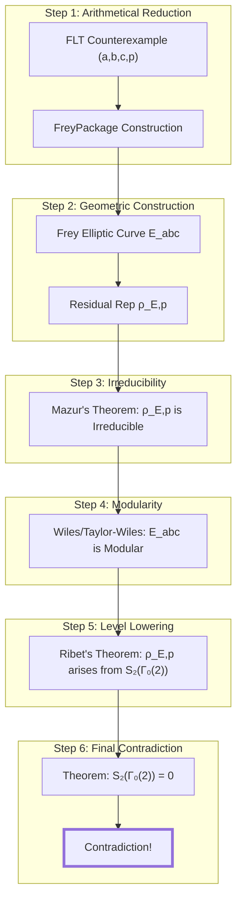
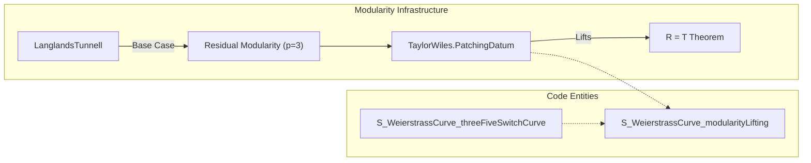

<!-- source: DeepWiki mcp.deepwiki.com · repo anthropics/fermats-last-theorem · unicode-title page 页**：1.2 Proof Route: Six Steps from FLT to S₂(Γ₀(2))=0 · patched 2026-10-26 -->

# Proof Route: Six Steps from FLT to S₂(Γ₀(2))=0
# Proof Route: Six Steps from FLT to S₂(Γ₀(2))=0

Relevant source files

The following files were used as context for generating this wiki page:

- [P2M/Sol/S_AlgebraicClosure_exists_cycloChar_family.lean](P2M/Sol/S_AlgebraicClosure_exists_cycloChar_family.lean)
- [P2M/Sol/S_CerednikDrinfeld_classSet_eq_empty_or_eq_univ_of_forall_mem_iff_of_squarefree.lean](P2M/Sol/S_CerednikDrinfeld_classSet_eq_empty_or_eq_univ_of_forall_mem_iff_of_squarefree.lean)
- [P2M/Sol/S_CohCarrier_exists_complex_heckeT_eigen_reduction_eq_of_mem_span_int.lean](P2M/Sol/S_CohCarrier_exists_complex_heckeT_eigen_reduction_eq_of_mem_span_int.lean)
- [P2M/Sol/S_CuspForm_HeckeGaloisRepDatum_exists_pi_eq_and_forall_isUnramifiedAt.lean](P2M/Sol/S_CuspForm_HeckeGaloisRepDatum_exists_pi_eq_and_forall_isUnramifiedAt.lean)
- [P2M/Sol/S_CuspForm_HeckeGaloisRepDatum_exists_pi_eq_and_isFlatAt_of_primeFactors_subset.lean](P2M/Sol/S_CuspForm_HeckeGaloisRepDatum_exists_pi_eq_and_isFlatAt_of_primeFactors_subset.lean)
- [P2M/Sol/S_CuspForm_HeckeGaloisRepDatum_exists_pi_eq_and_isOrdinaryAt_of_primeFactors_subset.lean](P2M/Sol/S_CuspForm_HeckeGaloisRepDatum_exists_pi_eq_and_isOrdinaryAt_of_primeFactors_subset.lean)
- [P2M/Sol/S_CuspForm_HeckeGaloisRepDatum_isFlatAt_of_primeFactors_subset.lean](P2M/Sol/S_CuspForm_HeckeGaloisRepDatum_isFlatAt_of_primeFactors_subset.lean)
- [P2M/Sol/S_CuspForm_HeckeGaloisRepDatum_isOrdinaryAt_of_primeFactors_subset.lean](P2M/Sol/S_CuspForm_HeckeGaloisRepDatum_isOrdinaryAt_of_primeFactors_subset.lean)
- [P2M/Sol/S_CuspForm_HeckeGaloisRepDatum_isUnramifiedAt_of_notMem.lean](P2M/Sol/S_CuspForm_HeckeGaloisRepDatum_isUnramifiedAt_of_notMem.lean)
- [P2M/Sol/S_CuspForm_HeckeGaloisRepDatum_ordinaryCondition_or_flatCondition_of_apOfModel.lean](P2M/Sol/S_CuspForm_HeckeGaloisRepDatum_ordinaryCondition_or_flatCondition_of_apOfModel.lean)
- [P2M/Sol/S_CuspForm_IsNewform_dvd_level_of_point_of_not_isUnramifiedAt.lean](P2M/Sol/S_CuspForm_IsNewform_dvd_level_of_point_of_not_isUnramifiedAt.lean)
- [P2M/Sol/S_CuspForm_IsNewform_exists_eigenPlane_torLine_tateModule_jZero.lean](P2M/Sol/S_CuspForm_IsNewform_exists_eigenPlane_torLine_tateModule_jZero.lean)
- [P2M/Sol/S_CuspForm_IsNewform_exists_galoisRepAdic_charpoly_inertia_eq_cyclotomicCharacter_of_linearMap_psCarrier_ne_zero_of_not_isUnramified_ratio_of_factorization_eq_two.lean](P2M/Sol/S_CuspForm_IsNewform_exists_galoisRepAdic_charpoly_inertia_eq_cyclotomicCharacter_of_linearMap_psCarrier_ne_zero_of_not_isUnramified_ratio_of_factorization_eq_two.lean)
- [P2M/Sol/S_CuspForm_IsNewform_exists_mem_inertiaSubgroupIn_baseChange_apply_ne_of_eigenPlane_tateModule_jZero.lean](P2M/Sol/S_CuspForm_IsNewform_exists_mem_inertiaSubgroupIn_baseChange_apply_ne_of_eigenPlane_tateModule_jZero.lean)
- [P2M/Sol/S_CuspForm_IsNewform_exists_ordLine_eigenPlane_tateModule_jZero_of_dvd.lean](P2M/Sol/S_CuspForm_IsNewform_exists_ordLine_eigenPlane_tateModule_jZero_of_dvd.lean)
- [P2M/Sol/S_CuspForm_IsNewform_exists_torLine_of_eigenPlane_tateModule_jZero.lean](P2M/Sol/S_CuspForm_IsNewform_exists_torLine_of_eigenPlane_tateModule_jZero.lean)
- [P2M/Sol/S_CuspForm_IsNewform_psCarrier_lam_dvd_sub_one_or_no_psCarrier_lam_dvd_add_one_of_factorization_eq_two_of_residual_isUnipotent_of_irreducible_odd_of_absIrred_odd.lean](P2M/Sol/S_CuspForm_IsNewform_psCarrier_lam_dvd_sub_one_or_no_psCarrier_lam_dvd_add_one_of_factorization_eq_two_of_residual_isUnipotent_of_irreducible_odd_of_absIrred_odd.lean)
- [P2M/Sol/S_CuspForm_TWLevel_HeckeRing_exists_galoisRepAdic_of_algHom.lean](P2M/Sol/S_CuspForm_TWLevel_HeckeRing_exists_galoisRepAdic_of_algHom.lean)
- [P2M/Sol/S_CuspForm_TWLevel_HeckeRing_isStrictOrdinaryAt_of_algHom_of_dvd_level_of_not_isFlatAt.lean](P2M/Sol/S_CuspForm_TWLevel_HeckeRing_isStrictOrdinaryAt_of_algHom_of_dvd_level_of_not_isFlatAt.lean)
- [P2M/Sol/S_CuspForm_TWLevel_HeckeRing_isStrictOrdinaryAt_of_dvd_level_of_not_isFlatAt.lean](P2M/Sol/S_CuspForm_TWLevel_HeckeRing_isStrictOrdinaryAt_of_dvd_level_of_not_isFlatAt.lean)
- [P2M/Sol/S_CuspForm_TWLevel_HeckeRing_isUnramifiedAt_of_not_dvd_sub_one_of_trace_frobenius_sq_ne.lean](P2M/Sol/S_CuspForm_TWLevel_HeckeRing_isUnramifiedAt_of_not_dvd_sub_one_of_trace_frobenius_sq_ne.lean)
- [P2M/Sol/S_CuspForm_exists_galoisRep_isFlatAt_of_point_of_not_dvd.lean](P2M/Sol/S_CuspForm_exists_galoisRep_isFlatAt_of_point_of_not_dvd.lean)
- [P2M/Sol/S_CuspForm_exists_galoisRep_of_point_stableLine_frobenius_sub_smul_mem_of_not_dvd.lean](P2M/Sol/S_CuspForm_exists_galoisRep_of_point_stableLine_frobenius_sub_smul_mem_of_not_dvd.lean)
- [P2M/Sol/S_CuspForm_heckeAlgebra_natCast_pow_twist_eq_natCast_pow_weight_sub_one_of_twist_mem.lean](P2M/Sol/S_CuspForm_heckeAlgebra_natCast_pow_twist_eq_natCast_pow_weight_sub_one_of_twist_mem.lean)
- [P2M/Sol/S_CuspForm_heckeLocal_exists_algHom_length_cotangent_le_of_isResiduallyModular_of_level_of_inertia_moves_torsion_of_eq_three_of_not_cube_dvd_of_level_not_cube_dvd.lean](P2M/Sol/S_CuspForm_heckeLocal_exists_algHom_length_cotangent_le_of_isResiduallyModular_of_level_of_inertia_moves_torsion_of_eq_three_of_not_cube_dvd_of_level_not_cube_dvd.lean)
- [P2M/Sol/S_CuspForm_heckeLocal_exists_isCornerRealization_and_linearEquiv_baseML_of_squarefree.lean](P2M/Sol/S_CuspForm_heckeLocal_exists_isCornerRealization_and_linearEquiv_baseML_of_squarefree.lean)
- [P2M/Sol/S_CuspForm_heckeLocal_exists_isNewform_sum_rootMultiplicity_residual_eq_one_of_isOrdinaryAt.lean](P2M/Sol/S_CuspForm_heckeLocal_exists_isNewform_sum_rootMultiplicity_residual_eq_one_of_isOrdinaryAt.lean)
- [P2M/Sol/S_CuspForm_heckeLocal_exists_ne_zero_forall_algHom_algebraicClosure_isNewform_residual_unitRoot_of_isOrdinaryAt.lean](P2M/Sol/S_CuspForm_heckeLocal_exists_ne_zero_forall_algHom_algebraicClosure_isNewform_residual_unitRoot_of_isOrdinaryAt.lean)
- [P2M/Sol/S_CuspForm_heckeLocal_exists_subfamily_idempotentSplitting_point_level_mul_auxPrime.lean](P2M/Sol/S_CuspForm_heckeLocal_exists_subfamily_idempotentSplitting_point_level_mul_auxPrime.lean)
- [P2M/Sol/S_CuspForm_heckeLocal_sum_rootMultiplicity_residual_eq_one_of_dvd_of_not_sq_dvd_of_ne.lean](P2M/Sol/S_CuspForm_heckeLocal_sum_rootMultiplicity_residual_eq_one_of_dvd_of_not_sq_dvd_of_ne.lean)
- [P2M/Sol/S_CuspForm_heckeLocal_sum_rootMultiplicity_residual_eq_two_of_not_isOrdinaryAt.lean](P2M/Sol/S_CuspForm_heckeLocal_sum_rootMultiplicity_residual_eq_two_of_not_isOrdinaryAt.lean)
- [P2M/Sol/S_CuspForm_isFlatAt_of_point_of_not_dvd.lean](P2M/Sol/S_CuspForm_isFlatAt_of_point_of_not_dvd.lean)
- [P2M/Sol/S_CuspForm_moduleFinite_heckeAlgebra.lean](P2M/Sol/S_CuspForm_moduleFinite_heckeAlgebra.lean)
- [P2M/Sol/S_DeligneSerre_exists_galoisRep_complex_trace_frobenius_eq_of_forall_residual.lean](P2M/Sol/S_DeligneSerre_exists_galoisRep_complex_trace_frobenius_eq_of_forall_residual.lean)
- [P2M/Sol/S_DeligneSerre_exists_isSemisimpleRepresentation_charpoly_map_eq_of_add_mem_range_of_mul_mem_range.lean](P2M/Sol/S_DeligneSerre_exists_isSemisimpleRepresentation_charpoly_map_eq_of_add_mem_range_of_mul_mem_range.lean)
- [P2M/Sol/S_DeligneSerre_exists_natCard_range_le_of_charpoly_frobenius_mem_of_upperDensity_le.lean](P2M/Sol/S_DeligneSerre_exists_natCard_range_le_of_charpoly_frobenius_mem_of_upperDensity_le.lean)
- [P2M/Sol/S_DeligneSerre_isIrreducible_matrixRepresentation_of_tsum_norm_trace_sq_le_log_of_odd.lean](P2M/Sol/S_DeligneSerre_isIrreducible_matrixRepresentation_of_tsum_norm_trace_sq_le_log_of_odd.lean)
- [P2M/Sol/S_FLT_fermatLastTheorem.lean](P2M/Sol/S_FLT_fermatLastTheorem.lean)
- [P2M/Sol/S_FreyPackage_Mazur_Frey.lean](P2M/Sol/S_FreyPackage_Mazur_Frey.lean)
- [P2M/Sol/S_FreyPackage_atPNewLowering.lean](P2M/Sol/S_FreyPackage_atPNewLowering.lean)
- [P2M/Sol/S_FreyPackage_atPNewLoweringAtUniform.lean](P2M/Sol/S_FreyPackage_atPNewLoweringAtUniform.lean)
- [P2M/Sol/S_FreyPackage_dvd_freyCurveInt_discr_iff.lean](P2M/Sol/S_FreyPackage_dvd_freyCurveInt_discr_iff.lean)
- [P2M/Sol/S_FreyPackage_fermatLastTheoremFor_of_five_le.lean](P2M/Sol/S_FreyPackage_fermatLastTheoremFor_of_five_le.lean)
- [P2M/Sol/S_FreyPackage_freyCurveInt_discr_ne_zero.lean](P2M/Sol/S_FreyPackage_freyCurveInt_discr_ne_zero.lean)
- [P2M/Sol/S_FreyPackage_freyCurveInt_map.lean](P2M/Sol/S_FreyPackage_freyCurveInt_map.lean)
- [P2M/Sol/S_FreyPackage_freyGaloisRep_isUnramifiedAt.lean](P2M/Sol/S_FreyPackage_freyGaloisRep_isUnramifiedAt.lean)
- [P2M/Sol/S_FreyPackage_frey_isModular.lean](P2M/Sol/S_FreyPackage_frey_isModular.lean)
- [P2M/Sol/S_FreyPackage_frey_isSemistableModel.lean](P2M/Sol/S_FreyPackage_frey_isSemistableModel.lean)
- [P2M/Sol/S_FreyPackage_level_lowering_odd_prime_of_conductorLevel.lean](P2M/Sol/S_FreyPackage_level_lowering_odd_prime_of_conductorLevel.lean)
- [P2M/Sol/S_FreyPackage_level_lowering_to_two.lean](P2M/Sol/S_FreyPackage_level_lowering_to_two.lean)
- [P2M/Sol/S_FreyPackage_mazurPrincipleAtPStep.lean](P2M/Sol/S_FreyPackage_mazurPrincipleAtPStep.lean)
- [P2M/Sol/S_FreyPackage_modularRepOfConductorLevel.lean](P2M/Sol/S_FreyPackage_modularRepOfConductorLevel.lean)
- [P2M/Sol/S_FreyPackage_no_frey_package.lean](P2M/Sol/S_FreyPackage_no_frey_package.lean)
- [P2M/Sol/S_FreyPackage_not_dvd_freyCurveInt_c4.lean](P2M/Sol/S_FreyPackage_not_dvd_freyCurveInt_c4.lean)
- [P2M/Sol/S_FreyPackage_padicValInt_freyCurveInt_discr.lean](P2M/Sol/S_FreyPackage_padicValInt_freyCurveInt_discr.lean)
- [P2M/Sol/S_FreyPackage_padicValInt_two_freyCurveInt_discr.lean](P2M/Sol/S_FreyPackage_padicValInt_two_freyCurveInt_discr.lean)
- [P2M/Sol/S_FrobeniusDensity_exists_frobenius_conj_of_mul_self_eq_one_of_statement.lean](P2M/Sol/S_FrobeniusDensity_exists_frobenius_conj_of_mul_self_eq_one_of_statement.lean)
- [P2M/Sol/S_FrobeniusDensity_exists_frobenius_conj_pow_of_statement.lean](P2M/Sol/S_FrobeniusDensity_exists_frobenius_conj_pow_of_statement.lean)
- [P2M/Sol/S_GaloisRepAdic_det_eq_mul_of_isFrobeniusAt_of_det_frobenius_eq_mul_of_not_dvd_conductor.lean](P2M/Sol/S_GaloisRepAdic_det_eq_mul_of_isFrobeniusAt_of_det_frobenius_eq_mul_of_not_dvd_conductor.lean)
- [P2M/Sol/S_GaloisRepAdic_det_eq_of_mem_inertiaSubgroupIn_of_det_frobenius_eq_mul.lean](P2M/Sol/S_GaloisRepAdic_det_eq_of_mem_inertiaSubgroupIn_of_det_frobenius_eq_mul.lean)
- [P2M/Sol/S_GaloisRepAdic_eigenformTraceNebentypus_isFlatAt_or_isStrictOrdinaryAt_of_not_sq_dvd_of_not_dvd_conductor.lean](P2M/Sol/S_GaloisRepAdic_eigenformTraceNebentypus_isFlatAt_or_isStrictOrdinaryAt_of_not_sq_dvd_of_not_dvd_conductor.lean)
- [P2M/Sol/S_GaloisRepAdic_eisensteinTrace_not_isAbsolutelyIrreducible_residual.lean](P2M/Sol/S_GaloisRepAdic_eisensteinTrace_not_isAbsolutelyIrreducible_residual.lean)
- [P2M/Sol/S_GaloisRepAdic_isStrictOrdinaryAt_of_detIsCyclotomic_of_ordinaryLine.lean](P2M/Sol/S_GaloisRepAdic_isStrictOrdinaryAt_of_detIsCyclotomic_of_ordinaryLine.lean)
- [P2M/Sol/S_GaloisRepAdic_isStrictOrdinaryAt_of_isPrimitiveForm_of_dvd_of_not_sq_dvd_of_not_dvd_conductor.lean](P2M/Sol/S_GaloisRepAdic_isStrictOrdinaryAt_of_isPrimitiveForm_of_dvd_of_not_sq_dvd_of_not_dvd_conductor.lean)
- [P2M/Sol/S_GaloisRepAdic_isStrictOrdinaryAt_of_isStrictOrdinaryAt_baseChangeAlong_of_injective.lean](P2M/Sol/S_GaloisRepAdic_isStrictOrdinaryAt_of_isStrictOrdinaryAt_baseChangeAlong_of_injective.lean)
- [P2M/Sol/S_GaloisRepAdic_not_isUnipotentOnInertiaAt_and_charpoly_frobenius_of_factorization_eq_two_of_absIrred_odd_of_ne_two.lean](P2M/Sol/S_GaloisRepAdic_not_isUnipotentOnInertiaAt_and_charpoly_frobenius_of_factorization_eq_two_of_absIrred_odd_of_ne_two.lean)
- [P2M/Sol/S_GaloisRepAdic_residual_isEquiv_and_det_sub_mem_of_charpoly_frobenius_eq.lean](P2M/Sol/S_GaloisRepAdic_residual_isEquiv_and_det_sub_mem_of_charpoly_frobenius_eq.lean)
- [P2M/Sol/S_GaloisRep_exists_conj_eq_of_charpoly_frobenius_eq_of_galoisFactorsThroughFiniteLevel.lean](P2M/Sol/S_GaloisRep_exists_conj_eq_of_charpoly_frobenius_eq_of_galoisFactorsThroughFiniteLevel.lean)
- [P2M/Sol/S_GaloisRep_exists_finiteField_galoisRep_trace_eq_heckeT_mod_of_isMaximal.lean](P2M/Sol/S_GaloisRep_exists_finiteField_galoisRep_trace_eq_heckeT_mod_of_isMaximal.lean)
- [P2M/Sol/S_GaloisRep_exists_finiteField_galoisRep_trace_eq_heckeT_mod_of_isMaximal_two.lean](P2M/Sol/S_GaloisRep_exists_finiteField_galoisRep_trace_eq_heckeT_mod_of_isMaximal_two.lean)
- [P2M/Sol/S_GaloisRep_exists_galoisFactorsThroughFiniteLevel_trace_eq_theta_heckeT_and_det_eq_pow.lean](P2M/Sol/S_GaloisRep_exists_galoisFactorsThroughFiniteLevel_trace_eq_theta_heckeT_and_det_eq_pow.lean)
- [P2M/Sol/S_GaloisRep_exists_galoisRep_trace_eq_add_mul_of_unitsHom.lean](P2M/Sol/S_GaloisRep_exists_galoisRep_trace_eq_add_mul_of_unitsHom.lean)
- [P2M/Sol/S_GaloisRep_exists_galoisRep_trace_eq_of_ringHom_heckeAlgebra_two.lean](P2M/Sol/S_GaloisRep_exists_galoisRep_trace_eq_of_ringHom_heckeAlgebra_two.lean)
- [P2M/Sol/S_GaloisRep_exists_isSemisimpleRepresentation_charpoly_map_eq_of_trace_det_frobenius_mem_range.lean](P2M/Sol/S_GaloisRep_exists_isSemisimpleRepresentation_charpoly_map_eq_of_trace_det_frobenius_mem_range.lean)

This page provides a detailed walkthrough of the logical path from Fermat's Last Theorem (FLT) to the vanishing of the space of weight 2 cusp forms for the congruence subgroup $\Gamma_0(2)$. The proof follows the Frey-Serre-Ribet-Wiles strategy, formalized as a six-step reduction.

## High-Level Proof Path

The proof proceeds by assuming a counterexample to FLT and deriving a contradiction through the properties of modular forms and Galois representations.

**Sources:** `PROOF-PATH.md` (General strategy), [P2M/Sol/S_FreyPackage_fermatLastTheoremFor_of_five_le.lean:1-50]()

---

## Step 1 & 2: The Frey Package and Curve Construction

The proof begins by reducing the problem to a prime exponent $p \ge 5$ and constructing the `FreyPackage` [Definitions/Def_FLTPrelim_FreyPackage.lean](). This package encapsulates the integer solution $a^p + b^p = c^p$ and its associated arithmetic properties (e.g., $a \equiv -1 \pmod 4$ and $2 | b$).

### Frey Curve Properties
The `freyCurve` is defined as a `WeierstrassCurve` over $\mathbb{Q}$ with specific coefficients derived from $(a, b, c)$.
*   **Discriminant:** The discriminant $\Delta$ is calculated as $\Delta = \frac{(abc)^{2p}}{2^8}$ [P2M/Sol/S_FreyPackage_freyCurveInt_map.lean:48-49]().
*   **Conductor:** The curve is semistable, meaning its conductor $N$ is the square-free product of primes dividing $abc$ [P2M/Sol/S_FreyPackage_frey_isSemistableModel.lean:6-10]().
*   **Integral Model:** `freyCurveInt` provides the $\mathbb{Z}$-model, essential for studying reduction modulo $q$ [P2M/Sol/S_FreyPackage_freyCurveInt_map.lean:17-18]().

**Sources:** [P2M/Sol/S_FreyPackage_freyCurveInt_map.lean:17-57](), [P2M/Sol/S_FreyPackage_dvd_freyCurveInt_discr_iff.lean:149-171]()

---

## Step 3: Irreducibility (Mazur)

For $p \ge 5$, the residual Galois representation $\bar{\rho}_{E,p}$ associated with the $p$-torsion points of the Frey curve $E$ must be absolutely irreducible. This relies on Mazur's theorem concerning rational points on modular curves, specifically that $X_0(p)(\mathbb{Q})$ has no non-cuspidal points for large $p$ that would correspond to a reducible representation.

The codebase implements this in `S_FreyPackage_Mazur_Frey.lean`, showing that a reducible $\bar{\rho}_{E,p}$ would imply the existence of a specific torsion structure contradicting the curve's semistability and discriminant properties.

**Sources:** [P2M/Sol/S_FreyPackage_Mazur_Frey.lean:1-20](), [P2M/Sol/S_RibetIrr_irreducible_of_point_of_not_dvd.lean:1-10]()

---

## Step 4: Modularity (Wiles / Taylor-Wiles)

The core of the proof is showing that the Frey curve $E$ is modular. This is achieved via Modularity Lifting Theorems.

### Key Modularity Components
1.  **Residual Modularity:** For $p=3$, the representation $\bar{\rho}_{E,3}$ is modular by Langlands-Tunnell [P2M/Sol/S_FreyPackage_modularRepOfConductorLevel.lean:1-16]().
2.  **Modularity Lifting:** If $\bar{\rho}_{E,p}$ is modular and satisfies certain conditions (semistability, irreducibility), then the $p$-adic representation $\rho_{E,p}$ is modular.
3.  **3-5 Switch:** If $p=5$ and $\bar{\rho}_{E,5}$ is not immediately liftable, a "switch" to another curve is performed to establish modularity [P2M/Sol/S_WeierstrassCurve_threeFiveSwitchCurve.lean:1-10]().

**Sources:** [P2M/Sol/S_FreyPackage_modularRepOfConductorLevel.lean:1-13](), [P2M/Sol/S_GaloisRepAdic_residual_isEquiv_and_det_sub_mem_of_charpoly_frobenius_eq.lean:70-80]()

---

## Step 5: Level Lowering (Ribet)

Given that $E$ is modular, its representation $\rho_{E,p}$ arises from a newform $f$ of weight 2 and level $N$ (the conductor). Ribet's Level Lowering theorem proves that if $\rho_{E,p}$ is ramified at a prime $q | N$ in a "thin" way (specifically $p | v_q(\Delta)$), then there exists a newform $g$ of level $N/q$ that gives rise to the same residual representation $\bar{\rho}_{E,p}$.

### Implementation Details
*   **Discriminant Condition:** The proof verifies $p | v_q(\Delta_{Frey})$ for all $q > 2$ [P2M/Sol/S_FreyPackage_padicValInt_freyCurveInt_discr.lean:149-151]().
*   **Ribet's Lemma:** The representation is lowered from $N = \prod_{q|abc} q$ to the minimal level $N=2$ [P2M/Sol/S_FreyPackage_level_lowering_odd_prime_of_conductorLevel.lean:1-20]().

**Sources:** [P2M/Sol/S_FreyPackage_padicValInt_freyCurveInt_discr.lean:131-146](), [P2M/Sol/S_CuspForm_isFlatAt_of_point_of_not_dvd.lean:1-20]()

---

## Step 6: The Vanishing of S₂(Γ₀(2))

The final step shows that if $\bar{\rho}_{E,p}$ were modular of level 2, it would correspond to a cusp form in $S_2(\Gamma_0(2))$. However, the genus of the modular curve $X_0(2)$ is 0, which implies that the space of weight 2 cusp forms is trivial.

### Final Contradiction
*   `ModularCurve.CuspSpace.instSubsingletonOfOne` [P2M/Sol/S_CuspForm_IsNewform_exists_eigenPlane_torLine_tateModule_jZero.lean:26]() indicates the vanishing of specific cusp spaces.
*   The contradiction arises because an irreducible representation $\bar{\rho}_{E,p}$ cannot be associated with a zero-dimensional space of forms.

**Sources:** [P2M/Sol/S_CuspForm_IsNewform_exists_eigenPlane_torLine_tateModule_jZero.lean:26-27](), [P2M/Sol/S_FreyPackage_no_frey_package.lean:1-10]()

---

