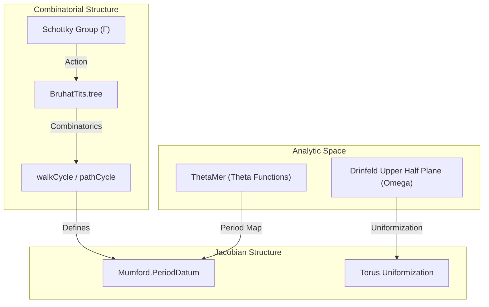
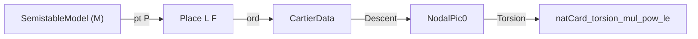

<!-- source: DeepWiki mcp.deepwiki.com · repo anthropics/fermats-last-theorem · page 2.4 Jacobians, Pic⁰, and the Abel-Jacobi Map · patched2 2026-10-26 -->

# Jacobians, Pic⁰, and the Abel-Jacobi Map
# Jacobians, Pic⁰, and the Abel-Jacobi Map

Relevant source files

The following files were used as context for generating this wiki page:

- [Definitions/Def_CerednikDrinfeld_DrinfeldHolomorphic.lean](Definitions/Def_CerednikDrinfeld_DrinfeldHolomorphic.lean)
- [P2M/Sol/S_AlgebraicCurve_DivisorialWeilPairingData_pair_semilinearSmul.lean](P2M/Sol/S_AlgebraicCurve_DivisorialWeilPairingData_pair_semilinearSmul.lean)
- [P2M/Sol/S_AlgebraicCurve_Pic0_exists_periodDatum_Q_mul_period_eq_one_of_mumfordQuotient.lean](P2M/Sol/S_AlgebraicCurve_Pic0_exists_periodDatum_Q_mul_period_eq_one_of_mumfordQuotient.lean)
- [P2M/Sol/S_AlgebraicCurve_Pic0_exists_torusPoints_uniformization_of_periodDatum_of_mumfordQuotient_of_v_card_stabilizer_eq_one.lean](P2M/Sol/S_AlgebraicCurve_Pic0_exists_torusPoints_uniformization_of_periodDatum_of_mumfordQuotient_of_v_card_stabilizer_eq_one.lean)
- [P2M/Sol/S_AlgebraicCurve_Pic0_exists_weilPairing.lean](P2M/Sol/S_AlgebraicCurve_Pic0_exists_weilPairing.lean)
- [P2M/Sol/S_AlgebraicCurve_Pic0_periodPairing_pullback_eq_periodPairing_pushforward_of_mumfordQuotient_theta.lean](P2M/Sol/S_AlgebraicCurve_Pic0_periodPairing_pullback_eq_periodPairing_pushforward_of_mumfordQuotient_theta.lean)
- [P2M/Sol/S_AlgebraicCurve_Place_analyticAt_evalAt_extChartAt_symm_of_mem.lean](P2M/Sol/S_AlgebraicCurve_Place_analyticAt_evalAt_extChartAt_symm_of_mem.lean)
- [P2M/Sol/S_AlgebraicCurve_Place_continuous_restrictAlong.lean](P2M/Sol/S_AlgebraicCurve_Place_continuous_restrictAlong.lean)
- [P2M/Sol/S_AlgebraicCurve_Place_ord_sub_algebraMap_eq_analyticOrderNatAt_chartRead.lean](P2M/Sol/S_AlgebraicCurve_Place_ord_sub_algebraMap_eq_analyticOrderNatAt_chartRead.lean)
- [P2M/Sol/S_AlgebraicCurve_Place_readDifferential_smul_D_eventuallyEq_chartRead_mul_deriv.lean](P2M/Sol/S_AlgebraicCurve_Place_readDifferential_smul_D_eventuallyEq_chartRead_mul_deriv.lean)
- [P2M/Sol/S_AlgebraicCurve_RegularProlongation_residue_integralClosure_surjective_of_genusFF_eq.lean](P2M/Sol/S_AlgebraicCurve_RegularProlongation_residue_integralClosure_surjective_of_genusFF_eq.lean)
- [P2M/Sol/S_AlgebraicCurve_SemilinearAut_mem_iff_smul_mem_of_forall_mem_iff_sections.lean](P2M/Sol/S_AlgebraicCurve_SemilinearAut_mem_iff_smul_mem_of_forall_mem_iff_sections.lean)
- [P2M/Sol/S_AlgebraicCurve_SemistableCovering_exists_circleCharts_and_bands_width_one_of_discFibres_of_rankOne.lean](P2M/Sol/S_AlgebraicCurve_SemistableCovering_exists_circleCharts_and_bands_width_one_of_discFibres_of_rankOne.lean)
- [P2M/Sol/S_AlgebraicCurve_SemistableCovering_exists_mem_riemannRochSpace_forall_residue_eq_of_glued_of_rankOne.lean](P2M/Sol/S_AlgebraicCurve_SemistableCovering_exists_mem_riemannRochSpace_forall_residue_eq_of_glued_of_rankOne.lean)
- [P2M/Sol/S_AlgebraicCurve_SemistableCovering_exists_ne_zero_ord_eq_single_sub_single_mapDomain_placeMap_mem_principal_of_valuation_eq_of_rankOne.lean](P2M/Sol/S_AlgebraicCurve_SemistableCovering_exists_ne_zero_ord_eq_single_sub_single_mapDomain_placeMap_mem_principal_of_valuation_eq_of_rankOne.lean)
- [P2M/Sol/S_AlgebraicCurve_SemistableCovering_exists_ne_zero_ord_eq_single_sub_single_of_depth_eq_of_rankOne.lean](P2M/Sol/S_AlgebraicCurve_SemistableCovering_exists_ne_zero_ord_eq_single_sub_single_of_depth_eq_of_rankOne.lean)
- [P2M/Sol/S_AlgebraicCurve_SemistableCovering_exists_widthOne_covering_equiv_of_discFibres_of_rankOne.lean](P2M/Sol/S_AlgebraicCurve_SemistableCovering_exists_widthOne_covering_equiv_of_discFibres_of_rankOne.lean)
- [P2M/Sol/S_AlgebraicCurve_SemistableCovering_finiteDimensional_and_finrank_graded_glued_riemannRochSpace_eq_finrank_of_width_one.lean](P2M/Sol/S_AlgebraicCurve_SemistableCovering_finiteDimensional_and_finrank_graded_glued_riemannRochSpace_eq_finrank_of_width_one.lean)
- [P2M/Sol/S_AlgebraicCurve_SemistableCovering_forall_ord_eq_zero_and_sum_eq_lap_of_ord_residue_smul_eq_of_width_one.lean](P2M/Sol/S_AlgebraicCurve_SemistableCovering_forall_ord_eq_zero_and_sum_eq_lap_of_ord_residue_smul_eq_of_width_one.lean)
- [P2M/Sol/S_AlgebraicCurve_SemistableCovering_residue_mem_riemannRochSpace_and_evalAt_eq_of_forall_mem_integers_of_rankOne.lean](P2M/Sol/S_AlgebraicCurve_SemistableCovering_residue_mem_riemannRochSpace_and_evalAt_eq_of_forall_mem_integers_of_rankOne.lean)
- [P2M/Sol/S_AlgebraicCurve_abelJacobiDiv_correspondence_sub_vecMul_mem_pathPeriodLattice.lean](P2M/Sol/S_AlgebraicCurve_abelJacobiDiv_correspondence_sub_vecMul_mem_pathPeriodLattice.lean)
- [P2M/Sol/S_AlgebraicCurve_abelJacobiDiv_mem_pathPeriodLattice_of_isPrincipal.lean](P2M/Sol/S_AlgebraicCurve_abelJacobiDiv_mem_pathPeriodLattice_of_isPrincipal.lean)
- [P2M/Sol/S_AlgebraicCurve_eventually_abelJacobiDiv_fibre_sub_mem_pathPeriodLattice.lean](P2M/Sol/S_AlgebraicCurve_eventually_abelJacobiDiv_fibre_sub_mem_pathPeriodLattice.lean)
- [P2M/Sol/S_AlgebraicCurve_exists_abelJacobiDiv_sub_mem_pathPeriodLattice_and_image_mem_nhds.lean](P2M/Sol/S_AlgebraicCurve_exists_abelJacobiDiv_sub_mem_pathPeriodLattice_and_image_mem_nhds.lean)
- [P2M/Sol/S_AlgebraicCurve_exists_add_sum_sub_sum_mem_principal_of_degree_add_sum_eq_zero_of_valuation_mul_prod_eq_of_lattice_of_semistableCovering_of_discFibres_of_rankOne.lean](P2M/Sol/S_AlgebraicCurve_exists_add_sum_sub_sum_mem_principal_of_degree_add_sum_eq_zero_of_valuation_mul_prod_eq_of_lattice_of_semistableCovering_of_discFibres_of_rankOne.lean)
- [P2M/Sol/S_AlgebraicCurve_exists_ball_abelJacobiDiv_correspondence_sub_sub_mem_pathPeriodLattice.lean](P2M/Sol/S_AlgebraicCurve_exists_ball_abelJacobiDiv_correspondence_sub_sub_mem_pathPeriodLattice.lean)
- [P2M/Sol/S_AlgebraicCurve_exists_ball_abelJacobiVec_restrictAlong_sub_sub_mem_pathPeriodLattice.lean](P2M/Sol/S_AlgebraicCurve_exists_ball_abelJacobiVec_restrictAlong_sub_sub_mem_pathPeriodLattice.lean)
- [P2M/Sol/S_AlgebraicCurve_exists_ball_abelJacobiVec_sub_sub_mem_pathPeriodLattice.lean](P2M/Sol/S_AlgebraicCurve_exists_ball_abelJacobiVec_sub_sub_mem_pathPeriodLattice.lean)
- [P2M/Sol/S_AlgebraicCurve_exists_cartierData_eq_ord_and_pt_mem_iff_of_forall_mapDomain_placeMap_eq_zero_of_balanced_of_semistableModel.lean](P2M/Sol/S_AlgebraicCurve_exists_cartierData_eq_ord_and_pt_mem_iff_of_forall_mapDomain_placeMap_eq_zero_of_balanced_of_semistableModel.lean)
- [P2M/Sol/S_AlgebraicCurve_exists_cartierData_eq_ord_and_pt_mem_iff_of_forall_mapDomain_placeMap_eq_zero_of_prod_evalAt_param_zpow_eq_one_add_of_semistableModel.lean](P2M/Sol/S_AlgebraicCurve_exists_cartierData_eq_ord_and_pt_mem_iff_of_forall_mapDomain_placeMap_eq_zero_of_prod_evalAt_param_zpow_eq_one_add_of_semistableModel.lean)
- [P2M/Sol/S_AlgebraicCurve_exists_cartierData_kummer_finiteLevel_of_cartierData_of_balanced_of_semistableModel_of_descent.lean](P2M/Sol/S_AlgebraicCurve_exists_cartierData_kummer_finiteLevel_of_cartierData_of_balanced_of_semistableModel_of_descent.lean)
- [P2M/Sol/S_AlgebraicCurve_exists_cartierData_kummer_finiteLevel_of_cartierData_of_divisor_of_semistableModel_of_descent.lean](P2M/Sol/S_AlgebraicCurve_exists_cartierData_kummer_finiteLevel_of_cartierData_of_divisor_of_semistableModel_of_descent.lean)
- [P2M/Sol/S_AlgebraicCurve_exists_degree_eq_zero_and_abelJacobiDiv_sub_mem_pathPeriodLattice.lean](P2M/Sol/S_AlgebraicCurve_exists_degree_eq_zero_and_abelJacobiDiv_sub_mem_pathPeriodLattice.lean)
- [P2M/Sol/S_AlgebraicCurve_exists_eventuallyEq_evalAt_of_meromorphicAt.lean](P2M/Sol/S_AlgebraicCurve_exists_eventuallyEq_evalAt_of_meromorphicAt.lean)
- [P2M/Sol/S_AlgebraicCurve_exists_forall_smul_div_pow_mem_integers_of_cartierData_of_balanced_of_semistableModel.lean](P2M/Sol/S_AlgebraicCurve_exists_forall_smul_div_pow_mem_integers_of_cartierData_of_balanced_of_semistableModel.lean)
- [P2M/Sol/S_AlgebraicCurve_exists_forall_smul_div_pow_mem_integers_of_cartierData_of_divisor_of_semistableModel.lean](P2M/Sol/S_AlgebraicCurve_exists_forall_smul_div_pow_mem_integers_of_cartierData_of_divisor_of_semistableModel.lean)
- [P2M/Sol/S_AlgebraicCurve_exists_isPrimitiveAlong_of_forall_ordDifferential_nonneg.lean](P2M/Sol/S_AlgebraicCurve_exists_isPrimitiveAlong_of_forall_ordDifferential_nonneg.lean)
- [P2M/Sol/S_AlgebraicCurve_exists_isPrimitiveAlong_of_mem_regularDifferentials.lean](P2M/Sol/S_AlgebraicCurve_exists_isPrimitiveAlong_of_mem_regularDifferentials.lean)
- [P2M/Sol/S_AlgebraicCurve_exists_isUnit_det_evalAt_differentialCoeff.lean](P2M/Sol/S_AlgebraicCurve_exists_isUnit_det_evalAt_differentialCoeff.lean)
- [P2M/Sol/S_AlgebraicCurve_exists_linearMap_forall_sub_one_eq_smul_of_semistableCovering_of_discFibres_of_rankOne_of_lifts_of_charZero_of_semistableModel.lean](P2M/Sol/S_AlgebraicCurve_exists_linearMap_forall_sub_one_eq_smul_of_semistableCovering_of_discFibres_of_rankOne_of_lifts_of_charZero_of_semistableModel.lean)
- [P2M/Sol/S_AlgebraicCurve_exists_linearMap_rationalTateModule_reduction_of_semistableCovering_of_discFibres_of_rankOne_of_lifts_of_charZero_of_semistableModel.lean](P2M/Sol/S_AlgebraicCurve_exists_linearMap_rationalTateModule_reduction_of_semistableCovering_of_discFibres_of_rankOne_of_lifts_of_charZero_of_semistableModel.lean)
- [P2M/Sol/S_AlgebraicCurve_exists_mem_iInf_ker_red_eq_zero_of_forall_proj_eq_mk_single_sub_single_quadruples_annulus_of_semistableCovering_of_discFibres_of_rankOne_of_lifts_of_charZero_of_semistableModel.lean](P2M/Sol/S_AlgebraicCurve_exists_mem_iInf_ker_red_eq_zero_of_forall_proj_eq_mk_single_sub_single_quadruples_annulus_of_semistableCovering_of_discFibres_of_rankOne_of_lifts_of_charZero_of_semistableModel.lean)
- [P2M/Sol/S_AlgebraicCurve_exists_meromorphicOrderAt_eq_of_forall_pathIntegral_eq_two_pi_I_mul.lean](P2M/Sol/S_AlgebraicCurve_exists_meromorphicOrderAt_eq_of_forall_pathIntegral_eq_two_pi_I_mul.lean)
- [P2M/Sol/S_AlgebraicCurve_exists_ne_zero_apply_ord_eq_sum_lap_of_semistableCovering_of_discFibres_of_rankOne_of_width_one.lean](P2M/Sol/S_AlgebraicCurve_exists_ne_zero_apply_ord_eq_sum_lap_of_semistableCovering_of_discFibres_of_rankOne_of_width_one.lean)
- [P2M/Sol/S_AlgebraicCurve_exists_ne_zero_ord_eq_of_depthMass_eq_zero_of_semistableCovering_of_rankOne.lean](P2M/Sol/S_AlgebraicCurve_exists_ne_zero_ord_eq_of_depthMass_eq_zero_of_semistableCovering_of_rankOne.lean)
- [P2M/Sol/S_AlgebraicCurve_exists_ne_zero_ord_eq_of_forall_eq_zero_of_semistableCovering_of_discFibres_of_rankOne.lean](P2M/Sol/S_AlgebraicCurve_exists_ne_zero_ord_eq_of_forall_eq_zero_of_semistableCovering_of_discFibres_of_rankOne.lean)
- [P2M/Sol/S_AlgebraicCurve_exists_ne_zero_ord_eq_of_sum_eq_zero_of_semistableCovering_of_discFibres_of_rankOne.lean](P2M/Sol/S_AlgebraicCurve_exists_ne_zero_ord_eq_of_sum_eq_zero_of_semistableCovering_of_discFibres_of_rankOne.lean)
- [P2M/Sol/S_AlgebraicCurve_exists_residue_pow_mul_eq_of_sum_smul_single_sub_single_sub_sum_sub_sum_smul_quadruple_mem_principal_of_semistableCovering_of_discFibres_of_rankOne_of_lifts_of_charZero_of_semistableModel.lean](P2M/Sol/S_AlgebraicCurve_exists_residue_pow_mul_eq_of_sum_smul_single_sub_single_sub_sum_sub_sum_smul_quadruple_mem_principal_of_semistableCovering_of_discFibres_of_rankOne_of_lifts_of_charZero_of_semistableModel.lean)
- [P2M/Sol/S_AlgebraicCurve_exists_residue_prod_zpow_eq_one_of_forall_mapDomain_placeMap_eq_zero_of_forall_annulus_sum_eq_zero_of_prod_valuation_evalAt_zpow_eq_one_of_semistableCovering_of_discFibres_of_rankOne.lean](P2M/Sol/S_AlgebraicCurve_exists_residue_prod_zpow_eq_one_of_forall_mapDomain_placeMap_eq_zero_of_forall_annulus_sum_eq_zero_of_prod_valuation_evalAt_zpow_eq_one_of_semistableCovering_of_discFibres_of_rankOne.lean)
- [P2M/Sol/S_AlgebraicCurve_exists_slopes_degree_add_sum_eq_zero_and_valuation_mul_prod_eq_of_ord_of_semistableCovering_of_discFibres_of_rankOne.lean](P2M/Sol/S_AlgebraicCurve_exists_slopes_degree_add_sum_eq_zero_and_valuation_mul_prod_eq_of_ord_of_semistableCovering_of_discFibres_of_rankOne.lean)
- [P2M/Sol/S_AlgebraicCurve_exists_smul_D_eq_smul_dCoord_of_forall_isIntegral_trace_mul_eq_aeval.lean](P2M/Sol/S_AlgebraicCurve_exists_smul_D_eq_smul_dCoord_of_forall_isIntegral_trace_mul_eq_aeval.lean)
- [P2M/Sol/S_AlgebraicCurve_exists_tateModule_forall_proj_eq_mk_single_sub_single_quadruples_annulus_of_semistableCovering_of_discFibres_of_rankOne_of_lifts_of_charZero_of_semistableModel_of_forall_pow_eq_self.lean](P2M/Sol/S_AlgebraicCurve_exists_tateModule_forall_proj_eq_mk_single_sub_single_quadruples_annulus_of_semistableCovering_of_discFibres_of_rankOne_of_lifts_of_charZero_of_semistableModel_of_forall_pow_eq_self.lean)
- [P2M/Sol/S_AlgebraicCurve_exists_vanishingCycles_ker_reduction_le_span_of_semistableCovering_of_discFibres_of_rankOne_of_lifts_of_src_ne_tgt_of_charZero_of_semistableModel_of_forall_pow_eq_self_of_algEquiv.lean](P2M/Sol/S_AlgebraicCurve_exists_vanishingCycles_ker_reduction_le_span_of_semistableCovering_of_discFibres_of_rankOne_of_lifts_of_src_ne_tgt_of_charZero_of_semistableModel_of_forall_pow_eq_self_of_algEquiv.lean)
- [P2M/Sol/S_AlgebraicCurve_exists_vanishingCycles_red_eq_zero_and_add_le_finrank_span_of_semistableCovering_of_discFibres_of_rankOne_of_lifts_of_src_ne_tgt_of_charZero_of_semistableModel_of_forall_pow_eq_self_of_algEquiv.lean](P2M/Sol/S_AlgebraicCurve_exists_vanishingCycles_red_eq_zero_and_add_le_finrank_span_of_semistableCovering_of_discFibres_of_rankOne_of_lifts_of_src_ne_tgt_of_charZero_of_semistableModel_of_forall_pow_eq_self_of_algEquiv.lean)
- [P2M/Sol/S_AlgebraicCurve_exists_vanishingCycles_smul_sub_mem_span_of_semistableCovering_of_discFibres_of_rankOne_of_lifts_of_src_ne_tgt_of_charZero_of_semistableModel_of_forall_pow_eq_self_of_algEquiv.lean](P2M/Sol/S_AlgebraicCurve_exists_vanishingCycles_smul_sub_mem_span_of_semistableCovering_of_discFibres_of_rankOne_of_lifts_of_src_ne_tgt_of_charZero_of_semistableModel_of_forall_pow_eq_self_of_algEquiv.lean)
- [P2M/Sol/S_AlgebraicCurve_finrank_ker_reduction_add_le_of_semistableCovering_of_discFibres_of_rankOne_of_lifts_of_charZero_of_semistableModel.lean](P2M/Sol/S_AlgebraicCurve_finrank_ker_reduction_add_le_of_semistableCovering_of_discFibres_of_rankOne_of_lifts_of_charZero_of_semistableModel.lean)
- [P2M/Sol/S_AlgebraicCurve_isNodalPrincipal_mapDomain_placeMap_of_forall_ord_eq_zero_of_semistableCovering_of_rankOne.lean](P2M/Sol/S_AlgebraicCurve_isNodalPrincipal_mapDomain_placeMap_of_forall_ord_eq_zero_of_semistableCovering_of_rankOne.lean)
- [P2M/Sol/S_AlgebraicCurve_isPrimitiveAlong_comp_extChartAt_of_hasDerivAt_readDifferential.lean](P2M/Sol/S_AlgebraicCurve_isPrimitiveAlong_comp_extChartAt_of_hasDerivAt_readDifferential.lean)
- [P2M/Sol/S_AlgebraicCurve_ker_sub_one_eq_iInf_ker_of_pow_eq_of_baseAut_ne_of_semistableCovering_of_discFibres_of_rankOne_of_lifts_of_charZero_of_semistableModel.lean](P2M/Sol/S_AlgebraicCurve_ker_sub_one_eq_iInf_ker_of_pow_eq_of_baseAut_ne_of_semistableCovering_of_discFibres_of_rankOne_of_lifts_of_charZero_of_semistableModel.lean)
- [P2M/Sol/S_AlgebraicCurve_le_add_one_and_exists_finset_card_le_pow_of_chartSupported_principal_of_semistableCovering_of_discFibres_of_rankOne_of_charZero_of_semistableModel.lean](P2M/Sol/S_AlgebraicCurve_le_add_one_and_exists_finset_card_le_pow_of_chartSupported_principal_of_semistableCovering_of_discFibres_of_rankOne_of_charZero_of_semistableModel.lean)
- [P2M/Sol/S_AlgebraicCurve_mapDomain_placeMap_mem_principal_of_degree_eq_zero_of_forall_annulus_sum_eq_zero_of_prod_valuation_evalAt_zpow_eq_one.lean](P2M/Sol/S_AlgebraicCurve_mapDomain_placeMap_mem_principal_of_degree_eq_zero_of_forall_annulus_sum_eq_zero_of_prod_valuation_evalAt_zpow_eq_one.lean)
- [P2M/Sol/S_AlgebraicCurve_mapDomain_placeMap_mem_principal_of_forall_support_subset_dom_of_degree_eq_zero.lean](P2M/Sol/S_AlgebraicCurve_mapDomain_placeMap_mem_principal_of_forall_support_subset_dom_of_degree_eq_zero.lean)
- [P2M/Sol/S_AlgebraicCurve_mem_span_smul_sub_of_red_eq_zero_of_forall_smul_eq_of_semistableCovering_of_discFibres_of_rankOne_of_lifts_of_charZero_of_semistableModel.lean](P2M/Sol/S_AlgebraicCurve_mem_span_smul_sub_of_red_eq_zero_of_forall_smul_eq_of_semistableCovering_of_discFibres_of_rankOne_of_lifts_of_charZero_of_semistableModel.lean)
- [P2M/Sol/S_AlgebraicCurve_natCard_fixedPoints_restrictAlong_lt_of_isFrobeniusEndo_sq.lean](P2M/Sol/S_AlgebraicCurve_natCard_fixedPoints_restrictAlong_lt_of_isFrobeniusEndo_sq.lean)
- [P2M/Sol/S_AlgebraicCurve_natCard_torsion_tropicalPositionZero_mul_pow_le_of_semistableCovering_of_discFibres_of_rankOne_of_charZero_of_semistableModel.lean](P2M/Sol/S_AlgebraicCurve_natCard_torsion_tropicalPositionZero_mul_pow_le_of_semistableCovering_of_discFibres_of_rankOne_of_charZero_of_semistableModel.lean)
- [P2M/Sol/S_AlgebraicCurve_rationalGaloisRep_tmul_eq_tmul_perm_of_forall_proj_eq_mk_single_sub_single_quadruples_annulus_of_semistableCovering_of_discFibres_of_rankOne_of_lifts_of_src_ne_tgt_of_charZero_of_semistableModel_of_algEquiv.lean](P2M/Sol/S_AlgebraicCurve_rationalGaloisRep_tmul_eq_tmul_perm_of_forall_proj_eq_mk_single_sub_single_quadruples_annulus_of_semistableCovering_of_discFibres_of_rankOne_of_lifts_of_src_ne_tgt_of_charZero_of_semistableModel_of_algEquiv.lean)
- [P2M/Sol/S_AlgebraicCurve_red_eq_zero_of_mem_span_smul_sub_of_forall_smul_eq_of_semistableCovering_of_discFibres_of_rankOne_of_lifts_of_charZero_of_semistableModel.lean](P2M/Sol/S_AlgebraicCurve_red_eq_zero_of_mem_span_smul_sub_of_forall_smul_eq_of_semistableCovering_of_discFibres_of_rankOne_of_lifts_of_charZero_of_semistableModel.lean)
- [P2M/Sol/S_AlgebraicCurve_smul_smul_sub_eq_smul_sub_of_isUnit_natCast_of_nsmul_eq_zero_of_genusFF_of_semistableCovering_of_charZero_of_semistableModel.lean](P2M/Sol/S_AlgebraicCurve_smul_smul_sub_eq_smul_sub_of_isUnit_natCast_of_nsmul_eq_zero_of_genusFF_of_semistableCovering_of_charZero_of_semistableModel.lean)
- [P2M/Sol/S_AlgebraicCurve_span_real_pathPeriodLattice_eq_top.lean](P2M/Sol/S_AlgebraicCurve_span_real_pathPeriodLattice_eq_top.lean)
- [P2M/Sol/S_AlgebraicCurve_sum_mem_principal_of_zsmul_mem_principal_of_isNodalPrincipal_mapDomain_placeMap_of_semistableModel_of_descent.lean](P2M/Sol/S_AlgebraicCurve_sum_mem_principal_of_zsmul_mem_principal_of_isNodalPrincipal_mapDomain_placeMap_of_semistableModel_of_descent.lean)
- [P2M/Sol/S_AlgebraicCurve_surjective_algebraMap_of_injective_restrict_place_of_isAlgClosed.lean](P2M/Sol/S_AlgebraicCurve_surjective_algebraMap_of_injective_restrict_place_of_isAlgClosed.lean)
- [P2M/Sol/S_CerednikDrinfeld_Omega_exists_eq_mul_prod_zpow_mul_one_add_of_isUnit.lean](P2M/Sol/S_CerednikDrinfeld_Omega_exists_eq_mul_prod_zpow_mul_one_add_of_isUnit.lean)
- [P2M/Sol/S_CerednikDrinfeld_Omega_exists_eq_sub_pow_mul_and_apply_ne_zero_of_mem_holOn_of_finite_setOf_eq_zero.lean](P2M/Sol/S_CerednikDrinfeld_Omega_exists_eq_sub_pow_mul_and_apply_ne_zero_of_mem_holOn_of_finite_setOf_eq_zero.lean)
- [P2M/Sol/S_CerednikDrinfeld_Omega_exists_finset_residueSystem_of_finite_quotient.lean](P2M/Sol/S_CerednikDrinfeld_Omega_exists_finset_residueSystem_of_finite_quotient.lean)
- [P2M/Sol/S_CerednikDrinfeld_Omega_exists_int_neighbours_sum_eq_zero_v_apply_smul_eq.lean](P2M/Sol/S_CerednikDrinfeld_Omega_exists_int_neighbours_sum_eq_zero_v_apply_smul_eq.lean)
- [P2M/Sol/S_CerednikDrinfeld_Omega_exists_isThetaPair_ordAt_eq_card.lean](P2M/Sol/S_CerednikDrinfeld_Omega_exists_isThetaPair_ordAt_eq_card.lean)
- [P2M/Sol/S_CerednikDrinfeld_Omega_exists_isUnit_coe_eq_thetaMer_apply_smul_eq_period_mul.lean](P2M/Sol/S_CerednikDrinfeld_Omega_exists_isUnit_coe_eq_thetaMer_apply_smul_eq_period_mul.lean)
- [P2M/Sol/S_CerednikDrinfeld_Omega_exists_mem_ribbonKernel_and_v_apply_smul_eq_mul_zpow_stabWidth_of_isUnit_of_forall_isOfFinOrder.lean](P2M/Sol/S_CerednikDrinfeld_Omega_exists_mem_ribbonKernel_and_v_apply_smul_eq_mul_zpow_stabWidth_of_isUnit_of_forall_isOfFinOrder.lean)
- [P2M/Sol/S_CerednikDrinfeld_Omega_exists_pair_v_theta_eq_one_and_v_theta_mul_zpow_sub_one_lt_forall_ne_pmoebius.lean](P2M/Sol/S_CerednikDrinfeld_Omega_exists_pair_v_theta_eq_one_and_v_theta_mul_zpow_sub_one_lt_forall_ne_pmoebius.lean)
- [P2M/Sol/S_CerednikDrinfeld_Omega_exists_pairs_v_prod_theta_div_sub_one_lt.lean](P2M/Sol/S_CerednikDrinfeld_Omega_exists_pairs_v_prod_theta_div_sub_one_lt.lean)
- [P2M/Sol/S_CerednikDrinfeld_Omega_exists_pairs_v_prod_theta_div_sub_one_lt_forall_ne_pmoebius.lean](P2M/Sol/S_CerednikDrinfeld_Omega_exists_pairs_v_prod_theta_div_sub_one_lt_forall_ne_pmoebius.lean)
- [P2M/Sol/S_CerednikDrinfeld_Omega_exists_pairs_v_prod_theta_eq_v_zpow_stabWidth_mul_pathCycle_forall_ne.lean](P2M/Sol/S_CerednikDrinfeld_Omega_exists_pairs_v_prod_theta_eq_v_zpow_stabWidth_mul_pathCycle_forall_ne.lean)
- [P2M/Sol/S_CerednikDrinfeld_Omega_exists_v_det_eq_one_of_isUnit_det_pathCycle_of_finite.lean](P2M/Sol/S_CerednikDrinfeld_Omega_exists_v_det_eq_one_of_isUnit_det_pathCycle_of_finite.lean)
- [P2M/Sol/S_CerednikDrinfeld_Omega_mem_holOn_of_forall_mem_holOn_halfDiscPiece_of_cover.lean](P2M/Sol/S_CerednikDrinfeld_Omega_mem_holOn_of_forall_mem_holOn_halfDiscPiece_of_cover.lean)
- [P2M/Sol/S_CerednikDrinfeld_Omega_mem_holOn_of_forall_mem_holOn_linearPiece_of_cover.lean](P2M/Sol/S_CerednikDrinfeld_Omega_mem_holOn_of_forall_mem_holOn_linearPiece_of_cover.lean)
- [P2M/Sol/S_CerednikDrinfeld_Omega_natCard_dvd_of_v_apply_smul_eq_mul_zpow_of_forall_smul_eq.lean](P2M/Sol/S_CerednikDrinfeld_Omega_natCard_dvd_of_v_apply_smul_eq_mul_zpow_of_forall_smul_eq.lean)
- [P2M/Sol/S_CerednikDrinfeld_Omega_sum_add_eq_zero_of_isUnit_of_forall_v_apply_eq_mul_zpow.lean](P2M/Sol/S_CerednikDrinfeld_Omega_sum_add_eq_zero_of_isUnit_of_forall_v_apply_eq_mul_zpow.lean)
- [P2M/Sol/S_CerednikDrinfeld_Omega_v_theta_pmoebius_mul_zpow_sum_stabWidth_mul_pathCycle_mul_walkCycle_eq.lean](P2M/Sol/S_CerednikDrinfeld_Omega_v_theta_pmoebius_mul_zpow_sum_stabWidth_mul_pathCycle_mul_walkCycle_eq.lean)

This section covers the theory of Jacobian varieties and the Picard group scheme for algebraic curves, focusing on the construction of the Abel-Jacobi map, period lattices, and uniformization. It details the relationship between algebraic divisors and analytic structures, specifically via Mumford quotients and $p$-adic/complex uniformization techniques required for the Čerednik-Drinfeld theory.

## The Picard Group and Jacobians

The Picard group $\text{Pic}^0(C)$ of a curve $C$ is implemented as the group of divisors of degree zero modulo principal divisors. The codebase provides infrastructure for verifying torsion properties and the existence of pairings on these groups.

### Divisorial Weil Pairing
The Weil pairing is constructed for the $n$-torsion of the Picard group, utilizing the reciprocity law for functions on curves. The implementation leverages `DivisorialWeilPairingData` to manage the relationship between divisors and the pairing values.

*   **Weil Reciprocity**: The proof relies on `AlgebraicCurve.weilReciprocity` to show that for functions $f, g$ with disjoint support, $f(\text{div}(g)) = g(\text{div}(f))$ [P2M/Sol/S_AlgebraicCurve_Pic0_exists_weilPairing.lean:9-9]().
*   **Torsion Points**: The existence of $n$-torsion points and their evaluation via the pairing is established in `Thm_AlgebraicCurve_Pic0_torsion_exists_addMonoidHom_eval_eq_pairing` [P2M/Sol/S_AlgebraicCurve_Pic0_exists_weilPairing.lean:7-7]().

Sources: [P2M/Sol/S_AlgebraicCurve_Pic0_exists_weilPairing.lean:1-22]()

## The Abel-Jacobi Map and Period Lattices

The Abel-Jacobi map $\Phi: \text{Div}^0(C) \to J(C)(\mathbb{C})$ bridges the algebraic and complex-analytic worlds. It is defined by integrating holomorphic differentials along paths.

### Path Integrals and Lattices
The map is realized through the `abelJacobiVec` function, which maps a divisor to a vector in the space of duals to regular differentials modulo the `pathPeriodLattice`.

| Entity | Code Symbol | Role |
| :--- | :--- | :--- |
| **Abel-Jacobi Vector** | `abelJacobiVec` | Integral of regular differentials against a divisor [P2M/Sol/S_AlgebraicCurve_exists_ball_abelJacobiVec_restrictAlong_sub_sub_mem_pathPeriodLattice.lean:30-30]() |
| **Period Lattice** | `pathPeriodLattice` | The subgroup of integrals over closed loops [P2M/Sol/S_AlgebraicCurve_exists_ball_abelJacobiVec_restrictAlong_sub_sub_mem_pathPeriodLattice.lean:30-30]() |
| **Regular Differentials** | `regularDifferentials` | The space $\Omega^1(C)$ of holomorphic 1-forms [P2M/Sol/S_AlgebraicCurve_exists_ball_abelJacobiDiv_correspondence_sub_sub_mem_pathPeriodLattice.lean:6-6]() |

### Local Analytic Behavior
The map's continuity and analytic properties are verified using `extChartAt` and `chartRead_apply` to perform calculations in local coordinates [P2M/Sol/S_AlgebraicCurve_exists_ball_abelJacobiVec_restrictAlong_sub_sub_mem_pathPeriodLattice.lean:30-30]().

Sources: [P2M/Sol/S_AlgebraicCurve_exists_ball_abelJacobiVec_restrictAlong_sub_sub_mem_pathPeriodLattice.lean:1-35](), [P2M/Sol/S_AlgebraicCurve_exists_ball_abelJacobiDiv_correspondence_sub_sub_mem_pathPeriodLattice.lean:1-28]()

## Mumford Quotients and Torus Uniformization

For curves with split multiplicative reduction (totally degenerate), the Jacobian can be described as a Mumford quotient. This involves the Schottky group $\Gamma$ acting on the Drinfeld upper half-plane $\Omega$.

### Period Data and Schottky Groups
The Schottky group action on the Bruhat-Tits tree $T$ is central to the uniformization. The `MumfordPeriod` and `ThetaMer` (theta meromorphic functions) are used to construct the period mapping.

Sources: [P2M/Sol/S_AlgebraicCurve_Pic0_exists_periodDatum_Q_mul_period_eq_one_of_mumfordQuotient.lean:1-38](), [P2M/Sol/S_CerednikDrinfeld_Omega_exists_mem_ribbonKernel_and_v_apply_smul_eq_mul_zpow_stabWidth_of_isUnit_of_forall_isOfFinOrder.lean:113-115]()

### Key Uniformization Functions
*   **Equivariant Uniformization**: The map from the upper half-plane to the curve is established in `CerednikDrinfeld.EquivariantUniformization` [P2M/Sol/S_AlgebraicCurve_Pic0_exists_periodDatum_Q_mul_period_eq_one_of_mumfordQuotient.lean:8-8]().
*   **Theta Functions**: `ThetaMer` functions are used to define the analytic sections that descend to the Jacobian [P2M/Sol/S_CerednikDrinfeld_Omega_exists_pairs_v_prod_theta_eq_v_zpow_stabWidth_mul_pathCycle_forall_ne.lean:1-7]().
*   **Stabilizer Finiteness**: Finiteness of stabilizers in the Schottky group is a prerequisite for the discreteness of the period lattice, verified in `finite_stabilizer_of_finite_stabilizer_dart` [P2M/Sol/S_AlgebraicCurve_Pic0_exists_periodDatum_Q_mul_period_eq_one_of_mumfordQuotient.lean:58-60]().

Sources: [P2M/Sol/S_AlgebraicCurve_Pic0_exists_periodDatum_Q_mul_period_eq_one_of_mumfordQuotient.lean:50-100](), [P2M/Sol/S_CerednikDrinfeld_Omega_exists_pairs_v_prod_theta_eq_v_zpow_stabWidth_mul_pathCycle_forall_ne.lean:38-80]()

## Semistable Models and Cartier Data

The connection between the Jacobian over the fraction field and its reduction is handled via `SemistableModel`.

### Cartier Data and Local Rings
The theory relates divisors on the generic fiber to Cartier data on the semistable model.
*   **Semistable Charts**: Components are modeled using `ComponentChart` and `Annulus` structures [P2M/Sol/S_AlgebraicCurve_exists_cartierData_eq_ord_and_pt_mem_iff_of_forall_mapDomain_placeMap_eq_zero_of_balanced_of_semistableModel.lean:24-28]().
*   **Valuation Logic**: The `ord_pos_of_residue_eq_zero` theorem links the valuation (order) of a function at a place to its behavior in the residue field of the semistable model [P2M/Sol/S_AlgebraicCurve_exists_cartierData_eq_ord_and_pt_mem_iff_of_forall_mapDomain_placeMap_eq_zero_of_balanced_of_semistableModel.lean:64-66]().
*   **Descent**: Lifting Cartier data from the reduction to the generic fiber is performed in `S_AlgebraicCurve_exists_cartierData_kummer_finiteLevel_of_cartierData_of_balanced_of_semistableModel_of_descent` [P2M/Sol/S_AlgebraicCurve_exists_cartierData_kummer_finiteLevel_of_cartierData_of_balanced_of_semistableModel_of_descent.lean:20-20]().

### Data Flow for Nodal Reduction

Sources: [P2M/Sol/S_AlgebraicCurve_exists_cartierData_eq_ord_and_pt_mem_iff_of_forall_mapDomain_placeMap_eq_zero_of_balanced_of_semistableModel.lean:30-66](), [P2M/Sol/S_AlgebraicCurve_natCard_torsion_tropicalPositionZero_mul_pow_le_of_semistableCovering_of_discFibres_of_rankOne_of_charZero_of_semistableModel.lean:1-12]()

---

