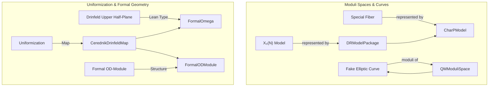
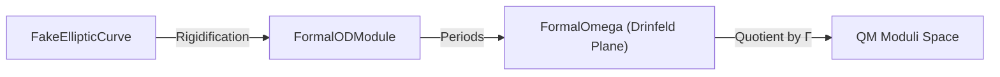

<!-- source: DeepWiki mcp.deepwiki.com · repo anthropics/fermats-last-theorem · page 4 Modular Curves and the Čerednik-Drinfeld Uniformization · patched2 2026-10-26 -->

# Modular Curves and the Čerednik-Drinfeld Uniformization
# Modular Curves and the Čerednik-Drinfeld Uniformization

Relevant source files

The following files were used as context for generating this wiki page:

- [Definitions/Def_ModularCurve_SpecializationMap.lean](Definitions/Def_ModularCurve_SpecializationMap.lean)
- [P2M/Sol/S_AlgebraicCurve_Place_exists_of_isPrime_over_valuationSubring.lean](P2M/Sol/S_AlgebraicCurve_Place_exists_of_isPrime_over_valuationSubring.lean)
- [P2M/Sol/S_CerednikDrinfeld_QM_FakeEllipticCurve_ExtraLevel_exists_isClosed_range_subset_iff_forall_factorsThrough_iff.lean](P2M/Sol/S_CerednikDrinfeld_QM_FakeEllipticCurve_ExtraLevel_exists_isClosed_range_subset_iff_forall_factorsThrough_iff.lean)
- [P2M/Sol/S_CerednikDrinfeld_QM_FakeEllipticCurve_ExtraLevel_exists_submodule_relIndex_eq_forall_factorsThrough_iff.lean](P2M/Sol/S_CerednikDrinfeld_QM_FakeEllipticCurve_ExtraLevel_exists_submodule_relIndex_eq_forall_factorsThrough_iff.lean)
- [P2M/Sol/S_CerednikDrinfeld_QM_FakeEllipticCurve_FullLevel_exists_extraLevel_forall_factorsThrough_iff.lean](P2M/Sol/S_CerednikDrinfeld_QM_FakeEllipticCurve_FullLevel_exists_extraLevel_forall_factorsThrough_iff.lean)
- [P2M/Sol/S_CerednikDrinfeld_QM_FakeEllipticCurve_FullLevel_exists_forall_factorsThrough_iff_of_mul_mem.lean](P2M/Sol/S_CerednikDrinfeld_QM_FakeEllipticCurve_FullLevel_exists_forall_factorsThrough_iff_of_mul_mem.lean)
- [P2M/Sol/S_CerednikDrinfeld_QM_FakeEllipticCurve_FullLevel_exists_isClosed_range_subset_iff_forall_factorsThrough_lev_imp_eq_one.lean](P2M/Sol/S_CerednikDrinfeld_QM_FakeEllipticCurve_FullLevel_exists_isClosed_range_subset_iff_forall_factorsThrough_lev_imp_eq_one.lean)
- [P2M/Sol/S_CerednikDrinfeld_QM_FakeEllipticCurve_FullLevel_forall_factorsThrough_iff_of_mul_mem_of_sectionAt_eq.lean](P2M/Sol/S_CerednikDrinfeld_QM_FakeEllipticCurve_FullLevel_forall_factorsThrough_iff_of_mul_mem_of_sectionAt_eq.lean)
- [P2M/Sol/S_CerednikDrinfeld_QM_FakeEllipticCurve_WithExtraLevel_exists_fin_forall_isLevelIsogeny_iso.lean](P2M/Sol/S_CerednikDrinfeld_QM_FakeEllipticCurve_WithExtraLevel_exists_fin_forall_isLevelIsogeny_iso.lean)
- [P2M/Sol/S_CerednikDrinfeld_QM_FakeEllipticCurve_WithExtraLevel_iso_of_forall_mapPt_eq_one_iff_of_forall_factorsThrough_mapPt_iff.lean](P2M/Sol/S_CerednikDrinfeld_QM_FakeEllipticCurve_WithExtraLevel_iso_of_forall_mapPt_eq_one_iff_of_forall_factorsThrough_mapPt_iff.lean)
- [P2M/Sol/S_CerednikDrinfeld_QM_FakeEllipticCurve_WithExtraLevel_iso_of_iso_of_forall_factorsThrough_iff_mul.lean](P2M/Sol/S_CerednikDrinfeld_QM_FakeEllipticCurve_WithExtraLevel_iso_of_iso_of_forall_factorsThrough_iff_mul.lean)
- [P2M/Sol/S_CerednikDrinfeld_QM_FakeEllipticCurve_annihilator_ne_of_not_isIso_of_nsmulPt_eq_one.lean](P2M/Sol/S_CerednikDrinfeld_QM_FakeEllipticCurve_annihilator_ne_of_not_isIso_of_nsmulPt_eq_one.lean)
- [P2M/Sol/S_CerednikDrinfeld_QM_FakeEllipticCurve_existsUnique_sectionAt_eq_of_nsmulPt_eq_one.lean](P2M/Sol/S_CerednikDrinfeld_QM_FakeEllipticCurve_existsUnique_sectionAt_eq_of_nsmulPt_eq_one.lean)
- [P2M/Sol/S_CerednikDrinfeld_QM_FakeEllipticCurve_exists_extraLevel_forall_factorsThrough_mapPt_iff.lean](P2M/Sol/S_CerednikDrinfeld_QM_FakeEllipticCurve_exists_extraLevel_forall_factorsThrough_mapPt_iff.lean)
- [P2M/Sol/S_CerednikDrinfeld_QM_FakeEllipticCurve_exists_fin_forall_factorsThrough_iff_of_iso_of_isLevelIsogeny.lean](P2M/Sol/S_CerednikDrinfeld_QM_FakeEllipticCurve_exists_fin_forall_factorsThrough_iff_of_iso_of_isLevelIsogeny.lean)
- [P2M/Sol/S_CerednikDrinfeld_QM_FakeEllipticCurve_exists_fin_forall_not_iso_not_exists_mapPt_mapPt_mul_zpow_eq_zpow_of_level_one.lean](P2M/Sol/S_CerednikDrinfeld_QM_FakeEllipticCurve_exists_fin_forall_not_iso_not_exists_mapPt_mapPt_mul_zpow_eq_zpow_of_level_one.lean)
- [P2M/Sol/S_CerednikDrinfeld_QM_FakeEllipticCurve_exists_isClopen_genLocus_schemeKer.lean](P2M/Sol/S_CerednikDrinfeld_QM_FakeEllipticCurve_exists_isClopen_genLocus_schemeKer.lean)
- [P2M/Sol/S_CerednikDrinfeld_QM_FakeEllipticCurve_exists_zmod_prod_equiv_factorsThrough_kernel_dual_of_not_dvd.lean](P2M/Sol/S_CerednikDrinfeld_QM_FakeEllipticCurve_exists_zmod_prod_equiv_factorsThrough_kernel_dual_of_not_dvd.lean)
- [P2M/Sol/S_CerednikDrinfeld_QM_FakeEllipticCurve_heckeNeighbour_iff_exists_isLevelIsogeny.lean](P2M/Sol/S_CerednikDrinfeld_QM_FakeEllipticCurve_heckeNeighbour_iff_exists_isLevelIsogeny.lean)
- [P2M/Sol/S_CerednikDrinfeld_QM_FakeEllipticCurve_isOpen_setOf_forall_factorsThrough_lev_imp_eq_one_smul_fullLevel.lean](P2M/Sol/S_CerednikDrinfeld_QM_FakeEllipticCurve_isOpen_setOf_forall_factorsThrough_lev_imp_eq_one_smul_fullLevel.lean)
- [P2M/Sol/S_CerednikDrinfeld_QM_IsFineModuli_mem_of_ptF_comp_eq_of_rigid.lean](P2M/Sol/S_CerednikDrinfeld_QM_IsFineModuli_mem_of_ptF_comp_eq_of_rigid.lean)
- [P2M/Sol/S_IsLocalRing_length_quotient_map_maximalIdeal_eq_finsum_ramificationIdx_mul_inertiaDeg.lean](P2M/Sol/S_IsLocalRing_length_quotient_map_maximalIdeal_eq_finsum_ramificationIdx_mul_inertiaDeg.lean)
- [P2M/Sol/S_ModularCurve_CharPModel_FibreModel_place_eq_of_forall_finChart_mem_nonunits_iff.lean](P2M/Sol/S_ModularCurve_CharPModel_FibreModel_place_eq_of_forall_finChart_mem_nonunits_iff.lean)
- [P2M/Sol/S_ModularCurve_CharPModel_FibreModel_place_eq_of_forall_infChart_mem_nonunits_iff.lean](P2M/Sol/S_ModularCurve_CharPModel_FibreModel_place_eq_of_forall_infChart_mem_nonunits_iff.lean)
- [P2M/Sol/S_ModularCurve_CharPModel_FibreModel_spPlace_d0_j.lean](P2M/Sol/S_ModularCurve_CharPModel_FibreModel_spPlace_d0_j.lean)
- [P2M/Sol/S_ModularCurve_CharPModel_FibreModel_spPlace_d0_jN.lean](P2M/Sol/S_ModularCurve_CharPModel_FibreModel_spPlace_d0_jN.lean)
- [P2M/Sol/S_ModularCurve_CharPModel_FibreModel_spPlace_d0_jN_pole.lean](P2M/Sol/S_ModularCurve_CharPModel_FibreModel_spPlace_d0_jN_pole.lean)
- [P2M/Sol/S_ModularCurve_CharPModel_FibreModel_spPlace_d0_j_pole.lean](P2M/Sol/S_ModularCurve_CharPModel_FibreModel_spPlace_d0_j_pole.lean)
- [P2M/Sol/S_ModularCurve_CharPModel_FibreModel_spPlace_d7_dictInfty.lean](P2M/Sol/S_ModularCurve_CharPModel_FibreModel_spPlace_d7_dictInfty.lean)
- [P2M/Sol/S_ModularCurve_CharPModel_FibreModel_spPlace_d7_dictInfty_of_level.lean](P2M/Sol/S_ModularCurve_CharPModel_FibreModel_spPlace_d7_dictInfty_of_level.lean)
- [P2M/Sol/S_ModularCurve_CharPModel_FibreModel_spPlace_d7_dictZero.lean](P2M/Sol/S_ModularCurve_CharPModel_FibreModel_spPlace_d7_dictZero.lean)
- [P2M/Sol/S_ModularCurve_CharPModel_FibreModel_spPlace_d7_dictZero_of_prime.lean](P2M/Sol/S_ModularCurve_CharPModel_FibreModel_spPlace_d7_dictZero_of_prime.lean)
- [P2M/Sol/S_ModularCurve_CharPModel_FibreModel_spPlace_surjective.lean](P2M/Sol/S_ModularCurve_CharPModel_FibreModel_spPlace_surjective.lean)
- [P2M/Sol/S_ModularCurve_CharPModel_chart_dichotomy_jBar.lean](P2M/Sol/S_ModularCurve_CharPModel_chart_dichotomy_jBar.lean)
- [P2M/Sol/S_ModularCurve_CharPModel_exists_unique_valueHom.lean](P2M/Sol/S_ModularCurve_CharPModel_exists_unique_valueHom.lean)
- [P2M/Sol/S_ModularCurve_CharPModel_finiteDimensional_adjoin_jBar.lean](P2M/Sol/S_ModularCurve_CharPModel_finiteDimensional_adjoin_jBar.lean)
- [P2M/Sol/S_ModularCurve_CharPModel_finiteDimensional_adjoin_jLine.lean](P2M/Sol/S_ModularCurve_CharPModel_finiteDimensional_adjoin_jLine.lean)

This section describes the theory of modular curves and their integral models, specifically focusing on the transition from the classical modular curves $X_0(N)$ to the p-adic uniformization of Shimura curves via the Čerednik-Drinfeld theorem. The codebase implements the geometric structures required to relate modular forms, Galois representations, and the arithmetic of abelian surfaces with quaternion multiplication.

## High-Level Architecture

The modular curve theory in this repository bridges the gap between the complex-analytic theory and the characteristic-$p$ geometry. This is achieved through three primary pillars:
1.  **Integral Models**: The `DRModelPackage` provides the Deligne-Rapoport model of $X_0(N)$, handling the reduction modulo $p$.
2.  **Moduli Spaces**: The theory of **Fake Elliptic Curves** (abelian surfaces with QM) defines the moduli schemes used in the Shimura curve construction.
3.  **p-adic Uniformization**: The Čerednik-Drinfeld theorem provides a formal-scheme-theoretic description of the special fiber using the Drinfeld upper half-plane.

### Code Entity Mapping

The following diagram maps the high-level modular curve concepts to their specific Lean 4 implementations within the `ModularCurve` and `CerednikDrinfeld` namespaces.

**Diagram: Modular Curve Entity Mapping**

Sources: [Definitions/Def_ModularCurve_FibreModel.lean:25-29](), [Definitions/Def_CerednikDrinfeld_QMModuli.lean:1-5](), [Definitions/Def_CerednikDrinfeld_QMFineModuli.lean:1-5]()

## Modular Curves: Integral Models and Specialization

The integral structure of modular curves is managed via the `DRModelPackage`. This package encapsulates the Deligne-Rapoport model of $X_0(N)$, which is essential for studying the curve's behavior at primes dividing the level $N$. A key component is the `CharPModel` [P2M/Sol/S_ModularCurve_CharPModel_FibreModel_spPlace_surjective.lean:42-52](), which defines the fiber in characteristic $p$.

The `spPlace` specialization map [P2M/Sol/S_ModularCurve_CharPModel_FibreModel_spPlace_surjective.lean:29-31]() connects places on the generic fiber to places on the `FibreModel`. This map is shown to be surjective, facilitating the study of how modular points specialize to the boundary of the moduli space.

For details, see [Modular Curves: DRModelPackage and Specialization](#4.1).

## Fake Elliptic Curves and QM Moduli Spaces

Shimura curves are constructed as moduli spaces of abelian surfaces with **Quaternion Multiplication (QM)**, referred to in the code as `FakeEllipticCurve` [P2M/Sol/S_CerednikDrinfeld_QM_FakeEllipticCurve_FullLevel_exists_extraLevel_forall_factorsThrough_iff.lean:74-76](). Unlike standard elliptic curves, these are surfaces $A$ where an order $\mathcal{O}_D$ in a quaternion algebra $D$ acts on $A$.

The codebase defines several level structures:
*   `FullLevel`: A complete level-N structure.
*   `ExtraLevel`: Additional structures used to ensure the moduli scheme `IsFineModuli` [P2M/Sol/S_CerednikDrinfeld_QM_FakeEllipticCurve_FullLevel_exists_extraLevel_forall_factorsThrough_iff.lean:3-3]().

The `FactorsThrough` predicate [P2M/Sol/S_CerednikDrinfeld_QM_FakeEllipticCurve_FullLevel_exists_extraLevel_forall_factorsThrough_iff.lean:11-11]() is used to determine if a morphism of schemes factors through specific torsion points, which is critical for defining Hecke neighbors via level isogenies.

For details, see [Fake Elliptic Curves and QM Moduli Spaces](#4.2).

## Čerednik-Drinfeld Uniformization

The Čerednik-Drinfeld theorem describes the $p$-adic completion of a Shimura curve at a prime $p$ where the quaternion algebra $D$ is ramified. The uniformization is implemented via the `Rigidification` structure [Definitions/Def_CerednikDrinfeld_QMFineModuli.lean:1-5](), which anchors `FakeEllipticCurves` to formal modules.

**Diagram: Čerednik-Drinfeld Data Flow**

Sources: [P2M/Sol/S_CerednikDrinfeld_QM_FakeEllipticCurve_FullLevel_exists_extraLevel_forall_factorsThrough_iff.lean:16-16](), [Definitions/Def_CerednikDrinfeld_QMFineModuli.lean:1-5]()

For details, see [Rigidification and the Čerednik-Drinfeld Uniformization](#4.3).

## Formal OD-Modules and the Drinfeld Upper Half-Plane

The local geometry of the uniformization is governed by `FormalODModule`, which are formal groups equipped with an action by the quaternion order $\mathcal{O}_D$. The construction uses the **Drinfeld Upper Half-Plane** (`FormalOmega`), a rigid analytic space whose formal model has a combinatorial structure related to the Bruhat-Tits tree.

Key operations include the `Mumford glue` construction for forming quotients and the `isCanonicalLMap` for identifying the period map.

For details, see [Formal OD-Modules and the Drinfeld Upper Half-Plane](#4.4).

## Coset Graphs and the Hecke Tower

The combinatorial skeleton of the uniformization is the `CosetGraph`, which represents the quotient of the Bruhat-Tits tree by a discrete subgroup $\Gamma \subset PGL_2(\mathbb{Q}_p)$. The `CSTower` (Čerednik-Drinfeld-Shimura tower) organizes these graphs as the level $N$ varies, allowing for the definition of the Hecke correspondence at the level of graphs.

For details, see [Coset Graphs and the Hecke Tower](#4.5).

Sources:
- [P2M/Sol/S_CerednikDrinfeld_QM_FakeEllipticCurve_FullLevel_exists_extraLevel_forall_factorsThrough_iff.lean:1-102]()
- [P2M/Sol/S_ModularCurve_CharPModel_FibreModel_spPlace_surjective.lean:1-138]()
- [Definitions/Def_ModularCurve_SpecializationMap.lean:1-176]()
- [P2M/Sol/S_CerednikDrinfeld_QM_FakeEllipticCurve_heckeNeighbour_iff_exists_isLevelIsogeny.lean:1-17]()
- [P2M/Sol/S_ModularCurve_CharPModel_exists_unique_valueHom.lean:1-152]()

---

