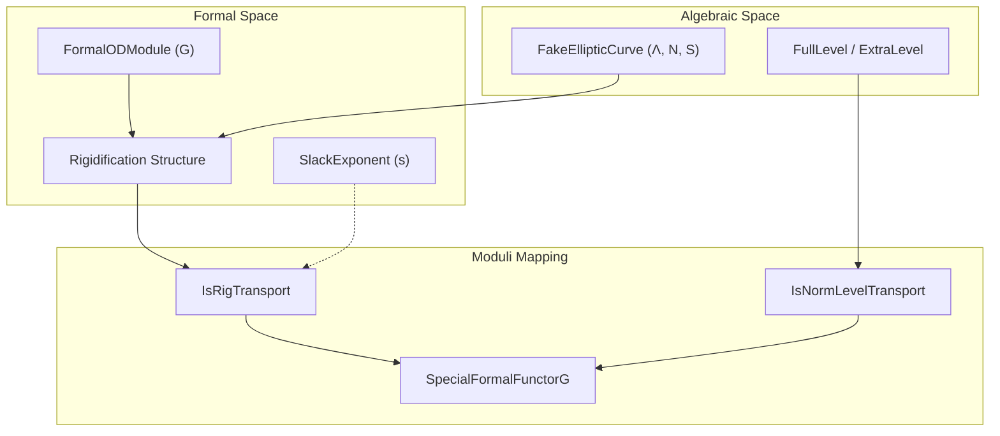
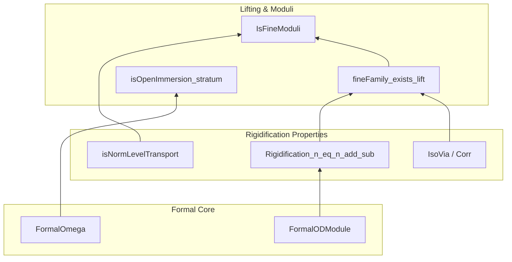

<!-- source: DeepWiki mcp.deepwiki.com · repo anthropics/fermats-last-theorem · unicode-title page Rigidification and the Čerednik-Drinfeld Uniformization · patched 2026-10-26 -->

# Rigidification and the Čerednik-Drinfeld Uniformization
# Rigidification and the Čerednik-Drinfeld Uniformization

Relevant source files

The following files were used as context for generating this wiki page:

- [P2M/Sol/S_AlgebraicGeometry_Scheme_exists_opens_disjoint_forall_mem_iff_of_natural_nontrivial_of_connected.lean](P2M/Sol/S_AlgebraicGeometry_Scheme_exists_opens_disjoint_forall_mem_iff_of_natural_nontrivial_of_connected.lean)
- [P2M/Sol/S_AlgebraicGeometry_Scheme_nilpPoints_existsUnique_forall_isNoetherianRing_extension_of_forall_isIdempotentElem.lean](P2M/Sol/S_AlgebraicGeometry_Scheme_nilpPoints_existsUnique_forall_isNoetherianRing_extension_of_forall_isIdempotentElem.lean)
- [P2M/Sol/S_AlgebraicGeometry_Scheme_nilpPoints_forall_eq_of_forall_eq_of_isNoetherianRing_of_forall_isIdempotentElem.lean](P2M/Sol/S_AlgebraicGeometry_Scheme_nilpPoints_forall_eq_of_forall_eq_of_isNoetherianRing_of_forall_isIdempotentElem.lean)
- [P2M/Sol/S_AlgebraicGeometry_Scheme_nilpPoints_forall_isNoetherianRing_eq_of_forall_eq_of_forall_isIdempotentElem.lean](P2M/Sol/S_AlgebraicGeometry_Scheme_nilpPoints_forall_isNoetherianRing_eq_of_forall_eq_of_forall_isIdempotentElem.lean)
- [P2M/Sol/S_AlgebraicGeometry_exists_intermediateField_finiteDimensional_isPullback_of_isAlgebraic.lean](P2M/Sol/S_AlgebraicGeometry_exists_intermediateField_finiteDimensional_isPullback_of_isAlgebraic.lean)
- [P2M/Sol/S_AlgebraicGeometry_exists_intermediateField_forall_exists_hom_comp_eq_of_isPullback_of_isAlgebraic.lean](P2M/Sol/S_AlgebraicGeometry_exists_intermediateField_forall_exists_hom_comp_eq_of_isPullback_of_isAlgebraic.lean)
- [P2M/Sol/S_CerednikDrinfeld_FormalODModule_exists_hasKernelOfDegree_eq_four_mul_add_two_mul_vdet_of_centralizer_apply_eq_zpow_smul_heightNormalised_eq.lean](P2M/Sol/S_CerednikDrinfeld_FormalODModule_exists_hasKernelOfDegree_eq_four_mul_add_two_mul_vdet_of_centralizer_apply_eq_zpow_smul_heightNormalised_eq.lean)
- [P2M/Sol/S_CerednikDrinfeld_FormalOmega_DeligneDatum_edgeNondegAt_map_iff_edgeNondegAt_comap.lean](P2M/Sol/S_CerednikDrinfeld_FormalOmega_DeligneDatum_edgeNondegAt_map_iff_edgeNondegAt_comap.lean)
- [P2M/Sol/S_CerednikDrinfeld_FormalOmega_DeligneDatum_inEdgeChart_iff_of_isBaseChange_of_isLocalHom.lean](P2M/Sol/S_CerednikDrinfeld_FormalOmega_DeligneDatum_inEdgeChart_iff_of_isBaseChange_of_isLocalHom.lean)
- [P2M/Sol/S_CerednikDrinfeld_FormalOmega_DrinfeldDatum_IsQuadrupleOf_deligneDatum_unique.lean](P2M/Sol/S_CerednikDrinfeld_FormalOmega_DrinfeldDatum_IsQuadrupleOf_deligneDatum_unique.lean)
- [P2M/Sol/S_CerednikDrinfeld_FormalOmega_OmegaNr_forall_eq_of_isTwistedAct_of_forall_isNoetherianRing_of_forall_isIdempotentElem.lean](P2M/Sol/S_CerednikDrinfeld_FormalOmega_OmegaNr_forall_eq_of_isTwistedAct_of_forall_isNoetherianRing_of_forall_isIdempotentElem.lean)
- [P2M/Sol/S_CerednikDrinfeld_FormalOmega_Omega_exists_opens_forall_edgeNondegAt_iff_mem_of_natural.lean](P2M/Sol/S_CerednikDrinfeld_FormalOmega_Omega_exists_opens_forall_edgeNondegAt_iff_mem_of_natural.lean)
- [P2M/Sol/S_CerednikDrinfeld_QM_FakeEllipticCurve_ExtraLevel_exists_forall_factorsThrough_imp_of_isIsogenyPair_pow_of_ne_of_intCast_mem.lean](P2M/Sol/S_CerednikDrinfeld_QM_FakeEllipticCurve_ExtraLevel_exists_forall_factorsThrough_imp_of_isIsogenyPair_pow_of_ne_of_intCast_mem.lean)
- [P2M/Sol/S_CerednikDrinfeld_QM_FakeEllipticCurve_FullLevel_eq_of_isNormLevelTransport_of_isNormLevelTransport.lean](P2M/Sol/S_CerednikDrinfeld_QM_FakeEllipticCurve_FullLevel_eq_of_isNormLevelTransport_of_isNormLevelTransport.lean)
- [P2M/Sol/S_CerednikDrinfeld_QM_FakeEllipticCurve_Rigidification_IsPullbackVia_comp.lean](P2M/Sol/S_CerednikDrinfeld_QM_FakeEllipticCurve_Rigidification_IsPullbackVia_comp.lean)
- [P2M/Sol/S_CerednikDrinfeld_QM_FakeEllipticCurve_Rigidification_comp_phi_comp_eq_phi_of_comp_act_pow_eq.lean](P2M/Sol/S_CerednikDrinfeld_QM_FakeEllipticCurve_Rigidification_comp_phi_comp_eq_phi_of_comp_act_pow_eq.lean)
- [P2M/Sol/S_CerednikDrinfeld_QM_FakeEllipticCurve_Rigidification_equiv_of_equiv_of_isPullbackVia_of_ker_sq_eq_bot.lean](P2M/Sol/S_CerednikDrinfeld_QM_FakeEllipticCurve_Rigidification_equiv_of_equiv_of_isPullbackVia_of_ker_sq_eq_bot.lean)
- [P2M/Sol/S_CerednikDrinfeld_QM_FakeEllipticCurve_Rigidification_exists_comp_act_eq_comp_act_of_corr_of_isIsogenyPair.lean](P2M/Sol/S_CerednikDrinfeld_QM_FakeEllipticCurve_Rigidification_exists_comp_act_eq_comp_act_of_corr_of_isIsogenyPair.lean)
- [P2M/Sol/S_CerednikDrinfeld_QM_FakeEllipticCurve_Rigidification_exists_comp_act_eq_comp_act_of_corr_of_isIsogenyPair_explicit.lean](P2M/Sol/S_CerednikDrinfeld_QM_FakeEllipticCurve_Rigidification_exists_comp_act_eq_comp_act_of_corr_of_isIsogenyPair_explicit.lean)
- [P2M/Sol/S_CerednikDrinfeld_QM_FakeEllipticCurve_Rigidification_exists_comp_act_eq_comp_of_isTranslateBy.lean](P2M/Sol/S_CerednikDrinfeld_QM_FakeEllipticCurve_Rigidification_exists_comp_act_eq_comp_of_isTranslateBy.lean)
- [P2M/Sol/S_CerednikDrinfeld_QM_FakeEllipticCurve_Rigidification_exists_comp_of_isPullbackVia_residueLeg_of_isogenyPair.lean](P2M/Sol/S_CerednikDrinfeld_QM_FakeEllipticCurve_Rigidification_exists_comp_of_isPullbackVia_residueLeg_of_isogenyPair.lean)
- [P2M/Sol/S_CerednikDrinfeld_QM_FakeEllipticCurve_Rigidification_exists_corr_of_isPullbackVia_of_isPullbackVia.lean](P2M/Sol/S_CerednikDrinfeld_QM_FakeEllipticCurve_Rigidification_exists_corr_of_isPullbackVia_of_isPullbackVia.lean)
- [P2M/Sol/S_CerednikDrinfeld_QM_FakeEllipticCurve_Rigidification_exists_corr_of_isPullbackVia_of_isPullbackVia_of_comp_eq_of_comp_eq.lean](P2M/Sol/S_CerednikDrinfeld_QM_FakeEllipticCurve_Rigidification_exists_corr_of_isPullbackVia_of_isPullbackVia_of_comp_eq_of_comp_eq.lean)
- [P2M/Sol/S_CerednikDrinfeld_QM_FakeEllipticCurve_Rigidification_exists_corr_of_isPullbackVia_of_isPullbackVia_of_squareZero.lean](P2M/Sol/S_CerednikDrinfeld_QM_FakeEllipticCurve_Rigidification_exists_corr_of_isPullbackVia_of_isPullbackVia_of_squareZero.lean)
- [P2M/Sol/S_CerednikDrinfeld_QM_FakeEllipticCurve_Rigidification_exists_corr_of_isoVia.lean](P2M/Sol/S_CerednikDrinfeld_QM_FakeEllipticCurve_Rigidification_exists_corr_of_isoVia.lean)
- [P2M/Sol/S_CerednikDrinfeld_QM_FakeEllipticCurve_Rigidification_exists_frobTwist_one_corr_relFrobenius_of_isAtkinLehnerQuotientVia_of_not_dvd.lean](P2M/Sol/S_CerednikDrinfeld_QM_FakeEllipticCurve_Rigidification_exists_frobTwist_one_corr_relFrobenius_of_isAtkinLehnerQuotientVia_of_not_dvd.lean)
- [P2M/Sol/S_CerednikDrinfeld_QM_FakeEllipticCurve_Rigidification_exists_fullLevel_locally_isNormLevelTransport_of_connected_conn.lean](P2M/Sol/S_CerednikDrinfeld_QM_FakeEllipticCurve_Rigidification_exists_fullLevel_locally_isNormLevelTransport_of_connected_conn.lean)
- [P2M/Sol/S_CerednikDrinfeld_QM_FakeEllipticCurve_Rigidification_exists_isPullbackVia_corr_of_ker_le_span.lean](P2M/Sol/S_CerednikDrinfeld_QM_FakeEllipticCurve_Rigidification_exists_isPullbackVia_corr_of_ker_le_span.lean)
- [P2M/Sol/S_CerednikDrinfeld_QM_FakeEllipticCurve_Rigidification_exists_isPullbackVia_corr_of_rigidifiedToG_of_isNormLevelTransport_of_squareZero_conn.lean](P2M/Sol/S_CerednikDrinfeld_QM_FakeEllipticCurve_Rigidification_exists_isPullbackVia_corr_of_rigidifiedToG_of_isNormLevelTransport_of_squareZero_conn.lean)
- [P2M/Sol/S_CerednikDrinfeld_QM_FakeEllipticCurve_Rigidification_exists_isPullbackVia_of_isPullbackVia.lean](P2M/Sol/S_CerednikDrinfeld_QM_FakeEllipticCurve_Rigidification_exists_isPullbackVia_of_isPullbackVia.lean)
- [P2M/Sol/S_CerednikDrinfeld_QM_FakeEllipticCurve_Rigidification_exists_isPullbackVia_rebase_of_isPullbackVia.lean](P2M/Sol/S_CerednikDrinfeld_QM_FakeEllipticCurve_Rigidification_exists_isPullbackVia_rebase_of_isPullbackVia.lean)
- [P2M/Sol/S_CerednikDrinfeld_QM_FakeEllipticCurve_Rigidification_exists_isoVia_corr_of_isPullbackVia.lean](P2M/Sol/S_CerednikDrinfeld_QM_FakeEllipticCurve_Rigidification_exists_isoVia_corr_of_isPullbackVia.lean)
- [P2M/Sol/S_CerednikDrinfeld_QM_FakeEllipticCurve_Rigidification_exists_le_equiv_of_inEdgeChart_of_isArtinianRing.lean](P2M/Sol/S_CerednikDrinfeld_QM_FakeEllipticCurve_Rigidification_exists_le_equiv_of_inEdgeChart_of_isArtinianRing.lean)
- [P2M/Sol/S_CerednikDrinfeld_QM_FakeEllipticCurve_Rigidification_exists_le_equiv_of_inEdgeChart_of_isLocalRing.lean](P2M/Sol/S_CerednikDrinfeld_QM_FakeEllipticCurve_Rigidification_exists_le_equiv_of_inEdgeChart_of_isLocalRing.lean)
- [P2M/Sol/S_CerednikDrinfeld_QM_FakeEllipticCurve_Rigidification_exists_le_equiv_of_isAdmissible_of_n_le_of_isArtinianRing.lean](P2M/Sol/S_CerednikDrinfeld_QM_FakeEllipticCurve_Rigidification_exists_le_equiv_of_isAdmissible_of_n_le_of_isArtinianRing.lean)
- [P2M/Sol/S_CerednikDrinfeld_QM_FakeEllipticCurve_Rigidification_exists_le_equiv_of_isAdmissible_of_n_le_of_isLocalRing.lean](P2M/Sol/S_CerednikDrinfeld_QM_FakeEllipticCurve_Rigidification_exists_le_equiv_of_isAdmissible_of_n_le_of_isLocalRing.lean)
- [P2M/Sol/S_CerednikDrinfeld_QM_FakeEllipticCurve_Rigidification_exists_lift_corr_and_equiv_of_isPullbackVia_corr_of_ker_sq_eq_bot.lean](P2M/Sol/S_CerednikDrinfeld_QM_FakeEllipticCurve_Rigidification_exists_lift_corr_and_equiv_of_isPullbackVia_corr_of_ker_sq_eq_bot.lean)
- [P2M/Sol/S_CerednikDrinfeld_QM_FakeEllipticCurve_Rigidification_exists_mem_isPullback_of_isoVia_levelHom_of_translate_of_isAlgClosed_heightNormalised_eq_of_oneLeg_levelHomLaw.lean](P2M/Sol/S_CerednikDrinfeld_QM_FakeEllipticCurve_Rigidification_exists_mem_isPullback_of_isoVia_levelHom_of_translate_of_isAlgClosed_heightNormalised_eq_of_oneLeg_levelHomLaw.lean)
- [P2M/Sol/S_CerednikDrinfeld_QM_FakeEllipticCurve_Rigidification_exists_mem_isTwistedAct_isTranslateBy_corr_of_isoVia_of_isAlgClosed_heightNormalised_eq_oneLeg.lean](P2M/Sol/S_CerednikDrinfeld_QM_FakeEllipticCurve_Rigidification_exists_mem_isTwistedAct_isTranslateBy_corr_of_isoVia_of_isAlgClosed_heightNormalised_eq_oneLeg.lean)
- [P2M/Sol/S_CerednikDrinfeld_QM_FakeEllipticCurve_Rigidification_exists_series_isODHom_represents_of_isoVia_of_corr_of_isRigTransport.lean](P2M/Sol/S_CerednikDrinfeld_QM_FakeEllipticCurve_Rigidification_exists_series_isODHom_represents_of_isoVia_of_corr_of_isRigTransport.lean)
- [P2M/Sol/S_CerednikDrinfeld_QM_FakeEllipticCurve_Rigidification_exists_translate_level_eq_of_levelHom_of_character_of_isTwistedAct_heightNormalised_eq.lean](P2M/Sol/S_CerednikDrinfeld_QM_FakeEllipticCurve_Rigidification_exists_translate_level_eq_of_levelHom_of_character_of_isTwistedAct_heightNormalised_eq.lean)
- [P2M/Sol/S_CerednikDrinfeld_QM_FakeEllipticCurve_Rigidification_forall_factorsThrough_iff_and_stable_of_isTranslateBy_corr_of_isAlgClosed_heightNormalised_eq_oneLeg.lean](P2M/Sol/S_CerednikDrinfeld_QM_FakeEllipticCurve_Rigidification_forall_factorsThrough_iff_and_stable_of_isTranslateBy_corr_of_isAlgClosed_heightNormalised_eq_oneLeg.lean)
- [P2M/Sol/S_CerednikDrinfeld_QM_FakeEllipticCurve_Rigidification_forall_factorsThrough_iff_and_stable_of_isTranslateBy_corr_of_isAlgClosed_heightNormalised_eq_oneLeg_det.lean](P2M/Sol/S_CerednikDrinfeld_QM_FakeEllipticCurve_Rigidification_forall_factorsThrough_iff_and_stable_of_isTranslateBy_corr_of_isAlgClosed_heightNormalised_eq_oneLeg_det.lean)
- [P2M/Sol/S_CerednikDrinfeld_QM_FakeEllipticCurve_Rigidification_forall_factorsThrough_iff_and_stable_of_isTranslateBy_corr_of_isAlgClosed_heightNormalised_eq_oneLeg_det_descent.lean](P2M/Sol/S_CerednikDrinfeld_QM_FakeEllipticCurve_Rigidification_forall_factorsThrough_iff_and_stable_of_isTranslateBy_corr_of_isAlgClosed_heightNormalised_eq_oneLeg_det_descent.lean)
- [P2M/Sol/S_CerednikDrinfeld_QM_FakeEllipticCurve_Rigidification_forall_factorsThrough_iff_and_stable_of_isTranslateBy_corr_of_isAlgClosed_heightNormalised_eq_oneLeg_det_kbar.lean](P2M/Sol/S_CerednikDrinfeld_QM_FakeEllipticCurve_Rigidification_forall_factorsThrough_iff_and_stable_of_isTranslateBy_corr_of_isAlgClosed_heightNormalised_eq_oneLeg_det_kbar.lean)
- [P2M/Sol/S_CerednikDrinfeld_QM_FakeEllipticCurve_Rigidification_forall_factorsThrough_iff_and_stable_of_isTranslateBy_corr_of_isAlgClosed_heightNormalised_eq_oneLeg_ell.lean](P2M/Sol/S_CerednikDrinfeld_QM_FakeEllipticCurve_Rigidification_forall_factorsThrough_iff_and_stable_of_isTranslateBy_corr_of_isAlgClosed_heightNormalised_eq_oneLeg_ell.lean)
- [P2M/Sol/S_CerednikDrinfeld_QM_FakeEllipticCurve_Rigidification_forall_factorsThrough_iff_iff_of_translate_corr_of_isAlgClosed_heightNormalised_eq_oneLeg.lean](P2M/Sol/S_CerednikDrinfeld_QM_FakeEllipticCurve_Rigidification_forall_factorsThrough_iff_iff_of_translate_corr_of_isAlgClosed_heightNormalised_eq_oneLeg.lean)
- [P2M/Sol/S_CerednikDrinfeld_QM_FakeEllipticCurve_Rigidification_fullLevel_eq_of_isNormLevelTransport_of_isNormLevelTransport_frobTwist_neg_one_of_isActBy.lean](P2M/Sol/S_CerednikDrinfeld_QM_FakeEllipticCurve_Rigidification_fullLevel_eq_of_isNormLevelTransport_of_isNormLevelTransport_frobTwist_neg_one_of_isActBy.lean)
- [P2M/Sol/S_CerednikDrinfeld_QM_FakeEllipticCurve_Rigidification_fullLevel_eq_of_locally_isNormLevelTransport_conn.lean](P2M/Sol/S_CerednikDrinfeld_QM_FakeEllipticCurve_Rigidification_fullLevel_eq_of_locally_isNormLevelTransport_conn.lean)
- [P2M/Sol/S_CerednikDrinfeld_QM_FakeEllipticCurve_Rigidification_isRigTransport_map_of_isPullbackVia.lean](P2M/Sol/S_CerednikDrinfeld_QM_FakeEllipticCurve_Rigidification_isRigTransport_map_of_isPullbackVia.lean)
- [P2M/Sol/S_CerednikDrinfeld_QM_FakeEllipticCurve_Rigidification_isTranslateBy_of_isPullbackVia_of_isPullbackVia.lean](P2M/Sol/S_CerednikDrinfeld_QM_FakeEllipticCurve_Rigidification_isTranslateBy_of_isPullbackVia_of_isPullbackVia.lean)
- [P2M/Sol/S_CerednikDrinfeld_QM_FakeEllipticCurve_Rigidification_locally_isNormLevelTransport_of_isoVia_of_corr_conn.lean](P2M/Sol/S_CerednikDrinfeld_QM_FakeEllipticCurve_Rigidification_locally_isNormLevelTransport_of_isoVia_of_corr_conn.lean)
- [P2M/Sol/S_CerednikDrinfeld_QM_FakeEllipticCurve_Rigidification_mapPt_pushPt_eq_of_translate_corr_of_isNormLevelTransport_of_isAlgClosed_heightNormalised_eq_oneLeg_levelHomLaw.lean](P2M/Sol/S_CerednikDrinfeld_QM_FakeEllipticCurve_Rigidification_mapPt_pushPt_eq_of_translate_corr_of_isNormLevelTransport_of_isAlgClosed_heightNormalised_eq_oneLeg_levelHomLaw.lean)
- [P2M/Sol/S_CerednikDrinfeld_QM_FakeEllipticCurve_Rigidification_n_eq_n_add_sub_slackExponent_of_isRigTransport_of_isRigTransport_translate_of_isActBy.lean](P2M/Sol/S_CerednikDrinfeld_QM_FakeEllipticCurve_Rigidification_n_eq_n_add_sub_slackExponent_of_isRigTransport_of_isRigTransport_translate_of_isActBy.lean)
- [P2M/Sol/S_CerednikDrinfeld_QM_FakeEllipticCurve_Rigidification_normLevel_translate_eq_rpow_character_of_isTranslateBy_of_isActBy_heightNormalised_eq.lean](P2M/Sol/S_CerednikDrinfeld_QM_FakeEllipticCurve_Rigidification_normLevel_translate_eq_rpow_character_of_isTranslateBy_of_isActBy_heightNormalised_eq.lean)
- [P2M/Sol/S_CerednikDrinfeld_QM_FakeEllipticCurve_Rigidification_omega_eq_of_rigidifiedToG_of_isPullbackVia_corr_of_squareZero.lean](P2M/Sol/S_CerednikDrinfeld_QM_FakeEllipticCurve_Rigidification_omega_eq_of_rigidifiedToG_of_isPullbackVia_corr_of_squareZero.lean)
- [P2M/Sol/S_CerednikDrinfeld_QM_FakeEllipticCurve_Rigidification_pushPt_slack_nsmulPt_translate_section_eq_nsmulPt_pushPt_character_section_of_isTranslateBy.lean](P2M/Sol/S_CerednikDrinfeld_QM_FakeEllipticCurve_Rigidification_pushPt_slack_nsmulPt_translate_section_eq_nsmulPt_pushPt_character_section_of_isTranslateBy.lean)
- [P2M/Sol/S_CerednikDrinfeld_QM_FakeEllipticCurve_evenRigidifiedPair_exists_unique_pullback_lift_of_rigidifiedToG_conn_h2.lean](P2M/Sol/S_CerednikDrinfeld_QM_FakeEllipticCurve_evenRigidifiedPair_exists_unique_pullback_lift_of_rigidifiedToG_conn_h2.lean)
- [P2M/Sol/S_CerednikDrinfeld_QM_FakeEllipticCurve_evenRigidifiedPair_lift_of_rigidifiedToG.lean](P2M/Sol/S_CerednikDrinfeld_QM_FakeEllipticCurve_evenRigidifiedPair_lift_of_rigidifiedToG.lean)
- [P2M/Sol/S_CerednikDrinfeld_QM_FakeEllipticCurve_evenRigidifiedPair_pullback_of_rigidifiedToG.lean](P2M/Sol/S_CerednikDrinfeld_QM_FakeEllipticCurve_evenRigidifiedPair_pullback_of_rigidifiedToG.lean)
- [P2M/Sol/S_CerednikDrinfeld_QM_FakeEllipticCurve_evenRigidifiedPair_unique_of_rigidifiedToG_of_forall_isIdempotentElem_of_isUnit_two.lean](P2M/Sol/S_CerednikDrinfeld_QM_FakeEllipticCurve_evenRigidifiedPair_unique_of_rigidifiedToG_of_forall_isIdempotentElem_of_isUnit_two.lean)
- [P2M/Sol/S_CerednikDrinfeld_QM_FakeEllipticCurve_exists_away_map_eq_of_atPrime_map_eq_of_rigidifiedToG.lean](P2M/Sol/S_CerednikDrinfeld_QM_FakeEllipticCurve_exists_away_map_eq_of_atPrime_map_eq_of_rigidifiedToG.lean)
- [P2M/Sol/S_CerednikDrinfeld_QM_FakeEllipticCurve_exists_away_presentationLabel_of_isPrime_pr.lean](P2M/Sol/S_CerednikDrinfeld_QM_FakeEllipticCurve_exists_away_presentationLabel_of_isPrime_pr.lean)
- [P2M/Sol/S_CerednikDrinfeld_QM_FakeEllipticCurve_exists_even_rigidification_of_isActBy_of_isPiTranslate.lean](P2M/Sol/S_CerednikDrinfeld_QM_FakeEllipticCurve_exists_even_rigidification_of_isActBy_of_isPiTranslate.lean)
- [P2M/Sol/S_CerednikDrinfeld_QM_FakeEllipticCurve_exists_even_rigidification_of_isActBy_of_isPiTranslate_normLevel_rpow.lean](P2M/Sol/S_CerednikDrinfeld_QM_FakeEllipticCurve_exists_even_rigidification_of_isActBy_of_isPiTranslate_normLevel_rpow.lean)
- [P2M/Sol/S_CerednikDrinfeld_QM_FakeEllipticCurve_exists_extraLevel_transport_and_iff_of_rigidification_normLevelTransport_oneLegC5.lean](P2M/Sol/S_CerednikDrinfeld_QM_FakeEllipticCurve_exists_extraLevel_transport_and_iff_of_rigidification_normLevelTransport_oneLegC5.lean)
- [P2M/Sol/S_CerednikDrinfeld_QM_FakeEllipticCurve_exists_forall_isActBy_rigidifiedToG_star_of_isTranslateBy_of_isLevelIsogeny_of_isAtkinLehnerQuotient_of_endIsoFull.lean](P2M/Sol/S_CerednikDrinfeld_QM_FakeEllipticCurve_exists_forall_isActBy_rigidifiedToG_star_of_isTranslateBy_of_isLevelIsogeny_of_isAtkinLehnerQuotient_of_endIsoFull.lean)
- [P2M/Sol/S_CerednikDrinfeld_QM_FakeEllipticCurve_exists_fullLevel_transport_and_eq_of_rigidification.lean](P2M/Sol/S_CerednikDrinfeld_QM_FakeEllipticCurve_exists_fullLevel_transport_and_eq_of_rigidification.lean)
- [P2M/Sol/S_CerednikDrinfeld_QM_FakeEllipticCurve_exists_fullLevel_transport_and_eq_of_rigidification_normLevelTransport.lean](P2M/Sol/S_CerednikDrinfeld_QM_FakeEllipticCurve_exists_fullLevel_transport_and_eq_of_rigidification_normLevelTransport.lean)
- [P2M/Sol/S_CerednikDrinfeld_QM_FakeEllipticCurve_exists_hom_extension_of_isPullback_of_isDiscreteValuationRing.lean](P2M/Sol/S_CerednikDrinfeld_QM_FakeEllipticCurve_exists_hom_extension_of_isPullback_of_isDiscreteValuationRing.lean)
- [P2M/Sol/S_CerednikDrinfeld_QM_FakeEllipticCurve_exists_hom_extension_of_isPullback_valuationSubring_of_isPullback_inf.lean](P2M/Sol/S_CerednikDrinfeld_QM_FakeEllipticCurve_exists_hom_extension_of_isPullback_valuationSubring_of_isPullback_inf.lean)
- [P2M/Sol/S_CerednikDrinfeld_QM_FakeEllipticCurve_exists_intermediateField_forall_hom_of_isPullback_algebraMap.lean](P2M/Sol/S_CerednikDrinfeld_QM_FakeEllipticCurve_exists_intermediateField_forall_hom_of_isPullback_algebraMap.lean)
- [P2M/Sol/S_CerednikDrinfeld_QM_FakeEllipticCurve_exists_isAtkinLehnerQuotientVia_comp_eq_of_isPullbackVia.lean](P2M/Sol/S_CerednikDrinfeld_QM_FakeEllipticCurve_exists_isAtkinLehnerQuotientVia_comp_eq_of_isPullbackVia.lean)
- [P2M/Sol/S_CerednikDrinfeld_QM_FakeEllipticCurve_exists_isNormLevelTransport_and_eq_pushPt_act_and_leg_eq_frobTwist_of_isLocalRing_of_rigidifiedToG_pr.lean](P2M/Sol/S_CerednikDrinfeld_QM_FakeEllipticCurve_exists_isNormLevelTransport_and_eq_pushPt_act_and_leg_eq_frobTwist_of_isLocalRing_of_rigidifiedToG_pr.lean)
- [P2M/Sol/S_CerednikDrinfeld_QM_FakeEllipticCurve_exists_isOpenImmersion_stratum_window_of_rigidifiedToG_of_bdd_local.lean](P2M/Sol/S_CerednikDrinfeld_QM_FakeEllipticCurve_exists_isOpenImmersion_stratum_window_of_rigidifiedToG_of_bdd_local.lean)
- [P2M/Sol/S_CerednikDrinfeld_QM_FakeEllipticCurve_exists_label_natural_iff_exists_ptR_eq_of_rigidifiedToG_connInj_pr.lean](P2M/Sol/S_CerednikDrinfeld_QM_FakeEllipticCurve_exists_label_natural_iff_exists_ptR_eq_of_rigidifiedToG_connInj_pr.lean)
- [P2M/Sol/S_CerednikDrinfeld_QM_FakeEllipticCurve_exists_levelRaise_squares_of_isPullback_inf.lean](P2M/Sol/S_CerednikDrinfeld_QM_FakeEllipticCurve_exists_levelRaise_squares_of_isPullback_inf.lean)
- [P2M/Sol/S_CerednikDrinfeld_QM_FakeEllipticCurve_exists_omega_family_natural_apply_ptR_eq_of_rigidifiedToG_connInj_pr.lean](P2M/Sol/S_CerednikDrinfeld_QM_FakeEllipticCurve_exists_omega_family_natural_apply_ptR_eq_of_rigidifiedToG_connInj_pr.lean)
- [P2M/Sol/S_CerednikDrinfeld_QM_FakeEllipticCurve_exists_opens_ratioWindow_degree_laws_of_rigidifiedToG_of_bdd.lean](P2M/Sol/S_CerednikDrinfeld_QM_FakeEllipticCurve_exists_opens_ratioWindow_degree_laws_of_rigidifiedToG_of_bdd.lean)
- [P2M/Sol/S_CerednikDrinfeld_QM_FakeEllipticCurve_exists_pullback_presentation_ptR_eq_map_pr.lean](P2M/Sol/S_CerednikDrinfeld_QM_FakeEllipticCurve_exists_pullback_presentation_ptR_eq_map_pr.lean)
- [P2M/Sol/S_CerednikDrinfeld_QM_FakeEllipticCurve_exists_represents_inEdgeChart_of_rigidifiedToG_of_bdd.lean](P2M/Sol/S_CerednikDrinfeld_QM_FakeEllipticCurve_exists_represents_inEdgeChart_of_rigidifiedToG_of_bdd.lean)
- [P2M/Sol/S_CerednikDrinfeld_QM_FakeEllipticCurve_exists_rigidification_frobTwist_zpow_isActBy_scalar_extraLevel_normLevel_of_rigidifiedToG.lean](P2M/Sol/S_CerednikDrinfeld_QM_FakeEllipticCurve_exists_rigidification_frobTwist_zpow_isActBy_scalar_extraLevel_normLevel_of_rigidifiedToG.lean)
- [P2M/Sol/S_CerednikDrinfeld_QM_FakeEllipticCurve_exists_rigidification_frobTwist_zpow_isActBy_scalar_extraLevel_of_rigidifiedToG.lean](P2M/Sol/S_CerednikDrinfeld_QM_FakeEllipticCurve_exists_rigidification_frobTwist_zpow_isActBy_scalar_extraLevel_of_rigidifiedToG.lean)
- [P2M/Sol/S_CerednikDrinfeld_QM_FakeEllipticCurve_exists_rigidifiedCurve_lift_pullback_isoVia_of_label_of_isArtinianRing_of_rigidifiedToG_connInj_pr.lean](P2M/Sol/S_CerednikDrinfeld_QM_FakeEllipticCurve_exists_rigidifiedCurve_lift_pullback_isoVia_of_label_of_isArtinianRing_of_rigidifiedToG_connInj_pr.lean)
- [P2M/Sol/S_CerednikDrinfeld_QM_FakeEllipticCurve_exists_strata_point_specMap_comp_eq_of_atPrime_map_eq_of_rigidifiedToG.lean](P2M/Sol/S_CerednikDrinfeld_QM_FakeEllipticCurve_exists_strata_point_specMap_comp_eq_of_atPrime_map_eq_of_rigidifiedToG.lean)
- [P2M/Sol/S_CerednikDrinfeld_QM_FakeEllipticCurve_mapPt_mul_and_act_comp_of_comp_eq_of_isPullback_valuationSubring.lean](P2M/Sol/S_CerednikDrinfeld_QM_FakeEllipticCurve_mapPt_mul_and_act_comp_of_comp_eq_of_isPullback_valuationSubring.lean)
- [P2M/Sol/S_CerednikDrinfeld_QM_FakeEllipticCurve_omega_family_bijective_label_of_isAlgClosed_of_rigidifiedToG_connInj_pr.lean](P2M/Sol/S_CerednikDrinfeld_QM_FakeEllipticCurve_omega_family_bijective_label_of_isAlgClosed_of_rigidifiedToG_connInj_pr.lean)
- [P2M/Sol/S_CerednikDrinfeld_QM_FakeEllipticCurve_omega_family_eq_of_label_of_theta_eq_of_isArtinianRing_of_rigidifiedToG_connInj_pr.lean](P2M/Sol/S_CerednikDrinfeld_QM_FakeEllipticCurve_omega_family_eq_of_label_of_theta_eq_of_isArtinianRing_of_rigidifiedToG_connInj_pr.lean)
- [P2M/Sol/S_CerednikDrinfeld_QM_FakeEllipticCurve_omega_family_existsUnique_lift_label_of_isArtinianRing_of_rigidifiedToG_connInj_pr.lean](P2M/Sol/S_CerednikDrinfeld_QM_FakeEllipticCurve_omega_family_existsUnique_lift_label_of_isArtinianRing_of_rigidifiedToG_connInj_pr.lean)
- [P2M/Sol/S_CerednikDrinfeld_QM_FakeEllipticCurve_omega_family_exists_lift_label_of_isArtinianRing_of_rigidifiedToG_connInj_pr.lean](P2M/Sol/S_CerednikDrinfeld_QM_FakeEllipticCurve_omega_family_exists_lift_label_of_isArtinianRing_of_rigidifiedToG_connInj_pr.lean)
- [P2M/Sol/S_CerednikDrinfeld_QM_FakeEllipticCurve_presentationLabel_map_of_presentationLabel_pr.lean](P2M/Sol/S_CerednikDrinfeld_QM_FakeEllipticCurve_presentationLabel_map_of_presentationLabel_pr.lean)
- [P2M/Sol/S_CerednikDrinfeld_QM_FakeEllipticCurve_presentationLabel_twist_pr.lean](P2M/Sol/S_CerednikDrinfeld_QM_FakeEllipticCurve_presentationLabel_twist_pr.lean)
- [P2M/Sol/S_CerednikDrinfeld_QM_FakeEllipticCurve_presentationLabel_unique_and_leg_eq_of_ptR_eq_pr.lean](P2M/Sol/S_CerednikDrinfeld_QM_FakeEllipticCurve_presentationLabel_unique_and_leg_eq_of_ptR_eq_pr.lean)
- [P2M/Sol/S_CerednikDrinfeld_QM_FakeEllipticCurve_rigidifiedToG_surjective_injective_of_isArtinianRing_of_isAlgClosed_residueField.lean](P2M/Sol/S_CerednikDrinfeld_QM_FakeEllipticCurve_rigidifiedToG_surjective_injective_of_isArtinianRing_of_isAlgClosed_residueField.lean)
- [P2M/Sol/S_CerednikDrinfeld_QM_IsCoarseModuliT_exists_towerFamily_connected_of_evenRigidifiedPair_of_heckeDictionary_of_isNoetherianRing_heightNormalised_oneLegC5.lean](P2M/Sol/S_CerednikDrinfeld_QM_IsCoarseModuliT_exists_towerFamily_connected_of_evenRigidifiedPair_of_heckeDictionary_of_isNoetherianRing_heightNormalised_oneLegC5.lean)
- [P2M/Sol/S_CerednikDrinfeld_QM_IsCoarseModuliT_exists_towerFamily_of_towerFamily_connected_of_isNoetherianRing_heightNormalised_oneLegC5.lean](P2M/Sol/S_CerednikDrinfeld_QM_IsCoarseModuliT_exists_towerFamily_of_towerFamily_connected_of_isNoetherianRing_heightNormalised_oneLegC5.lean)
- [P2M/Sol/S_CerednikDrinfeld_QM_IsCoarseModuliT_towerFamily_comp_dZero_eq_fineFamily_comp_of_isNoetherianRing_heightNormalised_oneLegC5.lean](P2M/Sol/S_CerednikDrinfeld_QM_IsCoarseModuliT_towerFamily_comp_dZero_eq_fineFamily_comp_of_isNoetherianRing_heightNormalised_oneLegC5.lean)
- [P2M/Sol/S_CerednikDrinfeld_QM_IsCoarseModuliT_towerFamily_eq_iff_exists_isTwistedAct_of_isAlgClosed_heightNormalised_oneLegC5.lean](P2M/Sol/S_CerednikDrinfeld_QM_IsCoarseModuliT_towerFamily_eq_iff_exists_isTwistedAct_of_isAlgClosed_heightNormalised_oneLegC5.lean)
- [P2M/Sol/S_CerednikDrinfeld_QM_IsCoarseModuliT_towerFamily_eq_of_isTwistedAct_of_mem_of_isNoetherianRing_heightNormalised_oneLegC5.lean](P2M/Sol/S_CerednikDrinfeld_QM_IsCoarseModuliT_towerFamily_eq_of_isTwistedAct_of_mem_of_isNoetherianRing_heightNormalised_oneLegC5.lean)
- [P2M/Sol/S_CerednikDrinfeld_QM_IsFineModuliT_exists_fineFamilyT_connected_value_of_fineFamily_of_towerFamily_of_isNoetherianRing_oneLegC5.lean](P2M/Sol/S_CerednikDrinfeld_QM_IsFineModuliT_exists_fineFamilyT_connected_value_of_fineFamily_of_towerFamily_of_isNoetherianRing_oneLegC5.lean)
- [P2M/Sol/S_CerednikDrinfeld_QM_IsFineModuliT_exists_fineFamilyT_value_compat_of_fineFamily_of_towerFamily_of_isNoetherianRing_oneLegC5.lean](P2M/Sol/S_CerednikDrinfeld_QM_IsFineModuliT_exists_fineFamilyT_value_compat_of_fineFamily_of_towerFamily_of_isNoetherianRing_oneLegC5.lean)
- [P2M/Sol/S_CerednikDrinfeld_QM_IsFineModuliT_exists_fineFamilyT_value_of_fineFamilyT_connected_of_isNoetherianRing_oneLegC5.lean](P2M/Sol/S_CerednikDrinfeld_QM_IsFineModuliT_exists_fineFamilyT_value_of_fineFamilyT_connected_of_isNoetherianRing_oneLegC5.lean)
- [P2M/Sol/S_CerednikDrinfeld_QM_IsFineModuliT_fineFamilyT_apply_eq_apply_of_isPullback_of_frobTwist_eq_of_translate_of_isNoetherianRing_eq.lean](P2M/Sol/S_CerednikDrinfeld_QM_IsFineModuliT_fineFamilyT_apply_eq_apply_of_isPullback_of_frobTwist_eq_of_translate_of_isNoetherianRing_eq.lean)
- [P2M/Sol/S_CerednikDrinfeld_QM_IsFineModuliT_fineFamilyT_comp_forgetExtraLevel_eq_fineFamily_of_natural_equivariant_value_oneLegC5.lean](P2M/Sol/S_CerednikDrinfeld_QM_IsFineModuliT_fineFamilyT_comp_forgetExtraLevel_eq_fineFamily_of_natural_equivariant_value_oneLegC5.lean)
- [P2M/Sol/S_CerednikDrinfeld_QM_IsFineModuliT_fineFamilyT_comp_forgetFullLevel_eq_towerFamily_of_natural_value_oneLegC5.lean](P2M/Sol/S_CerednikDrinfeld_QM_IsFineModuliT_fineFamilyT_comp_forgetFullLevel_eq_towerFamily_of_natural_value_oneLegC5.lean)
- [P2M/Sol/S_CerednikDrinfeld_QM_IsFineModuliT_fineFamilyT_eq_iff_exists_isTwistedAct_of_translate_of_value_of_isAlgClosed_eq.lean](P2M/Sol/S_CerednikDrinfeld_QM_IsFineModuliT_fineFamilyT_eq_iff_exists_isTwistedAct_of_translate_of_value_of_isAlgClosed_eq.lean)
- [P2M/Sol/S_CerednikDrinfeld_QM_IsFineModuliT_fineFamilyT_fibre_of_oneLeg_of_legBlind_of_translate_of_value_of_isAlgClosed_eq.lean](P2M/Sol/S_CerednikDrinfeld_QM_IsFineModuliT_fineFamilyT_fibre_of_oneLeg_of_legBlind_of_translate_of_value_of_isAlgClosed_eq.lean)
- [P2M/Sol/S_CerednikDrinfeld_QM_IsFineModuliT_fineFamilyT_fibre_of_translate_of_value_of_isAlgClosed_eq_oneLegC5.lean](P2M/Sol/S_CerednikDrinfeld_QM_IsFineModuliT_fineFamilyT_fibre_of_translate_of_value_of_isAlgClosed_eq_oneLegC5.lean)
- [P2M/Sol/S_CerednikDrinfeld_QM_IsFineModuliT_fineFamilyT_translate_fibre_of_value_of_isNoetherianRing_eq_oneLegC5.lean](P2M/Sol/S_CerednikDrinfeld_QM_IsFineModuliT_fineFamilyT_translate_fibre_of_value_of_isNoetherianRing_eq_oneLegC5.lean)
- [P2M/Sol/S_CerednikDrinfeld_QM_IsFineModuliT_fineFamilyT_translate_of_value_of_isNoetherianRing_eq_oneLegC5.lean](P2M/Sol/S_CerednikDrinfeld_QM_IsFineModuliT_fineFamilyT_translate_of_value_of_isNoetherianRing_eq_oneLegC5.lean)
- [P2M/Sol/S_CerednikDrinfeld_QM_IsFineModuli_cerednikDrinfeld_fineFamily_atkinLehner_of_rigidifiedToG_heightNormalised_oneLegC5.lean](P2M/Sol/S_CerednikDrinfeld_QM_IsFineModuli_cerednikDrinfeld_fineFamily_atkinLehner_of_rigidifiedToG_heightNormalised_oneLegC5.lean)
- [P2M/Sol/S_CerednikDrinfeld_QM_IsFineModuli_cerednikDrinfeld_fineFamily_atkinLehner_of_rigidifiedToG_of_isNoetherianRing_heightNormalised_oneLegC5.lean](P2M/Sol/S_CerednikDrinfeld_QM_IsFineModuli_cerednikDrinfeld_fineFamily_atkinLehner_of_rigidifiedToG_of_isNoetherianRing_heightNormalised_oneLegC5.lean)
- [P2M/Sol/S_CerednikDrinfeld_QM_IsFineModuli_existsUnique_lift_of_sheaf_of_represents_rigidifiedCurve.lean](P2M/Sol/S_CerednikDrinfeld_QM_IsFineModuli_existsUnique_lift_of_sheaf_of_represents_rigidifiedCurve.lean)
- [P2M/Sol/S_CerednikDrinfeld_QM_IsFineModuli_exists_cerednikDrinfeld_fineFamily_of_rigidifiedToG_of_isNoetherianRing_heightNormalised_eq_oneLegC5_h2.lean](P2M/Sol/S_CerednikDrinfeld_QM_IsFineModuli_exists_cerednikDrinfeld_fineFamily_of_rigidifiedToG_of_isNoetherianRing_heightNormalised_eq_oneLegC5_h2.lean)
- [P2M/Sol/S_CerednikDrinfeld_QM_IsFineModuli_exists_cerednikDrinfeld_fineFamily_value_of_connected_of_isNoetherianRing_equivariant_heightNormalised_conn.lean](P2M/Sol/S_CerednikDrinfeld_QM_IsFineModuli_exists_cerednikDrinfeld_fineFamily_value_of_connected_of_isNoetherianRing_equivariant_heightNormalised_conn.lean)
- [P2M/Sol/S_CerednikDrinfeld_QM_IsFineModuli_exists_cerednikDrinfeld_fineFamily_value_of_value_of_connected_equivariant_heightNormalised_conn.lean](P2M/Sol/S_CerednikDrinfeld_QM_IsFineModuli_exists_cerednikDrinfeld_fineFamily_value_of_value_of_connected_equivariant_heightNormalised_conn.lean)
- [P2M/Sol/S_CerednikDrinfeld_QM_IsFineModuli_exists_cerednikDrinfeld_towerFamily_liftT_of_rigidifiedToG_heightNormalised_eq_oneLegC5.lean](P2M/Sol/S_CerednikDrinfeld_QM_IsFineModuli_exists_cerednikDrinfeld_towerFamily_liftT_of_rigidifiedToG_heightNormalised_eq_oneLegC5.lean)
- [P2M/Sol/S_CerednikDrinfeld_QM_IsFineModuli_exists_cerednikDrinfeld_towerFamily_liftT_of_rigidifiedToG_of_isNoetherianRing_heightNormalised_eq_oneLegC5.lean](P2M/Sol/S_CerednikDrinfeld_QM_IsFineModuli_exists_cerednikDrinfeld_towerFamily_liftT_of_rigidifiedToG_of_isNoetherianRing_heightNormalised_eq_oneLegC5.lean)
- [P2M/Sol/S_CerednikDrinfeld_QM_IsFineModuli_exists_cerednikDrinfeld_uniformization_fine_level_atkinLehner_minusT_liftT_of_squarefree_of_isUnit_two_of_pow_smul_mem.lean](P2M/Sol/S_CerednikDrinfeld_QM_IsFineModuli_exists_cerednikDrinfeld_uniformization_fine_level_atkinLehner_minusT_liftT_of_squarefree_of_isUnit_two_of_pow_smul_mem.lean)
- [P2M/Sol/S_CerednikDrinfeld_QM_IsFineModuli_exists_cerednikDrinfeld_uniformization_fine_level_atkinLehner_of_geometricallyConnected_of_squarefree_of_isUnit_two_of_geometricallyConnected_tower_of_isUnit_three.lean](P2M/Sol/S_CerednikDrinfeld_QM_IsFineModuli_exists_cerednikDrinfeld_uniformization_fine_level_atkinLehner_of_geometricallyConnected_of_squarefree_of_isUnit_two_of_geometricallyConnected_tower_of_isUnit_three.lean)
- [P2M/Sol/S_CerednikDrinfeld_QM_IsFineModuli_exists_fineFamilyT_lift_of_towerFamily_of_isNoetherianRing_heightNormalised_eq_oneLegC5.lean](P2M/Sol/S_CerednikDrinfeld_QM_IsFineModuli_exists_fineFamilyT_lift_of_towerFamily_of_isNoetherianRing_heightNormalised_eq_oneLegC5.lean)
- [P2M/Sol/S_CerednikDrinfeld_QM_IsFineModuli_exists_fineFamily_of_evenRigidifiedPair_of_isNoetherianRing_heightNormalised_conn.lean](P2M/Sol/S_CerednikDrinfeld_QM_IsFineModuli_exists_fineFamily_of_evenRigidifiedPair_of_isNoetherianRing_heightNormalised_conn.lean)
- [P2M/Sol/S_CerednikDrinfeld_QM_IsFineModuli_exists_isOpen_inter_eq_image_of_formallyEtale.lean](P2M/Sol/S_CerednikDrinfeld_QM_IsFineModuli_exists_isOpen_inter_eq_image_of_formallyEtale.lean)
- [P2M/Sol/S_CerednikDrinfeld_QM_IsFineModuli_exists_levelHom_translate_fibre_of_fineFamily_of_isNoetherianRing_heightNormalised_conn_eq_oneLegC5.lean](P2M/Sol/S_CerednikDrinfeld_QM_IsFineModuli_exists_levelHom_translate_fibre_of_fineFamily_of_isNoetherianRing_heightNormalised_conn_eq_oneLegC5.lean)
- [P2M/Sol/S_CerednikDrinfeld_QM_IsFineModuli_exists_towerFamily_of_evenRigidifiedPair_of_heckeDictionary_of_isNoetherianRing_heightNormalised_oneLegC5.lean](P2M/Sol/S_CerednikDrinfeld_QM_IsFineModuli_exists_towerFamily_of_evenRigidifiedPair_of_heckeDictionary_of_isNoetherianRing_heightNormalised_oneLegC5.lean)
- [P2M/Sol/S_CerednikDrinfeld_QM_IsFineModuli_fineFamily_apply_eq_apply_of_isPullback_of_frobTwist_eq_of_isNoetherianRing_heightNormalised_eq.lean](P2M/Sol/S_CerednikDrinfeld_QM_IsFineModuli_fineFamily_apply_eq_apply_of_isPullback_of_frobTwist_eq_of_isNoetherianRing_heightNormalised_eq.lean)
- [P2M/Sol/S_CerednikDrinfeld_QM_IsFineModuli_fineFamily_eq_iff_exists_mem_levelHom_isTwistedAct_of_isAlgClosed_heightNormalised_eq.lean](P2M/Sol/S_CerednikDrinfeld_QM_IsFineModuli_fineFamily_eq_iff_exists_mem_levelHom_isTwistedAct_of_isAlgClosed_heightNormalised_eq.lean)
- [P2M/Sol/S_CerednikDrinfeld_QM_IsFineModuli_fineFamily_eq_iff_exists_mem_levelHom_of_isAlgClosed_heightNormalised_eq_hC5oneLeg.lean](P2M/Sol/S_CerednikDrinfeld_QM_IsFineModuli_fineFamily_eq_iff_exists_mem_levelHom_of_isAlgClosed_heightNormalised_eq_hC5oneLeg.lean)
- [P2M/Sol/S_CerednikDrinfeld_QM_IsFineModuli_fineFamily_eq_iff_exists_mem_levelHom_of_oneLeg_of_legBlind_of_twistedAct_heightNormalised_eq.lean](P2M/Sol/S_CerednikDrinfeld_QM_IsFineModuli_fineFamily_eq_iff_exists_mem_levelHom_of_oneLeg_of_legBlind_of_twistedAct_heightNormalised_eq.lean)
- [P2M/Sol/S_CerednikDrinfeld_QM_IsFineModuli_fineFamily_exists_lift_locally_of_value_of_squareZero.lean](P2M/Sol/S_CerednikDrinfeld_QM_IsFineModuli_fineFamily_exists_lift_locally_of_value_of_squareZero.lean)
- [P2M/Sol/S_CerednikDrinfeld_QM_IsFineModuli_fineFamily_exists_lift_of_value_of_squareZero_heightNormalised_conn.lean](P2M/Sol/S_CerednikDrinfeld_QM_IsFineModuli_fineFamily_exists_lift_of_value_of_squareZero_heightNormalised_conn.lean)
- [P2M/Sol/S_CerednikDrinfeld_QM_IsFineModuli_fineFamily_lift_unique_locally_of_value_of_squareZero.lean](P2M/Sol/S_CerednikDrinfeld_QM_IsFineModuli_fineFamily_lift_unique_locally_of_value_of_squareZero.lean)
- [P2M/Sol/S_CerednikDrinfeld_QM_IsFineModuli_fineFamily_lift_unique_of_value_of_squareZero_heightNormalised_conn.lean](P2M/Sol/S_CerednikDrinfeld_QM_IsFineModuli_fineFamily_lift_unique_of_value_of_squareZero_heightNormalised_conn.lean)
- [P2M/Sol/S_CerednikDrinfeld_QM_IsFineModuli_fineFamily_twistedAct_levelHom_mul_eq_of_translate_heightNormalised_eq.lean](P2M/Sol/S_CerednikDrinfeld_QM_IsFineModuli_fineFamily_twistedAct_levelHom_mul_eq_of_translate_heightNormalised_eq.lean)
- [P2M/Sol/S_CerednikDrinfeld_QM_IsFineModuli_fineFamily_twistedAct_levelHom_mul_eq_of_translate_of_isFormalModuleVia_of_forall_isIdempotentElem_heightNormalised_eq.lean](P2M/Sol/S_CerednikDrinfeld_QM_IsFineModuli_fineFamily_twistedAct_levelHom_mul_eq_of_translate_of_isFormalModuleVia_of_forall_isIdempotentElem_heightNormalised_eq.lean)
- [P2M/Sol/S_CerednikDrinfeld_QM_IsFineModuli_towerFamily_heckeTranslate_of_evenRigidifiedPair_of_isNoetherianRing_heightNormalised_oneLegC5.lean](P2M/Sol/S_CerednikDrinfeld_QM_IsFineModuli_towerFamily_heckeTranslate_of_evenRigidifiedPair_of_isNoetherianRing_heightNormalised_oneLegC5.lean)
- [P2M/Sol/S_CerednikDrinfeld_QM_RigidifiedPairClass_exists_isoVia_corr_of_ptR_eq_of_forall_isIdempotentElem.lean](P2M/Sol/S_CerednikDrinfeld_QM_RigidifiedPairClass_exists_isoVia_corr_of_ptR_eq_of_forall_isIdempotentElem.lean)
- [P2M/Sol/S_CerednikDrinfeld_QM_RigidifiedPairClass_exists_ptR_eq.lean](P2M/Sol/S_CerednikDrinfeld_QM_RigidifiedPairClass_exists_ptR_eq.lean)
- [P2M/Sol/S_CerednikDrinfeld_QM_RigidifiedPairClass_map_ptR_eq_ptR_of_isPullbackVia.lean](P2M/Sol/S_CerednikDrinfeld_QM_RigidifiedPairClass_map_ptR_eq_ptR_of_isPullbackVia.lean)
- [P2M/Sol/S_CerednikDrinfeld_QM_RigidifiedPairClass_ptR_eq_of_isoVia_of_corr.lean](P2M/Sol/S_CerednikDrinfeld_QM_RigidifiedPairClass_ptR_eq_of_isoVia_of_corr.lean)
- [P2M/Sol/S_CerednikDrinfeld_QM_RigidifiedPairClass_rel_equivalence.lean](P2M/Sol/S_CerednikDrinfeld_QM_RigidifiedPairClass_rel_equivalence.lean)
- [P2M/Sol/S_IsNoetherianRing_exists_isIdempotentElem_notMem_and_forall_isIdempotentElem_away_eq_zero_or_eq_one.lean](P2M/Sol/S_IsNoetherianRing_exists_isIdempotentElem_notMem_and_forall_isIdempotentElem_away_eq_zero_or_eq_one.lean)

The Čerednik-Drinfeld uniformization provides a p-adic description of Shimura curves (or moduli spaces of fake elliptic curves) at a prime $p$ where the underlying quaternion algebra ramifies. This page details the **Rigidification** infrastructure, which anchors Fake Elliptic Curves (FECs) to formal $O_D$-modules, and the construction of fine moduli families over Noetherian rings using the Drinfeld upper half-plane.

## Rigidification and Transport

Rigidification is the process of fixing an isomorphism between the formal group of a Fake Elliptic Curve and a standard formal $O_D$-module (typically denoted $G$). This structure is essential for relating the algebraic geometry of the Shimura curve to the p-adic analytic geometry of the Drinfeld upper half-plane.

### Key Structures and Predicates

*   **Rigidification**: A structure that anchors a `FakeEllipticCurve` to a formal module, allowing for the comparison of deformations and level structures [Definitions/Def_CerednikDrinfeld_QMRigidification:1-12]().
*   **IsRigTransport**: Defines how rigidifications behave under isogenies or base changes. It tracks the transformation of the anchoring isomorphism [P2M/Sol/S_CerednikDrinfeld_QM_FakeEllipticCurve_Rigidification_n_eq_n_add_sub_slackExponent_of_isRigTransport_of_isRigTransport_translate_of_isActBy:1-20]().
*   **IsNormLevelTransport**: A predicate ensuring that the rigidification is compatible with the level structure, specifically regarding the normalization of the action by the local uniformizer $\pi$ [P2M/Sol/S_CerednikDrinfeld_QM_FakeEllipticCurve_omega_family_bijective_label_of_isAlgClosed_of_rigidifiedToG_connInj_pr:14-15]().
*   **SlackExponent**: A numerical invariant (often denoted $s$) that appears in the relation $n = n' + s$ when comparing rigidifications across an isogeny of a specific height [P2M/Sol/S_CerednikDrinfeld_QM_FakeEllipticCurve_Rigidification_n_eq_n_add_sub_slackExponent_of_isRigTransport_of_isRigTransport_translate_of_isActBy:52-70]().

### Data Flow: Rigidification to Moduli

The following diagram illustrates how `FakeEllipticCurve` data is rigidified and then mapped to the formal moduli space.

**Sources:** [P2M/Sol/S_CerednikDrinfeld_QM_FakeEllipticCurve_Rigidification_n_eq_n_add_sub_slackExponent_of_isRigTransport_of_isRigTransport_translate_of_isActBy:52-98](), [P2M/Sol/S_CerednikDrinfeld_QM_FakeEllipticCurve_exists_le_equiv_of_isAdmissible_of_n_le_of_isLocalRing:1-30]()

## The Formal OD-Module and Drinfeld Half-Plane

The uniformization centers on the `FormalODModule`, which represents the formal completion of the Jacobian of a curve (or a fake elliptic curve) at a point of bad reduction.

### Formal Components
*   **SpecialFormalFunctorG**: A functor representing the formal group structure $G$ equipped with an action by the maximal order $O_D$ of the quaternion algebra [Definitions/Def_CerednikDrinfeld_SpecialFormalFunctorG:1-15]().
*   **FormalOmega (Drinfeld Upper Half-Plane)**: The formal scheme $\hat{\Omega}$ constructed by removing all $L$-rational points (for a local field $L$) from the projective line $\mathbb{P}^1$. In the codebase, this is handled via `FormalUpperHalfPlaneFunctor` and its associated points [Definitions/Def_CerednikDrinfeld_FormalUpperHalfPlaneFunctor:1-5](), [Definitions/Def_CerednikDrinfeld_FormalUpperHalfPlanePoints:1-6]().
*   **FormalODModule**: Defined as a formal group with $O_D$-multiplication, satisfying specific height and dimension requirements (typically height 4 for abelian surfaces with QM) [Theorems/Thm_CerednikDrinfeld_FormalODModule_exists_hasKernelOfDegree_eq_four_mul_add_two_mul_vdet_of_centralizer_apply_eq_zpow_smul_heightNormalised_eq:13-15]().

### Bridge: Code Entities to Uniformization Concepts

| Mathematical Concept | Code Entity | File Reference |
| :--- | :--- | :--- |
| Fake Elliptic Curve | `FakeEllipticCurve` | [P2M/Sol/S_CerednikDrinfeld_QM_FakeEllipticCurve_Rigidification_n_eq_n_add_sub_slackExponent_of_isRigTransport_of_isRigTransport_translate_of_isActBy:74-74]() |
| Formal $O_D$-module | `FormalODModule` | [P2M/Sol/S_CerednikDrinfeld_QM_FakeEllipticCurve_exists_le_equiv_of_isAdmissible_of_n_le_of_isLocalRing:16-16]() |
| Rigidification Map | `rigidifiedToG` | [P2M/Sol/S_CerednikDrinfeld_QM_FakeEllipticCurve_exists_isOpenImmersion_stratum_window_of_rigidifiedToG_of_bdd_local.lean:21-21]() |
| Uniformization Plane | `FormalOmega` | [Theorems/Thm_CerednikDrinfeld_FormalOmega_Omega_exists_opens_forall_edgeNondegAt_iff_mem_of_natural:16-16]() |
| Level Structure | `WithFullLevel` | [P2M/Sol/S_CerednikDrinfeld_QM_FakeEllipticCurve_Rigidification_n_eq_n_add_sub_slackExponent_of_isRigTransport_of_isRigTransport_translate_of_isActBy:80-80]() |

**Sources:** [P2M/Sol/S_CerednikDrinfeld_QM_FakeEllipticCurve_exists_le_equiv_of_isAdmissible_of_n_le_of_isLocalRing:1-20](), [P2M/Sol/S_CerednikDrinfeld_QM_FakeEllipticCurve_exists_isOpenImmersion_stratum_window_of_rigidifiedToG_of_bdd_local.lean:1-25]()

## Fine Moduli Families and Noetherian Lifting

The construction of the Shimura curve as a scheme requires lifting these formal structures to actual schemes over Noetherian rings, particularly discrete valuation rings (DVRs).

### Lifting Strategy
1.  **Local Existence**: Over a local ring or an Artinian ring, a rigidification exists and is unique up to isomorphism [P2M/Sol/S_CerednikDrinfeld_QM_FakeEllipticCurve_Rigidification_exists_le_equiv_of_isAdmissible_of_n_le_of_isArtinianRing:1-40]().
2.  **Square-Zero Extensions**: The `fineFamily` is shown to lift across square-zero infinitesimal extensions, a key step in showing the moduli space is smooth and representable [P2M/Sol/S_CerednikDrinfeld_QM_IsFineModuli_fineFamily_exists_lift_locally_of_value_of_squareZero:1-30]().
3.  **Representability**: The functor of rigidified FECs is representable by an open immersion into a "stratum window" of the formal moduli space [P2M/Sol/S_CerednikDrinfeld_QM_FakeEllipticCurve_exists_isOpenImmersion_stratum_window_of_rigidifiedToG_of_bdd_local.lean:20-25]().

### Theorem Hierarchy for Uniformization

**Sources:** [P2M/Sol/S_CerednikDrinfeld_QM_IsFineModuli_fineFamily_exists_lift_locally_of_value_of_squareZero:13-25](), [P2M/Sol/S_CerednikDrinfeld_QM_FakeEllipticCurve_Rigidification_n_eq_n_add_sub_slackExponent_of_isRigTransport_of_isRigTransport_translate_of_isActBy:13-26]()

### The Atkin-Lehner and Hecke Actions
The Čerednik-Drinfeld uniformization is equivariant with respect to the action of the p-adic group $PGL_2(\mathbb{Q}_p)$. In the codebase, this is reflected in the interaction between the `HeckeTower` and the `CosetGraph` (representing the Bruhat-Tits tree) [P2M/Sol/S_CerednikDrinfeld_QM_FakeEllipticCurve_exists_isOpenImmersion_stratum_window_of_rigidifiedToG_of_bdd_local.lean:8-10](). The action of $Fr$ (Frobenius) on the `Onr` (unramified extension of the DVR) is coupled with the rigidification to define the p-adic uniformization map [P2M/Sol/S_CerednikDrinfeld_QM_FakeEllipticCurve_Rigidification_n_eq_n_add_sub_slackExponent_of_isRigTransport_of_isRigTransport_translate_of_isActBy:61-66]().

**Sources:** [P2M/Sol/S_CerednikDrinfeld_QM_FakeEllipticCurve_Rigidification_n_eq_n_add_sub_slackExponent_of_isRigTransport_of_isRigTransport_translate_of_isActBy:52-98](), [P2M/Sol/S_CerednikDrinfeld_QM_RigidifiedPairClass_rel_equivalence:1-10]()

---

