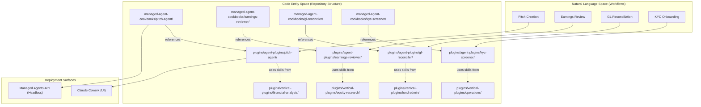
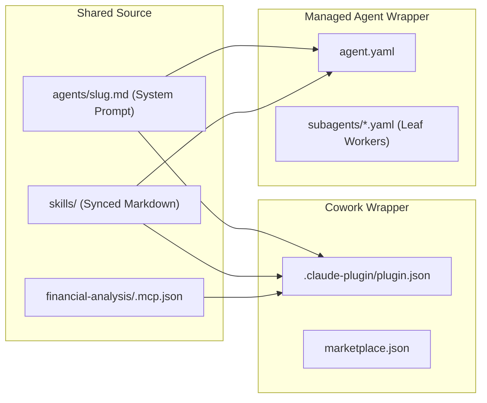

<!-- source: DeepWiki mcp.deepwiki.com · repo anthropics/financial-services · page 1 Overview · fetched 2026-10-26 -->

# Overview

Relevant source files

The following files were used as context for generating this wiki page:

- [.claude-plugin/marketplace.json](.claude-plugin/marketplace.json)
- [.github/workflows/plugin-validate.yml](.github/workflows/plugin-validate.yml)
- [CLAUDE.md](CLAUDE.md)
- [README.md](README.md)
- [plugins/vertical-plugins/financial-analysis/.mcp.json](plugins/vertical-plugins/financial-analysis/.mcp.json)

The `financial-services` repository is a comprehensive collection of reference agents, domain-specific skills, and data connectors tailored for high-stakes financial workflows including investment banking, equity research, private equity, and wealth management [[README.md:1-4]]().

The repository is designed around a **"one source, two wrappers"** principle: every agentic workflow is authored once and can be deployed either as a **Claude Cowork plugin** for interactive use or as a **Claude Managed Agent (CMA)** via the API for headless orchestration [[README.md:5-6]]().

## System Architecture

The codebase bridges high-level financial workflows (Natural Language Space) with structured execution (Code Entity Space). The following diagram illustrates how user-facing agents map to the underlying repository structure and deployment surfaces.

### Workflow to Code Mapping

**Sources:** [[CLAUDE.md:7-29]](), [[README.md:10-14]](), [[README.md:89-98]](), [[.claude-plugin/marketplace.json:50-90]]()

## Key Components

The repository is organized into four primary directories that separate domain logic from deployment configuration:

| Component | Directory | Description |
| :--- | :--- | :--- |
| **Agent Plugins** | `plugins/agent-plugins/` | Self-contained, workflow-specific bundles (e.g., `pitch-agent`) containing a canonical system prompt and synced skills [[CLAUDE.md:9-13]](). |
| **Vertical Plugins** | `plugins/vertical-plugins/` | The "source of truth" for domain skills, slash commands (e.g., `/comps`), and MCP data connectors [[CLAUDE.md:14-19]](). |
| **Partner Plugins** | `plugins/partner-built/` | Plugins authored by partners like LSEG and S&P Global for specific data terminal integrations [[README.md:42]](), [[.claude-plugin/marketplace.json:110-120]](). |
| **CMA Cookbooks** | `managed-agent-cookbooks/` | Templates for API deployment, including `agent.yaml` manifests and subagent (leaf-worker) definitions [[CLAUDE.md:21-26]](). |
| **Admin Tooling** | `claude-for-msft-365-install/` | Tooling for provisioning the Claude Microsoft 365 add-in in enterprise environments [[CLAUDE.md:27]](). |

### Deployment Surface Relationship
The relationship between Cowork and Managed Agents is governed by shared assets. The `agents/<slug>.md` file in an agent-plugin folder serves as the canonical system prompt for both surfaces [[CLAUDE.md:12]]().

**Sources:** [[CLAUDE.md:7-29]](), [[README.md:89-98]](), [[plugins/vertical-plugins/financial-analysis/.mcp.json:1-51]]()

## Development Workflow & Tooling

The repository includes a suite of Python scripts in `scripts/` to maintain consistency between the two deployment surfaces and validate the integrity of the plugins.

*   **`check.py`**: The primary linter. It verifies that all manifest references resolve and detects drift between `vertical-plugins/` (source) and `agent-plugins/` (bundles) [[CLAUDE.md:31]]().
*   **`sync-agent-skills.py`**: Propagates skill updates from the vertical source directories into the self-contained agent bundles [[CLAUDE.md:31]]().
*   **`deploy-managed-agent.sh`**: Resolves YAML manifests, uploads skills to the `/v1/skills` endpoint, and creates agents via the API [[README.md:81-85]]().
*   **`orchestrate.py`**: A reference event loop for handling `handoff_request` events between managed agents [[README.md:85]]().
*   **`plugin-validate.yml`**: A GitHub Action that runs the official Claude Code linter (`claude plugin validate`) over every plugin and the marketplace manifest [[.github/workflows/plugin-validate.yml:1-5]]().

For detailed setup instructions, see **[Getting Started](#1.1)**.
For a deep dive into the directory layout and design principles, see **[Repository Structure & Key Concepts](#1.2)**.

**Sources:** [[CLAUDE.md:31]](), [[README.md:45]](), [[README.md:81-85]](), [[.github/workflows/plugin-validate.yml:43-59]]()

---

