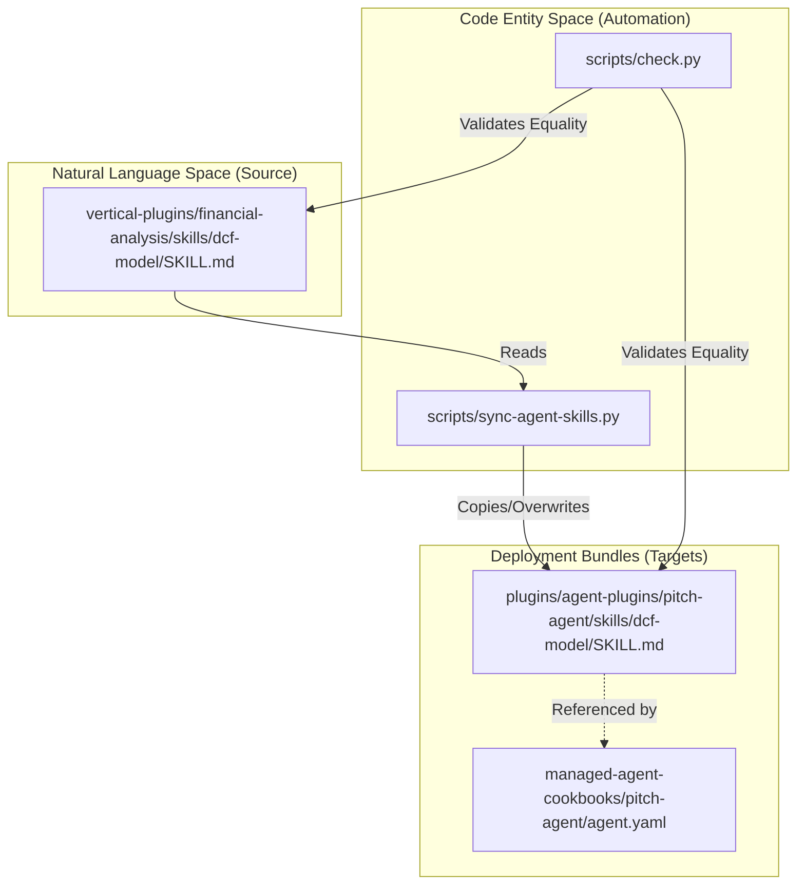
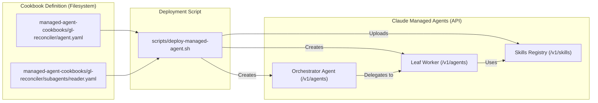

<!-- source: DeepWiki mcp.deepwiki.com · repo anthropics/financial-services · page 1.1 Getting Started · fetched 2026-10-26 -->

# Getting Started

<details>
<summary>Relevant source files</summary>

The following files were used as context for generating this wiki page:

- [CLAUDE.md](CLAUDE.md)
- [README.md](README.md)
- [plugins/vertical-plugins/financial-analysis/.mcp.json](plugins/vertical-plugins/financial-analysis/.mcp.json)
- [scripts/check.py](scripts/check.py)

</details>


This guide provides a step-by-step walkthrough for setting up the development environment, validating the repository state, and deploying agents across the two supported surfaces: **Claude Cowork** and **Claude Managed Agents (CMA)**.

The repository follows a "one source, two wrappers" design principle [README.md:3-5](), where core logic (prompts and skills) is authored once and packaged for different execution environments.

## Environment Setup

### 1. Clone the Repository
Clone the repository to your local machine to begin development.
```bash
git clone https://github.com/anthropics/financial-services.git
cd financial-services
```

### 2. Prerequisites
The repository primarily uses Python for linting, synchronization, and deployment scripts. Ensure you have Python 3.x installed.
*   **Dependencies**: The project minimizes external dependencies, focusing on standard Python libraries for scripts like `check.py` and `sync-agent-skills.py`. `check.py` requires `pyyaml` [scripts/check.py:53-57]().
*   **API Keys**: If deploying Managed Agents, you must export your Anthropic API key [README.md:81]().
    ```bash
    export ANTHROPIC_API_KEY=sk-ant-...
    ```

### 3. Local Development Workflow
The development workflow is centered around editing Markdown files (for prompts and skills) and JSON manifests [CLAUDE.md:44-46](). Changes take effect immediately in the "Natural Language Space" of the agents.

| Step | Action | Command |
| :--- | :--- | :--- |
| **1** | Edit Skills | Modify files in `plugins/vertical-plugins/<vertical>/skills/` [CLAUDE.md:31]() |
| **2** | Sync Agents | `python3 scripts/sync-agent-skills.py` [CLAUDE.md:31]() |
| **3** | Lint/Verify | `python3 scripts/check.py` [CLAUDE.md:31]() |

**Sources:** [CLAUDE.md:31-47](), [README.md:81-83](), [scripts/check.py:53-57]()

---

## Validation and Linting

Before committing changes or deploying, you must run the validation suite. The primary entry point is `scripts/check.py`.

### The `check.py` Script
This script performs the following critical checks:
1.  **Manifest Linting**: Validates `.claude-plugin/plugin.json` and `agent.yaml` structures [scripts/check.py:78-89]().
2.  **Reference Resolution**: Verifies that all file pointers (e.g., `system.file`, `skills.path`, `callable_agents.manifest`) exist on disk [scripts/check.py:109-140]().
3.  **Drift Detection**: Ensures that the bundled skills in `plugins/agent-plugins/<slug>/skills/` match their upstream sources in `plugins/vertical-plugins/` [scripts/check.py:142-160]().
4.  **Frontmatter Validation**: Checks that all agent Markdown files contain valid YAML frontmatter with `name` and `description` [scripts/check.py:91-105]().

`check.py` also self-installs a `.githooks` pre-commit hook by setting `core.hooksPath` [scripts/check.py:27-46](). This hook runs version bumping logic to automatically increment the patch version of modified plugins [CLAUDE.md:33]().

### Data Flow: Skill Synchronization
The following diagram illustrates how skills move from vertical domain libraries into self-contained agent bundles.

**Skill Propagation Logic**

**Sources:** [CLAUDE.md:8-29](), [CLAUDE.md:31-32](), [README.md:93-97](), [scripts/check.py:142-160]()

---

## Deploying to Claude Cowork

Cowork plugins allow users to interact with FSI tools directly within the Claude.com interface.

### Installation Methods
1.  **URL-based**: In Cowork, navigate to **Settings → Plugins → Add plugin** and paste the GitHub repository URL [README.md:52-54]().
2.  **Manual Upload**: Zip a specific directory (e.g., `plugins/agent-plugins/pitch-agent/`) and upload it via the "Upload a zip" option [README.md:55-56]().
3.  **Claude Code CLI**: Use the CLI to install specific plugins from the marketplace [README.md:59-61]():
    ```bash
    claude plugin marketplace add anthropics/financial-services
    claude plugin install financial-analysis@claude-for-financial-services
    ```
    [README.md:61-74]()

---

## Deploying Managed Agents

Managed Agents are deployed as headless entities via the Anthropic API using the templates in `managed-agent-cookbooks/` [CLAUDE.md:21](), [README.md:78-85]().

### Deployment Process
The `scripts/deploy-managed-agent.sh` script automates the transition from a local cookbook to a live API agent [README.md:82-85]().

1.  **Manifest Resolution**: Resolves the `agent.yaml` manifest which links the canonical system prompt and skills [CLAUDE.md:23](), [README.md:85]().
2.  **Skill Upload**: Uploads local Markdown skills to the `/v1/skills` endpoint [README.md:85]().
3.  **Subagent Creation**: Creates any "leaf-worker" subagents defined in the `subagents/` directory [CLAUDE.md:24](), [README.md:85]().
4.  **Orchestrator Provisioning**: POSTs the final agent configuration to the `/v1/agents` endpoint [README.md:85]().

### Managed Agent Architecture
This diagram bridges the cookbook definitions to the actual API entities created during deployment.

**Managed Agent Entity Mapping**

**Sources:** [CLAUDE.md:21-26](), [README.md:80-87](), [README.md:97](), [scripts/check.py:109-140]()

### Running the Agent
Once deployed, you can use `scripts/orchestrate.py` as a reference for the event loop. It handles `handoff_request` events to route communication between the orchestrator and its subagents [README.md:85]().

**Sources:** [CLAUDE.md:28](), [README.md:85]()

---

