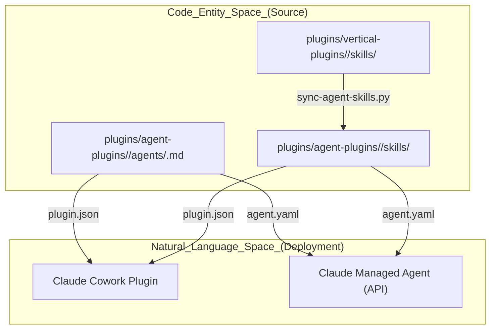
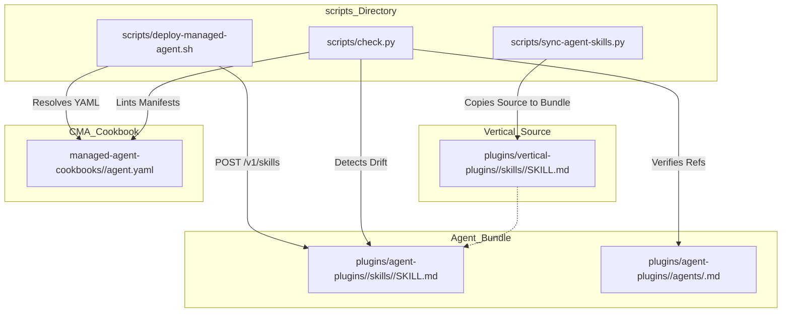

<!-- source: DeepWiki mcp.deepwiki.com · repo anthropics/financial-services · page 1.2 Repository Structure & Key Concepts · fetched 2026-10-26 -->

# Repository Structure & Key Concepts

Relevant source files

The following files were used as context for generating this wiki page:

- [.claude-plugin/marketplace.json](.claude-plugin/marketplace.json)
- [.github/workflows/plugin-validate.yml](.github/workflows/plugin-validate.yml)
- [CLAUDE.md](CLAUDE.md)
- [README.md](README.md)
- [plugins/vertical-plugins/financial-analysis/.mcp.json](plugins/vertical-plugins/financial-analysis/.mcp.json)

This page details the technical organization of the `financial-services` repository. It explains the design patterns used to maintain consistency across different deployment surfaces and the relationship between core domain logic and agentic workflows.

## Monorepo Layout

The repository is organized as a monorepo containing plugins, managed agent configurations, and deployment tooling. This structure ensures that domain-specific logic (skills) and agent personas (system prompts) remain synchronized regardless of whether they are deployed as Cowork plugins or Managed Agents.

### Directory Overview

| Directory | Purpose | Key Contents |
|-----------|---------|--------------|
| `plugins/` | The core logic layer containing all skill sources and agent definitions. | `vertical-plugins/`, `agent-plugins/`, `partner-built/` |
| `managed-agent-cookbooks/` | Configuration templates for deploying headless agents via the Claude Managed Agents (CMA) API. | `agent.yaml`, `subagents/`, `steering-examples.json` |
| `scripts/` | Tooling for validation, synchronization, and deployment. | `check.py`, `sync-agent-skills.py`, `deploy-managed-agent.sh` |
| `claude-for-msft-365-install/` | Administrative tooling for provisioning the Claude Microsoft 365 add-in. | Setup and manifest generation scripts. |

**Sources:** [CLAUDE.md:5-29](), [README.md:38-46]()

---

## The "One Source, Two Wrappers" Design Principle

A central architectural goal of this repository is to ensure that a single source of truth (the prompt and skill set) can be deployed to two different surfaces:
1.  **Claude Cowork:** Interactive, UI-driven plugins used directly within the Claude interface.
2.  **Claude Managed Agents (CMA):** Headless, API-driven agents deployed via `/v1/agents` for integration into custom enterprise workflows.

### Data Flow and Synchronization

The "Source of Truth" for any financial skill resides in `plugins/vertical-plugins/`. Agent-specific bundles in `plugins/agent-plugins/` contain **synced copies** of these skills.

#### Component Relationship Diagram
This diagram illustrates how code entities in the `plugins/` directory map to deployment artifacts.

**Sources:** [CLAUDE.md:3-13](), [README.md:5-13](), [README.md:91-98]()

---

## Plugin Categories

The repository distinguishes between three types of plugins, defined in `.claude-plugin/marketplace.json`.

### 1. Vertical Plugins (Skill Sources)
Located in `plugins/vertical-plugins/`, these are domain-specific libraries. They contain:
*   **Commands:** Slash actions (e.g., `/comps`, `/dcf`) found in `commands/*.md`. [CLAUDE.md:39-39]()
*   **Skills:** Detailed workflows found in `skills/*/SKILL.md`. [CLAUDE.md:40-40]()
*   **Connectors:** MCP (Model Context Protocol) configurations in `.mcp.json`. [CLAUDE.md:19-19]()

The `financial-analysis` plugin serves as the "Core Vertical," hosting the primary data connectors (FactSet, LSEG, etc.) and foundational modeling skills. [README.md:103-107](), [plugins/vertical-plugins/financial-analysis/.mcp.json:1-51]()

### 2. Agent Plugins (Bundled Agents)
Located in `plugins/agent-plugins/`, these are self-contained workflow agents (e.g., `pitch-agent`, `gl-reconciler`). Each agent bundles:
*   A canonical system prompt in `agents/<slug>.md`. [CLAUDE.md:12-12]()
*   A subset of skills copied from the vertical plugins to ensure the agent is "self-contained". [CLAUDE.md:13-13](), [README.md:19-19]()

### 3. Partner-Built Plugins
Located in `plugins/partner-built/`, these are authored by external partners like LSEG and S&P Global. They provide specialized financial data and analytics skills that integrate with the broader ecosystem. [.claude-plugin/marketplace.json:110-120]()

### 4. Managed Agent Cookbooks
Located in `managed-agent-cookbooks/`, these are not plugins themselves but templates for the Managed Agents API. They reference the `agent-plugins/` source code to define the agent's behavior and include:
*   `agent.yaml`: The manifest linking the system prompt and skills. [CLAUDE.md:23-23]()
*   `subagents/`: YAML definitions for "leaf workers"—specialized sub-agents that handle specific tasks like "untrusted document reading" or "model building". [CLAUDE.md:24-24]()

**Sources:** [.claude-plugin/marketplace.json:1-128](), [CLAUDE.md:8-26](), [README.md:15-34]()

---

## Implementation Details & Tooling

The repository relies on a set of Python scripts to maintain integrity across the monorepo.

### Dependency and Reference Graph
This diagram shows how the `scripts/` layer interacts with the repository structure to enforce the "One Source" principle.

### Key Functions of Tooling
*   **`check.py`**: Performs linting on manifests. It verifies that all `system.file`, `skills.path`, and `callable_agents.manifest` references in `agent.yaml` resolve to existing files. It also detects "drift" where a bundled skill in an agent-plugin differs from its source in a vertical-plugin. [CLAUDE.md:31-31]()
*   **`sync-agent-skills.py`**: The mechanism for propagation. Developers are instructed to **edit skills only in `vertical-plugins/`** and then run this script to update all agent bundles. [CLAUDE.md:31-32]()
*   **`deploy-managed-agent.sh`**: Handles the transition from the local file system to the Anthropic API. It resolves the YAML manifest into a JSON payload, uploads skills to the `/v1/skills` endpoint, and creates the orchestrator agent via `POST /v1/agents`. [README.md:85-85]()
*   **CI Validation**: The `.github/workflows/plugin-validate.yml` workflow runs the `claude plugin validate` command over every plugin and the `marketplace.json` manifest to catch malformed manifests before they reach users. [.github/workflows/plugin-validate.yml:1-65]()

**Sources:** [CLAUDE.md:31-32](), [README.md:45](), [README.md:80-85](), [.github/workflows/plugin-validate.yml:43-59]()

---

